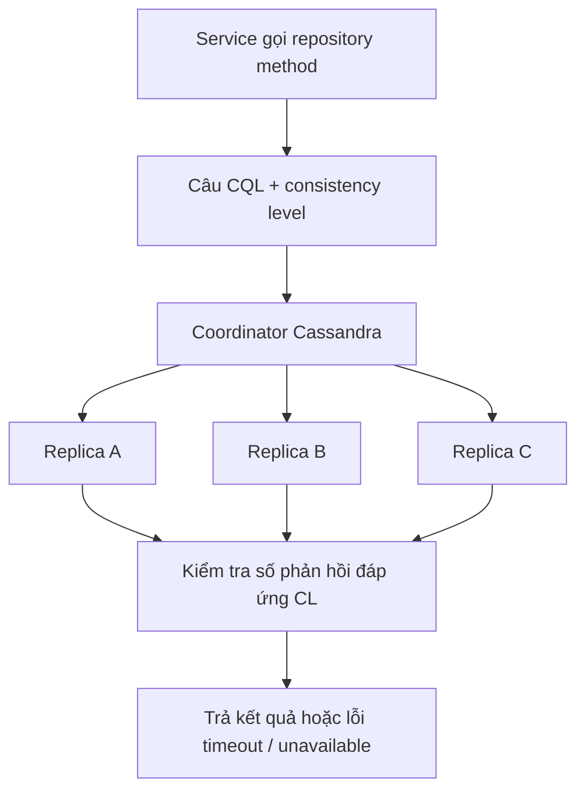

# @Consistency cho mức nhất quán của phương thức

Trong **Spring Data Cassandra**, một repository method có thể tạo CQL từ tên như `findByKeyTenantIdAndKeyDeviceIdAndKeyReadingDay(...)`, hoặc thực thi CQL khai báo qua `@Query`. Bên cạnh việc chọn **hàng nào cần đọc**, hệ thống phân tán còn phải quyết định **bao nhiêu replica cần phản hồi** trước khi coi thao tác là thành công. Đây là vai trò của *consistency level* (CL) trong Apache Cassandra.

Annotation **`@Consistency`** giúp khai báo CL tĩnh ngay trên **repository query method**. Nó không thay đổi partition key, không tạo transaction đa bảng, không tự điều chỉnh CL cho mọi lệnh ghi và không bảo đảm mọi phép đọc đều nhìn thấy dữ liệu mới nhất. Bài học trong chương **Truy vấn dẫn xuất** tập trung vào cách khai báo đúng, hiểu giới hạn bảo đảm, chọn CL phù hợp với use case và kiểm thử hành vi trên cluster thực tế.

Các ví dụ sử dụng Spring Data Cassandra kết hợp **Java Driver 4**. Ở các phiên bản Spring Data Cassandra hiện đại, annotation có tên đầy đủ `org.springframework.data.cassandra.repository.Consistency` và nhận enum `com.datastax.oss.driver.api.core.DefaultConsistencyLevel`. Dự án dùng Java Driver 3/Spring Data đời cũ có thể có package enum khác; không sao chép lẫn các phiên bản.

## 1. Consistency level là gì?

Cassandra phân phối dữ liệu của một partition đến nhiều **replica** theo replication strategy và replication factor (RF) của keyspace. Mỗi thao tác đọc/ghi có một **consistency level** chỉ định điều kiện phản hồi từ các replica để coordinator có thể trả kết quả thành công.

Ví dụ một keyspace có **RF = 3 trong cùng data center**:

- Với `LOCAL_ONE`, thao tác đọc cần một replica trong data center cục bộ phản hồi đủ điều kiện.
- Với `LOCAL_QUORUM`, thao tác cần đa số replica cục bộ: `floor(3 / 2) + 1 = 2`.
- Với `ALL`, cần phản hồi của tất cả replica liên quan; khả dụng thấp hơn nếu có replica gặp sự cố.

Khi ghi, Cassandra có thể gửi mutation đến các replica sở hữu dữ liệu; CL chủ yếu quyết định **số xác nhận cần đợi** trước khi trả thành công. Khi đọc, coordinator thường lấy đủ phản hồi theo CL, có thể thực hiện thêm công việc kiểm tra/đối chiếu replica tùy loại đọc và phiên bản.



Sơ đồ mang tính khái quát: coordinator không nhất thiết gửi một read request giống hệt đến cả ba replica ở mọi CL. Điểm cần nhớ là **CL là thuộc tính của thao tác CQL và topology**, không phải thuộc tính cố hữu của class entity.

## 2. `@Consistency` điều khiển phạm vi nào?

Trong Spring Data Cassandra, annotation được dùng như sau:

```java
import com.datastax.oss.driver.api.core.DefaultConsistencyLevel;
import org.springframework.data.cassandra.repository.Consistency;

@Consistency(DefaultConsistencyLevel.LOCAL_QUORUM)
```

Annotation này được đặt **trên phương thức truy vấn của repository**. Nó áp dụng CL được khai báo cho truy vấn được thực thi qua phương thức đó, bao gồm **derived query** và truy vấn CQL được khai báo bằng `@Query` trong phạm vi cơ chế repository query methods.

| Nơi khai báo / cách gọi | Có thể dùng `@Consistency` như ví dụ? | Cách kiểm soát cần biết |
| --- | --- | --- |
| `findBy...` là query method dẫn xuất | **Có** | Đặt annotation trên chính method |
| Repository query method mang `@Query` | **Có** | Có thể đặt `@Consistency` cùng `@Query` |
| Query method nhận `QueryOptions` | Có cơ chế tùy chọn động riêng | Truyền consistency trong `QueryOptions`, không cần annotation tĩnh |
| `CassandraRepository.save(...)` kế thừa từ CRUD API | Không nên giả định annotation trên một finder điều khiển thao tác này | Cấu hình write options/driver phù hợp |
| `CassandraTemplate`, `CqlTemplate`, `CqlSession` được gọi trực tiếp | **Không**, annotation trên repository khác không lan sang | Cấu hình options của template/driver/statement |
| Cả interface repository | Không phải nơi đặt `@Consistency` trực tiếp như một annotation cấp type | Khai báo cho từng query method cần khác mặc định |

Nói cách khác, `@Consistency` là **cấu hình theo phương thức truy vấn**, không phải công tắc biến cả ứng dụng thành chế độ nhất quán mạnh. Khi một service gọi một phương thức repository và sau đó gọi template, hai lời gọi có thể mang CL khác nhau.

Nếu không chỉ định CL qua annotation hoặc query options, thao tác sử dụng **các giá trị mặc định hiện hành** từ tầng Spring Data CQL API, execution profile hoặc cấu hình Java Driver tùy đường gọi. Không nên mặc định mọi môi trường đều đang dùng `LOCAL_QUORUM`; hãy kiểm tra cấu hình thực tế.

## 3. Ví dụ bảng Cassandra theo access pattern

Ứng dụng lưu số đo thiết bị theo tenant, thiết bị và ngày UTC:

```sql
CREATE TABLE readings_by_device_day (
    tenant_id     text,
    device_id     text,
    reading_day   date,
    reading_time  timeuuid,
    temperature_c decimal,
    PRIMARY KEY ((tenant_id, device_id, reading_day), reading_time)
) WITH CLUSTERING ORDER BY (reading_time DESC);
```

Schema có **partition key ghép** `(tenant_id, device_id, reading_day)` và **clustering column** `reading_time`. Hai yêu cầu đọc thực tế:

1. Dashboard lấy các số đo gần đây của một thiết bị trong một ngày, có thể chấp nhận một số độ trễ đồng bộ nhỏ.
2. Màn hình điều tra cần đọc lại dữ liệu với mức nhất quán cao hơn để giảm nguy cơ thấy trạng thái replica cũ sau một thao tác ghi đã được xác nhận.

Một truy vấn có phạm vi rõ ràng:

```sql
SELECT tenant_id, device_id, reading_day,
       reading_time, temperature_c
FROM readings_by_device_day
WHERE tenant_id = ?
  AND device_id = ?
  AND reading_day = ?;
```

**Cần đủ ba thành phần partition key** để truy vấn một partition. `@Consistency` không cho phép bỏ `device_id` hoặc `reading_day` rồi yêu cầu Cassandra tự dò toàn bộ dữ liệu của tenant. Mức nhất quán và tính hợp lệ của điều kiện `WHERE` là **hai vấn đề độc lập**.

## 4. Ánh xạ entity có khóa ghép

Sử dụng `@PrimaryKeyClass` để mô tả đủ primary key của bảng:

```java
import java.io.Serializable;
import java.time.LocalDate;
import java.util.UUID;
import org.springframework.data.cassandra.core.cql.Ordering;
import org.springframework.data.cassandra.core.mapping.PrimaryKeyClass;
import org.springframework.data.cassandra.core.mapping.PrimaryKeyColumn;
import org.springframework.data.cassandra.core.mapping.PrimaryKeyType;

@PrimaryKeyClass
public class ReadingKey implements Serializable {
    @PrimaryKeyColumn(name = "tenant_id", ordinal = 0,
            type = PrimaryKeyType.PARTITIONED)
    private String tenantId;

    @PrimaryKeyColumn(name = "device_id", ordinal = 1,
            type = PrimaryKeyType.PARTITIONED)
    private String deviceId;

    @PrimaryKeyColumn(name = "reading_day", ordinal = 2,
            type = PrimaryKeyType.PARTITIONED)
    private LocalDate readingDay;

    @PrimaryKeyColumn(name = "reading_time", ordinal = 3,
            type = PrimaryKeyType.CLUSTERED,
            ordering = Ordering.DESCENDING)
    private UUID readingTime;

    public ReadingKey() {}

    // Cần triển khai constructor, getters/setters,
    // equals() và hashCode() theo đủ bốn thành phần khóa.
}
```

```java
import java.math.BigDecimal;
import org.springframework.data.cassandra.core.mapping.Column;
import org.springframework.data.cassandra.core.mapping.PrimaryKey;
import org.springframework.data.cassandra.core.mapping.Table;

@Table("readings_by_device_day")
public class DeviceReading {
    @PrimaryKey
    private ReadingKey key;

    @Column("temperature_c")
    private BigDecimal temperatureC;

    public DeviceReading() {}

    // Cần triển khai constructor và getters/setters.
}
```

Đây là hai **khung lớp mapping**, không phải ví dụ source hoàn chỉnh có thể biên dịch độc lập: các phương thức được ghi chú cần được bổ sung. `UUID` của `reading_time` phải đúng dạng `timeuuid` khi ghi; không dùng `UUID.randomUUID()` (UUID v4) như một thay thế tự động cho timeuuid.

Đặt thời gian vào clustering column hỗ trợ sắp xếp **trong từng partition**. Nếu API đọc qua nhiều ngày, service phải điều phối nhiều partition, dù CL được khai báo là gì.

## 5. Gắn `@Consistency` cho derived query method

Một repository có thể khai báo CL khác nhau cho hai trường hợp đọc:

```java
import java.time.LocalDate;
import java.util.List;
import com.datastax.oss.driver.api.core.DefaultConsistencyLevel;
import org.springframework.data.cassandra.repository.CassandraRepository;
import org.springframework.data.cassandra.repository.Consistency;

public interface DeviceReadingRepository
        extends CassandraRepository<DeviceReading, ReadingKey> {

    @Consistency(DefaultConsistencyLevel.LOCAL_ONE)
    List<DeviceReading> findByKeyTenantIdAndKeyDeviceIdAndKeyReadingDay(
            String tenantId, String deviceId, LocalDate readingDay);
}
```

Ở derived method, Spring Data phân tích tên `findByKeyTenantIdAndKeyDeviceIdAndKeyReadingDay` thành đường thuộc tính `key.tenantId`, `key.deviceId`, `key.readingDay`. Vì ba thuộc tính đó tạo đủ partition key, query dự kiến tương ứng với:

```sql
SELECT * FROM readings_by_device_day
WHERE tenant_id = ?
  AND device_id = ?
  AND reading_day = ?;
```

Method này dùng CL `LOCAL_ONE`. **Tên phương thức quyết định điều kiện dữ liệu, annotation quyết định tùy chọn nhất quán.** Câu CQL không tự chứa từ khóa `LOCAL_ONE`; driver gắn CL vào phần tùy chọn thực thi của statement.

Khi cần hai mức CL tĩnh cho cùng đường đọc, nên tạo hai phương thức có **tên nghiệp vụ khác nhau**, chẳng hạn `findRecentForDashboard` và `findRecentForInvestigation`, thay vì lạm dụng overload có cùng tên. Ví dụ `@Query` ở phần tiếp theo cho thấy cách diễn đạt tường minh.

## 6. Kết hợp `@Query` và `@Consistency` trên cùng method

Khi muốn giới hạn rõ số hàng và mô tả mục đích của từng đường đọc, có thể viết CQL tường minh:

```java
import java.time.LocalDate;
import java.util.List;
import com.datastax.oss.driver.api.core.DefaultConsistencyLevel;
import org.springframework.data.cassandra.repository.CassandraRepository;
import org.springframework.data.cassandra.repository.Consistency;
import org.springframework.data.cassandra.repository.Query;

public interface ReadingFeedRepository
        extends CassandraRepository<DeviceReading, ReadingKey> {

    @Consistency(DefaultConsistencyLevel.LOCAL_ONE)
    @Query("SELECT * FROM readings_by_device_day " +
           "WHERE tenant_id = ?0 AND device_id = ?1 " +
           "AND reading_day = ?2 LIMIT 20")
    List<DeviceReading> findRecentForDashboard(
            String tenantId, String deviceId, LocalDate readingDay);

    @Consistency(DefaultConsistencyLevel.LOCAL_QUORUM)
    @Query("SELECT * FROM readings_by_device_day " +
           "WHERE tenant_id = ?0 AND device_id = ?1 " +
           "AND reading_day = ?2 LIMIT 20")
    List<DeviceReading> findRecentForInvestigation(
            String tenantId, String deviceId, LocalDate readingDay);
}
```

Cả hai methods dùng **cùng bảng, cùng điều kiện và `LIMIT 20`**, nhưng yêu cầu CL khác nhau:

- `findRecentForDashboard`: ưu tiên chi phí và khả dụng của đường đọc local khi nghiệp vụ chấp nhận khả năng đọc bản replica chưa kịp hội tụ.
- `findRecentForInvestigation`: yêu cầu đa số replica ở data center cục bộ phản hồi, có thể tăng độ trễ hoặc tỷ lệ lỗi khi cluster suy giảm.

`LIMIT 20` chỉ giới hạn số bản ghi trả về; nó không thay thế **page size** của driver, không bảo đảm trang tiếp theo và không thay đổi điều kiện đủ partition key. Các phương thức vẫn phải chạy trên keyspace/schema đúng với entity.

Trong code thật, nên chọn một chính sách CL có cơ sở từ **SLA, topology và cách ghi**, thay vì thêm annotation ngẫu nhiên để “truy vấn có vẻ chắc chắn hơn”.

## 7. Mức nhất quán tĩnh và `QueryOptions` động

Tài liệu Spring Data Cassandra cho phép query method nhận một tham số đặc biệt `QueryOptions`. Tham số này không được coi là giá trị trong điều kiện `WHERE`; nó cung cấp **query execution options**.

Ví dụ method **không dùng `@Consistency`** để caller quyết định CL:

```java
import java.time.LocalDate;
import java.util.List;
import org.springframework.data.cassandra.core.cql.QueryOptions;
import org.springframework.data.cassandra.repository.CassandraRepository;

public interface ConfigurableReadingRepository
        extends CassandraRepository<DeviceReading, ReadingKey> {

    List<DeviceReading> findByKeyTenantIdAndKeyDeviceIdAndKeyReadingDay(
            String tenantId, String deviceId, LocalDate readingDay,
            QueryOptions options);
}
```

Ví dụ service tạo tùy chọn:

```java
import java.time.LocalDate;
import java.util.List;
import com.datastax.oss.driver.api.core.DefaultConsistencyLevel;
import org.springframework.data.cassandra.core.cql.QueryOptions;

public List<DeviceReading> loadReadings(
        ConfigurableReadingRepository repository,
        String tenantId, String deviceId, LocalDate day) {

    QueryOptions options = QueryOptions.builder()
            .consistencyLevel(DefaultConsistencyLevel.LOCAL_QUORUM)
            .pageSize(100)
            .build();

    return repository
            .findByKeyTenantIdAndKeyDeviceIdAndKeyReadingDay(
                    tenantId, deviceId, day, options);
}
```

Ở ví dụ này:

- `consistencyLevel(...)` chỉ định CL **cho lần gọi**.
- `pageSize(100)` điều chỉnh kích thước mỗi lần lấy hàng của driver, **không giới hạn tổng số hàng**. Để tránh tải dữ liệu không giới hạn, cần `LIMIT` hoặc hợp đồng phân trang rõ ràng.
- Những giá trị `tenantId`, `deviceId`, `day` vẫn phải chỉ đến một partition hợp lệ.

**Đừng trộn `@Consistency` tĩnh với `QueryOptions` động trên cùng method rồi giả định quy tắc ghi đè cố định** nếu chưa kiểm tra chính xác phiên bản Spring Data Cassandra đang dùng. Tách method có CL cố định và method có CL do service quyết định giúp code dễ xem xét và kiểm thử hơn.

## 8. LOCAL_ONE và LOCAL_QUORUM trong thực tế

Giả sử keyspace dùng `NetworkTopologyStrategy` với RF cục bộ = 3. Đọc cùng partition đã được ghi ở data center đó:

| Read CL | Replica cục bộ cần đáp ứng | Lợi thế thường thấy | Giới hạn |
| --- | ---: | --- | --- |
| `LOCAL_ONE` | 1 | Latency thấp và yêu cầu ít phản hồi hơn | Có thể đọc phiên bản cũ khi replica chưa hội tụ |
| `LOCAL_QUORUM` | 2 | Có thể giao với tập replica ghi quorum, giảm rủi ro đọc cũ | Cần nhiều replica khỏe hơn; có thể timeout/unavailable |
| `ALL` | 3 trong ví dụ một DC | Chờ mọi replica cần thiết | Dễ thất bại khi một replica không sẵn sàng |

Đây là **nguyên lý chọn mức đáp ứng**, không phải cam kết số mili-giây hay throughput. Trong cluster nhiều data center, `LOCAL_QUORUM` được tính **trong data center của coordinator**, không tương đương với `QUORUM` trên tập replica toàn cluster.

### 8.1. Đọc sau ghi phải xét cả write CL

Một quy tắc quen thuộc với các replica trong cùng phạm vi là:

\[
R + W > RF
\]

Trong đó `R` là số replica phản hồi đọc, `W` là số replica xác nhận ghi, và `RF` là replication factor tương ứng. Nếu RF cục bộ = 3:

| Write CL | Read CL | R + W | Diễn giải |
| --- | --- | ---: | --- |
| `LOCAL_QUORUM` (2) | `LOCAL_QUORUM` (2) | 4 > 3 | Có giao giữa hai tập quorum cục bộ |
| `LOCAL_ONE` (1) | `LOCAL_QUORUM` (2) | 3 = 3 | Không có bảo đảm giao chỉ từ phép đếm |
| `LOCAL_QUORUM` (2) | `LOCAL_ONE` (1) | 3 = 3 | Không có bảo đảm giao chỉ từ phép đếm |
| `LOCAL_ONE` (1) | `LOCAL_ONE` (1) | 2 < 3 | Dễ gặp trường hợp replica đọc chưa có ghi mới |

**Điều kiện quorum intersection** giúp lập luận về một thao tác ghi đã được xác nhận và một lần đọc tiếp theo trong cùng data center, khi không có cập nhật/xóa đồng thời phức tạp. Nó không biến Cassandra thành hệ thống transaction ACID tuyến tính hóa mọi thao tác trên nhiều partition. Với cạnh tranh cập nhật, timestamp ghi, dữ liệu đi qua nhiều data center hoặc điều kiện nghiệp vụ kiểu “chỉ tạo nếu chưa tồn tại”, cần phân tích sâu hơn và có thể cần **lightweight transaction (LWT)**.

### 8.2. Chọn CL từ yêu cầu nghiệp vụ

- **Dashboard/số liệu có thể chậm vài giây:** `LOCAL_ONE` có thể phù hợp nếu API chấp nhận khả năng chưa thấy một số cập nhật mới.
- **Đọc ngay sau một write quorum trong cùng DC:** `LOCAL_QUORUM` cho cả read và write có ý nghĩa rõ hơn khi muốn tập replica phản hồi giao nhau.
- **Luồng duyệt/đối soát nhạy cảm:** cần đánh giá thêm ràng buộc nghiệp vụ, độ trễ cho phép, idempotency và cơ chế kiểm tra dữ liệu; chỉ tăng CL không giải quyết mọi vấn đề.
- **Hệ nhiều data center:** xem xét replica, local DC mà driver đang dùng và cách đồng bộ giữa DC; đừng suy ra một `LOCAL_QUORUM` ở DC A đồng nghĩa dữ liệu đã đến mọi replica ở DC B.

**Consistency cao hơn không đồng nghĩa “luôn tốt hơn”.** Nó có thể làm giảm khả dụng khi nhiều replica cục bộ gặp sự cố; API có SLA chặt đôi khi cần CL thấp hơn và cơ chế phục hồi dữ liệu ở tầng nghiệp vụ.

## 9. Những gì `@Consistency` không giải quyết được

### 9.1. Không sửa truy vấn thiếu partition key

Ví dụ CQL sau **không phù hợp** với bảng `readings_by_device_day`:

```sql
-- Thiếu tenant_id và reading_day trong partition key ghép.
SELECT * FROM readings_by_device_day
WHERE device_id = ?;
```

Đặt `@Consistency(DefaultConsistencyLevel.LOCAL_QUORUM)` lên method sinh query này **không tạo ra một đường đọc hợp lệ/hiệu quả**. Giải pháp là thiết kế bảng theo access pattern, truyền đủ khóa hoặc một read model phù hợp, không phải tăng CL hay dùng `ALLOW FILTERING` tùy tiện.

### 9.2. Không tự cấu hình CL cho tất cả thao tác ghi

Một service có thể thực hiện:

```java
repository.save(reading);
repository.findByKeyTenantIdAndKeyDeviceIdAndKeyReadingDay(
        tenantId, deviceId, readingDay);
```

Nếu chỉ annotate **query method đọc**, không được kết luận lời gọi `save(...)` thừa hưởng cùng CL. Với đường ghi, cần cấu hình write options hoặc các tầng truy cập có hỗ trợ CL ghi; đồng thời xác minh cơ chế được áp dụng thực tế trên phiên bản thư viện.

Ví dụ Java Driver 4 đặt CL trực tiếp trên bound statement ghi:

```java
import com.datastax.oss.driver.api.core.DefaultConsistencyLevel;
import com.datastax.oss.driver.api.core.cql.BoundStatement;
import com.datastax.oss.driver.api.core.cql.PreparedStatement;

// preparedInsert là PreparedStatement của một lệnh INSERT hợp lệ.
BoundStatement write = preparedInsert.bind(
        tenantId, deviceId, readingDay, readingTime, temperatureC)
        .setConsistencyLevel(DefaultConsistencyLevel.LOCAL_QUORUM);

// session.execute(write);
```

Ví dụ giả định câu INSERT đã được chuẩn bị, đúng thứ tự cột và kiểu bind; `readingTime` phải là UUID loại timeuuid hợp lệ. Mục đích là minh họa **CL của statement ghi**, không yêu cầu mọi repository phải bỏ qua Spring Data để dùng driver trực tiếp.

### 9.3. Không bảo đảm snapshot xuyên nhiều partition

Nếu một request tổng hợp số liệu 30 ngày, service có thể phải truy vấn 30 partition. Mỗi truy vấn `LOCAL_QUORUM` chỉ điều chỉnh điều kiện phản hồi replica **cho chính thao tác ấy**; nó không cấp một snapshot thời điểm thống nhất cho cả 30 partition. Dữ liệu mới phát sinh giữa các lần đọc có thể khiến kết quả phản ánh những thời điểm khác nhau.

### 9.4. Không thay thế cơ chế LWT/serial consistency

Với bài toán “chỉ tạo bản ghi nếu chưa tồn tại”, cần xem xét CQL `IF NOT EXISTS` và **lightweight transaction** phù hợp. Các mức `SERIAL`/`LOCAL_SERIAL` liên quan tới pha đồng thuận của conditional write; không dùng chúng như mức đọc thông thường để thay thế `LOCAL_QUORUM`. `@Consistency` trên finder không tự biến một chuỗi `read → check → write` thành thao tác nguyên tử.

## 10. Lỗi timeout, unavailable và not found là các trạng thái khác nhau

Một repository method có thể kết thúc theo các cách:

| Kết quả | Ý nghĩa | Cách xử lý |
| --- | --- | --- |
| Có danh sách hàng | Truy vấn thành công theo CL và điều kiện đã chọn | Xử lý dữ liệu theo nghiệp vụ |
| Danh sách rỗng / không tìm thấy | Truy vấn thực thi thành công, không có hàng phù hợp ở trạng thái quan sát được | Trả kết quả rỗng hoặc 404 theo API, nếu hợp đồng yêu cầu |
| Unavailable | Không có đủ replica đáp ứng yêu cầu CL vào lúc thực hiện | Quan sát sức khỏe cluster, topology, CL |
| Read timeout | Không nhận đủ kết quả/phản hồi cần thiết trong thời hạn | Giám sát độ trễ, node, tài nguyên và chính sách retry |
| Lỗi CQL/mapping | Cột/bảng không tồn tại, điều kiện khóa sai hoặc kiểu dữ liệu không phù hợp | Sửa schema/query/mapping, không phải hạ CL để che lỗi |

**Không bắt mọi exception rồi trả danh sách rỗng.** Khi `LOCAL_QUORUM` không đủ replica, điều đó không chứng minh dữ liệu không tồn tại; phản hồi rỗng sẽ che giấu sự cố và có thể dẫn tới quyết định nghiệp vụ sai.

Thay đổi CL để “chữa” timeout mà không có phân tích sẽ làm thay đổi hợp đồng tính nhất quán. Nếu phải hạ từ `LOCAL_QUORUM` xuống `LOCAL_ONE` trong chế độ suy giảm, cần ghi rõ yêu cầu nghiệp vụ, kiểm soát phạm vi và cách người dùng biết dữ liệu có thể cũ.

## 11. Kiểm chứng annotation và thử nghiệm trên Cassandra thật

Một bài test chỉ kiểm tra phương thức có annotation bằng reflection **chưa đủ** để chứng minh driver thực thi câu CQL với CL đã khai báo. Nên có kiểm thử tích hợp và quan sát thực tế:

1. Tạo keyspace với replication factor đúng mục tiêu; chuẩn bị bảng `readings_by_device_day`.
2. Tạo `CqlSession` và repository từ cấu hình ứng dụng giống môi trường thật; không mock toàn bộ tầng truy cập.
3. Ghi một số hàng test, gọi hai methods có `LOCAL_ONE` và `LOCAL_QUORUM`, xác nhận dữ liệu trả về đúng partition.
4. Bật quan sát truy vấn/statement metadata hoặc tracing có kiểm soát để xác nhận CL được áp dụng. Tracing có overhead, không bật đại trà trên production.
5. Thử tình huống node chậm/không sẵn sàng trong môi trường **được phép gây lỗi**, xác nhận hành vi timeout/unavailable thay vì thử nghiệm phá cluster production.
6. Kiểm tra đường ghi dùng CL nào; chỉ đánh giá read-after-write sau khi biết cả hai phía.
7. Kiểm tra truy vấn đi qua nhiều bucket và giới hạn số hàng, xem chính xác **bao nhiêu partition** được đọc.

Trong một test kết hợp `@Consistency` và `QueryOptions`, hãy xác định rõ chính sách ưu tiên của phiên bản thư viện; tránh phụ thuộc vào suy đoán khi cả hai cùng xuất hiện. Với nhiều ứng dụng/module dùng chung cluster, cần kiểm tra cả những đường đọc không đi qua repository method được annotate.

## 12. Checklist chọn CL theo phương thức

1. **Nêu hợp đồng nhất quán:** API có chấp nhận dữ liệu cũ không? Cần đọc ngay sau write nào, ở data center nào?
2. **Đo topology:** replication strategy, RF theo data center, local DC của driver và tình trạng replica.
3. **Thiết kế query hợp lệ:** đủ partition key và giới hạn kết quả; CL không thay thế schema/query design.
4. **Chọn static hoặc dynamic:** `@Consistency` cho method có CL cố định; `QueryOptions` cho method nhận tùy chọn được service kiểm soát.
5. **Kiểm tra write CL:** không dựa vào một finder annotation để suy ra mức ghi.
6. **Phân biệt mức thông thường với serial:** LWT có cơ chế và chi phí riêng.
7. **Thiết kế lỗi:** không gộp timeout/unavailable vào “không tìm thấy”; retry có giới hạn và chỉ khi an toàn.
8. **Quan sát trade-off:** p50/p95/p99, tỷ lệ lỗi, read repair, tải node và latency ở các CL khác nhau.
9. **Kiểm thử phiên bản thật:** package của `@Consistency`/`DefaultConsistencyLevel`, cách tạo query và thứ tự áp dụng options cần khớp Spring Data/driver đang dùng.

## 13. Bài tập tình huống

**Bài tập A.** Một query method có `@Consistency(DefaultConsistencyLevel.LOCAL_QUORUM)` và hoàn toàn không cung cấp `device_id`, trong khi partition key là `(tenant_id, device_id, reading_day)`. Truy vấn có tự hợp lệ hơn vì CL cao không?

**Đáp án:** Không. CL chỉ quy định mức phản hồi replica cho thao tác, không sửa điều kiện partition key. Cần đưa đủ khóa hoặc thiết kế read model khác.

**Bài tập B.** Ở một data center có RF=3, writer ghi `LOCAL_ONE`, reader đọc `LOCAL_QUORUM`. Có thể khẳng định luôn thấy write mới dựa vào quorum không?

**Đáp án:** Không. Với `W=1`, `R=2`, ta có `R+W=3`, không lớn hơn RF=3; không có bảo đảm giao giữa hai tập replica chỉ từ phép đếm.

**Bài tập C.** Dashboard thường chấp nhận dữ liệu trễ, nhưng trang đối soát cần độ mới cao hơn. Có cần đặt cùng một CL cho mọi query method của repository không?

**Đáp án:** Không nhất thiết. Có thể dùng `@Consistency(LOCAL_ONE)` cho đường đọc dashboard và `@Consistency(LOCAL_QUORUM)` cho đường đọc đối soát, nhưng phải xem CL ghi và yêu cầu business trước.

**Bài tập D.** Repository `findBy...` có `@Consistency(LOCAL_QUORUM)`, sau đó service gọi `CqlTemplate` để đọc một bảng phụ. Có chắc lệnh template cũng dùng `LOCAL_QUORUM`?

**Đáp án:** Không. Annotation của repository query method không lan sang lời gọi template độc lập; template/driver cần có cấu hình CL riêng.

**Bài tập E.** Một ứng dụng bắt `ReadTimeoutException` rồi trả `Optional.empty()` vì cho rằng “không có kết quả”. Điều gì sai?

**Đáp án:** Timeout nghĩa là không hoàn tất đọc theo điều kiện yêu cầu, không phải dữ liệu không tồn tại. Phải phân loại sự cố và xử lý lỗi phù hợp, không làm sai trạng thái nghiệp vụ.

## Kết luận

**`@Consistency`** trong Spring Data Cassandra là cách khai báo **mức nhất quán tĩnh cho từng repository query method**, kể cả derived query và method có `@Query`. `LOCAL_ONE` và `LOCAL_QUORUM` điều khiển số replica cục bộ cần phản hồi, tạo ra đánh đổi giữa **độ mới quan sát được, độ trễ và tính khả dụng**. Muốn đánh giá đọc sau ghi, phải hiểu **cả read CL lẫn write CL**, replication factor và data center liên quan.

Hãy đi theo trình tự **xác định query contract → thiết kế partition key → chọn CL theo nghiệp vụ và topology → khai báo annotation/options → kiểm thử trên Cassandra thật → quan sát lỗi và hiệu năng**. Không dùng `@Consistency` như giải pháp thay cho thiết kế bảng theo truy vấn, validation, paging, LWT hoặc xử lý dữ liệu phân tán đúng cách.

### Tham khảo

- Spring Data Cassandra — [Cassandra-specific Query Methods](https://docs.spring.io/spring-data/cassandra/reference/cassandra/repositories/query-methods.html), phần *Query Options* và `@Consistency`.
- Spring Data Cassandra — [API annotation `Consistency`](https://docs.spring.io/spring-data/cassandra/docs/current/api/org/springframework/data/cassandra/repository/Consistency.html).
- Apache Cassandra — [Dynamo / Tunable Consistency](https://cassandra.apache.org/doc/latest/cassandra/architecture/dynamo.html), giải thích `LOCAL_ONE`, `LOCAL_QUORUM` và quan hệ `R + W > RF`.
