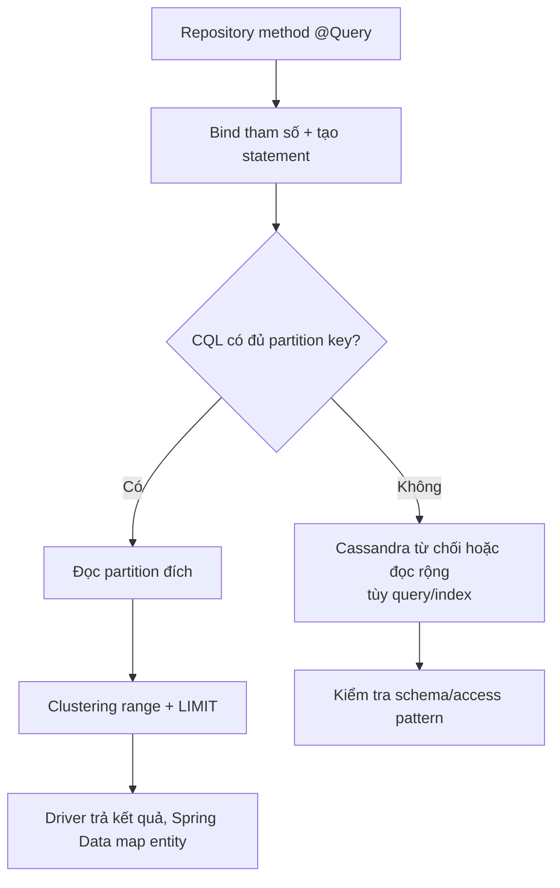

# Khai báo CQL tường minh trên phương thức repository

**Spring Data Cassandra** cho phép viết repository method bằng tên suy diễn, chẳng hạn `findByCustomerIdAndOrderMonth(...)`. Nhưng không phải truy vấn nghiệp vụ nào cũng được diễn tả rõ ràng bằng tên method: có truy vấn giới hạn khoảng thời gian, chọn danh sách cột cụ thể, sắp theo clustering order hoặc cần tối ưu CQL theo một access pattern đã được thiết kế.

Annotation **`@Query`** của package `org.springframework.data.cassandra.repository` cho phép đặt **CQL tường minh ngay trên phương thức repository**, để Spring Data gắn tham số từ Java method và ánh xạ kết quả trả về. Đây là cơ chế khai báo truy vấn trực tiếp; **không phải JPQL/JPA Query**, không dùng entity name như tên bảng nếu CQL không có bảng đó, và không tự tạo index hay thay đổi quy tắc truy vấn của Apache Cassandra.

Trong module **SPRING_DATA_CASSANDRA**, chủ đề này nối giữa entity mapping, repository, `CassandraTemplate`, bind parameters và thiết kế bảng theo truy vấn. Một `@Query` tốt phải giải quyết đồng thời hai vấn đề: **đúng Java/Spring Data API** và **đúng CQL/partition key trên hệ dữ liệu phân tán**.

> Các ví dụ dùng phong cách Spring Data Cassandra **4.5.x**, Apache Cassandra có hỗ trợ CQL chuẩn tương ứng và Java 17+. Nếu dự án dùng bản khác, cần kiểm tra API và dependency thực.

## 1. Mục tiêu học tập

Sau bài này, bạn có thể:

1. Chọn đúng `@Query` của **Spring Data Cassandra**, phân biệt với `@Query` của JPA.
2. Viết CQL `SELECT` tường minh trên repository method và bind tham số bằng `?0`, `?1`.
3. Thiết kế phương thức trả `List<T>`, `Optional<T>` hoặc `Slice<T>` phù hợp số lượng kết quả.
4. Viết truy vấn đọc trong một **partition** và lọc theo **clustering columns**, không lạm dụng `ALLOW FILTERING`.
5. Phân biệt query khai báo tường minh, derived query, `CassandraTemplate` và `CqlSession`.
6. Hiểu cách dùng `@Consistency`, `QueryOptions`, `@Query(idempotent = ...)` khi phù hợp.
7. Kiểm tra câu CQL qua cqlsh và integration test, xử lý lỗi tên cột, marker, mapping và performance.
8. Giải thích vì sao `@Query` không thay thế partition-aware data modeling, consistency hay paging.

## 2. Bối cảnh: ứng dụng cần đọc đơn hàng theo khách và tháng

Giả sử một ứng dụng bán hàng cần hai API:

- **Danh sách:** lấy tối đa 20 đơn gần nhất của một khách trong một tháng.
- **Khoảng thời gian:** lấy đơn của cùng khách/tháng trong khoảng thời gian xác định.

Cả hai truy vấn đều biết `customer_id` và `order_month`. Vì Cassandra định tuyến dữ liệu theo partition key, chúng ta chủ động chọn composite partition key `(customer_id, order_month)` và clustering columns `created_at`, `order_id`.

### 2.1. Schema CQL

Chạy trong `cqlsh` của **môi trường thực hành riêng**:

```sql
CREATE KEYSPACE IF NOT EXISTS sdc_query_lab
WITH replication = {
    'class': 'SimpleStrategy',
    'replication_factor': 1
};

CREATE TABLE IF NOT EXISTS sdc_query_lab.orders_by_customer_month (
    customer_id uuid,
    order_month text,
    created_at timestamp,
    order_id uuid,
    status text,
    total decimal,
    PRIMARY KEY (
        (customer_id, order_month),
        created_at,
        order_id
    )
) WITH CLUSTERING ORDER BY (created_at DESC, order_id ASC);
```

`SimpleStrategy` với RF=1 chỉ dành cho lab một node; production nhiều datacenter thường cần `NetworkTopologyStrategy` cùng chiến lược replication/consistency được đánh giá riêng.

Đọc cấu trúc bảng:

```sql
DESCRIBE TABLE sdc_query_lab.orders_by_customer_month;
```

| Cột | Kiểu CQL | Vai trò |
|---|---|---|
| `customer_id` | `uuid` | Partition key, phần 1 |
| `order_month` | `text` | Partition key, phần 2 |
| `created_at` | `timestamp` | Clustering column thứ nhất, giảm dần |
| `order_id` | `uuid` | Clustering column thứ hai, tăng dần |
| `status` | `text` | Regular column |
| `total` | `decimal` | Regular column |

**Primary key đầy đủ** là `((customer_id, order_month), created_at, order_id)`. Một khách có đơn ở nhiều tháng thuộc nhiều partition. Hai đơn cùng `created_at` vẫn phân biệt được nếu `order_id` khác nhau.

### 2.2. Dữ liệu thử để xác nhận truy vấn

```sql
INSERT INTO sdc_query_lab.orders_by_customer_month
(customer_id, order_month, created_at, order_id, status, total)
VALUES (
  11111111-1111-1111-1111-111111111111,
  '2026-11',
  '2026-11-25T09:30:00Z',
  00000000-0000-0000-0000-000000000001,
  'PAID',
  150000.00
);

INSERT INTO sdc_query_lab.orders_by_customer_month
(customer_id, order_month, created_at, order_id, status, total)
VALUES (
  11111111-1111-1111-1111-111111111111,
  '2026-11',
  '2026-11-24T07:15:00Z',
  00000000-0000-0000-0000-000000000002,
  'CREATED',
  99000.00
);

INSERT INTO sdc_query_lab.orders_by_customer_month
(customer_id, order_month, created_at, order_id, status, total)
VALUES (
  11111111-1111-1111-1111-111111111111,
  '2026-11',
  '2026-11-12T12:00:00Z',
  00000000-0000-0000-0000-000000000003,
  'SHIPPED',
  350000.00
);

INSERT INTO sdc_query_lab.orders_by_customer_month
(customer_id, order_month, created_at, order_id, status, total)
VALUES (
  11111111-1111-1111-1111-111111111111,
  '2026-10',
  '2026-10-28T09:00:00Z',
  00000000-0000-0000-0000-000000000004,
  'PAID',
  250000.00
);

INSERT INTO sdc_query_lab.orders_by_customer_month
(customer_id, order_month, created_at, order_id, status, total)
VALUES (
  22222222-2222-2222-2222-222222222222,
  '2026-11',
  '2026-11-25T11:00:00Z',
  00000000-0000-0000-0000-000000000005,
  'PAID',
  75000.00
);
```

Khi dùng đúng `customer_id = 1111...` và `order_month = '2026-11'`, dự kiến đọc được **3 row**, theo `created_at` từ mới đến cũ. Lệnh `INSERT` ở Cassandra mang ý nghĩa upsert; chạy lại cùng primary key không tạo bản sao row thứ hai.

### 2.3. Thử query gốc trước khi viết Java

```sql
SELECT customer_id, order_month, created_at, order_id, status, total
FROM sdc_query_lab.orders_by_customer_month
WHERE customer_id = 11111111-1111-1111-1111-111111111111
  AND order_month = '2026-11'
LIMIT 20;
```

Trong một partition, kết quả theo clustering order đã khai báo (mới đến cũ). Không cần sắp xếp toàn bộ dữ liệu trong Java rồi mới `limit(20)`.

Ví dụ chỉ lấy các đơn từ ngày 20/11:

```sql
SELECT customer_id, order_month, created_at, order_id, status, total
FROM sdc_query_lab.orders_by_customer_month
WHERE customer_id = 11111111-1111-1111-1111-111111111111
  AND order_month = '2026-11'
  AND created_at >= '2026-11-20T00:00:00Z'
  AND created_at <  '2026-12-01T00:00:00Z'
LIMIT 50;
```

Kỳ vọng: 2 row ngày 24 và 25/11. Câu này hợp lý vì `created_at` là clustering column đầu tiên và hai thành phần partition key đã được xác định.

## 3. Ánh xạ entity khớp với schema

`@Query` trả row CQL; Spring Data cần metadata để chuyển row thành entity. Vì primary key có nhiều thành phần, ta dùng `@PrimaryKeyClass` và `@PrimaryKeyColumn`.

### 3.1. OrderKey.java

```java
import java.io.Serializable;
import java.time.Instant;
import java.util.Objects;
import java.util.UUID;

import org.springframework.data.cassandra.core.cql.Ordering;
import org.springframework.data.cassandra.core.cql.PrimaryKeyType;
import org.springframework.data.cassandra.core.mapping.PrimaryKeyClass;
import org.springframework.data.cassandra.core.mapping.PrimaryKeyColumn;

@PrimaryKeyClass
public class OrderKey implements Serializable {

    @PrimaryKeyColumn(
        name = "customer_id",
        ordinal = 0,
        type = PrimaryKeyType.PARTITIONED
    )
    private UUID customerId;

    @PrimaryKeyColumn(
        name = "order_month",
        ordinal = 1,
        type = PrimaryKeyType.PARTITIONED
    )
    private String orderMonth;

    @PrimaryKeyColumn(
        name = "created_at",
        ordinal = 2,
        type = PrimaryKeyType.CLUSTERED,
        ordering = Ordering.DESCENDING
    )
    private Instant createdAt;

    @PrimaryKeyColumn(
        name = "order_id",
        ordinal = 3,
        type = PrimaryKeyType.CLUSTERED,
        ordering = Ordering.ASCENDING
    )
    private UUID orderId;

    public OrderKey() {}

    public OrderKey(
        UUID customerId, String orderMonth,
        Instant createdAt, UUID orderId
    ) {
        this.customerId = customerId;
        this.orderMonth = orderMonth;
        this.createdAt = createdAt;
        this.orderId = orderId;
    }

    public UUID getCustomerId() { return customerId; }
    public void setCustomerId(UUID value) { this.customerId = value; }

    public String getOrderMonth() { return orderMonth; }
    public void setOrderMonth(String value) { this.orderMonth = value; }

    public Instant getCreatedAt() { return createdAt; }
    public void setCreatedAt(Instant value) { this.createdAt = value; }

    public UUID getOrderId() { return orderId; }
    public void setOrderId(UUID value) { this.orderId = value; }

    @Override
    public boolean equals(Object other) {
        if (this == other) return true;
        if (!(other instanceof OrderKey key)) return false;

        return Objects.equals(customerId, key.customerId)
            && Objects.equals(orderMonth, key.orderMonth)
            && Objects.equals(createdAt, key.createdAt)
            && Objects.equals(orderId, key.orderId);
    }

    @Override
    public int hashCode() {
        return Objects.hash(customerId, orderMonth, createdAt, orderId);
    }
}
```

Việc dùng cả `ordinal` và `type` xác định thành phần khóa, thứ tự và vai trò trong primary key. Kiểu `Instant` ánh xạ sang CQL `timestamp`; `UUID` sang `uuid`.

### 3.2. OrderByCustomerMonth.java

```java
import java.math.BigDecimal;

import org.springframework.data.cassandra.core.mapping.Column;
import org.springframework.data.cassandra.core.mapping.PrimaryKey;
import org.springframework.data.cassandra.core.mapping.Table;

@Table("orders_by_customer_month")
public class OrderByCustomerMonth {

    @PrimaryKey
    private OrderKey key;

    @Column("status")
    private String status;

    @Column("total")
    private BigDecimal total;

    public OrderByCustomerMonth() {}

    public OrderKey getKey() { return key; }
    public void setKey(OrderKey value) { this.key = value; }

    public String getStatus() { return status; }
    public void setStatus(String value) { this.status = value; }

    public BigDecimal getTotal() { return total; }
    public void setTotal(BigDecimal value) { this.total = value; }
}
```

Ví dụ giả định `CqlSession` dùng keyspace mặc định `sdc_query_lab`. Khi dùng Spring Boot 3.x với cấu hình tương ứng:

```yaml
spring:
  cassandra:
    contact-points: 127.0.0.1
    port: 9042
    local-datacenter: datacenter1
    keyspace-name: sdc_query_lab
```

`datacenter1` chỉ là ví dụ của cluster lab. Cần xem tên datacenter thực tế bằng `SELECT data_center FROM system.local;` rồi thay cho phù hợp.

**Phạm vi mapping:** `@PrimaryKey` trong Java không tự biến một truy vấn không có `WHERE` thành partition-aware query. Spring Data chỉ ánh xạ cấu trúc kết quả và hỗ trợ tạo statement; thiết kế truy cập vẫn do CQL quyết định.

## 4. Viết phương thức @Query đầu tiên

Tạo repository interface:

```java
import java.util.List;
import java.util.UUID;

import org.springframework.data.cassandra.repository.CassandraRepository;
import org.springframework.data.cassandra.repository.Query;

public interface OrderRepository
        extends CassandraRepository<OrderByCustomerMonth, OrderKey> {

    @Query("""
        SELECT customer_id, order_month, created_at, order_id, status, total
        FROM orders_by_customer_month
        WHERE customer_id = ?0
          AND order_month = ?1
        LIMIT 20
        """)
    List<OrderByCustomerMonth> latestInMonth(
        UUID customerId,
        String orderMonth
    );
}
```

Giải thích từng thành phần:

- `@Query` là `org.springframework.data.cassandra.repository.Query`.
- Nội dung annotation là **CQL3 hợp lệ**, không phải JPQL/HQL; `FROM orders_by_customer_month` là tên bảng thực.
- `?0` tham chiếu **tham số thứ nhất của repository method** (`customerId`), đếm từ **0**.
- `?1` tham chiếu tham số thứ hai (`orderMonth`).
- `List<OrderByCustomerMonth>` yêu cầu chuyển các row trả về thành entity thông qua mapping của Spring Data.
- `LIMIT 20` đặt giới hạn theo yêu cầu màn hình, không tự tạo thứ tự toàn cục giữa các partition.
- Câu query xác định **đủ composite partition key** nên chỉ đọc một partition logic; đây là lý do chính để nó phù hợp hệ Cassandra.

**Quan trọng:** Java text block `""" ... """` được hỗ trợ từ Java 15 và là hằng chuỗi hợp lệ dùng làm annotation value. Nếu dự án dùng Java cũ, viết chuỗi trên một dòng hoặc ghép các **hằng** chuỗi lúc compile; không ghép giá trị từ request vào annotation.

### 4.1. Gọi repository trong service

```java
import java.util.List;
import java.util.UUID;

import org.springframework.stereotype.Service;

@Service
public class OrderHistoryService {

    private final OrderRepository repository;

    public OrderHistoryService(OrderRepository repository) {
        this.repository = repository;
    }

    public List<OrderByCustomerMonth> latestInMonth(
        UUID customerId, String orderMonth
    ) {
        return repository.latestInMonth(customerId, orderMonth);
    }
}
```

Ở đây, Spring Data tạo phần triển khai repository, xử lý bind parameters, chạy CQL và ánh xạ row. Không cần tự viết implementation class chỉ để thực hiện câu `SELECT` này.

### 4.2. @Query khác method name derivation ở đâu?

Cùng nghiệp vụ có thể được diễn đạt bằng method name dạng:

```java
List<OrderByCustomerMonth>
    findByKeyCustomerIdAndKeyOrderMonth(UUID customerId, String orderMonth);
```

Tuy nhiên, với composite key lồng trong `OrderKey`, tên method có thể dài và không nói rõ `LIMIT` hoặc danh sách cột. Dùng `@Query` khi muốn **xem ngay chính xác CQL** mà ứng dụng gửi.

Bảng so sánh:

| Khía cạnh | Method suy diễn | `@Query` CQL tường minh |
|---|---|---|
| Truy vấn đơn giản theo entity property | Ngắn gọn | Có thể dài hơn cần thiết |
| Xác định danh sách cột trả về | Phụ thuộc mapping/projection | Viết trực tiếp trong `SELECT` |
| Nhiều điều kiện clustering | Method có thể dài | CQL dễ đọc và kiểm tra |
| Cú pháp CQL/index/ANN đặc thù | Có thể không diễn đạt được | Chủ động, nhưng phụ thuộc khả năng repository và server |
| Hiệu năng | Phụ thuộc CQL tạo ra | Cũng phụ thuộc CQL được viết, không tự tốt hơn |
| Refactor schema | Có thể dựa vào property name | Phải rà soát chuỗi CQL cứng |
| Ràng buộc partition key | Vẫn bắt buộc | Vẫn bắt buộc |

Đừng viết `@Query` chỉ vì “raw query luôn nhanh hơn”. Đầu tiên hãy đánh giá **access pattern** và câu CQL thực.

## 5. Bind tham số: ?0, ?1 khác ? của Java driver

### 5.1. Phép gắn tham số theo chỉ số

Trong `@Query` của Spring Data Cassandra, các placeholder có dạng **`?0`, `?1`, `?2`...**:

```java
@Query("""
    SELECT *
    FROM orders_by_customer_month
    WHERE customer_id = ?0
      AND order_month = ?1
      AND created_at >= ?2
      AND created_at < ?3
    LIMIT 50
    """)
List<OrderByCustomerMonth> findWithinTimeRange(
    UUID customerId,
    String orderMonth,
    Instant fromInclusive,
    Instant toExclusive
);
```

Cần import `java.time.Instant` và `java.util.UUID`/`List` như ví dụ trước. Các chỉ số ánh xạ như sau:

| Marker Spring Data | Tham số Java | Kiểu dữ liệu CQL |
|---|---|---|
| `?0` | `customerId` | `uuid` |
| `?1` | `orderMonth` | `text` |
| `?2` | `fromInclusive` | `timestamp` |
| `?3` | `toExclusive` | `timestamp` |

**Thứ tự quan trọng:** Nếu đổi vị trí hai tham số `Instant` cùng kiểu mà không đổi marker, câu CQL vẫn có thể hợp lệ về type nhưng trả kết quả sai. Viết integration test với hai biên thời gian khác nhau để phát hiện.

### 5.2. Phân biệt ba loại marker quen thuộc

| Bối cảnh | Ví dụ | Ai xử lý? |
|---|---|---|
| Repository `@Query` | `?0`, `?1` | Spring Data ánh xạ vào method arguments |
| Java driver prepared statement | `?` hoặc `:customer_id` | Java driver bind giá trị vào CQL statement |
| CQL với literal trong cqlsh | `customer_id = 1111...` | Cassandra parser đọc literal đã viết |

Không sao chép nguyên `?0` vào `cqlsh` và mong Cassandra hiểu đó là UUID. `?0` là **cú pháp tầng Spring Data**, không phải literal CQL cho cqlsh.

### 5.3. Bind parameter giúp tránh ghép chuỗi nguy hiểm

Không dùng code kiểu:

```java
// KHÔNG NÊN: dữ liệu từ user làm thay đổi trực tiếp câu CQL.
String unsafe = "SELECT * FROM orders_by_customer_month " +
    "WHERE customer_id = " + customerId +
    " AND order_month = '" + orderMonth + "'";
```

Với `@Query("... WHERE customer_id = ?0 AND order_month = ?1")`, giá trị được bind, không cần escape dấu nháy thủ công và không bị diễn giải thành tên cột hoặc cú pháp CQL.

Bind marker **không thay thế được identifier**. Ví dụ này không hợp lệ:

```sql
SELECT * FROM ? WHERE customer_id = ?;
```

Nếu phải chọn bảng hoặc mẫu truy vấn khác theo nghiệp vụ, hãy dùng **allowlist query shape** được định nghĩa sẵn, không cho client gửi tên bảng/cột hoặc raw CQL tùy ý.

### 5.4. Named arguments thì sao?

Java driver hỗ trợ bind marker tên (`:name`), còn Spring Data repository `@Query` được JavaDoc Cassandra 4.5 ghi nhận rõ với **`?0`, `?1`...**. Các cơ chế parameter naming và `@Param` có thể khác theo module/phiên bản và không nên bê nguyên ví dụ của Spring Data JPA sang Cassandra mà chưa xác minh.

**Thực hành an toàn trong phạm vi bài này:** dùng các placeholder `?0`, `?1` có hỗ trợ rõ ràng và kiểm tra index sau mỗi lần refactor chữ ký method.

## 6. Query có điều kiện theo clustering column

Truy vấn theo khoảng thời gian thường gặp ở lịch sử đơn, nhật ký hoặc dữ liệu IoT. Do `created_at` là clustering column đầu tiên, có thể thêm điều kiện:

```java
@Query("""
    SELECT customer_id, order_month, created_at, order_id, status, total
    FROM orders_by_customer_month
    WHERE customer_id = ?0
      AND order_month = ?1
      AND created_at >= ?2
      AND created_at < ?3
    LIMIT 50
    """)
List<OrderByCustomerMonth> inInterval(
    UUID customerId,
    String month,
    Instant start,
    Instant endExclusive
);
```

Những quy tắc cần nhớ:

1. Có đủ **partition key** để Cassandra định tuyến đọc.
2. Clustering restriction phải tuân thủ thứ tự và cú pháp được Cassandra hỗ trợ.
3. `LIMIT 50` giới hạn số row trả về, không đặt một giới hạn tổng chi phí cố định trong mọi tình huống.
4. `created_at` nên dùng `Instant` trong Java để tránh nhập nhằng múi giờ; `order_month` phải được tính nhất quán theo quy tắc bucket của ứng dụng.
5. Nếu query cần nhiều tháng, dùng nhiều partition/bucket và ghép kết quả có kiểm soát; không tự suy ra một `ORDER BY` toàn cluster.

**Validation tại service:**

```java
public List<OrderByCustomerMonth> loadInterval(
    UUID customerId, String month, Instant start, Instant endExclusive
) {
    if (customerId == null || month == null ||
        start == null || endExclusive == null) {
        throw new IllegalArgumentException("Thiếu tham số truy vấn");
    }
    if (!start.isBefore(endExclusive)) {
        throw new IllegalArgumentException("Khoảng thời gian không hợp lệ");
    }
    return repository.inInterval(customerId, month, start, endExclusive);
}
```

Chú ý: đây là fragment method đặt trong service có `repository` đã inject như mục 4.1; ví dụ tập trung vào validation, không thay thế class service hoàn chỉnh.

## 7. Chọn kiểu trả về: List, Optional và Slice

Kiểu trả về giúp Spring Data hiểu cách xử lý kết quả, nhưng **không sửa CQL sai mô hình**.

### 7.1. List<T> cho một tập row có giới hạn rõ ràng

```java
@Query("""
    SELECT customer_id, order_month, created_at, order_id, status, total
    FROM orders_by_customer_month
    WHERE customer_id = ?0 AND order_month = ?1
    LIMIT 20
    """)
List<OrderByCustomerMonth> recent(UUID customerId, String month);
```

Phù hợp khi màn hình chỉ cần danh sách nhỏ. Nếu không có giới hạn và partition cực lớn, `List` có thể khiến ứng dụng materialize nhiều entity vào heap, kể cả driver đã fetch kết quả theo nhiều trang.

### 7.2. Optional<T> cho query chắc chắn tối đa một row

Với bảng chi tiết theo ID:

```sql
CREATE TABLE IF NOT EXISTS sdc_query_lab.orders_by_id (
    order_id uuid PRIMARY KEY,
    customer_id uuid,
    status text,
    total decimal
);
```

Entity cho bảng `orders_by_id` sẽ có `@PrimaryKey("order_id")` và các trường còn lại như `@Column` tương ứng. Nếu entity đặt tên `OrderById`, repository có thể khai báo:

```java
@Query("""
    SELECT order_id, customer_id, status, total
    FROM orders_by_id
    WHERE order_id = ?0
    """)
Optional<OrderById> lookup(UUID orderId);
```

Đây là ví dụ về **phương thức trong repository riêng của entity `OrderById`**, không đặt vào `OrderRepository` của bảng `orders_by_customer_month`. `Optional.empty()` biểu thị không tìm thấy row phù hợp.

Nếu query có thể trả nhiều row mà lại khai báo `Optional<T>`, nó không phải lời hứa “lấy row đầu” một cách an toàn. Framework có thể báo lỗi không duy nhất; hãy sửa CQL/giới hạn và bảo đảm key phù hợp, thay vì tùy tiện thu nhỏ return type.

Với tra cứu trực tiếp theo `PRIMARY KEY`, `repository.findById(orderId)` thường đơn giản hơn và không cần `@Query`.

### 7.3. Slice<T> và CassandraPageRequest khi cần paging

Spring Data Cassandra cho phép repository query method nhận `Pageable` và trả `Slice<T>`. Cassandra dùng **paging state** để tiếp tục theo chiều tiến, không cung cấp offset ngẫu nhiên như SQL quan hệ.

Ví dụ trong `OrderRepository`:

```java
import org.springframework.data.domain.Pageable;
import org.springframework.data.domain.Slice;

@Query("""
    SELECT customer_id, order_month, created_at, order_id, status, total
    FROM orders_by_customer_month
    WHERE customer_id = ?0 AND order_month = ?1
    """)
Slice<OrderByCustomerMonth> pageInMonth(
    UUID customerId, String month, Pageable pageable
);
```

Phần import phía trên minh họa kiểu trả về; hãy đặt chúng tại đầu file repository Java thực tế.

Gọi từ service:

```java
import org.springframework.data.cassandra.core.query.CassandraPageRequest;

Slice<OrderByCustomerMonth> first = repository.pageInMonth(
    customerId, "2026-11", CassandraPageRequest.first(20)
);

if (first.hasNext()) {
    Slice<OrderByCustomerMonth> second = repository.pageInMonth(
        customerId, "2026-11", first.nextPageable()
    );
}
```

- `Slice` cung cấp thông tin trang hiện tại và khả năng có trang kế, **không cần tổng số row để biết “total pages”**.
- `CassandraPageRequest` mang paging state cần thiết để đi tiếp.
- `PageRequest.of(100, 20)` không tương đương “nhảy thẳng đến trang 101” trên Cassandra.
- Không thay đổi `customerId` hoặc `month` trong khi tái sử dụng paging state của cùng chuỗi truy vấn.
- Paging của một query **đã giới hạn một partition** khác với chia trang để duyệt `SELECT * FROM table` trên toàn cluster.

**Lưu ý:** nếu cần top 20 cố định thì dùng `LIMIT 20` và trả `List` là đủ. Nếu client muốn duyệt nhiều trang thì dùng `Slice`/paging state và không cố trộn các cách giới hạn không phù hợp mà chưa kiểm tra hành vi framework.

## 8. SELECT * hay danh sách cột cụ thể?

`@Query` cho phép kiểm soát danh sách cột được trả về. Viết tường minh:

```sql
SELECT customer_id, order_month, created_at, order_id, status, total
FROM orders_by_customer_month
WHERE customer_id = ?0 AND order_month = ?1;
```

giúp thấy schema contract rõ ràng. Dù vậy, chú ý **mapping entity**:

- Entity `OrderByCustomerMonth` có `OrderKey` với bốn cột khóa. Nếu muốn ánh xạ thành entity đầy đủ, nên trả đủ các cột khóa và thuộc tính cần sử dụng.
- Khi chỉ select một vài cột, các thuộc tính không được trả về có thể là `null` hoặc giá trị mặc định trong Java object; điều này phụ thuộc mapping/constructor.
- Entity chỉ được nạp một phần **không nên được ghi lại vô điều kiện** nếu có nguy cơ ghi thiếu cột hoặc biến các giá trị null thành mutation ngoài ý muốn.
- Nếu giao diện chỉ cần ID và thời điểm, cân nhắc **projection/DTO** tương thích với phiên bản Spring Data Cassandra hoặc dùng `CassandraTemplate`/`CqlSession` để đọc theo projection xác định.

Ví dụ query chỉ lấy khóa:

```sql
SELECT customer_id, order_month, created_at, order_id
FROM orders_by_customer_month
WHERE customer_id = ?0 AND order_month = ?1
LIMIT 20;
```

Nó có thể giảm dữ liệu qua mạng khi `status` và `total` không cần dùng. Nhưng không được mặc định ánh xạ partial entity rồi gọi `save()` mà không đánh giá tác động.

**Lưu ý về schema migration:** nếu thay tên cột ở Cassandra, chuỗi CQL trong `@Query` cần cập nhật và được integration test cùng mapping. `@Query` không tự dùng property name để đổi `createdAt` thành `created_at` trong câu literal do người viết.

## 9. Điều khiển consistency và QueryOptions

### 9.1. @Consistency cho repository method

Spring Data Cassandra có annotation `@Consistency` để chỉ định consistency level tĩnh cho query method:

```java
import com.datastax.oss.driver.api.core.DefaultConsistencyLevel;
import org.springframework.data.cassandra.repository.Consistency;
import org.springframework.data.cassandra.repository.Query;

@Consistency(DefaultConsistencyLevel.LOCAL_QUORUM)
@Query("""
    SELECT customer_id, order_month, created_at, order_id, status, total
    FROM orders_by_customer_month
    WHERE customer_id = ?0 AND order_month = ?1
    LIMIT 20
    """)
List<OrderByCustomerMonth> recentAtLocalQuorum(
    UUID customerId, String month
);
```

**Cảnh báo:** `LOCAL_QUORUM` chỉ có ý nghĩa khi replication strategy và số replica trong datacenter phù hợp. Với lab RF=1, không thể suy luận cấu hình này đúng cho production. Chọn mức consistency theo yêu cầu dữ liệu, khả dụng và kiến trúc cluster.

Consistency level **không làm query đọc ít partition hơn** và không thay thế thiết kế bảng. Nó quyết định điều kiện phản hồi từ replica, không phải “bật index” hay “tạo transaction” cho câu `SELECT`.

### 9.2. QueryOptions là tham số điều khiển, không phải bind value

Tài liệu Spring Data Cassandra 4.5 cho phép truyền một tham số `QueryOptions` vào repository query method. Framework xem nó là **tham số đặc biệt** áp dụng cho statement, không phải `?2` trong CQL.

Ví dụ khai báo:

```java
import org.springframework.data.cassandra.core.cql.QueryOptions;

@Query("""
    SELECT customer_id, order_month, created_at, order_id, status, total
    FROM orders_by_customer_month
    WHERE customer_id = ?0 AND order_month = ?1
    LIMIT 20
    """)
List<OrderByCustomerMonth> recentWithOptions(
    UUID customerId, String month, QueryOptions options
);
```

`QueryOptions` có thể cung cấp các tùy chọn như consistency/fetch size theo khả năng của phiên bản. **Không truyền `options` như bind variable của CQL**, không tạo thêm placeholder `?2` cho nó.

Tùy chọn truyền vào method phải được ứng dụng kiểm soát. Nếu lấy tùy ý mức consistency, timeout hoặc page size từ HTTP request chưa validate, một người dùng có thể gây tăng tải hoặc làm hành vi API khó đoán.

### 9.3. Idempotence của @Query

JavaDoc của `org.springframework.data.cassandra.repository.Query` có thuộc tính `idempotent`. Ví dụ một câu đọc:

```java
@Query(
    value = """
        SELECT customer_id, order_month, created_at, order_id, status, total
        FROM orders_by_customer_month
        WHERE customer_id = ?0 AND order_month = ?1
        LIMIT 20
        """,
    idempotent = Query.Idempotency.IDEMPOTENT
)
List<OrderByCustomerMonth> recentIdempotent(
    UUID customerId, String month
);
```

Đây chỉ là cách **khai báo tính idempotent của statement** để driver/retry policy có thể sử dụng. Với `SELECT`, Spring Data đã coi là idempotent mặc định; annotation ở ví dụ mang tính minh họa, không phải bắt buộc.

Không đánh dấu các mutation như counter increment là idempotent chỉ để driver retry nhiều hơn. Idempotence không đồng nghĩa đảm bảo kết quả đọc luôn giống nhau giữa các thời điểm hay mức consistency.

## 10. @Query và COUNT/EXISTS: đừng vô tình quét cả bảng

Spring Data Cassandra `@Query` còn có thuộc tính `count` và `exists` cho các dạng projection thích hợp. Nhưng **có API trả về count không đồng nghĩa phép đếm rẻ** trong Cassandra.

Ví dụ CQL:

```sql
SELECT COUNT(*)
FROM sdc_query_lab.orders_by_customer_month
WHERE customer_id = 11111111-1111-1111-1111-111111111111
  AND order_month = '2026-11';
```

Câu này đếm số row trong **một partition**. Khi partition lớn, nó vẫn cần đọc nhiều dữ liệu để đếm.

Ngược lại:

```sql
SELECT COUNT(*) FROM sdc_query_lab.orders_by_customer_month;
```

có thể đọc qua toàn bộ bảng. Đừng đưa phép `count()` toàn bảng vào mỗi request dashboard chỉ vì method một dòng.

Nếu chỉ cần biết **đơn có tồn tại theo khóa đầy đủ hay không**, hãy dùng `existsById(...)`/`findById(...)` của repository có khóa đúng, hoặc query có mục tiêu; không cần quét/đếm toàn bộ row.

Nếu muốn tạo method đếm hoặc kiểm tra tồn tại bằng `@Query(count = true)`/`@Query(exists = true)`, hãy đối chiếu JavaDoc chính xác của phiên bản đang sử dụng và xác minh CQL sinh ra bằng test. Đừng tự suy diễn rằng Spring Data sẽ tìm ra partition key bị thiếu.

## 11. Truy vấn sai: @Query không cứu được một access pattern không hợp lệ

Các câu sau cho thấy ranh giới giữa Java API và quy tắc CQL.

### 11.1. Thiếu một phần composite partition key

```java
@Query("""
    SELECT * FROM orders_by_customer_month
    WHERE customer_id = ?0
    """)
List<OrderByCustomerMonth> byCustomerAcrossMonths(UUID customerId);
```

Với schema ở mục 2, câu này **không xác định đủ composite partition key**. Cassandra thường từ chối nếu không có đường truy cập/index tương ứng. Đừng thêm `ALLOW FILTERING` để làm API lịch sử khách hàng trên nhiều tháng một cách mặc định.

Thay vào đó:

- Yêu cầu client truyền **tháng**, hoặc
- Truy vấn lần lượt các bucket tháng đã biết và ghép dữ liệu trong giới hạn, hoặc
- Thiết kế thêm một bảng đọc phù hợp access pattern đa tháng.

### 11.2. WHERE theo status là regular column

```java
@Query("""
    SELECT * FROM orders_by_customer_month
    WHERE status = ?0
    """)
List<OrderByCustomerMonth> findAllByStatus(String status);
```

`status` không thuộc primary key và chưa có index. Việc dùng `?0` hoàn toàn đúng **cú pháp bind** nhưng **không làm CQL hợp lệ** theo schema.

Nếu nghiệp vụ cần “các đơn đã thanh toán toàn hệ thống”, hãy cân nhắc read model riêng theo trạng thái và bucket ngày/tenant, hoặc một index phù hợp được đánh giá bằng workload. Tránh sử dụng query scan rộng trên API trực tuyến.

### 11.3. ORDER BY regular column

```java
@Query("""
    SELECT * FROM orders_by_customer_month
    WHERE customer_id = ?0 AND order_month = ?1
    ORDER BY total DESC
    """)
List<OrderByCustomerMonth> mostExpensiveInMonth(
    UUID customerId, String month
);
```

Đây **không phải ORDER BY hợp lệ** của Cassandra cho bảng hiện tại: `total` là regular column, không phải clustering column. Cassandra không hỗ trợ sắp xếp tùy ý như SQL quan hệ.

Giải pháp là thiết kế bảng theo truy vấn “đơn đắt nhất trong tháng” với clustering/key thích hợp, hoặc cân nhắc xử lý ứng dụng **sau khi đã lấy một tập nhỏ có giới hạn rõ** nếu nghiệp vụ chấp nhận.

### 11.4. Query toàn bảng kèm LIMIT

```sql
SELECT * FROM orders_by_customer_month LIMIT 20;
```

Câu này có thể hợp lệ nhưng **không phải 20 đơn mới nhất toàn hệ thống**. Khi không chỉ định partition, Cassandra không cam kết thứ tự toàn cục theo `created_at`. `@Query` không bổ sung bảo đảm sắp xếp mà CQL không có.

## 12. @Query có dùng được để INSERT/UPDATE/DELETE không?

JavaDoc của `@Query` trong Spring Data Cassandra 4.5 mô tả nó là annotation **khai báo finder queries**. Trọng tâm được bảo đảm rõ ràng là **SELECT** và các dạng count/exists query projection, không nên mặc định lấy ví dụ `@Modifying` của JPA áp dụng trực tiếp cho Cassandra.

Với nhu cầu ghi có điều kiện, TTL, batch, LWT hay mutation phức tạp, nên dùng API có semantics ghi minh bạch:

| Nhu cầu | API phù hợp để bắt đầu |
|---|---|
| CRUD theo primary key | `CassandraRepository.save/deleteById` |
| Insert/upsert cùng write options | `CassandraTemplate.insert(entity, InsertOptions)` |
| Update theo criteria hoặc entity | `CassandraTemplate.update(...)` |
| Delete theo key và options | `CassandraTemplate.delete(...)` |
| Kiểm tra `IF NOT EXISTS` hoặc `IF version = ...` | Các phương thức có `InsertOptions`/`UpdateOptions` hoặc CQL prepared qua `CqlSession` |
| CQL driver-specific khó diễn tả bằng entity mapping | `CqlSession.prepare(...)` và `BoundStatement` |

**Ví dụ CQL của conditional update:**

```sql
UPDATE sdc_query_lab.orders_by_id
SET status = 'PAID'
WHERE order_id = 00000000-0000-0000-0000-000000000001
IF status = 'CREATED';
```

Để sử dụng từ Java, cần bảng `orders_by_id` tồn tại, đúng key và thực hiện qua API ghi phù hợp. Với conditional mutation, kiểm tra phản hồi `wasApplied()`; **false** nghĩa điều kiện không được đáp ứng, không phải timeout. `@Query` cho finder không tự cung cấp optimistic locking đa bảng.

Đừng đưa `@Modifying` từ Spring Data JPA vào repository Cassandra rồi giả định cùng cơ chế thực thi. Mỗi Spring Data module có API và giới hạn riêng.

## 13. Hệ quả về hiệu năng và consistency

Một query viết tường minh có thể rất tốt về khả năng đọc nhưng vẫn chậm nếu:

- Thiếu partition key và đi theo đường scan/index không phù hợp.
- Đọc một partition quá lớn hoặc nhiều tombstone.
- Không có `LIMIT` khi request chỉ cần vài chục row.
- Trả entity đầy đủ khi chỉ cần vài trường nhỏ.
- Dùng `COUNT(*)` rộng để hiển thị tổng số.
- Gọi query lặp lại quá nhiều lần theo cùng key nóng.
- Áp dụng consistency level hoặc page size không phù hợp workload.
- Truy vấn qua nhiều bucket rồi gom mọi thứ trong JVM trước khi phân trang.

Có thể hình dung:



**Tối ưu đầu tiên** không phải chuyển mọi method về `@Query` mà là chứng minh câu CQL đi đúng đường đọc đã thiết kế.

### 13.1. Kiểm tra consistency theo thực tế

Nếu dùng `@Consistency(LOCAL_QUORUM)`, cần xét số replica và replication factor. Consistency không làm một `@Query` tự tạo index và không đảm bảo dữ liệu ở nhiều bảng phi chuẩn hóa được cập nhật nguyên tử.

### 13.2. Đo latency thay vì suy đoán

Theo dõi:

- Latency và timeout theo loại repository method.
- Số query đồng thời, query per request và kích thước response.
- Các trường hợp full-table scan hoặc partition rất lớn.
- Metrics driver: request latency, in-flight requests, paging.
- Metrics Cassandra: tombstone read, SSTable, CPU/disk/network.
- Consistency level, coordinator/replica và biến động topology.

Chỉ bật query tracing có chọn lọc trên môi trường và truy vấn phù hợp; tracing có overhead. Không đưa raw bind values nhạy cảm vào log để debug.

## 14. Kiểm thử repository @Query

### 14.1. Tách kiểm tra cú pháp và mapping

Một quy trình có thể tái hiện:

1. **CQL schema:** tạo đúng keyspace và bảng như mục 2.
2. **Seed:** nạp các row ví dụ có nhiều partition/tháng.
3. **Chạy cqlsh:** kiểm tra kết quả với literal UUID, text và timestamp.
4. **Chạy repository:** gọi `latestInMonth` và `inInterval` với cùng dữ liệu.
5. **So sánh:** số row, thứ tự clustering và các trường mapped.
6. **Thử sai:** thiếu một thành phần partition key hoặc đổi marker; xác định loại lỗi.
7. **Đo tải:** tạo nhiều row và kiểm tra sự khác biệt giữa query có partition và scan rộng.

Lưu ý: `cqlsh` dùng literal thay cho `?0`; đừng sao chép nguyên annotation query vào cqlsh mà không thay các placeholder.

### 14.2. Một integration test tối thiểu

Ví dụ JUnit 5 và Spring Boot khi có Cassandra test instance/schema được chuẩn bị riêng:

```java
import static org.assertj.core.api.Assertions.assertThat;

import java.util.UUID;

import org.junit.jupiter.api.Test;
import org.springframework.beans.factory.annotation.Autowired;
import org.springframework.boot.test.context.SpringBootTest;

@SpringBootTest
class OrderRepositoryIT {

    @Autowired
    OrderRepository repository;

    @Test
    void shouldReadThreeRowsFromOneMonth() {
        UUID customerId = UUID.fromString(
            "11111111-1111-1111-1111-111111111111"
        );

        var orders = repository.latestInMonth(customerId, "2026-11");

        assertThat(orders).hasSize(3);
        assertThat(orders.get(0).getKey().getCreatedAt())
            .isAfter(orders.get(1).getKey().getCreatedAt());
    }
}
```

**Điều kiện:** test chỉ cho kết quả dự kiến khi đã nạp đúng dữ liệu mẫu và không có thao tác ghi cạnh tranh/TTL khác. Không kết nối đến Cassandra production để chạy test có seed. Trong CI có thể dùng Testcontainers hoặc một cluster test riêng và tạo schema trước khi gọi repository.

Test này không tự chứng minh truy vấn đã tối ưu: cần kiểm tra CQL, partition key và metrics khi có tải thật.

### 14.3. Kiểm thử trường hợp không có dữ liệu

```java
var orders = repository.latestInMonth(
    UUID.fromString("33333333-3333-3333-3333-333333333333"),
    "2026-11"
);

assertThat(orders).isEmpty();
```

Một danh sách trống không phải bằng chứng CQL đúng và đã định tuyến một partition; vẫn phải xác minh câu query được gửi xuống server.

### 14.4. Kiểm thử time range

```java
var selected = repository.inInterval(
    UUID.fromString("11111111-1111-1111-1111-111111111111"),
    "2026-11",
    Instant.parse("2026-11-20T00:00:00Z"),
    Instant.parse("2026-12-01T00:00:00Z")
);

assertThat(selected).hasSize(2);
```

Bằng cách chọn dữ liệu với các thời điểm hai phía của ranh giới, bạn sẽ phát hiện sớm lỗi hoán đổi `?2`/`?3` hoặc dùng sai `<=` thay vì `<`.

## 15. Những lỗi thường gặp và cách điều tra

| Triệu chứng | Nguyên nhân thường gặp | Cách xử lý |
|---|---|---|
| `Unconfigured table` | `FROM` sai bảng/keyspace hoặc schema chưa tạo | Kiểm tra `DESCRIBE TABLE` và keyspace của session |
| CQL lỗi dù derived query từng chạy | Chuỗi literal trong `@Query` dùng tên property Java thay cho tên cột CQL | Đối chiếu `@Column`, `@PrimaryKeyColumn` và schema |
| Query trả 0 row ngoài dự kiến | Bind sai chỉ số `?0`/`?1` hoặc tháng khác bucket | Kiểm tra đầu vào và dữ liệu CQL theo partition |
| `CodecNotFoundException` | Kiểu Java không hợp kiểu CQL của bind marker | Kiểm tra `UUID`, `Instant`, `BigDecimal` và converter |
| Cassandra từ chối WHERE | Thiếu partition key, clustering restriction sai hoặc regular column chưa có index | Sửa access pattern/schema/query |
| `ALLOW FILTERING` khiến latency cao | Lọc rộng sau khi không có đường truy cập phù hợp | Tạo read model hoặc index được kiểm chứng |
| `ORDER BY total` bị từ chối | `total` không phải clustering column | Thiết kế read model theo thứ tự cần đọc |
| Trả `Optional<T>` nhưng có nhiều row | Chữ ký method không tương thích cardinality | Chọn `List`/`Slice` hoặc ràng buộc khóa đúng |
| Entity được map thiếu giá trị | `SELECT` không có các cột mà constructor/entity cần | Chọn đủ cột hoặc dùng projection/DTO |
| `PageRequest.of(100, 20)` không hoạt động như RDBMS | Cassandra phân trang theo cursor | Dùng `CassandraPageRequest` và paging state |
| Code JPA `@Query(nativeQuery = true)` không compile | Import sai annotation | Dùng `org.springframework.data.cassandra.repository.Query` |
| Tưởng `@Consistency` làm query nhanh | Consistency không thay đổi truy vấn theo partition | Đo và tối ưu CQL/replication theo nhu cầu |
| Method bị trả nhiều kết quả không mong muốn | CQL thiếu điều kiện hoặc `LIMIT` | Kiểm tra query result trong cqlsh, bổ sung khóa/giới hạn |
| Log lộ dữ liệu người dùng | In raw query cùng literal tự ghép | Bind tham số; log metadata đã che dữ liệu nhạy cảm |

Quy trình điều tra ưu tiên:

1. **Đọc schema thật** và xác định partition/clustering columns.
2. **Đọc `@Query`**, kiểm tra đây là CQL và tên bảng/cột thật, không phải property Java.
3. **Đối chiếu marker** `?0`/`?1` với chữ ký method, kiểu và giá trị thực.
4. **Chạy CQL tương đương ở cqlsh** với literal test hợp lệ.
5. **Kiểm tra mapping** cột trả về, primary key, value converters.
6. **Đo latency/tracing/driver metrics** nếu vấn đề là hiệu năng, không chỉ lỗi cú pháp.
7. **Kiểm thử regression** sau mỗi thay đổi CQL hoặc schema migration.

## 16. Bài tập thực hành

### Bài 1 — Chuyển derived query thành @Query

Cho method:

```java
List<OrderByCustomerMonth> findByKeyCustomerIdAndKeyOrderMonth(
    UUID customerId, String month
);
```

Hãy viết `@Query` tường minh với đủ điều kiện `customer_id` và `order_month`, chỉ định danh sách cột và `LIMIT 20`.

**Đáp án định hướng:** dùng `WHERE customer_id = ?0 AND order_month = ?1` và không cần `ORDER BY` khác với clustering order đã khai báo.

### Bài 2 — Phân biệt marker

```java
@Query("""
    SELECT *
    FROM orders_by_customer_month
    WHERE customer_id = ?1 AND order_month = ?0
    """)
List<OrderByCustomerMonth> mixedUp(UUID customerId, String month);
```

**Câu hỏi:** Sai ở đâu?

**Đáp án:** `?1` đang nhận `String month` để bind vào `uuid customer_id`; `?0` đang nhận `UUID` cho `text order_month`. Có thể gây lỗi codec/type. Sửa về `?0` cho customer và `?1` cho month.

### Bài 3 — Chọn kiểu trả về

Một method truy vấn theo **một partition** có thể trả 200 đơn. Vì sao `Optional<OrderByCustomerMonth>` không phù hợp? Hãy chọn `List<T>` cho tập nhỏ có `LIMIT` hoặc `Slice<T>` với cursor khi cần đọc nhiều trang.

### Bài 4 — Kiểm tra CQL trên cqlsh

Dùng dữ liệu mục 2, lấy đơn của khách `1111...` tháng `2026-11`, sau đó truy vấn khoảng từ `2026-11-20T00:00:00Z`. Kỳ vọng lần lượt 3 và 2 row. Giải thích vì sao yêu cầu “mọi tháng của khách” không còn được định tuyến theo **một partition**.

### Bài 5 — Phát hiện scan rộng

```java
@Query("SELECT * FROM orders_by_customer_month LIMIT 20")
List<OrderByCustomerMonth> latestGlobal();
```

Có được đảm bảo đây là 20 đơn mới nhất toàn hệ thống không? Nếu không, hãy thiết kế bảng đọc/bucket theo thời gian để phục vụ truy vấn này mà không tạo partition nóng.

### Bài 6 — QueryOptions và consistency

Viết một repository method `@Query` trả `List`, có tham số `QueryOptions` đặc biệt. Nêu tại sao `QueryOptions` không cần marker CQL `?2` và vì sao consistency level không tạo index.

### Bài 7 — Sửa ORDER BY sai

Với schema hiện tại, tại sao `ORDER BY total DESC` không hợp lệ dù có đủ partition key? Hãy đề xuất một cách thiết kế read model nếu thật sự muốn lấy đơn lớn nhất trước.

### Bài 8 — Projection và cập nhật

Một `@Query` chỉ `SELECT order_id, status` nhưng return type là entity có khóa tổng hợp và các trường khác. Có rủi ro gì khi ứng dụng lập tức gọi `save` lên object này?

**Gợi ý:** Entity bị map thiếu khóa/giá trị. Dùng projection/DTO hoặc truy vấn đủ cột cần thiết; không dùng partial entity như bản ghi hoàn chỉnh.

### Bài 9 — Ngữ nghĩa của @Query

Một đồng nghiệp copy:

```java
@org.springframework.data.jpa.repository.Query(
    value = "SELECT * FROM orders_by_customer_month",
    nativeQuery = true
)
```

Vì sao không phù hợp? Hãy sửa import và giải thích `@Query` của Cassandra nhận CQL tường minh, không dùng `nativeQuery = true` của JPA.

## 17. Câu hỏi tự kiểm tra

1. **`@Query` Cassandra nằm ở package nào?** `org.springframework.data.cassandra.repository`.
2. **`?0` đại diện cho gì?** Tham số đầu tiên của repository method, theo index bắt đầu từ 0.
3. **CQL trong `@Query` có phải JPQL không?** Không. Đó là CQL trực tiếp, dùng bảng/cột Cassandra.
4. **Viết `@Query` có bỏ được ràng buộc partition key không?** Không.
5. **`List` khác `Slice` ra sao?** `List` là tập kết quả materialized; `Slice` hỗ trợ phân trang theo state và không cần tổng số trang.
6. **`@Consistency` làm gì?** Chọn consistency level cho statement khi phù hợp; không thay đổi partition routing.
7. **`QueryOptions` có phải dữ liệu bind của `?2` không?** Không. Đây là tham số đặc biệt dùng cấu hình query execution.
8. **`SELECT * FROM table LIMIT 20` có nghĩa 20 row mới nhất toàn cluster không?** Không.
9. **Khi nào nên dùng `CassandraTemplate`/`CqlSession` thay `@Query`?** Khi cần kiểm soát write options, LWT, statement đặc thù hoặc mapping ngoài khả năng abstraction repository.
10. **`@Query` có làm query nhanh hơn derived query không?** Không mặc định. Hiệu năng do schema/CQL, partition, index và tải quyết định.
11. **Nên làm gì khi thay cột `created_at`?** Sửa schema/migration, entity mapping và chuỗi `@Query`, sau đó chạy integration test.
12. **Tại sao không nên ghép input vào raw CQL?** Rủi ro injection, lỗi escape/kiểu dữ liệu và mất khả năng dùng bind parameters an toàn.

## 18. Tóm tắt

- **`@Query`** cho phép khai báo **CQL tường minh trên repository method**; dùng khi derived query trở nên dài hoặc cần CQL cụ thể.
- Dùng **`?0`, `?1`...** để gắn dữ liệu; không nối giá trị từ request vào chuỗi query.
- CQL phải phản ánh **partition key và clustering columns** thực tế. `@Query` không “mở khóa” truy vấn theo regular column không có index.
- Chọn `List`, `Optional` hoặc `Slice` dựa trên số lượng row và cách trang dữ liệu; dùng `CassandraPageRequest` để duyệt theo paging state.
- Các thuộc tính và annotation đi kèm như **`@Consistency`**, **`QueryOptions`** và **idempotent** điều chỉnh cách thực thi, không thay thế thiết kế dữ liệu.
- Với **mutation phức tạp, LWT, TTL, batch** hoặc CQL đặc thù, dùng **`CassandraTemplate`/`CqlSession`** khi cần semantic rõ ràng và metadata ghi.
- Kiểm chứng bằng **cqlsh + integration test + đo latency**, không chỉ dựa trên việc code compile.

## Tài liệu tham khảo

1. [Spring Data Cassandra 4.5 — Query annotation JavaDoc](https://docs.spring.io/spring-data/cassandra/docs/4.5.x/api/org/springframework/data/cassandra/repository/Query.html): `value`, positional placeholders `?0`, `allowFiltering`, `count`, `exists` và `idempotent`.
2. [Spring Data Cassandra 4.5 — Cassandra-specific Query Methods](https://docs.spring.io/spring-data/cassandra/reference/4.5/cassandra/repositories/query-methods.html): method derivation, `Slice`, `QueryOptions`, `@Consistency` và delete queries.
3. [Spring Data Cassandra 4.5 — Consistency annotation JavaDoc](https://docs.spring.io/spring-data/cassandra/docs/4.5.x/api/org/springframework/data/cassandra/repository/Consistency.html): khai báo consistency cho repository query method.
4. [Spring Data Cassandra — Repositories](https://docs.spring.io/spring-data/cassandra/reference/cassandra/repositories/repositories.html): tạo repository và query methods.
5. [Spring Data Cassandra 4.5 — CassandraRepository JavaDoc](https://docs.spring.io/spring-data/cassandra/docs/4.5.x/api/org/springframework/data/cassandra/repository/CassandraRepository.html): kiểu repository, `Slice` và paging.
6. [Spring Data Cassandra 4.5 — CassandraPageRequest JavaDoc](https://docs.spring.io/spring-data/cassandra/docs/4.5.x/api/org/springframework/data/cassandra/core/query/CassandraPageRequest.html): paging state và `nextPageable()`.
7. [Spring Data Cassandra 4.5 — CassandraOperations JavaDoc](https://docs.spring.io/spring-data/cassandra/docs/4.5.x/api/org/springframework/data/cassandra/core/CassandraOperations.html): khi cần `CassandraTemplate` cho truy vấn/ghi.
8. [Apache Cassandra — CQL Data Definition](https://cassandra.apache.org/doc/stable/cassandra/developing/cql/ddl.html): `PRIMARY KEY`, clustering order và schema.
9. [Apache Cassandra — CQL Data Manipulation](https://cassandra.apache.org/doc/stable/cassandra/developing/cql/dml.html): `SELECT`, `WHERE`, `LIMIT`, `ORDER BY` và `ALLOW FILTERING`.
10. [Apache Cassandra — Data Modeling](https://cassandra.apache.org/doc/stable/cassandra/developing/data-modeling/): thiết kế bảng theo access patterns và partition key.
