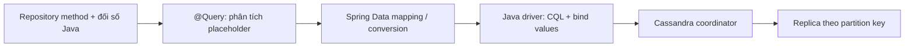
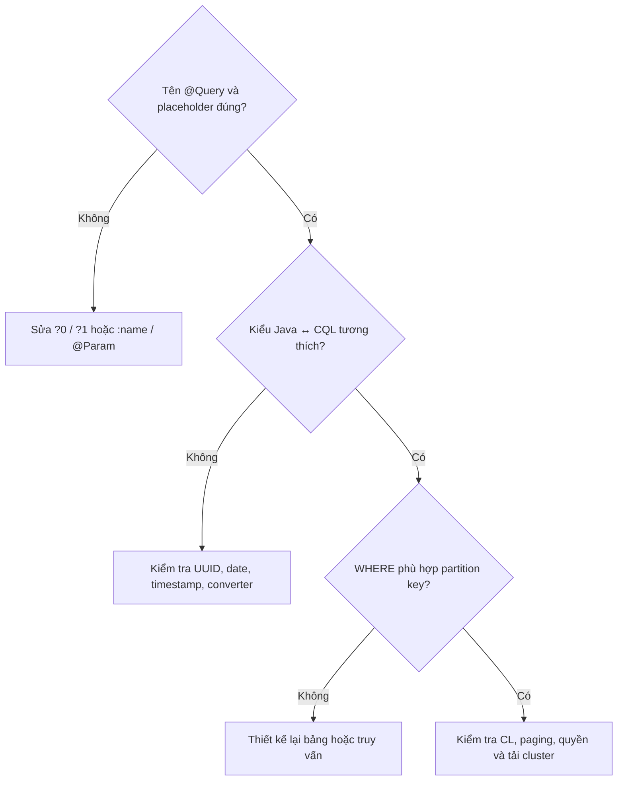

# Gắn tham số theo vị trí và tên trong truy vấn @Query của Spring Data Cassandra

Trong **Spring Data Cassandra**, annotation `@Query` cho phép khai báo trực tiếp câu lệnh CQL trên phương thức của `CassandraRepository`. Tuy nhiên, một câu CQL thường chứa giá trị đến từ API hoặc tầng nghiệp vụ: mã tenant, ngày, mã đơn hàng, mốc thời gian. **Gắn tham số (parameter binding)** là cách đưa các giá trị này vào truy vấn mà không tự ghép chuỗi CQL.

Bài thuộc chương **Truy vấn @Query** trong module **SPRING_DATA_CASSANDRA**. Trọng tâm là hai dạng được hỗ trợ bởi truy vấn chuỗi của repository:

- **Theo vị trí (index-based):** `?0`, `?1`, `?2` — tham chiếu tham số Java theo chỉ số bắt đầu từ **0**.
- **Theo tên (named):** `:tenantId`, `:eventDay` — ánh xạ đến tham số được khai báo tên, thường qua `@Param`.

Ta sẽ so sánh với bind marker của **Java driver/CqlTemplate**, tạo repository cho partition key ghép, giải thích cách Spring Data chuyển đổi kiểu và xem xét lỗi binding, tính bảo mật, hiệu năng và giới hạn truy vấn Cassandra. Ví dụ hướng tới Spring Data Cassandra hiện đại với Java driver 4.x; hãy kiểm chứng chính xác chữ ký API theo phiên bản dự án.

## 1. Vì sao cần bind tham số thay vì nối chuỗi?

Giả sử ứng dụng có endpoint lấy sự kiện của tenant `shop-42` trong ngày `2026-11-25`. Cách dựng CQL bằng nối chuỗi thường khó kiểm soát:

```java
// Không nên làm: input bên ngoài bị đưa trực tiếp vào cú pháp CQL.
String cql = "SELECT * FROM commerce.events_by_tenant_day " +
    "WHERE tenant_id = '" + tenantId + "' " +
    "AND event_day = '" + eventDay + "'";
```

Cách này có những vấn đề:

1. Phải tự chuyển đổi và escape từng kiểu giá trị, dễ sai với dấu nháy đơn, ngày giờ và UUID.
2. Tạo nguy cơ **CQL injection** nếu các giá trị không đáng tin cậy bị ghép vào cấu trúc truy vấn.
3. Làm mã nguồn khó đọc và khó đổi thứ tự điều kiện.
4. Dễ làm mất lợi ích của cơ chế xử lý/bind giá trị kiểu an toàn ở Spring Data và driver.

Với `@Query`, câu CQL được giữ cố định, còn tham số đi theo cơ chế binding:

```java
@Query("SELECT * FROM events_by_tenant_day " +
       "WHERE tenant_id = ?0 AND event_day = ?1")
List<TenantEvent> findByDay(String tenantId, LocalDate eventDay);
```

Framework phân tích `?0` và `?1`, sau đó áp dụng các giá trị tham số vào câu lệnh thực thi. Trong kiến trúc thực tế, lớp mapping và driver xử lý loại dữ liệu/marker phù hợp, thay vì để developer tự chèn giá trị thành literal CQL.



**Quan trọng:** Binding chỉ giúp truyền **giá trị dữ liệu** an toàn, không biến một truy vấn thiếu partition key thành truy vấn được Cassandra hỗ trợ hiệu quả.

## 2. Chuẩn bị schema: partition key ghép và entity

Để thấy rõ việc bind nhiều tham số, dùng một bảng phục vụ truy vấn “sự kiện của một tenant trong một ngày”:

```sql
-- Giả sử keyspace commerce đã tồn tại với RF và topology thích hợp.
CREATE TABLE commerce.events_by_tenant_day (
    tenant_id text,
    event_day date,
    occurred_at timestamp,
    event_id uuid,
    event_type text,
    payload text,
    PRIMARY KEY ((tenant_id, event_day), occurred_at, event_id)
) WITH CLUSTERING ORDER BY (occurred_at DESC, event_id ASC);

INSERT INTO commerce.events_by_tenant_day (
    tenant_id, event_day, occurred_at, event_id, event_type, payload
) VALUES (
    'shop-42',
    '2026-11-25',
    '2026-11-25T09:30:00Z',
    11111111-1111-1111-1111-111111111111,
    'ORDER_CREATED',
    '{"orderId":"O-1"}'
);
```

Cấu trúc khóa:

| Cột | Vai trò | Kiểu Java tương ứng |
| --- | --- | --- |
| `tenant_id` | Thành phần 1 của **partition key ghép** | `String` |
| `event_day` | Thành phần 2 của **partition key ghép** | `LocalDate` |
| `occurred_at` | Clustering column 1 | `Instant` |
| `event_id` | Clustering column 2 | `UUID` |
| `event_type`, `payload` | Cột dữ liệu thường | `String` |

**Hai thành phần partition key phải cùng xuất hiện** trong những truy vấn được thiết kế để đọc một partition. `occurred_at` là clustering column đầu tiên; có thể thêm điều kiện thời gian hợp lệ sau khi đã xác định đầy đủ partition.

### 2.1. Lớp khóa Java

```java
import java.io.Serializable;
import java.time.Instant;
import java.time.LocalDate;
import java.util.Objects;
import java.util.UUID;
import org.springframework.data.cassandra.core.mapping.PrimaryKeyClass;
import org.springframework.data.cassandra.core.mapping.PrimaryKeyColumn;
import org.springframework.data.cassandra.core.mapping.PrimaryKeyType;

@PrimaryKeyClass
public class TenantEventKey implements Serializable {

    @PrimaryKeyColumn(name = "tenant_id", ordinal = 0,
            type = PrimaryKeyType.PARTITIONED)
    private String tenantId;

    @PrimaryKeyColumn(name = "event_day", ordinal = 1,
            type = PrimaryKeyType.PARTITIONED)
    private LocalDate eventDay;

    @PrimaryKeyColumn(name = "occurred_at", ordinal = 2,
            type = PrimaryKeyType.CLUSTERED)
    private Instant occurredAt;

    @PrimaryKeyColumn(name = "event_id", ordinal = 3,
            type = PrimaryKeyType.CLUSTERED)
    private UUID eventId;

    public TenantEventKey() {}

    public String getTenantId() { return tenantId; }
    public void setTenantId(String value) { tenantId = value; }

    public LocalDate getEventDay() { return eventDay; }
    public void setEventDay(LocalDate value) { eventDay = value; }

    public Instant getOccurredAt() { return occurredAt; }
    public void setOccurredAt(Instant value) { occurredAt = value; }

    public UUID getEventId() { return eventId; }
    public void setEventId(UUID value) { eventId = value; }

    @Override
    public boolean equals(Object other) {
        if (this == other) return true;
        if (!(other instanceof TenantEventKey)) return false;
        TenantEventKey that = (TenantEventKey) other;
        return Objects.equals(tenantId, that.tenantId)
            && Objects.equals(eventDay, that.eventDay)
            && Objects.equals(occurredAt, that.occurredAt)
            && Objects.equals(eventId, that.eventId);
    }

    @Override
    public int hashCode() {
        return Objects.hash(tenantId, eventDay, occurredAt, eventId);
    }
}
```

`@PrimaryKeyClass` là kiểu **full primary key** gồm cả partition key và clustering columns. Đối với truy vấn liệt kê nhiều sự kiện trong một ngày, chỉ cần hai giá trị thuộc **partition key ghép**.

### 2.2. Entity được ánh xạ

```java
import org.springframework.data.cassandra.core.mapping.Column;
import org.springframework.data.cassandra.core.mapping.PrimaryKey;
import org.springframework.data.cassandra.core.mapping.Table;

@Table("events_by_tenant_day")
public class TenantEvent {

    @PrimaryKey
    private TenantEventKey key;

    @Column("event_type")
    private String eventType;

    @Column("payload")
    private String payload;

    public TenantEvent() {}

    public TenantEventKey getKey() { return key; }
    public void setKey(TenantEventKey key) { this.key = key; }

    public String getEventType() { return eventType; }
    public void setEventType(String value) { eventType = value; }

    public String getPayload() { return payload; }
    public void setPayload(String value) { payload = value; }
}
```

Ví dụ giả định ứng dụng cấu hình keyspace mặc định là `commerce` (chẳng hạn `spring.cassandra.keyspace-name: commerce`). Khi đó truy vấn `FROM events_by_tenant_day` tham chiếu đúng bảng. Nếu session không có keyspace mặc định, cần dùng tên đầy đủ `commerce.events_by_tenant_day` trong CQL.

## 3. Gắn tham số theo vị trí: `?0`, `?1` và `?2`

Trong `org.springframework.data.cassandra.repository.Query`, các placeholder `?0`, `?1`, ... được hỗ trợ cho truy vấn chuỗi. Chỉ số là **zero-based**, dựa trên thứ tự những tham số bind được của phương thức repository.

### 3.1. Ví dụ hai tham số

```java
import java.time.LocalDate;
import java.util.List;
import org.springframework.data.cassandra.repository.CassandraRepository;
import org.springframework.data.cassandra.repository.Query;

public interface TenantEventRepository
        extends CassandraRepository<TenantEvent, TenantEventKey> {

    @Query("SELECT * FROM events_by_tenant_day " +
           "WHERE tenant_id = ?0 AND event_day = ?1 LIMIT 50")
    List<TenantEvent> findRecentInDay(
        String tenantId,
        LocalDate eventDay
    );
}
```

Bảng ánh xạ:

| Placeholder trong `@Query` | Đối số phương thức | Kiểu Java | Cột CQL |
| --- | --- | --- | --- |
| `?0` | Tham số thứ nhất: `tenantId` | `String` | `tenant_id text` |
| `?1` | Tham số thứ hai: `eventDay` | `LocalDate` | `event_day date` |

Lời gọi:

```java
List<TenantEvent> events = repository.findRecentInDay(
    "shop-42",
    LocalDate.parse("2026-11-25")
);
```

CQL về mặt logic được thực thi theo hai giá trị trên, không phải phép nối Java string. `LIMIT 50` là một giới hạn cố định trong câu truy vấn; tên method không cần trùng tên các cột CQL vì `@Query` đã chỉ định câu lệnh.

### 3.2. Thứ tự xuất hiện trong CQL có thể khác thứ tự đối số

Ví dụ sau cũng hợp lệ:

```java
@Query("SELECT * FROM events_by_tenant_day " +
       "WHERE event_day = ?1 AND tenant_id = ?0 LIMIT 50")
List<TenantEvent> findDayByPositional(
    String tenantId, LocalDate eventDay
);
```

`?1` vẫn tham chiếu **tham số thứ hai**, `?0` vẫn tham chiếu **tham số thứ nhất**. Không phải marker đầu tiên xuất hiện trong chuỗi luôn là `?0`; con số sau `?` mới xác định vị trí Java được tham chiếu.

Tuy nhiên, thay đổi **thứ tự khai báo các tham số Java** mà quên cập nhật marker sẽ khiến tham số bị bind sai. Đặc biệt nguy hiểm nếu các cột đều kiểu `String`: lỗi có thể không xuất hiện khi compile nhưng câu truy vấn trả sai dữ liệu.

### 3.3. Ví dụ ba tham số với điều kiện clustering

```java
import java.time.Instant;
import java.time.LocalDate;
import java.util.List;

@Query("SELECT * FROM events_by_tenant_day " +
       "WHERE tenant_id = ?0 AND event_day = ?1 " +
       "AND occurred_at >= ?2 LIMIT 50")
List<TenantEvent> findSince(
    String tenantId,
    LocalDate eventDay,
    Instant fromInclusive
);
```

Cấu trúc này phù hợp vì:

1. `tenant_id` và `event_day` cùng xác định một partition.
2. `occurred_at` là clustering column đầu tiên nên có thể giới hạn theo thời gian trong partition đó.
3. `LIMIT 50` tránh trả số hàng không giới hạn từ partition lớn.

**Không dùng `?3`** khi phương thức chỉ có ba tham số bind được. Một placeholder vượt phạm vi có thể khiến repository tạo query thất bại khi khởi tạo hoặc thực thi.

## 4. Gắn tham số theo tên: `:name` và `@Param`

Một lựa chọn thường dễ bảo trì hơn là gắn bằng **tên logic** thay vì số. Spring Data Cassandra hỗ trợ named parameters cho truy vấn chuỗi `@Query`. `@Param` được import từ:

```java
import org.springframework.data.repository.query.Param;
```

Ví dụ đầy đủ:

```java
import java.time.LocalDate;
import java.util.List;
import org.springframework.data.cassandra.repository.CassandraRepository;
import org.springframework.data.cassandra.repository.Query;
import org.springframework.data.repository.query.Param;

public interface TenantEventRepository
        extends CassandraRepository<TenantEvent, TenantEventKey> {

    @Query("SELECT * FROM events_by_tenant_day " +
           "WHERE tenant_id = :tenant AND event_day = :day LIMIT 50")
    List<TenantEvent> findDayNamed(
        @Param("tenant") String tenantId,
        @Param("day") LocalDate eventDay
    );
}
```

Ở đây:

- `:tenant` trong CQL tương ứng `@Param("tenant")`, **không** cần trùng tên biến Java `tenantId`.
- `:day` tương ứng `@Param("day")`.
- `@Param` được Spring Data repository query framework đọc, không phải một cột trong entity.
- String `"tenant"` trong `@Param` là **tên tham số**, không phải tên bảng hay tên cột CQL.

### 4.1. Ưu điểm khi sắp lại thứ tự method

```java
@Query("SELECT * FROM events_by_tenant_day " +
       "WHERE tenant_id = :tenant AND event_day = :day LIMIT 50")
List<TenantEvent> findDayNamed(
    @Param("day") LocalDate eventDay,
    @Param("tenant") String tenantId
);
```

Dù `eventDay` được đặt trước `tenantId`, ý nghĩa của `:day` và `:tenant` **không thay đổi**, vì Spring Data liên kết theo `@Param` chứ không theo thứ tự các đối số Java. Đây là lợi ích khi refactor những method có nhiều tham số cùng kiểu.

### 4.2. Dùng tham số có tên cho thời gian

```java
import java.time.Instant;
import java.time.LocalDate;
import java.util.List;
import org.springframework.data.repository.query.Param;

@Query("SELECT * FROM events_by_tenant_day " +
       "WHERE tenant_id = :tenant AND event_day = :day " +
       "AND occurred_at >= :fromTime LIMIT 50")
List<TenantEvent> findSinceNamed(
    @Param("tenant") String tenantId,
    @Param("day") LocalDate eventDay,
    @Param("fromTime") Instant fromInclusive
);
```

Tham số `fromTime` là tên logic của giá trị `Instant`; cột thực vẫn tên `occurred_at`. Đặt tên tham số theo ý nghĩa nghiệp vụ giúp tránh lỗi và cải thiện khả năng đọc mã nguồn.

### 4.3. Không nhầm tên tham số với tên thuộc tính entity

Ví dụ entity có thuộc tính `key` chứa `tenantId` và `eventDay`, nhưng CQL chứa `tenant_id` và `event_day`. Trong `@Query`:

```java
@Query("SELECT * FROM events_by_tenant_day " +
       "WHERE tenant_id = :tenant AND event_day = :day")
List<TenantEvent> search(
    @Param("tenant") String tenantId,
    @Param("day") LocalDate eventDay
);
```

Ba tên đang đóng ba vai trò khác nhau:

| Ngữ cảnh | Tên | Được ai xử lý? |
| --- | --- | --- |
| Cột lưu trữ | `tenant_id` | CQL/Cassandra schema |
| Bind parameter | `:tenant` | Spring Data query binding |
| Biến Java | `tenantId` | Java method invocation |

Không cần đặt cả ba tên giống nhau. Tuy vậy, quy ước đặt tên rõ ràng, nhất quán giúp tránh nhầm lẫn về lâu dài.

### 4.4. Có bắt buộc dùng `@Param` không?

Cơ chế repository của Spring Data có thể suy ra tên parameter từ thông tin tên do Java compiler cung cấp, chẳng hạn khi bật `-parameters` ở những phiên bản hỗ trợ. Nhưng khi muốn một ví dụ **độc lập với cấu hình compile** và rõ hợp đồng binding, nên khai báo `@Param("...")` tường minh cho named parameters.

Không giả định tên biến Java luôn được giữ đầy đủ sau khi biên dịch. Tránh phụ thuộc vào thông tin debug/compiler nếu dự án chưa kiểm soát cấu hình build.

## 5. So sánh nhanh: positional và named parameters

| Tiêu chí | `?0`, `?1` theo vị trí | `:name` cùng `@Param` |
| --- | --- | --- |
| Cách tham chiếu | Chỉ số zero-based của đối số Java. | Tên logic gắn với tham số. |
| Ví dụ | `tenant_id = ?0` | `tenant_id = :tenant` |
| Khả năng đổi thứ tự tham số | Phải cập nhật index nếu đổi thứ tự. | Có thể giữ nguyên query nếu `@Param` vẫn đúng. |
| Độ rõ với nhiều tham số cùng kiểu | Dễ nhầm khi method dài. | Dễ đọc hơn trong các query phức tạp. |
| Cần import `@Param`? | Không. | Nên có `org.springframework.data.repository.query.Param`. |
| Có tự tạo index/partition? | Không. | Không. |
| Có thể dùng cho giá trị dữ liệu? | Có. | Có. |
| Có thể dùng làm tên bảng/cột? | Không. | Không. |

**Khuyến nghị thực hành:** Method có một hoặc hai tham số rất ổn định có thể dùng `?0`/`?1`. Với nhiều tham số, nhiều điều kiện hoặc khi hay refactor chữ ký method, tên `:tenant`/`:day` rõ ràng hơn. Quan trọng nhất là **chọn một quy ước nhất quán trong dự án**.

## 6. Đừng nhầm `@Query` với bind marker ở Java driver

Một lỗi hay gặp là thấy CQL có dấu `?` rồi áp dụng trực tiếp cách viết ở driver vào annotation repository.

| Tầng API | Ví dụ | Cách xác định đối số |
| --- | --- | --- |
| Spring Data Cassandra `@Query` | `tenant_id = ?0` | Tham số Java số 0 của repository method. |
| Spring Data Cassandra `@Query` | `tenant_id = :tenant` | Parameter được ánh xạ tên `tenant`, thường qua `@Param`. |
| Java driver 4.x `PreparedStatement` | `tenant_id = ? AND event_day = ?` | Các bind marker theo thứ tự trong CQL/prepared statement. |
| Java driver 4.x, named CQL marker | `tenant_id = :tenant` | Tên marker trong prepared statement và API bind tương ứng. |

Ví dụ Java driver với marker `?`, **không phải repository `@Query`**:

```java
import com.datastax.oss.driver.api.core.CqlSession;
import com.datastax.oss.driver.api.core.cql.PreparedStatement;
import java.time.LocalDate;

// session là bean dùng chung, được Spring quản lý.
PreparedStatement prepared = session.prepare(
    "SELECT * FROM commerce.events_by_tenant_day " +
    "WHERE tenant_id = ? AND event_day = ? LIMIT 50"
);

session.execute(
    prepared.bind("shop-42", LocalDate.parse("2026-11-25"))
);
```

Ở tầng driver, `?` là một placeholder được gắn giá trị khi thực thi prepared statement; nó **không có chữ số `0` hay `1` theo cú pháp repository**. Vì vậy:

- Với repository `@Query`, ưu tiên ví dụ được Spring Data Cassandra tài liệu hóa như `?0`, `?1`.
- Với `CqlTemplate` hoặc driver chuẩn bị CQL, dùng cú pháp marker được API đó hỗ trợ, chẳng hạn `?` và các cơ chế binding tương ứng.
- Không áp dụng quy tắc `?1` là “tham số đầu tiên” của Spring Data JPA vào Cassandra; trong `@Query` của Cassandra, `?0` mới là tham số đầu tiên.

Hai tầng API khác nhau về **cách đặt placeholder trong source Java**, dù cuối cùng đều gửi CQL và các giá trị tới Cassandra.

## 7. Binding kiểu dữ liệu: UUID, LocalDate, Instant và giá trị nghiệp vụ

Cassandra có các kiểu dữ liệu CQL như `uuid`, `date`, `timestamp`, `text`, `decimal`. Khi bind tham số, cần cung cấp **kiểu Java tương thích** và để Spring Data/driver xử lý chuyển đổi theo metadata mapping, codec hoặc converter được đăng ký.

Với bảng `events_by_tenant_day`:

| CQL | Java thường dùng | Lưu ý |
| --- | --- | --- |
| `tenant_id text` | `String` | Không tự ghép dấu nháy đơn. |
| `event_day date` | `java.time.LocalDate` | Biểu diễn **ngày**, không có múi giờ. |
| `occurred_at timestamp` | `java.time.Instant` | Biểu diễn thời điểm; cần xác định quy tắc múi giờ đầu vào. |
| `event_id uuid` | `java.util.UUID` | Không nên truyền chuỗi UUID không hợp lệ nếu type yêu cầu UUID. |
| `payload text` | `String` | Bind nguyên dữ liệu, không chèn vào CQL. |

Ví dụ bind định danh UUID của một bản ghi:

```java
import java.time.Instant;
import java.time.LocalDate;
import java.util.Optional;
import java.util.UUID;
import org.springframework.data.cassandra.repository.CassandraRepository;
import org.springframework.data.cassandra.repository.Query;

public interface TenantEventRepository
        extends CassandraRepository<TenantEvent, TenantEventKey> {

    @Query("SELECT * FROM events_by_tenant_day " +
           "WHERE tenant_id = ?0 AND event_day = ?1 " +
           "AND occurred_at = ?2 AND event_id = ?3")
    Optional<TenantEvent> findExactEvent(
        String tenantId,
        LocalDate eventDay,
        Instant occurredAt,
        UUID eventId
    );
}
```

Bốn bind parameters ở đây tương ứng **full primary key**, nên query định vị một hàng cụ thể. Trong khi đó, `findRecentInDay` chỉ bind **partition key** để trả nhiều hàng.

Nếu ứng dụng lưu enum dưới một mã CQL text ổn định (ví dụ `"created"`), hãy thiết kế converter rõ ràng. Một enum Java không tự có kiểu `ENUM` bên Cassandra. Cần quyết định mã lưu trữ, cách xử lý giá trị không nhận diện và tính tương thích giữa các phiên bản.

**Lưu ý null:** Không phải mọi biểu thức `WHERE column = null` đều có ý nghĩa như truy vấn SQL quan hệ; CQL hạn chế giá trị null trong key và điều kiện. Cần validate các thành phần partition key trước khi gọi repository, thay vì chỉ dựa vào binder.

## 8. Tham số đặc biệt như Pageable và QueryOptions

Ngoài giá trị dùng trong `WHERE`, Spring Data nhận diện những tham số điều khiển truy vấn như `Pageable` và `QueryOptions` ở những API/phiên bản hỗ trợ. Chúng không phải lúc nào cũng được tính là **bind value** khi xây query.

Ví dụ theo ý tưởng đọc có phân trang:

```java
import java.time.LocalDate;
import org.springframework.data.domain.Pageable;
import org.springframework.data.domain.Slice;
import org.springframework.data.cassandra.repository.CassandraRepository;
import org.springframework.data.cassandra.repository.Query;

public interface TenantEventRepository
        extends CassandraRepository<TenantEvent, TenantEventKey> {

    @Query("SELECT * FROM events_by_tenant_day " +
           "WHERE tenant_id = ?0 AND event_day = ?1")
    Slice<TenantEvent> findPage(
        String tenantId,
        LocalDate eventDay,
        Pageable pageable
    );
}
```

Trong trường hợp này, `?0` và `?1` tham chiếu `tenantId` và `eventDay`; `pageable` là tham số điều khiển paging, **không phải một cột CQL cần so sánh trong `WHERE`**. Cần kiểm tra phiên bản Spring Data Cassandra và API phân trang thực tế đang dùng.

Cassandra dùng **paging state** chứ không có `OFFSET` tùy ý như nhiều RDBMS. Một page là phần tiếp theo của truy vấn đã định; dữ liệu có thể thay đổi giữa các page, vì vậy paging không tạo snapshot nhất quán.

Đối với `QueryOptions`, tài liệu Spring Data Cassandra quy định có thể truyền nó cho method repository để áp dụng thiết lập request. Khi kết hợp với string `@Query`, cần phân biệt:

- Bind parameter: giá trị của tenant, ngày, UUID, mốc thời gian.
- Query option: consistency, page size và thiết lập request được phiên bản API hỗ trợ.
- `LIMIT` trong CQL: **số hàng tối đa** query trả về, không phải kích thước của page trao đổi.

Không tự thêm `?2` để bind toàn bộ object `QueryOptions` vào `WHERE`.

## 9. Value expressions (SpEL) là cú pháp nâng cao, không phải binding mặc định

Spring Data Cassandra có hỗ trợ **expression parameters** cho string-based repository queries trong các phiên bản tương ứng. Khi thật sự cần biểu thức trên đối số Java, có các dạng thường gặp như:

```java
import java.util.List;
import org.springframework.data.cassandra.repository.Query;
import org.springframework.data.repository.query.Param;

@Query("SELECT * FROM events_by_tenant_day " +
       "WHERE tenant_id = :#{#tenant} AND event_day = :#{#day}")
List<TenantEvent> byExpression(
    @Param("tenant") String tenantId,
    @Param("day") LocalDate eventDay
);
```

Hoặc tham chiếu theo chỉ số trong biểu thức:

```java
@Query("SELECT * FROM events_by_tenant_day " +
       "WHERE tenant_id = ?#{[0]} AND event_day = ?#{[1]}")
List<TenantEvent> byIndexedExpression(
    String tenantId, LocalDate eventDay
);
```

Ý tưởng của SpEL: tính **một giá trị** từ parameter/expression rồi bind nó vào truy vấn. Nó khác với `?0` hoặc `:tenant` thông thường. Khả năng hỗ trợ, ngữ cảnh biểu thức và quy tắc parse cụ thể phụ thuộc phiên bản Spring Data, nên phải xác nhận bằng integration test trên version đang chạy.

**Không sử dụng SpEL để ghép tùy ý tên bảng, tên cột hoặc đoạn CQL được cung cấp từ bên ngoài.** Khi không cần chuyển đổi/đánh giá biểu thức, `?0` và `:name` dễ đọc và an toàn hơn.

## 10. Bảo mật: bind value không phải bind identifier

Các kiểu placeholder trong bài dùng cho **giá trị**, ví dụ:

```sql
-- Ý tưởng CQL với marker giá trị.
SELECT * FROM commerce.events_by_tenant_day
WHERE tenant_id = :tenant AND event_day = :day;
```

Không thể chuyển marker thành tên bảng hoặc tên cột:

```sql
-- Không phải cách hợp lệ để parameterize identifier:
SELECT * FROM :table WHERE :column = :value;
```

Khi ứng dụng cần chọn một bảng trong số vài bảng biết trước, hãy chọn tên từ **danh sách cho phép** và render identifier đúng cách, chẳng hạn với `CqlIdentifier` trong code driver thích hợp. Không nhận nguyên tên bảng/column hay nguyên câu CQL từ request rồi nối trực tiếp vào `@Query`.

Ví dụ phân biệt rõ:

- **Tốt:** `tenant_id = :tenant`, giá trị tenant do binder kiểm soát.
- **Không tốt:** `"FROM " + request.getParameter("table")`.
- **Không tốt:** để client tự chỉ định `ALLOW FILTERING` hoặc phần `WHERE` bất kỳ nhằm vượt thiết kế bảng.

Một binding hợp lệ về kỹ thuật cũng không có nghĩa request được phép truy cập dữ liệu đó. Ứng dụng multi-tenant cần kiểm tra **quyền nghiệp vụ** để chắc chắn người dùng HTTP được phép đọc `tenantId` đã chọn; quyền `SELECT` ở Cassandra thường áp dụng theo bảng/keyspace, không tự kiểm tra từng tenant.

## 11. Các lỗi thường gặp với @Query parameter binding

| Hiện tượng | Nguyên nhân thường gặp | Cách sửa |
| --- | --- | --- |
| `?1` tham chiếu tham số đầu tiên | Hiểu nhầm index bắt đầu từ 1 như một số framework khác. | Dùng `?0` cho tham số Java đầu tiên. |
| `?2` được dùng nhưng method chỉ có hai bind args | Index vượt phạm vi. | Bổ sung tham số cần thiết hoặc sửa index. |
| Đổi thứ tự đối số, query trả dữ liệu sai | `?0`/`?1` không được đổi theo chữ ký mới. | Cập nhật marker hoặc dùng named parameter. |
| `:day` không bind được | `@Param("eventDay")` không trùng tên `day`. | Đổi `@Param("day")` hoặc placeholder thành `:eventDay`. |
| Bỏ `@Param` rồi build ở CI bị lỗi | Không có metadata tên method parameter đúng như dự kiến. | Khai báo `@Param` hoặc kiểm soát cấu hình `-parameters`. |
| Dùng `@Param` import nhầm package | Annotation không được repository framework nhận diện. | Dùng `org.springframework.data.repository.query.Param`. |
| Viết `?` trần trong repository `@Query` rồi mong như driver | Lẫn cú pháp string query của Spring Data với bind marker driver. | Dùng `?0`/`?1` hoặc `:name` theo cú pháp hỗ trợ. |
| Tham số là `String` nhưng CQL yêu cầu `uuid` | Kiểu dữ liệu bind không khớp. | Dùng `UUID` hoặc converter tương ứng. |
| CQL sai dù binding đúng | Thiếu một phần composite partition key hay lọc theo non-key. | Thiết kế truy vấn theo khóa và schema, không sửa bằng bind syntax. |
| Truy vấn nhiều hàng gây timeout | Partition lớn và thiếu `LIMIT`/paging. | Giới hạn số hàng và kiểm soát kích thước partition. |
| Lỗi xác thực/quyền khi query | Cassandra role thiếu `SELECT` trên bảng. | Kiểm tra quyền thay vì thay cú pháp marker. |
| Mã CQL chứa `:name` bên trong string literal | Nhầm giá trị chuỗi cố định với placeholder. | Đặt placeholder ở vị trí giá trị bind; dùng dấu nháy đúng ngữ cảnh. |

Để debug, nên nhìn lần lượt theo bốn tầng:



Thay `?0` thành `:tenant` **không** sửa lỗi Cassandra do partition key thiết kế sai; hai cú pháp chỉ khác cách định danh tham số.

## 12. Kiểm tra tích hợp theo cả hai kiểu binding

Một bài test nên chứng minh rằng positional và named queries trả **cùng bộ dữ liệu**, không lẫn tenant hoặc ngày.

### 12.1. Chuẩn bị dữ liệu ở các partition khác nhau

```sql
INSERT INTO commerce.events_by_tenant_day
(tenant_id, event_day, occurred_at, event_id, event_type)
VALUES ('shop-42', '2026-11-25', '2026-11-25T09:00:00Z',
        11111111-1111-1111-1111-111111111111, 'CREATED');

INSERT INTO commerce.events_by_tenant_day
(tenant_id, event_day, occurred_at, event_id, event_type)
VALUES ('shop-42', '2026-11-26', '2026-11-26T09:00:00Z',
        22222222-2222-2222-2222-222222222222, 'UPDATED');

INSERT INTO commerce.events_by_tenant_day
(tenant_id, event_day, occurred_at, event_id, event_type)
VALUES ('shop-99', '2026-11-25', '2026-11-25T09:00:00Z',
        33333333-3333-3333-3333-333333333333, 'CREATED');
```

### 12.2. So sánh kết quả hai method

Với repository chứa `findRecentInDay` và `findDayNamed` của các ví dụ trước:

```java
import static org.junit.jupiter.api.Assertions.*;
import java.time.LocalDate;
import java.util.List;
import org.junit.jupiter.api.Test;
import org.springframework.beans.factory.annotation.Autowired;
import org.springframework.boot.test.context.SpringBootTest;

@SpringBootTest
class TenantEventQueryIntegrationTest {

    @Autowired
    private TenantEventRepository repository;

    @Test
    void positionalAndNamedQueriesReadSamePartition() {
        LocalDate day = LocalDate.parse("2026-11-25");

        List<TenantEvent> byIndex =
            repository.findRecentInDay("shop-42", day);

        List<TenantEvent> byName =
            repository.findDayNamed("shop-42", day);

        assertEquals(byIndex.size(), byName.size());
        assertFalse(byIndex.isEmpty());
        for (TenantEvent event : byName) {
            assertEquals("shop-42", event.getKey().getTenantId());
            assertEquals(day, event.getKey().getEventDay());
        }
    }
}
```

Đây là ví dụ kiểm tra tích hợp, giả định Spring context, repository và keyspace đã được cấu hình và dữ liệu mẫu có thể truy cập. Các phương thức `findRecentInDay` và `findDayNamed` cần được gộp vào **cùng một interface repository** trong code chạy thực tế. Nếu test chạy chung database với những tác vụ khác, nên dùng keyspace/dữ liệu test riêng và kiểm tra bằng tập ID xác định, không chỉ so sánh `size()`.

### 12.3. Những kiểm tra nên bổ sung

1. **Đổi thứ tự parameter method dùng named binding:** giữ `@Param` đúng, xác minh query vẫn trả cùng partition.
2. **Mã ngày không tồn tại:** kết quả rỗng, không tự lẫn dữ liệu của ngày khác.
3. **Binding UUID và Instant:** kiểm tra kiểu dữ liệu và giá trị round-trip.
4. **Sai tên `@Param`:** bảo đảm bài test bắt lỗi lúc tạo query/execute, không để trôi vào production.
5. **Thiếu partition key:** xác minh Cassandra từ chối hoặc yêu cầu một access path khác, không thay bằng `ALLOW FILTERING` vô kiểm soát.
6. **LIMIT và paging:** dữ liệu vượt 50 hàng, xác minh không tải toàn bộ kết quả ngoài ý muốn.
7. **Tải phân bố không đều:** đo truy vấn của tenant nóng để đánh giá partition size và latency, không chỉ syntax.
8. **Bảo mật:** bảo đảm người dùng API không thể tự đổi `tenantId` nhằm đọc dữ liệu tenant khác.

Một test chỉ mock repository không chứng minh chuỗi CQL thực tế được parse/bind đúng; cần **ít nhất một integration test** với Cassandra tương ứng phiên bản dự án khi dùng cú pháp query mới.

## 13. Bài tập tình huống

**Tình huống A — Sai index:** Phương thức `findDay(String tenantId, LocalDate eventDay)` dùng `WHERE tenant_id = ?1 AND event_day = ?0`. Điều gì xảy ra? Khi nào lỗi có thể bị phát hiện ngay, và khi nào chỉ trả sai dữ liệu?

**Tình huống B — Đổi thứ tự parameter:** Một method dùng `:tenant` và `:day`, nhưng developer muốn đảo thứ tự tham số Java để tiện gọi. Cần thay đổi những gì trong `@Query` và `@Param`?

**Tình huống C — Thiếu tên:** Query dùng `WHERE tenant_id = :tenant` nhưng method khai báo `@Param("tenantId") String tenantId`. Hãy sửa một trong hai bên để binding hoạt động.

**Tình huống D — Driver và repository:** Tại sao `@Query("... WHERE tenant_id = ?0")` không có cú pháp marker giống `session.prepare("... WHERE tenant_id = ?")`?

**Tình huống E — Khóa ghép:** Entity ánh xạ bảng có `PRIMARY KEY ((tenant_id, event_day), occurred_at, event_id)`. Chỉ dùng `WHERE tenant_id = :tenant` có đủ chưa? Có thể khắc phục bằng đổi từ `:tenant` sang `?0` không?

**Tình huống F — An toàn:** Ứng dụng cho phép client gửi nguyên tên bảng và muốn dùng `:tableName` trong `FROM :tableName`. Vì sao không đúng? Cần làm gì nếu ứng dụng phải chọn giữa hai bảng hợp lệ?

**Tình huống G — Paging:** API đọc danh sách sự kiện của một tenant/ngày. Khác biệt giữa thêm `LIMIT 50` và thiết lập page size 50 là gì?

**Đáp án gợi ý:**

1. Các giá trị bị hoán đổi: một giá trị ngày có thể bind vào cột text và tenant vào cột date. Có thể lỗi kiểu lúc thực thi; nếu các kiểu tương thích nhau, có thể âm thầm trả sai kết quả.
2. Giữ đúng `@Param("tenant")` và `@Param("day")` trên đối số tương ứng; truy vấn `:tenant`/`:day` không nhất thiết phải đổi.
3. Hoặc dùng `@Param("tenant")`, hoặc đổi placeholder sang `:tenantId`.
4. Repository sử dụng trình phân tích placeholder của Spring Data; driver dùng marker CQL trong prepared statement.
5. Chưa: thiếu `event_day` để định vị full partition key; đổi cú pháp bind không bổ sung điều kiện CQL còn thiếu.
6. Bind parameter chỉ là giá trị, không phải identifier. Chọn tên bảng từ whitelist và dựng câu query cố định/identifier an toàn.
7. `LIMIT` giới hạn **tổng** số hàng câu query trả; page size điều chỉnh lượng dữ liệu truyền/fetch theo từng trang.

**Ghi nhớ:** Trong **Spring Data Cassandra**, `@Query` hỗ trợ **`?0`/`?1` theo chỉ số zero-based** và **`:name` kết hợp `@Param`** cho truy vấn chuỗi. Cả hai là cách gắn **giá trị**, không thay đổi quy tắc partition key, consistency hoặc quyền truy cập. Hãy giữ CQL tĩnh, chọn tên method/parameter rõ ràng, bind đúng kiểu, và kiểm thử trên schema Cassandra thật.

### Tài liệu đối chiếu

- [Spring Data Cassandra — `@Query` API](https://docs.spring.io/spring-data/cassandra/docs/4.5.x/api/org/springframework/data/cassandra/repository/Query.html)
- [Spring Data Cassandra — StringBasedCassandraQuery](https://docs.spring.io/spring-data/cassandra/docs/4.5.x/api/org/springframework/data/cassandra/repository/query/StringBasedCassandraQuery.html)
- [Spring Data Cassandra — Cassandra-specific query methods](https://docs.spring.io/spring-data/cassandra/reference/cassandra/repositories/query-methods.html)
- [Spring Data Cassandra — Prepared statements](https://docs.spring.io/spring-data/cassandra/reference/cassandra/prepared-statements.html)
