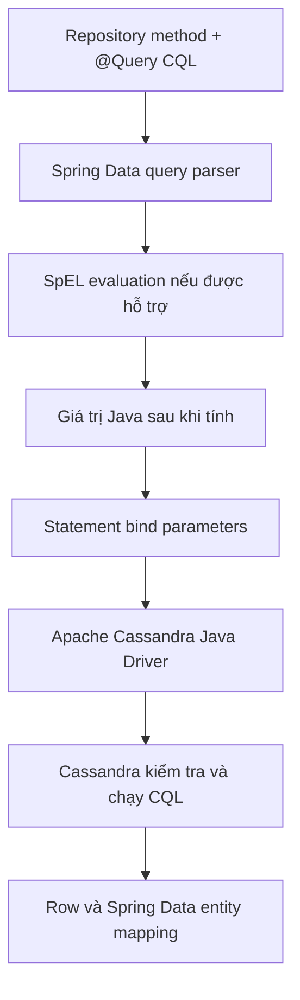

# Sử dụng SpEL trong phạm vi phiên bản hỗ trợ

Trong **Spring Data Cassandra**, annotation `@Query` dùng để khai báo CQL tường minh trên phương thức repository. Cách thông dụng nhất là viết câu CQL cố định và bind các tham số bằng vị trí hoặc tên. Trên **những phiên bản hỗ trợ expression-based parameters**, Spring Expression Language (**SpEL**) còn có thể được dùng để tính **giá trị bind** từ tham số phương thức.

Đây không phải cơ chế cho phép chạy truy vấn Cassandra tùy ý như SQL. SpEL được xử lý ở tầng Java/Spring Data; máy chủ **Apache Cassandra vẫn chỉ nhận CQL**, áp dụng các quy tắc về partition key, clustering, index, consistency và paging. Vì vậy, một biểu thức SpEL hợp lệ không làm câu CQL sai mô hình dữ liệu trở thành truy vấn hợp lệ hoặc hiệu quả.

Bài thuộc chương **Truy vấn @Query** của module **SPRING_DATA_CASSANDRA**. Nội dung tập trung vào **Sử dụng SpEL trong phạm vi phiên bản hỗ trợ**: cú pháp, kiểm tra tương thích, cách dùng có giới hạn, các rủi ro bảo mật và các lựa chọn đơn giản hơn bằng `@Query` thông thường, `CassandraTemplate`, repository fragment hoặc `CqlSession`.

## 1. Kết quả cần đạt

Sau bài học, người học có thể:

1. Phân biệt SpEL với CQL và với việc bind parameters của Java Driver.
2. Giải thích các mẫu `?#{...}`, `:#{...}` và cách truy cập tham số phương thức theo phiên bản hỗ trợ.
3. Khai báo một repository query nền tảng không SpEL, rồi phát triển biến thể có SpEL khi thật sự cần.
4. Hiểu vì sao **khả năng hỗ trợ của module Cassandra và phiên bản Spring Data cụ thể** mới là tiêu chí quyết định.
5. Bảo vệ query khỏi việc đánh giá biểu thức nhận từ nguồn không tin cậy.
6. Đảm bảo CQL có đầy đủ partition key và điều kiện clustering hợp lệ.
7. Xây dựng integration test trên Cassandra thật nhằm xác minh cả parser, binding, query và entity mapping.
8. Chọn cách thay thế bằng Java/service khi SpEL không hỗ trợ hoặc khiến mã khó bảo trì.

## 2. SpEL nằm ở tầng nào?

**SpEL** là ngôn ngữ biểu thức của Spring Framework. Nó có thể đọc property, gọi accessor của một object hoặc tính giá trị từ một biểu thức Java-like trong **evaluation context** được cung cấp.

Với Spring Data Cassandra, chỉ khi **query binder của phiên bản đang dùng hỗ trợ expression parameters**, một biểu thức nằm trong `@Query` mới được phân tích và đánh giá. Kết quả sau đó được dùng như một **giá trị tham số** của statement.



Ví dụ minh họa ngữ nghĩa:

```text
Method Java:
  findForScope(scope)

scope:
  tenantId  = 11111111-1111-1111-1111-111111111111
  studentId = 22222222-2222-2222-2222-222222222222

SpEL ở @Query (nếu bản sử dụng hỗ trợ):
  ?#{[0].tenantId()}
  ?#{[0].studentId()}

Ý nghĩa CQL:
  WHERE tenant_id = ? AND student_id = ?

Giá trị được bind:
  UUID thứ nhất và UUID thứ hai
```

Các biểu thức `?#{...}` là cú pháp phía **Spring Data**, không phải cú pháp CQL có thể chạy trực tiếp trong `cqlsh`.

**Quy tắc:** SpEL tạo ra *giá trị*, không tạo ra thiết kế partition key, không làm Java Driver tự hiểu một lược đồ mới và không thay đổi đường thực thi của Cassandra.

## 3. Phạm vi hỗ trợ và nguyên tắc tương thích

Spring Data Commons cung cấp hạ tầng query và value expression chung cho nhiều module. Nhưng **Spring Data JPA, Cassandra, MongoDB và những module khác không bảo đảm hỗ trợ cùng một tập tính năng**.

Tài liệu API `StringBasedCassandraQuery` của Spring Data Cassandra 4.5 mô tả string-based queries có hỗ trợ **named**, **index-based** và **expression parameters**. Tài liệu **Value Expressions Fundamentals** của Spring Data Cassandra cũng mô tả cách dùng SpEL và property placeholders trong bối cảnh query methods.

Tuy vậy, những điều sau **không được tự suy luận**:

- Không có nghĩa mọi cú pháp SpEL trong ví dụ **JPA/JPQL** cũng chạy trên Cassandra.
- Không có nghĩa cả `?#{...}` và `:#{...}` đều có hành vi hoàn toàn giống nhau ở mọi bản.
- Không có nghĩa mọi function/bean trong Spring container đều được công khai cho query evaluation context.
- Không có nghĩa có thể dùng SpEL để thay tên **keyspace**, **table** hoặc **column** động.
- Không có nghĩa Spring Data Cassandra bản cũ có khả năng này chỉ vì ứng dụng có thư viện `spring-expression`.

### 3.1. Ma trận quyết định

| Cách dùng | Ý nghĩa | Điều cần xác minh |
| --- | --- | --- |
| `?0`, `?1` | Tham số theo vị trí | Cú pháp positional binding của Spring Data Cassandra |
| `:tenantId` | Tham số theo tên | `@Param` hoặc cách tìm tên tham số ở phiên bản hiện tại |
| `?#{[0]}` | Đánh giá tham số method vị trí 0 | Có expression binding trong string `@Query` hay không |
| `?#{[0].tenantId()}` | Gọi accessor từ object tham số | Parser, SpEL property/method access và kiểu trả về |
| `:#{#scope.tenantId()}` | Đánh giá một named parameter | Named expression binding cùng `@Param("scope")` |
| `?${some.config.property}` | Spring property placeholder theo vị trí | Query value expressions của phiên bản, không phải CQL |
| `@Value("#{target...}")` | SpEL trên projection | Cơ chế projection, **khác** với SpEL trong `@Query` |

Cú pháp `?${some.property}` trong bảng chỉ minh họa dạng value expression của Spring Data; khả năng xử lý ở repository Cassandra vẫn phải xác minh theo phiên bản.

### 3.2. Cần kiểm tra phiên bản nào?

Trước khi sử dụng SpEL trong production, lưu lại:

1. Phiên bản **Spring Boot** và release train dependency management.
2. Phiên bản **Spring Data Cassandra** và **Spring Data Commons**.
3. Phiên bản Java, Java Driver và Apache Cassandra.
4. Repository đang dùng **imperative** hay **reactive**.
5. Mẫu cú pháp SpEL muốn dùng.
6. Kết quả test bằng repository proxy thật trên Cassandra test.

Một code snippet trong tài liệu phiên bản mới không đủ làm chứng cứ cho phiên bản cũ. Khi nâng cấp, hãy dùng BOM tương thích với Spring Boot, không thay tùy tiện riêng một JAR Spring Data và mặc định rằng mọi dependency liên quan vẫn đồng bộ.

### 3.3. Vì sao bài dùng ví dụ có điều kiện?

Bài sẽ đánh dấu rõ:

- **Baseline:** truy vấn tĩnh `@Query` không cần SpEL.
- **Candidate:** cú pháp expression parameter chỉ bật sau khi xác nhận bằng tài liệu/API và integration test của phiên bản đang dùng.
- **Anti-pattern:** dùng expression để ghép CQL hoặc đưa mã SpEL từ client vào hệ thống.

Sự phân biệt này tránh việc người học sao chép code chạy được ở một release train nhưng thất bại khi ứng dụng khởi động ở release khác.

## 4. Thiết kế bảng theo truy vấn trước khi viết SpEL

Một ứng dụng học tập cần:

```text
GET /tenants/{tenantId}/students/{studentId}/enrollments
```

Truy vấn trả các đăng ký của **một học viên trong một tenant**, mới nhất trước. Giả sử keyspace `learning` đã tồn tại.

```sql
CREATE TABLE IF NOT EXISTS learning.enrollments_by_student (
    tenant_id uuid,
    student_id uuid,
    enrolled_at timestamp,
    enrollment_id uuid,
    course_id uuid,
    status text,
    PRIMARY KEY ((tenant_id, student_id), enrolled_at, enrollment_id)
) WITH CLUSTERING ORDER BY (enrolled_at DESC, enrollment_id ASC);
```

| Cột | Vai trò | Hệ quả |
| --- | --- | --- |
| `tenant_id` | Partition key phần 1 | Cần để định vị partition |
| `student_id` | Partition key phần 2 | Cần cùng `tenant_id` |
| `enrolled_at` | Clustering column 1 | Sắp thứ tự theo thời điểm |
| `enrollment_id` | Clustering column 2 | Phân biệt các hàng cùng thời điểm |
| `course_id` | Regular column | Không tự tạo đường truy vấn theo course ID |
| `status` | Regular column | Không mặc định lọc trên toàn bảng được |

CQL đọc chính:

```sql
SELECT *
FROM learning.enrollments_by_student
WHERE tenant_id = ? AND student_id = ?;
```

Cassandra có thể xác định logical partition từ **đầy đủ hai thành phần** của partition key. Truy vấn chỉ dùng `tenant_id` không đủ để xác định partition cụ thể; truy vấn chỉ dùng `status` cũng không có access path theo schema này.

Một biểu thức SpEL dù có tính `status = "ACTIVE"` cũng không làm query theo `status` trở nên phù hợp với bảng.

## 5. Entity mapping và repository nền tảng

### 5.1. Composite primary key

```java
import java.io.Serializable;
import java.time.Instant;
import java.util.UUID;

import org.springframework.data.cassandra.core.cql.PrimaryKeyType;
import org.springframework.data.cassandra.core.mapping.PrimaryKeyClass;
import org.springframework.data.cassandra.core.mapping.PrimaryKeyColumn;

@PrimaryKeyClass
public class StudentEnrollmentKey implements Serializable {

    @PrimaryKeyColumn(name = "tenant_id", ordinal = 0,
                      type = PrimaryKeyType.PARTITIONED)
    private UUID tenantId;

    @PrimaryKeyColumn(name = "student_id", ordinal = 1,
                      type = PrimaryKeyType.PARTITIONED)
    private UUID studentId;

    @PrimaryKeyColumn(name = "enrolled_at", ordinal = 2,
                      type = PrimaryKeyType.CLUSTERED)
    private Instant enrolledAt;

    @PrimaryKeyColumn(name = "enrollment_id", ordinal = 3,
                      type = PrimaryKeyType.CLUSTERED)
    private UUID enrollmentId;

    protected StudentEnrollmentKey() {}

    // Constructor, getters/setters, equals/hashCode theo tất cả thành phần khóa.
}
```

### 5.2. Entity

```java
import java.util.UUID;

import org.springframework.data.cassandra.core.mapping.Column;
import org.springframework.data.cassandra.core.mapping.PrimaryKey;
import org.springframework.data.cassandra.core.mapping.Table;

@Table("enrollments_by_student")
public class EnrollmentByStudent {

    @PrimaryKey
    private StudentEnrollmentKey key;

    @Column("course_id")
    private UUID courseId;

    @Column("status")
    private String status;

    protected EnrollmentByStudent() {}

    public StudentEnrollmentKey getKey() { return key; }
    public UUID getCourseId() { return courseId; }
    public String getStatus() { return status; }

    // Constructor/setters cho mapping theo phiên bản đang dùng.
}
```

Đây là mã minh họa rút gọn; lớp Java dùng trong dự án thực phải có constructor, accessors và identity contract đầy đủ.

### 5.3. Baseline @Query không SpEL

```java
import java.util.List;
import java.util.UUID;

import org.springframework.data.cassandra.repository.CassandraRepository;
import org.springframework.data.cassandra.repository.Query;

public interface EnrollmentRepository
        extends CassandraRepository<EnrollmentByStudent, StudentEnrollmentKey> {

    @Query("""
        SELECT *
        FROM learning.enrollments_by_student
        WHERE tenant_id = ?0 AND student_id = ?1
        """)
    List<EnrollmentByStudent> findForStudent(
        UUID tenantId, UUID studentId);
}
```

Query trên dùng binding theo vị trí, không nối input thành chuỗi CQL. Nếu chỉ cần hai UUID, **đây thường là phương án tốt hơn việc thêm SpEL**.

Trong Spring Data Cassandra, `?0` và `?1` là dạng tham số positional dùng trong nhiều ví dụ repository CQL. Luôn kiểm tra theo version cụ thể, nhất là khi đang nâng cấp từ bản cũ.

## 6. SpEL theo vị trí: lấy giá trị từ object tham số

Đôi khi tầng service đã có object chứa cùng hai ID:

```java
import java.util.Objects;
import java.util.UUID;

public record StudentScope(UUID tenantId, UUID studentId) {

    public StudentScope {
        Objects.requireNonNull(tenantId, "tenantId");
        Objects.requireNonNull(studentId, "studentId");
    }
}
```

Nếu query engine của Spring Data Cassandra đang dùng **hỗ trợ expression binding**, có thể khai báo method nhận một object thay vì hai UUID.

```java
import java.util.List;

import org.springframework.data.cassandra.repository.Query;

// Method minh họa: đặt bên trong EnrollmentRepository đã được Spring Data quản lý.
@Query("""
    SELECT *
    FROM learning.enrollments_by_student
    WHERE tenant_id = ?#{[0].tenantId()}
      AND student_id = ?#{[0].studentId()}
    """)
List<EnrollmentByStudent> findForScope(StudentScope scope);
```

Giải thích:

- `[0]` đại diện **tham số đầu tiên** của method.
- `.tenantId()` gọi accessor record, trả một `UUID`.
- `.studentId()` trả `UUID` thứ hai.
- Spring Data phải biến các giá trị đã đánh giá thành **bind values** phù hợp với cột CQL `uuid`.
- Cassandra nhận câu query có `WHERE tenant_id = ? AND student_id = ?`.

Đoạn code là **candidate cần test**; không cam kết chạy trên mọi phiên bản. Việc một biểu thức được SpEL parser hiểu không chứng minh rằng Cassandra query binder cũng chấp nhận syntax và mapping kết quả.

### 6.1. Fallback đơn giản nhất

Khi SpEL không được hỗ trợ hoặc không cần thiết, chuyển logic bóc property vào Java service:

```java
import java.util.List;
import org.springframework.stereotype.Service;

@Service
public class EnrollmentService {

    private final EnrollmentRepository repository;

    public EnrollmentService(EnrollmentRepository repository) {
        this.repository = repository;
    }

    public List<EnrollmentByStudent> findForScope(StudentScope scope) {
        return repository.findForStudent(
            scope.tenantId(),
            scope.studentId()
        );
    }
}
```

Cách này rõ ràng, không có rủi ro parser expression, và thường dễ debug hơn. **Không cần ép mọi truy vấn vào SpEL** chỉ để repository nhận một object.

### 6.2. Truy cập bằng method hay property?

Một Java record có accessor `tenantId()`. Với class thường, SpEL có thể sử dụng property `tenantId` nếu có getter `getTenantId()`. Hỗ trợ truy cập property, method và reflection phụ thuộc evaluation context được tạo bởi phiên bản Spring Data.

Để tránh mơ hồ, nên dùng accessor Java đúng contract và **kiểm thử expression thực tế**. Nếu property path phức tạp, đưa logic vào Java rồi bind các giá trị đã tính.

## 7. Named parameters và named SpEL

Khi có nhiều tham số, đặt tên giúp review CQL dễ hơn.

### 7.1. Binding có tên, không dùng SpEL

```java
import java.util.List;
import java.util.UUID;

import org.springframework.data.cassandra.repository.Query;
import org.springframework.data.repository.query.Param;

// Method thuộc một repository interface.
@Query("""
    SELECT *
    FROM learning.enrollments_by_student
    WHERE tenant_id = :tenantId
      AND student_id = :studentId
    """)
List<EnrollmentByStudent> findNamed(
    @Param("tenantId") UUID tenantId,
    @Param("studentId") UUID studentId
);
```

Cần kiểm tra syntax named parameters của dòng Spring Data Cassandra đang dùng. Với `@Param`, tên nguồn của bind value được thể hiện rõ trong Java, không phụ thuộc hoàn toàn metadata tên tham số compile.

### 7.2. Named expression có điều kiện

Spring Data Value Expressions mô tả dạng `:#{...}` trong những module và phiên bản có hỗ trợ. Với Cassandra, xem mẫu sau là **bài test tương thích**, không phải cú pháp phổ quát:

```java
import org.springframework.data.repository.query.Param;

// Method thuộc repository interface và cần test trên Cassandra thật.
@Query("""
    SELECT *
    FROM learning.enrollments_by_student
    WHERE tenant_id = :#{#scope.tenantId()}
      AND student_id = :#{#scope.studentId()}
    """)
List<EnrollmentByStudent> findNamedScope(
    @Param("scope") StudentScope scope
);
```

`#scope` trỏ tới tham số được đặt tên. Không có `@Param("scope")` hoặc query evaluation context tương thích, expression có thể không resolve.

**Khuyến nghị:** nếu bản đang dùng không nhận `:#{...}`, đừng cố ghép UUID thành literal CQL. Chuyển sang query scalar `:tenantId`/`:studentId` hoặc `?0`/`?1`.

## 8. Biểu thức với khoảng thời gian: đúng partition và clustering

Ví dụ cần lấy đăng ký của học viên trong khoảng `[from, until)`. Tạo object miền có ràng buộc:

```java
import java.time.Instant;
import java.util.Objects;
import java.util.UUID;

public record EnrollmentWindow(
        UUID tenantId,
        UUID studentId,
        Instant fromInclusive,
        Instant untilExclusive) {

    public EnrollmentWindow {
        Objects.requireNonNull(tenantId);
        Objects.requireNonNull(studentId);
        Objects.requireNonNull(fromInclusive);
        Objects.requireNonNull(untilExclusive);

        if (!fromInclusive.isBefore(untilExclusive)) {
            throw new IllegalArgumentException("Invalid time window");
        }
    }
}
```

CQL phù hợp:

```sql
SELECT *
FROM learning.enrollments_by_student
WHERE tenant_id = ?
  AND student_id = ?
  AND enrolled_at >= ?
  AND enrolled_at < ?;
```

Ứng dụng có thể dùng SpEL để trích các giá trị từ record, **nếu đã xác nhận version hỗ trợ**:

```java
// Method thuộc repository interface; chỉ dùng khi đã kiểm thử.
@Query("""
    SELECT *
    FROM learning.enrollments_by_student
    WHERE tenant_id = ?#{[0].tenantId()}
      AND student_id = ?#{[0].studentId()}
      AND enrolled_at >= ?#{[0].fromInclusive()}
      AND enrolled_at < ?#{[0].untilExclusive()}
    """)
List<EnrollmentByStudent> findInWindow(EnrollmentWindow window);
```

Truy vấn trên vẫn chỉ sử dụng bốn **bind values**. SpEL không cho phép Cassandra tìm toàn bộ hàng với arbitrary date filter; hiệu quả của nó đến từ việc đã định vị đúng partition và áp dụng range trên clustering column đầu tiên.

Nếu method chỉ đơn giản trả bốn scalar, cách dễ kiểm soát hơn là `@Query` chứa `?0`/`?1`/`?2`/`?3` và service gọi bằng các accessor tương ứng.

## 9. Phân biệt SpEL với property placeholders

Tài liệu Spring Data có khái niệm **Value Expressions**, gồm SpEL và property placeholder.

| Dạng | Mục tiêu | Ví dụ khái niệm |
| --- | --- | --- |
| `#{...}` | Biểu thức SpEL | `#{1 + 2}` |
| `?#{...}` | Biểu thức cho tham số query theo vị trí | `?#{[0]}` |
| `:#{...}` | Biểu thức cho named parameter | `:#{#scope.tenantId()}` |
| `${config.name}` | Placeholder property | Nạp từ Spring `Environment` |
| `?${config.name}` | Placeholder dùng trong query value expression khi hỗ trợ | Không phải CQL identifier |

Hai dạng `${config.name}` và `?${config.name}` là property placeholders của Spring trong những ngữ cảnh được hỗ trợ; chúng không phải biến CQL do máy chủ Cassandra xử lý.

### Có thể chọn bảng hoặc keyspace bằng placeholder không?

**Không nên** sử dụng cú pháp này như một cách chọn tên bảng tùy ý theo request. CQL parameter binding dành cho **giá trị**, không phải arbitrary identifiers. Việc chọn keyspace, bảng hoặc cột phải được quản lý bởi schema và configuration được phê duyệt.

Ví dụ **không làm**:

```java
// Anti-pattern: lấy tên bảng từ request rồi nối vào CQL.
String query = "SELECT * FROM " + request.getTableName()
             + " WHERE tenant_id = ?";
```

Nếu sản phẩm có nhiều bảng do query-driven design, chọn DAO/repository thích hợp theo một allowlist rõ ràng. Không để client tùy ý quyết định đối tượng dữ liệu được truy cập.

## 10. @Query SpEL khác @Value trên projection

SpEL có thể xuất hiện ở cả query và projection, nhưng hai cơ chế có vai trò khác nhau.

### 10.1. Expression trong @Query

```java
@Query("""
    SELECT *
    FROM learning.enrollments_by_student
    WHERE tenant_id = ?#{[0].tenantId()}
      AND student_id = ?#{[0].studentId()}
    """)
List<EnrollmentByStudent> findForScope(StudentScope scope);
```

Khi được hỗ trợ, expression tính **giá trị tham số trước khi gửi query**.

### 10.2. SpEL trong @Value của projection

```java
import org.springframework.beans.factory.annotation.Value;

public interface EnrollmentLabelView {

    String getStatus();

    @Value("#{target.status + ' / enrollment'}")
    String getDisplayLabel();
}
```

Đây là biểu thức khi mapping/projection dữ liệu thành một view phía Java. Nó **không** viết lại `WHERE` và **không** thay partition key.

Open projection dùng SpEL có thể làm mất một số khả năng tối ưu chỉ đọc những cột cần thiết, vì expression có thể truy cập nhiều property của target. Đừng kết luận rằng `@Value` hoạt động thì `@Query` expression cũng hoạt động trên mọi version: chúng có các đường thực thi khác nhau.

## 11. Bảo mật: chỉ đánh giá biểu thức tin cậy

SpEL là một ngôn ngữ biểu thức mạnh. Vì thế, **không nhận nguyên văn source SpEL từ client** rồi đánh giá nó bằng `SpelExpressionParser` hoặc chèn vào annotation/query builder.

Ví dụ không an toàn:

```java
// KHÔNG LÀM: request.getExpression() là dữ liệu do client cung cấp.
Expression expression = new SpelExpressionParser()
        .parseExpression(request.getExpression());

Object result = expression.getValue();
```

Biểu thức trong `@Query` nên là **literal cố định trong source code tin cậy**, còn dữ liệu do client gửi chỉ được truyền dưới dạng **giá trị bind đã validate**.

Một số quy tắc quan trọng:

- Xác thực quyền truy cập `tenantId` ở service/security, không chỉ tin field trong request.
- Không gọi bean I/O, truy cập mạng hoặc thực hiện side effects từ expression.
- Không để expression quyết định tên bảng/keyspace nhận từ HTTP.
- Không ghi giá trị nhạy cảm vào log chỉ để debug SpEL.
- Tránh mở rộng evaluation context với quá nhiều hàm hoặc bean không cần thiết.
- Nếu cần xử lý nhiều nhánh hoặc logic nghiệp vụ, đặt trong Java service/helper được test riêng.
- Giới hạn time window, result size và tần suất query để tránh hot partitions.

**SpEL không tự ngăn một người dùng đoán `studentId` của người khác.** Authorization vẫn là trách nhiệm riêng và phải được áp dụng trước truy vấn.

## 12. Giới hạn của Apache Cassandra vẫn giữ nguyên

### 12.1. Thiếu partition key

```sql
-- Không phải đường truy cập hợp lệ mặc định cho bảng có
-- partition key ((tenant_id, student_id)).
SELECT *
FROM learning.enrollments_by_student
WHERE tenant_id = ?;
```

Không có SpEL nào biến `tenant_id` đơn lẻ thành partition key hoàn chỉnh.

### 12.2. Lọc regular column

```sql
-- Cần mô hình đọc/index phù hợp; không mặc định hợp lệ/hiệu quả.
SELECT *
FROM learning.enrollments_by_student
WHERE status = ?;
```

`status` chỉ là regular column. Dùng expression trả `"ACTIVE"` không tạo index hoặc chọn đúng partition.

### 12.3. Paging khác OFFSET

Cassandra sử dụng **paging state** để tiếp tục cùng một truy vấn và bind values. Nó không hỗ trợ offset pagination tùy ý như hệ SQL quan hệ.

- `LIMIT 20` giới hạn số hàng tối đa của toàn query.
- Page size 20 liên quan kích thước một lần fetch, không phải toàn bộ kết quả.
- Paging state cần dùng với cùng CQL và tham số; không dùng token của học viên A để truy vấn học viên B.
- Dữ liệu có thể biến động giữa hai page; không mặc định có snapshot bất biến.

SpEL chỉ cung cấp bind values; nó không quản lý cursor API hoặc xác thực token paging.

### 12.4. Consistency và nhiều bảng

Các mức `LOCAL_ONE`, `LOCAL_QUORUM` phụ thuộc replication factor, datacenter và yêu cầu đọc/ghi. Việc dùng SpEL **không thay consistency**.

Ghi cùng dữ liệu vào hai bảng phi chuẩn hóa không được biến thành transaction ACID chỉ vì nằm trong một repository method. Nếu một lần ghi thành công, lần kia timeout, ứng dụng cần idempotency, retry, đối soát và nguồn sự thật rõ ràng.

### 12.5. Timeout, tombstone và hiệu năng

Một query có expression đơn giản vẫn chậm khi partition quá lớn, có tombstone nhiều hoặc cluster đang quá tải. Khi lỗi xuất hiện, cần kiểm tra CQL, partition size, p95/p99 latency, driver metrics và consistency trước khi quy mọi vấn đề cho SpEL.

## 13. Chi phí và khả năng bảo trì

SpEL cần được phân tích/đánh giá trong runtime; Spring Data có cơ chế cache những thành phần thích hợp tùy version, nhưng kết quả expression vẫn phải tương ứng với tham số của mỗi lần gọi. Không nên đặt code I/O hoặc tính toán nặng trong annotation.

| Nhu cầu | Cách phù hợp | Lý do |
| --- | --- | --- |
| Hai UUID rõ ràng | `@Query` và `?0`/`?1` | Đơn giản, dễ kiểm thử |
| Một object chứa hai UUID | SpEL nếu version hỗ trợ, hoặc bóc ở service | Cân nhắc lợi ích với độ phức tạp |
| Truy vấn khoảng thời gian với validation | Java record/helper rồi bind scalar | Dễ kiểm tra ranh giới |
| Nhiều nhánh query động | Repository fragment/`CassandraTemplate` | CQL minh bạch hơn |
| Điều khiển paging state chi tiết | Java Driver/DAO | SpEL không xử lý pagination |
| Dữ liệu cần chuyển đổi kiểu nghiệp vụ | `CassandraCustomConversions` hoặc service | Không đưa mọi conversion vào query expression |
| Cần lọc theo cột regular | Thiết kế bảng theo truy vấn hoặc index được đánh giá | Không phụ thuộc SpEL |
| Query throughput lớn | Benchmark baseline và expression | Tránh overhead không cần thiết |

Một nguyên tắc thực dụng: **nếu Java service một dòng rõ ràng hơn biểu thức SpEL trong chuỗi, chọn Java service**. Annotation CQL khó refactor tự động và lỗi có thể chỉ bộc lộ lúc khởi tạo repository hoặc lúc thực thi query.

## 14. Imperative và reactive repositories

Spring Data Cassandra hỗ trợ repository imperative và reactive. Nhiều query semantics tương đồng, nhưng không nên suy ra **mọi expression evaluation và extension** đều hỗ trợ y hệt nhau.

Baseline reactive có thể là:

```java
import java.util.UUID;

import reactor.core.publisher.Flux;
import org.springframework.data.cassandra.repository.Query;
import org.springframework.data.cassandra.repository.ReactiveCassandraRepository;

public interface ReactiveEnrollmentRepository
        extends ReactiveCassandraRepository<
            EnrollmentByStudent, StudentEnrollmentKey> {

    @Query("""
        SELECT *
        FROM learning.enrollments_by_student
        WHERE tenant_id = ?0 AND student_id = ?1
        """)
    Flux<EnrollmentByStudent> findForStudent(
        UUID tenantId, UUID studentId);
}
```

Nếu cần `?#{...}` trong reactive query, hãy **test riêng** với reactive repository proxy. Không gọi `CqlSession.execute(...)` blocking ngay trong reactive event loop khi ứng dụng yêu cầu non-blocking.

## 15. Kiểm thử SpEL trong @Query bằng Cassandra thật

### 15.1. Vì sao unit test parser chưa đủ?

Một test gọi `new SpelExpressionParser().parseExpression(...)` có thể xác minh cú pháp SpEL, nhưng **không xác minh** Spring Data Cassandra `@Query` có nhận expression, bind đúng kiểu `UUID`/`Instant`, giải quyết entity mapping và tạo CQL hợp lệ.

Vì vậy cần integration test qua **repository proxy** với Cassandra thực: Testcontainers hoặc cluster test riêng, không dùng production.

### 15.2. Chuẩn bị

1. Chọn đúng bộ Spring Boot, Spring Data Cassandra, Commons và Driver giống ứng dụng.
2. Dựng Cassandra test, tạo keyspace `learning` và bảng `enrollments_by_student`.
3. Đặt `spring.cassandra.schema-action: none` nếu script migration đã tạo schema.
4. Chạy seed vào **nhiều partition** để phát hiện bind nhầm `studentId`.
5. Khởi động repository có method baseline và candidate SpEL.
6. Gọi hai method và so sánh kết quả.
7. Thử accessor sai, null, input không hợp lệ và khoảng thời gian.
8. Nếu không hỗ trợ syntax, không triển khai candidate; fallback sang scalar bindings.

### 15.3. Dữ liệu fixture

```sql
INSERT INTO learning.enrollments_by_student (
    tenant_id, student_id, enrolled_at, enrollment_id, course_id, status
) VALUES (
    11111111-1111-1111-1111-111111111111,
    22222222-2222-2222-2222-222222222222,
    '2026-11-15T09:00:00Z',
    33333333-3333-3333-3333-333333333333,
    44444444-4444-4444-4444-444444444444,
    'ACTIVE'
);

INSERT INTO learning.enrollments_by_student (
    tenant_id, student_id, enrolled_at, enrollment_id, course_id, status
) VALUES (
    11111111-1111-1111-1111-111111111111,
    55555555-5555-5555-5555-555555555555,
    '2026-11-16T09:00:00Z',
    66666666-6666-6666-6666-666666666666,
    77777777-7777-7777-7777-777777777777,
    'COMPLETED'
);
```

Hai hàng có cùng tenant nhưng **studentId khác**, do đó nằm ở hai partition. Test chỉ có một hàng không đủ phát hiện mọi lỗi bind.

### 15.4. Assertion qua repository

Đoạn sau nằm trong một integration test đã có Spring context và `repository` tương ứng:

```java
import java.util.List;
import java.util.UUID;

import static org.assertj.core.api.Assertions.assertThat;

UUID tenantId = UUID.fromString(
    "11111111-1111-1111-1111-111111111111");
UUID studentId = UUID.fromString(
    "22222222-2222-2222-2222-222222222222");

StudentScope scope = new StudentScope(tenantId, studentId);

List<EnrollmentByStudent> baseline =
    repository.findForStudent(tenantId, studentId);

List<EnrollmentByStudent> candidate =
    repository.findForScope(scope);

assertThat(baseline).hasSize(1);
assertThat(candidate).hasSize(1);
assertThat(candidate.get(0).getCourseId())
    .isEqualTo(baseline.get(0).getCourseId());
```

Chỉ chạy `findForScope` **khi phương thức đã được khai báo và khả năng expression binding được xác nhận**. Nếu ứng dụng đang dùng phiên bản không hỗ trợ, test này phải được điều chỉnh sang baseline thay vì ép deploy.

### 15.5. Ma trận kiểm thử

| Tình huống | Kết quả cần xác minh |
| --- | --- |
| Baseline `?0`/`?1` | Truy vấn đúng CQL và entity mapping |
| `?#{[0].tenantId()}` | Parser/evaluation/binding hoạt động đúng |
| `:#{#scope.tenantId()}` | Chỉ bật nếu bản hiện tại hỗ trợ named expressions |
| Hai studentIds khác nhau | Không lấy dữ liệu nhầm partition |
| Accessor sai tên | Báo lỗi rõ, không âm thầm lọc dữ liệu sai |
| Expression trả kiểu không đúng | Được phát hiện khi convert/bind |
| Query thiếu khóa ghép | Không đưa vào production; cần sửa query/schema |
| Cột NULL | Java mapping không nhầm với `0`/`false` |
| Nhiều page | Token dùng với cùng CQL/bind values |
| Reactive repository | Kiểm tra riêng nếu hệ thống thực sự dùng |
| Thay đổi version | Chạy lại toàn bộ integration tests trước release |

**Không kiểm thử SpEL bằng cách đánh giá mã do user gửi.** Các expression trong test phải là các literal tin cậy, giống như những gì được commit trong repository source.

## 16. Lỗi thường gặp

| Hiện tượng | Nguyên nhân khả dĩ | Cách xử lý |
| --- | --- | --- |
| Repository không khởi tạo với `?#{...}` | Version không hỗ trợ hoặc parser lỗi | Kiểm tra dependency; fallback `?0`/`?1` |
| SpEL báo thiếu method/property | `[0]` sai, accessor sai, kiểu object không khớp | Đối chiếu method signature và record/class |
| `#scope` không resolve | Thiếu `@Param` hoặc named expression không hỗ trợ | Sửa annotation hoặc dùng scalar |
| Cassandra báo sai kiểu UUID | Expression trả `String` thay vì `UUID` | Trả đúng Java type, kiểm tra converter |
| Không thấy dữ liệu | Bind sai partition key, không có hàng | So sánh input và CQL thực tế |
| Query theo `status` bị từ chối | Regular column thiếu access path | Thiết kế lại bảng/index |
| SpEL chạy nhưng query chậm | Partition lớn, tombstone, tải node | Đo metrics/latency, không chỉ tối ưu expression |
| Copy ví dụ `LIKE` của JPQL bị lỗi | Ngữ nghĩa CQL/index khác JPA | Dùng CQL đúng phiên bản Cassandra |
| Table name động gây lỗi/bảo mật | Identifier không phải bind value | Dùng DAO/schema được kiểm soát |
| Log lộ thông tin | Log nguyên input/secret/query context | Giảm logging, loại dữ liệu nhạy cảm |
| Test SpEL đơn lẻ xanh nhưng query fail | Chưa kiểm tra Spring Data query binder | Integration test qua repository proxy |
| Reactive pipeline bị blocking | Dùng sync driver trong event loop | Chuyển sang reactive/async operations |

Quy trình debug gợi ý: **kiểm tra phiên bản → baseline @Query → từng expression nhỏ → bind type → CQL partition key → cluster/test data → performance metrics**. Không bật `ALLOW FILTERING` chỉ để vượt lỗi query thiếu key.

## 17. Bài tập thực hành

Giả sử một bảng:

```sql
CREATE TABLE learning.progress_by_student (
    tenant_id uuid,
    student_id uuid,
    course_id uuid,
    completed_lessons int,
    updated_at timestamp,
    PRIMARY KEY ((tenant_id, student_id), course_id)
);
```

Service nhận object:

```java
public record StudentScope(UUID tenantId, UUID studentId) {}
```

Hãy giải đáp:

1. Viết CQL truy vấn tiến độ của **một học viên** theo đầy đủ partition key.
2. Viết method `@Query` với hai UUID và binding theo vị trí.
3. Trong bản hỗ trợ expression parameters, biểu thức `?#{...}` nào lấy hai accessor của `StudentScope`?
4. Vì sao cần integration test qua repository thay vì chỉ gọi `SpelExpressionParser`?
5. Nếu version không hỗ trợ SpEL, một method Java ở service nên thực hiện việc gì?
6. Có thể dùng SpEL để truy vấn hiệu quả `WHERE completed_lessons > 0` trên toàn cluster mà không đổi schema không?
7. Vì sao không cho client gửi expression source rồi gọi `parseExpression(...)`?
8. Phân biệt `@Value("#{target...}")` trên projection với SpEL query parameter.
9. Nếu query cần tìm theo `course_id` nhưng thiếu tenant/student, phải thay mô hình bảng như thế nào?
10. `LOCAL_QUORUM` có làm hai bảng phi chuẩn hóa cập nhật atomically không?
11. Vì sao paging state phải dùng với cùng query và bind values?
12. `@Param("scope")` có vai trò gì khi dùng mẫu `:#{#scope.tenantId()}`?
13. Vì sao đổi Java Driver hoặc Spring Data version cần kiểm tra lại expression binding?
14. Khi nào nên chọn repository fragment hoặc `CassandraTemplate` thay vì chuỗi SpEL dài?

**Hướng giải:** query cần `WHERE tenant_id = ? AND student_id = ?`. Baseline bind hai UUID, còn SpEL candidate có thể dùng `?#{[0].tenantId()}` và `?#{[0].studentId()}` **nếu version hỗ trợ**. Nếu không, service đọc accessor rồi gọi baseline. SpEL chỉ biến đổi **giá trị client-side**, không thay mô hình partition, authorization hoặc transaction.

## 18. Checklist trước khi triển khai

- [ ] Đã kiểm tra Spring Boot, Spring Data Cassandra, Commons và Driver versions.
- [ ] Đã đọc tài liệu query expression tương ứng phiên bản đang dùng.
- [ ] Query tĩnh có binding thông thường chạy đúng trước khi thêm SpEL.
- [ ] Expression chỉ thực hiện tính toán nhẹ, không I/O, không side effects.
- [ ] Input người dùng chỉ là bind value, không phải mã SpEL.
- [ ] Không ghép tên bảng, keyspace, cột từ request.
- [ ] Đầy đủ partition key/clustering constraints trong câu CQL.
- [ ] Không dùng `ALLOW FILTERING` để che lỗi mô hình dữ liệu.
- [ ] Có xác thực/ủy quyền tenant và giới hạn phạm vi truy vấn.
- [ ] Đã test positional/named expression đúng với module/version.
- [ ] Có test nhiều partition, null, sai accessor và sai type.
- [ ] Paging và limit có quy tắc rõ ràng.
- [ ] Không giả định SpEL cấp consistency hay transaction mới.
- [ ] Có fallback Java/service khi expression chưa được hỗ trợ.
- [ ] Đo latency và tải Cassandra trên dữ liệu đại diện.

## 19. Ghi nhớ

**SpEL trong `@Query` là một khả năng theo phiên bản của tầng Spring Data**, không phải một phần ngôn ngữ CQL trên Apache Cassandra. String-based Cassandra queries ở các phiên bản hỗ trợ có thể xử lý expression parameters, nhưng **mẫu cú pháp cụ thể phải được thử nghiệm trên bộ phiên bản mà ứng dụng thực sự triển khai**.

Khi bài toán chỉ là chuyển một object `StudentScope` thành hai UUID, một method service nhỏ và `@Query` thông thường có thể là thiết kế tốt hơn SpEL.

Quan trọng hơn cả: **Cassandra vẫn yêu cầu thiết kế bảng theo truy vấn, partition key đúng, paging phù hợp, consistency có chủ đích và bảo mật dữ liệu theo tenant**. SpEL là một tiện ích để chuẩn bị giá trị, không phải cách vượt qua những ràng buộc đó.

### Tài liệu chính thức để đối chiếu

- [Spring Data Cassandra — Value Expressions Fundamentals](https://docs.spring.io/spring-data/cassandra/reference/cassandra/value-expressions.html)
- [Spring Data Cassandra — Cassandra-specific Query Methods](https://docs.spring.io/spring-data/cassandra/reference/cassandra/repositories/query-methods.html)
- [Spring Data Cassandra — StringBasedCassandraQuery API 4.5](https://docs.spring.io/spring-data/cassandra/docs/4.5.x/api/org/springframework/data/cassandra/repository/query/StringBasedCassandraQuery.html)
- [Spring Data Cassandra — StringBasedQuery API](https://docs.spring.io/spring-data/cassandra/docs/current/api/org/springframework/data/cassandra/repository/query/StringBasedQuery.html)
- [Spring Data Cassandra — Repository Projections](https://docs.spring.io/spring-data/cassandra/reference/repositories/projections.html)
- [Spring Data Commons — Query Methods](https://docs.spring.io/spring-data/commons/reference/repositories/query-methods-details.html)
- [Apache Cassandra — CQL](https://cassandra.apache.org/doc/stable/cassandra/developing/cql/)
