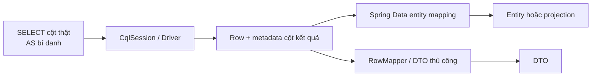

# Chọn cột, đặt bí danh và ánh xạ kết quả

## Mục tiêu học tập

Với Spring Data Cassandra, annotation `@Query` cho phép khai báo CQL trực tiếp trên phương thức repository. Một lợi ích quan trọng là kiểm soát **những cột được chọn trong `SELECT`**, cách **đặt bí danh bằng `AS`** và **kiểu Java nhận kết quả**. Ba việc này liên quan với nhau nhưng không đồng nghĩa: giảm số cột đọc không tự tạo DTO, còn đổi tên cột bằng alias không tự sửa mapping entity.

Trong chương **Truy vấn @Query** của module `SPRING_DATA_CASSANDRA`, bài này tập trung vào cách thiết kế câu CQL rõ ràng, phù hợp với partition key, rồi quyết định kết quả nên được ánh xạ thành entity, projection hay một DTO thông qua trình ánh xạ tường minh.

Sau bài này, bạn có thể:

- Chọn cột cụ thể thay cho `SELECT *`, hiểu tác động đến payload, paging và dữ liệu thiếu khi tạo entity.
- Dùng `AS` để đặt tên các cột trong kết quả CQL; phân biệt bí danh với tên cột lưu trữ trong schema.
- Viết `@Query` với tham số được bind, đủ các thành phần partition key và giới hạn kết quả phù hợp.
- Phân biệt **entity đầy đủ**, **entity được nạp một phần**, **interface projection**, **DTO** và **row mapping tường minh**.
- Nhận diện trường hợp alias không khớp tên property/`@Column` nên Spring Data không ánh xạ như mong đợi.
- Kiểm thử thứ tự cột, kiểu dữ liệu, `null`, khóa tổng hợp, hiệu năng và truy vấn sau khi đổi schema.

## 1. Ba quyết định độc lập trong một câu SELECT

Xét câu truy vấn:

```sql
SELECT order_id,
       placed_at,
       order_status AS status_label,
       total_cents AS amount_cents
FROM orders_by_customer_month
WHERE tenant_id = 11111111-1111-4111-8111-111111111111
  AND customer_id = 22222222-2222-4222-8222-222222222222
  AND order_month = '2026-11'
LIMIT 20;
```

Bạn đang ra ba quyết định:

1. **Cột được lấy:** `order_id`, `placed_at`, `order_status` và `total_cents`.
2. **Tên cột trong kết quả:** hai cột cuối được báo dưới tên `status_label` và `amount_cents`.
3. **Cách tiêu thụ kết quả:** phía Java cần biết cách đọc bốn giá trị và biến chúng thành entity/projection/DTO mong muốn.

Sơ đồ:



Điều kiện `WHERE` vẫn dựa trên **các cột thực của bảng**. Bí danh trong `SELECT` không tạo partition key, clustering key hay index mới.

### Phân biệt bốn khái niệm

| Khái niệm | Ví dụ | Ý nghĩa |
| --- | --- | --- |
| **Tên cột CQL** | `order_status` | Tên cột thực trong bảng Cassandra. |
| **Bí danh kết quả CQL** | `order_status AS status_label` | Tên được trả về cho biểu thức/cột trong kết quả truy vấn. |
| **Thuộc tính Java** | `private String status;` | Field/property của entity hoặc DTO. |
| **Mapping của Spring Data** | `@Column("order_status")` | Khai báo thuộc tính Java tương ứng với tên cột lưu trữ nào. |

Đây là các lớp tên khác nhau. Một alias được chọn theo nhu cầu báo cáo có thể không còn phù hợp với mapper entity mà bạn đã cấu hình.

## 2. Bối cảnh thực tế: bảng đơn hàng theo khách và tháng

Giả sử một ứng dụng thương mại cần hai màn hình:

- **Danh sách:** 20 đơn mới nhất của một khách hàng trong một tháng, chỉ hiển thị thời điểm, trạng thái và tổng tiền.
- **Chi tiết:** xem thêm ghi chú, mã theo dõi và nội dung biên nhận của một đơn.

Để phục vụ màn hình danh sách, Cassandra được thiết kế theo truy vấn:

```sql
CREATE TABLE orders_by_customer_month (
    tenant_id uuid,
    customer_id uuid,
    order_month text,
    placed_at timestamp,
    order_id uuid,
    order_status text,
    total_cents bigint,
    currency text,
    customer_note text,
    receipt_blob blob,
    PRIMARY KEY ((tenant_id, customer_id, order_month), placed_at, order_id)
) WITH CLUSTERING ORDER BY (placed_at DESC, order_id ASC);
```

Giải nghĩa khóa:

```text
Partition key:
  (tenant_id, customer_id, order_month)

Clustering columns:
  placed_at DESC
  order_id ASC

Regular columns:
  order_status, total_cents, currency,
  customer_note, receipt_blob
```

Mỗi partition logic chứa danh sách đơn của một tenant/khách hàng/tháng. Những đơn mới hơn được sắp trước theo `placed_at DESC`; `order_id` phân biệt những đơn có timestamp giống nhau.

### Dữ liệu minh họa

```sql
INSERT INTO orders_by_customer_month (
    tenant_id, customer_id, order_month,
    placed_at, order_id, order_status,
    total_cents, currency, customer_note, receipt_blob
) VALUES (
    11111111-1111-4111-8111-111111111111,
    22222222-2222-4222-8222-222222222222,
    '2026-11',
    '2026-11-25T09:30:00Z',
    33333333-3333-4333-8333-333333333333,
    'PAID',
    149900,
    'VND',
    'Giao sau 18 giờ',
    0x0123FE
);
```

Giá trị `total_cents` là một số nguyên theo **đơn vị nhỏ nhất được hệ thống quy ước**, chỉ có ý nghĩa khi đi kèm currency và quy tắc tiền tệ. Biên nhận blob ở ví dụ chỉ có ba byte nhằm minh họa kiểu; dữ liệu nhị phân thật có thể lớn hơn nhiều.

**Điểm quan trọng:** thiết kế này phù hợp với truy vấn đã biết đủ `tenant_id`, `customer_id` và `order_month`. Nó không tự hỗ trợ tìm mọi đơn của toàn tenant theo `order_status` hoặc xem đơn theo `order_id` đơn lẻ. Những nhu cầu đó có thể cần bảng theo truy vấn khác.

## 3. Vì sao thường nên chọn cột thay vì SELECT *?

Danh sách đơn chỉ cần vài trường. Cách viết đơn giản nhưng có thể tốn kém:

```sql
SELECT *
FROM orders_by_customer_month
WHERE tenant_id = 11111111-1111-4111-8111-111111111111
  AND customer_id = 22222222-2222-4222-8222-222222222222
  AND order_month = '2026-11'
LIMIT 20;
```

Kết quả bao gồm cả `customer_note` và `receipt_blob` dù màn hình không cần. Nếu blob lớn, số byte truyền qua mạng và lượng dữ liệu cần giải mã có thể tăng đáng kể.

Thay bằng truy vấn chỉ chọn những cột cần cho danh sách:

```sql
SELECT tenant_id,
       customer_id,
       order_month,
       placed_at,
       order_id,
       order_status,
       total_cents,
       currency
FROM orders_by_customer_month
WHERE tenant_id = 11111111-1111-4111-8111-111111111111
  AND customer_id = 22222222-2222-4222-8222-222222222222
  AND order_month = '2026-11'
LIMIT 20;
```

Truy vấn vẫn đọc **cùng partition** và dùng **cùng thứ tự clustering**, nhưng không yêu cầu trả về các trường ghi chú và biên nhận.

### Các lợi ích thường có

| Lợi ích | Giải thích |
| --- | --- |
| **Giảm payload mạng** | Ít cột được trả về, đặc biệt hữu ích khi bỏ qua blob/text lớn. |
| **Giảm công việc chuyển đổi** | Ít giá trị cần giải mã và ánh xạ ở tầng ứng dụng. |
| **Rõ hợp đồng dữ liệu** | Người đọc query biết ngay API dùng các cột nào. |
| **Hạn chế phụ thuộc không cần thiết** | Thêm cột mới vào bảng không tự đưa cột đó vào mọi câu truy vấn danh sách. |
| **Dễ thiết kế DTO** | Tập cột được chọn tương ứng rõ với các trường cần hiển thị. |

Nhưng không nên phóng đại:

- `SELECT` ít cột **không thay đổi partition key** hoặc khắc phục hot partition.
- `LIMIT 20` giới hạn kết quả, **không bảo đảm** mọi truy vấn chỉ tốn chi phí đọc đúng 20 hàng khi có tombstone hay điều kiện khác.
- Ít cột giúp giảm payload, nhưng không thay được đánh giá consistency, paging và độ trễ.

### Có nên chọn toàn bộ khóa chính?

Nếu mục tiêu là **materialize một entity hoàn chỉnh theo định danh**, nên chọn đầy đủ các cột primary key. Với bảng này, đó là:

```text
tenant_id, customer_id, order_month, placed_at, order_id
```

Thiếu một thành phần khóa có thể khiến entity không có đủ identity để tái sử dụng cho `findById`, `update` hoặc `delete`. Nếu chỉ muốn tạo DTO danh sách, có thể chọn ít cột hơn, nhưng nên **ánh xạ trực tiếp sang DTO/projection phù hợp**, không để một entity được nạp thiếu bị dùng như bản ghi đầy đủ.

## 4. Khai báo @Query chọn cột trên repository

Spring Data Cassandra cung cấp annotation:

```java
import org.springframework.data.cassandra.repository.Query;
```

Một phương thức dùng `@Query` có thể viết CQL tường minh và bind tham số:

```java
@Query("""
    SELECT tenant_id, customer_id, order_month,
           placed_at, order_id,
           order_status, total_cents, currency
    FROM orders_by_customer_month
    WHERE tenant_id = ?0
      AND customer_id = ?1
      AND order_month = ?2
    LIMIT ?3
    """)
List<OrderListRow> findListRows(
        UUID tenantId,
        UUID customerId,
        String orderMonth,
        int limit);
```

Trong ví dụ:

- `?0` là `tenantId`, `?1` là `customerId`.
- `?2` là `orderMonth`, hoàn thành partition key.
- `?3` là `limit`; ứng dụng nên giới hạn giá trị trước khi gọi.
- Các cột được chọn là **tên CQL thật**, chưa dùng alias.
- Kiểu `OrderListRow` cần được khai báo và ánh xạ đúng với bảng.

Khác với việc nối chuỗi CQL:

```java
// Phản ví dụ: không ghép đầu vào người dùng vào câu CQL.
String unsafe = "SELECT * FROM orders_by_customer_month " +
        "WHERE order_month = '" + orderMonth + "'";
```

binding giúp tách cấu trúc câu lệnh khỏi giá trị tham số và để framework/driver áp dụng codec theo kiểu CQL. Đây là cách dễ kiểm thử và an toàn hơn so với tạo CQL bằng nối chuỗi.

## 5. Ánh xạ entity với khóa tổng hợp

Để hiểu hệ quả của partial SELECT, trước tiên cần một entity biểu diễn đầy đủ schema.

### 5.1. Lớp khóa chính

```java
import java.io.Serializable;
import java.time.Instant;
import java.util.UUID;

import org.springframework.data.cassandra.core.cql.Ordering;
import org.springframework.data.cassandra.core.mapping.PrimaryKeyClass;
import org.springframework.data.cassandra.core.mapping.PrimaryKeyColumn;
import org.springframework.data.cassandra.core.mapping.PrimaryKeyType;

@PrimaryKeyClass
public class OrderListKey implements Serializable {

    @PrimaryKeyColumn(name = "tenant_id", ordinal = 0,
            type = PrimaryKeyType.PARTITIONED)
    private UUID tenantId;

    @PrimaryKeyColumn(name = "customer_id", ordinal = 1,
            type = PrimaryKeyType.PARTITIONED)
    private UUID customerId;

    @PrimaryKeyColumn(name = "order_month", ordinal = 2,
            type = PrimaryKeyType.PARTITIONED)
    private String orderMonth;

    @PrimaryKeyColumn(name = "placed_at", ordinal = 3,
            type = PrimaryKeyType.CLUSTERED,
            ordering = Ordering.DESCENDING)
    private Instant placedAt;

    @PrimaryKeyColumn(name = "order_id", ordinal = 4,
            type = PrimaryKeyType.CLUSTERED,
            ordering = Ordering.ASCENDING)
    private UUID orderId;

    // Bổ sung constructor, getters/setters, equals/hashCode.
}
```

Lớp khóa trong ví dụ là **khung minh họa**, chưa đầy đủ accessor hoặc quy tắc equality để triển khai trực tiếp. Mỗi thành phần của khóa phải khớp thứ tự và loại khóa trong CQL.

### 5.2. Entity đầy đủ

```java
import java.nio.ByteBuffer;

import org.springframework.data.cassandra.core.mapping.Column;
import org.springframework.data.cassandra.core.mapping.PrimaryKey;
import org.springframework.data.cassandra.core.mapping.Table;

@Table("orders_by_customer_month")
public class OrderListRow {

    @PrimaryKey
    private OrderListKey key;

    @Column("order_status")
    private String status;

    @Column("total_cents")
    private Long totalCents;

    @Column("currency")
    private String currency;

    @Column("customer_note")
    private String customerNote;

    @Column("receipt_blob")
    private ByteBuffer receiptBlob;

    // Bổ sung constructor, getters/setters.
}
```

Repository:

```java
import java.util.List;
import java.util.UUID;

import org.springframework.data.cassandra.repository.CassandraRepository;
import org.springframework.data.cassandra.repository.Query;

public interface OrderListRepository
        extends CassandraRepository<OrderListRow, OrderListKey> {

    @Query("""
        SELECT tenant_id, customer_id, order_month,
               placed_at, order_id,
               order_status, total_cents, currency
        FROM orders_by_customer_month
        WHERE tenant_id = ?0
          AND customer_id = ?1
          AND order_month = ?2
        LIMIT ?3
        """)
    List<OrderListRow> findListRows(
            UUID tenantId, UUID customerId,
            String orderMonth, int limit);
}
```

Ví dụ dùng Java text blocks (Java 15+) và giả định repository được kết nối tới keyspace chứa bảng.

### 5.3. Một entity đọc thiếu cột có còn “đầy đủ” không?

Trong trường hợp này, câu `SELECT` **không lấy** `customer_note` và `receipt_blob`. Nếu mapping materialize `OrderListRow` thành công, các thuộc tính không có trong row không chứa dữ liệu đã lưu ở bảng; với kiểu tham chiếu chúng có thể là `null` hoặc giá trị mặc định tùy mô hình/constructor.

Đây là nguy cơ quan trọng:

```text
Hàng thật trong Cassandra:
  order_status = PAID
  total_cents = 149900
  customer_note = "Giao sau 18 giờ"
  receipt_blob = 0x0123FE

Entity được đọc từ SELECT không có 2 cột cuối:
  status       = PAID
  totalCents   = 149900
  customerNote = null / chưa được nạp
  receiptBlob  = null / chưa được nạp
```

**Không gọi `save()` một entity được nạp một phần với kỳ vọng các cột chưa lấy sẽ được giữ nguyên trong mọi cấu hình.** Cách lưu và chính sách ghi `null` của framework có thể tạo câu lệnh ảnh hưởng tới dữ liệu cũ hoặc tombstone. Nếu mục tiêu chỉ là hiển thị, hãy trả DTO/projection; nếu mục tiêu là cập nhật một trường, hãy dùng thao tác cập nhật cột có chủ đích với khóa đầy đủ.

## 6. Bí danh AS thay đổi điều gì?

CQL cho phép đặt tên khác cho cột hoặc biểu thức được trả về trong kết quả:

```sql
SELECT order_id AS order_ref,
       placed_at AS ordered_at,
       order_status AS status_label,
       total_cents AS amount_cents
FROM orders_by_customer_month
WHERE tenant_id = 11111111-1111-4111-8111-111111111111
  AND customer_id = 22222222-2222-4222-8222-222222222222
  AND order_month = '2026-11'
LIMIT 20;
```

Phía kết quả, driver nhìn thấy tên:

```text
order_ref | ordered_at | status_label | amount_cents
----------+------------+--------------+-------------
...       | ...        | PAID         | 149900
```

Nhưng schema gốc **vẫn giữ** các tên:

```text
order_id | placed_at | order_status | total_cents
```

### AS không làm được những gì?

- Không đổi tên cột trên đĩa; muốn đổi schema cần migration thích hợp.
- Không thay đổi partition key hoặc clustering order.
- Không thể dùng tên alias để thay cột thật trong điều kiện định vị partition một cách tùy ý.
- Không tự tạo một thuộc tính Java có tên giống alias trong mọi mapping mode.
- Không giảm payload chỉ vì có alias: **số cột được chọn** mới quyết định những giá trị được yêu cầu.

### Ưu tiên alias không phân biệt chữ hoa/thường phức tạp

Trong CQL, định danh không đặt trong dấu nháy kép thường được chuẩn hóa theo quy tắc tên CQL. Ví dụ:

```sql
-- Bí danh đơn giản:
SELECT total_cents AS amount_cents
FROM orders_by_customer_month
WHERE tenant_id = 11111111-1111-4111-8111-111111111111
  AND customer_id = 22222222-2222-4222-8222-222222222222
  AND order_month = '2026-11'
LIMIT 1;
```

Với alias đặt trong dấu nháy kép như `"amountCents"`, việc giữ chính xác chữ hoa/thường có thể ảnh hưởng cách đọc bằng tên cột. Nếu không có nhu cầu đặc biệt, dùng alias `snake_case` dễ nhất quán với tên CQL và RowMapper.

## 7. Alias và @Column: cẩn thận khi trả entity

Entity ở phần trên khai báo:

```java
@Column("order_status")
private String status;

@Column("total_cents")
private Long totalCents;
```

Những annotation này thể hiện mapping từ thuộc tính Java tới **tên cột thật** `order_status` và `total_cents`.

Nếu viết:

```java
@Query("""
    SELECT order_status AS status_label,
           total_cents AS amount_cents
    FROM orders_by_customer_month
    WHERE tenant_id = ?0 AND customer_id = ?1 AND order_month = ?2
    LIMIT ?3
    """)
List<OrderListRow> findWithAliases(
        UUID tenantId, UUID customerId, String month, int limit);
```

thì **không nên giả định** `status_label` tự được chuyển sang thuộc tính `status` hoặc `amount_cents` tự điền vào `totalCents`. Trình chuyển entity của Spring Data cần giải quyết tên cột theo metadata và cách đọc row, không nhất thiết xem alias như quy tắc đổi tên property tùy ý.

Thêm vào đó, query trên **không chọn các cột primary key**. Dù framework/phiên bản có thể tạo được một số loại projection từ tập cột giới hạn, trả một **entity đầy đủ** ở ví dụ này không phải một hợp đồng ánh xạ đáng tin cậy.

Hai lựa chọn rõ ràng hơn:

1. **Muốn nhận entity:** chọn các cột theo tên CQL khớp mapping và ưu tiên đầy đủ khóa chính.
2. **Muốn tên/định dạng khác:** trả DTO/projection có cơ chế mapping được xác minh hoặc dùng RowMapper đọc alias tường minh.

Điểm cốt lõi: alias của một câu CQL thuộc **hợp đồng kết quả truy vấn**, trong khi `@Column` của entity thuộc **hợp đồng lưu trữ**. Đừng tự động đồng nhất hai hợp đồng.

## 8. DTO: nhận đúng hình dạng dữ liệu của màn hình

Màn hình danh sách chỉ cần một cấu trúc nhỏ:

```java
import java.time.Instant;
import java.util.UUID;

public record OrderCard(
        UUID orderId,
        Instant placedAt,
        String status,
        Long totalCents,
        String currency) {
}
```

Đây là **DTO**, không phải entity Cassandra. Nó không chứa `tenant_id`, `customer_id` hay `order_month` vì màn hình có thể không cần hiển thị các giá trị đó; nó cũng không có `@Table` hay `@PrimaryKey`.

### Có thể viết @Query trả thẳng DTO không?

Khả năng sử dụng DTO/class-based projection trực tiếp trong repository phụ thuộc vào **phiên bản Spring Data Cassandra, kiểu projection và cơ chế materialize kết quả**. Không nên mặc định rằng chỉ cần thay:

```java
// Chưa đủ để kết luận mapper hỗ trợ DTO này:
// List<OrderCard> findCards(...);
```

là framework tự ánh xạ được `order_status` sang `status`, hoặc alias `status_label` sang constructor argument mong muốn.

Trong dự án thật, có thể chọn một trong hai hướng:

- **Projection được Spring Data hỗ trợ và đã được test:** định nghĩa projection/interface theo property của entity, xác nhận `@Query` chọn đúng cột và kiểm tra round-trip truy vấn thực.
- **Row mapping tường minh:** dùng `CqlTemplate`/`CqlSession` cùng RowMapper hoặc code đọc `Row`, chỉ định rõ từng cột/alias và constructor DTO.

Hướng thứ hai thường dễ kiểm soát khi câu CQL dùng nhiều alias hoặc biểu thức không có ánh xạ tự nhiên vào entity.

## 9. Ví dụ chắc chắn về ý nghĩa alias: Row → DTO

Để minh họa cách đọc alias mà không phụ thuộc vào cơ chế projection của từng phiên bản Spring Data, có thể sử dụng API của Java Driver với `PreparedStatement`, rồi tạo DTO rõ ràng.

```java
import java.time.Instant;
import java.util.ArrayList;
import java.util.List;
import java.util.UUID;

import com.datastax.oss.driver.api.core.CqlSession;
import com.datastax.oss.driver.api.core.cql.BoundStatement;
import com.datastax.oss.driver.api.core.cql.PreparedStatement;
import com.datastax.oss.driver.api.core.cql.Row;

public final class OrderCardReader {

    private final CqlSession session;
    private final PreparedStatement selectCards;

    public OrderCardReader(CqlSession session) {
        this.session = session;
        this.selectCards = session.prepare("""
            SELECT order_id AS order_ref,
                   placed_at AS ordered_at,
                   order_status AS status_label,
                   total_cents AS amount_cents,
                   currency
            FROM orders_by_customer_month
            WHERE tenant_id = ?
              AND customer_id = ?
              AND order_month = ?
            LIMIT ?
            """);
    }

    public List<OrderCard> findCards(
            UUID tenantId, UUID customerId, String month, int limit) {

        if (limit < 1 || limit > 100) {
            throw new IllegalArgumentException("limit must be 1..100");
        }

        BoundStatement bound = selectCards.bind(
                tenantId, customerId, month, limit);

        List<OrderCard> result = new ArrayList<>();
        for (Row row : session.execute(bound)) {
            result.add(new OrderCard(
                    row.getUuid("order_ref"),
                    row.getInstant("ordered_at"),
                    row.getString("status_label"),
                    row.getLong("amount_cents"),
                    row.getString("currency")
            ));
        }
        return result;
    }
}
```

Đoạn mã giả định Java 17+, Java Driver 4.x, class `OrderCard` được định nghĩa ở trên và session do Spring quản lý đã được inject. Trong ứng dụng thực, không tự đóng session được Spring chia sẻ ở cuối method.

Các đặc điểm đáng chú ý:

1. CQL vẫn sử dụng tên **cột thật** ở `FROM` và `WHERE`.
2. `Row.getUuid("order_ref")` đọc **tên alias trong kết quả**.
3. DTO được tạo bằng constructor, không đòi hỏi `@Table`.
4. Truy vấn không đọc `receipt_blob` hay `customer_note`.
5. `PreparedStatement` được lưu lại để dùng nhiều lần, mỗi request tự tạo `BoundStatement` với tham số riêng.

### Vấn đề với null và primitive getter

Khi cột `total_cents` có thể thiếu, lời gọi `row.getLong("amount_cents")` trả kiểu nguyên thủy `long` và không biểu diễn được `null` như một giá trị nghiệp vụ. Vì vậy, nếu cần phân biệt “chưa có giá trị” với 0, hãy kiểm tra `row.isNull("amount_cents")` rồi xử lý:

```java
Long amount = row.isNull("amount_cents")
        ? null
        : row.getLong("amount_cents");
```

`OrderCard.totalCents` dùng `Long` để có thể biểu diễn dữ liệu thiếu. Với dữ liệu tài chính, cũng cần xác định currency và quy tắc định dạng; một cột `bigint` không tự mô tả giá trị là VND, USD hay đơn vị nào khác.

### Dùng CqlTemplate thay cho Row trực tiếp

Nếu muốn tổ chức cùng ý tưởng ở tầng Spring Data, `CqlTemplate` cung cấp cách thực thi CQL và ánh xạ kết quả bằng mapper/callback. Khi API phiên bản hiện tại hỗ trợ, một `RowMapper<OrderCard>` có thể đọc các tên alias như `order_ref`, `ordered_at`, `status_label` và `amount_cents`.

Ưu điểm là code tổ chức theo cách Spring Data, trong khi vẫn kiểm soát cột kết quả. Hãy đối chiếu chữ ký overload binding/row mapper trong phiên bản Spring Data Cassandra đang sử dụng; không nhầm `CqlTemplate` với `CassandraTemplate` chuyên xử lý entity.

## 10. Interface projection với @Query: khi nào phù hợp?

Spring Data có khái niệm **projection**, cho phép diễn đạt một tập thuộc tính cần đọc. Khi phiên bản Spring Data Cassandra sử dụng hỗ trợ interface-based projection cho repository, có thể định nghĩa:

```java
import java.time.Instant;
import java.util.UUID;

public interface OrderCardView {
    UUID getOrderId();
    Instant getPlacedAt();
    String getStatus();
    Long getTotalCents();
    String getCurrency();
}
```

Đây là projection dựa trên **tên property Java** của entity, không phải một bảng CQL mới. Với entity `OrderListRow` ở trên, `orderId` và `placedAt` nằm trong đối tượng khóa `key`, **không phải property trực tiếp**. Vì vậy, interface `OrderCardView` minh họa hình dạng mong muốn nhưng **không được tự coi là hoạt động với entity đó ngay lập tức**.

Các giải pháp:

- Điều chỉnh projection để truy cập đúng cấu trúc thuộc tính được Spring Data hỗ trợ, ví dụ thông qua property khóa tổng hợp nếu phù hợp.
- Dùng entity ánh xạ khóa theo dạng flat để các property `orderId`/`placedAt` nằm ở mức trực tiếp khi kiến trúc và phiên bản cho phép.
- Dùng DTO/RowMapper tường minh như phần trước, nhất là khi output cần tên khác với mapping entity.

### Cần kiểm tra gì nếu dùng projection?

| Câu hỏi | Vì sao quan trọng |
| --- | --- |
| API phiên bản này có hỗ trợ kiểu projection đang dùng không? | Spring Data có nhiều module/phiên bản với khả năng khác nhau. |
| Projection dựa trên **property** hay **alias**? | Không thể tự suy ra alias CQL luôn ánh xạ sang tên getter. |
| Query có chọn đủ các cột projection cần không? | Thiếu dữ liệu sẽ dẫn tới null hoặc lỗi materialization. |
| Có chọn toàn bộ entity rồi mới chuyển projection không? | Nếu có, network có thể không giảm như kỳ vọng. |
| Query có bỏ qua các thành phần khóa entity không? | Cần kiểm tra cách framework materialize identity/projection. |

**Đừng kết luận một projection giảm payload chỉ vì kiểu trả về có ít getter.** Muốn tối ưu băng thông, xác nhận câu CQL thực sự chỉ chọn những cột cần thiết.

## 11. Chọn cột cho biểu thức/aggregate: alias đặc biệt hữu ích

Khi câu CQL trả về một biểu thức thay vì cột entity thông thường, việc đặt alias giúp đọc kết quả dễ hiểu hơn.

Ví dụ đếm số hàng trong **một partition đã xác định đầy đủ**:

```sql
SELECT count(*) AS total_orders
FROM orders_by_customer_month
WHERE tenant_id = 11111111-1111-4111-8111-111111111111
  AND customer_id = 22222222-2222-4222-8222-222222222222
  AND order_month = '2026-11';
```

Kết quả có một cột tên `total_orders`. Khi dùng driver hoặc CqlTemplate với mapper, bạn có thể truy cập theo alias:

```java
Row row = resultSet.one();
long count = row == null ? 0L : row.getLong("total_orders");
```

Ví dụ giả định đã có `resultSet` chứa kết quả câu `SELECT count(*) AS total_orders ...` và các import driver tương ứng.

### Alias không biến kết quả aggregate thành entity

Entity `OrderListRow` mô tả một hàng đơn hàng với khóa và trạng thái. Kết quả:

```text
total_orders = 42
```

không phải một `OrderListRow`. Do đó, một kiểu trả về scalar/DTO hoặc mapper rõ ràng sẽ đúng hợp đồng hơn là cố ép kết quả đếm thành entity.

### Count có thể đắt

`count(*)` trong Cassandra không phải phép lấy số bản ghi từ một chỉ số tổng được cập nhật tức thời cho mọi partition. Với partition lớn, việc đếm có thể phải xét nhiều hàng và tombstone; thực thi nhiều lần mỗi giây cho dashboard có thể không phù hợp.

Nếu ứng dụng cần số lượng cập nhật liên tục, hãy xem xét:

- Bảng tổng hợp theo truy vấn và logic cập nhật riêng.
- Cơ chế tính toán/đối soát bất đồng bộ.
- Chấp nhận độ trễ cập nhật nếu nghiệp vụ cho phép.

Không dùng alias để che một phép đếm tốn tài nguyên.

## 12. Các alias khác: biểu thức, metadata và quy tắc phiên bản

CQL có thể trả về một số biểu thức đặc biệt như `ttl(column)` hoặc `writetime(column)` trong những trường hợp được hỗ trợ. Ví dụ:

```sql
SELECT order_id,
       ttl(order_status) AS status_ttl_seconds
FROM orders_by_customer_month
WHERE tenant_id = 11111111-1111-4111-8111-111111111111
  AND customer_id = 22222222-2222-4222-8222-222222222222
  AND order_month = '2026-11'
LIMIT 10;
```

Cột `status_ttl_seconds` biểu diễn kết quả của hàm metadata, **không** phải một regular column mới của bảng. Một số giá trị có thể `null` nếu TTL không áp dụng, tùy hàm và trạng thái dữ liệu.

**Lưu ý phiên bản và kiểu cột:** không phải mọi hàm CQL đều áp dụng cho mọi kiểu dữ liệu hay mọi phiên bản Cassandra; không dùng `ttl(...)` hoặc `writetime(...)` một cách tùy ý trên khóa chính hay kiểu cột không hỗ trợ. Khi cần metadata đặc biệt, nên có test thực tế theo version đang chạy.

Nếu DTO cần cả dữ liệu nghiệp vụ lẫn metadata trả về, mapping tường minh thường rõ hơn việc cố gán `status_ttl_seconds` vào một entity vốn không có cột đó.

## 13. ORDER BY, alias và thứ tự clustering

Trong schema `orders_by_customer_month`:

```sql
PRIMARY KEY ((tenant_id, customer_id, order_month), placed_at, order_id)
WITH CLUSTERING ORDER BY (placed_at DESC, order_id ASC)
```

Thứ tự này được thiết kế để lấy đơn mới nhất trong **một partition khách/tháng**.

Ví dụ dùng tên cột thật:

```sql
SELECT placed_at AS ordered_at,
       order_id AS order_ref,
       order_status AS status_label
FROM orders_by_customer_month
WHERE tenant_id = 11111111-1111-4111-8111-111111111111
  AND customer_id = 22222222-2222-4222-8222-222222222222
  AND order_month = '2026-11'
ORDER BY placed_at DESC, order_id ASC
LIMIT 20;
```

`ORDER BY` vẫn tuân thủ các **clustering columns của bảng**. Không nên coi `ordered_at` là một cột clustering mới chỉ vì nó là alias trong `SELECT`.

### Một số sai lầm

| Yêu cầu | Vì sao không tự phù hợp |
| --- | --- |
| `ORDER BY total_cents DESC` | `total_cents` là regular column, không nằm trong clustering order của bảng. |
| Sắp mọi đơn của tenant bất kể customer/month | Kết quả trải nhiều partition; bảng không định nghĩa thứ tự toàn cục. |
| Bỏ `order_month` để đọc tất cả tháng | Partition key chưa đủ, không còn một truy vấn theo partition dự kiến. |
| Dùng alias `ordered_at` thay cho khóa thật trong WHERE/ORDER BY | Alias thuộc danh sách kết quả, không thay schema và điều kiện định tuyến. |

Muốn màn hình “các đơn giá trị lớn nhất toàn tenant”, có thể cần một **bảng khác** được thiết kế theo truy vấn, hoặc hệ thống tổng hợp/phân tích riêng, không phải chỉ thêm `AS` vào câu SELECT.

## 14. Paging: tập cột và kiểu kết quả phải ổn định

Khi UI cuộn qua nhiều trang đơn hàng, các yếu tố sau phải được giữ nhất quán:

1. **Partition key:** cùng `tenant_id`, `customer_id`, `order_month`.
2. **CQL/điều kiện:** tập cột chọn, điều kiện clustering và thứ tự cần phù hợp với cursor.
3. **Page size và LIMIT:** phân biệt số hàng một trang với số hàng tổng được phép trả.
4. **Kiểu kết quả:** DTO/RowMapper phải tiếp tục đọc đúng tên cột/alias.
5. **Schema:** nếu đổi tên hoặc loại cột được SELECT, cần điều phối version API/cursor.

Paging state của Cassandra gắn với ngữ cảnh truy vấn; không được dùng một cursor của câu SELECT A cho câu SELECT B chỉ vì cả hai cùng đọc một bảng.

### Thay alias có thể là breaking change

Giả sử backend đang đọc:

```java
row.getLong("amount_cents")
```

Sau khi một lập trình viên thay `AS amount_cents` thành `AS amount`, CQL vẫn có thể chạy, nhưng mapper đang mong `amount_cents` có thể báo lỗi do tên cột kết quả không tồn tại.

Vì vậy, **alias là một phần hợp đồng giữa câu CQL và code đọc Row**. Khi đã được dùng bởi mapper hoặc lớp tích hợp, thay alias phải có test và điều chỉnh mã nhận kết quả tương ứng.

## 15. Null, kiểu dữ liệu và kết quả không đầy đủ

Ngay cả khi tên cột/alias đã khớp, còn phải hiểu kiểu dữ liệu:

| CQL | Java Driver phổ biến | Chú ý khi ánh xạ |
| --- | --- | --- |
| `uuid` | `UUID` | Không diễn giải như String bất kỳ nếu chưa chuyển có chủ đích. |
| `timestamp` | `Instant` | Giữ nhất quán cách diễn giải thời gian/múi giờ. |
| `text` | `String` | Có thể thiếu/null nếu regular column chưa ghi. |
| `bigint` | `Long` / `long` | Phân biệt giá trị 0 với null nếu nghiệp vụ cần. |
| `blob` | `ByteBuffer` | Chú ý position/limit và kích thước payload. |

Một phần quan trọng của mapping chính xác là phân biệt:

- **Cột không được SELECT:** kết quả truy vấn không chứa cột ấy.
- **Cột được SELECT nhưng giá trị null:** metadata có cột, nhưng hàng không có giá trị của regular column.
- **Cột được SELECT với alias khác:** metadata có tên mới, mapper phải dùng đúng alias.

Ba trường hợp có thể đều khiến một property Java trở thành `null` nếu ánh xạ không chặt, nhưng ý nghĩa và cách sửa khác nhau.

### Khi chọn DTO chỉ có một số trường

Nếu UI cần một giá trị không thể thiếu, hãy kiểm tra ở tầng application và hiển thị lỗi hợp lý. Không âm thầm đổi tất cả `null` thành 0 hoặc chuỗi rỗng nếu điều đó làm sai ý nghĩa nghiệp vụ.

Nếu dữ liệu lịch sử chưa có `currency`, cần một quy tắc rõ ràng: tương thích với schema cũ, backfill, hoặc từ chối kết quả thiếu dữ liệu. `@Query` không tự tạo default nghiệp vụ.

## 16. Hiệu năng: chọn đúng cột chưa đủ

Cassandra là hệ thống dữ liệu phân tán; chi phí một câu `SELECT` không chỉ do số cột trả về. Những yếu tố chính:

| Yếu tố | Ví dụ ảnh hưởng |
| --- | --- |
| **Partition key** | Query thiếu `order_month` không định tuyến như mong muốn. |
| **Kích thước partition** | Một khách hàng có thể có rất nhiều đơn trong một tháng. |
| **Hot partition** | Dashboard đọc liên tục cùng tenant/customer/month. |
| **Clustering order** | Có thể lấy các đơn mới nhất mà không cần sort toàn cụm. |
| **Số cột và payload** | Bỏ `receipt_blob` giúp giảm dữ liệu truyền cho màn hình danh sách. |
| **Tombstone** | Nhiều bản ghi xóa/hết TTL có thể tăng chi phí tìm đủ hàng còn hiệu lực. |
| **Consistency** | `LOCAL_QUORUM` hay mức khác ảnh hưởng yêu cầu phản hồi replica. |
| **Paging và giới hạn** | Kích thước trang và số lần round-trip tác động latency/heap. |
| **Mapping Java** | Materialize entity lớn có thể tốn công hơn DTO nhỏ. |

Với query danh sách:

```sql
SELECT placed_at, order_id, order_status, total_cents
FROM orders_by_customer_month
WHERE tenant_id = 11111111-1111-4111-8111-111111111111
  AND customer_id = 22222222-2222-4222-8222-222222222222
  AND order_month = '2026-11'
LIMIT 20;
```

đường đọc có đầy đủ partition key, ít cột và giới hạn kết quả. Đây là cơ sở tốt để đo tải, nhưng **không phải bảo đảm p95/p99 latency** nếu partition quá lớn hoặc replica bị quá tải.

Để kiểm chứng tác động của việc bỏ blob, hãy so sánh truy vấn với cùng partition và số hàng, quan sát kích thước kết quả, băng thông, latency và memory trong điều kiện tải tương tự. Đừng kết luận chỉ từ độ dài câu SQL/CQL.

## 17. Khi nào nên dùng @Query, CqlTemplate hoặc CassandraTemplate?

| Mục đích | Hướng thường phù hợp |
| --- | --- |
| Truy vấn entity theo khóa, cột có mapping chuẩn | Repository với `@Query` hoặc derived query. |
| Chỉ chọn vài cột, vẫn muốn dùng entity có mapping khóa đầy đủ | `@Query` với danh sách cột tường minh, nhưng không dùng kết quả partial để `save()` tùy tiện. |
| Trả projection được module/phiên bản hỗ trợ | Projection repository có integration test xác nhận kiểu trả về và cột thực được SELECT. |
| Trả DTO với tên alias rất khác entity hoặc có biểu thức metadata | `CqlTemplate`/RowMapper hoặc `CqlSession` với mapping tường minh. |
| CQL có yêu cầu driver đặc thù | Prepared statement qua `CqlSession` hoặc API template tương thích. |
| Dữ liệu cần JOIN, filter/sort toàn bảng tùy ý | Thiết kế bảng khác/công cụ khác; đổi API Java không thay giới hạn Cassandra. |

`CassandraTemplate` giúp truy vấn và materialize entity dựa trên mapping context/converter. `CqlTemplate` phù hợp khi muốn làm việc gần CQL/RowMapper hơn. Chọn API theo **hợp đồng kết quả và nhu cầu mapping**, không chỉ vì một method có vẻ ngắn hơn.

## 18. Debug khi @Query có kết quả sai

| Dấu hiệu | Nguyên nhân nên kiểm tra | Hướng xử lý |
| --- | --- | --- |
| CQL chạy nhưng field Java null | Cột không được SELECT, alias khác tên mapping hoặc dữ liệu thật null. | Đối chiếu column metadata và `@Column`/property. |
| Đọc `row.getString("status_label")` bị lỗi | Query đã bỏ/đổi alias hoặc kiểu cột không phải text. | Kiểm tra tên cột kết quả và kiểu CQL. |
| Repository không tạo entity được | Thiếu cột khóa/constructor binding hoặc kiểu không tương thích. | Chọn đủ identity, thử mapping thực hoặc dùng DTO/RowMapper. |
| Kết quả count không map vào entity | Aggregate trả một scalar, không phải hàng đơn hàng. | Dùng scalar/DTO mapper phù hợp. |
| Query thiếu dữ liệu khi xem tháng khác | `order_month` là partition key và chỉ đọc một bucket. | Điều phối truy vấn qua những tháng cần thiết. |
| Query từ chối điều kiện WHERE | Thiếu partition key hoặc filter theo regular column. | Thiết kế lại CQL/bảng theo truy vấn. |
| Có alias nhưng vẫn truyền blob lớn | Query vẫn chọn blob hoặc sử dụng `SELECT *`. | Chọn rõ những cột được phép trả. |
| Paging chồng chéo sau khi sửa query | Cursor được dùng cho CQL khác hoặc dữ liệu thay đổi. | Version cursor, giữ ngữ cảnh truy vấn và xử lý dữ liệu biến động. |
| Tên cột không đúng sau migration | Schema/driver metadata chưa cập nhật hoặc entity mapping không tương thích. | Phối hợp migration, schema agreement và rollout application. |

### Quy trình kiểm tra theo thứ tự

1. **Xác nhận bảng CQL thực:** tên và kiểu các cột, partition key, clustering columns.
2. **Chép ra câu CQL mong muốn:** danh sách SELECT, alias, WHERE, LIMIT và ORDER BY.
3. **Xác nhận các giá trị bind:** thứ tự `?0, ?1, ...` và kiểu Java tương ứng.
4. **Đối chiếu kết quả:** tên cột từ Row metadata có đúng alias/cột gốc như mapper mong đợi không?
5. **Đối chiếu kiểu Java:** `UUID`, `Instant`, `Long`, `String`, `ByteBuffer` có tương ứng không?
6. **Xác định kiểu trả về:** entity đầy đủ, partial entity, projection hay DTO?
7. **Đánh giá hiệu năng:** size, tombstone, payload, paging, consistency và workload.

Đừng cố sửa lỗi alias bằng cách đổi tùy tiện `@Table` hoặc `@PrimaryKey`: những annotation đó thể hiện schema/identity của entity, không phải tên cột tạm thời của một SELECT.

## 19. Kiểm thử với Cassandra thực hoặc môi trường tích hợp

Unit test có thể kiểm tra logic DTO hoặc tham số nhưng không đủ để khẳng định CQL hợp lệ. Nên có integration test cho các tình huống:

| Ca kiểm thử | Kỳ vọng |
| --- | --- |
| `SELECT *` và SELECT ít cột trên cùng hàng | Các trường chung bằng nhau; truy vấn ít cột không tải ghi chú/blob. |
| `@Query` trả entity với đủ khóa | ID và các regular columns được chọn được ánh xạ chính xác. |
| Partial entity | Các cột không được SELECT không bị nhầm là đã được tải đầy đủ. |
| Alias `order_status AS status_label` | Driver/RowMapper đọc đúng tên `status_label`. |
| Alias đổi tên sau refactor | Test phát hiện mapper vẫn dùng tên cũ. |
| Scalar `count(*) AS total_orders` | Nhận số nguyên đúng và không cố map thành hàng đơn hàng. |
| `null` ở regular column | Phân biệt được null với 0, không dùng getter primitive gây mất ngữ nghĩa. |
| Một partition với nhiều đơn | Danh sách theo clustering order và `LIMIT` như mong đợi. |
| Paging nhiều trang | Cursor gắn đúng câu truy vấn và tiếp tục ổn định trong điều kiện đã định. |
| Cột blob lớn | Chọn ít cột giảm payload, kiểm tra latency/memory. |
| Dữ liệu trải nhiều tháng | Query một tháng không tự lấy tháng khác; logic tổng hợp được test riêng. |

### Ví dụ kiểm tra mã mapper

Với `OrderCardReader` ở trên, test có thể:

1. Tạo bảng trong keyspace test.
2. Ghi hai đơn cùng `tenant_id/customer_id/order_month` nhưng `placed_at` khác nhau.
3. Ghi `customer_note` và `receipt_blob` khác nhau để biết rằng chúng có tồn tại.
4. Gọi `findCards(..., 20)` và kiểm tra `orderId`, `placedAt`, `status`, `totalCents`, `currency`.
5. Thay alias `amount_cents` trong bản thử nghiệm rồi xác nhận test chỉ ra contract của mapper.
6. Kiểm thử `null` trên một regular column nếu schema/luồng nghiệp vụ cho phép.

Đối với repository `@Query` trả interface projection, integration test là bước quan trọng để xác nhận **khả năng projection của phiên bản Spring Data thực tế**, thay vì suy đoán từ interface getter.

## 20. Bài tập vận dụng

**Câu 1 — Tối ưu danh sách.** Một màn hình chỉ cần ID, thời điểm, trạng thái và giá, nhưng repository dùng `SELECT *`. Nếu mỗi hàng có blob lớn, bạn sẽ thay đổi gì?

**Gợi ý:** Chỉ SELECT những cột cần thiết, đảm bảo CQL vẫn có đủ partition key; dùng DTO/projection hoặc mapper phù hợp để tránh nạp entity thiếu rồi gọi save.

**Câu 2 — Đổi tên bằng AS.** Cột bảng là `order_status`. Query dùng `order_status AS status_label`. Có phải cột trong Cassandra đã đổi thành `status_label`?

**Gợi ý:** Không. Đây chỉ là tên cột trong kết quả truy vấn. Schema và điều kiện WHERE vẫn dùng tên cột CQL thật.

**Câu 3 — Entity bị thiếu dữ liệu.** Query trả `OrderListRow` nhưng không chọn `customer_note` và `receipt_blob`. Có nên sửa `status` rồi gọi `save()` ngay không?

**Gợi ý:** Không nên mặc định như vậy. Entity chưa chứa đầy đủ các trường đã lưu, và hành vi ghi null có thể gây hại. Dùng update cột mục tiêu với khóa đầy đủ hoặc tải entity đầy đủ khi cần.

**Câu 4 — Alias và @Column.** Entity có `@Column("total_cents") private Long totalCents;`. Query dùng `total_cents AS amount_cents`. Framework có bắt buộc phải tự ánh xạ alias này vào `totalCents` không?

**Gợi ý:** Không được suy luận như vậy. Mapping entity dùng metadata cột gốc; muốn đặt alias khác nên kiểm tra projection/mapper hoặc dùng RowMapper tường minh.

**Câu 5 — DTO theo tên alias.** Bạn dùng driver, query trả `order_id AS order_ref`. Nên gọi `row.getUuid("order_id")` hay `row.getUuid("order_ref")`?

**Gợi ý:** Đọc tên cột trong metadata kết quả: `order_ref`. Viết test để kiểm tra contract khi đổi alias.

**Câu 6 — Count.** Có thể dùng `count(*) AS total_orders` trong dashboard mà không lo chi phí vì result chỉ có một ô không?

**Gợi ý:** Không. Kết quả nhỏ không có nghĩa chi phí tính toán nhỏ; Cassandra có thể phải xét nhiều hàng trong partition. Cân nhắc pre-aggregation.

**Câu 7 — Query thiếu partition key.** Câu SELECT chỉ lấy ba cột và có `LIMIT 10` nhưng WHERE chỉ lọc `order_status`. Nó có trở thành query hiệu quả của bảng này không?

**Gợi ý:** Không. Tập cột được SELECT và LIMIT không thay thế điều kiện định vị `(tenant_id, customer_id, order_month)`.

**Câu 8 — Kiểu trả về.** Một `@Query` trả `count(*)` nhưng method khai báo `List<OrderListRow>`. Vấn đề nằm ở đâu?

**Gợi ý:** Kết quả aggregate là scalar, không chứa dữ liệu tạo các entity đơn hàng. Chọn scalar/DTO hoặc mapper phù hợp.

## Tổng kết

Trong Spring Data Cassandra, `@Query` giúp khai báo trực tiếp CQL để **chọn cột chính xác**, giảm dữ liệu không cần thiết và đặt alias khi kết quả cần một tên dễ hiểu. Nhưng **`SELECT` quyết định tập dữ liệu được trả**, **`AS` quyết định tên cột kết quả**, còn **entity/projection/RowMapper quyết định cách dữ liệu được chuyển thành Java**. Ba lớp này cần được thiết kế và kiểm thử độc lập.

Khi muốn nhận entity, ưu tiên chọn đủ khóa chính và giữ tên cột tương thích mapping; không tùy tiện lưu lại entity được nạp một phần. Khi cần alias tùy biến, biểu thức hoặc DTO chỉ để hiển thị, RowMapper hay projection đã được xác minh thường rõ nghĩa hơn. Dù dùng `@Query`, `CassandraTemplate`, `CqlTemplate` hay `CqlSession` trực tiếp, ứng dụng vẫn phải tuân thủ **partition key, clustering order, consistency, paging và kiểm soát hiệu năng** của Apache Cassandra.
