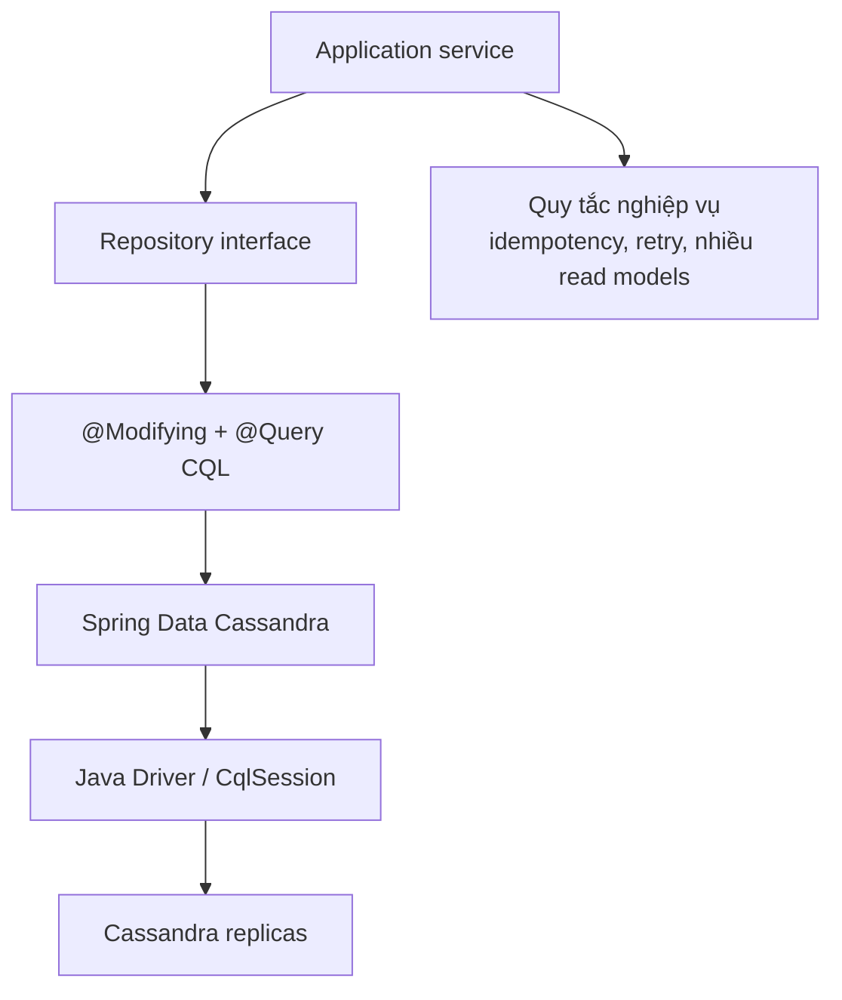

# Truy vấn INSERT, UPDATE và DELETE theo ngữ nghĩa Cassandra

## 1. Vì sao `@Query` cho thao tác ghi cần được hiểu khác SQL quan hệ?

Trong **Spring Data Cassandra**, một repository có thể khai báo câu CQL tường minh bằng `@Query` để thực hiện `SELECT` và các lệnh thay đổi dữ liệu. Những lệnh `INSERT`, `UPDATE`, `DELETE` trông quen thuộc với người học SQL, nhưng **Apache Cassandra không thực thi chúng theo toàn bộ ngữ nghĩa của một cơ sở dữ liệu quan hệ**:

- `INSERT` thường có tính **upsert**: ghi theo primary key đã biết, không mặc nhiên báo lỗi khi khóa đã tồn tại.
- `UPDATE` thường cũng là **upsert**: cập nhật các cột được chỉ định, và có thể tạo một hàng khi khóa chưa tồn tại.
- `DELETE` tạo dấu xóa (*tombstone*) để các replica dần đồng bộ trạng thái xóa; nó không giống việc lập tức xóa sạch dữ liệu vật lý trên mọi node.
- Mỗi lệnh phải tuân thủ **partition key, clustering columns và những điều kiện CQL được hỗ trợ**; không thể tùy ý `UPDATE ... WHERE status = ...` hoặc `DELETE ... WHERE total_amount > ...`.
- Một lệnh ghi thông thường không bảo đảm điều kiện “chỉ cập nhật nếu còn trạng thái cũ” hoặc “chỉ insert nếu chưa tồn tại”. Để thực thi điều kiện cạnh tranh, Cassandra cung cấp **lightweight transaction (LWT)** trong những trường hợp phù hợp.
- Ghi vào một bảng không tự cập nhật các bảng phi chuẩn hóa khác. Consistency level và `@Query` không thay thế quy trình đồng bộ nhiều read model.

`@Query` giúp **biểu đạt câu lệnh CQL ở tầng repository**, nhưng tính đúng của ghi và hiệu năng phân tán vẫn do schema, khóa, consistency, retry và điều kiện nghiệp vụ quyết định.



Trong bài này, `@Query` được dùng cho **câu CQL tường minh**, còn `@Modifying` đánh dấu phương thức thực hiện thao tác **không phải SELECT**. Cần import đúng annotation của Spring Data Cassandra và kiểm tra khả năng hỗ trợ của phiên bản Spring Data đang dùng, không sao chép annotation của JPA hoặc Spring Data JDBC.

## 2. Chuẩn bị schema theo đường truy cập của ứng dụng

Giả sử API quản lý đơn hàng cần tra cứu trực tiếp theo `orderId`, cập nhật trạng thái, ghi chú và một số thuộc tính:

```sql
-- Ví dụ local một node, không áp dụng replication này cho production.
CREATE KEYSPACE IF NOT EXISTS shop_demo
WITH replication = {
    'class': 'SimpleStrategy',
    'replication_factor': 1
};

CREATE TABLE IF NOT EXISTS shop_demo.orders_by_id (
    order_id uuid PRIMARY KEY,
    customer_id uuid,
    created_at timestamp,
    status text,
    total_amount decimal,
    note text,
    tags set<text>,
    attributes map<text, text>
);
```

Ở đây, `order_id` là **toàn bộ primary key** và đồng thời là partition key. Do đó các lệnh ghi/xóa nhắm vào một đơn có thể xác định chính xác hàng bằng `WHERE order_id = ?`.

Với màn hình hiển thị đơn của khách trong một ngày, có thể cần một bảng đọc khác:

```sql
CREATE TABLE IF NOT EXISTS shop_demo.orders_by_customer_day (
    customer_id uuid,
    day_bucket date,
    created_at timestamp,
    order_id uuid,
    status text,
    total_amount decimal,
    PRIMARY KEY ((customer_id, day_bucket), created_at, order_id)
) WITH CLUSTERING ORDER BY (created_at DESC, order_id ASC);
```

Trong bảng thứ hai, partition key gồm `(customer_id, day_bucket)` và hai clustering columns là `(created_at, order_id)`. Cập nhật một hàng cụ thể cần biết **đầy đủ khóa**; nếu service chỉ biết `order_id`, không thể tự động cập nhật hàng ở bảng thứ hai mà chưa có các giá trị khóa còn lại.

> **Lưu ý:** `SimpleStrategy` với replication factor 1 chỉ dùng cho bài thực hành local. Cụm nhiều node/datacenter cần chiến lược replication phù hợp topology, thường là `NetworkTopologyStrategy`. Chiến lược replication không do `@Query` quyết định.

## 3. `@Query` và `@Modifying` trong Spring Data Cassandra

### 3.1. Entity và repository mẫu

```java
import java.math.BigDecimal;
import java.time.Instant;
import java.util.Map;
import java.util.Set;
import java.util.UUID;

import org.springframework.data.cassandra.core.mapping.Column;
import org.springframework.data.cassandra.core.mapping.PrimaryKey;
import org.springframework.data.cassandra.core.mapping.Table;

@Table("orders_by_id")
public class OrderById {

    @PrimaryKey("order_id")
    private UUID orderId;

    @Column("customer_id")
    private UUID customerId;

    @Column("created_at")
    private Instant createdAt;

    @Column("status")
    private String status;

    @Column("total_amount")
    private BigDecimal totalAmount;

    @Column("note")
    private String note;

    @Column("tags")
    private Set<String> tags;

    @Column("attributes")
    private Map<String, String> attributes;

    protected OrderById() {
    }

    // Bổ sung constructor, getters/setters hoặc constructor mapping
    // phù hợp với phiên bản Spring Data Cassandra đang sử dụng.
}
```

Một repository khai báo **cả CRUD mặc định lẫn CQL tường minh**:

```java
import java.math.BigDecimal;
import java.util.UUID;

import org.springframework.data.cassandra.repository.CassandraRepository;
import org.springframework.data.cassandra.repository.Modifying;
import org.springframework.data.cassandra.repository.Query;

public interface OrderByIdRepository
        extends CassandraRepository<OrderById, UUID> {

    @Modifying
    @Query("""
        INSERT INTO orders_by_id
            (order_id, customer_id, status, total_amount)
        VALUES (?0, ?1, ?2, ?3)
        """)
    void insertExplicit(UUID orderId, UUID customerId,
                        String status, BigDecimal amount);

    @Modifying
    @Query("""
        UPDATE orders_by_id
        SET status = ?1
        WHERE order_id = ?0
        """)
    void setStatus(UUID orderId, String status);

    @Modifying
    @Query("DELETE FROM orders_by_id WHERE order_id = ?0")
    void deleteExplicit(UUID orderId);

    @Modifying
    @Query("DELETE note FROM orders_by_id WHERE order_id = ?0")
    void clearNote(UUID orderId);
}
```

Đặc điểm:

1. `@Query` chứa **CQL cố định**, có tham số vị trí `?0`, `?1`, ...; Spring Data bind giá trị được truyền vào phương thức.
2. `@Modifying` cho biết đây là phương thức **thay đổi dữ liệu**, không phải query trả entity như `SELECT`.
3. Kiểu trả về `void` là lựa chọn đơn giản cho lệnh ghi thông thường khi chỉ cần biết request được gửi mà **không cần trả nội dung của một hàng**.
4. Các tên `orders_by_id`, `order_id`, `status` trong CQL là tên **bảng/cột CQL thật**, không phải tên field Java.
5. Những thao tác ghi này **không tự tạo schema**, không mở transaction ACID xuyên bảng và không tự xác nhận điều kiện nghiệp vụ.

Với các câu lệnh `INSERT`/`DELETE` thông thường, `repository.save(entity)` hoặc `repository.deleteById(id)` có thể đơn giản hơn. `@Query` hữu ích khi cần biểu diễn rõ một cú pháp CQL, thao tác ghi một phần hoặc một đường ghi chuyên biệt mà API CRUD mặc định chưa thể hiện đủ.

### 3.2. Ranh giới của phương thức trả về

Trong Cassandra, một lệnh ghi không điều kiện không trả số hàng đã sửa theo kiểu `UPDATE count` phổ biến của JDBC. Hàng có thể chưa tồn tại trước khi `UPDATE`, nhưng câu lệnh vẫn thành công và tạo giá trị mới.

Không nên viết business logic theo giả định:

```text
rowsUpdated == 1  => đơn đã tồn tại trước đó
rowsUpdated == 0  => đơn không tồn tại
```

Đây không phải hợp đồng mặc định của CQL. Nếu cần thông tin **điều kiện có được áp dụng hay không**, dùng cú pháp LWT và kiểm tra kết quả `[applied]` qua API có hỗ trợ rõ ràng, ví dụ `CqlSession`.

### 3.3. Vì sao bind parameters quan trọng?

Không nên nối dữ liệu từ HTTP request thành một chuỗi CQL:

```java
// Sai về thiết kế: không nhúng dữ liệu người dùng vào CQL.
String cql = "UPDATE orders_by_id SET status = '" + status
    + "' WHERE order_id = " + orderId;
```

Ngoài rủi ro injection và lỗi escaping, các giá trị khác nhau còn làm tăng **số dạng câu truy vấn**, gây chi phí chuẩn bị và cache. Dùng `@Query` với các bind markers cố định để Spring Data chuyển đúng kiểu Java sang kiểu CQL.

Bind marker thay **giá trị**, không tự thay tên bảng/cột hay toàn bộ cú pháp `SET`. Với tên cột do client yêu cầu, ứng dụng phải có whitelist những trường được phép cập nhật, không ghép tên trường tùy ý.

## 4. `INSERT`: thêm hàng hay upsert?

### 4.1. Ghi lần đầu

Ví dụ CQL:

```sql
INSERT INTO shop_demo.orders_by_id
    (order_id, customer_id, created_at, status, total_amount)
VALUES (
    11111111-1111-4111-8111-111111111111,
    22222222-2222-4222-8222-222222222222,
    '2026-11-25T08:00:00Z',
    'PENDING',
    199000.00
);
```

Với một hàng mới, `INSERT` ghi các cột được chỉ định. Cassandra **yêu cầu đủ thành phần primary key**; với bảng `orders_by_id` chỉ cần `order_id`, còn bảng có khóa ghép cần tất cả các cột khóa.

### 4.2. Ghi trùng khóa: không có duplicate-key exception mặc định

Nếu tiếp tục:

```sql
INSERT INTO shop_demo.orders_by_id (order_id, status)
VALUES (11111111-1111-4111-8111-111111111111, 'PAID');
```

Đây là một **upsert theo cùng khóa**. Giá trị `status` được ghi mới và có thể trở thành `PAID` theo quy tắc hòa giải của Cassandra; những cột **không xuất hiện** trong câu `INSERT` không tự bị xóa hàng loạt chỉ vì thiếu trong lệnh.

Điều này khác trực giác từ nhiều SQL database, nơi `INSERT` trùng primary key thường bị từ chối. Nó cũng khác thao tác `REPLACE` toàn bộ hàng. Không dùng từ “tạo mới” trong tên method/service rồi suy ra repository bảo đảm uniqueness.

### 4.3. Khi nào cần `INSERT ... IF NOT EXISTS`?

Nếu nghiệp vụ yêu cầu một ID chỉ được **tạo lần đầu**, Cassandra hỗ trợ lệnh điều kiện:

```sql
INSERT INTO shop_demo.orders_by_id
    (order_id, customer_id, status)
VALUES (
    11111111-1111-4111-8111-111111111111,
    22222222-2222-4222-8222-222222222222,
    'PENDING'
)
IF NOT EXISTS;
```

`IF NOT EXISTS` thực thi **lightweight transaction (LWT)** để kiểm tra điều kiện một cách có phối hợp giữa các replica liên quan. Nó có chi phí/độ trễ khác ghi thông thường.

`@Modifying @Query` không phải cách thuận tiện mặc định để quan sát đầy đủ kết quả LWT: cách Spring Data xử lý return type cần được kiểm tra theo phiên bản. Nếu use case cần quyết định theo `[applied]`, nên dùng một đường thực thi CQL có hợp đồng trả về rõ ràng, ví dụ `CqlSession` hoặc một API template tương ứng.

### 4.4. Sinh khóa trước khi ghi để retry an toàn hơn

```java
UUID orderId = UUID.randomUUID();

// Dùng lại cùng orderId khi retry cùng một yêu cầu nghiệp vụ.
repository.insertExplicit(
    orderId, customerId, "PENDING", new BigDecimal("199000.00")
);
```

Nếu tạo một UUID **mới cho mỗi lần retry sau timeout**, hệ thống có thể vô tình tạo hai đơn dù người dùng chỉ gửi một yêu cầu nghiệp vụ. Cần định nghĩa stable ID hoặc idempotency key ở tầng service, không phụ thuộc riêng `@Query`.

## 5. `UPDATE`: gán cột, thay đổi một phần và upsert

### 5.1. Chỉ cập nhật cột được chỉ định

Ví dụ:

```sql
UPDATE shop_demo.orders_by_id
SET status = 'SHIPPED',
    note = 'Đã bàn giao vận chuyển'
WHERE order_id = 11111111-1111-4111-8111-111111111111;
```

Hai cột `status` và `note` được ghi. Những cột khác không bị cập nhật chỉ vì vắng mặt trong `SET`. Đây là lý do một lệnh `UPDATE` từng phần thường phù hợp với HTTP `PATCH` hơn việc tải một entity thiếu dữ liệu rồi gọi `save`.

Trong repository mẫu:

```java
repository.setStatus(orderId, "SHIPPED");
```

Hệ thống biết chính xác đường truy cập theo `order_id`; không cần tìm tất cả đơn theo một cột không thuộc khóa.

### 5.2. `UPDATE` thường không yêu cầu hàng tồn tại

Một lệnh:

```sql
UPDATE shop_demo.orders_by_id
SET status = 'PAID'
WHERE order_id = 33333333-3333-4333-8333-333333333333;
```

có thể tạo một hàng mang `order_id` và `status`, dù chưa từng có `INSERT` cho ID đó. Các cột như `customer_id` hoặc `total_amount` có thể không có giá trị. Vì vậy phải phân biệt rõ:

- **Upsert được phép:** ví dụ ghi trạng thái cuối theo nguồn sự kiện đáng tin cậy.
- **Chỉ sửa đối tượng đã có:** cần cơ chế điều kiện hoặc nguồn sự thật để ngăn tạo hàng mồ côi.

Đọc trước rồi `UPDATE` **không đủ loại trừ race condition**: một request khác vẫn có thể sửa/xóa trạng thái giữa hai thao tác.

### 5.3. Không `UPDATE` primary key

Với bảng `orders_by_id`, không thể làm:

```sql
-- Không hợp lệ: order_id là primary key.
UPDATE shop_demo.orders_by_id
SET order_id = 44444444-4444-4444-8444-444444444444
WHERE order_id = 11111111-1111-4111-8111-111111111111;
```

Muốn đổi khóa, phải tạo hàng theo khóa mới, chuyển các dữ liệu liên quan rồi xử lý hàng cũ. Với bảng `orders_by_customer_day`, đổi `day_bucket`, `created_at` hoặc `order_id` thuộc khóa cũng là một thay đổi vị trí lưu trữ, không phải `SET` thông thường.

### 5.4. `UPDATE ... IF`: chuyển trạng thái có điều kiện

Nếu đơn chỉ được chuyển từ `PENDING` sang `PAID` khi trạng thái hiện tại còn `PENDING`:

```sql
UPDATE shop_demo.orders_by_id
SET status = 'PAID'
WHERE order_id = 11111111-1111-4111-8111-111111111111
IF status = 'PENDING';
```

Cassandra trả thông tin `[applied]`. Nếu điều kiện sai, không coi đó là lỗi kết nối; nó là một kết quả nghiệp vụ cần xử lý. Nếu cần check tồn tại, CQL cũng có `IF EXISTS` cho những thao tác phù hợp.

Ví dụ thực thi điều kiện qua Java Driver:

```java
import java.util.UUID;

import com.datastax.oss.driver.api.core.CqlSession;
import com.datastax.oss.driver.api.core.cql.PreparedStatement;
import org.springframework.stereotype.Repository;

@Repository
public class OrderConditionalWriter {

    private final CqlSession session;
    private final PreparedStatement markPaid;

    public OrderConditionalWriter(CqlSession session) {
        this.session = session;
        this.markPaid = session.prepare("""
            UPDATE shop_demo.orders_by_id
            SET status = ?
            WHERE order_id = ?
            IF status = ?
            """);
    }

    public boolean markPaidIfPending(UUID orderId) {
        return session.execute(
            markPaid.bind("PAID", orderId, "PENDING")
        ).wasApplied();
    }
}
```

`ResultSet.wasApplied()` là cách Java Driver kiểm tra thao tác điều kiện đã được áp dụng hay chưa. Mã minh họa giả định ứng dụng inject **session dùng chung** do Spring quản lý; không tạo `CqlSession` mới cho từng request. LWT không tạo giao dịch ACID tùy ý giữa nhiều bảng denormalized.

## 6. `DELETE`: xóa hàng, xóa cột và tombstone

### 6.1. Xóa một hàng theo toàn bộ khóa

```sql
DELETE FROM shop_demo.orders_by_id
WHERE order_id = 11111111-1111-4111-8111-111111111111;
```

Trong repository:

```java
repository.deleteExplicit(orderId);
```

Câu lệnh phải xác định phạm vi xóa bằng key được Cassandra hỗ trợ. Không thể coi `DELETE FROM orders_by_id WHERE status = 'CANCELLED'` là thao tác tự nhiên chỉ vì có cột `status`.

### 6.2. Xóa một cột thay vì toàn bộ hàng

```sql
DELETE note
FROM shop_demo.orders_by_id
WHERE order_id = 11111111-1111-4111-8111-111111111111;
```

Hàng có thể vẫn còn những cột khác như `status`, `total_amount`. Khác với `DELETE FROM table`, lệnh trên chỉ nhắm vào cột `note`. Khi API chỉ cần bỏ một ghi chú, không nên xóa cả đơn rồi tạo lại.

### 6.3. Tombstone và tính chất phân tán

Cassandra dùng **tombstone** để biểu diễn xóa trên hệ phân tán. Tombstone giúp replica nhận biết dữ liệu đã bị xóa, tránh dữ liệu cũ xuất hiện lại khi một replica chưa cập nhật được đồng bộ trở lại.

Hệ quả:

- Lệnh `DELETE` trả thành công **không đồng nghĩa** bytes dữ liệu đã bị thu hồi ngay trên đĩa ở tất cả replica.
- Tombstones được xử lý theo vòng đời compaction và các quy tắc vận hành liên quan đến độ an toàn dữ liệu.
- Xóa nhiều hàng/cột thường xuyên có thể tạo chi phí đọc/compaction và tăng tail latency, nhất là với partition lớn.
- Cần có chiến lược repair, retention, `gc_grace_seconds`/cơ chế tương ứng theo phiên bản Cassandra; không hạ thời gian bảo vệ tombstone tùy tiện để “xóa nhanh”.
- Khi xóa vì yêu cầu bảo mật/tuân thủ, cần xác định cả bản sao dữ liệu, backup, thời gian thu hồi và những hệ thống liên quan thay vì chỉ dựa vào một câu `DELETE`.

### 6.4. Xóa hàng, cột hay cả partition?

Với bảng `orders_by_customer_day`:

```sql
-- Xóa một hàng theo đủ primary key.
DELETE FROM shop_demo.orders_by_customer_day
WHERE customer_id = 22222222-2222-4222-8222-222222222222
  AND day_bucket = '2026-11-25'
  AND created_at = '2026-11-25T08:00:00Z'
  AND order_id = 11111111-1111-4111-8111-111111111111;

-- Xóa toàn bộ partition của một khách trong ngày này.
DELETE FROM shop_demo.orders_by_customer_day
WHERE customer_id = 22222222-2222-4222-8222-222222222222
  AND day_bucket = '2026-11-25';
```

Hai câu CQL khác nhau **rất lớn về phạm vi tác động**. Câu đầu nhắm một hàng, câu thứ hai nhắm **mọi hàng trong partition**. Không để một method repository tên mơ hồ như `deleteOrders(...)` che giấu khác biệt này. Với dữ liệu lớn, xóa toàn partition cần xem xét tombstones, retention và quyền thao tác.

## 7. Counter, collection, TTL: `@Query` phải tôn trọng kiểu cột

### 7.1. Counter là phép cộng/trừ, không phải `SET` thông thường

```sql
CREATE TABLE IF NOT EXISTS shop_demo.order_metrics_by_id (
    order_id uuid PRIMARY KEY,
    view_count counter
);

UPDATE shop_demo.order_metrics_by_id
SET view_count = view_count + 1
WHERE order_id = 11111111-1111-4111-8111-111111111111;
```

**Không trộn counter với các cột thường không thuộc primary key** trong cùng một bảng. Counter được tăng/giảm chứ không gán tuyệt đối theo cú pháp `SET view_count = 100`. Counter cũng không dùng TTL hoặc điều kiện LWT như một cột thường.

Phép tăng `view_count + 1` **không idempotent**: nếu request đã được áp dụng nhưng response thất lạc, retry có thể cộng thêm một lần nữa. Dù được khai báo qua `@Modifying @Query`, ngữ nghĩa vẫn là counter và phải có chính sách retry tương ứng.

### 7.2. Set và map có phép cập nhật từng phần

Với `tags set<text>` và `attributes map<text,text>` ở bảng `orders_by_id`:

```sql
-- Thêm nhãn.
UPDATE shop_demo.orders_by_id
SET tags = tags + {'vip'}
WHERE order_id = 11111111-1111-4111-8111-111111111111;

-- Xóa nhãn khỏi set.
UPDATE shop_demo.orders_by_id
SET tags = tags - {'old'}
WHERE order_id = 11111111-1111-4111-8111-111111111111;

-- Gán riêng một phần tử map.
UPDATE shop_demo.orders_by_id
SET attributes['channel'] = 'mobile'
WHERE order_id = 11111111-1111-4111-8111-111111111111;

-- Xóa riêng một phần tử map.
DELETE attributes['channel'] FROM shop_demo.orders_by_id
WHERE order_id = 11111111-1111-4111-8111-111111111111;
```

Các collection này là dạng **không frozen**, cho phép một số thao tác từng phần theo CQL. Với `frozen<map<...>>` hoặc kiểu frozen khác, phải coi giá trị như một khối nguyên tử theo quy tắc của kiểu frozen; không mặc nhiên cập nhật entry như trên.

Thêm/bớt collection rất lớn có thể tạo nhiều tombstones hoặc chi phí đọc/ghi khó kiểm soát. Đừng lưu lịch sử tăng liên tục trong một `list` hoặc `set` vô hạn; tạo bảng riêng có partition key và clustering columns phù hợp thường tốt hơn.

Khi cú pháp collection đặc thù cần binding hoặc request options chi tiết, `CqlSession` và prepared statement có thể rõ ràng hơn cố nhồi mọi thao tác vào một method repository. Không nên suy ra `@Query` có thể loại bỏ mọi ràng buộc của CQL.

### 7.3. TTL của giá trị được cập nhật

```sql
UPDATE shop_demo.orders_by_id
USING TTL 3600
SET note = 'Thông tin tạm'
WHERE order_id = 11111111-1111-4111-8111-111111111111;
```

Giá trị `note` được ghi với TTL khoảng một giờ. Cấu hình đó **không tự làm mọi cột của hàng hết hạn sau một giờ**. TTL trên các giá trị cần phối hợp với retention, tombstone và chính sách đọc. Không áp TTL cho counter.

Trong các câu CQL có hỗ trợ, TTL có thể được bind bằng marker để giữ query shape cố định, nhưng ứng dụng phải **giới hạn TTL hợp lệ** thay vì chấp nhận tùy ý từ client.

## 8. Timestamp, last-write-wins và tính idempotent

Cassandra giải quyết nhiều trường hợp ghi cạnh tranh theo **timestamp** của dữ liệu và các quy tắc hòa giải liên quan. Điều đó khác với việc bảo đảm “request HTTP đến trước luôn ghi trước”.

Ví dụ hai tiến trình cùng cập nhật `status`:

```text
Worker A: status = PAID
Worker B: status = CANCELLED
```

Nếu không có điều kiện nghiệp vụ rõ ràng, kết quả cuối phụ thuộc vào các write timestamps và quy tắc xung đột, không phải vào thứ tự log của controller. Việc đặt `LOCAL_QUORUM` cũng **không thay thế** cơ chế kiểm soát chuyển trạng thái.

### 8.1. Không tự ý đặt write timestamp

CQL có cơ chế `USING TIMESTAMP` cho những thao tác hỗ trợ, nhưng đặt timestamp bằng tay có thể tạo trạng thái khó giải thích, đặc biệt khi nhiều writer, clock skew hoặc retry. Một ghi có timestamp thấp hơn giá trị đã lưu có thể không trở thành giá trị quan sát được.

Không sử dụng timestamp nhân tạo như mẹo “ép cập nhật thắng” trong nghiệp vụ quan trọng khi chưa hiểu quy tắc ghi và thời gian giữ tombstone. LWT và các thao tác đặc biệt còn có giới hạn riêng đối với timestamp được chỉ định.

### 8.2. Bảng so sánh retry

| Thao tác | Có thể retry mù quáng không? | Điều cần xét |
| --- | --- | --- |
| Gán `status = 'PAID'` theo khóa cố định | Có thể idempotent về **giá trị mong muốn**, nhưng không tự bảo đảm nghiệp vụ | TTL, timestamps, cạnh tranh, read models khác |
| `INSERT` cùng ID, cùng dữ liệu | Có thể có tác dụng upsert lặp lại | Quy tắc sinh ID, write timestamp và phụ thuộc khác |
| `INSERT` sinh UUID mới mỗi retry | **Không** | Có thể tạo nhiều hàng nghiệp vụ |
| `counter = counter + 1` | **Không** | Có thể đếm nhiều lần |
| Append vào `list` | **Không mặc nhiên** | Có thể thêm phần tử trùng |
| `DELETE` theo khóa cố định | Có thể lặp về mục tiêu xóa | Đồng bộ replica, timestamps, tác động nghiệp vụ |
| LWT `IF status = ...` | Phải xử lý kết quả điều kiện và timeout | Không coi timeout là `applied=false` |

Một timeout phía client không luôn cho biết server **chưa ghi**. Ứng dụng cần idempotency key, stable primary key, retry budget và quy trình đối soát khi thao tác quan trọng.

## 9. Cập nhật nhiều bảng theo truy vấn: service phải điều phối

Giả sử một đơn tồn tại trong:

- `orders_by_id` để tra cứu bằng ID.
- `orders_by_customer_day` để liệt kê đơn mới nhất của khách.

Đổi trạng thái `PENDING → PAID` có thể phải ghi vào **cả hai bảng**:

```text
OrderStatusService
  1. Validate quyền và chuyển trạng thái hợp lệ
  2. Xác định orderId, customerId, dayBucket, createdAt
  3. Ghi trạng thái ở nguồn sự thật theo quy tắc điều kiện
  4. Đồng bộ trạng thái sang read model orders_by_customer_day
  5. Theo dõi/retry/đối soát nếu bước đồng bộ thất bại
  6. Trả kết quả với hợp đồng về độ mới dữ liệu rõ ràng
```

Không thể cập nhật bảng thứ hai chỉ bằng `order_id` nếu primary key của nó còn gồm `customer_id`, `day_bucket`, `created_at`. Phải có đầy đủ khóa hoặc thiết kế đường tra cứu/nguồn metadata khác.

### `@Transactional` và batch có giúp biến hai lần ghi thành ACID không?

Không suy ra việc thêm `@Transactional` vào service tạo giao dịch quan hệ **ACID xuyên hai bảng Cassandra**. Cassandra không cung cấp cùng một mô hình transaction như JPA/RDBMS; cơ chế transaction manager, batch và LWT có phạm vi/hạn chế riêng.

Một logged batch có thể cung cấp tính nguyên tử ở mức batch theo ngữ nghĩa Cassandra, nhưng không có isolation quan hệ và không phải giải pháp tăng tốc mặc định cho nhiều partition. Batch lớn xuyên nhiều partition có thể tăng tải coordinator. Cần hiểu rõ yêu cầu nghiệp vụ, thiết kế idempotency và eventual consistency, không chỉ gộp nhiều câu `@Query` vào một method.

## 10. Chọn repository `@Query`, `CassandraTemplate` hay `CqlSession`?

| Nhu cầu | Công cụ thường phù hợp | Lý do |
| --- | --- | --- |
| `findById`, `save`, `deleteById` theo khóa đơn | `CassandraRepository` | CRUD có sẵn, tận dụng entity mapping |
| Gán một số cột theo primary key | `@Modifying @Query` hoặc `CassandraTemplate.update(Query, Update, ...)` | Thể hiện rõ cập nhật từng phần |
| Nhiều câu truy vấn theo khóa có CQL tường minh | `@Query` trên repository | Dễ giữ đường đọc cạnh interface entity |
| Thao tác collection/counter/TTL phức tạp | `CqlSession`/`CqlTemplate` khi DSL repository không đủ rõ | Kiểm soát CQL, bind và options |
| LWT cần đọc `[applied]` để quyết định nghiệp vụ | `CqlSession` hoặc API có hợp đồng kết quả conditional rõ | Tránh suy diễn từ return type của một method `void` |
| Phối hợp nhiều bảng và retry | Application service + persistence adapters | Điều phối nghiệp vụ không thuộc một repository đơn lẻ |

**Không có công cụ nào tự làm CQL vượt qua hạn chế partition key.** Với một bảng thiết kế sai truy vấn, thay `@Query` bằng driver trực tiếp không giải quyết vấn đề fan-out, hot partition hoặc `ALLOW FILTERING`.

Ngoài ra, Spring Data repository là proxy được framework tạo; hãy inject qua constructor, không tự `new` interface hoặc tạo `CqlSession` trong mỗi HTTP request.

## 11. Một số lỗi thường gặp khi viết `@Query` cho DML

| Lỗi | Hậu quả | Hướng xử lý |
| --- | --- | --- |
| Dùng `@Query` thay đổi dữ liệu mà thiếu dấu hiệu modifying theo API phiên bản | Hạ tầng có thể xử lý không đúng loại query | Dùng `@Modifying` của Spring Data Cassandra và integration test |
| Dùng method `insert...` rồi nghĩ trùng ID sẽ báo lỗi | Cassandra upsert | Dùng LWT `IF NOT EXISTS` khi thực sự cần điều kiện |
| `UPDATE` một ID chưa tồn tại | Có thể tạo hàng thiếu các cột khác | Xác định chính sách upsert hay chỉ sửa hàng cũ |
| `WHERE status = ?` trên bảng khóa `order_id` | Truy vấn không phù hợp CQL | Thiết kế bảng theo đường truy cập hoặc dùng khóa đúng |
| Sửa `order_id` bằng `SET` | Primary key không đổi kiểu đó được | Migration/move hàng có kiểm soát |
| `DELETE` thiếu clustering key mà không nhận ra phạm vi | Có thể xóa cả partition | Review `WHERE` và phân biệt row/partition delete |
| Cho rằng `DELETE` giải phóng bytes ngay | Dữ liệu còn tombstone cho tới khi xử lý | Vận hành compaction/repair/retention hợp lý |
| Cộng counter bằng retry tự động | Double-count | Phân loại non-idempotent và thiết kế chống ghi trùng |
| Thay set hoàn toàn khi chỉ muốn thêm tag | Dễ bỏ mất giá trị ghi cạnh tranh | Dùng phép cập nhật phần tử phù hợp |
| Không kiểm tra `[applied]` sau LWT | Có thể báo thành công khi điều kiện sai | Trả kết quả conditional từ API hỗ trợ |
| Chỉ ghi bảng lookup rồi giả định read model đã cập nhật | Dữ liệu API không đồng nhất giữa các màn hình | Đồng bộ/đối soát ở tầng service |
| Ghi CQL chứa string từ input HTTP | Injection/sai literal/query-shape explosion | Bind parameters, whitelist identifier |
| Tăng consistency/timeout để sửa query thiếu khóa | Tải và độ trễ vẫn cao | Sửa schema, giới hạn partition, đo hiệu năng |

## 12. Kiểm thử tích hợp cho ba loại lệnh

Unit test có thể kiểm tra service gọi đúng repository, nhưng **không chứng minh CQL hợp lệ hoặc cách Cassandra xử lý tombstone/LWT**. Để kiểm tra lệnh `@Modifying @Query` thực tế, cần Cassandra test instance có schema đúng.

### 12.1. Kiểm tra `INSERT` và upsert

1. Tạo bảng `shop_demo.orders_by_id`.
2. Gọi `repository.insertExplicit(...)` bằng UUID cố định.
3. Đọc lại bằng `findById` và xác nhận các giá trị.
4. Gọi lần nữa với cùng `orderId` nhưng `status` khác; xác nhận không tạo hai hàng có cùng primary key.
5. Kiểm tra cột **không có trong lệnh INSERT thứ hai** có được giữ theo quy tắc cell updates của Cassandra.
6. Thử `INSERT ... IF NOT EXISTS` bằng driver và xác nhận `wasApplied()` false khi hàng đã tồn tại.

### 12.2. Kiểm tra `UPDATE` và điều kiện ghi

1. Seed một hàng có `status = PENDING`.
2. Gọi `repository.setStatus(orderId, "PAID")`, đọc lại đúng trạng thái.
3. Gọi `UPDATE` trên ID không tồn tại; quan sát ngữ nghĩa upsert và xác định có phù hợp use case không.
4. Với conditional update, một lần `IF status = 'PENDING'` thành công; lần sau với cùng điều kiện phải trả `[applied] = false`.
5. Dùng hai client cạnh tranh chuyển trạng thái để kiểm thử điều kiện nghiệp vụ.
6. Test null, TTL và ghi đè timestamp khi ứng dụng có sử dụng các tùy chọn này.

### 12.3. Kiểm tra `DELETE` và phạm vi khóa

1. Seed hai hàng cùng partition trong bảng `orders_by_customer_day`.
2. Xóa **một hàng** bằng đầy đủ primary key và xác nhận hàng còn lại vẫn có thể đọc.
3. Xóa **cả partition** bằng chỉ partition key và xác nhận tất cả hàng trong partition bị ẩn.
4. Thử xóa riêng `note` ở bảng `orders_by_id`, xác nhận `status` vẫn giữ nguyên.
5. Quan sát tình huống ghi/xóa cạnh tranh, consistency và tombstone trong môi trường kiểm thử.

### 12.4. Những phép đo vận hành cần có

| Chỉ số | Tác dụng |
| --- | --- |
| p50/p95/p99 latency cho `INSERT`/`UPDATE`/`DELETE` | Theo dõi tail latency |
| Timeout và retry theo loại lệnh | Phân biệt lỗi tạm thời với nguy cơ double-write |
| Kết quả LWT `[applied]` true/false | Kiểm tra xung đột nghiệp vụ và tỷ lệ tranh chấp |
| Số partition/hàng bị xóa mỗi request | Phát hiện delete quá rộng |
| Tombstone và compaction pressure | Nhận biết chi phí xóa/TTL |
| Hot partition, write throughput và replica lag | Phát hiện phân bố tải không cân bằng |
| Sai lệch giữa các bảng read model | Kiểm soát đồng bộ dữ liệu phi chuẩn hóa |

Không nên log toàn bộ dữ liệu đơn hàng, secret hoặc CQL đã nội suy dữ liệu nhạy cảm. Dùng query family và request/correlation ID ở hệ tracing/log riêng.

## 13. Bài tập thực hành

**Bài 1 — Phân biệt `INSERT` và SQL INSERT:** Tạo `orders_by_id`, chèn hai lần cùng `order_id` với giá trị `status` khác nhau. Dự đoán hàng cuối cùng và giải thích vì sao không có lỗi duplicate key mặc định. Viết câu `IF NOT EXISTS` nếu muốn chỉ tạo lần đầu.

**Bài 2 — Repository DML:** Viết ba phương thức Spring Data Cassandra repository tương ứng với `INSERT`, `UPDATE status` và `DELETE note` bằng `@Modifying @Query`. Chọn kiểu tham số Java và giải thích vì sao dùng bind markers `?0`, `?1`.

**Bài 3 — Partial update và upsert:** Một đơn có `status`, `note`, `total_amount`. API chỉ sửa note. So sánh `@Query("UPDATE ... SET note = ? ...")` với việc tạo một entity thiếu các cột rồi gọi `save`; kiểm thử ID tồn tại và ID không tồn tại.

**Bài 4 — Chuyển trạng thái:** Chỉ cho phép `PENDING -> PAID`, còn `CANCELLED` không được chuyển. Viết CQL có `IF status = 'PENDING'`, kiểm tra `wasApplied()` và nêu cách service trả lỗi nghiệp vụ thay vì coi điều kiện false là lỗi database.

**Bài 5 — DELETE theo khóa ghép:** Với bảng `orders_by_customer_day`, phân biệt CQL xóa một hàng bằng đủ `(customer_id, day_bucket, created_at, order_id)` với lệnh chỉ có `(customer_id, day_bucket)`. Lệnh nào có thể xóa tất cả đơn của khách trong một ngày?

**Bài 6 — Counter và retry:** Tạo bảng counter riêng để tăng số lượt xem. Vì sao thao tác `SET view_count = view_count + 1` không an toàn khi tự động retry sau timeout? Đề xuất cách đếm dựa trên event ID nếu cần không tính trùng.

**Bài 7 — Nhiều read models:** Đổi `status` của một đơn trong `orders_by_id` và `orders_by_customer_day`; mô tả thứ tự ghi, idempotency, xử lý partial failure và cách đối soát. Vì sao hai lệnh `@Query` trong một service không tự tạo giao dịch quan hệ?

### Câu hỏi tự kiểm tra

1. Vì sao `@Query("INSERT ...")` không bảo đảm hàng chưa tồn tại?
2. `@Modifying` có tạo điều kiện LWT hoặc transaction ACID không?
3. `UPDATE ... SET` khác cập nhật toàn entity ở điểm nào?
4. Vì sao `UPDATE` trên ID chưa tồn tại có thể tạo hàng?
5. Câu `DELETE` thiếu clustering columns có thể có phạm vi rộng như thế nào?
6. Tombstone dùng để làm gì khi replica phân tán?
7. Khi nào cần `IF NOT EXISTS` hoặc `IF status = ...`?
8. Vì sao không nên suy ra `[applied]` từ kiểu trả về của một method `void`?
9. Counter increment và thao tác append collection có rủi ro gì khi retry?
10. Consistency level có thay thế việc đồng bộ hai bảng phi chuẩn hóa không?

## Kết luận

Với **Spring Data Cassandra**, `@Query` cho phép viết CQL `INSERT`, `UPDATE`, `DELETE` một cách tường minh, còn `@Modifying` giúp hạ tầng repository nhận diện thao tác ghi theo API phù hợp. Nhưng tên lệnh giống SQL không đồng nghĩa ngữ nghĩa giống database quan hệ: `INSERT` và `UPDATE` thường **upsert theo primary key**, `DELETE` tạo **tombstone**, còn các điều kiện `IF` dùng **LWT** khi cần kiểm soát cạnh tranh. Cần phân biệt row/partition deletion, cột thường/counter/collection, tính idempotent khi retry và trạng thái đồng bộ giữa những bảng được thiết kế theo truy vấn. Repository chỉ thực thi đường ghi được khai báo; **application service** phải chịu trách nhiệm bất biến nghiệp vụ, phân quyền, điều kiện cập nhật, retry, reconciliation và hợp đồng nhất quán của API.
