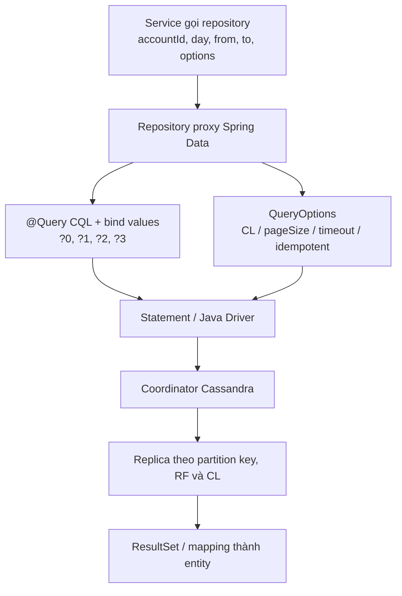
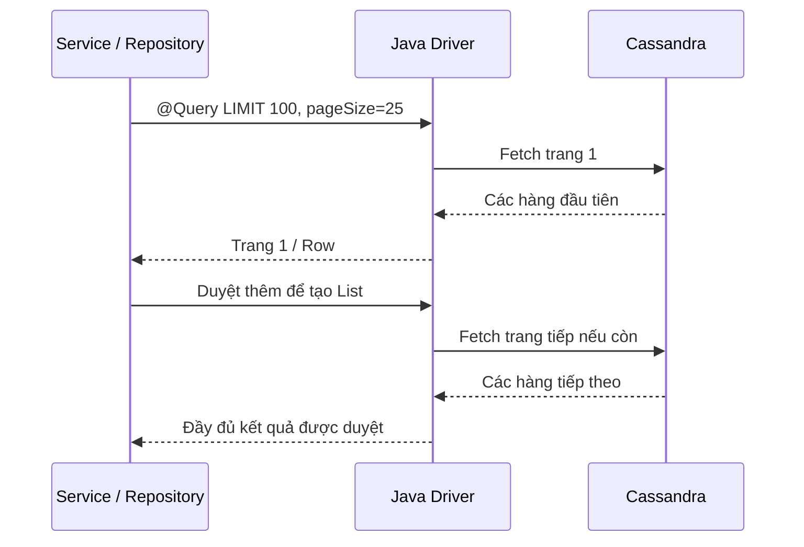

# Truyền QueryOptions cùng truy vấn khai báo

## 1. Vấn đề: cùng một câu CQL nhưng mỗi lần gọi có yêu cầu thực thi khác nhau

Trong **Spring Data Cassandra**, repository thường định nghĩa các truy vấn CQL bằng annotation `@Query`. Ví dụ, một truy vấn lấy sự kiện theo tài khoản và ngày có thể được dùng bởi nhiều trường hợp:

- Màn hình hoạt động gần đây cần kết quả nhanh với một **fetch page size** phù hợp.
- Tác vụ nội bộ cần đặt **timeout** riêng để tránh giữ request quá lâu.
- Một luồng đọc nhất định cần **consistency level (CL)** đã được đánh giá theo replication factor (RF) và yêu cầu nghiệp vụ.
- Khi chẩn đoán sự cố, nhóm phát triển cần bật **tracing** một cách có chọn lọc mà không sửa CQL.

Nếu viết một repository method mới cho mỗi tổ hợp timeout/page size/consistency, code sẽ lặp lại và khó bảo trì. Spring Data Cassandra cung cấp **`QueryOptions`** để truyền các tùy chọn thực thi tại **thời điểm gọi repository method**, kể cả method có `@Query` khai báo chuỗi CQL.

Ý tưởng trung tâm:

```text
@Query("SELECT ... WHERE ... ?0 ... ?1")
List<Entity> find...(giá_trị_1, giá_trị_2, QueryOptions options);
                                             |
                           không bind vào WHERE; áp dụng lên statement
```

**`QueryOptions` thuộc tầng thực thi query, không thuộc dữ liệu truy vấn.** Nó không thay đổi schema, không thêm điều kiện `WHERE`, không đổi partition key, không tự tạo `LIMIT` và không biến một truy vấn CQL không hợp lệ thành hợp lệ.

Sau bài học, bạn sẽ biết:

1. Khai báo đúng `QueryOptions` trong chữ ký phương thức repository có `@Query`.
2. Dùng `QueryOptions.builder()` để lựa chọn consistency, page size, timeout, idempotency và tracing.
3. Phân biệt tham số **bind vào CQL** với tham số **điều khiển thực thi**.
4. Hiểu mối quan hệ giữa `LIMIT`, `pageSize`, repository trả `List` và phân trang có paging state.
5. Phân tích ảnh hưởng RF/CL, timeout/retry và thiết kế bảng theo truy vấn.
6. Kiểm thử rằng options thực sự được áp dụng, thay vì chỉ thấy Java code biên dịch thành công.

Bài thuộc chương **Truy vấn `@Query`** của module `SPRING_DATA_CASSANDRA`, tập trung vào API repository kết hợp CQL, entity mapping và mô hình dữ liệu phân tán của Apache Cassandra.

> Ví dụ sử dụng Spring Data Cassandra 4.x, Java Driver 4.x và cấu hình thường gặp của Spring Boot 3.x. Package, builder và hành vi của `QueryOptions` đã được đối chiếu với tài liệu Spring Data Cassandra; khi nâng cấp phiên bản cần xác minh lại API và chạy integration test.

## 2. QueryOptions là gì và được xử lý ở đâu?

`QueryOptions` là class trong package:

```java
import org.springframework.data.cassandra.core.cql.QueryOptions;
```

Nó mô tả các tùy chọn cần áp dụng vào query khi thực thi. Spring Data Cassandra **nhận biết tham số kiểu `QueryOptions` trong repository method như tham số đặc biệt**, không xem đây là giá trị dùng để thay dấu `?0`, `?1` trong chuỗi `@Query`.



Điều quan trọng là **hai kênh thông tin riêng biệt**:

| Kênh | Đầu vào | Tác dụng |
| --- | --- | --- |
| **Query arguments** | `UUID accountId`, `LocalDate day`, `Instant from`, `Instant to` | Gắn giá trị vào các vị trí `?0`…`?3` của `@Query`; xác định **dữ liệu nào** cần đọc. |
| **QueryOptions** | `consistencyLevel`, `pageSize`, `timeout`, `idempotent`, … | Điều chỉnh **cách statement được thực thi**; không tham gia biểu thức `WHERE`. |

Ví dụ một method có **năm tham số Java** nhưng câu CQL chỉ có **bốn bind markers**. Tham số thứ năm là `QueryOptions` và không được thêm marker `?4` cho nó.

Các giá trị không được đặt trong `QueryOptions` sẽ lấy mặc định từ cấu hình/hạ tầng tương ứng theo cơ chế của phiên bản đang dùng. Chỉ các giá trị đã đặt mới được áp dụng lên statement. Không cần lặp lại mọi tham số mặc định trong mỗi lần gọi.

### Đừng nhầm với các kiểu gần tên

- `org.springframework.data.cassandra.core.cql.QueryOptions`: lớp tùy chọn của **Spring Data Cassandra** dùng ở repository method.
- `org.springframework.data.cassandra.core.query.Query`: đối tượng để xây truy vấn khi dùng `CassandraTemplate`; không phải chính `QueryOptions`.
- `com.datastax.oss.driver.api.core.cql.BoundStatement`: statement của **Java Driver** có API điều khiển các lựa chọn trực tiếp, như `setPageSize` hoặc `setConsistencyLevel`.
- `org.springframework.data.domain.Pageable`: đối tượng của Spring Data mô tả việc phân trang, không đồng nghĩa với `QueryOptions.pageSize`.
- `WriteOptions` hoặc `InsertOptions`/`UpdateOptions`: các tùy chọn khác trong API ghi của Spring Data, không phải lý do để tự đặt TTL hay điều kiện ghi vào `QueryOptions` của một `SELECT`.

## 3. Chuẩn bị schema Cassandra theo truy vấn

### 3.1. Yêu cầu nghiệp vụ và partition key

Giả sử có màn hình cần hiển thị **những hoạt động của một tài khoản trong một ngày**, có thể giới hạn thêm khoảng thời gian. Để query không phải quét toàn cluster, ta thiết kế bảng với:

- **Partition key**: `(account_id, activity_day)`.
- **Clustering columns**: `(occurred_at, activity_id)`, trong đó thời điểm giảm dần.
- Các thuộc tính như `activity_type` và `description` là cột dữ liệu thường.

Để thực hành trên một node ở DC `dc1`, tạo keyspace và bảng:

```sql
-- Lab một node, RF=1; không dùng nguyên cấu hình này cho production.
CREATE KEYSPACE IF NOT EXISTS learning
WITH replication = {
  'class': 'NetworkTopologyStrategy',
  'dc1': 1
};

CREATE TABLE IF NOT EXISTS learning.activity_by_account_day (
    account_id uuid,
    activity_day date,
    occurred_at timestamp,
    activity_id uuid,
    activity_type text,
    description text,
    PRIMARY KEY ((account_id, activity_day), occurred_at, activity_id)
) WITH CLUSTERING ORDER BY (
    occurred_at DESC,
    activity_id ASC
);
```

**Vì sao `activity_day` nằm trong partition key?** Truy vấn định vị theo tài khoản/ngày. Trong Cassandra, phân bucket theo ngày làm mỗi partition có phạm vi dữ liệu hữu hạn hơn so với một partition chứa toàn bộ lịch sử. Tuy nhiên, một tài khoản có hàng triệu hoạt động mỗi ngày vẫn có thể tạo **hot partition**; cần đo workload để chọn bucket phù hợp.

**Vì sao `activity_id` là clustering column thứ hai?** Hai hoạt động có thể xảy ra trong cùng một mili giây; dùng `activity_id` giúp không biến chúng thành cùng một khóa hàng.

### 3.2. Dữ liệu mẫu có thể đọc lại

```sql
INSERT INTO learning.activity_by_account_day (
    account_id, activity_day, occurred_at,
    activity_id, activity_type, description
) VALUES (
    11111111-1111-1111-1111-111111111111,
    '2026-11-25',
    '2026-11-25T08:00:00Z',
    22222222-2222-2222-2222-222222222222,
    'LOGIN',
    'Đăng nhập'
);

INSERT INTO learning.activity_by_account_day (
    account_id, activity_day, occurred_at,
    activity_id, activity_type, description
) VALUES (
    11111111-1111-1111-1111-111111111111,
    '2026-11-25',
    '2026-11-25T09:00:00Z',
    33333333-3333-3333-3333-333333333333,
    'VIEW',
    'Xem chi tiết đơn hàng'
);

INSERT INTO learning.activity_by_account_day (
    account_id, activity_day, occurred_at,
    activity_id, activity_type, description
) VALUES (
    11111111-1111-1111-1111-111111111111,
    '2026-11-25',
    '2026-11-25T10:00:00Z',
    44444444-4444-4444-4444-444444444444,
    'PURCHASE',
    'Thanh toán'
);
```

Câu query dưới đây là cơ sở của repository:

```sql
SELECT account_id, activity_day, occurred_at,
       activity_id, activity_type, description
FROM learning.activity_by_account_day
WHERE account_id = 11111111-1111-1111-1111-111111111111
  AND activity_day = '2026-11-25'
  AND occurred_at >= '2026-11-25T08:00:00Z'
  AND occurred_at <  '2026-11-25T11:00:00Z'
LIMIT 100;
```

Kết quả gồm ba hoạt động, theo thứ tự mặc định `10:00`, `09:00`, `08:00`. Khoảng `[08:00, 11:00)` là **nửa mở**: bao gồm mốc bắt đầu nhưng không lấy hàng ở mốc 11:00.

Nếu chỉ thêm `QueryOptions` mà bỏ `account_id` hoặc `activity_day` khỏi `WHERE`, truy vấn không tự động trở thành hiệu quả. **QueryOptions không sửa thiếu partition key**.

## 4. Kết nối Spring Boot và chuẩn bị entity

Ứng dụng **Spring Boot 3.x** có thể thêm starter:

```groovy
dependencies {
    implementation 'org.springframework.boot:spring-boot-starter-data-cassandra'
}
```

Cấu hình `application.yml`:

```yaml
spring:
  cassandra:
    contact-points: 127.0.0.1
    port: 9042
    local-datacenter: dc1
    keyspace-name: learning
    schema-action: NONE
```

- `contact-points` là endpoint ban đầu của Java Driver. `127.0.0.1` thích hợp khi Spring Boot chạy trên máy host và container Cassandra publish cổng `9042`.
- Nếu app chạy **trong cùng Docker network** với service Cassandra, dùng hostname service tương ứng; `localhost` bên trong app container là chính app container.
- `local-datacenter` phải đúng tên DC Cassandra công bố qua `system.local`.
- `keyspace-name` phải tồn tại; `schema-action: NONE` phù hợp khi DDL được quản lý qua script/migration.
- Với phiên bản Spring Boot khác, cần đối chiếu namespace cấu hình, vì các ví dụ cũ có thể dùng `spring.data.cassandra.*`.

### Entity mapping cho composite primary key

Để tập trung vào `@Query`, ví dụ dùng `@PrimaryKeyColumn` trực tiếp trên entity:

```java
package com.example.activity.domain;

import java.time.Instant;
import java.time.LocalDate;
import java.util.UUID;

import org.springframework.data.cassandra.core.cql.Ordering;
import org.springframework.data.cassandra.core.mapping.Column;
import org.springframework.data.cassandra.core.mapping.PrimaryKeyColumn;
import org.springframework.data.cassandra.core.mapping.PrimaryKeyType;
import org.springframework.data.cassandra.core.mapping.Table;

@Table("activity_by_account_day")
public class ActivityRecord {

    @PrimaryKeyColumn(name = "account_id", ordinal = 0,
        type = PrimaryKeyType.PARTITIONED)
    private UUID accountId;

    @PrimaryKeyColumn(name = "activity_day", ordinal = 1,
        type = PrimaryKeyType.PARTITIONED)
    private LocalDate activityDay;

    @PrimaryKeyColumn(name = "occurred_at", ordinal = 0,
        type = PrimaryKeyType.CLUSTERED, ordering = Ordering.DESCENDING)
    private Instant occurredAt;

    @PrimaryKeyColumn(name = "activity_id", ordinal = 1,
        type = PrimaryKeyType.CLUSTERED, ordering = Ordering.ASCENDING)
    private UUID activityId;

    @Column("activity_type")
    private String activityType;

    private String description;

    protected ActivityRecord() {
    }

    public UUID getAccountId() { return accountId; }
    public LocalDate getActivityDay() { return activityDay; }
    public Instant getOccurredAt() { return occurredAt; }
    public UUID getActivityId() { return activityId; }
    public String getActivityType() { return activityType; }
    public String getDescription() { return description; }

    // Bổ sung constructor/factory và mutator có kiểm soát
    // nếu ứng dụng cần tạo/ghi ActivityRecord bằng repository.
}
```

Đây là một entity **đủ để minh họa đọc/mapping**; trong dự án thực tế hãy hoàn thiện constructors và việc tạo đối tượng. Nếu chuyển sang `@PrimaryKeyClass`, cần mapping các thành phần khóa và chọn kiểu ID repository tương ứng. `QueryOptions` vẫn hoạt động độc lập với cách biểu diễn ID của entity.

## 5. Khai báo @Query có thêm tham số QueryOptions

Đây là phần cốt lõi. Repository khai báo một phương thức có bốn tham số bind CQL và một tham số `QueryOptions`:

```java
package com.example.activity.repository;

import java.time.Instant;
import java.time.LocalDate;
import java.util.List;
import java.util.UUID;

import org.springframework.data.cassandra.core.cql.QueryOptions;
import org.springframework.data.cassandra.core.mapping.MapId;
import org.springframework.data.cassandra.repository.CassandraRepository;
import org.springframework.data.cassandra.repository.Query;

import com.example.activity.domain.ActivityRecord;

public interface ActivityRepository
        extends CassandraRepository<ActivityRecord, MapId> {

    @Query(
        "SELECT account_id, activity_day, occurred_at, " +
        "activity_id, activity_type, description " +
        "FROM activity_by_account_day " +
        "WHERE account_id = ?0 AND activity_day = ?1 " +
        "AND occurred_at >= ?2 AND occurred_at < ?3 LIMIT 100"
    )
    List<ActivityRecord> findWindow(
        UUID accountId,
        LocalDate activityDay,
        Instant fromInclusive,
        Instant toExclusive,
        QueryOptions options
    );
}
```

Đọc chữ ký bằng bảng sau:

| Vị trí trong method | Giá trị Java | Vị trí ở câu `@Query` | Vai trò |
| --- | --- | --- | --- |
| 1 | `UUID accountId` | `?0` | Thành phần đầu partition key. |
| 2 | `LocalDate activityDay` | `?1` | Thành phần thứ hai partition key. |
| 3 | `Instant fromInclusive` | `?2` | Ranh giới bắt đầu, bao gồm. |
| 4 | `Instant toExclusive` | `?3` | Ranh giới kết thúc, loại trừ. |
| 5 | `QueryOptions options` | **Không có marker** | Cấu hình thực thi statement. |

**Điểm không được nhầm:** `QueryOptions` là **special parameter**. Không viết thêm `?4` chỉ vì method có tham số Java thứ năm. Nếu bạn muốn thêm một điều kiện dữ liệu khác trong CQL, phải khai báo một tham số query bình thường có kiểu và marker tương ứng.

### Điều gì xảy ra khi gọi method?

1. Spring Data tìm câu CQL định nghĩa trong `@Query`.
2. Các giá trị `accountId`, `activityDay`, `fromInclusive` và `toExclusive` được bind theo vị trí `?0`…`?3`.
3. `QueryOptions` được nhận diện riêng và những option đã cấu hình được áp dụng vào statement.
4. Java Driver gửi request tới Cassandra, định tuyến theo thông tin keyspace, contact points, local DC và partition key.
5. Kết quả được Spring Data chuyển từ row sang `ActivityRecord`; vì trả `List` nên caller nhận toàn bộ hàng do câu query trả về, tối đa `100` theo `LIMIT` trong ví dụ.

Không nhất thiết phải khai báo tham số `QueryOptions` ở cuối về mặt cú pháp API, nhưng **đặt cuối** làm chữ ký dễ đọc, giảm nhầm thứ tự bind khi bảo trì. Cần một bộ integration test để phát hiện đổi thứ tự `?0`/`?1` và mapping sai.

## 6. Tạo QueryOptions bằng builder và truyền từ service

### 6.1. Ví dụ đầy đủ với các lựa chọn phổ biến

```java
package com.example.activity.service;

import java.time.Duration;
import java.time.Instant;
import java.time.LocalDate;
import java.util.List;
import java.util.UUID;

import org.springframework.data.cassandra.core.cql.QueryOptions;
import org.springframework.stereotype.Service;

import com.datastax.oss.driver.api.core.DefaultConsistencyLevel;
import com.example.activity.domain.ActivityRecord;
import com.example.activity.repository.ActivityRepository;

@Service
public class ActivityService {

    private final ActivityRepository repository;

    public ActivityService(ActivityRepository repository) {
        this.repository = repository;
    }

    public List<ActivityRecord> readWindow(
            UUID accountId, LocalDate day,
            Instant fromInclusive, Instant toExclusive) {

        if (accountId == null || day == null
                || fromInclusive == null || toExclusive == null) {
            throw new IllegalArgumentException(
                "Account, ngay va khoang thoi gian la bat buoc");
        }

        if (fromInclusive.isAfter(toExclusive)) {
            throw new IllegalArgumentException(
                "from phai nho hon hoac bang to");
        }

        if (fromInclusive.equals(toExclusive)) {
            return List.of();
        }

        QueryOptions options = QueryOptions.builder()
            .consistencyLevel(DefaultConsistencyLevel.LOCAL_ONE)
            .pageSize(25)
            .timeout(Duration.ofSeconds(3))
            .idempotent(true)
            .build();

        return repository.findWindow(
            accountId, day, fromInclusive, toExclusive, options);
    }
}
```

Diễn giải:

- `LOCAL_ONE`: mức nhất quán **ví dụ của lab RF=1**, không phải giá trị chuẩn áp dụng mọi cluster và nghiệp vụ.
- `pageSize(25)`: Java Driver có mục tiêu fetch dữ liệu theo các trang khoảng 25 hàng; không giới hạn cả query xuống 25 hàng.
- `timeout(Duration.ofSeconds(3))`: giới hạn thời gian chờ theo statement; không thay đổi cấu hình timeout server hoặc SLA của toàn hệ thống.
- `idempotent(true)`: đánh dấu `SELECT` trong ví dụ là thao tác đọc không tạo mutation, giúp driver áp dụng chính sách phù hợp khi retry/speculative execution được cấu hình. Không dùng `true` cho mọi loại ghi.
- Chỉ tạo `QueryOptions` cho lần gọi đó; không cần tái cấu hình toàn bộ `CqlSession`.

**Giới hạn:** Method này đọc **một partition** ứng với `accountId` và `day`. Nếu client truyền khoảng vượt nhiều ngày, code vẫn không tự đọc các partition ngày khác. API nên yêu cầu khoảng thuộc bucket đã chọn hoặc có lớp điều phối đọc nhiều bucket có giới hạn.

### 6.2. Tạo một cấu hình cơ sở có thể tái sử dụng

`QueryOptions` được xây bằng builder và mô tả các lựa chọn nhất quán; có thể tạo cấu hình cơ sở cho một nhóm truy vấn:

```java
import java.time.Duration;

import org.springframework.data.cassandra.core.cql.QueryOptions;
import com.datastax.oss.driver.api.core.DefaultConsistencyLevel;

QueryOptions baseReadOptions = QueryOptions.builder()
    .consistencyLevel(DefaultConsistencyLevel.LOCAL_ONE)
    .pageSize(50)
    .timeout(Duration.ofSeconds(3))
    .build();

QueryOptions compactReadOptions = baseReadOptions
    .mutate()
    .pageSize(20)
    .build();
```

`mutate()` giúp tạo builder khởi tạo từ options đã có và tạo một options mới. Đây là cách thuận tiện để dùng một profile đọc mặc định nhưng thay đổi một lựa chọn theo use case.

Khi các option đi vào code nghiệp vụ, nên gói chúng trong một **chính sách truy cập dữ liệu** (factory/service) thay vì để bất kỳ HTTP caller nào tự chọn CL, timeout hoặc bật tracing tùy ý. Cấu hình thực thi cần được kiểm soát, đo lường và review.

## 7. Các trường QueryOptions thường gặp

Những lựa chọn dưới đây thuộc API `QueryOptions.QueryOptionsBuilder` trong các nhánh Spring Data Cassandra hiện đại:

| Lựa chọn | Ví dụ builder | Vai trò | Cần cảnh giác |
| --- | --- | --- | --- |
| **Consistency level** | `consistencyLevel(DefaultConsistencyLevel.LOCAL_ONE)` | Số phản hồi replica cần có theo topology/CL cho request. | Không sửa RF và không bảo đảm mọi ứng dụng đọc thấy cùng một ảnh chụp transaction. |
| **Page size** | `pageSize(25)` | Mục tiêu số hàng được lấy theo mỗi fetch của result set. | **Không** phải tổng số hàng và không phải page number/offset. |
| **Timeout** | `timeout(Duration.ofSeconds(3))` | Giới hạn thời gian chờ request trong driver. | Không tự tăng tốc query nặng; timeout không chứng minh ghi thất bại. |
| **Idempotent** | `idempotent(true)` | Cho driver biết statement có thể thử lại theo chính sách phù hợp hay không. | Đánh dấu sai ở ghi có side effect gây lặp tác động. |
| **Tracing** | `tracing(true)` | Yêu cầu tracing phía Cassandra cho câu lệnh khi cần chẩn đoán. | Tăng chi phí, có thể làm lộ metadata truy vấn; chỉ bật có chọn lọc. |
| **Execution profile** | `executionProfile("read-profile")` | Chọn profile đã cấu hình trong Java Driver. | Profile phải tồn tại; kiểm tra cách option rõ ràng phối hợp với profile. |
| **Keyspace** | `keyspace(CqlIdentifier.fromCql("learning"))` | Chỉ định keyspace gắn với statement khi use case yêu cầu. | Đổi keyspace không tự đổi entity schema, bảng hoặc quyền ứng dụng. |
| **Routing keyspace/key** | `routingKeyspace(...)`, `routingKey(...)` | Tùy biến token-aware routing chuyên sâu. | Tự thiết lập sai có thể làm lệch routing; ưu tiên bind đúng partition key để driver tính. |
| **Serial consistency** | `serialConsistencyLevel(DefaultConsistencyLevel.LOCAL_SERIAL)` | Tham gia protocol điều kiện/LWT trong ngữ cảnh hợp lệ. | Không có ý nghĩa cho một `SELECT` thông thường; không phải cách tăng độ mới dữ liệu đọc tùy ý. |

Với các dự án dùng nhánh API cũ, chú ý nhiều overload `readTimeout(...)` đã **deprecated**; các phiên bản hiện đại khuyến nghị `timeout(Duration)`. Không copy trực tiếp một snippet cũ có phương thức deprecated mà không xem chữ ký hiện tại.

### Thiết lập ít nhất những gì cần thiết

Không bắt buộc thiết lập mọi option. Ví dụ chỉ muốn thay page size:

```java
QueryOptions pageOnly = QueryOptions.builder()
    .pageSize(40)
    .build();
```

Trường khác chưa được đặt sẽ tuân theo cấu hình default/profile/annotation tương ứng của hạ tầng. Điều này thuận tiện hơn so với cố gắng đồng bộ mọi cấu hình của Java Driver trong từng service.

### Có được đặt timeout cực dài để hết lỗi?

Thường là không nên. Nếu query chậm do partition rất lớn hoặc phải đọc nhiều tombstone, tăng timeout chỉ làm request chờ lâu hơn và có thể giữ tài nguyên lâu hơn. Cần đo latency, kích thước partition, CL và trạng thái cluster; sau đó mới điều chỉnh timeout dựa trên SLO thực tế.

## 8. QueryOptions là tham số đặc biệt: những lỗi binding thường gặp

### 8.1. Sai: xem QueryOptions như một giá trị CQL

Ví dụ **không đúng**:

```java
@Query(
    "SELECT * FROM activity_by_account_day " +
    "WHERE account_id = ?0 AND activity_day = ?1 " +
    "AND occurred_at >= ?2 AND occurred_at < ?3 " +
    "AND description = ?4"
)
List<ActivityRecord> incorrect(
    UUID accountId, LocalDate day, Instant from, Instant to,
    QueryOptions options
);
```

`?4` đòi hỏi **một tham số dữ liệu thứ năm**, trong khi `options` được Spring Data nhận như special parameter, không phải giá trị để bind. Đồng thời, lọc `description` không phù hợp với bảng hiện tại nếu không có thiết kế truy vấn/index riêng.

Một dạng sai khác là cố đưa `QueryOptions` vào chuỗi `@Query`, ví dụ “`USING CONSISTENCY ?`” giống một cột dữ liệu. Những lựa chọn driver-level không được biểu diễn như một điều kiện `WHERE`.

### 8.2. Đúng: tách hẳn tham số dữ liệu và tùy chọn

```java
@Query(
    "SELECT * FROM activity_by_account_day " +
    "WHERE account_id = ?0 AND activity_day = ?1 " +
    "AND occurred_at >= ?2 AND occurred_at < ?3 LIMIT 100"
)
List<ActivityRecord> correct(
    UUID accountId, LocalDate day, Instant from, Instant to,
    QueryOptions options
);
```

**Nguyên tắc review:** Đếm **giá trị được bind**, không đếm tổng số tham số Java. `QueryOptions` là phần điều khiển của Spring Data, nên marker `?0`…`?3` chỉ gắn các tham số thực của câu query.

### 8.3. Thêm/sửa tham số phải cập nhật @Query nhất quán

Nếu sau này bổ sung lọc theo một clustering column hoặc kiểu điều kiện được Cassandra hỗ trợ, cần:

1. Xem lại schema/CQL trước để xác nhận restriction hợp lệ.
2. Thêm tham số Java cho **giá trị dữ liệu** mới.
3. Cập nhật marker `?N` đúng thứ tự; không dùng vị trí của `QueryOptions` làm marker.
4. Kiểm thử integration với dữ liệu đủ đa dạng để phát hiện bind nhầm `UUID`, `LocalDate`, `Instant`.
5. Kiểm tra đường tạo `QueryOptions` còn đúng chính sách hiệu năng/consistency.

Không dựa vào compiler Java để phát hiện một marker CQL gõ sai: lỗi có thể chỉ lộ ra khi repository khởi tạo hoặc thực thi request.

## 9. @Consistency tĩnh, cấu hình mặc định và QueryOptions động

Có ba mức ý tưởng cần phân biệt:

1. **Driver / Spring Data defaults:** cấu hình mặc định của session, execution profile và template.
2. **Annotation `@Consistency`** trên repository method: cách khai báo CL tĩnh cho method đó.
3. **`QueryOptions` ở tham số method:** cấu hình tại thời điểm gọi, phù hợp khi cần thay đổi tùy chọn theo use case.

Ví dụ tĩnh:

```java
import com.datastax.oss.driver.api.core.DefaultConsistencyLevel;
import org.springframework.data.cassandra.repository.Consistency;

@Consistency(DefaultConsistencyLevel.LOCAL_ONE)
@Query(
    "SELECT * FROM activity_by_account_day " +
    "WHERE account_id = ?0 AND activity_day = ?1 LIMIT 100"
)
List<ActivityRecord> findDayStatic(
    UUID accountId, LocalDate day
);
```

> **Lưu ý phiên bản:** Annotation `@Consistency` thuộc repository của Spring Data Cassandra, nhưng kiểu argument/chữ ký có thể thay đổi giữa các nhánh; code minh họa cần được đối chiếu với API thực tế trước khi dùng. Với dự án ưu tiên runtime options, ví dụ `QueryOptions` ở các phần trước là đường rõ ràng hơn.

Nếu method **đồng thời** khai báo `@Consistency` và nhận `QueryOptions` có CL riêng, hãy kiểm tra rõ **thứ tự áp dụng và precedence** của phiên bản đang chạy, thay vì dựa vào suy đoán. Cách dễ bảo trì là để một policy rõ ràng sở hữu CL của mỗi đường đọc.

Ví dụ hai use case dùng chung CQL nhưng chọn option khác nhau:

```java
QueryOptions fastRead = QueryOptions.builder()
    .consistencyLevel(DefaultConsistencyLevel.LOCAL_ONE)
    .pageSize(50)
    .build();

QueryOptions strongerRead = QueryOptions.builder()
    .consistencyLevel(DefaultConsistencyLevel.LOCAL_QUORUM)
    .pageSize(50)
    .build();
```

Đây là **hai profile ý tưởng**, không phải khuyến nghị dùng `LOCAL_QUORUM` trong lab RF=1 để “tăng độ mạnh”. Nếu local DC có RF=3, `LOCAL_QUORUM` thường cần hai replica hợp lệ; với RF=1 thì quorum địa phương chỉ là một replica.

| Cách cấu hình | Thời điểm chọn | Ưu điểm | Rủi ro |
| --- | --- | --- | --- |
| Driver defaults | Khi tạo session/profile | Ít code lặp, thống nhất hệ thống | Một mặc định có thể không hợp mọi query. |
| `@Consistency` | Khi khai báo method | Chính sách tĩnh dễ thấy | Khó dùng một method với nhiều CL khác nhau. |
| `QueryOptions` | Mỗi lần gọi method | Linh hoạt về CL, timeout, page size | Nếu cho caller tự do chọn, dễ phá chính sách consistency/latency. |

## 10. PageSize không phải LIMIT hay phân trang API

Một lỗi phổ biến là nghĩ:

```java
QueryOptions.builder().pageSize(25).build();
```

đồng nghĩa câu query chỉ trả **25 hàng**. Điều này **không đúng**.

### 10.1. Ba khái niệm riêng

| Khái niệm | Ở đâu? | Tác dụng |
| --- | --- | --- |
| **`LIMIT 100`** | CQL trong `@Query` | Giới hạn tối đa **100 hàng** của một lần thực thi query. |
| **`pageSize(25)`** | `QueryOptions` / Java Driver | Cố gắng lấy kết quả thành những đợt fetch khoảng **25 hàng**. |
| **API pagination/cursor** | Repository method, `Pageable`/`Slice`/`Window` hoặc paging state | Xác định cách client lấy từng đoạn dữ liệu qua nhiều request. |

Ví dụ `@Query` có `LIMIT 100`, options `pageSize(25)` và method trả `List<ActivityRecord>`. Nếu có 70 hàng hợp lệ, việc thực thi và duyệt kết quả **có thể fetch nhiều trang** để tạo list 70 hàng; nó không tự trả đúng 25 hàng chỉ vì page size bằng 25.



### 10.2. Nếu API thực sự muốn mỗi trang 25 hàng?

Hãy thiết kế **phân trang ở mức API**: dùng các cơ chế repository trả `Slice`/`Window` hoặc Java Driver paging state theo phiên bản được hỗ trợ, hoặc một keyset cursor phù hợp clustering key.

- Với Cassandra, **paging state** là opaque token gắn với statement và tham số query; đừng biến nó thành offset SQL hay một ID bền vững vĩnh viễn.
- Nếu dữ liệu đang được ghi đồng thời, kết quả giữa các trang có thể thay đổi; cần hợp đồng consistency/ordering rõ ràng.
- `Pageable` không phải là `QueryOptions`; phối hợp hai special parameters phụ thuộc các quy tắc repository của phiên bản framework, cần integration test thay vì giả định mọi tổ hợp đều hợp lệ.
- Nếu partition rất lớn, việc cố duyệt hết `List` ở service có thể tạo áp lực memory dù page size nhỏ.

### 10.3. Cẩn trọng với câu query không có LIMIT

Một method `@Query("SELECT ... WHERE account_id = ?0 AND activity_day = ?1")` trả `List` có thể đọc rất nhiều hàng trong partition. Thêm `pageSize(25)` **không tự giới hạn tổng số hàng**. Hãy có chiến lược `LIMIT`, paging, giới hạn số request và phân bucket theo workload.

## 11. Consistency level phải đi cùng RF và topology

`QueryOptions.consistencyLevel(...)` giúp chọn **số phản hồi replica** yêu cầu cho thao tác; nó không thay đổi RF hay số node thật trong cluster.

Ví dụ giả định **một DC** có RF=3:

| CL | Phản hồi cần có từ replica | Hệ quả tổng quát |
| --- | ---: | --- |
| `LOCAL_ONE` | 1 replica ở local DC | Có thể ít chờ hơn nhưng có nguy cơ đọc từ bản sao chưa bắt kịp thay đổi. |
| `LOCAL_QUORUM` | 2 replica ở local DC | Tăng điều kiện phản hồi; có thể tăng latency và giảm availability khi replica lỗi. |
| `ALL` | 3 replica | Nhạy với replica chậm/không phản hồi. |

Với **lab một node, RF=1**, `LOCAL_QUORUM` cũng chỉ cần một replica tại DC đó. Không thể đánh giá khả năng chịu lỗi của cấu hình RF=3 từ lab này.

### QueryOptions có đảm bảo “đọc mới nhất” không?

Không tự động. Kết quả đọc phụ thuộc **read CL + write CL + RF + số replica sẵn sàng + cơ chế timestamp và điều kiện ghi**. Chẳng hạn, yêu cầu đọc theo CL cao hơn không sửa được dữ liệu đã ghi sai partition key hay số tiền bị chuyển sai kiểu.

Nếu nghiệp vụ cần **linearizable compare-and-set**, phải thiết kế ghi có điều kiện/LWT và các yêu cầu serial consistency phù hợp; không dùng `LOCAL_QUORUM` của một `SELECT` thông thường làm thay thế.

### Chọn CL theo use case, không theo input của người dùng

Đừng cho query parameter HTTP kiểu `?consistency=ALL` tự động biến thành `QueryOptions.consistencyLevel(ALL)` nếu không có kiểm soát. Một caller có thể làm query chậm hoặc không khả dụng. Hãy cấu hình một số **policy được phê duyệt** cho từng nhóm nghiệp vụ, giới hạn lựa chọn và quan sát latency/error.

## 12. Timeout, idempotency, retry và tracing

### 12.1. Request timeout không sửa được query sai

`timeout(Duration.ofSeconds(3))` quy định driver chờ trong giới hạn tương ứng cho thao tác. Một request có thể timeout vì nhiều lý do: replica chậm, tài nguyên cạn, partition lớn, nhiều tombstone, CL không đáp ứng hoặc network.

Điều chỉnh hợp lý:

1. Đo latency bình thường/p95/p99 theo query fingerprint.
2. Kiểm tra `WHERE` có đủ partition key và clustering restriction phù hợp.
3. Kiểm tra số hàng đọc, `LIMIT`, số trang, kích thước partition, tombstone và tải node.
4. Đối chiếu CL và SLO.
5. Sau đó mới chọn timeout theo ngân sách request của API; timeout quá dài có thể gây nghẽn tài nguyên phía ứng dụng.

**Đừng gán nghĩa sai cho timeout của ghi:** Cassandra có thể đã áp dụng một phần mutation trước khi client nhận timeout. Với những thao tác ghi, retry và idempotency cần được thiết kế theo nghiệp vụ.

### 12.2. Idempotent: thông tin cho driver, không phải cơ chế nghiệp vụ

`idempotent(true)` không biến một thao tác có side effect thành an toàn khi lặp lại. Nó **khai báo** rằng thực thi lại statement có thể chấp nhận theo semantics đã phân tích.

- `SELECT` bình thường không tạo mutation nên thường được coi là idempotent.
- Một thao tác `UPDATE counter = counter + 1` không idempotent khi thực thi lại.
- `INSERT` với TTL, timestamp được server tạo, hoặc logic phụ thuộc trạng thái trước đó có thể có khác biệt khi lặp lại; không đặt `idempotent(true)` máy móc.
- LWT `IF NOT EXISTS`/`IF ...` cần xử lý kết quả `[applied]` và trạng thái timeout không chắc chắn theo hợp đồng nghiệp vụ.

Việc driver thực sự retry/speculative execute còn phụ thuộc **driver policy**, loại lỗi và cấu hình tương ứng. `idempotent(true)` không bảo đảm luôn có retry, cũng không bảo đảm đọc cùng một snapshot dữ liệu ở mọi lần thử.

### 12.3. Tracing khi cần kiểm tra vấn đề khó

Có thể tạo options tạm thời:

```java
QueryOptions debugRead = QueryOptions.builder()
    .pageSize(25)
    .tracing(true)
    .timeout(Duration.ofSeconds(5))
    .build();
```

**Tracing có chi phí** và có thể tạo metadata nhạy cảm về việc truy vấn. Chỉ bật có chọn lọc trong lab hoặc một phạm vi giám sát được cho phép, có quyền truy cập/retention phù hợp. Không đặt `tracing(true)` cho tất cả request production.

### 12.4. Execution profile

Khi có driver execution profile đã được cấu hình bằng tài liệu/setting của driver, có thể chọn:

```java
QueryOptions profileBased = QueryOptions.builder()
    .executionProfile("read-profile")
    .pageSize(25)
    .build();
```

Tên `read-profile` là **ví dụ**, không phải một profile có sẵn mặc định. Nếu profile chưa được định nghĩa, request có thể lỗi khi thực thi. Khi dùng profile kết hợp các option cụ thể, phải kiểm tra thứ tự ưu tiên theo phiên bản đang chạy.

## 13. Những gì QueryOptions không thể làm

Một số tình huống dễ dẫn tới cấu hình sai:

| Mong muốn | QueryOptions có giải quyết? | Cách xử lý đúng |
| --- | --- | --- |
| Tìm mọi sự kiện theo `description` trên toàn cluster | **Không** | Thiết kế bảng/chỉ mục theo query pattern; không dựa vào `ALLOW FILTERING` một cách mặc định. |
| Tự thêm điều kiện ngày khi đã bind account | **Không** | Cập nhật `@Query` và truyền đúng `LocalDate activityDay`. |
| Chuyển một `SELECT` thành “lấy đúng 25 kết quả” | `pageSize` **không** | Dùng `LIMIT`/phân trang ở mức API. |
| Đổi thứ tự kết quả theo mọi cột tùy ý | **Không** | Cassandra chỉ hỗ trợ thứ tự phù hợp clustering key và restriction; thiết kế bảng tương ứng. |
| Tạo keyspace hoặc tăng RF | **Không** | Quản lý schema/topology bằng CQL và quy trình vận hành. |
| Tạo index tự động | **Không** | Chủ động lựa chọn index hoặc bảng theo truy vấn, đánh giá hiệu năng. |
| Thiết lập username/password/TLS cho từng request | **Không** | Cấu hình `CqlSession`/driver và secret management phù hợp. |
| Bảo đảm delete/insert chỉ xảy ra một lần | **Không** | Thiết kế LWT/idempotency và xử lý xung đột. |
| Tự sửa lỗi đồng hồ/múi giờ | **Không** | Chuẩn hóa `Instant`/`LocalDate` theo business zone. |
| Tự động hóa distributed transaction nhiều partition | **Không** | Thiết kế luồng nghiệp vụ, reconciliation và nhất quán phù hợp Cassandra. |

### Keyspace/routing chuyên sâu

Builder có một số option về keyspace/routing. Đây **không phải** cách để đổi schema của entity chỉ bằng một chuỗi: nếu entity mapping và câu `@Query` đang trỏ bảng cố định, việc gắn keyspace khác lên statement không khiến bảng hoặc cột xuất hiện ở keyspace mới.

Ở ứng dụng chỉ dùng một keyspace, thường nên để session và cấu hình Spring Data sở hữu keyspace. Không tự đặt routing key/raw token khi đã bind đầy đủ partition key và driver có thể tính định tuyến token-aware.

### Serial consistency

Tùy chọn `serialConsistencyLevel(...)` thuộc ngữ cảnh **conditional statements / LWT**. Không áp dụng nó như một cách “đọc mọi thứ mới nhất” cho câu `SELECT` thông thường; nếu phải làm việc với LWT, cần hiểu serial phase, normal consistency, timeout và rủi ro retry riêng.

## 14. Lỗi thường gặp và cách khoanh vùng

| Triệu chứng | Nguyên nhân thường gặp | Hướng xử lý |
| --- | --- | --- |
| Repository báo thiếu tham số bind hoặc query không hợp lệ | Tính cả `QueryOptions` là `?N` trong `@Query`, hoặc đổi thứ tự tham số. | Đếm chỉ **query arguments**, đối chiếu `?0`…`?3` và kiểm thử startup/query. |
| `QueryOptions` import sai package | Dùng type không thuộc Spring Data Cassandra hoặc nhầm `Query` của core. | Import `org.springframework.data.cassandra.core.cql.QueryOptions`. |
| Biên dịch lỗi `readTimeout(...)` hoặc warning deprecated | Dùng API từ phiên bản Spring Data cũ. | Ưu tiên `timeout(Duration)` trên nhánh hiện đại, kiểm tra Javadoc. |
| `pageSize(25)` nhưng repository trả 70 hàng | Page size chỉ là chunk fetch; `List` có thể gom nhiều trang. | Đặt `LIMIT` và dùng API phân trang phù hợp khi muốn trang 25 hàng. |
| Query quá chậm mặc dù giảm page size | Partition quá lớn, nhiều tombstone, kết quả quá rộng, RF/CL hoặc node chậm. | Đo query/cluster; thiết kế lại bucket, giới hạn dữ liệu và xử lý paging. |
| `ReadTimeoutException` khi giảm timeout | Ngân sách timeout không phù hợp latency thực tế; query/nodes chậm. | Đối chiếu SLO, p95/p99, retry và áp lực cluster trước khi chỉnh. |
| `UnavailableException` ở CL cao | Không đủ replica đáp ứng CL trong DC/topology. | Kiểm tra RF, số replica sẵn sàng, DC và CL; không chỉ tăng timeout. |
| Truy vấn có QueryOptions nhưng vẫn bị `InvalidQueryException` | `WHERE` không phù hợp partition/clustering key hoặc CQL sai. | Sửa schema/query; QueryOptions không thay restriction. |
| Đọc thiếu hàng gần nửa đêm | Writer/reader tính `activity_day` bằng zone khác. | Thống nhất quy tắc bucket và kiểm tra migration dữ liệu nếu đã sai. |
| Kết quả từ `@Query` và derived query khác nhau | Query predicates, LIMIT, sort hoặc option của hai method khác. | So sánh CQL được sinh, bind values, CL và các tùy chọn áp dụng. |
| Gọi `executionProfile("read-profile")` nhưng lỗi | Profile chưa được định nghĩa trong Java Driver. | Cấu hình profile hợp lệ, test startup và query; tránh giả định có sẵn. |
| Latency tăng sau khi bật tracing | Tracing phát sinh thêm công việc/metadata. | Chỉ bật có chọn lọc và tắt sau khi chẩn đoán. |
| LWT không áp dụng dù không có exception | Điều kiện `IF NOT EXISTS`/`IF` không thỏa. | Đọc trạng thái `[applied]` và xử lý conflict; không dựa vào options để kết luận thành công. |

### Trình tự chẩn đoán đề xuất

1. **CQL**: truy vấn gốc có chạy được với cùng partition key và giá trị trong `cqlsh`?
2. **Binding**: `?0`, `?1`, `?2`, `?3` có đúng kiểu/đúng vị trí, và `QueryOptions` có bị đặt nhầm thành marker không?
3. **Session**: ứng dụng kết nối đúng host, port, keyspace, local DC?
4. **Options**: bạn thực sự đã đặt CL/pageSize/timeout nào? Có dùng execution profile hoặc annotation khác làm chồng chính sách?
5. **Result**: `LIMIT` và kiểu trả `List`/`Slice` có phù hợp mục tiêu?
6. **Cluster**: node/replica có khỏe, RF/CL tương thích, latency và tombstone thế nào?
7. **Nghiệp vụ**: ranh giới thời gian, zone và cách phân bucket có nhất quán giữa writer/reader không?

## 15. Bài thực hành: cùng @Query, nhiều QueryOptions

### Bài 1 — Từ repository method tới CQL

Dùng bảng `learning.activity_by_account_day` và ba bản ghi mẫu.

Gọi:

```java
UUID accountId = UUID.fromString(
    "11111111-1111-1111-1111-111111111111");

LocalDate day = LocalDate.of(2026, 11, 25);
Instant from = Instant.parse("2026-11-25T08:00:00Z");
Instant to = Instant.parse("2026-11-25T11:00:00Z");

QueryOptions options = QueryOptions.builder()
    .consistencyLevel(DefaultConsistencyLevel.LOCAL_ONE)
    .pageSize(25)
    .build();

List<ActivityRecord> rows =
    repository.findWindow(accountId, day, from, to, options);
```

Kỳ vọng có **3 hàng**, theo clustering order mặc định `10:00`, `09:00`, `08:00`.

Giải thích vì sao `options` không được bind thành `?4` và vì sao các dấu `?0`…`?3` phải giữ đúng thứ tự, kể cả khi bạn đổi cách xây `QueryOptions`.

### Bài 2 — Kiểm chứng pageSize không phải LIMIT

Tạo ít nhất 60 hoạt động trong **cùng partition**, mỗi hàng có `activity_id` riêng. Gọi một query có `LIMIT 100` với:

- `pageSize(10)`.
- `pageSize(25)`.
- `pageSize(50)`.

Khi method trả `List` và toàn bộ kết quả được tiêu thụ, số hàng trả về phải tuân theo **tập dữ liệu và `LIMIT`**, không tự bằng 10/25/50. Quan sát latency và số lần fetch qua công cụ giám sát phù hợp; không dùng page size cực nhỏ trong production chỉ vì lab chạy được.

### Bài 3 — Đổi timeout không đổi query pattern

Dùng cùng câu `@Query`, gọi với `timeout(Duration.ofMillis(500))` và `timeout(Duration.ofSeconds(3))` trong môi trường lab được kiểm soát. Ghi nhận khả năng timeout và độ trễ, **không cố tình tăng tải lên cluster dùng chung**. Giải thích vì sao việc tăng timeout không khắc phục một partition quá lớn.

### Bài 4 — CL và RF

Trên lab RF=1, gọi `LOCAL_ONE` và `LOCAL_QUORUM` theo khả năng cluster hỗ trợ; giải thích vì sao cả hai đều không mô phỏng **quorum 2/3**. Với cluster thử nghiệm nhiều node RF=3 nếu được cấp riêng, đánh giá số replica cần phản hồi và latency khi một replica không khả dụng.

### Bài 5 — Phát hiện lỗi bind

Tạo một method lab cố ý dùng `?4` trong `@Query` khi chỉ có bốn tham số query và `QueryOptions`. Kiểm tra lỗi mà framework/driver báo rồi sửa về `?0`…`?3`. Không giữ method lỗi này trong branch triển khai.

### Bài 6 — QueryOptions với derived query

Ngoài `@Query`, có thể khai báo method dẫn xuất phù hợp partition key, ví dụ:

```java
List<ActivityRecord> findByAccountIdAndActivityDay(
    UUID accountId, LocalDate activityDay, QueryOptions options
);
```

So sánh cách dùng options ở method này với `findWindow` khai báo bằng `@Query`. Nhận xét rằng **cùng đối tượng `QueryOptions` không có nghĩa hai CQL có cùng predicates hay giới hạn kết quả**.

## 16. Checklist review

- [ ] `@Query` là CQL phù hợp Cassandra, đã đối chiếu primary key và partition key.
- [ ] `QueryOptions` import từ `org.springframework.data.cassandra.core.cql`.
- [ ] `QueryOptions` được khai báo như special parameter, không chiếm marker `?N`.
- [ ] Query arguments có kiểu Java phù hợp CQL (`UUID`, `LocalDate`, `Instant`…).
- [ ] Đủ thành phần partition key, range tuân thủ clustering key; không dựa vào `ALLOW FILTERING` để che lỗi thiết kế.
- [ ] `consistencyLevel` được chọn theo RF/DC, mục tiêu nghiệp vụ và chính sách read/write CL.
- [ ] `pageSize` không bị hiểu thành `LIMIT`, offset hoặc API page number.
- [ ] Method trả `List` có giới hạn dữ liệu hợp lý; nếu cần paging thật, đã có hợp đồng `Slice`/`Window`/paging state phù hợp.
- [ ] `timeout` phù hợp SLO và latency thực, không chỉ tăng để né lỗi cluster.
- [ ] `idempotent(true)` chỉ dùng khi statement thực sự an toàn khi lặp lại; retry policy đã được hiểu.
- [ ] Tracing chỉ bật có chọn lọc, không vô ý làm tăng chi phí hoặc tiết lộ dữ liệu nhạy cảm.
- [ ] Không trộn `@Consistency`, execution profile và QueryOptions động theo cách không xác định precedence.
- [ ] Không dùng QueryOptions như cách thay đổi TTL, schema, auth/TLS hoặc LWT semantics.
- [ ] Có integration test với nhiều mức page size, timeout, CL và các ca bind sai.
- [ ] Đã theo dõi latency, request timeout, retry, partition size và tombstone.
- [ ] Đã tách cấu hình của một query khỏi dữ liệu nghiệp vụ và bảo đảm lựa chọn runtime options được kiểm soát.

## 17. Tài liệu tham khảo

- [Spring Data Cassandra — Cassandra-specific Query Methods](https://docs.spring.io/spring-data/cassandra/reference/cassandra/repositories/query-methods.html): giải thích `QueryOptions` như special parameter dùng được với derived và `@Query` repository methods.
- [Spring Data Cassandra 4.4 — QueryOptions API](https://docs.spring.io/spring-data/cassandra/docs/4.4.x/api/org/springframework/data/cassandra/core/cql/QueryOptions.html): class `QueryOptions` và `builder()`.
- [Spring Data Cassandra — QueryOptionsBuilder API](https://docs.spring.io/spring-data/cassandra/docs/current/api/org/springframework/data/cassandra/core/cql/QueryOptions.QueryOptionsBuilder.html): các lựa chọn builder như consistency, page size và timeout.
- [Spring Data Cassandra — Prepared Statements](https://docs.spring.io/spring-data/cassandra/reference/cassandra/prepared-statements.html): cơ chế chuẩn bị/bind giá trị để tránh ghép CQL từ input tùy ý.

Khi tham khảo tài liệu, luôn chọn phiên bản tương ứng với **Spring Boot, Spring Data Cassandra và Java Driver** thực sự có trong ứng dụng.

**Kết luận:** Truyền `QueryOptions` vào một repository method có `@Query` là cách **tách dữ liệu CQL khỏi chính sách thực thi**. Các tham số `?0`…`?N` quyết định hàng nào được truy vấn, còn `QueryOptions` quyết định những lựa chọn như consistency, page size và timeout cho lần gọi đó. Dù API linh hoạt, kết quả đúng và nhanh vẫn phụ thuộc vào **schema theo truy vấn, partition key, replication/CL, paging, idempotency và quan sát hiệu năng**.
