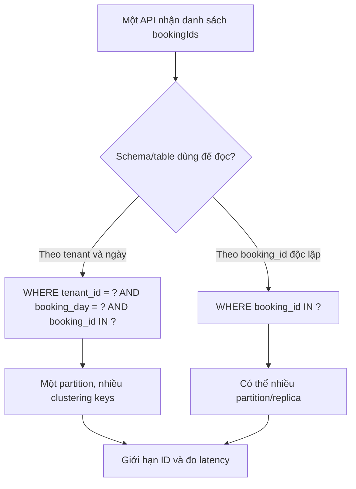

# Tham số collection, IN và giới hạn kích thước đầu vào

Khi viết truy vấn bằng **`@Query` trong Spring Data Cassandra**, bạn có thể cần nhận **một tập ID** từ ứng dụng để lấy nhiều bản ghi: “Xem thông tin của 10 booking trong ngày”, “Đối chiếu 20 mã sự kiện đã chọn”, hoặc “Lấy một nhóm đơn hàng theo khóa”. CQL hỗ trợ toán tử **`IN`** và cơ chế **bind tham số collection** cho một số dạng điều kiện khóa. Tuy nhiên, một danh sách ID càng lớn **không tự động trở thành một truy vấn hiệu quả**: nó có thể tăng tải lên coordinator, số partition cần liên hệ, độ trễ, dung lượng request và bộ nhớ của ứng dụng.

Bài học thuộc chương **Truy vấn `@Query`** của module **`SPRING_DATA_CASSANDRA`**. Module tập trung vào entity mapping, repository, `CassandraTemplate` và CQL, cùng những quy tắc thiết kế bảng theo truy vấn, partition key, consistency level, paging và hiệu năng của hệ thống dữ liệu phân tán. Trọng tâm ở đây là **dùng `IN` đúng phạm vi, bind list an toàn, giới hạn đầu vào và biết khi nào phải đổi cách truy vấn**.

**Sau bài học, bạn có thể:**

1. Phân biệt collection **được dùng làm danh sách giá trị trong `IN`** với cột CQL kiểu `list`, `set` hoặc `map`.
2. Viết `@Query` có `IN ?N` và tham số Java `List<UUID>`, tránh ghép chuỗi CQL từ dữ liệu người dùng.
3. Hiểu khác biệt giữa `IN` trên clustering column trong **một partition** và `IN` trên partition key có thể chạm **nhiều partition**.
4. Kiểm soát **số ID, độ dài request, giá trị null/rỗng, duplicate, quyền tenant và thời gian xử lý**.
5. Phân biệt số phần tử đầu vào của `IN`, `LIMIT` và **page size** của Java Driver.
6. Chọn giữa repository `@Query`, `CassandraTemplate`/`CqlOperations` và `CqlSession` khi có yêu cầu kiểm soát cao hơn.

## 1. IN làm gì và không làm gì?

`IN` trong CQL biểu diễn phép kiểm tra một giá trị cột thuộc tập lựa chọn, ví dụ:

```sql
SELECT booking_id, status
FROM bookings_by_id
WHERE booking_id IN (
    6f555d2f-167d-41aa-b6e0-33d0d38ec610,
    8cd0996a-0c94-4db5-b3db-7a6cce4a0271
);
```

Ở đây cột `booking_id` là khóa phân vùng của bảng `bookings_by_id` (sẽ được định nghĩa ở mục 3). Hai UUID là **hai giá trị ứng viên** cần tra cứu. Cassandra có thể phải đọc nhiều partition tương ứng. `IN` không tương đương JOIN, không có nghĩa dữ liệu được lưu trong một list, và **không bảo đảm thứ tự kết quả giống thứ tự các giá trị trong danh sách đầu vào**.

### Phân biệt ba loại “collection”

| Khái niệm | Ví dụ | Ý nghĩa |
| --- | --- | --- |
| Danh sách giá trị của `IN` | `WHERE booking_id IN ?` | Tập ứng viên để so khớp giá trị khóa/cột được truy vấn hợp lệ |
| Cột CQL kiểu collection | `tags set<text>`, `scores list<int>` | Dữ liệu **được lưu trong một cột**, không tự là điều kiện `IN` |
| Java collection | `List<UUID> ids` | Kiểu dữ liệu Java dùng truyền nhiều ID vào một tham số đã bind |

Với một cột CQL `tags set<text>`, nhu cầu “hàng có chứa tag `VIP`” có thể được mô tả bằng toán tử `CONTAINS` và cần một đường truy vấn/index tương ứng; nó **không phải** `WHERE tags IN ?` để kiểm tra một phần tử trong set.

**Quy tắc:** trước khi viết `IN`, hãy hỏi **cột bên trái `IN` có thuộc khóa hoặc có đường truy vấn được Cassandra hỗ trợ không?** Việc đặt một danh sách vào method repository không làm một cột thường trở thành searchable.

## 2. Hai phạm vi IN quan trọng trong Cassandra

Có hai tình huống khác nhau:

**A. Nhiều clustering values trong cùng một partition.** Ví dụ `tenant_id` và `booking_day` cố định, chỉ `booking_id` nhận nhiều giá trị. Cassandra có thể định vị một partition rồi chọn một số hàng bên trong.

**B. Nhiều partition keys.** Ví dụ `booking_id` là partition key duy nhất và `WHERE booking_id IN (...)` chứa 20 ID. Truy vấn có thể liên hệ **nhiều partition/replica**; chi phí không giống một point lookup duy nhất.



**Cả A và B đều phải có giới hạn input.** A thường có phạm vi dữ liệu dễ kiểm soát hơn do đủ partition key, nhưng partition lớn/hot vẫn có thể tạo chi phí. B không nên trở thành API “multi-get” với hàng nghìn hoặc hàng triệu ID chỉ vì cú pháp CQL chấp nhận một danh sách.

## 3. Chuẩn bị schema cho ví dụ chính: IN trong một partition

Giả sử yêu cầu nghiệp vụ là: “Lấy tối đa 20 booking được chọn của **một tenant trong một ngày**”. Thiết kế bảng:

```sql
CREATE TABLE IF NOT EXISTS bookings_by_tenant_day (
    tenant_id uuid,
    booking_day date,
    booking_id uuid,
    created_at timestamp,
    status text,
    total_amount_cents bigint,
    PRIMARY KEY ((tenant_id, booking_day), booking_id)
);
```

| Thành phần | Loại khóa | Tác dụng |
| --- | --- | --- |
| `tenant_id` | Partition key, phần 1 | Tách tenant |
| `booking_day` | Partition key, phần 2 | Bucket theo ngày, hạn chế partition quá lớn |
| `booking_id` | Clustering column | Xác định hàng trong partition |
| `created_at` | Cột thường | Thời điểm nghiệp vụ; **không tự được dùng để ORDER BY** |
| `status` | Cột thường | Trạng thái booking |
| `total_amount_cents` | Cột thường | Số tiền tính theo đơn vị nhỏ để tránh lỗi biểu diễn số thực |

Truy vấn phù hợp:

```sql
SELECT tenant_id, booking_day, booking_id,
       created_at, status, total_amount_cents
FROM bookings_by_tenant_day
WHERE tenant_id = 7847cc7a-8a8d-4970-924b-95cd53f8b3a5
  AND booking_day = '2026-11-25'
  AND booking_id IN (
      6f555d2f-167d-41aa-b6e0-33d0d38ec610,
      8cd0996a-0c94-4db5-b3db-7a6cce4a0271
  );
```

Ở đây **đủ hai cột partition key** và `IN` áp dụng trên **clustering column duy nhất** là `booking_id`. Đây là một trường hợp có thể kiểm soát tốt cho `@Query`. Các ràng buộc về vị trí `IN` và điều kiện trên clustering columns còn phụ thuộc hình dạng primary key; **không suy ra rằng có thể đặt `IN` vào mọi cột hoặc xen tùy ý với range conditions**.

### Lưu ý về thứ tự kết quả

Truy vấn có thể trả hàng theo **thứ tự clustering của partition** (trong bảng này là `booking_id` theo thứ tự mặc định), **không phải theo thứ tự danh sách ID đã truyền vào**. Vì `created_at` không phải clustering column, không được yêu cầu `ORDER BY created_at DESC` trực tiếp trên bảng này rồi kỳ vọng Cassandra tự sắp xếp.

Nếu nghiệp vụ cần “booking mới nhất”, một bảng được thiết kế theo `created_at` trong clustering key sẽ phù hợp hơn. Nếu chỉ muốn trả kết quả theo **thứ tự ID do client yêu cầu**, có thể sắp xếp lại trong Java sau khi lấy **tập kết quả nhỏ, có giới hạn**.

## 4. Entity mapping cho khóa tổng hợp

Tầng Spring Data cần hiểu chính xác primary key. Ví dụ lớp khóa:

```java
package example.booking.data;

import java.io.Serializable;
import java.time.LocalDate;
import java.util.UUID;
import org.springframework.data.cassandra.core.mapping.PrimaryKeyClass;
import org.springframework.data.cassandra.core.mapping.PrimaryKeyColumn;
import org.springframework.data.cassandra.core.mapping.PrimaryKeyType;

@PrimaryKeyClass
public class BookingKey implements Serializable {

    @PrimaryKeyColumn(name = "tenant_id", ordinal = 0,
            type = PrimaryKeyType.PARTITIONED)
    private UUID tenantId;

    @PrimaryKeyColumn(name = "booking_day", ordinal = 1,
            type = PrimaryKeyType.PARTITIONED)
    private LocalDate bookingDay;

    @PrimaryKeyColumn(name = "booking_id", ordinal = 2,
            type = PrimaryKeyType.CLUSTERED)
    private UUID bookingId;

    public BookingKey() {}

    // Thêm constructor, getter/setter, equals và hashCode.
}
```

Entity:

```java
package example.booking.data;

import java.time.Instant;
import org.springframework.data.cassandra.core.mapping.Column;
import org.springframework.data.cassandra.core.mapping.PrimaryKey;
import org.springframework.data.cassandra.core.mapping.Table;

@Table("bookings_by_tenant_day")
public class BookingByTenantDay {

    @PrimaryKey
    private BookingKey key;

    @Column("created_at")
    private Instant createdAt;

    @Column("status")
    private String status;

    @Column("total_amount_cents")
    private Long totalAmountCents;

    public BookingByTenantDay() {}

    // Thêm constructor/getter/setter; dùng key.getBookingId() sau khi
    // hoàn thiện các accessor của BookingKey.
}
```

Đây là **đoạn mapping minh họa**, chưa là hai lớp Java hoàn chỉnh. Hãy bổ sung các thành viên được ghi chú trước khi chạy và kiểm tra kiểu Java phù hợp với driver/conversion trong Spring Data. `@Table` chọn bảng, `@PrimaryKey` gắn khóa với entity, còn `@PrimaryKeyColumn` mô tả từng phần của partition/clustering key.

## 5. Dùng @Query với collection tham số

Trong Repository, `@Query` cho phép viết câu CQL tường minh, còn `?0`, `?1`, `?2` là **tham số theo chỉ số phương thức** của Spring Data:

```java
package example.booking.data;

import java.time.LocalDate;
import java.util.List;
import java.util.UUID;
import org.springframework.data.cassandra.repository.CassandraRepository;
import org.springframework.data.cassandra.repository.Query;

public interface BookingRepository
        extends CassandraRepository<BookingByTenantDay, BookingKey> {

    @Query("""
        SELECT tenant_id, booking_day, booking_id,
               created_at, status, total_amount_cents
        FROM bookings_by_tenant_day
        WHERE tenant_id = ?0
          AND booking_day = ?1
          AND booking_id IN ?2
        """)
    List<BookingByTenantDay> findSelectedInDay(
            UUID tenantId,
            LocalDate bookingDay,
            List<UUID> bookingIds);
}
```

Trong phương thức trên:

1. `?0` nhận một `UUID` ứng với `tenant_id`.
2. `?1` nhận `LocalDate` ứng với `booking_day`.
3. `?2` nhận **`List<UUID>`** đại diện danh sách khóa `booking_id` trong toán tử `IN`.
4. Kết quả được Spring Data Cassandra ánh xạ thành `List<BookingByTenantDay>`.
5. Tên phương thức diễn đạt rõ “lấy **các booking đã chọn trong ngày**”, không che mất phạm vi partition.

**Lưu ý cú pháp và phiên bản:** ví dụ dùng dạng CQL `IN ?2` (một marker đại diện danh sách giá trị). Spring Data sẽ xử lý các tham số `?0`, `?1`, `?2` theo repository query binder. Cú pháp tạo marker CQL và cách driver bind collection cần được kiểm chứng bằng integration test trên **phiên bản Spring Data Cassandra/Cassandra Java Driver và Cassandra server thực tế**. Dạng `IN (?, ?, ?)` là nhiều markers riêng, **khác** với `IN ?` là một marker có giá trị collection.

### Vì sao không nối chuỗi danh sách UUID?

**Không nên:**

```java
// Sai nguyên tắc: biến danh sách dữ liệu thành một mảnh CQL thô.
String idsText = bookingIds.stream()
        .map(UUID::toString)
        .collect(java.util.stream.Collectors.joining(", "));
String cql = "SELECT * FROM bookings_by_tenant_day " +
        "WHERE tenant_id = " + tenantId +
        " AND booking_day = '" + day + "'" +
        " AND booking_id IN (" + idsText + ")";
```

Ngoài nguy cơ lỗi cú pháp/injection khi một phần cấu trúc không được kiểm soát, cách này tạo query text thay đổi theo từng bộ ID, làm việc quan sát và tái sử dụng prepared statements phức tạp. Dùng **bind arguments có kiểu** để tách cấu trúc CQL khỏi dữ liệu.

## 6. CQL IN ? và IN (?, ?, ?) khác nhau thế nào?

Hai dạng thường gây nhầm lẫn:

```sql
-- Một bind marker nhận danh sách các giá trị hợp lệ cho IN:
SELECT * FROM bookings_by_tenant_day
WHERE tenant_id = ?
  AND booking_day = ?
  AND booking_id IN ?;

-- Ba bind marker riêng biệt, tương ứng ba giá trị:
SELECT * FROM bookings_by_tenant_day
WHERE tenant_id = ?
  AND booking_day = ?
  AND booking_id IN (?, ?, ?);
```

| Dạng | Truyền tham số | Đánh đổi |
| --- | --- | --- |
| `IN ?` | Một `List<UUID>` cho marker cuối | Query text ổn định theo số phần tử; cần API bind collection tương thích |
| `IN (?, ?, ?)` | Ba `UUID` riêng, số marker cố định bằng ba | Thay số ID thường phải đổi hình dạng CQL/prepare lại |
| Ghép `IN (literal1, ...)` | Chuỗi CQL chứa từng giá trị | Không nên dùng cho input động; khó cache và khó kiểm soát |

Khi số ID do người dùng nhập thay đổi từ 1 đến 20, **một marker collection** là mô hình dễ hiểu. Tuy nhiên phải xác nhận dạng query đó được server và tầng Spring Data/driver đang chạy hỗ trợ. Nếu một API không hỗ trợ binding collection theo cách mong muốn, đừng bù bằng cách lấy đầu vào chưa kiểm tra và lắp thẳng thành chuỗi CQL; hãy chọn API driver phù hợp hoặc tạo một số query shapes được kiểm soát.

### Collection parameter không phải một cột collection

`booking_id IN ?` dùng **list các giá trị UUID** cho phép so sánh với **cột đơn kiểu uuid**. Cột `booking_id` **không phải `list<uuid>`** và việc binder nhận `List<UUID>` không thay đổi kiểu CQL của cột đó.

## 7. Giới hạn số lượng ID: một phần của API contract

Giới hạn đầu vào cần được thực hiện **trước khi gọi Repository**, ở ranh giới HTTP/service và được duy trì bởi gateway. Một ví dụ chính sách cho API đọc dữ liệu online:

- Cho phép tối đa **30 ID** trong một request.
- Nếu danh sách rỗng: **trả collection rỗng** mà không gửi CQL.
- Nếu đầu vào có phần tử null: từ chối để tránh bind value không hợp lệ.
- Nếu vượt 30: trả lỗi validation/`400 Bad Request` (hoặc mã lỗi theo API contract).
- Loại duplicate sau khi kiểm tra giới hạn **raw input**; không chấp nhận một request hàng triệu phần tử giống nhau để rồi mới deduplicate.

**30 không phải giới hạn cố định của Cassandra**; đây là **ngưỡng minh họa**. Giá trị thực cần benchmark theo kích thước mỗi hàng, QPS, topology, số partition và SLO của hệ thống.

### Service kiểm soát input

```java
package example.booking.service;

import java.time.LocalDate;
import java.util.ArrayList;
import java.util.LinkedHashSet;
import java.util.List;
import java.util.Objects;
import java.util.UUID;
import example.booking.data.BookingByTenantDay;
import example.booking.data.BookingRepository;

public class BookingSelectionService {
    private static final int MAX_IDS = 30;
    private final BookingRepository repository;

    public BookingSelectionService(BookingRepository repository) {
        this.repository = repository;
    }

    public List<BookingByTenantDay> fetch(
            UUID authorizedTenantId,
            LocalDate bookingDay,
            List<UUID> bookingIds) {

        Objects.requireNonNull(authorizedTenantId, "tenant");
        Objects.requireNonNull(bookingDay, "day");
        Objects.requireNonNull(bookingIds, "ids");

        if (bookingIds.isEmpty()) {
            return List.of(); // Không gửi IN rỗng đến Cassandra.
        }
        if (bookingIds.size() > MAX_IDS) {
            throw new IllegalArgumentException("Too many booking IDs");
        }
        if (bookingIds.stream().anyMatch(Objects::isNull)) {
            throw new IllegalArgumentException("Null booking ID");
        }

        List<UUID> uniqueIds =
                new ArrayList<>(new LinkedHashSet<>(bookingIds));

        return repository.findSelectedInDay(
                authorizedTenantId, bookingDay, uniqueIds);
    }
}
```

**Lưu ý:** `authorizedTenantId` phải được lấy/xác minh từ **ngữ cảnh xác thực và phân quyền tin cậy**; không nên đơn giản tin một `tenantId` do client tự gửi. Đoạn mã trên thể hiện **giới hạn và chuẩn hóa danh sách ID**; tầng controller cần chuyển các `IllegalArgumentException` sang phản hồi validation phù hợp, đồng thời còn phải cấu hình **giới hạn byte của HTTP request**.

**Vì sao kiểm tra size trước deduplicate?** Nếu request chứa 500.000 UUID giống nhau, việc deduplicate thành một ID sau cùng không xóa chi phí parse và memory của request. Giới hạn raw input trước giúp phát hiện hành vi quá tải sớm.

## 8. Đầu vào rỗng, null, trùng lặp và phần tử không tồn tại

Một số tình huống cần contract rõ:

| Input | Hành vi được khuyến nghị | Lý do |
| --- | --- | --- |
| `ids = null` | Từ chối input không hợp lệ | Không thể hiểu là một danh sách hợp lệ |
| `ids = []` | Trả `List.of()`, không gọi Cassandra | Tránh phụ thuộc vào cách server xử lý `IN` rỗng |
| `ids = [a, a, b]` | Giới hạn raw list, sau đó deduplicate thành `[a, b]` | Tránh tìm ID lặp không cần thiết |
| `ids = [a, null]` | Từ chối | Tránh giá trị khóa không hợp lệ hoặc semantics mơ hồ |
| `ids = [a, missing]` | Trả những hàng tồn tại và được phép đọc | Không tự tạo hàng ảo cho ID chưa tồn tại |
| `ids.size() > MAX_IDS` | Trả lỗi trước khi query | Tránh request lớn gây tốn tài nguyên |

**Không bao giờ quy ước `ids = []` là “bỏ lọc và lấy tất cả”** trừ khi API có mục đích hoàn toàn khác và được thiết kế riêng. Đây là một lỗi nguy hiểm vì có thể biến “không chọn booking nào” thành “đọc mọi booking của tenant”.

### Danh sách trả về không giữ thứ tự input

Giả sử client gửi `[bookingB, bookingA, bookingC]`. CQL `IN` không hứa trả các hàng theo đúng thứ tự đó. Nếu API cần giữ thứ tự, có thể **reorder sau khi query**:

```java
import java.util.Map;
import java.util.function.Function;
import java.util.stream.Collectors;

Map<UUID, BookingByTenantDay> byId = rows.stream()
    .collect(Collectors.toMap(
        row -> row.getKey().getBookingId(),
        Function.identity()));

List<BookingByTenantDay> ordered = uniqueIds.stream()
    .map(byId::get)
    .filter(Objects::nonNull)
    .toList();
```

Đoạn trên giả định `BookingKey` đã có `getBookingId()`, `rows` là kết quả đọc, `uniqueIds` đã được validate và ID không trùng trong kết quả. Cách này **không tạo bản ghi giả cho ID không tồn tại** và phải giới hạn kích thước list đầu vào. Trả kết quả theo thứ tự input là **logic của ứng dụng**, không phải bảo đảm của CQL `IN`.

## 9. Tình huống B: IN trên partition key, nhiều partition

Một bảng khác được thiết kế để tra cứu booking trực tiếp theo ID toàn cục:

```sql
CREATE TABLE IF NOT EXISTS bookings_by_id (
    booking_id uuid PRIMARY KEY,
    tenant_id uuid,
    booking_day date,
    status text
);
```

Truy vấn:

```sql
SELECT booking_id, tenant_id, booking_day, status
FROM bookings_by_id
WHERE booking_id IN (
    6f555d2f-167d-41aa-b6e0-33d0d38ec610,
    8cd0996a-0c94-4db5-b3db-7a6cce4a0271
);
```

Điều kiện `IN` ở đây nằm trên **partition key `booking_id`**. Hai ID có thể map tới những partition/tập replica khác nhau. Tăng danh sách lên 100 hay 10.000 ID có thể tạo fan-out lớn, không thể mặc định coi nó như một truy vấn “chỉ một lần đọc đĩa”.

**Các điểm cần cân nhắc:**

1. Truy vấn nhiều partition có thể tăng số RPC/round trip bên trong cluster và tải trên coordinator.
2. Thứ tự kết quả giữa nhiều partition **không phải thứ tự sắp xếp toàn cục có bảo đảm**.
3. Một request lớn dễ có p99 cao, timeout và retry khuếch đại tải.
4. Token-aware routing của driver hoạt động tốt nhất khi request có **một routing key cụ thể**; `IN` nhiều partition không biến thành một point lookup duy nhất.
5. Bảng `bookings_by_id` chứa `tenant_id` như **cột thường**, nên không thể chỉ thêm `AND tenant_id = ?` vào mọi CQL như thể nó là một phần partition key. Cần giải quyết **phân quyền tenant** ở đường API/data model.

Nếu ứng dụng multi-tenant, hãy bảo đảm mỗi kết quả được xác minh quyền truy cập trước khi trả về, hoặc ưu tiên một bảng/khóa cho phép giới hạn truy vấn theo tenant ngay trong CQL. **Chặn client đọc ID của tenant khác là yêu cầu bảo mật, không chỉ tối ưu hiệu năng.**

## 10. Kết hợp nhiều cột khóa với IN: không được tùy tiện

Cassandra hỗ trợ `IN` theo **những quy tắc cụ thể về partition key và clustering columns**, không phải bất cứ điều kiện SQL nào cũng hợp lệ. Với bảng `bookings_by_tenant_day` ở mục 3, câu:

```sql
SELECT booking_id, status
FROM bookings_by_tenant_day
WHERE tenant_id = ?
  AND booking_day = ?
  AND booking_id IN ?;
```

có một partition key **đầy đủ** và `IN` trên clustering column của bảng.

Ngược lại:

```sql
-- Thiếu booking_day của composite partition key.
-- Không thể giả định đây là cách đọc hiệu quả một partition:
-- SELECT * FROM bookings_by_tenant_day
-- WHERE tenant_id = ? AND booking_id IN ?;

-- status là cột thường, không được hỗ trợ bởi đường truy vấn hiện tại:
-- SELECT * FROM bookings_by_tenant_day
-- WHERE status IN ?;
```

Ngay cả khi một truy vấn `IN` trên partition key nhiều thành phần hoặc clustering columns được cho phép ở phiên bản Cassandra cụ thể, **vị trí của `IN` so với những cột khóa còn lại và các điều kiện range/order** vẫn phải tuân quy tắc CQL. Khi thay schema hoặc mở rộng WHERE, hãy xác nhận bằng integration test thay vì copy công thức từ SQL.

### Vì sao không dùng ALLOW FILTERING?

`ALLOW FILTERING` có thể cho một số truy vấn không theo partition key chạy được bằng cách đọc rồi lọc nhiều dữ liệu. Nhưng nó có thể biến request nhỏ thành **quét nhiều partition hoặc lượng dữ liệu khó dự báo**. Nếu yêu cầu “lọc theo status” trở thành tính năng chính, hãy thiết kế bảng `bookings_by_status_day` hoặc đánh giá index/SAI thích hợp theo phiên bản, cardinality và workload, thay vì tự thêm `ALLOW FILTERING` vào mọi `@Query`.

## 11. Giá trị collection phải được bind, không phải mở rộng tùy ý thành SQL

Trong `@Query`:

```java
@Query("""
    SELECT tenant_id, booking_day, booking_id, status
    FROM bookings_by_tenant_day
    WHERE tenant_id = ?0 AND booking_day = ?1
      AND booking_id IN ?2
    """)
List<BookingByTenantDay> findSelectedInDay(
    UUID tenantId, LocalDate day, List<UUID> ids);
```

`?2` là tham số phương thức do Spring Data bind; **không phải chỗ chèn một đoạn văn bản CQL thô từ danh sách ID**. Mục tiêu là truyền một collection có kiểu qua tầng binding. Nếu CQL sử dụng bind marker `IN ?`, kiểu của marker phải tương thích với **list các giá trị của cột**.

**Về `List` và `Set`:** `List<UUID>` là kiểu ví dụ dễ đối chiếu. Dù API HTTP có thể nhận set, hãy biết rõ contract chuyển đổi collection của Spring Data và driver. Trong đường dùng Java Driver, `setList(index, ids, UUID.class)` thể hiện rõ kiểu marker. Không mặc định mọi loại Java collection sẽ được encode giống nhau với mọi CQL IN marker.

### Named parameters có thay đổi hiệu năng không?

Một số phiên bản Spring Data hỗ trợ tham số theo tên với `@Param`, ngoài tham số theo vị trí. Cách đặt tên làm code dễ đọc hơn ở query dài, **không tự giảm số partition được đọc**. Nếu chuyển từ `?2` sang tên tham số, xác minh syntax repository `@Query` của đúng phiên bản và giữ nguyên kiểm tra input/partition key.

## 12. Java Driver: PreparedStatement với IN ?

Khi cần kiểm soát statement/caching hoặc chẩn đoán binding collection, có thể xuống mức Java Driver 4.x:

```java
import java.time.LocalDate;
import java.util.List;
import java.util.UUID;
import com.datastax.oss.driver.api.core.CqlSession;
import com.datastax.oss.driver.api.core.DefaultConsistencyLevel;
import com.datastax.oss.driver.api.core.cql.BoundStatement;
import com.datastax.oss.driver.api.core.cql.PreparedStatement;
import com.datastax.oss.driver.api.core.cql.ResultSet;

public class BookingDriverQueries {
    private final CqlSession session;
    private final PreparedStatement selected;

    public BookingDriverQueries(CqlSession session) {
        this.session = session;
        this.selected = session.prepare("""
            SELECT tenant_id, booking_day, booking_id,
                   created_at, status, total_amount_cents
            FROM bookings_by_tenant_day
            WHERE tenant_id = ?
              AND booking_day = ?
              AND booking_id IN ?
            """);
    }

    public ResultSet fetch(
            UUID tenantId, LocalDate day, List<UUID> ids) {
        if (ids == null || ids.isEmpty() || ids.size() > 30) {
            throw new IllegalArgumentException("IDs must contain 1..30 items");
        }
        if (ids.stream().anyMatch(java.util.Objects::isNull)) {
            throw new IllegalArgumentException("Null booking ID");
        }

        BoundStatement bound = selected.bind()
                .setUuid(0, tenantId)
                .setLocalDate(1, day)
                .setList(2, ids, UUID.class)
                .setConsistencyLevel(DefaultConsistencyLevel.LOCAL_QUORUM);

        return session.execute(bound);
    }
}
```

Giải thích:

- `session.prepare(...)` tạo một **prepared query shape** để tái sử dụng; không prepare lại cho từng request.
- `setUuid(0, ...)` và `setLocalDate(1, ...)` gắn hai phần partition key.
- `setList(2, ids, UUID.class)` gắn **một list UUID** vào marker `IN ?` ở vị trí 2.
- `LOCAL_QUORUM` là **ví dụ**; mức consistency thực tế cần chọn theo RF, topology và yêu cầu nghiệp vụ.
- `CqlSession` là tài nguyên dùng chung do Spring quản lý; không `close()` trong method `fetch`.

Đây là ví dụ minh họa API driver; tầng production nên hoàn thiện **null checks của tenant/day, authorization, cap byte, metrics và ánh xạ kết quả**. Service ở mục 7 nên là nơi bảo đảm chính sách input thống nhất cho cả repository/template/driver.

### PreparedStatement giúp gì và không giúp gì?

Một marker collection `IN ?` giữ **cùng query text** khi số ID thay đổi. Driver có thể tái sử dụng prepared metadata theo query shape. Nhưng `IN` có thể fan-out nhiều partition và server vẫn phải xử lý từng giá trị ứng viên; prepared statement **không làm chi phí đó biến mất**.

## 13. CassandraTemplate hoặc CqlOperations khi cần kiểm soát hơn @Query

Repository `@Query` phù hợp khi CQL có một hình dạng cố định và kết quả là entity. Khi cần projection nhỏ, callback hoặc xử lý đặc biệt, có thể dùng **`CqlOperations`** từ `CassandraTemplate`:

```java
import org.springframework.data.cassandra.core.CassandraTemplate;
import org.springframework.data.cassandra.core.cql.CqlOperations;

CqlOperations cql = cassandraTemplate.getCqlOperations();
```

Ví dụ đường CQL mức thấp với binding arguments:

```java
List<UUID> returnedIds = cql.query("""
    SELECT booking_id
    FROM bookings_by_tenant_day
    WHERE tenant_id = ? AND booking_day = ?
      AND booking_id IN ?
    """,
    (row, rowNumber) -> row.getUuid("booking_id"),
    tenantId, bookingDay, validatedBookingIds);
```

Ví dụ cần được kiểm tra trên overload `CqlOperations.query(String, RowMapper, Object...)` của phiên bản Spring Data Cassandra đang dùng, đặc biệt việc truyền `List<UUID>` cho marker `IN ?`. Nếu yêu cầu kiểm soát chuẩn bị/bind typed collection chính xác, phương án **`CqlSession` + `BoundStatement.setList`** ở mục 12 là rõ nhất.

`CassandraTemplate` với `Query`/`Criteria` cũng cho phép xây query linh hoạt theo entity. Tuy nhiên, khi thêm/bỏ điều kiện với collection, hãy kiểm tra API `Criteria.in(...)` có nhận các giá trị đúng dạng trong phiên bản đang dùng; **không suy đoán rằng truyền một `List` sẽ luôn tự được trải thành N marker tương đương**.

**Tại sao không chuyển tất cả API sang driver?** Repository và Template tiết kiệm mã mapping/exception handling cho thao tác chuẩn. Chỉ đi xuống tầng thấp khi abstraction cao hơn chưa diễn đạt đúng contract hoặc cần kiểm soát hiệu năng/statement cụ thể.

## 14. IN, LIMIT và page size là ba giới hạn khác nhau

Ba con số rất dễ bị trộn:

| Giới hạn | Nó kiểm soát điều gì? | Ví dụ |
| --- | --- | --- |
| **Số phần tử IN** | Số ứng viên/key được gửi trong một request | 20 booking IDs |
| **CQL LIMIT** | Số hàng tối đa mà câu SELECT trả về | `LIMIT 20` |
| **Driver page size** | Số hàng mục tiêu của mỗi lần fetch một trang | `setPageSize(10)` |

Ví dụ có 30 ID trong `IN` nhưng `LIMIT 10`:

```sql
SELECT booking_id, status
FROM bookings_by_tenant_day
WHERE tenant_id = ?
  AND booking_day = ?
  AND booking_id IN ?
LIMIT 10;
```

**`LIMIT 10` không có nghĩa coordinator chỉ cần xử lý 10 giá trị ID đầu tiên** trong một danh sách 30 giá trị, cũng không bảo đảm đúng 10 ID đầu input được trả về. Nó chỉ giới hạn số hàng kết quả của query theo semantics CQL. Do đó **phải giới hạn số ID trước khi gửi**, độc lập với `LIMIT`.

Với Java Driver:

```java
BoundStatement query = prepared.bind()
    .setUuid(0, tenantId)
    .setLocalDate(1, day)
    .setList(2, ids, UUID.class)
    .setPageSize(10);
```

`setPageSize(10)` không thay thế cap 30 ID, cũng không thay cho `LIMIT 10`. Nếu query trả về nhiều hơn một trang, `ResultSet` đồng bộ có thể tự tải thêm khi duyệt; `AsyncResultSet` cho phép điều phối fetch theo cách không đồng bộ. Khi thiết kế API trang tiếp theo, giữ đúng query parameters, paging state và giới hạn tổng dữ liệu.

## 15. Độ lớn đầu vào: số lượng chưa phải mọi thứ

Với `List<UUID>`, kích thước mỗi phần tử thường ổn định hơn danh sách chuỗi tùy ý. Nhưng một API nhận nhiều collection, chuỗi lớn hoặc nested values có thể còn tăng tải vì:

- **Request body và parse JSON** trước khi vào repository.
- **Validation và deduplicate** phải duyệt danh sách.
- **Serialization/binding** từ Java sang giao thức CQL.
- **Coordinator và replica** phải tìm dữ liệu tương ứng với từng key.
- **Response** có thể chứa entity lớn hơn nhiều so với các UUID trong request.
- **GC/heap và logging** có thể tăng nếu in toàn bộ danh sách ID hoặc materialize nhiều result rows.

Vì vậy nên đặt giới hạn ở **nhiều tầng**:

1. **HTTP gateway/controller:** số byte tối đa của request, xác thực, rate limit.
2. **Service:** số ID tối đa, định dạng/kiểu UUID, null/empty/duplicate và tenant ownership.
3. **DAO:** query shape cố định, giới hạn kết quả và paging/concurrency.
4. **Driver/cluster:** timeout, request in-flight, retry, metrics và capacity.

Không có một “giới hạn IN 30 ID” chung cho mọi Cassandra cluster. Hãy xác định ngưỡng trên bằng benchmark với dữ liệu đại diện và **đặt SLA** cho latency/CPU/bytes/partition fan-out.

### Vì sao không gửi một triệu ID rồi chia nhỏ bằng LIMIT?

CQL `LIMIT` giới hạn **kết quả**, không phải số giá trị của predicate. Một danh sách một triệu ID vẫn tạo payload lớn và chi phí phân tích/binding/điều phối. Hãy **từ chối request quá lớn** hoặc sử dụng **job/batch processing có giới hạn concurrency** khi nghiệp vụ thực sự cần xử lý nhiều ID.

## 16. Quyền tenant và an toàn dữ liệu

Trong hệ thống đa tenant, danh sách booking IDs có thể bị đoán hoặc lấy từ nơi khác. Không được giả định rằng có `IN` là đủ để giới hạn quyền truy cập.

Với bảng `bookings_by_tenant_day`, truy vấn bắt buộc:

```sql
WHERE tenant_id = ?
  AND booking_day = ?
  AND booking_id IN ?
```

Giá trị `tenant_id` nên lấy từ **principal đã xác thực/được cấp quyền**, không chỉ từ field JSON do caller tự khai. `booking_day` cũng phải được kiểm tra quyền/phạm vi nghiệp vụ. Nếu kết quả chứa thông tin cá nhân, cần thực thi chính sách authorization và data minimization trước khi trả ra API.

Với bảng `bookings_by_id` có partition key chỉ là `booking_id`, truy vấn `IN` không tự giới hạn tenant. Service phải kiểm tra quyền trên **từng bản ghi trả về** hoặc thay data model để query được giới hạn theo tenant. Không giải quyết vấn đề này bằng cách thêm `AND tenant_id = ?` lên cột thường khi CQL không hỗ trợ.

**Không log đầy đủ UUID/định danh khách nếu không cần thiết.** Thường chỉ cần log **số ID**, query shape, latency, correlation ID và thông tin tenant ở dạng được phép theo chính sách vận hành.

## 17. Retry, timeout và fan-out với IN nhiều partition

Một request `WHERE booking_id IN ?` trên bảng `bookings_by_id` có thể yêu cầu coordinator làm nhiều việc hơn so với point query. Khi quá tải:

1. Một số replica chậm, toàn request bị kéo dài.
2. Driver gặp timeout và có thể retry theo policy.
3. Retry lặp trên request nhiều partition có thể **nhân đôi hoặc nhân nhiều lần tải**, làm tình trạng xấu hơn.
4. Tăng timeout vô điều kiện khiến nhiều request chờ và tăng memory/connection pressure.

**Biện pháp:**

- Cap số ID/ngày/tenant theo workload; với multi-partition IN thường cần giới hạn thận trọng hơn.
- Giữ request đồng thời và số retry ở mức được đo kiểm; áp dụng backpressure/rate limiting.
- Dùng consistency phù hợp replication factor/SLA, không tự hạ consistency để “chữa” query model sai.
- Đo p95/p99 latency, request in-flight, retry, read timeout, CPU/I/O/compaction và hot partitions.
- Với việc lấy rất nhiều ID, đánh giá **point reads song song có concurrency giới hạn** thay cho một `IN` cực lớn, hoặc một bảng phục vụ truy vấn mới.

### Chia lô không có nghĩa tạo CQL BATCH để đọc

CQL `BATCH` hướng tới nhóm mutations ghi, **không phải cơ chế SELECT nhiều ID nhanh hơn**. “Batch read” ở tầng ứng dụng là chia input thành các nhóm có giới hạn rồi điều phối những truy vấn đọc riêng. Chọn giữa `IN` và bounded parallel point reads bằng **phép đo**, vì phương án nào tốt hơn phụ thuộc số partition, topology và tải.

## 18. Thứ tự, kết quả thiếu và tính nhất quán

Một request gồm 20 IDs có thể nhận lại 17 hàng vì 3 ID chưa tồn tại, đã bị xóa/TTL hết hạn, hoặc chưa khả kiến theo điều kiện đọc. Đây **không tự chứng minh** query sai.

**Những câu hỏi contract cần định nghĩa:**

- Có trả danh sách **chỉ gồm những hàng tìm thấy**, hay báo lỗi nếu thiếu ID?
- Có cần giữ **thứ tự IDs đầu vào** không?
- Có cần trả kết quả theo **sắp xếp thời gian** không? Nếu vậy schema có hỗ trợ không?
- Có cần đảm bảo **read-your-writes** với consistency và topology đang dùng không?
- Nếu dữ liệu thay đổi trong lúc đọc nhiều partition, API có cần snapshot transaction không?

`IN` không mặc nhiên cho **snapshot nhất quán trên nhiều partition**, và Cassandra không có JOIN/transaction đọc nhiều partition giống hệ RDBMS. Consistency level của từng thao tác phải được lựa chọn đúng với replication factor và nghiệp vụ; nó không tự cung cấp thứ tự input hoặc bảo đảm tất cả các key đều tồn tại.

Khi API cần **thứ tự caller đưa vào**, giữ thứ tự ở service sau khi nhận những hàng đã đọc. Khi cần **top N theo thời gian**, nên thiết kế bảng theo truy vấn và clustering order; không lấy 20 kết quả ngẫu nhiên từ `IN` rồi sort trong Java và gọi đó là top 20 toàn hệ thống.

## 19. Khi nào không dùng IN?

| Nhu cầu | IN có phù hợp? | Phương án xem xét |
| --- | --- | --- |
| 5–20 ID trong **một partition tenant/ngày** | Thường phù hợp, sau khi validate | `@Query` `IN` trên clustering key |
| 1 ID với khóa đầy đủ | Thường không cần `IN` | `findById` hoặc `WHERE key = ?` |
| Hàng nghìn ID xuyên rất nhiều partition | Rủi ro fan-out/tail latency | Bounded parallel reads, job phân lô hoặc data model riêng |
| Lấy 20 booking mới nhất của tenant | `IN` không phải công cụ chính | Bảng clustering theo thời gian và `LIMIT` |
| Tìm theo `status` hoặc một cột thường không có đường truy vấn | Không tự giải quyết | Bảng theo query, đánh giá index/SAI |
| Đọc toàn bộ data analytics | Không phù hợp làm một API IN khổng lồ | Luồng xử lý batch/analytics chuyên dụng |
| Lọc phần tử của cột `set/list` | `IN` không tự là “contains” | `CONTAINS` khi có index/đường truy vấn hợp lệ |
| Cần thứ tự theo IDs input | Không tự bảo đảm | Reorder kết quả nhỏ ở service |

**Quy tắc:** chỉ dùng `IN` nếu **số ứng viên có thể giới hạn**, query shape được Cassandra hỗ trợ và chi phí được kiểm soát. Một giải pháp “một câu CQL thay cho nhiều câu” không đương nhiên nhanh hơn.

## 20. Bài thực hành từ CQL đến @Query

### Bước 1 — Tạo bảng thực hành

Trong keyspace mà `CqlSession` đã chọn:

```sql
CREATE TABLE IF NOT EXISTS bookings_by_tenant_day (
    tenant_id uuid,
    booking_day date,
    booking_id uuid,
    created_at timestamp,
    status text,
    total_amount_cents bigint,
    PRIMARY KEY ((tenant_id, booking_day), booking_id)
);
```

### Bước 2 — Ghi ba booking

```sql
INSERT INTO bookings_by_tenant_day (
    tenant_id, booking_day, booking_id, created_at,
    status, total_amount_cents
) VALUES (
    7847cc7a-8a8d-4970-924b-95cd53f8b3a5,
    '2026-11-25',
    6f555d2f-167d-41aa-b6e0-33d0d38ec610,
    '2026-11-25T03:00:00Z',
    'CONFIRMED',
    150000
);

INSERT INTO bookings_by_tenant_day (
    tenant_id, booking_day, booking_id, created_at,
    status, total_amount_cents
) VALUES (
    7847cc7a-8a8d-4970-924b-95cd53f8b3a5,
    '2026-11-25',
    8cd0996a-0c94-4db5-b3db-7a6cce4a0271,
    '2026-11-25T04:00:00Z',
    'PENDING',
    220000
);

INSERT INTO bookings_by_tenant_day (
    tenant_id, booking_day, booking_id, created_at,
    status, total_amount_cents
) VALUES (
    7847cc7a-8a8d-4970-924b-95cd53f8b3a5,
    '2026-11-25',
    19ed48fb-f131-4dd6-bdcb-74ece8e1c6fd,
    '2026-11-25T05:00:00Z',
    'CANCELLED',
    50000
);
```

### Bước 3 — Kiểm tra IN bằng CQL

```sql
SELECT booking_id, status
FROM bookings_by_tenant_day
WHERE tenant_id = 7847cc7a-8a8d-4970-924b-95cd53f8b3a5
  AND booking_day = '2026-11-25'
  AND booking_id IN (
      8cd0996a-0c94-4db5-b3db-7a6cce4a0271,
      6f555d2f-167d-41aa-b6e0-33d0d38ec610
  );
```

Kết quả mong đợi có **hai booking tương ứng**, không bảo đảm thứ tự giống thứ tự hai ID trong `IN`.

### Bước 4 — Đọc qua Repository

Hoàn thiện entity/`BookingKey` ở mục 4, dùng `BookingRepository` ở mục 5 rồi gọi:

```java
UUID tenantId = UUID.fromString(
    "7847cc7a-8a8d-4970-924b-95cd53f8b3a5");
LocalDate day = LocalDate.of(2026, 11, 25);

List<UUID> ids = List.of(
    UUID.fromString("8cd0996a-0c94-4db5-b3db-7a6cce4a0271"),
    UUID.fromString("6f555d2f-167d-41aa-b6e0-33d0d38ec610"));

List<BookingByTenantDay> found =
    repository.findSelectedInDay(tenantId, day, ids);
```

Xác minh **tập booking IDs trả về** bằng phép so sánh set, thay vì khẳng định hai dòng được trả theo thứ tự input. Nếu CQL binding collection của phiên bản đang dùng báo lỗi, kiểm tra cú pháp `IN ?2`/`IN ?` của repository/driver và thử đường typed `BoundStatement.setList` ở mục 12, **không lắp trực tiếp ids thành chuỗi**.

### Bước 5 — Kiểm thử input validation

Chạy các trường hợp:

1. Danh sách rỗng → không phát CQL, trả list rỗng.
2. Một ID hợp lệ → trả tối đa một booking.
3. Hai ID trùng → chỉ truy vấn một ID sau chuẩn hóa.
4. Danh sách có `null` → từ chối.
5. Danh sách 31 ID khi `MAX_IDS = 30` → từ chối trước DAO.
6. ID không tồn tại → không tạo một hàng giả.
7. Tenant không được phép → từ chối theo authorization trước khi query.

### Bước 6 — Quan sát hiệu năng

Đo các lần gọi với 1, 5, 10, 20 và 30 ID (trong môi trường dữ liệu đại diện): p95/p99 latency, bytes, số hàng trả về và error/retry. Sau đó nếu có bảng `bookings_by_id`, thử multi-partition IN trên cùng số ID để quan sát khác biệt. **Không coi một lượt benchmark nhỏ là bằng chứng cho một ngưỡng chung của Cassandra.**

## 21. Những lỗi phổ biến

| Sai lầm | Hậu quả | Cách sửa |
| --- | --- | --- |
| Dùng `IN` trên cột thường không có đường truy vấn | Query bị từ chối hoặc quét rộng | Thiết kế bảng/index theo nhu cầu |
| Chỉ cung cấp một phần composite partition key | Không định vị partition dự kiến | Bind đầy đủ các thành phần bắt buộc |
| Nối danh sách giá trị vào CQL string | Khó bảo mật, sai kiểu, nhiều query shapes | Bind `List<UUID>` hoặc driver `setList` |
| Dùng `IN ()` với list rỗng mà không có guard | Hành vi lỗi/không nhất quán theo API | Trả kết quả rỗng sớm |
| Thấy `IN` list 30 và `LIMIT 10`, nghĩ chỉ xử lý 10 key | Hiểu sai chi phí query | Giới hạn input riêng, LIMIT riêng |
| Coi `IN` luôn giữ nguyên thứ tự truyền IDs | Trả danh sách sai thứ tự contract | Reorder trong Java nếu cần |
| Chỉ deduplicate rồi mới giới hạn số ID | Request cực lớn vẫn tốn parse/memory | Cap raw input trước dedup |
| Tin `tenantId` do client khai mà không xác thực | Lộ dữ liệu khác tenant | Lấy tenant từ principal/authorization |
| Dùng multi-partition `IN` cực lớn | Coordinator/replica quá tải, p99 tăng | Chia lô có concurrency cap hoặc thiết kế lại |
| Dùng `ALLOW FILTERING` để ép query theo status | Chi phí scan khó dự báo | Bảng theo query hoặc index phù hợp |
| Dùng `setPageSize(20)` như giới hạn số ID | Không giới hạn predicate input | Cap collection trước khi gọi driver |
| Tự động retry nhiều request `IN` sau timeout | Khuếch đại fan-out | Kiểm soát retry/idempotence/backpressure |

## 22. Câu hỏi tự kiểm tra

**Câu 1.** `List<UUID> bookingIds` trong `@Query` với `booking_id IN ?2` có nghĩa cột `booking_id` phải là `list<uuid>` không?

<details>
<summary>Gợi ý trả lời</summary>

Không. Cột `booking_id` vẫn có kiểu `uuid`. `List<UUID>` là tập giá trị ứng viên để kiểm tra `IN` trên cột khóa.
</details>

**Câu 2.** Vì sao bảng `bookings_by_tenant_day` ở mục 3 có thể dùng `booking_id IN ?` khi đã biết `tenant_id` và `booking_day`?

<details>
<summary>Gợi ý trả lời</summary>

Vì hai giá trị đã xác định **đầy đủ partition key**, còn `booking_id` là clustering column của partition đó. Đây là query shape được thiết kế cho việc chọn nhiều ID trong một partition.
</details>

**Câu 3.** `WHERE booking_id IN ?` trên bảng `bookings_by_id` có tương đương một point lookup duy nhất không?

<details>
<summary>Gợi ý trả lời</summary>

Không. Mỗi ID có thể tương ứng một partition/tập replica khác nhau. Coordinator có thể phải điều phối nhiều đọc, nên cần giới hạn số ID và đo độ trễ/tải.
</details>

**Câu 4.** Nếu list rỗng, bạn nên tự động bỏ điều kiện `IN` để trả mọi booking trong ngày không?

<details>
<summary>Gợi ý trả lời</summary>

Không. Trong API “lấy các ID đã chọn”, list rỗng nghĩa là **không chọn ID nào**. Trả list rỗng mà không query giúp tránh vô tình trả toàn bộ dữ liệu.
</details>

**Câu 5.** Tại sao `LIMIT 10` không thay thế validation `bookingIds.size() <= 30`?

<details>
<summary>Gợi ý trả lời</summary>

`LIMIT 10` giới hạn **số hàng kết quả**, còn danh sách `IN` có thể vẫn chứa hàng trăm/hàng nghìn ứng viên mà server phải xử lý. Phải cap input độc lập với LIMIT và page size.
</details>

**Câu 6.** Vì sao cần kiểm tra tenant ownership trong một API nhận IDs?

<details>
<summary>Gợi ý trả lời</summary>

Vì client có thể cung cấp ID không thuộc tenant đang đăng nhập. Query nên dùng tenant được xác thực và/or kiểm tra quyền trên từng kết quả, tùy schema; `IN` không tự thực thi phân quyền.
</details>

**Câu 7.** Cách phân biệt `IN ?` và `IN (?, ?, ?)` khi chuẩn bị statement?

<details>
<summary>Gợi ý trả lời</summary>

`IN ?` dùng **một marker** có thể bind một collection các giá trị, còn `IN (?, ?, ?)` có **ba markers riêng**. Một marker collection giúp query shape ổn định khi số ID thay đổi, nhưng phải dùng API/version hỗ trợ.
</details>

**Câu 8.** Khi nào nên ngừng dùng một `IN` lớn và chuyển hướng thiết kế?

<details>
<summary>Gợi ý trả lời</summary>

Khi danh sách ID lớn, fan-out nhiều partition, p99/timeout/retry tăng, hoặc yêu cầu truy vấn trở thành thường xuyên và không còn giới hạn được. Cân nhắc các truy vấn điểm song song có kiểm soát, job xử lý phân lô hoặc bảng/index chuyên phục vụ query.
</details>

## 23. Ghi nhớ

- **`IN` là phép chọn nhiều giá trị ứng viên** theo cột được CQL hỗ trợ. Nó không có nghĩa bản thân cột là collection và không thay thế thiết kế partition key.
- Dùng **`@Query` với bind tham số `List<UUID>`**, ví dụ `booking_id IN ?2`, thay vì ghép giá trị đầu vào thành chuỗi CQL. Kiểm tra binding collection trên phiên bản Spring Data/driver đang dùng.
- **`IN` trong một partition** có chi phí khác **`IN` trên nhiều partition**. Cả hai phải được giới hạn, còn multi-partition thường dễ gặp coordinator fan-out hơn.
- Bảo vệ API bằng **cap số lượng ID, cap request bytes, null/empty validation, dedup, authorization, rate limit và concurrency**.
- **Collection input size, CQL LIMIT và driver page size là ba giới hạn độc lập**. LIMIT không làm một list hàng nghìn ID trở nên miễn phí.
- **Kết quả IN không bảo đảm theo thứ tự ID được truyền**, và số hàng trả về có thể ít hơn số ID vì dữ liệu thiếu, TTL, delete hoặc visibility.
- **CqlSession.prepare + BoundStatement.setList** hữu ích khi cần kiểm soát typed binding; Repository/Template thích hợp khi mapping và query shape cố định đã đáp ứng.
- Khi truy vấn có fan-out, hot partition hoặc cần lọc trên cột thường, **xem lại data model và đo hiệu năng**, không dùng `ALLOW FILTERING` hoặc tăng timeout vô hạn.

### Tài liệu tham khảo

- [Spring Data for Apache Cassandra – Query Methods](https://docs.spring.io/spring-data/cassandra/reference/cassandra/repositories/query-methods.html)
- [Spring Data for Apache Cassandra – CqlTemplate](https://docs.spring.io/spring-data/cassandra/reference/cassandra/cql-template.html)
- [Spring Data for Apache Cassandra – CassandraTemplate](https://docs.spring.io/spring-data/cassandra/reference/cassandra/template.html)
- [Apache Cassandra Java Driver – Prepared statements](https://apache.github.io/cassandra-java-driver/4.18.0/core/statements/prepared/)
- [Apache Cassandra – Data modeling](https://cassandra.apache.org/doc/stable/cassandra/developing/data-modeling/intro.html)
- [Apache Cassandra – CQL DML](https://cassandra.apache.org/doc/stable/cassandra/developing/cql/dml.html)
