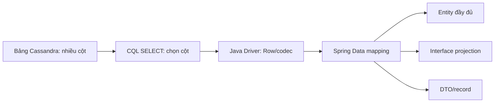

# Projection theo interface, DTO và chọn cột cần đọc

Khi xây dựng API bằng **Spring Data Cassandra**, một bảng có thể lưu nhiều thông tin nhưng mỗi màn hình chỉ cần một phần nhỏ. Trang danh sách đơn hàng có thể chỉ cần thời điểm, loại sự kiện và mô tả ngắn; trang chi tiết mới cần nội dung đầy đủ. Nếu mọi truy vấn đều đọc toàn bộ entity, ứng dụng dễ **over-fetching**: lấy quá nhiều cột, truyền nhiều dữ liệu qua mạng, materialize object lớn và tiêu tốn bộ nhớ.

**Projection** là cách biểu diễn **một góc nhìn của dữ liệu** thay vì nhất thiết trả về toàn bộ entity. Trong Spring Data, hai hướng phổ biến là **projection theo interface** và **DTO/class-based projection**. Tuy nhiên, với **Apache Cassandra**, cần tách hai câu hỏi:

1. **Java cần kiểu kết quả gì?** Interface projection, record/DTO hay entity đầy đủ?
2. **CQL thực sự đọc những cột nào?** Câu `SELECT` có danh sách cột cụ thể hay vẫn là `SELECT *`?

Hai câu hỏi có liên quan nhưng **không đồng nhất**. Một interface chỉ khai báo hai getter chưa đủ để khẳng định driver chỉ lấy hai cột. Việc Spring Data Cassandra tối ưu danh sách cột cho một kiểu projection phụ thuộc loại projection, phương thức repository, custom `@Query` và phiên bản đang chạy.

Bài nằm trong chương **Chiếu và phân trang**. Ta sẽ áp dụng projection với repository, `CassandraTemplate` và CQL; xem tác động tới partition key, clustering columns, mapping, paging, consistency level, hiệu năng và cách kiểm thử để biết ứng dụng **thật sự đọc đúng phần dữ liệu cần thiết**.

> **Mục tiêu:** Thiết kế một query đúng mô hình Cassandra, chọn interface hoặc DTO phù hợp nhu cầu, và xác minh danh sách cột được đọc thay vì chỉ nhìn vào kiểu trả về của repository.

## 1. Vì sao cần projection?

Xét một hệ thống có bảng sự kiện đơn hàng. Mỗi sự kiện có:

- Các khóa xác định tenant, khách hàng, bucket thời gian, mốc thời gian và ID sự kiện.
- Những cột nhỏ như loại sự kiện và mô tả tóm tắt.
- Những cột lớn hơn như nội dung chi tiết, payload hoặc metadata.

Màn hình “Lịch sử đơn hàng” có thể chỉ hiển thị:

```text
25/11/2026 10:00    PAID       Đơn hàng đã được thanh toán
25/11/2026 09:55    CREATED    Đơn hàng được tạo
25/11/2026 09:53    VALIDATED  Đã kiểm tra địa chỉ nhận hàng
```

Màn hình này không cần một payload JSON dài hàng chục KB. Nếu query luôn đọc payload, service sẽ tốn băng thông và công xử lý vô ích.

Projection có thể giúp:

- **Làm rõ hợp đồng trả về:** Client chỉ thấy các thuộc tính dùng cho use case.
- **Giảm số property cần materialize:** Không nhất thiết phải dựng cả aggregate/entity đầy đủ.
- **Giảm network/payload khi CQL chọn đúng cột:** Đặc biệt hữu ích nếu bảng có cột lớn.
- **Tách read model khỏi API DTO:** Tránh trả trực tiếp entity chứa field nội bộ.
- **Phối hợp với paging:** Mỗi trang chứa ít dữ liệu hơn khi query thực sự chỉ lấy các cột cần thiết.

Nhưng projection **không tự giảm số partition cần đọc**. Một query lọc trên regular column mà không có đường truy cập hợp lệ vẫn tốn kém ngay cả khi chỉ `SELECT` hai cột.

## 2. Ba tầng: bảng, CQL và Java projection



Có hai loại “thu gọn” khác nhau:

| Việc thu gọn | Diễn ra ở đâu? | Giúp gì? | Cần xác minh gì? |
| --- | --- | --- | --- |
| **Chọn ít cột trong `SELECT`** | Cassandra/CQL/driver | Giảm dữ liệu từ database trả về, nhất là cột lớn | CQL thực tế, danh sách cột, kích thước response |
| **Projection chỉ lộ vài thuộc tính** | Spring Data/Java | Đơn giản hóa API, giảm dữ liệu mà caller nhìn thấy | Type mapping và các getter được tạo |
| **DTO riêng cho frontend** | Service/API boundary | Kiểm soát JSON, validation, security | Có vô tình đọc entity đầy đủ trước khi dựng DTO không? |

Ví dụ:

```java
OrderEvent entity = repository.findById(key).orElseThrow();

EventCard dto = new EventCard(
    entity.getKey().getEventTime(),
    entity.getKey().getEventId(),
    entity.getEventType(),
    entity.getSummary()
);
```

Đây là **chuyển entity thành DTO trong Java**, nhưng query trước đó **có thể đã tải toàn bộ cột** của entity. Nó hữu ích cho hợp đồng API, song **chưa chắc** tiết kiệm được payload Cassandra. Khi tối ưu hiệu năng, cần đẩy việc chọn cột xuống câu `SELECT` nếu API/framework cho phép.

## 3. Bảng mẫu được thiết kế theo truy vấn

Nhu cầu: “Hiển thị sự kiện mới nhất của một khách trong một tháng, tải tiếp khi người dùng cuộn xuống”.

Một bảng phục vụ đúng đường đọc:

```sql
CREATE TABLE IF NOT EXISTS commerce_ks.order_events_by_customer_month (
    tenant_id uuid,
    customer_id uuid,
    bucket_month text,
    event_time timestamp,
    event_id uuid,
    order_id uuid,
    event_type text,
    summary text,
    detail_text text,
    payload blob,
    PRIMARY KEY (
        (tenant_id, customer_id, bucket_month),
        event_time,
        event_id
    )
) WITH CLUSTERING ORDER BY (
    event_time DESC,
    event_id DESC
);
```

Schema minh họa; keyspace `commerce_ks` được giả định đã tạo bằng migration với replication strategy và RF phù hợp môi trường. Không coi DDL của bài học là thao tác tự động chạy trên production.

**Ý nghĩa các cột:**

| Nhóm | Cột | Tác dụng |
| --- | --- | --- |
| Partition key | `tenant_id`, `customer_id`, `bucket_month` | Định vị nhóm sự kiện của một khách trong một tháng |
| Clustering key | `event_time`, `event_id` | Sắp các hàng trong partition và phân biệt sự kiện trùng thời gian |
| Regular nhỏ | `order_id`, `event_type`, `summary` | Dữ liệu cần cho danh sách |
| Regular lớn | `detail_text`, `payload` | Dữ liệu chỉ cần cho màn hình chi tiết |

Đọc danh sách với **đúng cột cần thiết**:

```sql
SELECT tenant_id, customer_id, bucket_month,
       event_time, event_id,
       order_id, event_type, summary
FROM commerce_ks.order_events_by_customer_month
WHERE tenant_id = 11111111-1111-1111-1111-111111111111
  AND customer_id = 22222222-2222-2222-2222-222222222222
  AND bucket_month = '2026-11'
LIMIT 25;
```

So với `SELECT *`, truy vấn này **không yêu cầu** `detail_text` và `payload`. Các cột thuộc primary key vẫn được chọn để có định danh đầy đủ và hỗ trợ ánh xạ key nếu cần.

**Quan trọng:** `LIMIT 25` giới hạn **tổng kết quả của câu query này**. Nó phù hợp với một lần lấy top 25, nhưng **không tự tạo cơ chế tải trang thứ hai của toàn bộ lịch sử**. Để phân trang nhiều lần, cần sử dụng page size/paging state hoặc cursor có thiết kế phù hợp và không giới hạn toàn bộ kết quả ở 25 nếu muốn đọc vượt quá 25.

### Query projection không đổi partition key

Một câu như:

```sql
-- Không phải đường truy cập hiệu quả của bảng mẫu:
SELECT event_time, event_type, summary
FROM commerce_ks.order_events_by_customer_month
WHERE event_type = 'PAID';
```

vẫn không phù hợp với partition key đã thiết kế. Chọn ít cột không biến `event_type` thành partition key và không làm Cassandra có chỉ mục toàn cluster miễn phí.

Nếu sản phẩm thường xuyên cần “mọi sự kiện PAID theo ngày”, phải cân nhắc **bảng read model khác**, index phù hợp với workload hoặc một giải pháp tìm kiếm/analytics. Đừng chữa thiết kế truy vấn bằng cách đổi kiểu Java từ entity sang projection.

## 4. Entity đầy đủ để làm mốc so sánh

Giả sử Spring Data Cassandra ánh xạ bảng thành `OrderEvent`.

### Lớp primary key

```java
import java.io.Serializable;
import java.time.Instant;
import java.util.UUID;

import org.springframework.data.cassandra.core.cql.Ordering;
import org.springframework.data.cassandra.core.cql.PrimaryKeyType;
import org.springframework.data.cassandra.core.mapping.PrimaryKeyClass;
import org.springframework.data.cassandra.core.mapping.PrimaryKeyColumn;

@PrimaryKeyClass
public class OrderEventKey implements Serializable {

    @PrimaryKeyColumn(
        name = "tenant_id",
        ordinal = 0,
        type = PrimaryKeyType.PARTITIONED
    )
    private UUID tenantId;

    @PrimaryKeyColumn(
        name = "customer_id",
        ordinal = 1,
        type = PrimaryKeyType.PARTITIONED
    )
    private UUID customerId;

    @PrimaryKeyColumn(
        name = "bucket_month",
        ordinal = 2,
        type = PrimaryKeyType.PARTITIONED
    )
    private String bucketMonth;

    @PrimaryKeyColumn(
        name = "event_time",
        ordinal = 3,
        type = PrimaryKeyType.CLUSTERED,
        ordering = Ordering.DESCENDING
    )
    private Instant eventTime;

    @PrimaryKeyColumn(
        name = "event_id",
        ordinal = 4,
        type = PrimaryKeyType.CLUSTERED,
        ordering = Ordering.DESCENDING
    )
    private UUID eventId;

    // Constructor, getter/setter, equals và hashCode theo dự án.
}
```

### Entity

```java
import java.nio.ByteBuffer;
import java.util.UUID;

import org.springframework.data.cassandra.core.mapping.Column;
import org.springframework.data.cassandra.core.mapping.PrimaryKey;
import org.springframework.data.cassandra.core.mapping.Table;

@Table("order_events_by_customer_month")
public class OrderEvent {

    @PrimaryKey
    private OrderEventKey key;

    @Column("order_id")
    private UUID orderId;

    @Column("event_type")
    private String eventType;

    @Column("summary")
    private String summary;

    @Column("detail_text")
    private String detailText;

    @Column("payload")
    private ByteBuffer payload;

    // Constructor và accessor phù hợp với Spring Data Cassandra.
}
```

Đây là ví dụ metadata rút gọn, không phải class đầy đủ để copy biên dịch ngay. Khi triển khai cần hoàn thiện constructor, accessor và `equals/hashCode` cho key, đối chiếu kiểu CQL/Java Driver và thiết lập mapping trên phiên bản Spring Data thực tế.

Với entity đầy đủ, một thao tác đọc thường hướng đến cung cấp các persistent properties của entity. Nếu chỉ cần danh sách nhỏ, ta muốn trả object **gọn hơn** và, khi khả thi, chỉ yêu cầu các cột liên quan trong CQL.

## 5. Projection theo interface là gì?

**Interface-based projection** khai báo các getter mà caller được phép sử dụng. Spring Data tạo một đối tượng/proxy cung cấp các giá trị đó dựa trên dữ liệu đã ánh xạ.

Ví dụ các trường thông thường của entity:

```java
import java.util.UUID;

public interface OrderEventCardView {

    UUID getOrderId();

    String getEventType();

    String getSummary();
}
```

Đây là một **closed projection** theo ý tưởng: các getter tham chiếu trực tiếp tới property có trong entity `OrderEvent`. Client chỉ cần card view thay vì entity gồm `detailText` và `payload`.

Một repository khai báo method với return type projection, theo kiểu API phổ biến của Spring Data:

```java
import java.util.List;
import java.util.UUID;

import org.springframework.data.cassandra.repository.CassandraRepository;

public interface OrderEventRepository
        extends CassandraRepository<OrderEvent, OrderEventKey> {

    List<OrderEventCardView>
        findByKey_TenantIdAndKey_CustomerIdAndKey_BucketMonth(
            UUID tenantId,
            UUID customerId,
            String bucketMonth
        );
}
```

Tên derived query sử dụng đường property Java `key.tenantId`, `key.customerId` và `key.bucketMonth`. Dấu `_` làm rõ cách đi qua property `key`. Với đường đọc thường xuyên, phải kiểm tra generated CQL và lựa chọn số hàng/page thích hợp.

**Lưu ý theo phiên bản:** Spring Data Cassandra hỗ trợ projection theo các giới hạn của datastore module và release cụ thể. Không giả định mọi biến thể derived query, dynamic projection, nested projection hoặc interface proxy đều hoạt động như Spring Data JPA. Ví dụ này là một mẫu cần xác minh bằng integration test trên phiên bản đang dùng.

### Closed projection có tự loại cột khỏi SELECT không?

**Không được kết luận chỉ từ interface.** Tùy query method và đường thực thi, framework có thể:

- Dựng entity/nguồn dữ liệu đủ rộng rồi cho interface proxy truy cập một số property.
- Tối ưu selection theo danh sách property của closed projection nếu datastore và kiểu projection hỗ trợ.
- Giữ nguyên danh sách cột của một `@Query` khai báo sẵn, vốn do lập trình viên quyết định.

Vì vậy, **một getter ít đi không bảo đảm bytes truyền từ Cassandra ít đi**. Hãy xác minh statement thực tế và so sánh payload/latency trước khi tuyên bố tối ưu hiệu năng.

### Interface projection có nên dùng để ghi?

Thông thường **không**. Projection này thể hiện **góc nhìn đọc**, không phải một entity thay thế có đủ primary key và quy tắc cập nhật. Không đưa interface proxy vào thao tác `save` rồi mong Cassandra biết nên cập nhật một phần cột nào. Cập nhật cần entity, `Update`, prepared statement hoặc API được thiết kế riêng với semantics rõ ràng.

## 6. Nested interface projection và composite primary key

Ở bảng mẫu, `eventTime` và `eventId` nằm trong thuộc tính `key` chứ không nằm trực tiếp ở root của entity. Muốn hiển thị thời gian, có thể mô tả nested projection:

```java
import java.time.Instant;
import java.util.UUID;

public interface OrderEventWithKeyView {

    KeyView getKey();

    UUID getOrderId();

    String getEventType();

    String getSummary();

    interface KeyView {
        Instant getEventTime();
        UUID getEventId();
    }
}
```

Dùng trong service:

```java
OrderEventWithKeyView view = ...;

Instant time = view.getKey().getEventTime();
UUID eventId = view.getKey().getEventId();
```

Hai dấu chấm `getKey().getEventTime()` ở đây mô tả **nested Java property**, không phải cú pháp chọn cột CQL `key.eventTime`. Thực tế các cột Cassandra vẫn là `event_time`, `event_id` và những cột khóa khác.

**Cẩn trọng:** Nested projection có thể cần framework materialize toàn bộ object khóa `OrderEventKey`. Không mặc định chỉ chọn `event_time` và `event_id` là đủ để tạo đúng primary key. Hãy kiểm tra version và bảo đảm CQL trả những cột bắt buộc cho mapping.

### Khi nào tránh nested projection phức tạp?

- Khi chỉ cần các field rất đơn giản nhưng đường property quá dài.
- Khi cần DTO phẳng để trả API hoặc đưa sang hệ thống khác.
- Khi parent property là UDT/collection lớn và việc materialize nested structure tốn kém.
- Khi mapping projection thiếu cột thuộc khóa dẫn tới lỗi hoặc dữ liệu null khó giải thích.

Nếu muốn một contract ổn định giữa backend và frontend, **DTO phẳng** thường rõ ràng hơn nested proxy với cấu trúc phản chiếu entity nội bộ.

## 7. Open projection: tính toán từ đối tượng nguồn

Spring Data còn có khái niệm **open projection**: getter không chỉ lấy một property có sẵn mà tính giá trị từ object nguồn, thường qua expression.

Ví dụ minh họa kiểu Spring Data interface projection:

```java
import org.springframework.beans.factory.annotation.Value;

public interface OrderEventLabelView {

    String getEventType();

    String getSummary();

    @Value("#{target.eventType + ': ' + target.summary}")
    String getLabel();
}
```

Ý tưởng là `getLabel()` kết hợp hai property. Nhưng việc dùng expression làm framework khó xác định trước chính xác những property nào cần tải, đặc biệt khi expression có thể truy cập nhiều phần tử của object nguồn.

**Trong Cassandra, không nên dựa vào open projection như cơ chế giảm lượng cột được đọc.** Tùy phiên bản, kiểu expression và module, khả năng hỗ trợ/đường mapping khác nhau. Nếu mục tiêu chính là tối ưu payload, hãy chọn **closed projection hoặc DTO với CQL tường minh**, sau đó đo query thật.

Một lựa chọn khác là tính label trong service sau khi nhận một DTO gọn:

```java
String label = card.eventType() + ": " + card.summary();
```

Cách này dễ kiểm thử, không phụ thuộc expression engine khi thực sự không cần sức mạnh của open projection.

## 8. DTO/class-based projection: kiểu dữ liệu dành riêng cho use case

**DTO (Data Transfer Object)** là class hoặc record mô tả những property mà use case cần. Không nhất thiết trùng toàn bộ entity và không cần đại diện một bảng có thể ghi.

Ví dụ cho một card:

```java
import java.time.Instant;
import java.util.UUID;

public record EventCard(
    Instant eventTime,
    UUID eventId,
    UUID orderId,
    String eventType,
    String summary
) {}
```

Ưu điểm:

- Kiểu kết quả phẳng, dễ serialize sang JSON.
- Các field rõ ràng ngay ở constructor.
- Record có `equals`, `hashCode`, accessor và canonical constructor do Java sinh.
- Có thể đặt validation hoặc chuẩn hóa dữ liệu trong constructor nếu phù hợp.
- Giảm coupling giữa API response và chi tiết entity mapping nội bộ.

**Lưu ý:** Một Java record DTO **không tự khiến Spring Data Cassandra biết lấy `eventTime` từ `key.eventTime`**. Cách map nested entity property sang flat DTO cần được thiết kế và xác minh; có thể dùng query/constructor projection được version hỗ trợ hoặc chuyển từ row một cách tường minh.

Để dễ học, ta sẽ dùng **hai kiểu DTO**:

1. `ProfileCard` — DTO có field cùng tên với property entity phẳng, thuận tiện minh họa class-based projection.
2. `EventCard` — DTO phẳng lấy từ một entity có khóa composite lồng nhau, thích hợp minh họa row mapping tường minh khi cần kiểm soát SELECT.

## 9. DTO projection với entity có khóa đơn

Ví dụ một bảng hồ sơ khách hàng:

```sql
CREATE TABLE IF NOT EXISTS commerce_ks.customer_profiles_by_id (
    profile_id uuid PRIMARY KEY,
    display_name text,
    city text,
    personal_note text,
    avatar_blob blob
);
```

Entity minh họa:

```java
import java.nio.ByteBuffer;
import java.util.UUID;

import org.springframework.data.cassandra.core.mapping.Column;
import org.springframework.data.cassandra.core.mapping.PrimaryKey;
import org.springframework.data.cassandra.core.mapping.Table;

@Table("customer_profiles_by_id")
public class CustomerProfile {

    @PrimaryKey("profile_id")
    private UUID profileId;

    @Column("display_name")
    private String displayName;

    @Column("city")
    private String city;

    @Column("personal_note")
    private String personalNote;

    @Column("avatar_blob")
    private ByteBuffer avatarBlob;

    // Constructor + getter/setter.
}
```

Màn hình dropdown chọn khách chỉ cần ID và tên:

```java
import java.util.UUID;

public record ProfileCard(
    UUID profileId,
    String displayName
) {}
```

Ví dụ cú pháp repository kiểu DTO projection theo phong cách Spring Data:

```java
import java.util.Optional;
import java.util.UUID;

import org.springframework.data.cassandra.repository.CassandraRepository;

public interface CustomerProfileRepository
        extends CassandraRepository<CustomerProfile, UUID> {

    Optional<ProfileCard> findByProfileId(UUID profileId);
}
```

Đây là **mẫu cần kiểm chứng trên phiên bản Spring Data Cassandra cụ thể**. Class-based projection có các điều kiện về constructor, tên property, cách ánh xạ dữ liệu và hỗ trợ của query derivation. Nếu code không hỗ trợ record DTO ở vị trí này, không nên “chữa” bằng cách đổi schema: hãy chọn phương thức projection được module hỗ trợ hoặc map row/DTO tường minh.

**Phân biệt tên:** `profileId` và `displayName` là property Java; `profile_id` và `display_name` là tên cột CQL. Spring Data mapping có thể chuyển đổi dựa trên metadata, nhưng kiểu DTO với tên/cấu trúc khác entity cần cấu hình hoặc mapping bổ sung.

### DTO với constructor tường minh

Trong dự án không dùng Java record hoặc cần validation, có thể dùng class:

```java
import java.util.Objects;
import java.util.UUID;

public final class ProfileCardDto {

    private final UUID profileId;
    private final String displayName;

    public ProfileCardDto(UUID profileId, String displayName) {
        this.profileId = Objects.requireNonNull(profileId);
        this.displayName = displayName;
    }

    public UUID getProfileId() { return profileId; }
    public String getDisplayName() { return displayName; }
}
```

Với constructor-based projection, framework cần nhận diện đúng constructor và tên tham số. Hãy bật `-parameters` hoặc dùng metadata do phiên bản hỗ trợ; nếu nhiều constructor, quy tắc persistence creator có thể cần annotation phù hợp. DTO projection không nên phụ thuộc vào việc gán các field final bằng reflection sau khi tạo.

### Nếu query thiếu cột bắt buộc?

Nếu DTO constructor bắt buộc `displayName != null` nhưng câu `SELECT` chỉ lấy `profile_id`, quá trình materialize có thể thất bại. Vì vậy, chọn ít cột phải đi kèm **hợp đồng object tương ứng**. Không dùng `SELECT profile_id` rồi yêu cầu framework dựng `CustomerProfile` đầy đủ có nhiều property bắt buộc.

## 10. Dynamic projection: lựa chọn kiểu kết quả lúc gọi

Spring Data cung cấp một mẫu **dynamic projection** trong nhiều datastore module, dùng tham số `Class<T>`:

```java
public interface CustomerProfileRepository
        extends CassandraRepository<CustomerProfile, UUID> {

    <T> Optional<T> findByProfileId(
        UUID profileId,
        Class<T> projectionType
    );
}
```

Ý tưởng:

```java
Optional<CustomerProfile> full =
    repository.findByProfileId(id, CustomerProfile.class);

Optional<ProfileCard> brief =
    repository.findByProfileId(id, ProfileCard.class);
```

Cách này có thể dùng chung tên method cho hai góc nhìn. Nhưng hãy **xác minh hỗ trợ dynamic projection của Spring Data Cassandra release đang chạy**, cả với interface và class/record DTO. Hãy viết integration test thực tế trước khi đưa vào thư viện chung; không phải tính năng hỗ trợ của Spring Data Commons đều được các datastore module triển khai y hệt.

**Không lấy `Class<T>` từ dữ liệu người dùng không tin cậy.** Danh sách kiểu projection nên được quyết định bởi code server, không phải một tên class gửi qua HTTP.

### Khi nào dynamic projection hữu ích?

- Cùng một mẫu tra cứu theo primary key nhưng có vài hình thức trả về hợp lệ.
- Service muốn chọn kiểu DTO trong một số trường hợp mà không nhân bản nhiều method.
- Dự án đã xác minh query generation và mapping cho tất cả projection được phép.

Nếu mỗi màn hình có logic chọn cột, filter hay consistency khác nhau, nhiều **method tường minh** thường dễ quản lý hơn một method generic phức tạp.

## 11. @Query với SELECT liệt kê cột rõ ràng

Muốn biết chắc **CQL không yêu cầu tải một cột lớn**, cách rõ nhất là viết câu `SELECT` liệt kê cột. Ví dụ:

```sql
SELECT profile_id, display_name
FROM commerce_ks.customer_profiles_by_id
WHERE profile_id = ?;
```

Với repository, Spring Data Cassandra hỗ trợ khai báo query CQL bằng `@Query`. Ví dụ:

```java
import java.util.Optional;
import java.util.UUID;

import org.springframework.data.cassandra.repository.Query;

public interface CustomerProfileRepository
        extends CassandraRepository<CustomerProfile, UUID> {

    @Query("""
        SELECT profile_id, display_name
        FROM customer_profiles_by_id
        WHERE profile_id = ?0
        """)
    Optional<ProfileCard> findCardByProfileId(UUID profileId);
}
```

Đây là **mẫu kết hợp declared query với DTO projection cần kiểm tra theo phiên bản**: CQL chọn cột là tường minh, nhưng **việc map row sang `ProfileCard` còn phụ thuộc khả năng DTO projection và constructor binding** của Spring Data Cassandra. Không coi đoạn code là chứng minh tự động rằng mọi phiên bản hỗ trợ mapping này.

Để tránh lỗi runtime:

1. Đảm bảo `profile_id` là primary key của bảng thực.
2. Kiểm tra `SELECT` có trả tất cả field mà DTO constructor cần.
3. Kiểm tra tên/kiểu property Java và conversion từ `uuid`/`text`.
4. Xác minh repository method được module chấp nhận và startup không báo query/mapping error.
5. Seed dữ liệu test rồi kiểm tra giá trị DTO sau truy vấn.

### @Query không phải derived query

Phương thức có `@Query` dùng câu CQL do lập trình viên cung cấp, thay vì để framework suy toàn bộ query từ tên method. Cách này giúp nhìn rõ các cột và cú pháp, nhưng **không tự bảo đảm query hợp lệ hay hiệu quả**. Một câu `SELECT` ít cột mà thiếu partition key vẫn có thể là lựa chọn sai.

### Chọn cột nhưng đừng bỏ khóa một cách thiếu chủ đích

Với `ProfileCard`, chỉ cần `profile_id` và `display_name` là đủ. Với entity có `@PrimaryKeyClass` lồng nhau, một số mapping/projection cần đọc thêm **toàn bộ thành phần key** để dựng object. Vì vậy phải xem **shape của kết quả Java**, không chỉ số cột được UI hiển thị.

## 12. Đường dự phòng chắc chắn: map Row thành DTO tường minh

Khi DTO phẳng không khớp cấu trúc nested key hoặc projection module không hỗ trợ kiểu cần thiết, có thể dùng **Cassandra Java Driver trực tiếp** để đọc các cột đã chọn và tự dựng DTO. Cách này không phải repository projection, nhưng rất rõ về dữ liệu thật sự được yêu cầu.

Ví dụ cho bảng `customer_profiles_by_id`:

```java
import java.util.Optional;
import java.util.UUID;

import com.datastax.oss.driver.api.core.CqlSession;
import com.datastax.oss.driver.api.core.cql.PreparedStatement;
import com.datastax.oss.driver.api.core.cql.Row;

public final class ProfileCardReader {

    private final CqlSession session;
    private final PreparedStatement findCard;

    public ProfileCardReader(CqlSession session) {
        this.session = session;
        this.findCard = session.prepare("""
            SELECT profile_id, display_name
            FROM commerce_ks.customer_profiles_by_id
            WHERE profile_id = ?
            """);
    }

    public Optional<ProfileCard> find(UUID profileId) {
        Row row = session.execute(findCard.bind(profileId)).one();

        if (row == null) {
            return Optional.empty();
        }

        return Optional.of(new ProfileCard(
            row.getUuid("profile_id"),
            row.getString("display_name")
        ));
    }
}
```

Điểm khác biệt:

- CQL rõ ràng **không chọn `personal_note` hay `avatar_blob`**.
- Driver trả `Row` với các cột cụ thể.
- Code Java dựng `ProfileCard` tường minh; không phụ thuộc khả năng tự suy nested DTO của projection engine.
- Giá trị `null` và lỗi codec/kiểu cần được xử lý theo domain contract.

Nhược điểm là code tự chịu trách nhiệm mapping và chuyển kiểu, không tự sử dụng mọi tiện ích `MappingCassandraConverter` hoặc repository. Đừng tạo `CqlSession` mới cho mỗi request; sử dụng session đã được quản lý/cấu hình trong Spring để tái dùng connection, timeout, security và routing.

### Khi nào chọn cách map tay?

- Một query rất quan trọng về hiệu năng và cần kiểm soát chính xác danh sách cột.
- Mapping DTO phẳng không tương thích với nested primary key theo phiên bản đang dùng.
- Cần chuyển đổi đặc biệt mà Spring Data projection không đáp ứng trực tiếp.
- Đội ngũ muốn kiểm soát statement, paging state và DTO conversion một cách tường minh.

Không cần bỏ toàn bộ repository chỉ vì một query đặc biệt; service có thể kết hợp repository cho CRUD đơn giản và query driver/template cho đường đọc chuyên biệt.

## 13. CassandraTemplate và việc chọn cột

`CassandraTemplate` là API mức trung gian giữa repository và Java Driver. Nó sử dụng mapping metadata để ánh xạ entity và có thể xây `Query` từ `Criteria`.

Ví dụ một truy vấn đầy đủ partition key:

```java
import org.springframework.data.cassandra.core.CassandraTemplate;
import org.springframework.data.cassandra.core.query.Criteria;
import org.springframework.data.cassandra.core.query.Query;

Query query = Query.query(
    Criteria.where("tenant_id").is(tenantId)
        .and("customer_id").is(customerId)
        .and("bucket_month").is(month)
);

List<OrderEvent> events =
    cassandraTemplate.select(query, OrderEvent.class);
```

Với API này, tham số `OrderEvent.class` yêu cầu **materialize entity**, không đồng nghĩa với DTO `EventCard`. Nếu template/query API của phiên bản hiện tại hỗ trợ chọn danh sách cột, cần cân nhắc:

- Chọn cột nhưng vẫn map sang entity đầy đủ có thể tạo property null/thiếu.
- Constructor của immutable entity có thể đòi các cột không được chọn.
- Việc `select(...)` trả `List` vẫn có thể đọc số lượng hàng lớn nếu không limit/page.
- Query vẫn phải có partition key, clustering rules và consistency options hợp lệ.

Ví dụ định hướng:

```text
CassandraTemplate
  -> Query với WHERE theo partition
  -> Cơ chế chọn cột nếu phiên bản API hỗ trợ
  -> Chọn kiểu materialization phù hợp:
        entity đủ property, hoặc projection/DTO, hoặc Row mapper
```

Vì tên method chọn cột và cách truyền projection vào template có thể thay đổi theo release, hãy đối chiếu API thực tế; đừng tự tạo ra một lời gọi `selectProjected(...)` không tồn tại. Nếu cần kiểm soát SELECT ngay, ví dụ `CqlSession` ở phần trước là phương án minh bạch.

## 14. Interface projection và DTO: so sánh ưu/nhược

| Tiêu chí | Interface projection | DTO/class/record |
| --- | --- | --- |
| Cách khai báo | Getter mô tả các property cần phơi bày | Constructor/components mô tả dữ liệu |
| Object nhận được | Thường là proxy do Spring Data tạo | Object Java cụ thể |
| Tính bất biến | Tùy projection/interface và object nguồn | Record/final class dễ thiết kế bất biến |
| Mapping nested property | Có thể có nested interface theo version | Cần shape/constructor phù hợp; flatten có thể cần map tay |
| Computed property | Open projection/expression hoặc default method | Method/constructor tính toán trong DTO |
| Chi phí tạo object | Proxy có overhead nhất định | Constructor thường trực tiếp |
| Chọn cột CQL tối ưu | **Phải kiểm tra query thực tế** | **Phải kiểm tra query thực tế** |
| Rõ hợp đồng JSON | Có thể expose getter theo proxy | DTO thường dễ kiểm soát |
| Tái sử dụng nhiều endpoint | Tiện nếu các view cùng cấu trúc entity | Tiện nếu API contract riêng và ổn định |
| Ghi lại dữ liệu | Không nên coi proxy là entity để save | DTO đọc cũng không tự là entity ghi |
| Hỗ trợ theo phiên bản | Cần xác minh interface/nested/open/dynamic | Cần xác minh class/record/constructor projection |

### Chọn theo nhu cầu, không theo độ ngắn của code

**Nên cân nhắc interface** khi use case chỉ cần vài property đã tồn tại trên entity, team quen Spring Data và đã kiểm chứng projection được hỗ trợ.

**Nên cân nhắc DTO** khi contract cần ổn định và tách biệt entity, có validation/serialization riêng hoặc dùng chung giữa service/API.

**Nên chọn CQL tường minh + mapper** khi phải bảo đảm chỉ chọn các cột cụ thể, cần flatten nested key hay xử lý type conversion đặc biệt mà projection tự động không đáp ứng.

Trong cả ba trường hợp, **truy vấn đúng schema** quan trọng hơn kiểu trả về.

## 15. Projection kết hợp Slice: đọc trang nhỏ và đúng cột

Một UI danh sách có thể yêu cầu:

- Tối đa 25 card mỗi lần.
- Có cursor để tải 25 card tiếp theo.
- Không đọc `payload` hay `detail_text`.
- Có thứ tự sự kiện theo `event_time DESC, event_id DESC` trong partition.

Khi framework hỗ trợ, một repository method có thể kết hợp return type `Slice` và projection:

```java
import java.util.UUID;

import org.springframework.data.domain.Pageable;
import org.springframework.data.domain.Slice;

public interface OrderEventRepository
        extends CassandraRepository<OrderEvent, OrderEventKey> {

    Slice<OrderEventCardView>
        findByKey_TenantIdAndKey_CustomerIdAndKey_BucketMonth(
            UUID tenantId,
            UUID customerId,
            String bucketMonth,
            Pageable pageable
        );
}
```

*Đây là một mẫu định hướng; cần kiểm tra version hỗ trợ Slice of interface projections, query derivation và generated CQL. Không định nghĩa đồng thời method trùng tên/chỉ khác return type với ví dụ `List` ở phần trước trong cùng một interface Java.*

Đọc trang đầu theo API paging Cassandra được phiên bản hỗ trợ:

```java
import org.springframework.data.cassandra.core.query.CassandraPageRequest;
import org.springframework.data.domain.Pageable;
import org.springframework.data.domain.Slice;

Pageable firstPage = CassandraPageRequest.first(25);

Slice<OrderEventCardView> first =
    repository.findByKey_TenantIdAndKey_CustomerIdAndKey_BucketMonth(
        tenantId, customerId, "2026-11", firstPage
    );

List<OrderEventCardView> items = first.getContent();

if (first.hasNext()) {
    Pageable nextPage = first.nextPageable();
    // Dùng nextPage cho đúng cùng query/partition/filter.
}
```

Tên factory method/package và cách `Slice` trả paging state có thể khác theo Spring Data Cassandra release. Với Cassandra, dùng **paging state/cursor**, không suy từ `PageRequest.of(100, 25)` rằng có thể nhảy thẳng tới trang 101 theo SQL offset.

### Projection giúp giảm dữ liệu *trên từng trang* nếu SELECT được tối ưu

Nếu một row đầy đủ gồm `payload` 64 KB nhưng card chỉ cần vài chục byte, việc CQL không lấy `payload` có thể giảm đáng kể bytes truyền về trên một trang. Tuy nhiên:

- Driver page size là số row mục tiêu, **không phải cam kết cùng số byte**.
- Nếu framework vẫn thực hiện `SELECT *` và chỉ dựng proxy sau đó, network có thể **không giảm**.
- Cột lớn có thể gây áp lực heap/GC ngay cả khi caller không truy cập getter tương ứng.
- Paging đúng vẫn phải giữ partition key, sort, filter ổn định và giới hạn lượng dữ liệu.

### Slice không phải Page có tổng số hàng miễn phí

`Slice<T>` thường cho biết có trang sau hay không, nhưng không cần tổng số phần tử toàn tập. Với Cassandra, việc đếm toàn bộ hàng có thể rất đắt. Nếu UX yêu cầu “trang 1 trên tổng 2.435 trang”, cần thiết kế tổng hợp/đếm riêng hoặc thay đổi UX; không suy từ `Slice` rằng có total count chính xác.

## 16. Projection và Stream: khi nào có lợi?

Một job chỉ cần một vài field của mỗi sự kiện cũng có thể dùng projection khi API/version hỗ trợ return type `Stream<Projection>` hoặc sử dụng driver paging với mapper DTO tường minh.

Ý tưởng:

```java
try (Stream<OrderEventCardView> stream =
         repository.streamByKey_TenantIdAndKey_CustomerIdAndKey_BucketMonth(
             tenantId, customerId, month)) {

    stream.forEach(this::processCard);
}
```

Đoạn ví dụ giả định **repository có method stream tương ứng và module hỗ trợ kiểu trả về đó**. `processCard` là business function phải được định nghĩa. Kiểm tra phiên bản trước khi dùng.

Không nên hiểu projection + stream là:

- Tự động có backpressure kiểu Reactive Streams.
- Tự động đọc trên một snapshot xuyên nhiều driver pages.
- Không cần giới hạn partition size.
- Không cần đóng stream.
- Có checkpoint hoặc exactly-once cho side effect.

Nếu job có thể restart giữa chừng, nên tổ chức theo **bucket/page + checkpoint/idempotency**. Projection chỉ giảm dữ liệu cần xử lý, không giải quyết tính đúng đắn của workflow.

## 17. Các giới hạn khi kết hợp SELECT cột, mapping và pagination

### Đừng bỏ nhầm cột khóa

Ví dụ CQL:

```sql
SELECT event_type, summary
FROM commerce_ks.order_events_by_customer_month
WHERE tenant_id = ? AND customer_id = ? AND bucket_month = ?;
```

Đây là một query đọc các regular columns, nhưng nếu muốn materialize entity `OrderEvent` có `@PrimaryKey OrderEventKey`, thiếu `event_time` và `event_id` có thể khiến key không đầy đủ hoặc việc mapping thất bại. Nếu chỉ cần `event_type`/`summary` và không cần key ở Java, hãy dùng **DTO/projection phù hợp với đúng shape SELECT** và kiểm tra mapping.

Trong Cassandra, **cột được dùng ở WHERE không đương nhiên xuất hiện trong SELECT output** cho mọi cách truy cập. Đừng giả định framework tự có dữ liệu khóa trong row nếu câu CQL không trả về.

### Projection không miễn phí về conversion

Ngay cả khi chỉ chọn `event_type` và `summary`, framework vẫn phải:

- Giải mã dữ liệu từ CQL qua driver codec.
- Ánh xạ cột đến property.
- Dựng proxy hoặc DTO.
- Áp dụng converter tùy chỉnh nếu property cần.

Nếu `eventType` trong entity là value object, còn CQL lưu `text`, cần kiểm tra `@ReadingConverter`/`CassandraCustomConversions` áp dụng đúng đường projection. Mẫu DTO lấy `String` có thể phù hợp hơn DTO dùng value object nếu API chỉ cần một mã hiển thị.

### Null và dữ liệu lịch sử

Một cột `summary` có thể không tồn tại trong hàng cũ hoặc đã bị xóa. Projection trả `null` hoặc lỗi constructor non-null tùy kiểu:

```java
public record EventCard(
    Instant eventTime,
    UUID eventId,
    UUID orderId,
    String eventType,
    String summary
) {}
```

`summary` của record có thể `null` trừ khi constructor đặt ràng buộc riêng. Nếu dùng primitive hoặc ép non-null cho cột lịch sử thiếu dữ liệu, integration test cần bao phủ trường hợp đó. Không dùng projection để che lỗi migration hoặc giả định mọi row đã được backfill.

### UDT, collection và nested dữ liệu

Một getter trỏ tới UDT hoặc collection lớn có thể khiến mapper cần đọc/tạo nhiều cấu trúc dữ liệu. Nested interface projection không nhất thiết làm Cassandra chỉ truyền một phần nhỏ bên trong UDT. Để tối ưu dữ liệu phức tạp, cân nhắc schema read model với các cột thường cần truy cập hoặc một representation khác; không chỉ đổi getter.

## 18. Projection không thay thế bảo mật và phân quyền

Một số developer nghĩ rằng nếu projection không khai báo `getPersonalNote()` thì dữ liệu nhạy cảm đã an toàn. Thực tế phải phân biệt:

- **CQL không chọn cột nhạy cảm:** Có thể giảm việc dữ liệu đó đi qua network/mapper.
- **Java projection không expose getter:** Giảm nguy cơ service/controller serialize field đó, nhưng source entity hoặc row bên dưới có thể vẫn chứa dữ liệu.
- **Authorization:** Phải kiểm soát user/tenant được đọc partition nào.
- **Dữ liệu thật trong database:** Vẫn cần chính sách phân quyền role và audit.

Nếu service dùng `SELECT *`, rồi tạo projection có hai getter, dữ liệu `payload` vẫn có thể đã được đọc về từ Cassandra. Vì vậy với dữ liệu nhạy cảm, ưu tiên **data minimization ở cả CQL và API boundary** khi khả thi.

### Một projection không phải cơ chế bảo vệ tenant

Nếu partition key gồm `tenant_id` và `customer_id`, server phải kiểm tra **tenant ID từ ngữ cảnh xác thực**. Không được tin tenant ID do frontend gửi rồi cho phép truy vấn tùy ý. Projection chỉ giới hạn hình dạng kết quả, không tự chứng minh caller được quyền xem dữ liệu.

### Open projection có thể có rủi ro phụ thuộc biểu thức

Nếu expression đọc property không dự kiến, có thể gây tốn xử lý hoặc vô tình lộ thông tin. Dùng expression cố định, được review; không nhận biểu thức SpEL từ input client. Với API nhạy cảm, DTO tường minh và kiểm thử serialization thường dễ kiểm soát hơn proxy open projection.

## 19. Đo hiệu năng: làm sao biết projection có giúp thật?

Cần đo **ít nhất ba cấu hình** trên cùng workload:

1. **Full entity:** Query đọc toàn bộ cột, trả `OrderEvent`.
2. **Java projection:** Repository trả `OrderEventCardView` nhưng chưa biết CQL chọn cột gì.
3. **CQL projection thật:** Query chọn đúng các cột card và map vào DTO.

### Những chỉ số nên theo dõi

| Chỉ số | Tại sao quan trọng |
| --- | --- |
| Danh sách cột trong CQL | Chứng minh có thực sự bỏ cột lớn không |
| Bytes/row và network bytes/query | Phản ánh payload thực tế |
| Driver page count và page size | Phản ánh lượng dữ liệu mỗi lần fetch |
| P50/P95/P99 latency | Tác động tới người dùng và tail latency |
| CPU cho mapping/conversion | Projection/DTO có thể tạo overhead khác nhau |
| JVM heap/GC | Entity lớn, ByteBuffer, proxy và collection ảnh hưởng bộ nhớ |
| Rows read/returned | Phát hiện query đọc quá rộng rồi bỏ hàng |
| Timeout/unavailable | Phản ánh khả năng phục vụ theo CL/replica |
| Số partition và độ lớn partition | Phát hiện hot partition hoặc bucket quá lớn |
| Lỗi materialization | Kiểm tra DTO/constructor/query có khớp không |

Đừng khẳng định “projection nhanh hơn 80%” nếu chưa đo. Với bảng chỉ có hai cột nhỏ, hiệu quả có thể không đáng kể; trong khi một cột payload lớn có thể tạo khác biệt rõ rệt khi được loại khỏi `SELECT`.

### Đo công bằng

- Sử dụng cùng partition, cùng số hàng và cùng consistency level.
- Test với page size tương đương.
- Warm-up driver/prepared statements ở mức hợp lý.
- Đo cả network, CPU và heap, không chỉ thời gian hàm Java.
- Không trộn benchmark với thay đổi cấu trúc bảng hoặc index.
- Sử dụng dữ liệu test/anonymized; không bật log toàn bộ nội dung nhạy cảm production.

### Tối ưu projection không sửa query phân tán sai

Nếu query vốn phải scan nhiều partition, giảm số cột có thể cải thiện payload nhưng không khắc phục **fan-out, số partition lớn, CL cao hoặc latency của replica**. Tối ưu theo thứ tự: **mẫu truy vấn và schema → số hàng/partition → cột cần đọc → page size → mapping**.

## 20. Kiểm thử tích hợp: chứng minh đúng dữ liệu và đúng CQL

Unit test một record `EventCard` chỉ kiểm tra constructor. Muốn xác minh Spring Data Cassandra projection, cần kết nối Cassandra test có schema và dữ liệu thật.

### Chuẩn bị fixture

Seed ít nhất:

- Một profile có `profile_id`, `display_name` và cột lớn `avatar_blob`.
- Một profile có `display_name = null` nếu domain cho phép.
- Nhiều sự kiện thuộc cùng partition `tenant_id/customer_id/bucket_month`.
- Sự kiện thuộc tenant hoặc bucket khác để phát hiện query thiếu điều kiện khóa.
- Hai sự kiện có cùng `event_time` nhưng khác `event_id` để kiểm tra tie-breaker.
- Một partition có nhiều hơn một trang dữ liệu.

### Test interface projection

Ví dụ ý tưởng:

```java
List<OrderEventCardView> cards =
    repository.findByKey_TenantIdAndKey_CustomerIdAndKey_BucketMonth(
        tenantId, customerId, "2026-11"
    );

assertFalse(cards.isEmpty());

OrderEventCardView card = cards.get(0);
assertNotNull(card.getEventType());
```

Đoạn code giả định test đã seed dữ liệu, có JUnit imports và repository đúng version. **Test trả đúng getter chưa chứng minh CQL bỏ `payload`**; phải quan sát query thực tế riêng.

### Test DTO projection

```java
Optional<ProfileCard> card =
    customerProfileRepository.findByProfileId(profileId);

assertTrue(card.isPresent());
assertEquals(profileId, card.orElseThrow().profileId());
assertEquals("Nguyen Van A", card.orElseThrow().displayName());
```

Với record DTO, chỉ gọi test này khi version/framework đã cấu hình method projection phù hợp. Nếu việc mapping DTO không được hỗ trợ, test sẽ chỉ ra cần sửa API hoặc chuyển sang row mapper, không phải sửa giá trị fixture tùy tiện.

### Test chọn cột thực sự

Ví dụ direct driver read, dùng query liệt kê hai cột:

```java
Row row = session.execute(
    preparedFindCard.bind(profileId)
).one();

assertNotNull(row);
assertTrue(row.getColumnDefinitions().contains("profile_id"));
assertTrue(row.getColumnDefinitions().contains("display_name"));
assertFalse(row.getColumnDefinitions().contains("avatar_blob"));
```

`preparedFindCard` ở đây là prepared statement đã tạo bằng `SELECT profile_id, display_name ...`; đoạn code là phần thân test minh họa, chưa đủ imports/context.

Cách kiểm tra cột được trả này chứng minh **shape của row theo statement cụ thể**. Để kiểm tra repository tự sinh CQL, cần dùng logging/tracing/driver instrumentation trên môi trường test mà không làm lộ bind values.

### Test khi đọc thiếu cột khóa

Tạo một query chỉ chọn `event_type, summary` rồi cố map thành entity `OrderEvent` đầy đủ. Ghi nhận hành vi của phiên bản đang dùng: có thể gặp lỗi materialization hoặc property key thiếu. Không lấy kết quả “không ném exception” làm bằng chứng entity đã hợp lệ: phải assert đầy đủ primary key và các cột bắt buộc.

### Test phân trang projection

Với ít nhất ba sự kiện trong cùng partition:

```java
Pageable firstRequest = CassandraPageRequest.first(2);

Slice<OrderEventCardView> first =
    repository.findByKey_TenantIdAndKey_CustomerIdAndKey_BucketMonth(
        tenantId, customerId, "2026-11", firstRequest
    );

assertEquals(2, first.getContent().size());

if (first.hasNext()) {
    Slice<OrderEventCardView> second =
        repository.findByKey_TenantIdAndKey_CustomerIdAndKey_BucketMonth(
            tenantId, customerId, "2026-11", first.nextPageable()
        );

    // Assert các event không trùng/sót khi test không có concurrent writes.
}
```

Phải dùng một **phiên bản method Slice** riêng trong test/repository để tránh trùng chữ ký với method List trong cùng interface. Chi tiết `CassandraPageRequest` và việc hỗ trợ Slice projection theo version cần được xác minh trước khi copy.

## 21. Các lỗi phổ biến và hướng xử lý

| Biểu hiện | Khả năng nguyên nhân | Cách kiểm tra |
| --- | --- | --- |
| Interface chỉ có 2 getter nhưng query vẫn chậm | CQL vẫn đọc mọi cột hoặc số hàng/partition quá lớn | Quan sát SELECT và bytes/query, không chỉ Java return type |
| DTO thiếu giá trị trường khóa | Query không trả đủ key hoặc mapping nested key không được flatten | Xem column selection, constructor và primary-key mapping |
| Repository method không khởi động được | Projection/derived query signature không được module hỗ trợ | Kiểm tra version, query derivation và integration test |
| DTO record bị lỗi constructor | Tên tham số/type conversion chưa phù hợp | Cột CQL, property Java, `-parameters`, record support |
| `getSummary()` trả null | Cột null/thiếu hoặc tên mapping sai | Dữ liệu fixture, `@Column`, query thực |
| Open projection không giảm payload | Expression khiến framework không biết field subset | Chuyển closed/DTO + CQL tường minh, đo lại |
| Nested projection trả object key thiếu | Thiếu cột primary key hoặc module mapping hạn chế | Chọn đủ key hoặc dùng DTO/row mapper |
| Projection Slice không tải được trang tiếp | Cursor/query mismatch, LIMIT thấp, API version | Kiểm tra paging state và cùng partition/filter |
| CQL bị từ chối khi lọc event_type | Regular column, thiếu partition key/index phù hợp | Sửa read model hoặc query |
| Client vẫn thấy dữ liệu nhạy cảm | Controller trả entity hoặc DTO có field ngoài dự kiến | Kiểm thử JSON schema, CQL data minimization |
| Stream of projection gây leak | Không đóng stream hoặc tiêu thụ quá lâu | try-with-resources, bounded workload |
| API muốn tổng số trang chính xác | Slice không cung cấp total count | Dùng aggregate riêng hoặc đổi UX |
| Benchmark không thấy cải thiện | Dữ liệu cột nhỏ, driver vẫn SELECT *, hoặc bottleneck ở replica | Đo cả query shape, network và CPU |
| Lỗi chỉ xuất hiện sau migration | DTO/property không khớp cột mới hoặc dữ liệu cũ chưa backfill | Đối chiếu system_schema và dữ liệu lịch sử |

## 22. Bài tập thực hành

### Bài 1 — có thực sự giảm dữ liệu đọc?

Một repository trả `OrderEventCardView` chỉ có `getEventType()` và `getSummary()`. Nhưng trace cho thấy CQL vẫn là `SELECT * FROM ...`.

**Câu hỏi:** Projection đã tối ưu băng thông giữa Cassandra và ứng dụng chưa?

<details>
<summary>Gợi ý trả lời</summary>

Chưa chắc, và trong trường hợp `SELECT *` đọc tất cả cột thì chưa tối ưu phần dữ liệu được yêu cầu ở CQL. Interface có thể giúp service chỉ nhìn thấy vài property, nhưng database vẫn trả các cột khác. Cần dùng cơ chế chọn cột được version hỗ trợ hoặc query CQL tường minh, rồi đo bytes/row và latency.

</details>

### Bài 2 — chọn interface hay DTO?

Một API trả `eventTime`, `eventId`, `eventType`, `summary`. Entity lưu `eventTime` và `eventId` bên trong `key`, còn frontend muốn JSON phẳng.

**Câu hỏi:** Nên cân nhắc lựa chọn nào?

<details>
<summary>Gợi ý trả lời</summary>

Một **DTO/record phẳng** phù hợp cho API contract, ví dụ `EventCard`. Có thể map từ projection có nested key hoặc từ CQL row đã chọn đúng cột. Nếu muốn tránh đọc payload lớn, cần xác minh query CQL; chỉ tạo DTO sau khi đã đọc full entity chưa chắc giảm network.

</details>

### Bài 3 — projection cho truy vấn sai schema

Developer khai báo `List<EventCardView> findByEventType(String type)` trên bảng phân vùng bằng `tenant_id/customer_id/bucket_month`, không có index thích hợp.

**Câu hỏi:** Đổi return type từ `OrderEvent` sang projection có sửa lỗi truy vấn không?

<details>
<summary>Gợi ý trả lời</summary>

Không. Query vẫn thiếu đường truy cập theo partition key; projection không tạo index hoặc cho phép lọc miễn phí. Cần thiết kế read model theo loại sự kiện hoặc giải pháp truy vấn phù hợp với workload.

</details>

### Bài 4 — chỉ SELECT hai cột nhưng muốn entity đầy đủ

Một câu `@Query` chỉ lấy `event_type, summary` và trả `OrderEvent`. Entity có `@PrimaryKey OrderEventKey` và constructor yêu cầu toàn bộ key.

**Câu hỏi:** Rủi ro là gì?

<details>
<summary>Gợi ý trả lời</summary>

Hàng trả về không có các cột đủ để dựng `OrderEventKey`, nên việc mapping có thể lỗi hoặc tạo entity thiếu định danh. Dùng projection/DTO được thiết kế đúng shape kết quả; nếu cần entity đầy đủ thì SELECT phải trả đủ dữ liệu cần thiết.

</details>

### Bài 5 — kết hợp Slice và cột lớn

Danh sách có 10.000 event, mỗi row chứa `payload` 64 KB, UI tải 25 card/lần.

**Câu hỏi:** Cần kiểm tra những gì để đảm bảo tối ưu?

<details>
<summary>Gợi ý trả lời</summary>

Thiết kế query theo partition và clustering order; dùng Slice/paging state thay vì load toàn bộ; CQL chỉ chọn key và cột của card; bảo đảm không đọc `payload`; đo network bytes, p95/p99, page size, heap và số request. `Slice` một mình chưa bảo đảm loại payload khỏi SELECT.

</details>

### Bài 6 — cursor sau khi đổi tháng

User tải trang đầu của `bucket_month = '2026-11'`, sau đó đổi filter sang `2026-10` nhưng frontend gửi lại cursor cũ.

**Câu hỏi:** Có dùng lại được không?

<details>
<summary>Gợi ý trả lời</summary>

Không. Paging state/cursor gắn với cùng query và tham số. Đổi bucket phải bắt đầu trang đầu của query mới. Server cần kiểm tra scope user/tenant, filter và query version trước khi chấp nhận cursor.

</details>

### Bài 7 — DTO có giúp bảo mật không?

Service trả record DTO chỉ gồm `profileId` và `displayName`, nhưng repository gốc đọc cả `avatar_blob` và `personal_note`.

**Câu hỏi:** Đã đạt data minimization tuyệt đối chưa?

<details>
<summary>Gợi ý trả lời</summary>

Chưa. DTO có thể hạn chế field trả ra frontend, nhưng Cassandra vẫn có thể đã gửi các cột nhạy cảm về service. Nếu không cần, nên dùng CQL chỉ SELECT những cột được phép và thực sự cần, đồng thời vẫn kiểm tra authorization cho tenant/user.

</details>

## 23. Checklist triển khai projection và chọn cột

- [ ] Đã xác định rõ **use case** cần full entity, interface projection hay DTO.
- [ ] Query phù hợp với partition key, clustering order và dữ liệu phân tán.
- [ ] Đã kiểm tra CQL **thực sự chọn cột nào**, không chỉ nhìn getter/constructor.
- [ ] Không gọi `SELECT *` nếu API chỉ cần vài cột và có thể tối ưu bằng SELECT tường minh.
- [ ] Đã phân biệt **Java projection** và **CQL column selection**.
- [ ] Interface getters khớp persistent properties Java, không nhầm tên CQL snake_case.
- [ ] Nếu có nested projection, đã xác minh mapping key/UDT và số cột thực tế cần đọc.
- [ ] Với DTO/record, constructor, tên property và converter phù hợp dữ liệu trả về.
- [ ] Dynamic/open projections chỉ dùng khi module/version và đường mapping đã được kiểm chứng.
- [ ] Không coi projection là entity cập nhật hoặc ghi partial data qua `save`.
- [ ] Không coi projection là phương án lọc/sắp xếp vượt quy tắc CQL.
- [ ] Đã chọn đúng kiểu trả về: `Optional` cho 0/1, `List` cho tập nhỏ, `Slice` cho tải tiếp, `Stream` cho duyệt có kiểm soát.
- [ ] Với Slice, dùng paging state/cursor đúng query và không nhầm `LIMIT` với page size.
- [ ] Cursor được ràng buộc với user, tenant, filter, sort và version.
- [ ] Đã dự trù dữ liệu thay đổi giữa các trang; không giả định có snapshot toàn cục.
- [ ] SELECT trả đủ cột khóa và thuộc tính bắt buộc nếu framework cần materialize entity/key.
- [ ] Đã kiểm tra null, dữ liệu lịch sử, UDT/collection và type conversion.
- [ ] API DTO không lộ dữ liệu nội bộ, nhưng vẫn phải có authorization và CQL data minimization.
- [ ] Đã test round trip qua Cassandra thật và so sánh hiệu năng với full entity.
- [ ] Đã quan sát heap, network bytes, số row/page, p95/p99 và lỗi mapping.
- [ ] Đã đối chiếu API projection với phiên bản Spring Data Cassandra đang dùng.
- [ ] Khi query phức tạp hoặc mapping không hỗ trợ, có phương án `@Query`/`CassandraTemplate`/driver row mapper rõ ràng.

**Ghi nhớ:** **Interface projection** và **DTO projection** giúp diễn đạt *hình dạng dữ liệu Java cần nhận*. Nhưng hiệu quả truy vấn Cassandra còn phụ thuộc **những cột được liệt kê trong `SELECT`**, **partition key**, **clustering key**, **consistency level** và **paging**. Với Spring Data Cassandra, hãy thiết kế query theo cách dữ liệu được lưu, xác minh generated CQL, chỉ chọn những cột cần cho use case và kiểm thử đúng trên phiên bản framework thực tế. Nhờ đó, projection không chỉ làm code gọn hơn mà còn có cơ sở rõ ràng để giảm dữ liệu thừa, bảo vệ hợp đồng API và kiểm soát hiệu năng trong hệ thống phân tán.
