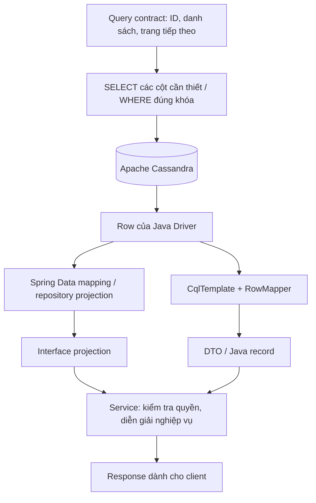

# Ánh xạ kết quả truy vấn về kiểu khác entity

Trong **Spring Data Cassandra**, một bảng có thể chứa nhiều cột phục vụ việc ghi và các truy vấn khác nhau, nhưng mỗi màn hình thường chỉ cần **một phần dữ liệu**. Ví dụ, trang danh sách đơn hàng có thể cần `order_id`, trạng thái và số tiền, chứ không cần toàn bộ metadata, ghi chú hay payload chi tiết. Nếu đọc cả entity rồi trả thẳng ra API, ứng dụng có thể tải dữ liệu không cần thiết, gắn chặt hợp đồng API với cấu trúc lưu trữ và vô tình công bố trường nội bộ.

Kỹ thuật **projection** và **DTO (Data Transfer Object)** giúp ánh xạ kết quả truy vấn sang **kiểu Java khác entity**. Trong chương **Chiếu và phân trang**, bài học này tập trung vào lựa chọn giữa interface projection của repository, DTO/record và `RowMapper` với `CqlTemplate`; cách chọn cột trong CQL; và mối quan hệ giữa projection, partition key, clustering order, paging và hiệu năng của Apache Cassandra.

## 1. Phân biệt entity, projection và DTO

| Khái niệm | Mục đích | Dữ liệu điển hình |
| --- | --- | --- |
| **Entity** | Ánh xạ dữ liệu của một bảng Cassandra, gồm primary key và các cột nghiệp vụ | `OrderById` với `orderId`, `tenantId`, `statusCode`, `totalMinor`, `metadata` |
| **Interface projection** | Trình bày một tập thuộc tính của entity thông qua interface do Spring Data tạo đối tượng triển khai | `OrderCardView` có các getter cần thiết |
| **DTO/record** | Kiểu dữ liệu cụ thể, thường dùng làm kết quả read-only hoặc hợp đồng của một tầng API | `OrderCard(UUID, String, Long)` |
| **RowMapper** | Chuyển một `Row` của Java Driver sang kiểu Java theo quy tắc do lập trình viên định nghĩa | `Row → OrderCard` |

Một projection không phải “bảng mới”, không thay đổi schema CQL và không tạo truy vấn hiệu quả một cách tự động. Nó chỉ thay đổi **hình dạng dữ liệu đi ra khỏi tầng truy cập**. Muốn thực sự tiết kiệm băng thông, câu CQL còn phải **chọn đúng những cột cần thiết**.



**Đừng nhầm hai loại tối ưu:** (1) giảm số cột/hàng **được trả về**, và (2) giảm số **partition phải đọc**. Projection có thể giúp mục tiêu đầu khi CQL chọn ít cột, nhưng **không thay đổi partition key** để giải quyết mục tiêu thứ hai.

## 2. Ví dụ 1: bảng tra cứu theo ID và màn hình thẻ đơn hàng

Giả sử ứng dụng cần tìm một đơn hàng bằng UUID. Thiết kế bảng đơn giản:

```sql
CREATE TABLE orders_by_id (
    order_id       uuid PRIMARY KEY,
    tenant_id      text,
    customer_name  text,
    status_code    text,
    total_minor    bigint,
    metadata       map<text, text>,
    internal_notes text
);
```

`order_id` là partition key. Truy vấn bằng `WHERE order_id = ?` là một point lookup rõ phạm vi, còn `WHERE status_code = ?` trên bảng này **không tự trở thành đường đọc tốt**. Nếu cần danh sách theo tenant/trạng thái, phải xác định một access pattern khác hoặc đánh giá index phù hợp.

Entity có thể được ánh xạ như sau:

```java
import java.util.Map;
import java.util.UUID;
import org.springframework.data.cassandra.core.mapping.Column;
import org.springframework.data.cassandra.core.mapping.PrimaryKey;
import org.springframework.data.cassandra.core.mapping.Table;

@Table("orders_by_id")
public class OrderById {
    @PrimaryKey("order_id")
    private UUID orderId;

    @Column("tenant_id")
    private String tenantId;

    @Column("customer_name")
    private String customerName;

    @Column("status_code")
    private String statusCode;

    @Column("total_minor")
    private Long totalMinor;

    @Column("metadata")
    private Map<String, String> metadata;

    @Column("internal_notes")
    private String internalNotes;

    public OrderById() {}

    public UUID getOrderId() { return orderId; }
    public String getTenantId() { return tenantId; }
    public String getCustomerName() { return customerName; }
    public String getStatusCode() { return statusCode; }
    public Long getTotalMinor() { return totalMinor; }
    public Map<String, String> getMetadata() { return metadata; }
    public String getInternalNotes() { return internalNotes; }

    // Bổ sung constructor/setters nếu mô hình ghi của dự án cần.
}
```

`Long` thay vì `long` giúp giữ trạng thái **chưa có số tiền** (`null`) của những bản ghi cũ. Dữ liệu `internal_notes` được lưu cho nghiệp vụ nội bộ nhưng không có lý do xuất hiện trên mọi màn hình hoặc response.

### Hợp đồng đầu ra

Một thẻ đơn hàng chỉ cần:

```java
import java.util.UUID;

public record OrderCard(
        UUID orderId,
        String statusCode,
        Long totalMinor) {
}
```

`OrderCard` là **read model**, không được đánh dấu `@Table` hoặc `@PrimaryKey` và không được dùng như entity để gọi `save`. Việc không chứa `internalNotes` là lợi ích về cách tổ chức dữ liệu, nhưng **không tự thay thế kiểm tra quyền truy cập**: service vẫn phải kiểm tra tenant/người dùng được phép đọc đơn hàng.

## 3. Cách A: Interface-based projection trong repository

Spring Data hỗ trợ khai báo projection dạng interface, với các getter tương ứng thuộc tính entity:

```java
import java.util.UUID;

public interface OrderCardView {
    UUID getOrderId();
    String getTenantId();
    String getStatusCode();
    Long getTotalMinor();
}
```

Trong đó `getTenantId()` là trường phục vụ **kiểm tra quyền ở service**, không nhất thiết đưa ra response client. Thay vì trả trực tiếp proxy projection qua JSON, service có thể xác thực tenant và chuyển sang `OrderCard` chỉ gồm các trường công khai.

Repository minh họa:

```java
import java.util.Optional;
import java.util.UUID;
import org.springframework.data.cassandra.repository.CassandraRepository;

public interface OrderByIdRepository
        extends CassandraRepository<OrderById, UUID> {

    Optional<OrderCardView> findCardByOrderId(UUID orderId);
}
```

`findCardByOrderId` là **query method có phần mô tả `Card` nằm trước `By`**; Spring Data phân tích điều kiện `OrderId` từ thuộc tính `orderId` của entity. Kiểu trả về là `OrderCardView`, nên Spring Data có thể tạo một projection thay vì yêu cầu service xử lý toàn bộ `OrderById`.

Ví dụ sử dụng:

```java
import java.util.Optional;
import java.util.UUID;

public Optional<OrderCard> findCardForTenant(
        OrderByIdRepository repository,
        UUID orderId, String authenticatedTenant) {

    return repository.findCardByOrderId(orderId)
            .filter(view -> authenticatedTenant.equals(view.getTenantId()))
            .map(view -> new OrderCard(
                    view.getOrderId(),
                    view.getStatusCode(),
                    view.getTotalMinor()));
}
```

Ở đây, nếu không đúng tenant, API có thể áp dụng chính sách không tiết lộ sự tồn tại của đơn hàng. **Không nhận `authenticatedTenant` từ một trường tự do do client cung cấp**; giá trị đó phải được suy ra từ ngữ cảnh xác thực/ủy quyền phù hợp.

### 3.1. Closed projection và phạm vi cột thực sự được đọc

Một interface chỉ có getter trùng với thuộc tính entity như `OrderCardView` là ví dụ **closed projection**. Với những kho dữ liệu và phiên bản Spring Data hỗ trợ tối ưu projection, framework có thể dùng thông tin thuộc tính để giảm dữ liệu cần tải. Tuy nhiên, **không được suy từ kiểu trả về mà khẳng định CQL chắc chắn chỉ SELECT bốn cột**: khả năng tối ưu phụ thuộc store, phiên bản và hình dạng query.

Muốn chứng minh lợi ích giảm payload, cần **kiểm tra CQL thực tế** mà repository tạo ra. Nếu truy vấn vẫn dùng `SELECT *`, driver vẫn nhận các cột mà CQL đã yêu cầu, dù interface chỉ lộ một số getter.

### 3.2. Phép chiếu tường minh qua `@Query`

Khi cần kiểm soát projection của CQL, có thể khai báo một query method riêng:

```java
import java.util.Optional;
import java.util.UUID;
import org.springframework.data.cassandra.repository.Query;

// Khai báo bên trong OrderByIdRepository.
@Query("SELECT order_id, tenant_id, status_code, total_minor " +
       "FROM orders_by_id WHERE order_id = ?0")
Optional<OrderCardView> findCardSelected(UUID orderId);
```

Câu CQL chỉ chọn các cột cần thiết và có đủ partition key. Cách ánh xạ một kết quả `@Query` trả về interface projection phải được **kiểm thử tích hợp trên phiên bản Spring Data Cassandra đang sử dụng**; đặc biệt chú ý quy tắc tên cột (`status_code`) sang thuộc tính Java (`statusCode`), constructor và các converter tùy biến.

Mã ví dụ là phần khai báo **bên trong interface repository**, không phải một phương thức Java đứng độc lập trong một file source. Nếu hệ thống cần quy tắc ánh xạ phức tạp, `CqlTemplate` với `RowMapper` ở phần 5 là lựa chọn minh bạch hơn.

## 4. Cách B: DTO/class-based projection

DTO có thể là Java `record`, class bất biến hoặc class có constructor phù hợp. Khác với interface projection, DTO chứa **giá trị cụ thể**, thuận tiện cho serialization, kiểm tra dữ liệu và việc đưa qua ranh giới các tầng ứng dụng.

Với cơ chế projection theo constructor, Spring Data có thể dựa vào **tên tham số constructor và metadata entity** để ánh xạ một số kiểu DTO trong những trường hợp/phiên bản được hỗ trợ. Vì hỗ trợ projection cụ thể khác nhau theo store, không nên mặc định mọi record có tên trường giống cột sẽ tự ánh xạ được từ mọi câu `@Query`.

Đối với `OrderCard`, hai chiến lược dễ kiểm soát là:

1. **Repository trả interface projection**, sau đó service khởi tạo `new OrderCard(...)`.
2. **CqlTemplate với RowMapper**, ánh xạ trực tiếp `Row` sang `OrderCard`, không phụ thuộc constructor rewriting hoặc metadata của entity.

| Lựa chọn | Ưu điểm | Đánh đổi |
| --- | --- | --- |
| Repository interface projection | Ít mã, dùng tên thuộc tính entity, tích hợp query method | Cần kiểm tra CQL được sinh và giới hạn projection trong phiên bản cụ thể |
| Repository → DTO tại service | Ranh giới API rõ ràng; dễ kiểm tra quyền và biến đổi dữ liệu | Có bước chuyển đổi Java, có thể vẫn đọc nhiều cột từ Cassandra |
| `CqlTemplate` → DTO qua `RowMapper` | Kiểm soát chính xác cột được SELECT, null và quy tắc chuyển đổi | Phải duy trì CQL/RowMapper thủ công |
| `CassandraTemplate` → entity → DTO | Tận dụng mapping/converter hiện có và truy vấn `Query` | Nếu đọc full entity, không giảm payload chỉ nhờ bước DTO |

**Đừng gọi DTO là entity chỉ để tận dụng `CassandraRepository.save`.** Đặc biệt, một đối tượng chỉ được nạp vài cột và thiếu các cột còn lại không an toàn để ghi trở lại như một hàng đầy đủ; các trường vắng giá trị có thể bị ghi null/xóa tùy thao tác và cấu hình.

## 5. Cách C: `CqlTemplate` và `RowMapper` ánh xạ trực tiếp sang record

Đối với một truy vấn CQL rõ ràng, `RowMapper` giúp chuyển từng `Row` của Java Driver thành đối tượng bất kỳ. Ví dụ:

```java
import java.util.List;
import java.util.Optional;
import java.util.UUID;
import com.datastax.oss.driver.api.core.cql.SimpleStatement;
import org.springframework.data.cassandra.core.cql.CqlTemplate;

public final class OrderCardReader {
    private final CqlTemplate cql;

    public OrderCardReader(CqlTemplate cql) {
        this.cql = cql;
    }

    public Optional<OrderCard> findCard(
            UUID orderId, String authenticatedTenant) {
        if (orderId == null || authenticatedTenant == null
                || authenticatedTenant.isBlank()) {
            throw new IllegalArgumentException("Input không hợp lệ");
        }

        SimpleStatement statement = SimpleStatement.builder(
                "SELECT order_id, tenant_id, status_code, total_minor " +
                "FROM orders_by_id WHERE order_id = ?")
                .addPositionalValue(orderId)
                .build();

        List<OrderCard> cards = cql.query(statement, (row, rowNum) -> {
            String tenantId = row.getString("tenant_id");
            if (!authenticatedTenant.equals(tenantId)) {
                // Ví dụ từ chối đưa dữ liệu qua biên ứng dụng;
                // production nên áp dụng chính sách lỗi/404 nhất quán.
                throw new SecurityException("Không có quyền truy cập");
            }

            Long amount = row.isNull("total_minor")
                    ? null : row.getLong("total_minor");

            return new OrderCard(
                    row.getUuid("order_id"),
                    row.getString("status_code"),
                    amount);
        });

        return cards.isEmpty() ? Optional.empty() :
                Optional.of(cards.get(0));
    }
}
```

Đây là ví dụ **đọc một partition theo UUID**. CQL chọn đúng bốn cột; `RowMapper` quyết định cách xử lý `null` và kiểu của từng thuộc tính. Trong hệ thống thật, nên chuyển kiểm tra quyền sang một lớp chính sách thống nhất thay vì ném trực tiếp `SecurityException` ở mapper như mã minh họa.

### 5.1. Vì sao phải kiểm tra `row.isNull()`?

`total_minor bigint` có thể vắng giá trị ở hàng cũ. Getter nguyên thủy `row.getLong("total_minor")` không biểu diễn được trạng thái null bằng Java `long` một cách rõ ràng; nên kiểm tra `row.isNull` trước và gán `Long`:

```java
Long amount = row.isNull("total_minor")
        ? null : row.getLong("total_minor");
```

Đừng biến giá trị thiếu thành `0` nếu nghiệp vụ phân biệt “chưa biết” với “đúng bằng không”. Với các cột tham chiếu như `String`, `row.getString(...)` có thể trả `null` khi cell không có giá trị, cần xác định fallback ở tầng nghiệp vụ.

### 5.2. Tên cột phải khớp projection của CQL

Với RowMapper, các tên dùng trong `row.getUuid("order_id")`, `row.getString("status_code")` chính là **tên/nhãn cột** có mặt trong result set. Nếu câu CQL không SELECT `total_minor`, việc gọi `row.getLong("total_minor")` có thể lỗi vì cột không tồn tại trong metadata của kết quả — tình huống khác với cột có mặt nhưng cell bằng null.

Nếu dùng alias trong CQL, RowMapper phải đọc đúng alias. Nếu cột đổi tên khi migration, nên cập nhật `SELECT`, mapper và test cùng một lần; lỗi schema/codec không nên bị chuyển thành giá trị rỗng giả.

### 5.3. Sử dụng `CqlTemplate` không đồng nghĩa prepared statement

`SimpleStatement` có bind values giúp truyền dữ liệu tách khỏi cú pháp CQL. Nó không đồng nghĩa với việc câu query **đã được prepare và cache** bằng `CqlSession.prepare()`. Đối với đường đọc lặp nhiều lần, có thể dùng `PreparedStatement`/`BoundStatement` và chuyển statement sang API hỗ trợ, nhưng vẫn phải quản lý lifecycle và cấu hình driver phù hợp.

Không ghép `orderId`, giá trị status hay input người dùng vào CQL bằng chuỗi. **Tên bảng và cột cố định**, còn các giá trị lọc được bind theo kiểu.

## 6. Ví dụ 2: đọc danh sách mà không trả payload nặng

Giả sử ứng dụng còn có màn hình “20 đơn hàng gần nhất của một tenant trong một ngày UTC”. Cần một bảng phục vụ **truy vấn danh sách**:

```sql
CREATE TABLE orders_by_tenant_day (
    tenant_id      text,
    order_day      date,
    created_at     timestamp,
    order_id       uuid,
    customer_name  text,
    status_code    text,
    total_minor    bigint,
    internal_notes text,
    PRIMARY KEY ((tenant_id, order_day), created_at, order_id)
) WITH CLUSTERING ORDER BY (created_at DESC, order_id DESC);
```

Đây là **read model riêng** cho access pattern theo tenant và ngày. Hệ thống có thể ghi dữ liệu vào cả `orders_by_id` và `orders_by_tenant_day`, đánh đổi write amplification và nhu cầu đối soát để truy vấn theo hai hướng mà không cần scan toàn cluster.

Query danh sách chỉ chọn bốn cột:

```sql
SELECT created_at, order_id, status_code, total_minor
FROM orders_by_tenant_day
WHERE tenant_id = ? AND order_day = ?
LIMIT 20;
```

Câu SELECT không trả `customer_name` hay `internal_notes`. `created_at` và `order_id` được giữ trong result vì chúng là **clustering keys**, hữu ích để định danh hàng và hỗ trợ cursor phân trang.

Định nghĩa DTO:

```java
import java.time.Instant;
import java.util.UUID;

public record DayOrderItem(
        Instant createdAt,
        UUID orderId,
        String statusCode,
        Long totalMinor) {
}
```

Service truy vấn bằng `CqlTemplate`:

```java
import java.time.LocalDate;
import java.util.List;
import com.datastax.oss.driver.api.core.cql.SimpleStatement;
import org.springframework.data.cassandra.core.cql.CqlTemplate;

public List<DayOrderItem> latestInDay(
        CqlTemplate cql, String authorizedTenant, LocalDate day) {

    if (authorizedTenant == null || authorizedTenant.isBlank()
            || day == null) {
        throw new IllegalArgumentException("Thiếu partition key");
    }

    SimpleStatement statement = SimpleStatement.builder(
            "SELECT created_at, order_id, status_code, total_minor " +
            "FROM orders_by_tenant_day " +
            "WHERE tenant_id = ? AND order_day = ? LIMIT 20")
            .addPositionalValues(authorizedTenant, day)
            .setPageSize(20)
            .build();

    return cql.query(statement, (row, rowNum) ->
            new DayOrderItem(
                    row.getInstant("created_at"),
                    row.getUuid("order_id"),
                    row.getString("status_code"),
                    row.isNull("total_minor")
                            ? null : row.getLong("total_minor")));
}
```

Ở đây, `authorizedTenant` phải là tenant đã được service xác minh quyền. `LocalDate day` cần dùng **cùng quy tắc UTC/bucket** với writer. Kích thước trang của driver được đặt 20 để minh họa, nhưng vì CQL đã có `LIMIT 20`, tổng số hàng đọc theo kết quả câu này cũng tối đa 20; `setPageSize(20)` **không tạo ra “trang HTTP thứ hai”**.

### Vì sao DTO không sửa được truy vấn sai?

Một DTO chỉ có hai thuộc tính vẫn không biến câu sau thành đường đọc hợp lệ:

```sql
-- Thiếu tenant_id và order_day trong partition key.
SELECT order_id, status_code
FROM orders_by_tenant_day
WHERE status_code = 'PAID';
```

Đây là vấn đề **access pattern**, không phải vấn đề ánh xạ kết quả. Nếu màn hình cần danh sách đơn đã thanh toán trên nhiều tenant/ngày, phải thiết kế bảng theo tiêu chí đó hoặc đánh giá index tương thích với phiên bản Cassandra, dữ liệu và yêu cầu hiệu năng.

## 7. Hiệu quả thực tế: giảm cột khác giảm partition

Giả sử một hàng có payload/ghi chú nội bộ 8 KiB và phần thông tin thẻ chỉ khoảng 100 byte. Một lượt đọc 20 hàng có thể tạo khác biệt lớn về **dung lượng dữ liệu truyền lên ứng dụng** khi SELECT chỉ các cột của thẻ thay vì `SELECT *`.

Nhưng có ba lớp chi phí:

| Lớp chi phí | Projection giúp gì? | Không giúp gì? |
| --- | --- | --- |
| Network và ánh xạ Java | Khi `SELECT` cột tường minh, giảm bytes trả về và trường phải map | Nếu CQL vẫn `SELECT *`, interface projection không chắc giảm bytes |
| Dung lượng đối tượng trả API | DTO/record định hình response và giới hạn trường | Không tự thay đổi quyền truy cập hoặc semantics dữ liệu |
| Định tuyến partition và đọc hàng | CQL chỉ một partition với khóa phù hợp là đường đọc rõ ràng | Projection không giảm số partition nếu query fan-out `B × S` |

Các con số chỉ nhằm mô tả xu hướng; overhead, compression, protocol, kích thước partition và cách thực thi Cassandra đều tác động lượng bytes/tốc độ thực tế. Cần đo `p95/p99`, bytes read/response, số hàng và số partition thay vì kết luận từ số field trong Java.

**Đặt projection sau việc thiết kế truy vấn:** trước hết chọn partition key và clustering order theo use case, sau đó chọn các cột cần xuất hiện trong result. Đảo ngược thứ tự thường tạo được DTO đẹp nhưng truy vấn vẫn phải scan dữ liệu.

## 8. Projection kết hợp với pagination

Một API trả danh sách thường cần cả **kiểu dữ liệu gọn** và **cơ chế đi đến trang tiếp theo**. Hai nhu cầu này độc lập:

- **Projection:** hàng trả về có những field nào?
- **Pagination:** lần đọc kế tiếp bắt đầu ở đâu, lấy bao nhiêu hàng, và theo thứ tự nào?

Với bảng `orders_by_tenant_day`, Cassandra sắp xếp theo `created_at DESC, order_id DESC` trong **một partition**. Câu `LIMIT 20` lấy tối đa 20 hàng của một lần đọc, **không tạo offset**. Đừng cố giả lập `OFFSET 10000` bằng cách đọc và bỏ 10.000 hàng cho một request.

### 8.1. Paging state của Cassandra

Java Driver hỗ trợ paging state để tiếp tục truy vấn mà không dùng offset. Nếu muốn expose cursor ra API, service cần quản lý:

1. **Cùng CQL và tham số** khi tiếp tục: tenant, ngày, filter và thứ tự phải không thay đổi.
2. **State có thời hạn/kiểm soát:** không tin vào cursor do client tự chỉnh; nên ký/mã hóa và ràng buộc với tenant/quyền của người dùng, xử lý state không hợp lệ hoặc đã cũ.
3. **Không tải toàn bộ result vô ý:** một lời gọi `CqlTemplate.query(...)` trả `List` có thể tiêu thụ toàn bộ tập kết quả mà query/driver cho phép, dù bên dưới dùng nhiều fetch page. Để kiểm soát **mỗi trang HTTP**, cần đường API hỗ trợ đọc theo trang/async và lấy paging state đúng cách.
4. **Nhất quán khi dữ liệu thay đổi:** paging qua nhiều thời điểm không tạo snapshot nguyên tử; hàng mới/chỉnh sửa có thể tác động tập kết quả.

Không nên truyền trực tiếp paging state như một token truy cập không giới hạn. Trong hệ đa tenant, token phải ràng buộc với chính request và quyền đang được xác thực.

### 8.2. Cursor theo clustering key

Một phương án khác là keyset pagination: giữ **cặp khóa cuối trang** `(created_at, order_id)`, sau đó truy vấn các hàng tiếp theo theo clustering order. Nếu chỉ nhớ `created_at`, nhiều đơn có cùng millisecond sẽ gây **trùng hoặc bỏ sót**.

Việc tạo điều kiện tiếp tục phải tương thích với các ràng buộc trên clustering columns, thứ tự DESC và khả năng tuple comparison của phiên bản Cassandra; cần kiểm tra CQL cụ thể trước khi triển khai. Không suy diễn rằng cú pháp `WHERE created_at < ? OR order_id < ?` của SQL quan hệ có thể dùng nguyên vẹn trong Cassandra.

Vì `DayOrderItem` giữ cả `createdAt` và `orderId`, DTO có thể cung cấp đủ thông tin để tạo cursor mà không cần chuyển về entity đầy đủ.

### 8.3. Nhiều partition không có global order miễn phí

Nếu request yêu cầu “20 đơn mới nhất trong 30 ngày”, service có thể phải đọc nhiều partition `(tenant_id, order_day)` rồi merge dữ liệu đã sắp xếp. Một `ORDER BY` trong một partition không tạo thứ tự toàn cục trên 30 partition. Projection giảm dung lượng mỗi hàng được mang về, nhưng **không xóa fan-out, tail latency hay công việc merge**.

Nếu đây là API cực nóng, có thể cân nhắc read model cho feed gần đây, giới hạn khoảng ngày hoặc chiến lược kết hợp bucket để có chi phí dự đoán.

## 9. Null, kiểu dữ liệu và schema evolution

Ánh xạ sang kiểu khác entity dễ làm lộ lỗi kiểu và dữ liệu lịch sử:

- **Giá trị null:** dùng `Long` khi `total_minor` có thể vắng mặt; không ép bằng 0 một cách ngầm định.
- **Timestamp:** `timestamp` CQL ánh xạ sang `Instant` ở Java Driver 4 với độ chính xác millisecond; nếu dùng trong cursor, cần duy trì giá trị đã đọc thay vì tự tính lại.
- **UUID:** `uuid` và `timeuuid` có ngữ nghĩa khác nhau; `Row.getUuid` trả `UUID` nhưng dữ liệu ghi phải hợp với kiểu cột.
- **Tên cột:** property `statusCode` trong mapping entity có thể tương ứng cột CQL `status_code`; RowMapper thô phải dùng tên nhãn cột của kết quả.
- **Cột mới:** `ALTER TABLE ADD` khiến hàng cũ có thể thiếu giá trị; DTO và service cần hỗ trợ giai đoạn chuyển tiếp.
- **Cột bị bỏ:** nếu `SELECT` vẫn tham chiếu cột đã xóa, truy vấn lỗi CQL; đó không phải một giá trị null bình thường.
- **Converter riêng:** entity mapping của Spring Data và RowMapper thô không nhất thiết dùng cùng bộ chuyển đổi. Khi có value object/enum tùy biến, RowMapper phải diễn giải giá trị theo quy tắc tương ứng.

Một lỗi nguy hiểm là lấy entity đọc **thiếu cột**, sửa một field rồi ghi cả entity. Nếu các field không tải được mang giá trị `null`, một thao tác lưu có thể vô tình xóa/ghi đè dữ liệu hiện hữu tùy semantics ghi. **DTO/record chỉ đọc** là một ranh giới có ý nghĩa: không dùng chúng để biểu diễn bản ghi đủ điều kiện ghi trở lại Cassandra.

## 10. Bảo mật và cách tách response API

Projection giảm nguy cơ vô tình trả toàn bộ entity, nhưng không phải một lớp authorization:

1. **Ràng buộc tenant ngay từ use case.** Nếu bảng chỉ có `order_id` làm partition key, service phải kiểm tra chủ sở hữu trước khi trả dữ liệu; khi tenant-scoped lookup là đường đọc chính, cân nhắc bảng với partition key chứa `tenant_id`.
2. **Không trả trực tiếp proxy projection** nếu nó còn có getter nội bộ như `getTenantId()`. Chuyển sang DTO response công khai sau bước phân quyền.
3. **Không ghi log payload thô** để chẩn đoán lỗi mapping khi chứa dữ liệu nhạy cảm; ghi tên bảng/cột và khóa được phép theo chính sách.
4. **Không dùng DTO để kiểm soát quyền trên Cassandra.** Quyền truy cập, xác thực và chính sách dữ liệu phải được thực thi ở tầng phù hợp.
5. **Chỉ SELECT cột cần thiết:** giảm số trường nội bộ đi qua mạng và vùng nhớ ứng dụng, nhưng không coi đây là biện pháp duy nhất để bảo vệ dữ liệu.

## 11. Kiểm thử: xác nhận cả kết quả lẫn câu CQL

Một bộ kiểm thử có ích nên có Cassandra thử nghiệm với schema tương ứng, vì test đơn thuần constructor `new OrderCard(...)` không chứng minh repository projection hay RowMapper hoạt động.

| Kiểm thử | Điều cần xác minh |
| --- | --- |
| Interface projection trên repository | Tên getter khớp property; giá trị đúng; chạy trên phiên bản Spring Data thực tế |
| `@Query` chọn một số cột | CQL thực sự chọn cột mong muốn, mapping projection hoạt động |
| CqlTemplate → DTO | `RowMapper` đọc đúng tên cột/kiểu, không truy cập cột thiếu |
| Dữ liệu legacy có `total_minor = null` | Đọc được `null`, không tự biến thành 0 |
| Truy cập khác tenant | Không có thông tin nội bộ lọt sang response |
| `orders_by_tenant_day` cùng millisecond | `created_at` + `order_id` giữ thứ tự phụ ổn định |
| Nhiều ngày/bucket | Service không giả định một partition chứa toàn bộ dữ liệu |
| Trang tiếp theo | Không lặp/bỏ sót trong bộ dữ liệu cố định; cursor ràng buộc request |
| Lỗi schema/codec/timeout | Được phân loại riêng, không chuyển mọi lỗi thành kết quả rỗng |
| `SELECT *` so với projection rõ cột | Đo bytes, p95/p99 và số partition thực tế |

Để đánh giá tối ưu, cần **quan sát CQL phát sinh**, không chỉ nhìn kiểu trả về của repository. Nếu phương thức projection vẫn đọc đủ payload lớn, thêm một getter ít hơn không chứng minh dữ liệu được chuyển ít hơn. Ngược lại, một truy vấn CQL chỉ chọn bốn cột nhưng thiếu partition key có thể không hợp lệ hoặc rất đắt.

## 12. Các lỗi thường gặp

| Sai lầm | Vấn đề | Cách khắc phục |
| --- | --- | --- |
| Trả thẳng entity ra JSON | Lộ trường nội bộ, API phụ thuộc schema | Định nghĩa DTO response độc lập |
| Nghĩ `OrderCardView` luôn làm CQL chọn ít cột | Repository có thể vẫn SELECT nhiều cột | Kiểm tra CQL hoặc dùng `@Query`/RowMapper chọn cột tường minh |
| `SELECT` thiếu cột nhưng mapper vẫn đọc | Getter trên `Row` không tìm thấy cột | Đồng bộ projection CQL với RowMapper |
| DTO khai báo primitive `long` cho cột có thể null | Mất khả năng phân biệt dữ liệu thiếu | Dùng `Long` và validation rõ ràng |
| Ghi lại entity chỉ mới đọc một số cột | Nguy cơ xóa/ghi đè trường không nạp | Không dùng partial entity cho update toàn hàng |
| Chỉ trả `status_code` nhưng cần phân trang | Thiếu clustering keys để tạo cursor | Giữ ID và các trường khóa sắp xếp trong DTO |
| Lọc theo cột không thuộc key vì DTO chỉ có cột ấy | Query vẫn không có access path phù hợp | Thiết kế schema theo truy vấn hoặc index hợp lệ |
| Dùng `LIMIT` như số trang, hoặc giả lập `OFFSET` | Chi phí đọc không dự đoán được | Paging state hoặc keyset cursor phù hợp |
| Bỏ kiểm tra quyền vì DTO không có dữ liệu bí mật | Vẫn có thể lộ sự tồn tại/trạng thái đơn của tenant khác | Authorization ở service và/hoặc key tenant-scoped |
| Bỏ qua consistency/timeout | Kết quả có thể lỗi hoặc không phản ánh thời điểm mong muốn | Chọn CL theo contract và xử lý lỗi riêng |

## 13. Checklist trước khi triển khai

1. **Chốt access pattern:** đọc theo ID hay danh sách theo tenant/ngày; biết đầy đủ partition key.
2. **Chọn field xuất ra:** phân biệt field nội bộ, field cần cho UI và field cần cho paging/cursor.
3. **Chọn hình thức:** interface projection nếu tích hợp repository phù hợp; DTO + RowMapper nếu cần kiểm soát chặt câu CQL và kiểu dữ liệu.
4. **Kiểm soát CQL:** dùng `SELECT` tường minh khi mục tiêu là giảm tải; kiểm tra truy vấn sinh tự động thay vì suy đoán.
5. **Null và legacy:** Java type nullable, converter/RowMapper phù hợp với dữ liệu lịch sử.
6. **Không write partial entity:** read model/DTO được tách khỏi đường ghi đầy đủ.
7. **Cân nhắc paging:** giữ clustering key và thứ tự ổn định; tránh offset và token không ràng buộc.
8. **Thực thi security:** tenant được xác thực, DTO response không chứa getter nội bộ.
9. **Đo trong môi trường đại diện:** p95/p99, số partition, số hàng, bytes, timeout và consistency.
10. **Kiểm thử round-trip và query shape:** không dừng ở test mapper thuần Java.

## 14. Bài tập tình huống

**Bài tập A.** Một repository trả `OrderCardView` chỉ có `getStatusCode()`, nhưng khi quan sát CQL thấy `SELECT * FROM orders_by_id WHERE order_id = ?`. Có thể kết luận đã giảm dữ liệu truyền qua mạng chưa?

**Gợi ý:** Chưa. Projection giới hạn phần thuộc tính Java được truy cập, nhưng query vẫn yêu cầu đầy đủ cột. Nếu mục tiêu là giảm payload, hãy dùng CQL chọn cột tường minh hoặc cơ chế tối ưu đã kiểm chứng, rồi đo số bytes.

**Bài tập B.** Một API cần 20 đơn hàng gần nhất trong ngày, nhưng DTO chỉ có `statusCode` và `totalMinor`. Trang tiếp theo thường dựa vào `created_at, order_id`. DTO thiếu gì?

**Gợi ý:** Thiếu thông tin clustering key để giữ cursor có tie-breaker ổn định. Có thể trả token cursor riêng, nhưng tầng truy vấn vẫn phải giữ cả hai khóa trong logic paging.

**Bài tập C.** Dữ liệu V1 chưa có `total_minor`. RowMapper gọi `row.getLong("total_minor")` rồi trả DTO có `long totalMinor`. Cách làm có đủ an toàn cho nghiệp vụ không?

**Gợi ý:** Không. Kiểm tra `row.isNull("total_minor")` và dùng `Long`; xử lý bản ghi thiếu số tiền ở tầng nghiệp vụ, không ngầm suy ra 0.

**Bài tập D.** Đọc `orders_by_tenant_day` bằng CQL chỉ chọn `order_id, status_code`, rồi chuyển thành một `OrderById` và gọi `save` để sửa trạng thái. Nguy cơ là gì?

**Gợi ý:** Entity có nhiều trường không được nạp có thể mang null; ghi toàn entity có thể làm thay đổi/xóa dữ liệu không định sửa. Dùng câu `UPDATE` mục tiêu trên bảng đúng, có đủ khóa và semantics ghi được kiểm chứng.

**Bài tập E.** Một dịch vụ trả DTO đúng cấu trúc nhưng truy vấn `WHERE status_code = 'PAID'` trên bảng phân vùng theo `(tenant_id, order_day)`. Projection có làm câu truy vấn hiệu quả hơn không?

**Gợi ý:** Không. Trước tiên phải có access path phù hợp với truy vấn trạng thái: bảng read model mới hoặc index được đánh giá đầy đủ; DTO không thay đổi định tuyến partition.

## Kết luận

**Ánh xạ kết quả truy vấn về kiểu khác entity** giúp Spring Data Cassandra trả dữ liệu sát nhu cầu của từng use case, giảm sự phụ thuộc của API vào cấu trúc lưu trữ và tạo cơ hội giảm payload. **Interface projection** thuận tiện khi truy cập bằng repository; **DTO/record kết hợp `CqlTemplate` và `RowMapper`** cho phép kiểm soát rõ cột CQL, kiểu và null. `CassandraTemplate` vẫn phù hợp khi cần ánh xạ entity rồi chuyển đổi có chủ đích.

Hãy theo trình tự **thiết kế truy vấn và partition key → chọn cột cần đọc → ánh xạ sang projection/DTO → giữ thông tin cursor → kiểm tra quyền, null và consistency → đo bytes và độ trễ**. Projection là công cụ tổ chức dữ liệu đầu ra; hiệu năng và tính đúng đắn cuối cùng vẫn phụ thuộc schema, CQL, paging và vận hành Apache Cassandra.
