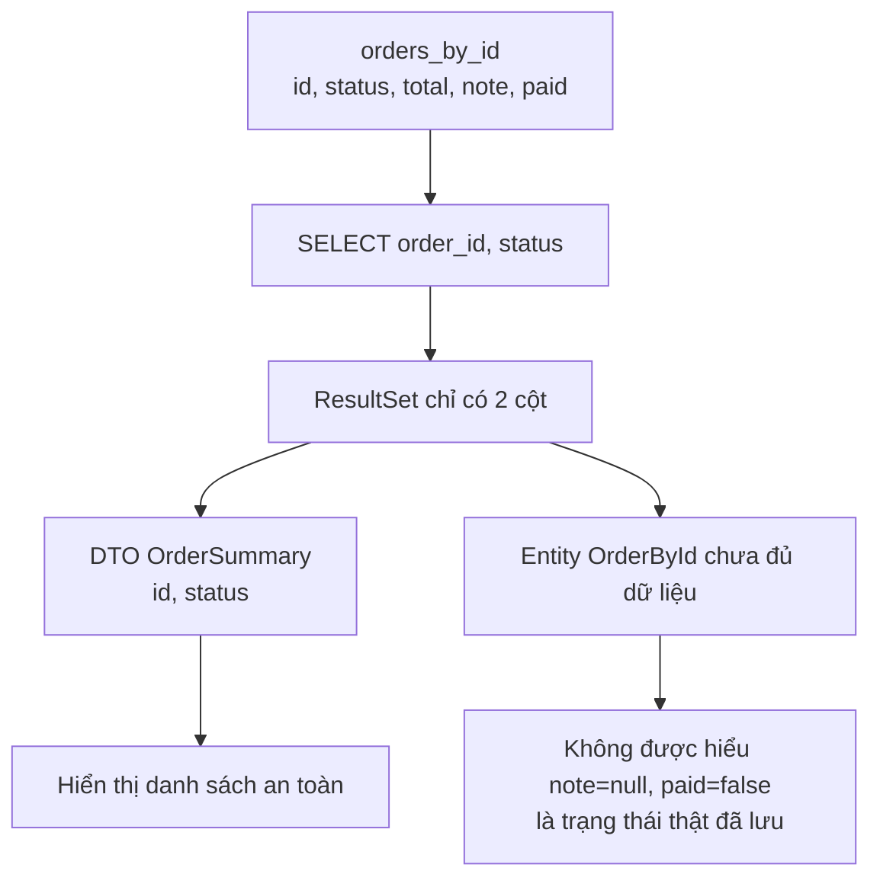
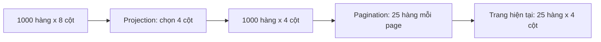

# Giá trị mặc định khi một số cột không được chọn

## 1. Bài toán: truy vấn nhẹ nhưng entity lại có nhiều thuộc tính

Với **Spring Data Cassandra**, một bảng Apache Cassandra có thể chứa nhiều cột, trong khi mỗi màn hình chỉ cần một vài trường. Màn hình danh sách đơn hàng thường chỉ cần ID, trạng thái và thời điểm tạo; phần ghi chú dài, tổng tiền hoặc thông tin khác chỉ được tải khi người dùng mở chi tiết.

Ta có thể dùng **projection** (phép chiếu): trong CQL, `SELECT` chỉ các cột cần thiết; trong Java, trả về DTO/interface chứa đúng những thuộc tính đã chọn. Cách này có thể giảm dữ liệu truyền qua mạng và công sức chuyển đổi đối tượng.

Vấn đề xuất hiện khi lập trình viên chọn một ít cột nhưng vẫn ánh xạ kết quả vào **entity đầy đủ**. Lúc đó các thuộc tính không được chọn có thể trông như đang mang **giá trị mặc định Java** (`null`, `0`, `false`) hoặc giá trị khởi tạo từ constructor/field initializer. Những giá trị ấy **không chứng minh** dữ liệu được lưu trong Cassandra thật sự có giá trị tương ứng.



**Mục tiêu bài học:** phân biệt **cột không có trong kết quả truy vấn** với **cột được chọn nhưng có giá trị `null`**, hiểu tác động của default Java đến entity, chọn projection phù hợp với repository/`CassandraTemplate`/`CqlTemplate`, và tránh ghi đè dữ liệu khi làm việc với một object chưa được tải đầy đủ.

## 2. Schema minh họa và ba trạng thái rất dễ nhầm

Tạo một keyspace/bảng để thực hành:

```sql
-- Chỉ dùng SimpleStrategy và RF=1 trên Cassandra local một node.
CREATE KEYSPACE IF NOT EXISTS shop_demo
WITH replication = {
    'class': 'SimpleStrategy',
    'replication_factor': 1
};

CREATE TABLE IF NOT EXISTS shop_demo.orders_by_id (
    order_id uuid PRIMARY KEY,
    customer_id uuid,
    status text,
    total_amount decimal,
    paid boolean,
    retry_count int,
    note text,
    updated_at timestamp
);
```

`order_id` là **partition key** và cũng là toàn bộ primary key. Một truy vấn `WHERE order_id = ?` định vị được hàng theo khóa, không cần quét toàn bộ bảng.

Seed một hàng:

```sql
INSERT INTO shop_demo.orders_by_id (
    order_id, customer_id, status,
    total_amount, paid, retry_count, updated_at
) VALUES (
    11111111-1111-4111-8111-111111111111,
    22222222-2222-4222-8222-222222222222,
    'PAID',
    259000.00,
    true,
    3,
    '2026-11-25T08:00:00Z'
);
```

Không ghi giá trị cho `note` trong ví dụ này. Hãy xem ba truy vấn:

**A — Không chọn cột `note`:**

```sql
SELECT order_id, status
FROM shop_demo.orders_by_id
WHERE order_id = 11111111-1111-4111-8111-111111111111;
```

Kết quả truy vấn chỉ chứa **hai cột** `order_id`, `status`. Nó **không đưa ra thông tin nào** về giá trị hiện tại của `note`, `paid`, `retry_count`, `total_amount` hay `updated_at`.

**B — Chọn cột `note` nhưng dữ liệu của nó vắng mặt:**

```sql
SELECT order_id, status, note
FROM shop_demo.orders_by_id
WHERE order_id = 11111111-1111-4111-8111-111111111111;
```

Kết quả chứa **cột `note`**, với giá trị được đọc là `null` nếu cột chưa có giá trị còn hiệu lực. Cột vẫn có mặt trong **metadata** của result set.

**C — Truy vấn không tìm thấy hàng:**

```sql
SELECT order_id, status, note
FROM shop_demo.orders_by_id
WHERE order_id = 33333333-3333-4333-8333-333333333333;
```

Ở trường hợp này **không có hàng kết quả**; không nên biến nó thành một entity có tất cả field là `null` rồi báo rằng đơn đã tồn tại.

| Tình huống | Cột nằm trong result metadata? | Có hàng kết quả? | Kết luận được về dữ liệu? |
| --- | --- | --- | --- |
| Không có `note` trong `SELECT` | **Không** | Có thể có | **Chưa biết** `note` trong Cassandra là gì |
| Có `note` trong `SELECT`, cell đọc là `null` | **Có** | Có | Tại thời điểm đọc, giá trị cột được quan sát là `null` |
| Query trả về 0 hàng | Metadata của câu query vẫn có thể chứa `note` | **Không** | Không có bản ghi thỏa điều kiện; không có object để đọc |

Đây là sự khác biệt quan trọng nhất trong bài. **“Không được tải” không đồng nghĩa với “đã tải và có giá trị null”.**

## 3. Default của Java không phải default trong Cassandra

Java có quy tắc khởi tạo field khi một object được tạo:

| Field Java | Giá trị mặc định Java nếu chưa gán | Vấn đề khi ánh xạ từ một `SELECT` thiếu cột |
| --- | --- | --- |
| `String status` | `null` | Có thể bị hiểu là trạng thái đang rỗng |
| `BigDecimal totalAmount` | `null` | Không thể phân biệt chưa tải với dữ liệu CQL null |
| `Boolean paid` | `null` | Cho phép diễn đạt “không biết”, nhưng vẫn cần biết lý do |
| `boolean paid` | `false` | Dễ bị hiểu nhầm là chưa thanh toán |
| `Integer retryCount` | `null` | Chưa tải và CQL null có thể trông giống nhau |
| `int retryCount` | `0` | Dễ bị hiểu nhầm là thực sự chưa retry |
| `Instant updatedAt` | `null` | Có thể bị hiển thị như chưa từng cập nhật |

**Các giá trị trong bảng là default của ngôn ngữ Java, không phải cam kết của mọi phiên bản Spring Data Cassandra rằng một truy vấn thiếu cột luôn tạo object với đúng những giá trị đó.** Cơ chế materialization có thể gọi constructor, đặt field, dùng property access hoặc converter. Nếu constructor yêu cầu dữ liệu không được chọn, ánh xạ có thể thất bại thay vì âm thầm dùng default.

Ví dụ entity:

```java
import java.math.BigDecimal;
import java.time.Instant;
import java.util.UUID;

import org.springframework.data.cassandra.core.mapping.Column;
import org.springframework.data.cassandra.core.mapping.PrimaryKey;
import org.springframework.data.cassandra.core.mapping.Table;

@Table("orders_by_id")
public class OrderById {

    @PrimaryKey("order_id")
    private UUID orderId;

    @Column("status")
    private String status;

    @Column("total_amount")
    private BigDecimal totalAmount;

    @Column("paid")
    private boolean paid;

    @Column("retry_count")
    private int retryCount;

    @Column("note")
    private String note;

    @Column("updated_at")
    private Instant updatedAt;

    protected OrderById() {
    }

    // Bổ sung constructor và accessors cho dự án thực tế.
}
```

Nếu mapper tạo được một `OrderById` từ truy vấn chỉ chọn `order_id`, `status`, những field **không được nạp** có nguy cơ hiện ra theo default Java như `paid == false`, `retryCount == 0`, `note == null`. Nhưng hàng đã seed thực sự có `paid = true`, `retry_count = 3`. **Object vừa đọc chưa đủ dữ liệu để làm nguồn sự thật cho các thuộc tính đó.**

### Field initializer và constructor cũng có thể gây hiểu nhầm

```java
private String status = "PENDING";
private boolean paid = false;
```

Nếu cơ chế materialization **giữ lại** giá trị khởi tạo khi cột không được chọn, field có thể trông như `PENDING` dù dữ liệu đã lưu là `PAID`. Nếu mapper ghi đè bằng `null`/giá trị khác hoặc yêu cầu constructor argument, kết quả lại khác. **Không dùng field initializer để thay thế quy tắc dữ liệu khi đọc một phần entity.**

Tương tự, `@Column` hay `@CassandraType` chỉ mô tả mapping/kiểu CQL; chúng không tự tạo một `DEFAULT` ở tầng Cassandra và không tự phân biệt dữ liệu bị bỏ khỏi projection.

## 4. Phân biệt metadata của Row với giá trị của Cell

Khi thao tác trực tiếp bằng **Java Driver 4.x**, nên phân biệt ba bước:

1. `ResultSet.one()` có trả về một `Row` không?
2. Column definitions của `Row` có chứa tên cột cần đọc không?
3. Nếu có cột, `row.isNull("column")` hoặc getter tương ứng trả kết quả gì?

Ví dụ đọc projection rõ ràng bằng prepared statement:

```java
import java.util.Optional;
import java.util.UUID;

import com.datastax.oss.driver.api.core.CqlSession;
import com.datastax.oss.driver.api.core.cql.PreparedStatement;
import com.datastax.oss.driver.api.core.cql.Row;

record OrderSummary(UUID orderId, String status) {
}

public final class OrderSummaryReader {

    private final CqlSession session;
    private final PreparedStatement findSummary;

    public OrderSummaryReader(CqlSession session) {
        this.session = session;
        this.findSummary = session.prepare("""
            SELECT order_id, status
            FROM shop_demo.orders_by_id
            WHERE order_id = ?
            """);
    }

    public Optional<OrderSummary> find(UUID id) {
        Row row = session.execute(findSummary.bind(id)).one();
        if (row == null) {
            return Optional.empty();
        }
        return Optional.of(new OrderSummary(
            row.getUuid("order_id"),
            row.getString("status")
        ));
    }
}
```

Đoạn này không đọc `paid`, `note` hay `retry_count` nên không có giá trị giả cho các trường đó. Service chỉ nhận **một DTO có đúng hai thành phần**.

### Nếu thực sự cần kiểm tra cột có nằm trong SELECT

Ví dụ khái niệm với Java Driver 4.x:

```java
import com.datastax.oss.driver.api.core.CqlIdentifier;
import com.datastax.oss.driver.api.core.cql.Row;

boolean noteWasSelected = row.getColumnDefinitions()
    .contains(CqlIdentifier.fromCql("note"));

if (!noteWasSelected) {
    // Trạng thái: chưa chọn/không có cột note trong kết quả.
} else if (row.isNull("note")) {
    // Trạng thái: đã chọn note, giá trị quan sát là null.
} else {
    String note = row.getString("note");
    // Trạng thái: đã chọn và có giá trị note.
}
```

API kiểm tra metadata có thể khác về overload theo phiên bản Java Driver; điều cần giữ là **kiểm tra cột có trong result metadata trước**, rồi mới hỏi giá trị. Gọi `row.getString("note")` trên một result **không hề chọn `note`** có thể gây lỗi tra cứu cột, không phải lúc nào cũng trả `null`. Không viết code dựa trên giả định sai rằng driver sẽ tự cho một default.

Trong hệ thống thật, thường nên tránh phải kiểm tra động kiểu này: một **projection cố định** biết trước danh sách cột và trả đúng DTO sẽ đơn giản, an toàn hơn.

## 5. Spring Data Cassandra: tại sao không nên ánh xạ projection thành entity đầy đủ?

Repository có thể khai báo câu `@Query` chỉ chọn vài cột:

```java
import java.util.Optional;
import java.util.UUID;

import org.springframework.data.cassandra.repository.CassandraRepository;
import org.springframework.data.cassandra.repository.Query;

public interface OrderByIdRepository
        extends CassandraRepository<OrderById, UUID> {

    @Query("""
        SELECT order_id, status
        FROM orders_by_id
        WHERE order_id = ?0
        """)
    Optional<OrderById> findThinEntity(UUID id);
}
```

**Đây là ví dụ để nhận diện rủi ro, không phải pattern được khuyến nghị.** Câu CQL chỉ chọn `order_id` và `status`, nhưng kiểu trả về vẫn là `OrderById` chứa nhiều thuộc tính. Tùy mapping/constructor/phiên bản Spring Data, entity có thể được tạo với các thuộc tính thiếu dữ liệu, hoặc không thể materialize nếu thiếu trường bắt buộc.

Nếu được tạo, các trường như `totalAmount`, `note`, `paid` không được chọn **không thể coi là trạng thái thật ở Cassandra**. Đặc biệt nguy hiểm khi:

```java
OrderById partial = repository.findThinEntity(id).orElseThrow();

// Không nên sửa một vài field trên partial rồi save cả entity.
// repository.save(partial);
```

Một thao tác `save` sẽ sử dụng **trạng thái object được cung cấp và chiến lược ghi của Spring Data**. Tùy null-handling, mapping và kiểu lệnh phát sinh, ứng dụng có thể tạo những thay đổi không chủ đích, thậm chí xóa/ghi lại giá trị của các cột không được tải. Không dựa vào giả định rằng các field không được chọn sẽ luôn được hệ thống persistence tự bảo vệ.

**Nguyên tắc:** nếu cần đối tượng để **hiển thị**, trả về projection/DTO; nếu cần **sửa đúng một vài cột**, dùng partial update CQL rõ ràng; nếu cần lưu lại toàn bộ entity, trước tiên phải đọc dữ liệu đầy đủ theo khóa và kiểm soát cạnh tranh.

### Một nguy cơ khác: thiếu primary key trong SELECT

Một entity được xác định bằng `@PrimaryKey` hoặc `@PrimaryKeyClass`. Nếu truy vấn không chọn các thành phần khóa cần thiết, object trả về có thể không mang ID đầy đủ, không phù hợp với `findById`, cập nhật hoặc xóa. Khi cần projection phục vụ một câu query, hãy chọn các trường khóa cần thiết cho **định danh, phân trang/cursor và thao tác tiếp theo**.

## 6. Giải pháp A: interface projection chỉ biểu lộ những field đã chọn

Với các phiên bản Spring Data Cassandra có hỗ trợ interface projection, ta có thể khai báo:

```java
import java.util.UUID;

public interface OrderSummaryView {
    UUID getOrderId();
    String getStatus();
}
```

Repository:

```java
import java.util.Optional;
import java.util.UUID;

import org.springframework.data.cassandra.repository.CassandraRepository;
import org.springframework.data.cassandra.repository.Query;

public interface OrderByIdRepository
        extends CassandraRepository<OrderById, UUID> {

    @Query("""
        SELECT order_id, status
        FROM orders_by_id
        WHERE order_id = ?0
        """)
    Optional<OrderSummaryView> findSummaryById(UUID id);
}
```

**Ý nghĩa thiết kế:** `OrderSummaryView` **không có** getter cho `paid`, `retryCount` hoặc `note`. Nhờ đó tầng service/UI không thể vô tình đọc các trường chưa được chọn như thể chúng đã có dữ liệu.

Cần lưu ý:

- Khả năng áp dụng projection, cách materialize và naming strategy phụ thuộc **phiên bản Spring Data Cassandra** và dạng method repository. Kiểm thử ví dụ trên bằng integration test; nếu cần constructor/alias cụ thể, dùng DTO explicit hoặc manual row mapping.
- Tên property `orderId` phải ánh xạ được với cột CQL `order_id` thông qua metadata/mapping tương ứng. Không thay alias hoặc tên property tùy tiện mà không kiểm chứng.
- Interface projection là **read view**, không phải một entity đầy đủ để gọi `save`.
- Nếu projection có một getter nhưng câu `SELECT` thiếu cột đó, giá trị getter không được coi là một default nghiệp vụ đúng; hãy **sửa projection và SELECT cho khớp**.

Một projection chỉ để giảm số property mà **vẫn dùng `SELECT *`** không nhất thiết làm giảm byte đọc từ Cassandra. Muốn giảm dữ liệu trả về từ server, phải kiểm tra câu CQL thực sự chỉ chọn những cột cần thiết.

## 7. Giải pháp B: DTO tường minh và RowMapper/CqlTemplate

Khi muốn kiểm soát hoàn toàn những cột được chọn và cách giải mã, sử dụng DTO:

```java
import java.math.BigDecimal;
import java.util.UUID;

public record OrderCard(
    UUID orderId,
    String status,
    BigDecimal totalAmount
) {
}
```

Truy vấn:

```sql
SELECT order_id, status, total_amount
FROM shop_demo.orders_by_id
WHERE order_id = ?;
```

Với Java Driver, ánh xạ các cột cụ thể:

```java
Row row = session.execute(statement.bind(id)).one();
if (row == null) {
    return Optional.empty();
}

return Optional.of(new OrderCard(
    row.getUuid("order_id"),
    row.getString("status"),
    row.getBigDecimal("total_amount")
));
```

Ở ví dụ trên, `statement` là `PreparedStatement` đã chuẩn bị từ CQL phía trên, và hàm trả về `Optional<OrderCard>`. Ba cột cần thiết **đều xuất hiện trong SELECT**; có thể quyết định rõ cách xử lý nếu `total_amount` được chọn nhưng là null.

`CqlTemplate` cũng có thể dùng `RowMapper` khi cần mapping thấp hơn entity:

```java
import java.util.List;

import org.springframework.data.cassandra.core.cql.CqlTemplate;

List<String> versions = cqlTemplate.query(
    "SELECT release_version FROM system.local",
    (row, rowNum) -> row.getString("release_version")
);
```

Ví dụ cuối minh họa API mapping của `CqlTemplate`, **không dùng user input**. Với truy vấn nghiệp vụ có tham số động, dùng bind markers hoặc prepared statements theo API của phiên bản hiện tại; không ghép UUID/string từ HTTP vào CQL.

### Nên chọn interface, record hay entity?

| Nhu cầu | Kiểu kết quả | Lợi ích |
| --- | --- | --- |
| Một trang danh sách chỉ cần ID/trạng thái | Interface projection hoặc record DTO | Không mang các field chưa chọn |
| Dữ liệu có logic hiển thị/phối hợp nhiều nguồn | DTO ở tầng ứng dụng | Hợp đồng API không phụ thuộc schema |
| CRUD cần trạng thái đầy đủ của một hàng | Entity ánh xạ đầy đủ | Phù hợp `save`, mapping và quy trình cập nhật có kiểm soát |
| CQL đặc biệt, hàm CQL, custom aggregation | RowMapper/DTO từ `CqlTemplate` hoặc `CqlSession` | Kiểm soát cột và kiểu của kết quả |
| Phân trang lịch sử theo partition | DTO gồm khóa/cursor fields | Không đánh mất dữ liệu cần để tiếp tục trang |

Một DTO có thể có `status == null` nếu cột được chọn nhưng thật sự null. **DTO không tự giải quyết mọi nullability**, nhưng nó giải quyết nhầm lẫn nghiêm trọng giữa **field chưa chọn** và **field tưởng như đang mang default của entity**.

## 8. Giá trị mặc định nên đặt ở đâu?

Phân biệt **default để hiển thị** với **giá trị nghiệp vụ có ý nghĩa**:

```java
public record OrderCardResponse(
    UUID orderId, String status, String statusLabel
) {
    static OrderCardResponse from(OrderSummary summary) {
        String label = summary.status() == null
            ? "Chưa có trạng thái"
            : summary.status();
        return new OrderCardResponse(
            summary.orderId(),
            summary.status(),
            label
        );
    }
}
```

`"Chưa có trạng thái"` là **fallback trình bày**, không phải giá trị được ghi vào Cassandra. Không vì UI hiển thị fallback mà cập nhật `status` ngầm thành một trạng thái nghiệp vụ mới.

| Địa điểm đặt default | Thích hợp khi | Cần tránh |
| --- | --- | --- |
| HTTP response/DTO view | Chỉ muốn hiển thị placeholder | Ghi nhầm placeholder vào database |
| Application service | Quy tắc nghiệp vụ thực sự quy định giá trị mặc định khi tạo đối tượng | Dùng default để che dấu projection thiếu cột |
| Constructor/value object | Muốn bảo vệ invariant của object mới | Coi giá trị constructor là bằng chứng dữ liệu đã đọc |
| CQL `INSERT`/`UPDATE` | Cần ghi một giá trị thực, đã có quy tắc rõ ràng | Suy ra Cassandra tự điền default như SQL |
| Migration/backfill | Cần chuẩn hóa dữ liệu cũ sau thêm cột | Ghi đè null có ý nghĩa khác theo nghiệp vụ |

Trong mô hình Cassandra thông thường, không có cơ chế `DEFAULT` linh hoạt cho các cột thường giống nhiều RDBMS. **Default của domain nên được quy định ở tầng tạo dữ liệu**; lúc đọc dữ liệu cũ cần có chiến lược tương thích, không đoán dựa trên trạng thái một entity bị chiếu thiếu.

### Khi nào `null` của cột được chọn có thể là giá trị hợp lệ?

`note` có thể hợp lệ khi không tồn tại, còn `status` có thể bắt buộc theo nghiệp vụ. Khi đọc:

- Đã chọn `note` và nó null: có thể trả `null` hoặc không hiển thị note.
- Đã chọn `status` và nó null: có thể báo lỗi chất lượng dữ liệu/áp dụng fallback được thiết kế rõ.
- Không chọn `status`: **không có căn cứ** để quyết định trạng thái và không được tự suy là `PENDING`.

Với số đếm, số tiền hay cờ boolean, nên dùng `Integer`, `BigDecimal`, `Boolean` trong DTO đọc nếu cần phân biệt **giá trị chưa có** với **giá trị `0`/`false` thực**. Tuy nhiên wrapper nullable vẫn không chứng minh một field đã được chọn; hợp đồng projection phải bảo đảm chọn đúng cột.

## 9. Projection và phân trang trên Cassandra

Phân trang đặc biệt quan trọng vì một projection ít cột **không loại bỏ** chi phí truy vấn nhiều partition.

Để liệt kê đơn mới nhất theo khách và ngày, một bảng theo truy vấn:

```sql
CREATE TABLE IF NOT EXISTS shop_demo.orders_by_customer_day (
    customer_id uuid,
    day_bucket date,
    created_at timestamp,
    order_id uuid,
    status text,
    total_amount decimal,
    note text,
    PRIMARY KEY ((customer_id, day_bucket), created_at, order_id)
) WITH CLUSTERING ORDER BY (created_at DESC, order_id ASC);
```

CQL cho trang danh sách:

```sql
SELECT created_at, order_id, status, total_amount
FROM shop_demo.orders_by_customer_day
WHERE customer_id = ?
  AND day_bucket = ?
LIMIT ?;
```

Trong ví dụ này:

1. `customer_id` và `day_bucket` là **partition key**, được cung cấp trong `WHERE` để giới hạn truy cập vào một partition.
2. `created_at` và `order_id` là **clustering columns**, được chọn vì có thể cần thiết cho hiển thị, thứ tự và cursor nghiệp vụ.
3. `note` không được chọn vì màn hình danh sách không cần tải ghi chú.
4. `LIMIT ?` giới hạn số hàng tối đa trả về bởi CQL; cần validate limit ở API.
5. Nếu dùng driver paging state, cần phân biệt nó với `LIMIT` và page size.

### `LIMIT` khác page size và cursor

| Khái niệm | Ý nghĩa | Rủi ro nếu hiểu sai |
| --- | --- | --- |
| `LIMIT 100` | CQL giới hạn số hàng tối đa cho query | Không có nghĩa UI tự có bốn trang 25 hàng |
| Driver page size 25 | Số hàng mục tiêu mỗi lần fetch từ Cassandra | Duyệt toàn bộ `ResultSet` có thể fetch tiếp |
| Paging state | Vị trí tiếp tục theo query và tham số cụ thể | Không dùng làm offset tùy ý hay token phân quyền |
| API cursor | Token opaque do ứng dụng quản lý | Phải gắn với tenant, partition, filter, hướng sắp xếp |

Ở hệ thống thực, nên dùng cơ chế `Slice`/paging state phù hợp với **Spring Data Cassandra hoặc Java Driver** trên phiên bản đã chọn, thay vì tự tạo phân trang `OFFSET` giống SQL. Paging state có thể phụ thuộc nội dung CQL, giá trị bind, page size/định dạng phiên bản; không dùng lại token với query/projection đã thay đổi.

**Thay đổi danh sách cột được chọn có thể làm thay đổi statement mà cursor gắn với.** Vì vậy, khi sửa projection của một API đang có cursor, cân nhắc phiên bản token hoặc vô hiệu hóa cursor cũ một cách có kiểm soát.

### Dữ liệu còn thiếu do phân trang không giống field chưa chọn

Một page chỉ chứa 25 **hàng** không có nghĩa 25 hàng đó thiếu dữ liệu vì database chưa đọc hết những page còn lại. Trong từng hàng đã trả, câu `SELECT` vẫn quyết định **những cột nào xuất hiện**. Đây là hai chiều khác nhau:

- **Projection:** giới hạn tập **cột** cho mỗi hàng.
- **Pagination:** chia tập **hàng** thành những phần nhỏ để tải dần.



Việc chọn ít cột có thể giảm payload/mapping nhưng **không tự tạo index**, không làm việc lọc theo `status` hiệu quả nếu schema không hỗ trợ. Khi cần đọc nhiều ngày, service phải truy vấn các bucket tương ứng và merge kết quả; một paging state của một partition không đại diện cho toàn bộ lịch sử nhiều partition.

### Cần chọn những cột nào cho cursor?

Nếu dùng **driver paging state**, ứng dụng không nhất thiết cần tự tính khóa tiếp tục từ các cột hiển thị; driver quản lý state của query. Nhưng nếu ứng dụng thiết kế **keyset cursor**, merge từ nhiều partition hoặc cần dedup, phải có thông tin định danh và thứ tự ổn định — ví dụ `(day_bucket, created_at, order_id)` cùng customer/tenant từ context.

Không giả định Cassandra tự thêm các cột khóa vào DTO khi chúng không nằm trong `SELECT`. Hãy thiết kế projection bao gồm các trường cần cho hợp đồng API và cursor đã chọn.

## 10. Đừng dùng partial entity để ghi trở lại

Giả sử UI chỉ yêu cầu đổi `status` của đơn:

```http
PATCH /orders/{orderId}
Content-Type: application/json

{"status":"SHIPPED"}
```

Không nên thực hiện:

```text
SELECT order_id, status
-> materialize OrderById với field khác chưa tải
-> set status mới
-> save(partialEntity)
```

Vì object chỉ có dữ liệu của projection, một lần lưu toàn entity có thể làm biến dạng các cột khác tùy hành vi mapping/null-handling. Thay vào đó, dùng **partial update** nhắm đúng cột:

```sql
UPDATE shop_demo.orders_by_id
SET status = ?
WHERE order_id = ?;
```

Ví dụ repository:

```java
import java.util.UUID;

import org.springframework.data.cassandra.repository.CassandraRepository;
import org.springframework.data.cassandra.repository.Modifying;
import org.springframework.data.cassandra.repository.Query;

public interface OrderByIdRepository
        extends CassandraRepository<OrderById, UUID> {

    @Modifying
    @Query("UPDATE orders_by_id SET status = ?1 WHERE order_id = ?0")
    void updateStatus(UUID id, String newStatus);
}
```

Câu lệnh chỉ nhắc tới cột `status`. **Nó vẫn mang ngữ nghĩa upsert của Cassandra**: nếu ID chưa tồn tại, update không điều kiện có thể tạo một hàng chỉ có status. Nếu nghiệp vụ yêu cầu “chỉ sửa đơn đã tồn tại”, cần xử lý điều kiện, chẳng hạn LWT `IF EXISTS` hoặc `IF status = ...` khi phù hợp, và kiểm tra `[applied]` qua API có hợp đồng kết quả rõ ràng.

**Không xem việc đọc trước rồi update sau là một transaction**. Một request khác có thể thay đổi trạng thái giữa hai thao tác; việc sử dụng consistency level cao hơn cũng không tự biến hai bước thành một điều kiện nguyên tử.

## 11. Schema evolution: thêm cột mới và dữ liệu lịch sử

Giả sử bổ sung cột `priority`:

```sql
ALTER TABLE shop_demo.orders_by_id
ADD priority text;
```

Các hàng trước đó không tự có giá trị nghiệp vụ `priority = 'NORMAL'`. Khi đọc `SELECT priority` trên hàng cũ, ứng dụng có thể nhận `null`, và phải quyết định ý nghĩa của `null`.

Một quy trình triển khai:

1. **Định nghĩa ngữ nghĩa:** `priority` vắng mặt có thực sự đồng nghĩa `NORMAL` hay cần phân biệt “chưa xác định”?
2. **Cập nhật writer:** khi tạo đơn mới, ghi `priority` theo quy tắc mới.
3. **Cập nhật reader:** projection chọn cột mới khi cần; áp dụng fallback hiển thị/domain có chủ đích.
4. **Backfill dữ liệu cũ:** chỉ khi nghiệp vụ yêu cầu, dùng quy trình có giới hạn tốc độ và kiểm soát tải cluster.
5. **Đối chiếu:** kiểm tra các hàng cũ, hàng mới và quá trình chạy song song nhiều phiên bản ứng dụng.
6. **Cập nhật cursor/contract:** nếu danh sách cột hoặc thứ tự query thay đổi, bảo đảm cursor cũ được xử lý phù hợp.

Trong giai đoạn ứng dụng cũ/chưa có schema mới chạy song song, tránh deploy một query `SELECT priority` **trước khi cột được tạo trong Cassandra**. Một cột không tồn tại trong schema khác với cột tồn tại nhưng dữ liệu của một hàng là null.

### Null, TTL và tombstone

Một giá trị có TTL đã hết hạn hoặc từng bị `DELETE` có thể được đọc là `null` khi cột được chọn. Đó là **kết quả quan sát qua Cassandra**, không phải hiện tượng bị bỏ khỏi `SELECT`. Tombstone, repair và compaction ảnh hưởng vòng đời dữ liệu và hiệu năng, nhưng projection không được dùng để tự suy đoán nguyên nhân tạo null.

Trường hợp nhiều read model phi chuẩn hóa càng cần thận trọng: nếu một bảng chưa kịp đồng bộ giá trị mới, DTO của bảng đó có thể hiển thị dữ liệu cũ/null; việc đọc projection từ bảng khác không tự sửa độ trễ nhất quán giữa các bảng.

## 12. Kiểm thử đúng: không chỉ kiểm tra JSON cuối cùng

Một integration test trên Cassandra thật nên chuẩn bị các hàng với dữ liệu phân biệt rõ:

| Test case | Trạng thái dữ liệu | CQL | Kỳ vọng |
| --- | --- | --- | --- |
| Cột có giá trị | `paid = true`, `retry_count = 3` | Chỉ chọn `order_id, status` | DTO không có paid/retry; không được suy `false`/`0` |
| Cột chưa có giá trị | `note` chưa được ghi | Chọn `order_id, note` | Hàng có mặt, cột `note` được chọn và đọc null |
| Không có hàng | ID không tồn tại | Chọn `order_id, status` | Không có `Row` / `Optional.empty()` |
| Entity khóa thiếu | Query không chọn primary key | Materialize thành entity | Phát hiện không đủ thông tin hoặc lỗi mapping; không dùng để ghi |
| Constructor nghiêm ngặt | Constructor yêu cầu `totalAmount` | Chỉ chọn ID/status | Ghi nhận hành vi materialization theo phiên bản |
| Primitive | Entity có `boolean paid` | Không chọn `paid` | Không dùng `false` làm kết luận nghiệp vụ |
| Thêm cột sau migration | Hàng cũ chưa có `priority` | Chọn `priority` | Xử lý null theo hợp đồng đã thống nhất |
| Trang đầu và trang sau | Nhiều hàng cùng partition | Projection + paging | Đúng số hàng và thứ tự; không mất cột cần cho cursor |

### Quy trình test tối thiểu

1. Tạo bảng và seed hàng có `paid=true`, `retry_count=3`, `status=PAID`.
2. Chạy `SELECT order_id, status`, kiểm tra result metadata **không chứa** `paid`, `retry_count`.
3. Chạy `SELECT order_id, status, paid, retry_count`, xác nhận các giá trị thật là `true`, `3`.
4. Truy vấn một ID không tồn tại, xác nhận `Row == null` hoặc `Optional.empty()` thay vì một object rỗng.
5. Chạy repository projection/DTO trên **đúng phiên bản Spring Data Cassandra**, xác minh tên cột và kiểu trả về.
6. Kiểm thử một partial update, xác nhận các cột khác giữ nguyên và xử lý ID không tồn tại theo đúng yêu cầu.
7. Kiểm thử page size, paging state, thay đổi projection và dữ liệu ghi thêm trong lúc duyệt.

**Unit test với mock không chứng minh** Spring Data đã ánh xạ đúng entity hay Cassandra trả đúng column definitions. Dùng unit test cho quy tắc fallback/business; dùng integration test cho hành vi mapping và CQL thật.

## 13. Những sai lầm thường gặp

| Sai lầm | Hậu quả | Cách xử lý |
| --- | --- | --- |
| Coi cột không chọn là CQL null | Dùng thông tin chưa tải làm trạng thái thật | Phân biệt result metadata và cell null |
| Entity có `boolean paid` nên suy mặc định false | Hàng thật có thể `paid=true` | Projection/DTO chỉ có các cột đã chọn; dùng wrapper khi cần nullable |
| Entity có field initializer `"PENDING"` | Hiển thị sai dữ liệu khi partial mapping | Không dùng initializer làm bằng chứng trạng thái |
| Query chỉ chọn ID/status nhưng trả full entity rồi `save` | Có nguy cơ ghi/xóa giá trị không được tải | Trả DTO hoặc dùng CQL partial update |
| Projection getter yêu cầu cột không có trong SELECT | Mapping null/error/giá trị khó hiểu | Đảm bảo projection khớp danh sách cột |
| DTO trả null vì query không tìm thấy hàng | Nhầm “không tồn tại” với “cột null” | Kiểm tra có `Row` trước khi đọc cột |
| Gọi `Row.getString("note")` dù không SELECT note | Lỗi tra cứu cột | Chỉ đọc cột có trong result metadata |
| Dùng projection nhưng vẫn `SELECT *` trên bảng rộng | Không giảm byte dữ liệu qua mạng như mong đợi | Kiểm tra CQL thật sự chọn ít cột |
| Dùng một page state sau khi sửa query/projection | Cursor không tương thích hoặc sai kết quả | Ràng buộc cursor với query, version/validate |
| Dùng `Page`/`count()` tùy ý cho bảng lớn | Đếm hoặc quét dữ liệu rộng | `Slice`/cursor theo partition, không đòi total count tùy tiện |
| Default cho dữ liệu cũ bị ghi lại không kiểm soát | Có thể đổi nghĩa của bản ghi | Quy tắc domain rõ ràng và migration theo kế hoạch |
| Tăng timeout thay vì sửa fan-out | Tải cluster và tail latency vẫn cao | Thiết kế bảng theo truy vấn, đo số partition và tombstone |

## 14. Bài tập thực hành

**Bài 1 — Ba trạng thái khác nhau:** Với bảng `orders_by_id`, hãy viết ba câu CQL biểu diễn: không chọn cột `note`; chọn `note` trên hàng có note null; truy vấn một ID không tồn tại. Giải thích khác nhau ở result metadata và số hàng trả về.

**Bài 2 — Primitive và wrapper:** Một entity có `boolean paid`, `int retryCount`, `String note`. Query chỉ chọn ID và status. Vì sao hiển thị `false`, `0`, `null` từ entity bị chiếu thiếu có thể sai? Viết `OrderSummary` không có các trường đó.

**Bài 3 — Interface projection:** Tạo `OrderSummaryView` gồm `getOrderId()` và `getStatus()` cùng repository method chỉ chọn `order_id, status`. Viết integration test và giải thích vì sao không nên gọi `save` với kết quả projection.

**Bài 4 — DTO và driver:** Viết `PreparedStatement` đọc `order_id, status, total_amount`; map sang record DTO. Xử lý hàng không tồn tại và cột `total_amount` có giá trị null mà không gán giá trị mặc định nghiệp vụ sai.

**Bài 5 — Partial update:** API PATCH chỉ đổi status. Viết CQL `UPDATE ... SET status = ? WHERE order_id = ?`, chứng minh `note` và `total_amount` không bị nhắc tới trong lệnh. Giải thích upsert với ID chưa tồn tại và lúc nào cần `IF EXISTS`.

**Bài 6 — Phân trang:** Bảng `orders_by_customer_day` có 8 cột, nhưng trang danh sách chỉ cần bốn cột. Thiết kế projection kèm khóa cần cho cursor, phân biệt `LIMIT`, page size và paging state khi đọc dữ liệu qua bảy ngày.

**Bài 7 — Schema evolution:** Thêm `priority text` cho đơn hàng cũ. Đề xuất chiến lược default khi tạo đơn mới, fallback khi đọc đơn cũ, backfill nếu cần và kiểm thử trong giai đoạn hai phiên bản ứng dụng chạy song song.

### Câu hỏi tự kiểm tra

1. Cột không nằm trong `SELECT` có đồng nghĩa với giá trị CQL null không?
2. Vì sao `Row == null` khác `row.isNull("note")`?
3. Default của `boolean` và `int` trong Java là gì, và tại sao chúng nguy hiểm trong partial entity?
4. `@Column` hoặc field initializer có tạo giá trị mặc định trong Cassandra không?
5. Tại sao projection chỉ có ID/status phù hợp cho danh sách hơn việc trả full entity bị thiếu cột?
6. Khi nào cần chọn các cột clustering để tạo keyset cursor?
7. `LIMIT`, page size và paging state giới hạn những chiều nào?
8. Có nên dùng `repository.save` trên một entity chỉ được load từ SELECT vài cột không?
9. Khi thêm cột mới, tại sao hàng cũ không tự nhận default nghiệp vụ?
10. Test nào chứng minh mapping Spring Data thật sự xử lý các cột được/không được chọn đúng cách?

## Kết luận

Trong **Spring Data Cassandra**, projection giảm những cột phải trả về cho một đường đọc, nhưng **không chọn một cột không có nghĩa là giá trị của nó đang bằng `null`, `0` hoặc `false` trong Cassandra**. Những giá trị ấy có thể chỉ là default Java khi một object chưa được ánh xạ đầy đủ — hoặc cơ chế mapping có thể thất bại nếu constructor cần dữ liệu thiếu. Hãy dùng DTO/interface projection đúng các cột cần đọc; kiểm tra result metadata khi thao tác bằng Java Driver; phân biệt hàng không tồn tại với cell null; và không lưu lại partial entity như thể đó là entity đầy đủ. Khi kết hợp với phân trang, cần giữ đủ khóa/cursor fields, giới hạn số partition và bảo đảm paging state gắn đúng câu truy vấn. Default hiển thị và default nghiệp vụ phải có hợp đồng rõ ràng, không được suy đoán từ những cột bị bỏ khỏi `SELECT`.
