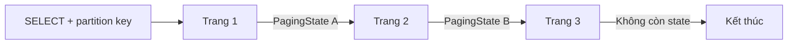
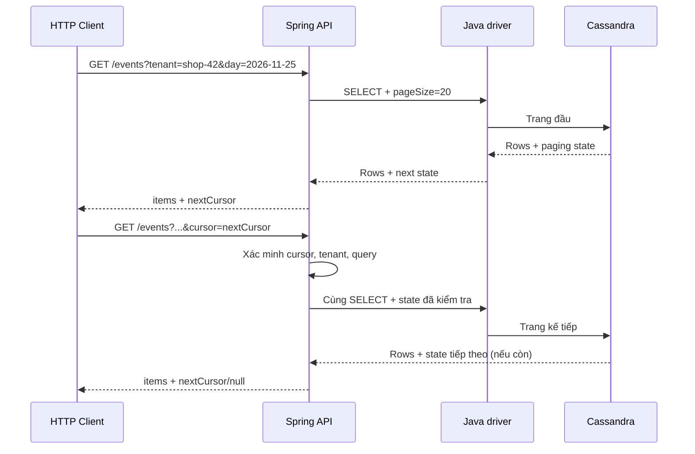
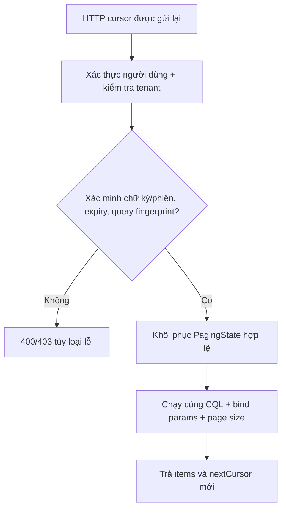

# PagingState và cơ chế đọc tiếp về phía trước trong Spring Data Cassandra

**PagingState** là thông tin do Cassandra/Java driver trả về để tiếp tục một truy vấn đọc ở **trang kế tiếp**. Khác với `OFFSET` trong nhiều hệ cơ sở dữ liệu quan hệ, Cassandra ưu tiên **phân trang tiến (forward-only pagination)**: đọc trang đầu, giữ trạng thái tiếp tục, rồi sử dụng trạng thái đó để đọc trang sau với **cùng truy vấn và cùng các giá trị ràng buộc**.

Trong **Spring Data Cassandra**, nguyên tắc này xuất hiện khi dùng `CassandraRepository` trả `Slice<T>`, `CassandraPageRequest`, `CassandraTemplate` hoặc trực tiếp Java driver. Hiểu đúng PagingState giúp xây API danh sách ổn định về mặt hiệu năng, tránh tải cả partition vào bộ nhớ và tránh nhầm **kích thước trang** với **giới hạn tổng số hàng**.

Bài học thuộc chương **Chiếu và phân trang**, trong module **SPRING_DATA_CASSANDRA**: truy cập Cassandra bằng entity mapping, repository, template và CQL theo mô hình dữ liệu phân tán.

## 1. Vì sao Cassandra không dùng OFFSET như RDBMS?

Với cơ sở dữ liệu quan hệ, một API có thể dùng lối phân trang:

```sql
-- Minh họa tư duy SQL quan hệ; KHÔNG phải cú pháp phân trang CQL.
SELECT *
FROM orders
ORDER BY created_at DESC
LIMIT 20 OFFSET 10000;
```

Ở trang 501, hệ thống phải bỏ qua 10.000 hàng trước khi trả 20 hàng. Trên Cassandra, dữ liệu được chia theo **partition key** và phân bố trên các replica; việc bỏ qua một số hàng tùy ý thường yêu cầu đọc hoặc quét đáng kể dữ liệu trước đó.

CQL không cung cấp `OFFSET` tổng quát như kiểu SQL trên. Thay vào đó:

1. Client gửi truy vấn `SELECT` hợp lệ với partition key và thiết lập **page size**.
2. Cassandra trả một phần kết quả, kèm trạng thái để tiếp tục nếu còn dữ liệu.
3. Driver dùng trạng thái đó khi lấy trang tiếp theo.
4. Client lặp lại cho đến khi hết kết quả hoặc đạt ngân sách đọc.



Đây là hành trình **tiến lên từ một truy vấn đã thực hiện**, không phải phép toán “nhảy ngay đến trang số 501”.

| Tiêu chí | Offset-based pagination | Cassandra PagingState |
| --- | --- | --- |
| Cách xác định phần tiếp theo | `OFFSET`/số trang. | Trạng thái tiếp nối opaque từ lần đọc trước. |
| Đi đến trang N tùy ý | Có thể yêu cầu, nhưng offset lớn có thể rất tốn. | Không thể tự tính token của trang N từ số N. |
| Đọc tuần tự | Có. | Có, là mô hình tự nhiên nhất. |
| Đi lùi | Có thể dùng offset. | Cần giữ cursor/trang trước hoặc thiết kế truy vấn khác. |
| Khả năng dữ liệu thay đổi giữa các trang | Có thể dẫn đến trùng/bỏ sót. | Cũng có thể dẫn đến trùng/bỏ sót; **không có snapshot tự động**. |
| Định tuyến dữ liệu | Theo cơ chế của DB quan hệ. | Vẫn theo partition key và topology Cassandra. |

## 2. Thiết kế CQL trước khi bàn đến paging

Giả sử hệ thống multi-tenant cần hiển thị nhật ký sự kiện theo **tenant và ngày**, mới nhất ở trước.

```sql
-- Giả sử keyspace commerce đã tồn tại.
CREATE TABLE commerce.events_by_tenant_day (
    tenant_id text,
    event_day date,
    occurred_at timestamp,
    event_id uuid,
    event_type text,
    payload text,
    PRIMARY KEY ((tenant_id, event_day), occurred_at, event_id)
) WITH CLUSTERING ORDER BY (occurred_at DESC, event_id ASC);
```

Phân tích:

- `(tenant_id, event_day)` là **partition key ghép**. Một cặp tenant/ngày định vị một partition logic.
- `occurred_at` và `event_id` là **clustering columns**, quyết định thứ tự và định danh hàng trong partition.
- `event_type` và `payload` là cột thường. Có thể chỉ lấy những cột cần hiển thị để giảm lượng dữ liệu truyền.
- Truy vấn phân trang nên giữ **cùng partition key** giữa các trang.

Ví dụ CQL:

```sql
SELECT occurred_at, event_id, event_type
FROM commerce.events_by_tenant_day
WHERE tenant_id = 'shop-42'
  AND event_day = '2026-11-25';
```

Câu truy vấn này khớp thiết kế bảng và có thứ tự clustering theo schema. Việc chỉ chọn ba cột được gọi là **projection ở mức CQL**; nó giúp giảm dữ liệu được trả về so với `SELECT *` có cả `payload`, nhưng **không tạo paging tự động**, cũng không thay đổi vị trí partition.

Ngược lại, câu sau **không** thành một truy vấn hiệu quả nhờ đặt page size nhỏ:

```sql
-- Thiếu event_day, không có full composite partition key.
SELECT * FROM commerce.events_by_tenant_day
WHERE tenant_id = 'shop-42';
```

Cassandra vẫn yêu cầu mô hình truy vấn hợp lệ. `PagingState` không thay thế partition key, index hay thiết kế bảng theo query.

## 3. PagingState thực chất là gì?

PagingState là một **giá trị mờ (opaque token)** do Cassandra trả về thông qua driver để biết nên tiếp tục truy vấn ở đâu. Client **không được tự phân tích, suy đoán hoặc sửa các byte** bên trong token như thể đó là số hàng đã đọc.

Có ba khái niệm cần phân biệt:

| Khái niệm | Ý nghĩa | Ví dụ |
| --- | --- | --- |
| **Page size / fetch size** | Quy mô mục tiêu của một lần lấy dữ liệu; driver/server có thể trả số hàng khác kỳ vọng tùy tình huống. | 20 hoặc 50 hàng/trang. |
| **PagingState** | Dữ liệu tiếp nối cho trang sau của **cùng truy vấn**. | Opaque binary state/token. |
| **CQL LIMIT** | Giới hạn **tổng số hàng** truy vấn được phép trả. | `LIMIT 100`. |

Một trang không nhất thiết có **chính xác** `pageSize` hàng. Khi server phải xử lý tombstone, phạm vi đọc, giới hạn nội bộ hoặc các tình huống khác, số hàng trả về có thể thấp hơn giá trị mục tiêu. **Điều kiện kết thúc đúng** là tín hiệu không còn trang tiếp theo từ API, không phải quy tắc “trang có ít hơn 20 hàng thì chắc đã hết”.

### 3.1. PagingState gắn với truy vấn nào?

Khi gửi yêu cầu cho trang tiếp theo, phải giữ nhất quán:

- Câu CQL và cấu trúc statement; không đổi `SELECT`, `WHERE`, `ORDER BY` hoặc `LIMIT` giữa chừng.
- Các giá trị bind như `tenant_id`, `event_day` và ranh giới thời gian.
- Cách ánh xạ/giải mã paging state và các thiết lập cần thiết của driver; thông thường cũng nên giữ nguyên page size trong toàn hành trình.
- Ngữ cảnh bảo mật: cùng tenant/người dùng và quyền truy cập đã được kiểm tra ở API.

Một state tạo khi đọc tenant `shop-42` không phải “cursor chung” để chuyển sang `shop-99`. Với một số phiên bản driver, việc dùng state của một câu truy vấn khác có thể bị phát hiện và từ chối; **không dựa vào khả năng từ chối của driver làm lớp phân quyền ứng dụng**.

### 3.2. PagingState không phải snapshot dữ liệu

Giả sử người dùng đọc trang 1 lúc 10:00, rồi đọc trang 2 lúc 10:02. Trong khoảng đó, có một sự kiện mới được ghi hoặc một hàng cũ bị xóa. Cassandra không tự khóa toàn bộ kết quả đọc lại đến khi người dùng duyệt xong.

Do đó:

- Có thể xuất hiện **bỏ sót hoặc trùng lặp** khi tập dữ liệu thay đổi trong lúc phân trang, tùy vị trí ghi/xóa và thứ tự.
- Mỗi lần fetch là một request có thể chịu consistency và trạng thái replica tại thời điểm đó.
- Một kết quả trang 2 không bảo đảm là “phần còn lại của snapshot lúc 10:00”.
- PagingState không phải transaction identifier hay mã phiên snapshot nhất quán.

Khi nghiệp vụ yêu cầu snapshot mạnh, cần thiết kế riêng (ví dụ cố định tập dữ liệu đầu vào theo mốc thời gian/phiên xuất báo cáo), không mặc định paging tự giải quyết.

## 4. Cơ chế forward-only ở Java driver 4.x

Java driver 4.x có hai cách sử dụng phổ biến:

- **Đồng bộ:** `ResultSet` có thể tự động lấy tiếp các trang trong lúc ứng dụng duyệt hàng. Rất tiện, nhưng nếu duyệt hết một result set lớn sẽ phát sinh nhiều request và có nguy cơ tải/quét nhiều dữ liệu hơn dự kiến.
- **Bất đồng bộ:** `AsyncResultSet` cho phép xử lý **trang hiện tại** và chủ động gọi `fetchNextPage()` để lấy trang sau.

Điều quan trọng là **không coi một lời gọi `execute` trả về result set đồng nghĩa đã tải tất cả hàng**; driver có thể tiếp tục fetch khi ứng dụng tiêu thụ dữ liệu.

### 4.1. Ví dụ: đọc từng trang với AsyncResultSet

```java
import com.datastax.oss.driver.api.core.CqlSession;
import com.datastax.oss.driver.api.core.cql.AsyncResultSet;
import com.datastax.oss.driver.api.core.cql.BoundStatement;
import com.datastax.oss.driver.api.core.cql.PreparedStatement;
import com.datastax.oss.driver.api.core.cql.Row;
import java.time.LocalDate;

// session là CqlSession dùng chung do Spring quản lý.
PreparedStatement prepared = session.prepare(
    "SELECT occurred_at, event_id, event_type " +
    "FROM commerce.events_by_tenant_day " +
    "WHERE tenant_id = ? AND event_day = ?"
);

BoundStatement statement = prepared
    .bind("shop-42", LocalDate.parse("2026-11-25"))
    .setPageSize(20);

AsyncResultSet page = session.executeAsync(statement)
    .toCompletableFuture()
    .join();

int processedPages = 0;
while (true) {
    // currentPage(): chỉ những hàng thuộc trang vừa được fetch.
    for (Row row : page.currentPage()) {
        System.out.println(
            row.getInstant("occurred_at") + " " +
            row.getUuid("event_id") + " " +
            row.getString("event_type")
        );
    }

    processedPages++;

    // Ví dụ minh họa giới hạn tối đa 2 trang cho một lượt.
    if (!page.hasMorePages() || processedPages >= 2) {
        break;
    }

    // Chủ động yêu cầu trang kế tiếp, không nhảy tới một trang bất kỳ.
    page = page.fetchNextPage().toCompletableFuture().join();
}
```

Đoạn mã trên có chủ đích dừng sau tối đa hai trang; nếu muốn xử lý toàn bộ kết quả, điều kiện dừng sẽ khác. Trong production, đừng dùng `join()` không giới hạn bên trong luồng xử lý có yêu cầu non-blocking. Có thể xây chuỗi `CompletionStage` để xử lý trang và fetch tiếp mà không chặn event loop.

**Ý nghĩa các phương thức:**

- `executeAsync(statement)` bắt đầu đọc truy vấn.
- `currentPage()` duyệt các hàng trong trang hiện tại.
- `hasMorePages()` cho biết driver có thể tiếp tục fetch.
- `fetchNextPage()` lấy trang tiếp theo và trả về một `AsyncResultSet` mới.
- `setPageSize(20)` ảnh hưởng kích thước trang, **không giới hạn tổng số kết quả của query**.

### 4.2. Dùng lại PagingState qua hai HTTP request

Trong một vòng lặp `fetchNextPage()`, driver tự chuyển trạng thái cần thiết. Nhưng nếu trang 1 được trả trong một HTTP response và trang 2 chỉ được yêu cầu sau đó, API cần một **continuation token**.

Ở tầng driver 4.x, thông tin tiếp nối được cung cấp thông qua **execution information / paging state** của truy vấn. Có thể tạo statement có paging state được chấp nhận bởi driver để chạy tiếp. Loại dữ liệu cụ thể và cách serialize/deserialze được quy định bởi phiên bản Java driver đang dùng; **không tự chế một số offset hoặc tự giải mã cấu trúc token**.

Luồng thiết kế:



Ở đây `nextCursor` là **định dạng API tự định nghĩa** chứa hoặc tham chiếu đến trạng thái tiếp nối, không phải một trường CQL có tên `nextCursor`.

## 5. Spring Data Cassandra: Slice và CassandraPageRequest

Khi làm việc với entity, `CassandraRepository` và `CassandraTemplate` giúp tránh phải tự xử lý từng `Row`. Spring Data Cassandra cung cấp cách phân trang với `Pageable`/`Slice<T>` và đối tượng như `CassandraPageRequest`, tùy API và phiên bản đang dùng.

Một điểm khác với phân trang kiểu quan hệ: **`Slice` phù hợp hơn `Page` khi chỉ cần biết có trang sau hay không**. Cassandra không có thao tác đếm tất cả hàng trong mọi partition với chi phí thấp như một câu truy vấn theo primary key.

### 5.1. Entity và khóa ghép

Ánh xạ bảng phần 2 bằng full primary key gồm hai partition columns và hai clustering columns:

```java
import java.io.Serializable;
import java.time.Instant;
import java.time.LocalDate;
import java.util.Objects;
import java.util.UUID;
import org.springframework.data.cassandra.core.mapping.PrimaryKeyClass;
import org.springframework.data.cassandra.core.mapping.PrimaryKeyColumn;
import org.springframework.data.cassandra.core.mapping.PrimaryKeyType;

@PrimaryKeyClass
public class TenantEventKey implements Serializable {
    @PrimaryKeyColumn(name = "tenant_id", ordinal = 0,
            type = PrimaryKeyType.PARTITIONED)
    private String tenantId;

    @PrimaryKeyColumn(name = "event_day", ordinal = 1,
            type = PrimaryKeyType.PARTITIONED)
    private LocalDate eventDay;

    @PrimaryKeyColumn(name = "occurred_at", ordinal = 2,
            type = PrimaryKeyType.CLUSTERED)
    private Instant occurredAt;

    @PrimaryKeyColumn(name = "event_id", ordinal = 3,
            type = PrimaryKeyType.CLUSTERED)
    private UUID eventId;

    public TenantEventKey() {}

    public String getTenantId() { return tenantId; }
    public void setTenantId(String v) { tenantId = v; }

    public LocalDate getEventDay() { return eventDay; }
    public void setEventDay(LocalDate v) { eventDay = v; }

    public Instant getOccurredAt() { return occurredAt; }
    public void setOccurredAt(Instant v) { occurredAt = v; }

    public UUID getEventId() { return eventId; }
    public void setEventId(UUID v) { eventId = v; }

    @Override
    public boolean equals(Object other) {
        if (this == other) return true;
        if (!(other instanceof TenantEventKey)) return false;
        TenantEventKey that = (TenantEventKey) other;
        return Objects.equals(tenantId, that.tenantId)
            && Objects.equals(eventDay, that.eventDay)
            && Objects.equals(occurredAt, that.occurredAt)
            && Objects.equals(eventId, that.eventId);
    }

    @Override
    public int hashCode() {
        return Objects.hash(tenantId, eventDay, occurredAt, eventId);
    }
}
```

```java
import org.springframework.data.cassandra.core.mapping.Column;
import org.springframework.data.cassandra.core.mapping.PrimaryKey;
import org.springframework.data.cassandra.core.mapping.Table;

@Table("events_by_tenant_day")
public class TenantEvent {
    @PrimaryKey
    private TenantEventKey key;

    @Column("event_type")
    private String eventType;

    @Column("payload")
    private String payload;

    public TenantEvent() {}

    public TenantEventKey getKey() { return key; }
    public void setKey(TenantEventKey v) { key = v; }

    public String getEventType() { return eventType; }
    public void setEventType(String v) { eventType = v; }

    public String getPayload() { return payload; }
    public void setPayload(String v) { payload = v; }
}
```

Vì bảng đã được tạo bằng CQL, thứ tự clustering `occurred_at DESC, event_id ASC` nằm ở schema. Nếu dùng tính năng sinh schema từ annotation, cần cấu hình ordering tương ứng; chỉ đặt `@PrimaryKeyColumn` chưa thể hiện hết thứ tự `DESC` đó.

### 5.2. Repository trả Slice

```java
import java.time.LocalDate;
import org.springframework.data.cassandra.repository.CassandraRepository;
import org.springframework.data.cassandra.repository.Query;
import org.springframework.data.domain.Pageable;
import org.springframework.data.domain.Slice;

public interface TenantEventRepository
        extends CassandraRepository<TenantEvent, TenantEventKey> {

    @Query("SELECT * FROM events_by_tenant_day " +
           "WHERE tenant_id = ?0 AND event_day = ?1")
    Slice<TenantEvent> findInDay(
        String tenantId,
        LocalDate eventDay,
        Pageable pageable
    );
}
```

Repository method khai báo **hai giá trị partition key** và một tham số `Pageable` điều khiển việc đọc trang. `Pageable` không phải bind value thứ ba trong `WHERE`. Spring Data sử dụng metadata của truy vấn, entity mapping và Cassandra paging để dựng kết quả `Slice`.

### 5.3. Đọc trang đầu, rồi đọc trang tiếp theo

Với Spring Data Cassandra có API `CassandraPageRequest.first(int)`, luồng thường có dạng:

```java
import java.time.LocalDate;
import org.springframework.data.cassandra.core.query.CassandraPageRequest;
import org.springframework.data.domain.Pageable;
import org.springframework.data.domain.Slice;

LocalDate day = LocalDate.parse("2026-11-25");
Pageable request = CassandraPageRequest.first(20);

Slice<TenantEvent> slice =
    repository.findInDay("shop-42", day, request);

// Xử lý slice.getContent() làm trang đầu.
for (TenantEvent event : slice.getContent()) {
    System.out.println(event.getEventType());
}

// Chỉ yêu cầu tiếp khi slice thông báo còn trang.
if (slice.hasNext()) {
    Pageable next = slice.nextPageable();
    Slice<TenantEvent> second =
        repository.findInDay("shop-42", day, next);
    // Xử lý second.getContent() theo nhu cầu.
}
```

Phần minh họa này sử dụng API phân trang Spring Data Cassandra phổ biến; **đối chiếu phiên bản đang dùng** cho package/chữ ký của `CassandraPageRequest` và cơ chế phát hành `nextPageable()`. Trong sản phẩm thật, thường gộp các phương thức vào một service, kiểm soát số trang tối đa mỗi request và chỉ trả dữ liệu cần thiết.

Điều khác biệt so với:

```java
// Không phải cách đúng để nhảy thẳng đến trang thứ 100 trong Cassandra.
Pageable request = PageRequest.of(99, 20);
```

`PageRequest.of(99, 20)` mang tư duy “bỏ qua 99 * 20 hàng”. Cassandra không có `OFFSET` tổng quát; để đọc trang 100 cần trạng thái tiếp nối của hành trình trước hoặc thiết kế phương pháp seek/keyset phù hợp.

**Lưu ý:** Đừng truyền `nextPageable` của `shop-42` cho truy vấn `shop-99` hoặc đổi ngày/điều kiện lọc. State được tạo cho truy vấn cũ, không phải cursor toàn cục.

## 6. Slice, Page, List và projection: chọn kết quả phù hợp

Các kiểu trả về không mang cùng ý nghĩa:

| Kiểu kết quả | Khi dùng | Điểm cần lưu ý |
| --- | --- | --- |
| `List<T>` | Tập kết quả có giới hạn nhỏ, một lần đọc. | Nếu truy vấn không giới hạn, có thể gom rất nhiều hàng. |
| `Slice<T>` | API “Load more” hoặc “Next” chỉ cần biết còn trang sau. | Phù hợp forward-only; không hứa biết tổng số trang. |
| `Page<T>` | API yêu cầu tổng số bản ghi và tổng số trang. | Tổng đếm có thể tốn kém hoặc không được hỗ trợ hiệu quả bởi Cassandra; không mặc định dùng. |
| Driver `AsyncResultSet` | Xử lý từng page/Row với quyền điều khiển thấp. | Tự quản lý conversion, fetch và giới hạn tài nguyên. |
| Projection DTO/interface | Chỉ lấy/trình bày các trường cần thiết. | Giảm payload, nhưng không làm thay đổi quy tắc partition/paging. |

Ví dụ UI chỉ hiển thị thời gian và loại sự kiện, không cần `payload`. Ở tầng CQL có thể dùng:

```sql
SELECT occurred_at, event_id, event_type
FROM commerce.events_by_tenant_day
WHERE tenant_id = 'shop-42'
  AND event_day = '2026-11-25';
```

Giảm số cột được truyền thường có lợi cho I/O và băng thông, nhất là khi `payload` lớn. Tuy nhiên, cần bảo đảm cách mapping/projection nhận được đầy đủ trường phục vụ định danh/sắp xếp, và không nhầm “projection ít cột” với “chỉ đọc ít hàng”.

**Không dùng** `COUNT(*)` trên một phạm vi dữ liệu lớn chỉ để vẽ “Trang 1/9.999” nếu workload không có bảng tổng hợp được thiết kế sẵn cho việc đếm. Một UI “Xem thêm” thường hợp với cơ chế Cassandra hơn.

## 7. LIMIT và page size: hai tầng giới hạn

Giả sử dữ liệu của `('shop-42', 2026-11-25)` chứa 3.000 hàng.

**Tình huống A — chỉ đặt page size:**

```sql
SELECT occurred_at, event_id, event_type
FROM commerce.events_by_tenant_day
WHERE tenant_id = 'shop-42' AND event_day = '2026-11-25';
```

Nếu driver dùng page size 20, nó có thể lần lượt fetch nhiều page cho đến hết 3.000 hàng; **không phải kết quả tổng cộng chỉ có 20 hàng**.

**Tình huống B — đặt thêm LIMIT:**

```sql
SELECT occurred_at, event_id, event_type
FROM commerce.events_by_tenant_day
WHERE tenant_id = 'shop-42'
  AND event_day = '2026-11-25'
LIMIT 100;
```

Với page size 20, truy vấn này có thể cần nhiều trang nhưng **tổng số hàng không vượt 100** theo giới hạn CQL. Trang cuối của truy vấn có thể ngắn hơn page size; số trang thực tế cũng có thể khác dự kiến.

| Thuộc tính | Page size 20 | `LIMIT 100` |
| --- | --- | --- |
| Vai trò | Kích thước trang khi fetch. | Trần tổng số hàng kết quả. |
| Có tự dừng ở 20 kết quả không? | Không. | Không; dừng ở tối đa 100. |
| Có giúp tránh một request trả dữ liệu cực lớn? | Có nếu ứng dụng chỉ xử lý/trả từng page. | Có, bằng trần tổng số hàng. |
| Có thay thế điều kiện partition key không? | Không. | Không. |

Trong API, ngoài page size, hãy đặt **giới hạn tổng công việc** cho mỗi lần gọi và giới hạn số trang một client được phép duyệt trong một khoảng thời gian.

## 8. Thiết kế nextCursor cho REST API

API giao tiếp với trình duyệt thường muốn:

```text
GET /api/events?tenantId=shop-42&day=2026-11-25&size=20
```

Response minh họa (giá trị cursor chỉ là placeholder, không phải state thật):

```json
{
  "items": [
    {
      "occurredAt": "2026-11-25T09:30:00Z",
      "eventId": "11111111-1111-1111-1111-111111111111",
      "eventType": "ORDER_CREATED"
    }
  ],
  "nextCursor": "<opaque-signed-continuation-token>"
}
```

Khi không còn trang, `nextCursor` có thể là `null`. Client **không tự sửa, tăng hoặc giảm** nội dung token.

### 8.1. Cursor ở tầng API cần ràng buộc gì?

Có thể thiết kế token ở hai dạng:

- **Stateful:** client chỉ giữ một ID ngắn; server lưu paging state, query fingerprint, tenant, user và expiry ở cache có TTL.
- **Stateless:** token có payload đã bảo vệ toàn vẹn (ví dụ ký MAC/AEAD), gồm driver paging state hoặc thông tin tham chiếu; server xác minh trước khi dùng.

Những ràng buộc nên có:

1. **Danh tính/tenant:** cursor chỉ dùng được với người dùng và tenant mà nó được cấp, tùy chính sách bảo mật.
2. **Query fingerprint:** hàm băm hoặc mô tả cố định của CQL, bind values, sort/filter và giới hạn trang; không dùng một state cho query khác.
3. **Expiry:** có thời hạn hợp lý, tránh token tồn tại vô hạn khi schema và dữ liệu thay đổi.
4. **Version:** cho phép xử lý thay đổi contract API, driver/schema.
5. **Size:** đặt cận trên cho độ dài cursor; từ chối token quá lớn hoặc sai format trước khi đưa cho driver.
6. **Bảo mật và log:** tránh log nguyên state, tránh để cursor chứa thông tin nhạy cảm chưa bảo vệ; cân nhắc mã hóa nếu payload cần bí mật.

**Ký token không tự tạo phân quyền.** Server vẫn phải xác minh user có quyền truy cập tenant/partition được yêu cầu, kể cả khi token có MAC hợp lệ.

### 8.2. Không nhận raw paging state từ nguồn không đáng tin cậy mà không kiểm soát

Paging state là dữ liệu opaque của hệ thống lưu trữ. Không nên đơn giản mã hóa Base64 một chuỗi state rồi chấp nhận mọi token mà client gửi lại. Ngoài việc state có thể không tương thích với query, các driver có những cảnh báo về khả năng token bị giả mạo hoặc dùng sai phạm vi.

Đường xử lý an toàn:



Nếu cursor hết hạn, schema đã đổi hoặc driver từ chối state, trả lỗi có thể xử lý (thường yêu cầu client **bắt đầu lại từ trang đầu**) thay vì im lặng chuyển cursor sang một truy vấn khác.

## 9. Các tình huống không ổn định khi đọc nhiều trang

### 9.1. Ghi mới trong lúc phân trang

Giả sử bảng sắp xếp `occurred_at DESC`. Sau khi khách hàng đọc trang 1, có một sự kiện mới xuất hiện ở đầu partition. Khi yêu cầu trang 2, state tiếp tục theo hành trình query cũ trong một dataset đã đổi. Không có bảo đảm snapshot toàn bộ kết quả.

Nếu UI cần trải nghiệm ổn định hơn, có thể:

- Chốt một **mốc thời gian trần** khi bắt đầu (ví dụ `occurred_at <= snapshotTime`) và giữ cố định trong các trang; điều này giúp loại trừ dữ liệu *được ghi với timestamp sự kiện sau mốc*, nhưng không ngăn backfill hoặc thay đổi các hàng cũ.
- Tránh mutate các trường clustering; primary key không thể cập nhật tại chỗ.
- Với yêu cầu snapshot tuyệt đối, dùng một dataset hoặc job xuất báo cáo bất biến theo phiên.

### 9.2. Xóa, TTL và tombstone

Nếu một số hàng hết TTL hoặc bị xóa giữa các trang, dữ liệu đọc tiếp có thể thay đổi. Tombstone cũng có thể làm tăng chi phí scan trong một partition, nên page size không nhất thiết tương ứng số hàng “live” thu được.

**Không dừng chỉ vì trang hiện tại ít hàng hơn page size.** Hãy dựa vào `hasMorePages()`/`Slice.hasNext()` hoặc trạng thái tiếp nối của API.

### 9.3. Các trang có CL/replica khác nhau

Cassandra replication và consistency ảnh hưởng đến các kết quả đọc. Nếu một client có thể truy cập nhiều replica chưa hoàn toàn hội tụ, các trang có thể chứng kiến trạng thái khác nhau. Việc tăng page size không phải giải pháp cho consistency; cần xác định CL, sửa dữ liệu và cơ chế repair phù hợp theo yêu cầu nghiệp vụ.

### 9.4. Thay đổi schema, driver hoặc query

Một opaque state có thể mất hiệu lực sau khi thay CQL, schema, driver/protocol hoặc ngữ cảnh thực thi. Không coi token là định danh lâu dài như primary key. Với API public, quy định **cursor TTL ngắn**, xử lý lỗi stale cursor và khả năng restart từ đầu.

## 10. Khi nào chọn PagingState, khi nào chọn keyset/seek?

Có hai hướng phân trang dễ gặp khi thiết kế API:

**PagingState** phù hợp khi người dùng muốn tiếp tục một truy vấn Cassandra cụ thể, server/driver giữ ngữ cảnh query và chỉ cần điều hướng **Next**. Đây là cách tự nhiên để đọc dần dữ liệu lớn, không tự thiết kế cách tìm row ranh giới.

**Keyset/seek pagination** có thể phù hợp khi muốn cursor dựa trên **giá trị khóa sắp xếp** mà ứng dụng kiểm soát, ví dụ mốc `occurred_at` và một khóa tie-breaker. Ứng dụng sẽ gửi query mới với điều kiện clustering phù hợp:

```sql
-- Chỉ minh họa seek đơn giản theo timestamp, chưa xử lý
-- các sự kiện có cùng occurred_at.
SELECT occurred_at, event_id, event_type
FROM commerce.events_by_tenant_day
WHERE tenant_id = 'shop-42'
  AND event_day = '2026-11-25'
  AND occurred_at < '2026-11-25T09:30:00Z'
LIMIT 20;
```

**Cảnh báo:** Điều kiện trên có thể **bỏ sót** hàng có cùng `occurred_at` với hàng cuối trang trước. Nếu cần thứ tự toàn phần, hãy thiết kế và kiểm tra chính xác điều kiện seek với toàn bộ clustering key và `CLUSTERING ORDER BY`, bao gồm trường hợp timestamp trùng, hướng sắp xếp hỗn hợp và giới hạn CQL. Không tự đoán cú pháp so sánh tuple hoặc điều kiện `OR` như SQL quan hệ.

| Tiêu chí | PagingState | Keyset/seek |
| --- | --- | --- |
| Biểu diễn cursor | Opaque state của server/driver. | Giá trị khóa/sort do ứng dụng định nghĩa. |
| Cần giữ cùng statement? | Có, về nguyên tắc. | Query mới theo ranh giới khóa. |
| Điều hướng tự nhiên | Tiến theo trang kế tiếp. | Tiến theo khóa sắp xếp; đôi khi hỗ trợ đi ngược bằng query khác. |
| Độ phức tạp của ứng dụng | Thấp ở driver/Slice, cao hơn nếu phát token API an toàn. | Phải xác định thứ tự toàn phần và ranh giới đúng CQL. |
| Snapshot tự động | Không. | Cũng không. |
| Khả năng sống qua thay đổi driver | Không được bảo đảm. | Phụ thuộc hợp đồng ứng dụng/schema, có thể dễ kiểm soát hơn. |

Không có lựa chọn thắng tuyệt đối. **PagingState thích hợp nhất cho phân trang liên tục trong một truy vấn Cassandra cụ thể**; seek thích hợp khi access pattern cho phép xác định ranh giới bằng khóa clustering ổn định và ứng dụng cần quyền kiểm soát cursor.

## 11. Chẩn đoán lỗi và tối ưu hiệu năng

| Hiện tượng | Nguyên nhân khả dĩ | Cách xử lý |
| --- | --- | --- |
| Truy vấn trang đầu chạy, trang tiếp theo lỗi | Cursor sai query, bind value, version hoặc state đã hỏng. | Kiểm tra fingerprint/expiry, trả lỗi yêu cầu bắt đầu lại. |
| Cố gọi trang số 50 trực tiếp | Cassandra không có random-access `OFFSET`. | Dùng state tuần tự hoặc thiết kế seek phù hợp. |
| Đổi ngày/tenant nhưng giữ cursor cũ | PagingState gắn với truy vấn trước. | Reset cursor khi filter thay đổi. |
| API trả quá nhiều dữ liệu | Nhầm page size với `LIMIT` hoặc gọi hết iterator. | Trả từng trang, đặt ngân sách request, streaming phù hợp. |
| UI đòi tổng số trang | Cassandra không tự cung cấp cheap count trên dữ liệu lớn. | Dùng “Load more”, hoặc bảng tổng hợp riêng nếu nghiệp vụ cần tổng. |
| Một trang ít hơn page size nhưng vẫn có trang sau | Server/driver có thể trả trang ngắn trong tình huống đọc phức tạp. | Kiểm tra `hasMorePages`, không chỉ kích thước list. |
| Dữ liệu bị lặp/thiếu khi phân trang | Ghi/xóa đồng thời; không có snapshot. | Chốt filter/range ổn định, giải quyết idempotency phía UI khi cần. |
| Latency cao dù page size nhỏ | Hot partition, tombstone, payload lớn, CL hoặc nhiều round-trip. | Đo partition size, truy vấn theo khóa, giảm cột và benchmark page size. |
| Token cursor không hợp lệ sau deploy | Thay schema, query, driver hoặc định dạng token. | Versioning, TTL, xử lý stale cursor rõ ràng. |
| Người dùng A dùng cursor của B | Thiếu kiểm soát quyền/query binding ở API. | Xác minh tenant, user, chữ ký và query fingerprint. |

### Checklist trước khi triển khai

1. `WHERE` có **đầy đủ partition key** hay mô hình truy vấn hợp lệ khác không?
2. Thứ tự clustering có xác định rõ hành trình xem dữ liệu không?
3. Có đang dùng `Slice`/`AsyncResultSet` hoặc API đọc từng trang thay vì gom cả bảng vào `List`?
4. Page size dựa trên benchmark hay là một con số tùy ý?
5. Có quy định `LIMIT`/ngân sách tổng số hàng hoặc số trang được đọc không?
6. Có phân biệt `hasNext`/`hasMorePages` với số hàng của trang hiện tại không?
7. Cursor được ràng buộc với query, tenant, user, expiry và version chưa?
8. Có xử lý cursor sai/hết hạn và reset trang đầu khi đổi filter không?
9. Đã thử dữ liệu được ghi mới, xóa và hết TTL trong lúc paging chưa?
10. Có đánh giá hot partition, tombstone, consistency và ảnh hưởng của projection đến băng thông chưa?

## 12. Thực hành và bài tập

### Bài thực hành: đọc tiếp không bị lẫn tenant

Chuẩn bị dữ liệu:

```sql
INSERT INTO commerce.events_by_tenant_day
(tenant_id, event_day, occurred_at, event_id, event_type)
VALUES ('shop-42', '2026-11-25', '2026-11-25T10:00:00Z',
        11111111-1111-1111-1111-111111111111, 'A');

INSERT INTO commerce.events_by_tenant_day
(tenant_id, event_day, occurred_at, event_id, event_type)
VALUES ('shop-42', '2026-11-25', '2026-11-25T09:00:00Z',
        22222222-2222-2222-2222-222222222222, 'B');

INSERT INTO commerce.events_by_tenant_day
(tenant_id, event_day, occurred_at, event_id, event_type)
VALUES ('shop-42', '2026-11-25', '2026-11-25T08:00:00Z',
        33333333-3333-3333-3333-333333333333, 'C');

INSERT INTO commerce.events_by_tenant_day
(tenant_id, event_day, occurred_at, event_id, event_type)
VALUES ('shop-99', '2026-11-25', '2026-11-25T09:30:00Z',
        44444444-4444-4444-4444-444444444444, 'OTHER_TENANT');
```

Dùng page size nhỏ, ví dụ 2, để buộc một truy vấn `shop-42` phải đi qua ít nhất hai lượt đọc nếu môi trường/driver phân trang theo đúng số hàng mục tiêu. Khi đọc tiếp, cần kiểm tra:

- `shop-99` không có trong các trang của `shop-42`.
- Các trang diễn ra theo thứ tự clustering `occurred_at DESC`.
- Dùng state của `shop-42` cho `shop-99` bị chặn ở tầng API thay vì chuyển thẳng xuống Cassandra.
- Đổi `event_day` thì cursor cũ bị bỏ đi.
- Khi hết dữ liệu, API trả `nextCursor = null` hoặc tương đương.

Không chỉ so sánh tổng số hàng: cần kiểm tra **định danh, thứ tự và ràng buộc tenant**.

### Câu hỏi tự kiểm tra

**Câu 1.** Vì sao Cassandra không thể dùng `PageRequest.of(99, 20)` để nhảy hiệu quả tới trang thứ 100 như một truy vấn SQL có OFFSET?

**Câu 2.** Sự khác nhau giữa page size 20 và CQL `LIMIT 20` là gì?

**Câu 3.** Có thể tái sử dụng PagingState của `('shop-42', 2026-11-25)` cho `('shop-99', 2026-11-25)` không? Vì sao?

**Câu 4.** Nếu `AsyncResultSet.currentPage()` trả 15 hàng khi `pageSize=20`, có thể kết luận đã hết dữ liệu chưa?

**Câu 5.** Vì sao `Slice<T>` thường phù hợp với nút “Xem thêm” hơn `Page<T>` khi đọc Cassandra?

**Câu 6.** Một client mở lại trang 2 sau ba ngày từ cursor cũ. Điều gì có thể sai và API nên phản hồi thế nào?

**Câu 7.** Vì sao một báo cáo yêu cầu snapshot bất biến không thể chỉ dựa trên PagingState?

**Câu 8.** Khi seek theo `occurred_at < lastTimestamp`, rủi ro nào xuất hiện nếu nhiều sự kiện có cùng timestamp?

**Đáp án gợi ý:**

1. PagingState không suy ra từ số trang, còn Cassandra không hỗ trợ `OFFSET` tùy ý; muốn đến trang 100 thường phải đi qua các trạng thái tiếp nối.
2. Page size là kích thước trang khi fetch; `LIMIT` là giới hạn tổng số hàng câu CQL có thể trả.
3. Không. State gắn với truy vấn/bind parameters, và API phải giữ ràng buộc tenant/quyền truy cập.
4. Chưa. Phải dựa vào `hasMorePages()` hoặc tín hiệu trang tiếp theo, không chỉ đếm số hàng trang hiện tại.
5. `Slice` cho biết nội dung trang và có trang sau hay không, không đòi tổng số trang/đếm toàn cục tốn kém.
6. State có thể hết hạn theo chính sách, không tương thích query/schema/driver hoặc dữ liệu đã thay đổi. API nên từ chối có kiểm soát và yêu cầu bắt đầu lại.
7. Các request đọc trang là những thời điểm khác nhau; có thể có insert, update, delete và TTL giữa các request.
8. Có thể bỏ sót hàng cùng timestamp ở ranh giới; cần một thứ tự toàn phần/tie-breaker và điều kiện CQL chính xác.

**Ghi nhớ:** PagingState là **cursor opaque dùng để đọc tiếp**, không phải số trang hay OFFSET. Với Spring Data Cassandra, hãy ưu tiên cách đọc **forward-only** bằng `Slice`/`CassandraPageRequest` hoặc driver `AsyncResultSet`, giữ nguyên query và bind values giữa các trang, giới hạn số dữ liệu phải tải, bảo vệ cursor ở API và luôn nhớ rằng phân trang **không tự cung cấp snapshot nhất quán**.

### Tài liệu tham khảo

- [Spring Data Cassandra — Query Methods](https://docs.spring.io/spring-data/cassandra/reference/cassandra/repositories/query-methods.html)
- [Spring Data Cassandra — Repository API và paging](https://docs.spring.io/spring-data/cassandra/reference/cassandra/repositories.html)
- [Apache Cassandra Java Driver 4.x — Paging](https://docs.datastax.com/en/developer/java-driver/4.17/manual/core/paging/)
- [Apache Cassandra — CQL](https://cassandra.apache.org/doc/stable/cassandra/developing/cql/index.html)
