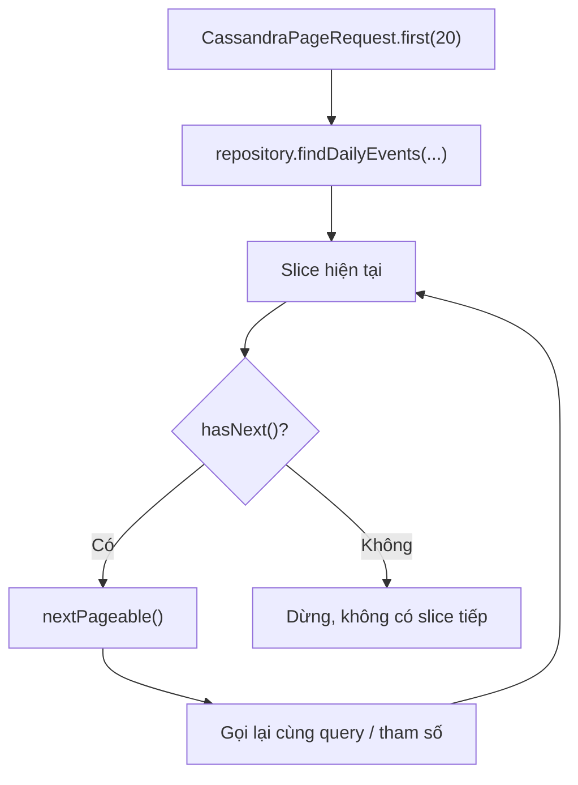

# Slice và CassandraPageRequest

## Mục tiêu học tập

Trong **Spring Data Cassandra**, các truy vấn trả nhiều hàng thường cần chia thành những phần nhỏ để giảm áp lực lên Cassandra, bộ nhớ ứng dụng và kết nối mạng. Cặp khái niệm quan trọng ở tầng repository là **`Slice<T>`** và **`CassandraPageRequest`**. Chúng giúp biểu diễn “lấy một nhóm kết quả, rồi tiếp tục từ vị trí hiện tại” phù hợp hơn với Apache Cassandra so với kiểu phân trang truy cập ngẫu nhiên bằng `OFFSET` thường gặp trong cơ sở dữ liệu quan hệ.

Bài học thuộc chương **Chiếu và phân trang** của module `SPRING_DATA_CASSANDRA`. Ngoài việc đọc API, chúng ta sẽ nối kết các lớp repository, `CassandraTemplate`, truy vấn CQL, **partition key**, **clustering order**, **paging state**, consistency và kiểm soát hiệu năng trong mô hình dữ liệu phân tán.

Sau bài, bạn có thể:

- Giải thích `Slice<T>` chứa những thông tin nào và vì sao nó không cần biết tổng số hàng.
- Phân biệt `Slice` với `Page`, `Pageable` chung và `CassandraPageRequest`.
- Lấy trang đầu, kiểm tra `hasNext()` và truy vấn trang tiếp theo với `nextPageable()`.
- Hiểu **paging state/cursor** đại diện vị trí tiếp tục của một truy vấn CQL, không phải số thứ tự hàng có thể nhảy tới tùy ý.
- Viết repository query có đủ partition key và thứ tự clustering ổn định, đồng thời cân nhắc projection để giảm payload.
- Thiết kế API cuộn vô hạn/“Xem thêm”, hạn chế việc lạm dụng `count(*)`, `OFFSET` hoặc page number.
- Nhận diện lỗi khi dùng cursor sai truy vấn, thay đổi kích thước trang, truy vấn xuyên bucket, dữ liệu biến động hoặc có partition quá lớn.

## 1. Vì sao phân trang của Cassandra khác phân trang SQL thường thấy?

Một giao diện web thường biểu diễn phân trang như sau:

```text
GET /items?page=1&size=20
GET /items?page=2&size=20
GET /items?page=1000&size=20
```

Với một hệ quản trị quan hệ, lập trình viên có thể nghĩ ngay đến `LIMIT 20 OFFSET 19980`. Cách này dựa trên ý tưởng có thể bỏ qua số lượng lớn hàng đứng trước trang cần xem. **Cassandra không cung cấp cách phân trang `OFFSET` tương đương cho các truy vấn CQL thông thường.**

Cassandra dùng một cơ chế khác: khi đọc một phần kết quả, driver có thể nhận **paging state** để tiếp tục từ vị trí đã đọc, với cùng truy vấn và các điều kiện tương ứng.

```text
Truy vấn Q + tham số P
          |
          v
      [Slice 1]  --- paging state S1 --->
          |
      [Slice 2]  --- paging state S2 --->
          |
      [Slice 3]  --- không còn trang tiếp
```

Mỗi lần đọc tiếp, client cung cấp trạng thái tiếp tục được tạo từ lần đọc trước. Đây là **forward pagination** theo dòng kết quả, không phải phép tính chỉ từ số trang.

### Vì sao Cassandra không khuyến khích nhảy đến trang sâu?

Cassandra phân phối dữ liệu theo partition key. Trong mỗi partition, các hàng được sắp theo clustering columns. Một truy vấn muốn đọc hàng ở “vị trí thứ 50.000” không thể đơn giản suy ra địa chỉ vật lý từ con số 50.000.

Ngay cả khi truy vấn nằm trong một partition, các yếu tố như tombstone, TTL, dữ liệu được ghi mới và cách Cassandra thực thi đọc khiến việc bỏ qua một số lượng lớn hàng không phải thao tác miễn phí. Vì vậy, thiết kế API nên ưu tiên **lần lượt lấy trang tiếp**, hoặc dùng một khóa bắt đầu (*seek*) được thiết kế riêng.

## 2. Slice, Page, Pageable và CassandraPageRequest

Spring Data có nhiều abstraction cho kết quả có phân trang:

| Thành phần | Trách nhiệm | Điểm cần nhớ với Cassandra |
| --- | --- | --- |
| **`Pageable`** | Mô tả yêu cầu về phân trang, kích thước trang và có thể có sắp xếp. | Không phải mọi `Pageable` đều chứa trạng thái tiếp tục CQL. |
| **`Page<T>`** | Kết quả trang **có metadata tổng số phần tử/trang**. | Việc tính tổng có thể đòi hỏi truy vấn đếm tốn kém; không mặc định sẵn có và rẻ. |
| **`Slice<T>`** | Một nhóm phần tử và thông tin còn trang tiếp hay không. | Thường phù hợp với kiểu “Xem thêm”, không cần tổng số hàng. |
| **`CassandraPageRequest`** | Biến thể `Pageable` dành cho cơ chế phân trang Cassandra. | Có thể mang **paging state** cần thiết để tiếp tục truy vấn. |
| **Driver paging state** | Dấu tiếp tục do cơ chế CQL/driver tạo. | Gắn với câu truy vấn, các tham số và ngữ cảnh thực thi. |

`Slice<T>` là giao diện ở `org.springframework.data.domain`, không phải một collection đặc biệt của Java Driver. `CassandraPageRequest` thuộc phần hỗ trợ phân trang của Spring Data Cassandra, thường ở package `org.springframework.data.cassandra.core.query`.

### Slice cung cấp thông tin gì?

Các phương thức phổ biến của `Slice<T>`:

```java
slice.getContent();     // Các phần tử thuộc slice hiện tại
slice.getNumber();      // Chỉ số logic của slice hiện tại
slice.getSize();        // Kích thước trang yêu cầu
slice.hasNext();        // Có thể yêu cầu slice tiếp hay không?
slice.isFirst();        // Slice đầu tiên?
slice.nextPageable();   // Thông tin cần thiết để lấy slice tiếp
```

Các API này **không** cung cấp cam kết rằng bạn có thể lấy slice số 200 chỉ từ `getNumber() == 200`. Chỉ số trang là metadata giúp giao diện quản lý chuỗi trang; **paging state** mới là phần quan trọng để tiếp tục chính xác ở Cassandra.

### Slice cố ý không trả tổng số

`Page<T>` thường có:

```java
page.getTotalElements();
page.getTotalPages();
```

Trong khi đó `Slice<T>` tập trung vào:

```java
slice.getContent();
slice.hasNext();
```

Đối với một bảng có hàng triệu sự kiện, một truy vấn `count(*)` chỉ để vẽ “Trang 1/20.000” có thể làm tăng chi phí đáng kể. Nếu sản phẩm chỉ cần cuộn tiếp, **không nên trả giá cho phép đếm tổng** khi nó không mang lại giá trị cho người dùng.

### Slice khác “lấy List rồi cắt ở Java”

Nếu ứng dụng tải một triệu hàng vào `List` rồi dùng `subList(0, 20)`, Cassandra vẫn đã phải đọc/truyền lượng dữ liệu rất lớn. Với pagination đúng ở driver/repository, yêu cầu đọc được chia nhỏ ngay tại lớp truy cập dữ liệu.

## 3. Ví dụ xuyên suốt: đọc sự kiện thiết bị theo ngày

Giả sử một ứng dụng IoT cần xem lịch sử sự kiện của một thiết bị trong ngày. API chủ yếu đọc từ mới đến cũ, mỗi lần 20–50 sự kiện.

Ta thiết kế bảng:

```sql
CREATE TABLE events_by_device_day (
    tenant_id uuid,
    device_id uuid,
    event_day date,
    occurred_at timestamp,
    event_id uuid,
    event_type text,
    message text,
    payload blob,
    PRIMARY KEY ((tenant_id, device_id, event_day), occurred_at, event_id)
) WITH CLUSTERING ORDER BY (occurred_at DESC, event_id ASC);
```

Ý nghĩa schema:

- **Partition key:** `(tenant_id, device_id, event_day)` định vị đúng thiết bị/ngày của một tenant.
- **Clustering column 1:** `occurred_at DESC`, các sự kiện mới hơn đứng trước.
- **Clustering column 2:** `event_id ASC`, phân biệt sự kiện trùng timestamp.
- **Regular columns:** `event_type`, `message`, `payload`.

Thứ tự clustering không tạo một danh sách sự kiện toàn cụm; nó chỉ có ý nghĩa **trong mỗi partition**.

### Truy vấn CQL nền tảng

```sql
SELECT tenant_id, device_id, event_day,
       occurred_at, event_id, event_type, message
FROM events_by_device_day
WHERE tenant_id = 11111111-1111-4111-8111-111111111111
  AND device_id = 22222222-2222-4222-8222-222222222222
  AND event_day = '2026-11-25';
```

Câu truy vấn **đủ toàn bộ partition key**, có thứ tự mặc định theo clustering columns và cố ý **không chọn `payload`** để màn hình danh sách không phải tải nhị phân lớn.

Không thêm `ORDER BY event_type` chỉ để thay cách hiển thị; `event_type` không phải clustering column. Nếu cần một thứ tự truy vấn khác, thường phải thiết kế bảng/cách nhìn dữ liệu khác.

### Dữ liệu minh họa

```sql
INSERT INTO events_by_device_day (
    tenant_id, device_id, event_day,
    occurred_at, event_id, event_type, message
) VALUES (
    11111111-1111-4111-8111-111111111111,
    22222222-2222-4222-8222-222222222222,
    '2026-11-25',
    '2026-11-25T10:15:00Z',
    33333333-3333-4333-8333-333333333333,
    'TEMPERATURE',
    'Nhiệt độ ổn định'
);

INSERT INTO events_by_device_day (
    tenant_id, device_id, event_day,
    occurred_at, event_id, event_type, message
) VALUES (
    11111111-1111-4111-8111-111111111111,
    22222222-2222-4222-8222-222222222222,
    '2026-11-25',
    '2026-11-25T09:30:00Z',
    44444444-4444-4444-8444-444444444444,
    'HEARTBEAT',
    'Thiết bị đang hoạt động'
);
```

Hai hàng nằm trong cùng partition nhưng khác clustering key. Khi có dữ liệu nhiều hơn, ứng dụng nên đọc thành từng slice thay vì trả toàn bộ lịch sử trong một response.

## 4. Định nghĩa entity với khóa tổng hợp

Ở Spring Data Cassandra, các annotation mapping mô tả mối liên hệ giữa property Java và cột CQL. Với schema trên, dùng một lớp khóa riêng:

```java
import java.io.Serializable;
import java.time.Instant;
import java.time.LocalDate;
import java.util.UUID;

import org.springframework.data.cassandra.core.cql.Ordering;
import org.springframework.data.cassandra.core.mapping.PrimaryKeyClass;
import org.springframework.data.cassandra.core.mapping.PrimaryKeyColumn;
import org.springframework.data.cassandra.core.mapping.PrimaryKeyType;

@PrimaryKeyClass
public class DeviceEventKey implements Serializable {

    @PrimaryKeyColumn(name = "tenant_id", ordinal = 0,
            type = PrimaryKeyType.PARTITIONED)
    private UUID tenantId;

    @PrimaryKeyColumn(name = "device_id", ordinal = 1,
            type = PrimaryKeyType.PARTITIONED)
    private UUID deviceId;

    @PrimaryKeyColumn(name = "event_day", ordinal = 2,
            type = PrimaryKeyType.PARTITIONED)
    private LocalDate eventDay;

    @PrimaryKeyColumn(name = "occurred_at", ordinal = 3,
            type = PrimaryKeyType.CLUSTERED,
            ordering = Ordering.DESCENDING)
    private Instant occurredAt;

    @PrimaryKeyColumn(name = "event_id", ordinal = 4,
            type = PrimaryKeyType.CLUSTERED,
            ordering = Ordering.ASCENDING)
    private UUID eventId;

    // Bổ sung constructor, getter/setter, equals/hashCode phù hợp.
}
```

Entity:

```java
import java.nio.ByteBuffer;

import org.springframework.data.cassandra.core.mapping.Column;
import org.springframework.data.cassandra.core.mapping.PrimaryKey;
import org.springframework.data.cassandra.core.mapping.Table;

@Table("events_by_device_day")
public class DeviceEvent {

    @PrimaryKey
    private DeviceEventKey key;

    @Column("event_type")
    private String eventType;

    @Column("message")
    private String message;

    @Column("payload")
    private ByteBuffer payload;

    public DeviceEventKey getKey() {
        return key;
    }

    public String getEventType() {
        return eventType;
    }

    public String getMessage() {
        return message;
    }

    // Bổ sung constructor và các accessor còn lại.
}
```

Đây là **khung entity học tập**, không phải hai file Java có thể copy nguyên vào một file rồi biên dịch. Cần bổ sung constructor và accessor theo quy ước dự án. Quan trọng nhất là thứ tự và loại các thành phần khóa phải khớp schema.

## 5. Repository trả Slice<DeviceEvent>

Để tạo một API đọc theo partition và trả từng nhóm kết quả, một mẫu repository có thể dùng `@Query`:

```java
import java.time.LocalDate;
import java.util.UUID;

import org.springframework.data.cassandra.repository.CassandraRepository;
import org.springframework.data.cassandra.repository.Query;
import org.springframework.data.domain.Pageable;
import org.springframework.data.domain.Slice;

public interface DeviceEventRepository
        extends CassandraRepository<DeviceEvent, DeviceEventKey> {

    @Query("""
        SELECT * FROM events_by_device_day
        WHERE tenant_id = ?0
          AND device_id = ?1
          AND event_day = ?2
        """)
    Slice<DeviceEvent> findDailyEvents(
            UUID tenantId,
            UUID deviceId,
            LocalDate eventDay,
            Pageable pageable);
}
```

Các tham số đầu là thành phần **partition key**; tham số cuối là **`Pageable`**, không phải một thành phần CQL của khóa. Spring Data Cassandra có thể áp dụng phân trang qua cơ chế riêng khi thực thi câu query này, tùy phiên bản API.

**Vì sao ví dụ dùng `SELECT *`?** Nó giúp materialize đầy đủ entity ở bước đầu. Nếu màn hình chỉ cần `event_type`, `message`, `occurred_at` và `event_id`, nên cân nhắc projection hoặc query chọn cột cụ thể; phần sau sẽ giải thích giới hạn của việc nạp entity một phần.

### Không viết LIMIT cố định khi muốn tiếp tục nhiều slice

Nếu bạn gắn `LIMIT 20` cứng trong CQL và sau đó muốn lấy “trang 2, 3, 4, ...”, phải hiểu rằng **CQL LIMIT** là giới hạn của câu truy vấn, không đơn giản là “mỗi trang 20”. Điều đó có thể chặn việc tiếp tục sau 20 hàng.

Với repository paging, hãy để API phân trang điều phối kích thước trang; nếu cần cả giới hạn tổng số hàng, thiết kế và kiểm thử riêng thay vì trộn hai cơ chế một cách tình cờ.

## 6. CassandraPageRequest: lấy trang đầu tiên

Ví dụ dùng API thường gặp của Spring Data Cassandra:

```java
import org.springframework.data.cassandra.core.query.CassandraPageRequest;
import org.springframework.data.domain.Pageable;
import org.springframework.data.domain.Slice;

Pageable firstPage = CassandraPageRequest.first(20);

Slice<DeviceEvent> firstSlice = repository.findDailyEvents(
        tenantId, deviceId, eventDay, firstPage);
```

Trong đoạn mã này:

- `repository` là bean `DeviceEventRepository` được inject.
- `tenantId`, `deviceId`, `eventDay` là giá trị đã kiểm tra ở tầng nghiệp vụ.
- `CassandraPageRequest.first(20)` thể hiện yêu cầu trang đầu với kích thước 20, **chưa cần paging state từ lần đọc trước**.
- `firstSlice.getContent()` chứa các phần tử được trả về.

Lưu ý về API: Spring Data Cassandra có các thế hệ phiên bản khác nhau. Hãy đối chiếu package, factory method và cách truyền `Pageable` với phiên bản đang dùng. Ví dụ tập trung vào **mô hình tiếp tục bằng CassandraPageRequest**, không phải cam kết rằng mọi phiên bản lịch sử đều dùng cùng một chữ ký.

### Phân biệt kích thước trang và số hàng của cả partition

Một partition có thể có 150.000 event. `CassandraPageRequest.first(20)` yêu cầu **một phần nhỏ của tập kết quả**, không tạo một giới hạn lưu trữ 20 hàng cho partition.

Không nên nghĩ vì request đầu chỉ đọc 20 event nên thiết kế partition đã an toàn. Partition vẫn có thể rất lớn hoặc nóng khi có nhiều thiết bị tạo dữ liệu ở cùng một bucket.

## 7. Lấy slice tiếp theo: hasNext và nextPageable

Sau lần đọc đầu:

```java
Slice<DeviceEvent> slice = repository.findDailyEvents(
        tenantId, deviceId, eventDay,
        CassandraPageRequest.first(20));

List<DeviceEvent> firstItems = slice.getContent();

if (slice.hasNext()) {
    Pageable nextRequest = slice.nextPageable();
    Slice<DeviceEvent> nextSlice = repository.findDailyEvents(
            tenantId, deviceId, eventDay, nextRequest);

    // Dùng nextSlice.getContent() cho lượt đọc tiếp.
}
```

Ví dụ cần import `java.util.List`, `Pageable`, `Slice` và `CassandraPageRequest`. Giá trị `nextPageable()` của một slice Cassandra được thiết kế để giữ **thông tin tiếp tục** phù hợp, thay vì chỉ tăng số trang và tính offset.

### Luồng nhiều trang



Nếu `hasNext()` là `false`, **đừng gọi lại query với một page number tùy ý** để “xin thêm”. Cơ chế phân trang đang báo không có bước tiếp trong chuỗi kết quả đó.

### Một vòng đọc minh họa

```java
Pageable request = CassandraPageRequest.first(20);

while (true) {
    Slice<DeviceEvent> current = repository.findDailyEvents(
            tenantId, deviceId, eventDay, request);

    process(current.getContent()); // Xử lý tối đa một nhóm kết quả.

    if (!current.hasNext()) {
        break;
    }

    request = current.nextPageable();
}
```

Hàm `process(...)` là hàm nghiệp vụ do dự án tự định nghĩa, không thuộc Spring Data. Ví dụ này thích hợp để **hiểu cơ chế**, nhưng không nên chạy không giới hạn trong một HTTP request: nếu partition chứa hàng triệu event, vòng lặp có thể kéo dài và làm cạn tài nguyên.

Với API web, thường **trả một slice mỗi request**. Chỉ thực hiện nhiều slice trong một job nền có giới hạn số lần đọc, kiểm soát tốc độ và checkpoint phù hợp.

## 8. Paging state hoạt động như một cursor, không phải số trang

Nên xem `CassandraPageRequest` của các trang sau như một yêu cầu chứa hai nhóm thông tin:

```text
Thông tin điều hướng:
  - page size
  - metadata trang ở tầng Spring

Thông tin tiếp tục:
  - paging state do cơ chế driver/Cassandra cung cấp
  - phải áp dụng với cùng ngữ cảnh truy vấn
```

Vì paging state có thể chứa thông tin liên quan vị trí xử lý một query, nó cần được xem là **opaque**: không đọc/sửa nó như một số nguyên, không tự tạo bằng công thức `pageIndex * size`.

### Điều gì phải giữ nguyên khi đọc trang tiếp?

Trong tình huống ví dụ, nên giữ:

1. **Câu CQL tương đương:** cùng bảng, cùng danh sách điều kiện, cùng kiểu sắp xếp.
2. **Các giá trị khóa:** cùng `tenantId`, `deviceId` và `eventDay`.
3. **Kích thước trang/quy tắc giới hạn:** không tùy tiện thay đổi giữa hai lần gọi.
4. **Ngữ cảnh quyền truy cập:** cùng tenant và phạm vi dữ liệu người dùng được phép đọc.
5. **Phiên bản cursor/schema:** nếu query đã thay đổi, nên coi token cũ có thể không còn dùng được.

Nếu bạn gửi paging state của thiết bị A vào query thiết bị B, kết quả có thể lỗi, không đúng hoặc không được bảo đảm bởi hợp đồng driver. **Không dùng paging state như một “vé” có thể tái sử dụng cho mọi SELECT.**

### Không nhảy thẳng đến trang 100

Ví dụ yêu cầu:

```text
Tôi chỉ biết page=100 và size=20.
Tôi chưa bao giờ lấy page=1..99.
```

Với cơ chế Cassandra paging state, thông tin đó **không đủ** để tiếp tục đúng “trang 100”. Một số API có khái niệm chỉ số trang để phục vụ giao diện, nhưng không nên suy ra Cassandra có offset ngẫu nhiên tương ứng.

Nếu sản phẩm thực sự cần truy cập trực tiếp một khoảng dữ liệu theo thời gian, hãy cân nhắc thiết kế **seek pagination bằng clustering key** hoặc tổ chức bucket theo thời gian, thay vì giả lập offset rất sâu.

## 9. Thiết kế API “Xem thêm” bằng cursor

Một API phù hợp với UI cuộn vô hạn:

```text
GET /tenants/{tenantId}/devices/{deviceId}/events
    ?day=2026-11-25
    &size=20

Response:
{
  "items": [ ... ],
  "hasNext": true,
  "nextCursor": "<opaque-token>"
}
```

Lần tiếp:

```text
GET /tenants/{tenantId}/devices/{deviceId}/events
    ?day=2026-11-25
    &size=20
    &cursor=<opaque-token>
```

`nextCursor` là **hợp đồng API do ứng dụng thiết kế**, không phải trường có sẵn bắt buộc của `Slice`. Cần có lớp chuyển đổi giữa continuation state của Spring Data/driver và cursor ở HTTP.

### Cursor nên chứa hoặc gắn với thông tin nào?

| Thành phần | Mục đích |
| --- | --- |
| Định danh query/phiên bản query | Tránh dùng token của câu SELECT khác. |
| Tenant/device/day hoặc fingerprint của tham số | Không chuyển cursor giữa các scope dữ liệu. |
| Kích thước trang | Tránh thay semantics giữa các lần đọc. |
| Trạng thái tiếp tục | Cho phép driver/Spring tiếp tục từ đúng điểm. |
| Hạn sử dụng | Tránh token cũ tồn tại vô thời hạn sau khi schema/logic đổi. |
| Chữ ký/toàn vẹn và bảo vệ dữ liệu | Ngăn token bị sửa, đọc trộm hoặc lạm dụng. |

**Không đưa raw paging state trực tiếp ra client không đáng tin cậy** rồi coi nó là an toàn. Nó là dữ liệu opaque của cơ chế truy vấn, không phải token xác thực/ủy quyền. Một thiết kế API có thể ký hoặc mã hóa cursor, kết hợp với kiểm tra quyền và ràng buộc ngữ cảnh truy vấn.

Nếu Spring Data Cassandra phiên bản bạn dùng không cung cấp API xuất/khôi phục paging state ở dạng phù hợp cho REST stateless, có các lựa chọn:

- Giữ trạng thái cursor ở server kèm một ID ngắn có TTL.
- Tạo adapter riêng ở tầng driver để quản lý token và xác thực.
- Chuyển sang **seek pagination** theo clustering key khi phù hợp hơn với yêu cầu sản phẩm.

**Không tự suy đoán cách serialize `CassandraPageRequest` hoặc lấy state từ những field nội bộ không phải public API.** Cách trích xuất/khởi tạo lại paging state khác nhau theo thế hệ driver/Spring Data; phải dùng API công khai và kiểm thử với phiên bản thực tế.

## 10. Projection và phân trang: giảm dữ liệu ở đúng tầng

Giả sử mỗi event có `payload blob` tương đối lớn nhưng màn hình chỉ cần thời điểm, loại và thông báo. Repository đang dùng:

```sql
SELECT * FROM events_by_device_day WHERE ...
```

Mỗi slice có thể tải cả blob, dù UI không hiển thị. Nếu 20 hàng × 50 KiB payload thì khoảng **1.000 KiB** dữ liệu nhị phân đã được yêu cầu, chưa kể overhead. Đây là **tính toán minh họa**, không phải kích thước đo trên mạng hay SSTable.

Có thể tối ưu bằng truy vấn chọn đúng các cột:

```sql
SELECT tenant_id, device_id, event_day,
       occurred_at, event_id, event_type, message
FROM events_by_device_day
WHERE tenant_id = 11111111-1111-4111-8111-111111111111
  AND device_id = 22222222-2222-4222-8222-222222222222
  AND event_day = '2026-11-25';
```

Lợi ích là giảm dữ liệu trả về. Nhưng **chọn ít cột** và **chia trang** giải quyết hai vấn đề khác nhau:

- Projection/column selection giảm **độ rộng mỗi hàng**.
- Paging giảm **số hàng trong một lượt xử lý**.

Kết hợp đúng cả hai thường giúp giảm heap, network và chi phí materialization trên hot path.

### Entity nạp một phần và nguy cơ save()

Nếu truy vấn chỉ chọn các cột danh sách nhưng trả kiểu `DeviceEvent` đầy đủ, thuộc tính `payload` có thể không được nạp. **Không nên gọi `save()` ngay trên entity partial** với kỳ vọng trường chưa đọc sẽ luôn được giữ nguyên. Hành vi ghi các giá trị null/vắng mặt phải được hiểu theo Spring Data Cassandra và câu CQL thực tế.

Các lựa chọn an toàn hơn:

1. Dùng projection/interface đúng property và đã được kiểm thử ở phiên bản hiện tại.
2. Dùng DTO riêng cho danh sách và ánh xạ tường minh.
3. Dùng `CqlTemplate`/`CqlSession` + RowMapper khi cần kiểm soát cột và kiểu trả về.
4. Khi cần cập nhật một trường, dùng thao tác UPDATE mục tiêu với **khóa đầy đủ**, thay vì save lại entity nạp thiếu.

### Ví dụ DTO cho giao diện

```java
import java.time.Instant;
import java.util.UUID;

public record EventCard(
        Instant occurredAt,
        UUID eventId,
        String eventType,
        String message) {
}
```

`EventCard` không phải tự động là persistent entity chỉ vì nó chứa field tương ứng với schema. Để dùng nó làm kết quả repository/projection, cần xác minh Spring Data Cassandra phiên bản hiện tại hỗ trợ cách ánh xạ mong muốn; nếu không, map từ kết quả `Row` hoặc entity theo cách rõ ràng.

Một `Slice<EventCard>` là kết quả mong muốn về mặt API, nhưng cần bảo đảm **query thật** không vẫn âm thầm SELECT toàn bộ blob rồi mới chuyển thành DTO ở service.

## 11. Slice có cần câu lệnh COUNT(*) không?

`Slice` thường là lựa chọn tốt khi giao diện chỉ cần:

```text
items: [event1, event2, ...]
hasNext: true/false
```

Trên Cassandra, việc tính tổng:

```sql
SELECT count(*)
FROM events_by_device_day
WHERE tenant_id = 11111111-1111-4111-8111-111111111111
  AND device_id = 22222222-2222-4222-8222-222222222222
  AND event_day = '2026-11-25';
```

có thể phải xem xét lượng dữ liệu lớn và tombstone trong partition. Không nên gắn một query đếm đầy đủ vào mọi request chỉ để hiển thị tổng số trang nếu không thực sự cần.

### Khi sản phẩm yêu cầu “Tổng cộng 23.416 sự kiện”?

Có thể dùng các giải pháp có đánh đổi:

- Duy trì số đếm tổng hợp riêng bằng logic cập nhật phù hợp và chấp nhận/kiểm soát độ trễ.
- Tính toán thống kê theo lịch rồi hiển thị dữ liệu có timestamp.
- Trả tổng gần đúng nếu sản phẩm cho phép.
- Chỉ thực hiện count cho trường hợp hiếm, có giới hạn và đánh giá tải.

Các phương án này cần kiểm thử đúng đắn và chi phí. **Counter của Cassandra** có ngữ nghĩa retry/nhất quán riêng; nó không phải cách thay thế tự động cho mọi phép đếm chính xác trong nghiệp vụ.

## 12. Giới hạn của Slice.hasNext()

`hasNext()` có ý nghĩa “kết quả hiện tại cho phép yêu cầu phần tiếp theo” theo cơ chế mà repository sử dụng. Nó **không** là:

- Bằng chứng số lượng còn lại chính xác.
- Bảo đảm rằng dữ liệu sẽ không thay đổi giữa hai request.
- Bảo đảm các hàng đã đọc sẽ không bị xóa/TTL trước khi người dùng kéo tiếp.
- Quy tắc tự khôi phục khi query/schema đã đổi.

Ở các phiên bản/đường thực thi khác nhau, cách xác định có slice tiếp có thể dựa trên driver paging state hoặc cách lấy phần tử bổ sung. Không nên viết code phụ thuộc vào chi tiết nội bộ ấy; hãy dùng **hợp đồng public của `Slice.hasNext()` và `nextPageable()`**.

### Slice cuối cùng

Một slice cuối có thể chứa ít hơn `size` phần tử. Nhưng **không được chỉ so sánh `getContent().size() < pageSize` rồi tự kết luận mọi tình huống pagination**, nhất là khi framework có cơ chế xác định `hasNext()` riêng.

Tương tự, slice đúng `size` phần tử không chứng minh còn trang tiếp. Hãy dùng `hasNext()`.

## 13. Dữ liệu thay đổi giữa hai trang: không có snapshot cố định

Giả sử client lấy 20 event mới nhất lúc 10:00, sau đó đến 10:01 có sự kiện mới và một sự kiện cũ bị xóa.

```text
10:00  Đọc slice đầu: E100 ... E81
10:01  Ghi thêm E101; xóa E75
10:02  Đọc slice tiếp theo bằng cursor trước đó
```

Kết quả không nhất thiết là một snapshot bất biến của dữ liệu lúc 10:00. Tùy thời điểm, consistency level, TTL, tombstone và cách tiếp tục, danh sách có thể có biến động.

### Ứng dụng nên làm gì?

- Dùng khóa sự kiện ổn định để loại trùng ở tầng UI nếu nghiệp vụ yêu cầu.
- Xác định chính sách hiển thị dữ liệu mới: tải lại từ đầu hoặc thông báo có event mới.
- Tránh giả định `hasNext()` đảm bảo tổng số hàng không đổi.
- Nếu báo cáo đòi hỏi snapshot cố định, phải thiết kế quy trình dữ liệu/điểm chốt riêng; chỉ dùng paging state không tạo transaction snapshot.
- Với dữ liệu TTL, xem xét trường hợp một hàng hết hạn giữa các lần fetch.

**Consistency level** kiểm soát số replica cần phản hồi theo thiết kế replication/topology. Nó không biến các lần gọi `findDailyEvents(...)` cách nhau một phút thành một giao dịch snapshot nhiều request.

## 14. Query xuyên ngày: một paging state không nối các partition

Bảng ví dụ chia theo `event_day`. Nếu UI muốn xem lịch sử từ ngày 25 sang ngày 24:

```text
Query 1:
  (tenant=T1, device=D7, day=2026-11-25)
  -> Slice 1 -> Slice 2 -> hết

Query 2:
  (tenant=T1, device=D7, day=2026-11-24)
  -> Slice 1 -> Slice 2 -> hết
```

Paging state của ngày 25 **không thể đơn giản truyền sang query ngày 24**. Mỗi partition/ngày là ngữ cảnh truy vấn riêng.

Một cursor ứng dụng phục vụ lịch sử nhiều ngày có thể gồm:

- Bucket ngày hiện tại.
- Paging state của query trong bucket đó (nếu có).
- Trạng thái đã chuyển sang bucket trước hay chưa.
- Ranh giới thời gian và phiên bản hợp đồng query.

Đó là **cursor do ứng dụng định nghĩa**, không phải tính năng tự động của `CassandraPageRequest`. Nếu cần lấy sự kiện từ nhiều partition cùng lúc, còn phải giải quyết việc hợp nhất thứ tự toàn cục và giới hạn số truy vấn fan-out.

### Khi một ngày vẫn có partition quá lớn

Ví dụ một thiết bị gửi 5.000 event/giây:

```text
5.000 event/giây × 86.400 giây/ngày
  = 432.000.000 event trong một ngày
```

Đây là **minh họa cực đoan**, đủ để thấy bucket ngày không phải lúc nào cũng phù hợp. Dù mỗi request chỉ lấy 20 event, partition của thiết bị/ngày có thể rất lớn và nóng.

Cần cân nhắc bucket nhỏ hơn (giờ/phút theo workload), shard ổn định hoặc mô hình dữ liệu khác. Khi đổi partition key, ứng dụng phải đọc nhiều bucket/shard và quản lý cursor riêng; không thể trông chờ một `CassandraPageRequest` tự giải quyết.

## 15. ORDER BY và độ ổn định của phân trang

Thứ tự mặc định trong bảng:

```sql
WITH CLUSTERING ORDER BY (occurred_at DESC, event_id ASC)
```

Nếu nhiều event cùng `occurred_at`, `event_id` đóng vai trò **tie-breaker** trong định danh/thứ tự hàng. Điều này giúp có một trật tự xác định **trong partition**.

Không thể tùy tiện truyền:

```java
Sort.by("eventType").descending()
```

vào `Pageable` rồi kỳ vọng Cassandra sắp xếp theo regular column `event_type` trên toàn bảng. Cassandra chỉ cho phép các dạng `ORDER BY` gắn với clustering columns và quy tắc thứ tự được schema hỗ trợ.

### Khi cần “sort theo mức độ ưu tiên”

Nếu API muốn lấy sự kiện theo `severity` rồi mới đến thời gian, bảng `events_by_device_day` chưa phục vụ trực tiếp được mẫu đó. Có thể cần một bảng `events_by_device_severity_day` với thứ tự khóa phù hợp, kèm chiến lược ghi denormalized và đọc theo partition được thiết kế.

**Sort là một phần của thiết kế bảng, không phải tính năng mở rộng tùy ý từ `Pageable`.**

## 16. CassandraPageRequest và PageRequest của Spring Data Commons

Trong các dự án dùng Spring Data JPA, lập trình viên thường quen với:

```java
PageRequest.of(5, 20);
```

Tuy nhiên, không nên đem trực giác `OFFSET 100 LIMIT 20` của JPA áp dụng sang Spring Data Cassandra.

| Yêu cầu | Trong Cassandra nên hiểu |
| --- | --- |
| Trang đầu, 20 hàng | Có thể khởi tạo với `CassandraPageRequest.first(20)`. |
| Trang tiếp theo | Lấy `nextPageable()` từ `Slice` trước để giữ continuation state. |
| Nhảy trực tiếp đến trang 50 | Không suy ra được từ page number khi thiếu trạng thái tiếp tục. |
| Đếm tổng số trang | Không tự có từ `Slice`; có thể đắt nếu truy vấn count. |
| Đổi thứ tự theo một cột bất kỳ | Bị giới hạn bởi schema và quy tắc clustering. |

Ở một số phiên bản, `CassandraPageRequest` có các factory/constructor nhận page number và thông tin state. Điều đó **không tạo ra khả năng random access bằng số trang**; page number chỉ là metadata tổ chức chuỗi request, còn continuation state phải đúng.

### Tại sao không chuyển sang Page chỉ để có tổng số?

Nếu giao diện không sử dụng `getTotalPages()` hay `getTotalElements()`, dùng `Page` có thể tạo áp lực phải tính tổng không cần thiết. Nên đặt câu hỏi trước: **người dùng cần xem phần tiếp hay cần biết chính xác tổng số?**

Với timeline, log, chat và feed, nhiều sản phẩm chỉ cần “Có thêm dữ liệu không?” — đúng với `Slice`.

## 17. CqlTemplate/CassandraTemplate và paging ở tầng thấp hơn

Repository giúp API ngắn gọn, nhưng đôi khi cần điều khiển CQL và mapping rõ hơn.

### 17.1. Truy vấn bằng CassandraTemplate

`CassandraTemplate` có thể xây query theo entity metadata hoặc thực thi CQL phù hợp. Khi cần paging, hãy sử dụng các tùy chọn truy vấn/statement do phiên bản Spring Data Cassandra hỗ trợ và quản lý trạng thái tiếp tục tương ứng. Không giả định mọi overload `select(...)` đều trả `Slice` hoặc tự sinh cursor REST.

### 17.2. CqlTemplate và CqlSession

`CqlTemplate` làm việc gần CQL/RowMapper, còn `CqlSession` là driver API. Ở tầng driver, cơ chế paging thể hiện qua request/page size và paging state của kết quả:

```text
CqlSession.execute(query với fetch size)
              |
              v
ResultSet / AsyncResultSet
              |
              +--> Hàng của lượt đọc hiện tại
              |
              +--> Trạng thái/khả năng fetch tiếp
              |
              v
Fetch tiếp qua API của driver khi cần
```

Chữ ký cụ thể khác giữa đồng bộ và bất đồng bộ. Với driver 4.x, `AsyncResultSet` có các API kiểm tra trang hiện tại và fetch trang tiếp; `ResultSet` đồng bộ có thể fetch tự động khi duyệt. Nếu cần triển khai REST cursor, phải hiểu sự khác nhau này và không vô tình duyệt **toàn bộ ResultSet** trong một request chỉ vì đặt fetch size.

**Fetch size của driver không phải giới hạn tổng số hàng cần đọc.** Một vòng lặp `for (Row row : resultSet)` có thể khiến driver lấy hết các trang cho đến khi kết quả cạn.

### 17.3. Chọn tầng API theo yêu cầu

| Yêu cầu | Hướng tiếp cận |
| --- | --- |
| Danh sách theo partition, nút “Xem thêm” | Repository `Slice<T>` + `CassandraPageRequest`. |
| Truy vấn entity với điều kiện được xây dựng động nhưng vẫn đúng khóa | `CassandraTemplate` với API paging được phiên bản hỗ trợ. |
| Chọn vài cột/alias, ánh xạ DTO cụ thể | `CqlTemplate`/RowMapper hoặc `CqlSession` và mapper rõ ràng. |
| Kiểm soát async fetch, token hoặc driver options sâu hơn | `CqlSession` và driver paging API trực tiếp. |
| Kết quả xuyên nhiều bucket | Service điều phối nhiều truy vấn/cursor riêng. |

Đổi API Java **không làm biến mất** các quy tắc partition, consistency, clustering hoặc chi phí tombstone.

## 18. Quy trình xử lý lỗi khi phân trang

| Hiện tượng | Nguyên nhân cần kiểm tra | Hướng xử lý |
| --- | --- | --- |
| Trang đầu đúng nhưng trang sau lặp lại trang đầu | Không truyền `slice.nextPageable()`, hoặc bỏ quên state trong API. | Kiểm tra state qua các lần gọi, không khởi tạo `first(...)` lại cho mọi request. |
| Request trang 5 không có cursor | API đang dùng số trang như offset. | Yêu cầu lấy tuần tự hoặc thiết kế seek pagination. |
| Token bị từ chối khi đổi `eventDay` | Paging state của query trước không tương thích. | Gắn cursor với tham số, tạo cursor mới cho query khác. |
| Đổi page size giữa hai lần gọi làm kết quả bất thường | Hợp đồng phân trang/driver state thay đổi. | Giữ kích thước và ngữ cảnh ổn định; version token. |
| Trả danh sách nhưng mất nội dung `payload` | Query chỉ chọn một phần cột hoặc dùng projection. | Xác định đây là ý đồ UI; tránh tái sử dụng partial entity để ghi. |
| Query chậm khi page size nhỏ | Partition nóng, tombstone, nhiều request hoặc latency round-trip. | Đo end-to-end, cân bằng page size với tài nguyên. |
| Response dùng rất nhiều RAM | Có thể service duyệt tất cả pages hoặc tải blob lớn. | Giới hạn kết quả/lượt xử lý và chọn đúng cột. |
| `hasNext()` sai với kỳ vọng tổng số | Dữ liệu thay đổi giữa các request hoặc hiểu nhầm Slice là Page. | Dùng contract của Slice, không suy diễn total count. |
| Cursor cũ hỏng sau khi deploy | CQL/schema/driver version/format state đổi. | Version cursor, TTL, trả lỗi hợp lệ và hướng client tải lại từ đầu. |
| Cùng query nhưng dữ liệu tenant khác xuất hiện | Lỗi xác thực, gắn cursor sai scope hoặc thiếu tenant key. | Kiểm tra quyền mỗi request và dùng đầy đủ partition key. |

### Trình tự debug nên theo

1. **Viết CQL thực:** xác nhận bảng, partition key, clustering order và `WHERE`.
2. **Xác nhận trang đầu:** `CassandraPageRequest.first(size)`, kích thước trong giới hạn cho phép.
3. **Xác nhận trang tiếp:** dùng đúng `hasNext()` và `nextPageable()`.
4. **Giữ query context:** tham số tenant/device/day, page size và sort không đổi trái quy tắc.
5. **Kiểm tra mapping:** entity/projection và tập cột được SELECT có phù hợp không.
6. **Kiểm tra biến động dữ liệu:** có insert, delete, TTL trong lúc paging không.
7. **Quan sát hệ thống:** page fetch count, latency, timeout, tombstone, heap và tải node.

Không mặc định tăng page size hoặc dùng `ALLOW FILTERING` để “sửa” lỗi phân trang. Hai thay đổi này có thể làm truy vấn đắt hơn và không giải quyết nguyên nhân.

## 19. Kiểm thử Slice và CassandraPageRequest

Nên dùng **integration test với Cassandra test environment** phù hợp, vì unit test chỉ mock repository không thể xác minh cơ chế paging state hay CQL do framework thực thi.

### Bộ ca thử gợi ý

| Ca thử | Kỳ vọng |
| --- | --- |
| 0 hàng trong partition | `getContent()` rỗng và không có slice tiếp. |
| Ít hơn kích thước trang | Trả đúng số hàng và `hasNext()` phù hợp. |
| Đúng bằng kích thước trang | Không tự suy diễn có trang tiếp chỉ từ `content.size()`. |
| Nhiều hơn kích thước trang | Truy vấn slice tiếp bằng `nextPageable()`; kiểm tra không lặp/bỏ hàng khi dữ liệu ổn định. |
| Hai event trùng timestamp | Tie-breaker `event_id` bảo đảm thứ tự trong partition. |
| Tenant A và tenant B | Cursor không được dùng chéo tenant; yêu cầu quyền truy cập được kiểm tra. |
| Device/day khác nhau | State của một partition không được tái sử dụng cho partition khác. |
| Blob lớn | Projection/column selection không tải blob trong API danh sách. |
| Dữ liệu thay đổi giữa hai slice | Ứng dụng xử lý được thay đổi theo hợp đồng, không kỳ vọng snapshot cố định. |
| Chuyển sang ngày trước | Bắt đầu query/cursor mới; không tiếp tục state của ngày sau. |
| Cursor hết hạn hoặc lỗi version | Trả lỗi API xác định, không chạy query với token bất kỳ. |

### Pseudocode test đọc hai slice

```java
// Chuẩn bị ít nhất 5 event trong cùng partition theo thứ tự clustering.

Slice<DeviceEvent> first = repository.findDailyEvents(
        tenantId, deviceId, eventDay,
        CassandraPageRequest.first(2));

assertEquals(2, first.getContent().size());
assertTrue(first.hasNext());

Slice<DeviceEvent> second = repository.findDailyEvents(
        tenantId, deviceId, eventDay,
        first.nextPageable());

assertEquals(2, second.getContent().size());
assertNotEquals(
        first.getContent().get(0).getKey(),
        second.getContent().get(0).getKey());
```

Đoạn test cần imports JUnit, các biến dữ liệu thử, và một implementation entity/key hoàn chỉnh; đây là **phác thảo ca kiểm thử**, không phải test tự chạy khi copy độc lập.

Kiểm thử cần xác nhận thứ tự tất cả sự kiện đã đọc trên **dữ liệu cố định**, chứ không chỉ kiểm tra hai phần tử đầu khác nhau. Với tải thực, kiểm tra cả request đến Cassandra và giới hạn bộ nhớ/độ trễ theo từng slice.

## 20. Checklist thiết kế API phân trang thực tế

Trước khi phát hành một endpoint dùng `Slice`, hãy tự trả lời:

1. **Mẫu truy vấn đã được xác định?** API có đủ partition key để định vị partition không?
2. **Thứ tự xác định?** Clustering columns có phản ánh đúng thứ tự UI và có tie-breaker khi timestamp trùng không?
3. **Giới hạn kích thước trang?** Có chặn `size` quá lớn ở biên API không?
4. **Chỉ lấy các cột cần thiết?** Có đang tải blob hoặc text lớn không dùng tới không?
5. **Kết quả là entity hay DTO/projection?** Có nguy cơ nạp một phần rồi lưu lại object không?
6. **Cursor gắn ngữ cảnh?** Có version, TTL, kiểm tra quyền và chống sửa token không?
7. **Không cần COUNT?** UI có thật sự cần tổng số hàng/trang hay chỉ nút “Xem thêm”?
8. **Có xử lý dữ liệu thay đổi?** Có chính sách cho insert/delete/TTL giữa các lần đọc không?
9. **Có xuyên partition?** Nếu qua nhiều ngày/shard, logic điều phối cursor đã được thiết kế chưa?
10. **Có đo hiệu năng?** Theo dõi p95/p99 latency, số request/page, tombstone và kích thước partition chưa?

Nếu câu trả lời cho câu 1 hoặc 2 là “chưa”, **đừng bắt đầu bằng việc chọn `Pageable`**. Hãy điều chỉnh thiết kế bảng theo truy vấn trước.

## 21. Bài tập vận dụng

**Câu 1 — Slice hay Page?** Giao diện chỉ hiển thị 20 sự kiện và một nút “Xem thêm”. Có cần trả chính xác tổng số hàng không?

**Gợi ý:** Không. `Slice<T>` phù hợp vì cung cấp nội dung hiện tại và `hasNext()`, không yêu cầu đếm toàn bộ.

**Câu 2 — Trang tiếp.** Bạn đã nhận `firstSlice` và `hasNext() == true`. Có nên tạo lại `CassandraPageRequest.first(20)` để lấy trang 2?

**Gợi ý:** Không. Cần dùng `firstSlice.nextPageable()` để giữ continuation state, đồng thời gọi lại cùng truy vấn với cùng tham số.

**Câu 3 — Nhảy trang.** Client yêu cầu `page=500` nhưng không có cursor. Vì sao không thể tính trực tiếp một offset CQL tương đương?

**Gợi ý:** Cassandra không hỗ trợ random-offset pagination phổ biến như RDBMS. Paging state đi theo chuỗi truy vấn; cần cursor từ các lần trước hoặc thiết kế seek pagination khác.

**Câu 4 — Đổi tenant.** Người dùng lấy paging state của tenant A rồi gửi trong request của tenant B. Điều gì phải xảy ra?

**Gợi ý:** API phải xác thực/ủy quyền và từ chối cursor không đúng scope; không để paging state được tái sử dụng như quyền truy cập dữ liệu.

**Câu 5 — Payload lớn.** Bảng chứa `payload blob` 100 KiB mỗi event nhưng màn hình chỉ cần `message`. Giải pháp nào đúng hơn: giảm page size hay chọn ít cột?

**Gợi ý:** Nên **chọn đúng cột cần dùng** để tránh tải blob; đồng thời chọn page size phù hợp để kiểm soát số hàng mỗi lượt. Hai tối ưu bổ sung cho nhau.

**Câu 6 — Đọc xuyên ngày.** Một cursor cho ngày 25 có thể tiếp tục sang ngày 24 khi đã hết dữ liệu không?

**Gợi ý:** Không tự động. Cần query mới theo partition key ngày 24 và một cursor ứng dụng điều phối nhiều bucket.

**Câu 7 — Tổng số.** `Slice.hasNext() == true` có nói còn đúng 1.000 event không?

**Gợi ý:** Không. Nó chỉ nói còn khả năng tiếp tục theo hợp đồng Slice, không cung cấp tổng số hàng còn lại.

**Câu 8 — Ghi trong lúc đọc.** Một event mới được thêm sau khi client tải slice đầu. Các slice tiếp có phải snapshot của đúng thời điểm tải slice đầu không?

**Gợi ý:** Không. Cassandra paging state không tự tạo snapshot bất biến xuyên nhiều request. API cần có chính sách cho dữ liệu thay đổi.

**Câu 9 — PageRequest thông thường.** Có thể dùng `PageRequest.of(10, 20)` rồi kỳ vọng Spring Data Cassandra tự bỏ qua đúng 200 hàng như OFFSET không?

**Gợi ý:** Không nên. `CassandraPageRequest` kết hợp continuation state mới phù hợp với cơ chế đọc tiếp; chỉ số trang không đủ để nhảy tới dữ liệu.

**Câu 10 — Hot partition.** Một thiết bị có hàng trăm triệu sự kiện/ngày. Dùng mỗi slice 20 hàng có giải quyết nguyên nhân partition nóng không?

**Gợi ý:** Không. Paging kiểm soát lượng đọc mỗi lượt nhưng không thay cấu trúc partition. Cần đánh giá bucket nhỏ hơn, phân tán tải, TTL và mô hình dữ liệu theo workload.

## Tổng kết

**`Slice<T>`** thể hiện một phần kết quả cùng khả năng đọc tiếp, còn **`CassandraPageRequest`** giúp Spring Data Cassandra điều hướng bằng **paging state** phù hợp với cơ chế CQL/driver. Hai abstraction này lý tưởng cho timeline, log và giao diện “Xem thêm” vì không yêu cầu truy vấn đếm tổng số hàng ở mỗi lần đọc. **`nextPageable()` từ slice trước**, không phải công thức offset từ số trang, là ý tưởng cốt lõi để tiếp tục.

Muốn phân trang đúng và hiệu quả, trước hết phải **thiết kế bảng theo truy vấn**, có đầy đủ partition key và thứ tự clustering phù hợp. Sau đó kết hợp `Slice` với lựa chọn cột/projection để giới hạn cả **số hàng** lẫn **độ rộng mỗi hàng**, bảo vệ cursor theo ngữ cảnh query/tenant và đo hiệu năng. Repository, `CassandraTemplate` hay `CqlSession` chỉ là các lớp API khác nhau; các giới hạn về **consistency, paging, tombstone, hot partition và tính phân tán** của Apache Cassandra vẫn cần được xử lý ở mức thiết kế hệ thống.
