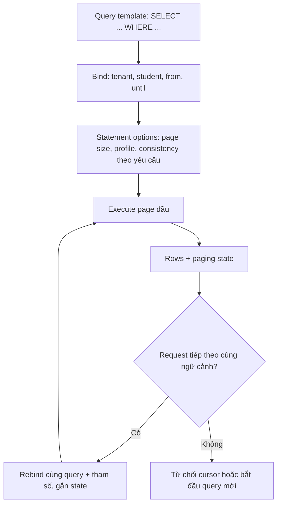

# Paging state gắn với câu lệnh, tham số và điều kiện truy vấn

Một API danh sách trong **Spring Data Cassandra** thường chỉ cần trả 20–50 bản ghi mỗi lần. Tuy nhiên, khi truy cập **Apache Cassandra** trên nhiều node, việc lấy “trang tiếp theo” không giống lệnh `OFFSET` của cơ sở dữ liệu quan hệ. Cassandra dùng **paging state**: một trạng thái tiếp diễn do hệ thống truy vấn/driver cung cấp để tiếp tục đọc kết quả của **cùng câu CQL với cùng các giá trị tham số và điều kiện**.

Đây là điểm dễ mắc lỗi khi phát triển ứng dụng: trang đầu được đọc bằng khóa `studentId=A`, nhưng client vô tình hoặc cố tình gửi token đó cùng `studentId=B`; hoặc API thay bộ lọc ngày, tên bảng, trật tự sắp xếp hay câu `SELECT` rồi cố tái sử dụng token cũ. Một paging state **không phải** “số trang 2” độc lập với truy vấn; sử dụng nó sai ngữ cảnh có thể khiến driver từ chối, trả kết quả không nhất quán hoặc tạo lỗ hổng về phạm vi dữ liệu nếu API không xác thực quyền.

Bài học thuộc chương **Chiếu và phân trang** của module **SPRING_DATA_CASSANDRA**. Bên cạnh `CassandraRepository`, `CassandraTemplate` và truy vấn CQL, ta tìm hiểu **paging state theo Java Driver 4.x**, `Slice` của Spring Data, cách đóng gói cursor trên HTTP, kiểm thử và giới hạn của một hệ thống dữ liệu phân tán có nhiều replica.

## 1. Mục tiêu học tập

Sau bài này, bạn có thể:

1. Giải thích sự khác biệt giữa **page size**, `LIMIT`, paging state và `OFFSET`.
2. Chỉ ra các yếu tố gắn với token: **câu CQL**, **các tham số đã bind**, **bộ lọc**, **partition key**, **trật tự truy vấn** và ngữ cảnh API.
3. Viết một phương thức lấy từng trang bằng `CqlSession`, `BoundStatement` và `PagingState` của Java Driver 4.x.
4. Biết khi nào dùng repository trả `Slice<T>`, khi nào cần điều khiển token trực tiếp.
5. Thiết kế cursor HTTP có kiểm tra người dùng, tenant, tham số, phiên bản và hạn sử dụng.
6. Phân biệt việc **đọc tiếp kết quả** với một snapshot bất biến của dữ liệu.
7. Nhận diện lỗi reuse token sau khi đổi `WHERE`, `SELECT`, `ORDER BY` hoặc cập nhật schema.
8. Kiểm thử phân trang trên Cassandra thật với dữ liệu nhiều partition, nhiều trang và cập nhật đồng thời.

## 2. Ví dụ xuyên suốt: lịch sử đăng ký khóa học

Ứng dụng có endpoint:

```http
GET /tenants/{tenantId}/students/{studentId}/enrollments?from=...&until=...&pageSize=20
```

Mục tiêu là liệt kê đăng ký của **một học viên trong một tenant** theo thời gian gần nhất trước, có thể giới hạn khoảng ngày. Dữ liệu cần được lưu trong bảng phục vụ truy vấn này.

Giả sử keyspace `learning` đã tồn tại:

```sql
CREATE TABLE IF NOT EXISTS learning.enrollments_by_student (
    tenant_id uuid,
    student_id uuid,
    enrolled_at timestamp,
    enrollment_id uuid,
    course_id uuid,
    enrollment_status text,
    PRIMARY KEY ((tenant_id, student_id), enrolled_at, enrollment_id)
) WITH CLUSTERING ORDER BY (enrolled_at DESC, enrollment_id ASC);
```

| Thành phần | Vai trò | Tại sao liên quan đến paging |
| --- | --- | --- |
| `tenant_id` | Thành phần partition key thứ nhất | Cursor phải thuộc đúng tenant được phép truy cập |
| `student_id` | Thành phần partition key thứ hai | Đổi student ID là đổi partition truy vấn |
| `enrolled_at` | Clustering column thứ nhất | Định nghĩa thứ tự thời gian trong partition |
| `enrollment_id` | Clustering column thứ hai | Phân biệt các hàng có cùng timestamp |
| `course_id` | Regular column | Là dữ liệu trả về, không phải khóa định tuyến |
| `enrollment_status` | Regular column | Không được thêm tùy ý vào `WHERE` nếu không có đường truy vấn phù hợp |

CQL đọc danh sách trong một khoảng nửa mở:

```sql
SELECT course_id, enrolled_at, enrollment_id, enrollment_status
FROM learning.enrollments_by_student
WHERE tenant_id = ?
  AND student_id = ?
  AND enrolled_at >= ?
  AND enrolled_at < ?;
```

Query này có **đầy đủ partition key** và **range trên clustering column đầu tiên**. Nếu thay `student_id` hoặc hai mốc thời gian, đó là **truy vấn khác về mặt kết quả**, dù chuỗi CQL template không đổi.

### 2.1. Vì sao cần cả hai clustering columns?

Với `enrolled_at DESC`, các đăng ký mới hơn đứng trước. `enrollment_id` giúp phân biệt hai hàng cùng một timestamp. Khi chuẩn bị một cơ chế cursor thay thế dựa trên clustering key, toàn bộ các trường khóa và thứ tự đó đều quan trọng.

Không nên chỉ dùng `enrolled_at` làm một cursor tự chế nếu nhiều đăng ký có cùng thời điểm; cách đó có thể bỏ sót hoặc lặp hàng. Paging state của driver giải quyết việc tiếp tục xử lý truy vấn theo giao thức, nhưng **không thay thế việc chọn schema có khóa ổn định**.

### 2.2. Không thể dùng bảng này cho mọi hướng tìm kiếm

Nếu yêu cầu đổi thành “liệt kê tất cả học viên đăng ký một khóa học”, bảng trên không có partition key `course_id`. Đổi CQL rồi dùng lại paging state cũ không hợp lệ về mặt ngữ nghĩa. Cần thiết kế bảng đọc như `students_by_course` hoặc một access path phù hợp với nhu cầu, cùng chiến lược đồng bộ projection.

Một API phân trang tốt bắt đầu từ **query-driven design**, sau đó mới chọn cursor.

## 3. Page size, LIMIT, paging state và OFFSET

Bốn khái niệm sau thường bị trộn lẫn:

| Khái niệm | Ý nghĩa | Có tạo “trang thứ N” độc lập không? |
| --- | --- | --- |
| **Page size** | Số hàng mục tiêu mà driver/Cassandra trả trong một lần fetch | Không |
| **`LIMIT N`** | Giới hạn số hàng tối đa của **toàn bộ truy vấn** | Không |
| **Paging state** | Trạng thái tiếp tục đọc kết quả của **cùng truy vấn** | Không; cần ngữ cảnh truy vấn gốc |
| **`OFFSET N`** | Bỏ qua N hàng theo cách SQL truyền thống | Không phải mô hình phân trang CQL tổng quát của Cassandra |

Giả sử query phù hợp schema có 137 hàng:

- Với `pageSize = 20` và không có `LIMIT 20`, mỗi lần fetch thường trả một tập hàng cỡ 20; client có thể lấy tiếp cho đến khi hết.
- Với `LIMIT 20`, kết quả tổng cộng chỉ có tối đa 20 hàng; đặt page size 20 không làm xuất hiện “trang 2” chứa hàng 21–40.
- Với `LIMIT 100` và page size 20, có thể có nhiều page nhưng **tổng số hàng truy vấn vẫn bị chặn bởi LIMIT 100**.
- Không thể gọi một cách tùy ý “cho tôi trang số 500” bằng phép cộng offset mà không đọc qua những vị trí trước hoặc không có một mô hình truy cập khác.

**Page size là một kích thước fetch, không phải hợp đồng trả chính xác N hàng trong mọi trường hợp.** Server có thể trả ít hàng hơn do giới hạn kích thước phản hồi hoặc khi kết quả đã kết thúc. Vì vậy, khi thiết kế API HTTP, phải xử lý số hàng thực nhận và token tiếp diễn, không chỉ suy từ `rows.size() == pageSize`.

### 3.1. Không suy ra còn dữ liệu chỉ từ số hàng

Đoạn logic sau dễ sai:

```java
boolean hasNext = rows.size() == pageSize;
```

Nếu page cuối cùng có đúng 20 hàng mà không còn dữ liệu, code trên vẫn cho `hasNext = true`. Ngược lại, một fetch có thể trả ít hơn cấu hình size nhưng vẫn còn paging state theo giới hạn phản hồi.

**Cách đúng:** dùng thông tin continuation mà driver hoặc abstraction paging hỗ trợ, ví dụ `ExecutionInfo.getPagingState()`, `Slice.hasNext()` hoặc cơ chế tương ứng, **không tự đoán** từ số phần tử trong list.

## 4. Paging state không phải con trỏ độc lập với câu CQL

Paging state là một giá trị **opaque**: ứng dụng nên coi nó như dữ liệu do driver/Cassandra quản lý, không phân tích các byte nội bộ để tự tính offset hoặc clustering position.

Có thể mô tả mối liên hệ:



Quan trọng nhất:

- **Cùng câu lệnh:** không đổi truy vấn CQL tạo kết quả.
- **Cùng tham số:** cùng các giá trị bind, không chỉ cùng số lượng dấu `?`.
- **Cùng điều kiện:** không đổi filter, partition key, range, quyền dữ liệu.
- **Cùng ngữ nghĩa thứ tự:** thay clustering/order hoặc hướng đọc đồng nghĩa đổi cách diễn giải kết quả.
- **Cùng mục tiêu truy cập:** token của học viên A không được đem dùng để đọc B.

Java Driver 4.x có thể kiểm tra tính phù hợp giữa paging state với statement tương ứng. Tuy nhiên, **kiểm tra của driver không thay thế xác thực/ủy quyền ở API**: ứng dụng vẫn phải tự bảo vệ token khỏi bị dùng chéo người dùng/tenant và phải theo dõi ngữ cảnh nghiệp vụ.

### 4.1. Ví dụ những thay đổi bắt buộc xem là truy vấn khác

| Page đầu | Request sau cố dùng lại token | Cách xử lý |
| --- | --- | --- |
| `studentId = A` | `studentId = B` | Từ chối token hoặc bắt đầu query B từ đầu |
| `tenantId = X` | `tenantId = Y` | Không cho reuse; kiểm tra quyền tenant |
| `from = 2026-11-01` | `from = 2026-10-01` | Token không phù hợp, tạo query mới |
| `until = 2026-12-01` | `until = 2026-11-20` | Token không phù hợp, tạo query mới |
| `SELECT course_id, status` | `SELECT course_id, enrolled_at` | Không trộn continuation của hai projection |
| `WHERE tenant_id=? AND student_id=?` | Thêm filter trạng thái | CQL/đường đọc đã đổi, không reuse |
| `ORDER BY enrolled_at DESC` | Đổi thứ tự tương ứng với CQL/table khác | Không reuse |
| Truy vấn trên bảng A | Chuyển sang bảng B sau deploy | Không reuse |
| Page size 20 | Client yêu cầu page size 100 | Khuyến nghị đóng băng page size trong contract cursor; thay đổi phải có quy tắc rõ |
| Query template phiên bản 1 | Triển khai phiên bản 2 thay query/schema | Version hóa cursor hoặc từ chối token cũ |

Một số thay đổi tùy chọn statement như page size có thể không phải điều kiện *bắt buộc* của cơ chế đối chiếu paging state ở mọi driver. Tuy nhiên, ở **mức hợp đồng HTTP**, giữ nguyên page size giúp kết quả dễ dự đoán và giảm rủi ro lạm dụng tài nguyên. Không khẳng định tất cả các trường hợp này đều bị máy chủ phát hiện và từ chối tự động.

### 4.2. Vì sao thêm một bộ lọc tưởng như vô hại cũng sai?

Giả sử page đầu:

```sql
SELECT course_id, enrolled_at
FROM learning.enrollments_by_student
WHERE tenant_id = ? AND student_id = ?;
```

Client nhận token, sau đó muốn thêm `enrollment_status = 'ACTIVE'`. Nếu bảng không có access path phù hợp, câu CQL mới có thể bị từ chối. Ngay cả khi có index/bảng mới hỗ trợ, **đó vẫn là tập kết quả khác**, không phải continuation của danh sách trước.

Không được làm một API “đổi filter ngay trong lúc xem thêm” và lặng lẽ đem token cũ sang query mới. Khi người dùng đổi bộ lọc, **reset cursor**.

## 5. Java Driver 4.x: lấy trang đầu và trang tiếp theo

Spring Data Cassandra sử dụng Apache Cassandra Java Driver ở tầng thấp. Với yêu cầu cần quản lý paging state chính xác, có thể dùng trực tiếp `CqlSession` và `PreparedStatement`.

Ví dụ dưới đây dùng Java 17, Java Driver 4.x và schema `enrollments_by_student` ở phần 2. Đây là một phương án **blocking** cho service/DAO imperative.

### 5.1. DTO kết quả

```java
import java.time.Instant;
import java.util.List;
import java.util.UUID;

public record EnrollmentItem(
        UUID courseId,
        Instant enrolledAt,
        UUID enrollmentId,
        String status) {
}

public record EnrollmentPage(
        List<EnrollmentItem> items,
        String nextPagingState) {
}
```

Hai record được trình bày gộp để minh họa; trong dự án Java thực hãy đặt mỗi public record vào một source file riêng hoặc điều chỉnh visibility phù hợp.

`nextPagingState == null` có nghĩa là không có continuation trong phản hồi hiện tại. **Không trả trực tiếp string này ra client production khi chưa đóng gói/bảo vệ**, vì đó là một token của đường truy cập cơ sở dữ liệu.

### 5.2. DAO sử dụng PreparedStatement

```java
import java.time.Instant;
import java.util.ArrayList;
import java.util.List;
import java.util.Objects;
import java.util.UUID;

import com.datastax.oss.driver.api.core.CqlSession;
import com.datastax.oss.driver.api.core.cql.BoundStatement;
import com.datastax.oss.driver.api.core.cql.PagingState;
import com.datastax.oss.driver.api.core.cql.PreparedStatement;
import com.datastax.oss.driver.api.core.cql.ResultSet;
import com.datastax.oss.driver.api.core.cql.Row;

public class EnrollmentPagingDao {

    private final CqlSession session;
    private final PreparedStatement statement;

    public EnrollmentPagingDao(CqlSession session) {
        this.session = Objects.requireNonNull(session);

        this.statement = session.prepare("""
            SELECT course_id, enrolled_at,
                   enrollment_id, enrollment_status
            FROM learning.enrollments_by_student
            WHERE tenant_id = ?
              AND student_id = ?
              AND enrolled_at >= ?
              AND enrolled_at < ?
            """);
    }

    public EnrollmentPage fetchPage(
            UUID tenantId,
            UUID studentId,
            Instant fromInclusive,
            Instant untilExclusive,
            int pageSize,
            String incomingPagingState) {

        Objects.requireNonNull(tenantId, "tenantId");
        Objects.requireNonNull(studentId, "studentId");
        Objects.requireNonNull(fromInclusive, "fromInclusive");
        Objects.requireNonNull(untilExclusive, "untilExclusive");

        if (!fromInclusive.isBefore(untilExclusive)) {
            throw new IllegalArgumentException("Invalid time interval");
        }
        if (pageSize < 1 || pageSize > 100) {
            throw new IllegalArgumentException("Invalid page size");
        }

        BoundStatement bound = statement
                .bind(tenantId, studentId, fromInclusive, untilExclusive)
                .setPageSize(pageSize);

        if (incomingPagingState != null) {
            PagingState state =
                    PagingState.fromString(incomingPagingState);
            bound = bound.setPagingState(state);
        }

        ResultSet rs = session.execute(bound);

        // Chỉ đọc các hàng hiện có của page này,
        // tránh iterator tự tải tất cả các page tiếp theo.
        int available = rs.getAvailableWithoutFetching();
        List<EnrollmentItem> items = new ArrayList<>(available);

        for (int i = 0; i < available; i++) {
            Row row = rs.one();
            if (row == null) {
                break;
            }
            items.add(new EnrollmentItem(
                    row.getUuid("course_id"),
                    row.getInstant("enrolled_at"),
                    row.getUuid("enrollment_id"),
                    row.getString("enrollment_status")
            ));
        }

        PagingState next =
                rs.getExecutionInfo().getPagingState();

        return new EnrollmentPage(
                List.copyOf(items),
                next == null ? null : next.toString()
        );
    }
}
```

Đoạn này minh họa cách dùng các API phổ biến của Java Driver 4.x:

- `PreparedStatement` được chuẩn bị một lần; câu `SELECT` cố định và tham số được bind theo thứ tự.
- `BoundStatement` của driver 4.x là immutable-style: setter trả một statement mới, nên phải dùng kết quả `setPageSize` hoặc `setPagingState`.
- `setPageSize(pageSize)` cấu hình kích thước fetch; không chèn `LIMIT pageSize` để giả làm “trang kế”.
- `PagingState.fromString(...)` khôi phục dạng token do driver sinh ra; `setPagingState(...)` gắn continuation vào **statement được dựng lại từ đúng tham số**.
- `getAvailableWithoutFetching()` cho biết số hàng đã có của page hiện tại. Chỉ gọi `one()` số lần tương ứng; **không** duyệt toàn bộ `ResultSet` bằng `for (Row row : rs)` nếu chỉ muốn một page.
- `getExecutionInfo().getPagingState()` trả trạng thái để tiếp tục khi có trang sau, nếu driver/server cung cấp; `null` nghĩa là không còn continuation được báo tại thời điểm đó.
- `next.toString()` là biểu diễn chuỗi của paging state ở API driver hỗ trợ; nó là **opaque** đối với application.
- Nếu driver/version thay đổi, cần chạy lại integration tests cho token handling; không tự phân tích/chỉnh sửa chuỗi token.

**Lưu ý:** Các API paging và cách mã hóa paging state là chi tiết của dòng Java Driver đang dùng. Mã cần được biên dịch và thử trên bộ phiên bản Spring Boot/Driver/Cassandra thực tế, đặc biệt trước khi đổi driver hoặc giao thức.

### 5.3. Cẩn thận với iterator tự fetch

Một lỗi điển hình:

```java
// KHÔNG dùng nếu endpoint chỉ muốn trả đúng page hiện tại.
List<EnrollmentItem> all = new ArrayList<>();

for (Row row : session.execute(bound)) {
    all.add(toItem(row));
}
```

Trong driver đồng bộ, duyệt `ResultSet` có thể kích hoạt lấy tiếp các page cho đến khi hết truy vấn. Vô tình này làm mất ý nghĩa phân trang tại HTTP, tăng độ trễ và bộ nhớ.

Đoạn mã trên chỉ là anti-pattern minh họa; `toItem` là helper giả định, không phải method đã định nghĩa. Nếu muốn truy cập toàn bộ dữ liệu một cách có kiểm soát ở batch job, cần thiết kế riêng cho khối lượng, backpressure/batching và observability.

### 5.4. Token không được dùng lại với tham số khác

Giả sử client gọi:

```text
fetchPage(
  tenantId=T1,
  studentId=S1,
  fromInclusive=2026-11-01T00:00:00Z,
  untilExclusive=2026-12-01T00:00:00Z,
  pageSize=20,
  incomingPagingState=null
)
```

DAO trả token `P1`. Khi gọi lần tiếp theo:

```text
fetchPage(
  tenantId=T1,
  studentId=S1,
  fromInclusive=2026-11-01T00:00:00Z,
  untilExclusive=2026-12-01T00:00:00Z,
  pageSize=20,
  incomingPagingState=P1
)
```

đó mới là continuation đúng ngữ cảnh.

Nếu thay `studentId=S2` hoặc `fromInclusive` khác rồi gắn `P1`, không còn là cùng truy vấn. Một số API của Java Driver có cơ chế kiểm tra state khớp statement; lỗi có thể được báo khi gắn token hoặc thực thi. **Không dựa duy nhất vào khả năng phát hiện này để thực thi tenant isolation**.

## 6. Vòng đời token qua nhiều request HTTP

Một API thông thường gồm hai lượt:

**Lượt 1:**

```http
GET /tenants/T1/students/S1/enrollments?from=2026-11-01T00:00:00Z&until=2026-12-01T00:00:00Z&pageSize=20
```

Trả:

```json
{
  "items": [
    {
      "courseId": "44444444-4444-4444-4444-444444444444",
      "enrolledAt": "2026-11-28T09:00:00Z",
      "status": "ACTIVE"
    }
  ],
  "nextPageToken": "opaque-signed-cursor"
}
```

Đây là cấu trúc JSON **minh họa**; `opaque-signed-cursor` là placeholder, **không phải token thật của driver** và không thể đem truyền vào `PagingState.fromString` trực tiếp.

**Lượt 2:**

```http
GET /tenants/T1/students/S1/enrollments?from=2026-11-01T00:00:00Z&until=2026-12-01T00:00:00Z&pageSize=20&cursor=opaque-signed-cursor
```

Service sẽ:

1. Xác thực người gọi.
2. Kiểm tra quyền truy cập tenant/student.
3. Giải mã/xác thực **cursor ứng dụng** và kiểm tra hạn sử dụng.
4. So sánh query identity (table/query version, tenant, student, filter, page size) với request hiện tại.
5. Trích **paging state driver** từ payload đã xác thực.
6. Rebind **cùng query và cùng values**.
7. Gắn paging state, lấy trang tiếp theo.
8. Phát hành cursor mới nếu còn dữ liệu.

### 6.1. Có nên trả raw paging state trực tiếp?

Trong môi trường học tập hoặc ứng dụng nội bộ có kiểm soát, có thể trả token driver để minh họa cơ chế. Nhưng với HTTP API công khai hoặc multi-tenant, nên dùng **cursor của ứng dụng** bao bọc token driver.

Lý do:

- Paging state **không phải chứng cứ phân quyền**.
- API cần chặn việc dùng token của người dùng khác hoặc một tenant khác.
- API cần hỗ trợ thay đổi query version và thời hạn.
- Token có thể làm lộ metadata/chi tiết nội bộ nếu bị xử lý sai; không log nguyên văn.
- Cần chống việc client thay payload để chuyển cursor sang phạm vi dữ liệu khác.

Một cursor wrapper có thể chứa:

```json
{
  "v": 2,
  "queryId": "enrollments-by-student-v2",
  "tenantId": "11111111-1111-1111-1111-111111111111",
  "studentId": "22222222-2222-2222-2222-222222222222",
  "from": "2026-11-01T00:00:00Z",
  "until": "2026-12-01T00:00:00Z",
  "pageSize": 20,
  "expiresAt": "2026-12-01T02:00:00Z",
  "driverPagingState": "<opaque-driver-token>"
}
```

Đây là **payload logic minh họa**. Trong production, không gửi payload JSON có thể sửa tự do như một token “đã tin cậy”. Hãy:

- **Ký bằng HMAC hoặc cơ chế xác thực tương đương**, và kiểm tra chữ ký trước khi tin bất kỳ field nào;
- cân nhắc **mã hóa** nếu payload chứa thông tin nhạy cảm cần che giấu;
- hoặc **lưu cursor phía server** với một ID ngẫu nhiên khó đoán, TTL và access control;
- giới hạn kích thước token và không chấp nhận input không hợp lệ gây quá tải parser/decoder.

Chữ ký bảo vệ **tính toàn vẹn**, không mặc nhiên bảo mật **nội dung**. Mã hóa mới hỗ trợ che giấu nội dung. Cần xác định key rotation, giới hạn thời gian sử dụng và chính sách refresh khi deployment đổi schema/query.

### 6.2. Cursor nào cần bị từ chối?

Một request nên nhận lỗi có thể hiểu được (ví dụ HTTP 400/409 tùy contract) khi:

- Token hỏng, giải mã/kiểm tra chữ ký thất bại.
- Token hết hạn hoặc không thuộc người gọi/tenant được phép.
- Token có `studentId` khác `studentId` trên đường dẫn HTTP.
- Client đổi `from`, `until`, `pageSize` khi contract yêu cầu giữ nguyên.
- Query version trong token đã bị ngừng hỗ trợ.
- Paging state driver không tương thích sau khi nâng cấp, hoặc không khớp câu lệnh/bind values.

Đừng âm thầm bỏ token rồi trả lại **trang đầu** nếu client đang yêu cầu trang sau: làm vậy có thể dẫn tới vòng lặp vô tận hoặc trùng dữ liệu mà phía client không phát hiện.

## 7. Vấn đề tương thích qua deploy và nâng cấp

Paging state là token cấp thấp của driver/protocol. Không nên hứa nó tồn tại vĩnh viễn, có thể chuyển từ cluster này sang cluster khác hoặc vẫn hợp lệ sau mọi đợt thay đổi query/schema.

### 7.1. Thay câu SELECT

Version 1:

```sql
SELECT course_id, enrolled_at
FROM learning.enrollments_by_student
WHERE tenant_id = ? AND student_id = ?;
```

Version 2:

```sql
SELECT course_id, enrolled_at, enrollment_status
FROM learning.enrollments_by_student
WHERE tenant_id = ? AND student_id = ?;
```

Dù cùng partition key, đây là **hai câu lệnh khác nhau**. Token của version 1 không nên dùng cho version 2. Hãy tăng `queryId` trong cursor hoặc giữ endpoint/query cũ trong một giai đoạn chuyển tiếp nếu thật sự cần hỗ trợ token đang lưu hành.

### 7.2. Thay filter hoặc bảng

Đổi `WHERE enrolled_at >= ?` sang một bộ lọc khác, chuyển từ `enrollments_by_student` sang bảng bucket theo tháng, hoặc thêm một bảng index mới đều có thể làm thay đổi tập kết quả. Token cũ không còn mang ý nghĩa continuation của query mới.

Một quy tắc triển khai đơn giản:

```text
Thay đổi tương thích với API mà không đổi query identity:
    Giữ nguyên queryId, chạy regression tests.

Thay đổi CQL/filter/table/order ảnh hưởng tập kết quả:
    Tăng queryId, quyết định cách xử lý cursor cũ.

Nâng Java Driver / Cassandra protocol:
    Kiểm thử định dạng paging state và khả năng tiếp tục.
    Có phương án trả lỗi "cursor expired, restart listing".
```

### 7.3. Thay schema và dữ liệu

Thêm cột vào bảng không nhất thiết khiến mọi token ngay lập tức vô hiệu ở protocol level. Tuy nhiên, nếu `SELECT *` làm projection thay đổi, hoặc ứng dụng thay mapper/contract DTO, thì ngữ nghĩa request đã đổi. Tránh dùng `SELECT *` trong API cursor dài hạn nếu chỉ cần một vài cột.

Đừng coi việc Cassandra vẫn nhận token là chứng minh hợp đồng API hoàn toàn giữ nguyên; hãy version hóa theo **đường truy vấn của ứng dụng**.

## 8. Spring Data Cassandra: Slice và CassandraPageRequest

Khi không cần thao tác trực tiếp với driver token, Spring Data Cassandra có cơ chế phân trang theo hướng **`Slice<T>` và `CassandraPageRequest`** trong những phiên bản hỗ trợ.

Ví dụ chữ ký repository mô tả truy vấn theo đầy đủ partition key:

```java
import java.util.UUID;
import org.springframework.data.cassandra.repository.CassandraRepository;
import org.springframework.data.domain.Pageable;
import org.springframework.data.domain.Slice;

public interface EnrollmentRepository
        extends CassandraRepository<EnrollmentByStudent, StudentEnrollmentKey> {

    Slice<EnrollmentByStudent> findByKey_TenantIdAndKey_StudentId(
            UUID tenantId,
            UUID studentId,
            Pageable pageable);
}
```

Với entity `EnrollmentByStudent` và `StudentEnrollmentKey` ánh xạ đúng bảng, phương thức có thể đọc từng slice theo partition. **Cần đối chiếu khả năng query derivation, `Pageable` và `CassandraPageRequest` của phiên bản Spring Data Cassandra cụ thể.**

Quy trình ở service theo ngữ nghĩa:

```text
Page 1:
  pageable = CassandraPageRequest/first-page request(pageSize)
  slice = repository.findByKey_TenantIdAndKey_StudentId(T1, S1, pageable)

Page 2 nếu slice.hasNext():
  pageable = slice.nextPageable() (loại request có paging state)
  slice = repository.findByKey_TenantIdAndKey_StudentId(T1, S1, pageable)
```

Đoạn trên là **pseudo-code về trình tự**, không phải lời hứa rằng cùng một constructor/factory tồn tại trong tất cả các phiên bản. Tên API và cách khởi tạo `CassandraPageRequest` có thể thay đổi; xem tài liệu Javadoc của bản dùng thực tế trước khi triển khai.

### 8.1. Tại sao ưu tiên Slice hơn Page?

| Kiểu trả về | Điều cần lưu ý với Cassandra |
| --- | --- |
| `List<T>` | Có thể vật chất hóa toàn bộ kết quả; không tự cung cấp token |
| `Slice<T>` | Phù hợp mô hình “có trang tiếp theo hay không” |
| `Page<T>` | Thường gắn với tổng số phần tử/trang, dễ dẫn tới `COUNT` tốn kém hoặc semantics không phù hợp |
| `Iterable<Row>` của Java Driver | Có thể tự fetch nhiều page khi duyệt hết |
| DTO cùng `nextPageToken` | Phù hợp HTTP cursor nếu API tự bảo vệ token và định nghĩa query identity |

Cassandra không có một phép đếm tổng `COUNT(*)` miễn phí trên tập dữ liệu lớn. Khi sản phẩm chỉ cần nút “Xem thêm”, `Slice` là contract gần với mô hình hệ thống hơn một `Page` yêu cầu tổng số trang.

### 8.2. Paging state vẫn bị ràng buộc khi dùng repository

Việc Spring Data bọc trạng thái trong `CassandraPageRequest` không làm token tách khỏi query. Nếu đã lấy `Slice` bằng `tenantId=T1, studentId=S1`, thì lời gọi tiếp theo phải giữ **cùng truy vấn và cùng tham số**.

Không lấy `slice.nextPageable()` từ một repository method rồi chuyển sang một method khác trả projection khác hoặc thay học viên. Đây là lỗi logic dù Java type `Pageable` có vẻ tương thích.

### 8.3. Paging với truy vấn @Query có filter

Một method có `@Query` theo khoảng ngày có thể có các tham số:

```java
@Query("""
    SELECT * FROM learning.enrollments_by_student
    WHERE tenant_id = ?0 AND student_id = ?1
      AND enrolled_at >= ?2 AND enrolled_at < ?3
    """)
Slice<EnrollmentByStudent> findInWindow(
        UUID tenantId, UUID studentId,
        Instant fromInclusive, Instant untilExclusive,
        Pageable pageable);
```

Đây là **method trong repository interface**, không phải Java class độc lập; cần import `Query`, `Slice`, `Pageable` và `Instant` tương ứng. Phải xác nhận **cú pháp @Query cùng paging abstraction** trong phiên bản Spring Data Cassandra triển khai.

Khi lấy trang tiếp, bốn giá trị `tenantId`, `studentId`, `fromInclusive` và `untilExclusive` cần giữ nguyên; không chỉ thay `Pageable`.

## 9. CassandraTemplate, CqlTemplate và CqlSession khác nhau thế nào?

Trong module Spring Data Cassandra, các abstraction cung cấp mức kiểm soát khác nhau:

| API | Truy cập dữ liệu | Quản lý continuation |
| --- | --- | --- |
| `CassandraRepository` | Entity/query methods | Dùng `Slice` và các hỗ trợ paging của Spring Data khi phù hợp |
| `CassandraTemplate` / `CassandraOperations` | Query/criteria và entity mapping | Có API paging theo phiên bản; kiểm tra contract cụ thể |
| `CqlTemplate` / `CqlOperations` | CQL tường minh và `RowMapper` | Query list/callback không tự tạo cursor HTTP có bảo mật |
| `CqlSession` của Java Driver | Prepared/BoundStatement, ResultSet/AsyncResultSet | Kiểm soát trực tiếp page size và paging state |

Với một endpoint cần **đóng gói cursor đa tenant có xác thực**, `CqlSession`/Java Driver thường cho phép kiểm soát chính xác token. Nhưng điều này không bắt buộc phải dùng driver cho mọi query: repository/`Slice` giúp code gọn hơn nếu version và contract sản phẩm đáp ứng được.

**Không nên trộn hai cơ chế pagination trong cùng một luồng** mà chưa xác định chúng dùng cùng CQL/query identity. Ví dụ token từ driver query tự viết không mặc nhiên là `Pageable` phù hợp với một derived repository method.

## 10. Dữ liệu thay đổi giữa hai trang: không có snapshot tự động

Paging state giúp tiếp tục đọc, nhưng **không tự tạo snapshot nhất quán tại thời điểm trang đầu**.

Giả sử:

```text
T0: Trang 1 trả các đăng ký A, B, C.
T1: Một đăng ký D mới được ghi, có enrolled_at mới hơn A.
T2: Client dùng paging state để lấy trang 2.
```

Tùy ngữ nghĩa truy vấn, thứ tự clustering, timestamp, cập nhật/xóa và phiên bản Cassandra, kết quả ở trang sau có thể không phản ánh cùng một “ảnh chụp” dữ liệu như trang đầu. Ứng dụng cần chấp nhận hoặc thiết kế chiến lược riêng nếu sản phẩm đòi hỏi snapshot ổn định.

Những trường hợp cần cân nhắc:

- **Insert mới** nằm trước vị trí trang đầu: client có thể không thấy nó trong lượt duyệt hiện tại.
- **Delete/TTL** làm hàng biến mất trong khi người dùng đang phân trang.
- **Update regular columns** khiến trạng thái của một enrollment đổi giữa hai request.
- **Đổi clustering key** thực chất tương đương ghi một hàng ở khóa mới và xóa khóa cũ, có thể tác động đến thứ tự quan sát.
- **Đọc từ replica khác** cùng consistency level có thể thấy tiến độ đồng bộ khác nhau trong khoảng thời gian ngắn.

### 10.1. Có cần một mốc cố định?

Nếu API cần giới hạn thời điểm dữ liệu được duyệt, có thể đặt **anchor time** khi trang đầu bắt đầu, chẳng hạn chỉ đọc `enrolled_at < anchorTime`, và giữ anchor đó trong mọi request tiếp theo.

Tuy nhiên, cách này chỉ hạn chế các bản ghi có clustering timestamp mới hơn anchor; nó **không tạo snapshot hoàn chỉnh** khi dữ liệu cũ có thể bị cập nhật/xóa, khi timestamp được cung cấp không tương ứng với thời gian ghi, hoặc khi consistency khác nhau.

Nếu yêu cầu kiểm toán đòi hỏi danh sách bất biến, có thể phải dùng một bản xuất dữ liệu/snapshot nghiệp vụ được materialize riêng, hoặc lưu danh sách ID và version như một workflow có kiểm soát. Paging state một mình không giải quyết bài toán đó.

### 10.2. Tránh phát sinh khóa mới khi retry

Nếu ứng dụng dùng `enrollment_id` ổn định và `enrolled_at` không đổi cho cùng một sự kiện, retry ghi dễ idempotent hơn. Nếu mỗi retry tạo một UUID hoặc timestamp mới, các hàng trùng nghiệp vụ có thể xuất hiện trong cùng partition và làm người dùng thấy danh sách lặp.

Đó là vấn đề thiết kế dữ liệu/luồng ghi, không phải lỗi paging state. Cursor chỉ phản ánh một truy vấn trên những hàng Cassandra đang tồn tại.

## 11. Projection thay đổi cũng thay đổi ngữ nghĩa cursor

**Projection** có hai nghĩa thường gặp:

1. **CQL projection**: danh sách cột trong `SELECT`, ví dụ `course_id, enrolled_at`.
2. **Spring Data projection**: interface/DTO chứa một phần thuộc tính của entity.

Đối với paging state, cần giữ ổn định **câu truy vấn CQL thực tế**. Hai repository methods nhìn như cùng truy vấn nghiệp vụ nhưng tạo `SELECT` khác nhau thì không nên trao đổi token với nhau.

### 11.1. Ví dụ hai projection

```sql
-- Projection A
SELECT course_id, enrolled_at
FROM learning.enrollments_by_student
WHERE tenant_id = ? AND student_id = ?;

-- Projection B
SELECT course_id, enrolled_at, enrollment_status
FROM learning.enrollments_by_student
WHERE tenant_id = ? AND student_id = ?;
```

Không dùng token của A để tiếp tục B. Kể cả khi hàng trả về giống nhau về mặt ID, **query identity và contract dữ liệu trả về không giống nhau**.

### 11.2. Partial entity không phải snapshot đầy đủ

Nếu Spring Data chỉ đọc một số cột vào DTO hoặc projection, dữ liệu không được SELECT **không tương đương** với cột đã SELECT nhưng có CQL NULL. Một entity được dựng từ partial result không nên được `save()` lại như bản sao đầy đủ nếu không kiểm soát chính sách ghi null; có thể xóa hoặc ghi đè những cột không định cập nhật.

Hãy dùng DTO cho API chỉ đọc và CQL `UPDATE` rõ ràng cho phép sửa cột. Projection giúp giảm dữ liệu truyền về, nhưng không làm query thiếu partition key trở thành hiệu quả.

## 12. Consistency, timeout và paging

### 12.1. Consistency không biến nhiều page thành transaction

Mức `LOCAL_ONE`, `LOCAL_QUORUM` liên quan yêu cầu số replica phản hồi theo cấu hình replication. Dùng cùng consistency cho các request là một phần của việc giữ ngữ nghĩa đọc ổn định, nhưng **không tạo một transaction snapshot kéo dài qua nhiều trang**.

Cũng không nên thay consistency giữa các request mà không có lý do: hành vi quan sát dữ liệu có thể khác. API nên có execution profile hoặc policy rõ ràng cho loại truy vấn này.

### 12.2. Timeout khi fetch page

Nếu page 3 gặp timeout:

- Không được mặc định rằng Cassandra đã “khóa” dữ liệu trong ba page.
- Không nên đổi CQL/filter để cố lấy tiếp từ token cũ.
- Nếu tiếp tục cùng query và state, phải có chính sách retry được kiểm soát, idempotent với thao tác đọc.
- Nếu driver/token không còn hợp lệ, trả lỗi cursor expired/invalid và hướng dẫn bắt đầu lại.
- Không để server retry vô hạn làm tăng tải trên cluster đang gặp vấn đề.

### 12.3. Page size và tải

Page size quá nhỏ làm tăng số lượt mạng; quá lớn làm tăng payload/heap và độ trễ một request. Giá trị thích hợp phụ thuộc kích thước row, lượng truy cập, mạng, topology và SLA.

Đo ít nhất:

- p50/p95/p99 latency theo page.
- Số hàng và byte trả mỗi page.
- Số request fetch cho một phiên duyệt.
- Timeout/exception của driver.
- Kích thước partition, hot keys và tombstone warnings.
- Số token bị từ chối vì sai query/filter/tenant.

**Đặt page size = 10.000 không sửa được partition quá lớn hoặc query fan-out.** Cần tối ưu schema và đường đọc cùng với pagination.

## 13. Khi nào nên dùng cursor dựa trên clustering key?

Ngoài driver paging state, một số API có thể chọn **keyset pagination** (*seek pagination*) với khóa/sort key cuối cùng đã đọc. Ý tưởng là trang sau bắt đầu ở vị trí khóa tiếp theo của một partition theo thứ tự xác định.

Ưu điểm có thể có:

- Token thuộc hợp đồng nghiệp vụ dễ version hóa hơn.
- Không phụ thuộc trực tiếp vào định dạng paging state của driver.
- Có thể phù hợp với một số kiểu feed có khóa sắp xếp ổn định.

Nhưng Cassandra có **quy tắc truy vấn clustering riêng**:

- Phải có đầy đủ partition key phù hợp.
- Predicate range trên clustering columns phải thỏa thứ tự và phép so sánh được CQL hỗ trợ.
- Với `enrolled_at DESC` và `enrollment_id ASC`, việc xác định “sau hàng cuối” cần xử lý chính xác thứ tự hỗn hợp và timestamp trùng.
- Tránh viết một điều kiện đơn giản trên `enrolled_at` rồi làm mất các hàng có cùng thời điểm.
- Các thay đổi dữ liệu vẫn có thể dẫn tới khác biệt giữa hai trang.

Vì thế không mặc định keyset luôn đơn giản hoặc chính xác hơn paging state. Nếu muốn dùng, cần thiết kế và integration test riêng với **đúng clustering order**.

## 14. Kiểm thử paging state trên Cassandra thật

Một unit test chỉ mock `EnrollmentPagingDao.fetchPage` không chứng minh token được driver/Cassandra tạo đúng hoặc có thể dùng để lấy page tiếp theo. Cần test tích hợp trên **Apache Cassandra thực** (Testcontainers hoặc cluster thử nghiệm) với đúng Java Driver/Spring Data version.

### 14.1. Fixture nhiều hàng

Tạo dữ liệu ở cùng partition:

```sql
INSERT INTO learning.enrollments_by_student
  (tenant_id, student_id, enrolled_at, enrollment_id,
   course_id, enrollment_status)
VALUES
  (11111111-1111-1111-1111-111111111111,
   22222222-2222-2222-2222-222222222222,
   '2026-11-21T09:00:00Z',
   33333333-3333-3333-3333-333333333333,
   44444444-4444-4444-4444-444444444444,
   'ACTIVE');

INSERT INTO learning.enrollments_by_student
  (tenant_id, student_id, enrolled_at, enrollment_id,
   course_id, enrollment_status)
VALUES
  (11111111-1111-1111-1111-111111111111,
   22222222-2222-2222-2222-222222222222,
   '2026-11-20T09:00:00Z',
   55555555-5555-5555-5555-555555555555,
   66666666-6666-6666-6666-666666666666,
   'ACTIVE');

INSERT INTO learning.enrollments_by_student
  (tenant_id, student_id, enrolled_at, enrollment_id,
   course_id, enrollment_status)
VALUES
  (11111111-1111-1111-1111-111111111111,
   22222222-2222-2222-2222-222222222222,
   '2026-11-19T09:00:00Z',
   77777777-7777-7777-7777-777777777777,
   88888888-8888-8888-8888-888888888888,
   'CANCELLED');
```

Đây là ba hàng ở cùng partition, với thứ tự `enrolled_at` giảm dần. Khi dùng `pageSize = 1` trong một test nhỏ, các lần fetch sẽ buộc phải quan sát nhiều page ở môi trường mà driver/server thực sự phân trang theo thiết lập này.

**Trong integration test ổn định**, dùng nhiều hơn vài hàng và kiểm tra continuation bằng chính kết quả thực tế, không giả định cứ một hàng là server chắc chắn cung cấp token ở mọi tình huống/phiên bản.

### 14.2. Test đi hết các trang

Ví dụ khung lặp ở tầng test/service:

```java
List<EnrollmentItem> all = new ArrayList<>();
String cursor = null;

do {
    EnrollmentPage page = dao.fetchPage(
        tenantId,
        studentId,
        Instant.parse("2026-11-01T00:00:00Z"),
        Instant.parse("2026-12-01T00:00:00Z"),
        1,
        cursor
    );

    all.addAll(page.items());
    cursor = page.nextPagingState();
} while (cursor != null);

// Kiểm tra đủ các enrollment IDs mong đợi,
// không trùng và theo đúng thứ tự clustering.
```

Đoạn code là thân integration test với `dao`, `tenantId` và `studentId` đã khởi tạo; thêm giới hạn số vòng lặp trong test thật để phát hiện token lặp hoặc logic phân trang bị lỗi thay vì treo vô hạn.

### 14.3. Ma trận kiểm thử tối thiểu

| Ca kiểm thử | Điều cần xác minh |
| --- | --- |
| Không có hàng | Danh sách rỗng và không có continuation |
| Ít hơn một page | Đọc hết và dừng |
| Nhiều page | Không mất hàng, không lặp hàng với dataset tĩnh |
| Hai hàng cùng timestamp | `enrollment_id` phân biệt, thứ tự ổn định |
| Hai học viên cùng tenant | Cursor của A không áp dụng cho B |
| Hai tenant | Token không vượt ranh giới quyền tenant |
| Đổi `from` hoặc `until` | Wrapper API từ chối token không cùng filter |
| Đổi CQL projection | Query version khác, không reuse token |
| Đổi page size | Contract API áp dụng quy tắc nhất quán |
| Token bị sửa một byte | Chữ ký/parse validation thất bại |
| Token hết hạn | Trả lỗi cursor hết hạn có hướng dẫn |
| Token rỗng/sai format | Phản hồi lỗi 4xx thay vì lỗi 500 không kiểm soát |
| Data insert giữa hai page | Quan sát hành vi theo contract eventual consistency |
| TTL/xóa giữa hai page | Không mặc định snapshot |
| Driver/Spring Data nâng phiên bản | Regression test compatibility và xử lý token cũ |
| Page size nhỏ trên tập nhiều hàng | Không vô tình auto-fetch hết bảng |
| Query với trạng thái `status` không được index | Không “chữa” bằng `ALLOW FILTERING` |

Test với một node Cassandra sẽ xác minh CQL, mapping và paging logic; nó **không mô phỏng đầy đủ** consistency/replica failure của cluster nhiều node. Nếu production có nhiều DC, cần thêm kịch bản phù hợp với topology và failure mode thực tế.

## 15. Những lỗi điển hình khi dùng paging state

| Triệu chứng | Nguyên nhân thường gặp | Hướng xử lý |
| --- | --- | --- |
| Trang 2 bị từ chối vì paging state | Token không phù hợp statement/giá trị bind hoặc format sai | Dựng lại đúng query, xác minh token và queryId |
| Trang 2 trả dữ liệu của bộ lọc cũ | Client đổi filter nhưng reuse cursor | So sánh filter trong cursor với request và từ chối |
| Đổi học viên nhưng vẫn gửi token cũ | Không ràng buộc student/tenant trong API cursor | Kiểm tra authorization và scope trong token |
| Trả lại trang 1 nhiều lần | Client bỏ qua token, server nuốt lỗi và reset cursor | Trả lỗi rõ ràng, không fallback ngầm |
| Trùng/thiếu hàng khi có ghi đồng thời | Paging không cung cấp snapshot bất biến | Định nghĩa contract, anchor hoặc mô hình snapshot nghiệp vụ |
| Đọc `ResultSet` ngốn nhiều RAM | Iterator auto-fetch toàn bộ page tiếp theo | Chỉ lấy số hàng của page hiện có, giới hạn query |
| `LIMIT 20` khiến không có trang thứ hai | LIMIT chặn toàn bộ query | Phân biệt limit và page size |
| `rows.size() == pageSize` báo sai hasNext | Suy diễn continuation từ số hàng | Dùng paging state/`Slice.hasNext()` |
| `Page<T>` chậm do tính count | Tổng số trang không rẻ với Cassandra | Ưu tiên `Slice`/cursor khi không cần tổng |
| Query đổi sau deploy, token cũ lỗi | Query identity/schema/driver thay đổi | Version hóa cursor và trả cursor expired |
| Token bị sửa nhưng API vẫn dùng | Payload không được ký/xác thực | HMAC/AEAD hoặc server-side token store |
| Vô tình log raw token | Logging quá chi tiết | Che hoặc không log token, quan sát bằng queryId |
| Query có page size nhưng vẫn chậm | Partition lớn/hot, tombstone, consistency | Đo metrics, cân nhắc bucket/retention |
| `@Query` method khác nhận cùng token | Câu SELECT/WHERE khác nhau | Không trao đổi page requests giữa queries |

### Quy trình chẩn đoán

1. Kiểm tra **request identity**: tenant, student, filters, page size, người dùng.
2. Kiểm tra **queryId/version** và CQL template hiện tại.
3. Kiểm tra **bind values** (không log dữ liệu nhạy cảm nguyên văn).
4. Xác minh token được tạo từ **cùng statement** và chưa hết hạn.
5. Kiểm tra Java Driver/Spring Data version và đường paging.
6. Kiểm tra Cassandra schema, primary key và clustering order.
7. Quan sát row count, paging metrics, timeout, tombstone và tải replica.
8. Tạo integration test tái hiện với nhiều partition và nhiều page.

Không nên “sửa nhanh” bằng cách bỏ kiểm tra cursor, nối input vào CQL hoặc nâng timeout vô hạn.

## 16. Bài tập thực hành

Bảng Cassandra:

```sql
CREATE TABLE learning.progress_by_student (
    tenant_id uuid,
    student_id uuid,
    course_id uuid,
    completed_lessons int,
    updated_at timestamp,
    PRIMARY KEY ((tenant_id, student_id), course_id)
);
```

API muốn đọc tiến độ từng trang:

```text
GET /tenants/{tenantId}/students/{studentId}/progress?pageSize=25&cursor=...
```

Hãy trả lời:

1. Partition key của bảng là gì? Vì sao API cần cả `tenantId` và `studentId`?
2. `pageSize=25` có đồng nghĩa CQL `LIMIT 25` không?
3. Tại sao không nên suy ra có trang kế khi `rows.size() == 25`?
4. Nếu request trang sau đổi `studentId`, có thể dùng lại token không?
5. Nếu thêm bộ lọc `updated_at >= from` nhưng bảng không có index/đường đọc phù hợp, paging state có làm query hiệu quả không?
6. Tại sao `SELECT course_id, completed_lessons` và `SELECT *` không nên dùng chung paging state?
7. Nếu API phát hành raw driver state qua HTTP, những rủi ro multi-tenant nào phải xử lý?
8. Phân biệt ký token bằng HMAC với mã hóa nội dung token.
9. Với Java Driver, khi nào dùng `getAvailableWithoutFetching()`?
10. Điều gì xảy ra nếu code duyệt `for (Row row : resultSet)` đến hết trong một endpoint chỉ muốn một page?
11. `Slice<T>` giải quyết nhu cầu gì mà `Page<T>` có thể làm tốn kém?
12. Nếu dữ liệu bị xóa giữa hai request, paging state có đảm bảo snapshot không?
13. Nếu thay query CQL sau deploy, nên xử lý cursor cũ thế nào?
14. Vì sao token phải có hạn sử dụng và query version ở tầng API?
15. Khi nào nên cân nhắc keyset pagination thay cho driver paging state?
16. Cần kiểm thử gì để chứng minh không mất/trùng hàng trong một dataset tĩnh?
17. Nếu đã dùng `LOCAL_QUORUM`, vì sao điều đó vẫn không tạo snapshot nhiều trang?
18. Vì sao cập nhật hai bảng phi chuẩn hóa không được giải quyết chỉ bằng đổi page size?

**Gợi ý:** partition key là `(tenant_id, student_id)`. Page size là số hàng fetch theo trang, còn `LIMIT` chặn tổng kết quả. Cursor chỉ hợp lệ trong ngữ cảnh **cùng CQL, cùng bind values/filter và cùng quyền**. Paging state không tạo offset hoặc snapshot. Với HTTP đa tenant, dùng cursor có xác thực, hạn dùng và gắn query version. `Slice` phù hợp nút “Xem thêm”; dữ liệu tĩnh nên có integration test duyệt nhiều trang không mất hoặc lặp ID.

## 17. Checklist trước khi triển khai

- [ ] Query sử dụng đúng partition key và clustering restrictions.
- [ ] Đã phân biệt page size, `LIMIT`, paging state và `OFFSET`.
- [ ] Dùng cùng câu CQL và bind values khi truy vấn tiếp.
- [ ] Khi filter hoặc thứ tự thay đổi, reset cursor.
- [ ] Không tái sử dụng paging state qua hai repository/query templates khác nhau.
- [ ] Cursor ràng buộc người dùng, tenant, student và quyền truy cập.
- [ ] Token được ký/xác thực (hoặc quản lý server-side) và có hạn sử dụng.
- [ ] Có `queryId`/version để xử lý nâng cấp schema/query.
- [ ] Không log raw paging state hoặc payload chứa dữ liệu nhạy cảm.
- [ ] Dùng continuation thực tế thay vì `rows.size()==pageSize`.
- [ ] Không tự duyệt toàn bộ `ResultSet` nếu API chỉ muốn một trang.
- [ ] Với Spring Data, đã kiểm thử `Slice`/`CassandraPageRequest` đúng phiên bản.
- [ ] Với driver trực tiếp, đã kiểm thử `PagingState` và `BoundStatement`.
- [ ] Không yêu cầu tổng số trang/count miễn phí trên bảng lớn.
- [ ] Có chính sách xử lý token sai/expired hoặc version không tương thích.
- [ ] Đã quy định cách API xử lý concurrent insert/update/delete.
- [ ] Có metrics latency, page fetch count, timeout và hot partitions.
- [ ] Integration test Cassandra thật có nhiều partition và nhiều trang.

## 18. Ghi nhớ

**Paging state là trạng thái tiếp tục một truy vấn Cassandra cụ thể, không phải một số trang độc lập.** Khi muốn lấy trang tiếp theo, giữ **cùng statement, cùng tham số đã bind, cùng điều kiện và cùng hợp đồng truy vấn**. Nếu user đổi bộ lọc, đối tượng cần xem hoặc API đã đổi CQL sau deploy, phải bắt đầu truy vấn mới hoặc từ chối cursor cũ.

**Page size khác `LIMIT`, và cả hai đều khác `OFFSET`.** Một `ResultSet` có thể tự tải tiếp các page nếu duyệt hết; Spring Data `Slice` và Java Driver `PagingState` giúp mô tả continuation đúng hơn việc tự đoán từ kích thước list.

**Phân trang không tạo snapshot bất biến hay cơ chế phân quyền.** Trong production, hãy bảo vệ cursor theo tenant/user, version hóa query, giới hạn kích thước/hạn sử dụng và có integration test trên Cassandra thật. Tính đúng đắn vẫn bắt đầu từ **thiết kế bảng theo truy vấn, partition key, clustering, consistency và kiểm soát hiệu năng**.

### Tài liệu tham khảo

- [Apache Cassandra Java Driver 4 — Paging](https://docs.datastax.com/en/developer/java-driver/4.17/manual/core/paging/)
- [Apache Cassandra Java Driver 4 — PagingState API](https://docs.datastax.com/en/latest-java-driver-api/com/datastax/oss/driver/api/core/cql/PagingState.html)
- [Spring Data Cassandra — Query Methods](https://docs.spring.io/spring-data/cassandra/reference/cassandra/repositories/query-methods.html)
- [Spring Data Cassandra — CassandraPageRequest API](https://docs.spring.io/spring-data/cassandra/docs/current/api/org/springframework/data/cassandra/core/query/CassandraPageRequest.html)
- [Spring Data Cassandra — Repositories](https://docs.spring.io/spring-data/cassandra/reference/repositories.html)
- [Spring Data Cassandra — CassandraTemplate](https://docs.spring.io/spring-data/cassandra/reference/cassandra/template.html)
- [Apache Cassandra — CQL Data Manipulation](https://cassandra.apache.org/doc/stable/cassandra/developing/cql/dml.html)
