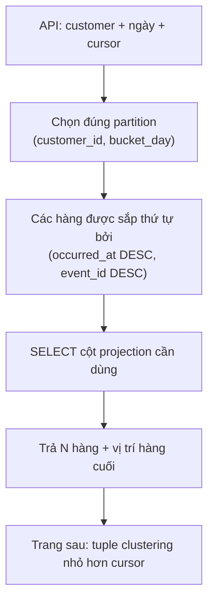
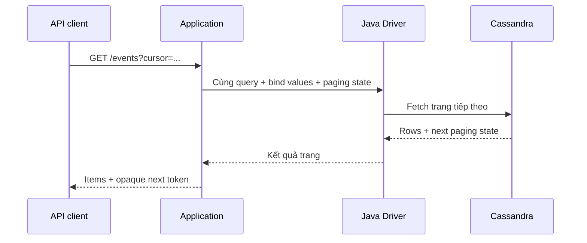

# Đọc theo khoảng clustering và giữ vị trí bằng khóa nghiệp vụ

## 1. Vấn đề: làm sao tải tiếp một danh sách mà không bỏ sót hàng?

Trong **Spring Data Cassandra**, repository, `CassandraTemplate` và Java Driver giúp thực thi CQL, ánh xạ entity hoặc projection rồi trả dữ liệu cho ứng dụng. Tuy nhiên, một API hiển thị lịch sử dài còn cần giải quyết bài toán khác: **lấy một đoạn có thứ tự và biết chính xác bắt đầu đọc tiếp từ đâu**.

Ví dụ màn hình “lịch sử sự kiện của khách hàng trong ngày” có yêu cầu:

- Trả tối đa 50 sự kiện mới nhất, sau đó tải tiếp những sự kiện cũ hơn.
- Giữ thứ tự ổn định khi nhiều sự kiện xảy ra **trong cùng một mili giây**.
- Chỉ đọc những hàng của **một customer và một bucket ngày**, tránh quét toàn cluster.
- Không phụ thuộc vào `OFFSET 10000` như cách phân trang thường thấy trong SQL quan hệ.
- Khi response đầu tiên hoàn tất, trả một **cursor ứng dụng** có đủ thông tin để truy vấn lần tiếp theo.

Các bài toán này liên quan trực tiếp đến **partition key**, **clustering columns**, **projection**, **paging state** của Java Driver và **keyset pagination** bằng khóa nghiệp vụ.

Bài học có ba tầng cần phân biệt:

1. **Clustering range**: dùng `WHERE` trên clustering key để chọn các hàng trong một khoảng, sau khi đã xác định partition.
2. **Projection**: chỉ lấy và ánh xạ những cột cần trả cho API, nhưng **vẫn giữ các thành phần khóa cần thiết để tạo cursor**.
3. **Continuation**: lưu vị trí đã trả cuối cùng bằng đầy đủ khóa sắp xếp, hoặc sử dụng opaque paging state của driver tùy nhu cầu.

> **Ý chính:** Một timestamp đơn lẻ thường **không phải cursor đủ mạnh**. Nếu hai hàng cùng `occurred_at`, cursor cần thêm khóa phân biệt như `event_id` — và truy vấn trang tiếp theo phải dùng **đúng thứ tự clustering**.

Bài thuộc chương **Chiếu và phân trang**, trong module `SPRING_DATA_CASSANDRA`: đọc Cassandra bằng entity mapping, repository, `CassandraTemplate` và CQL, đồng thời thiết kế partition key, consistency, paging và hiệu năng phù hợp mô hình dữ liệu phân tán.

## 2. Partition key, clustering key và thứ tự trong Cassandra

Trong Cassandra, bảng thường được thiết kế **theo truy vấn cần phục vụ**. Một partition key quyết định tập replica chứa dữ liệu; clustering columns tạo thứ tự hàng **bên trong cùng partition**.



Phân biệt các khái niệm:

| Khái niệm | Mục đích | Ví dụ |
| --- | --- | --- |
| **Partition key** | Định tuyến đến partition/tập replica; thường dùng equality đầy đủ. | `(customer_id, bucket_day)` |
| **Clustering key** | Định danh và sắp xếp hàng trong partition. | `(occurred_at, event_id)` |
| **Primary key đầy đủ** | Xác định một hàng; gồm partition key và clustering columns. | `(customer_id, bucket_day, occurred_at, event_id)` |
| **Clustering range** | Giới hạn một khoảng hàng có trật tự bên trong partition. | `occurred_at >= start AND occurred_at < end` |
| **Keyset cursor** | Mô tả vị trí đã phát cho client dựa trên các giá trị khóa. | `occurred_at` + `event_id`, gắn với customer/day |
| **Driver paging state** | Token không trong suốt do Cassandra Driver/cluster dùng để tiếp tục một truy vấn. | Byte/token do driver trả |
| **Projection** | Chỉ lấy các trường cần thiết thay vì toàn bộ entity. | `occurred_at`, `event_id`, `event_type`, `summary` |

**Clustering order không phải thứ tự toàn cluster.** Nếu hai khách hàng có các partition khác nhau, Cassandra không tự trộn hàng của họ thành một dòng thời gian toàn cục. Nếu sản phẩm cần feed đa partition hoặc đa ngày, phải thiết kế thêm bước hợp nhất có giới hạn hoặc bảng phục vụ trực tiếp query pattern đó.

### Vì sao có hai clustering columns?

CQL `timestamp` lưu thời điểm ở **độ chính xác mili giây**. Hai event khác nhau có thể cùng `occurred_at`. Nếu chỉ dùng timestamp làm primary key cùng customer/day, các ghi cùng mili giây có thể nhắm vào cùng một hàng.

`event_id uuid` là thành phần clustering thứ hai để phân biệt. Nó **không mang nghĩa thời gian** nếu là UUID ngẫu nhiên; thời gian vẫn do `occurred_at` quyết định, còn UUID tạo thứ tự xác định khi thời gian bằng nhau.

## 3. Chuẩn bị schema CQL có thứ tự dễ phân trang

Giả sử có môi trường học một node tại data center `dc1`. Tạo keyspace và bảng:

```sql
-- RF=1 chỉ dùng trong lab một node.
CREATE KEYSPACE IF NOT EXISTS learning
WITH replication = {
    'class': 'NetworkTopologyStrategy',
    'dc1': 1
};

CREATE TABLE IF NOT EXISTS learning.events_by_customer_day (
    customer_id uuid,
    bucket_day date,
    occurred_at timestamp,
    event_id uuid,
    event_type text,
    summary text,
    PRIMARY KEY ((customer_id, bucket_day), occurred_at, event_id)
) WITH CLUSTERING ORDER BY (
    occurred_at DESC,
    event_id DESC
);
```

Lựa chọn `DESC, DESC` là có chủ đích:

- Sự kiện **mới hơn** được đọc trước.
- Khi nhiều event bằng timestamp, `event_id` tạo thứ tự giảm dần ổn định.
- Phép “đọc sau vị trí cuối” sẽ dùng **tuple clustering nhỏ hơn** giá trị cursor: `(occurred_at, event_id) < (lastAt, lastId)` trong thiết kế thống nhất thứ tự giảm dần này.
- Nếu đổi schema thành thứ tự hỗn hợp `occurred_at DESC, event_id ASC`, không nên sao chép nguyên điều kiện cursor; cần kiểm chứng/thiết kế lại theo thứ tự so sánh tương ứng.

**Đừng xem `DESC` như cách đảo nghĩa toán tử `<`/`>`.** Toán tử so sánh CQL vẫn diễn đạt điều kiện theo giá trị; clustering order quyết định thứ tự trả hàng. Với cursor gồm nhiều cột, cần **kiểm tra trực tiếp** kết quả ở các timestamp trùng nhau trên phiên bản Cassandra đang chạy.

### Dữ liệu mẫu cho hai timestamp trùng nhau

```sql
INSERT INTO learning.events_by_customer_day (
    customer_id, bucket_day, occurred_at, event_id, event_type, summary
) VALUES (
    aaaaaaaa-aaaa-aaaa-aaaa-aaaaaaaaaaaa,
    '2026-11-25', '2026-11-25T11:00:00.000Z',
    66666666-6666-6666-6666-666666666666,
    'LOGIN', 'Sự kiện 11 giờ'
);

INSERT INTO learning.events_by_customer_day (
    customer_id, bucket_day, occurred_at, event_id, event_type, summary
) VALUES (
    aaaaaaaa-aaaa-aaaa-aaaa-aaaaaaaaaaaa,
    '2026-11-25', '2026-11-25T10:00:00.000Z',
    55555555-5555-5555-5555-555555555555,
    'VIEW', 'Sự kiện A lúc 10 giờ'
);

INSERT INTO learning.events_by_customer_day (
    customer_id, bucket_day, occurred_at, event_id, event_type, summary
) VALUES (
    aaaaaaaa-aaaa-aaaa-aaaa-aaaaaaaaaaaa,
    '2026-11-25', '2026-11-25T10:00:00.000Z',
    44444444-4444-4444-4444-444444444444,
    'VIEW', 'Sự kiện B lúc 10 giờ'
);

INSERT INTO learning.events_by_customer_day (
    customer_id, bucket_day, occurred_at, event_id, event_type, summary
) VALUES (
    aaaaaaaa-aaaa-aaaa-aaaa-aaaaaaaaaaaa,
    '2026-11-25', '2026-11-25T10:00:00.000Z',
    33333333-3333-3333-3333-333333333333,
    'PURCHASE', 'Sự kiện C lúc 10 giờ'
);

INSERT INTO learning.events_by_customer_day (
    customer_id, bucket_day, occurred_at, event_id, event_type, summary
) VALUES (
    aaaaaaaa-aaaa-aaaa-aaaa-aaaaaaaaaaaa,
    '2026-11-25', '2026-11-25T09:00:00.000Z',
    22222222-2222-2222-2222-222222222222,
    'PURCHASE', 'Sự kiện 9 giờ'
);

INSERT INTO learning.events_by_customer_day (
    customer_id, bucket_day, occurred_at, event_id, event_type, summary
) VALUES (
    aaaaaaaa-aaaa-aaaa-aaaa-aaaaaaaaaaaa,
    '2026-11-25', '2026-11-25T08:00:00.000Z',
    11111111-1111-1111-1111-111111111111,
    'LOGOUT', 'Sự kiện 8 giờ'
);
```

Đọc một partition:

```sql
SELECT occurred_at, event_id, event_type, summary
FROM learning.events_by_customer_day
WHERE customer_id = aaaaaaaa-aaaa-aaaa-aaaa-aaaaaaaaaaaa
  AND bucket_day = '2026-11-25'
LIMIT 10;
```

Thứ tự kỳ vọng: **11:00/66**, **10:00/55**, **10:00/44**, **10:00/33**, **09:00/22**, **08:00/11**. Các hậu tố ở đây chỉ là cách viết tắt của UUID mẫu.

Các câu `INSERT` mẫu là upsert thông thường theo primary key. Việc chạy lại ở lab có thể ghi lại cùng các khóa; không dùng seed này trên dữ liệu production.

## 4. Đọc một khoảng clustering có ranh giới rõ ràng

### 4.1. Truy vấn giới hạn thời gian trong một partition

Nếu muốn đọc các sự kiện trong khoảng **[09:00, 11:00)**, ta có:

```sql
SELECT occurred_at, event_id, event_type, summary
FROM learning.events_by_customer_day
WHERE customer_id = aaaaaaaa-aaaa-aaaa-aaaa-aaaaaaaaaaaa
  AND bucket_day = '2026-11-25'
  AND occurred_at >= '2026-11-25T09:00:00.000Z'
  AND occurred_at < '2026-11-25T11:00:00.000Z'
LIMIT 50;
```

Kết quả từ dữ liệu mẫu: ba sự kiện lúc **10:00** và một sự kiện lúc **09:00**. Bản ghi đúng **11:00** không thuộc khoảng vì toán tử `<`.

| Khoảng | Điều kiện CQL | Có tính mốc kết thúc? |
| --- | --- | --- |
| `[from, to)` | `occurred_at >= from AND occurred_at < to` | Không |
| `[from, to]` | `occurred_at >= from AND occurred_at <= to` | Có |
| `(from, to)` | `occurred_at > from AND occurred_at < to` | Không tính cả hai |
| `(from, to]` | `occurred_at > from AND occurred_at <= to` | Có tính `to` |

Khoảng **nửa mở** giúp ghép hai cửa sổ thời gian liên tiếp mà không đếm hai lần những hàng ở mốc ranh giới: `[09:00, 10:00)` và `[10:00, 11:00)`.

### 4.2. Điều kiện đúng nhưng thiếu partition key vẫn không đủ

CQL của Cassandra yêu cầu tuân thủ quy tắc restriction theo primary key. Chỉ viết:

```sql
-- Không phải query phù hợp schema vừa thiết kế:
SELECT * FROM learning.events_by_customer_day
WHERE occurred_at >= '2026-11-25T09:00:00.000Z';
```

không cung cấp partition key `(customer_id, bucket_day)`. Vì vậy, đừng sử dụng cách truy vấn này như một API mặc định để “lọc theo thời gian trên toàn hệ thống”. Thêm `ALLOW FILTERING` không thay thế việc thiết kế một bảng theo query pattern.

### 4.3. Khi nào cần đọc nhiều partition?

Nếu sản phẩm hỏi “lịch sử của khách hàng từ ngày 24 đến ngày 26”, bảng theo ngày tạo **ba partition** (nếu bucket tính theo cùng zone). Không có một câu range trên `bucket_day` tự động biến ba partition thành một đoạn clustering duy nhất.

Các lựa chọn:

1. Điều phối đọc **một số bucket có giới hạn**, hợp nhất theo thứ tự thời gian tại service.
2. Thiết kế bảng phụ theo query pattern khác nếu đọc xuyên ngày là yêu cầu thường xuyên.
3. Lưu một **cursor có cả bucket** khi điều phối nhiều ngày, để biết đang ở ngày nào và khi nào chuyển sang ngày trước.

Chỉ nên làm bước điều phối đa bucket sau khi đã có thuật toán đúng và đo được giới hạn số partition/row/request. Phần tiếp theo xây cursor cho **một partition**, rồi mở rộng thận trọng.

## 5. Vì sao cursor chỉ có timestamp sẽ bỏ sót hàng?

Giả sử một trang có giới hạn **2 hàng**, và trang đầu trả:

```text
11:00  event 66
10:00  event 55     <-- hàng cuối trang
```

Nếu cursor chỉ chứa `lastOccurredAt = 10:00`, trang tiếp theo truy vấn:

```sql
-- VÍ DỤ SAI KHI NHIỀU HÀNG TRÙNG TIMESTAMP:
SELECT occurred_at, event_id, event_type, summary
FROM learning.events_by_customer_day
WHERE customer_id = aaaaaaaa-aaaa-aaaa-aaaa-aaaaaaaaaaaa
  AND bucket_day = '2026-11-25'
  AND occurred_at < '2026-11-25T10:00:00.000Z'
LIMIT 2;
```

Nó trả **09:00/22** và **08:00/11**, bỏ sót **10:00/44** và **10:00/33** dù hai hàng đó chưa từng được gửi về client.

Nếu sửa thành `occurred_at <= 10:00`, trang tiếp có thể trả lại `10:00/55` — tức **trùng hàng đã gửi**. Hai cách này không giải quyết được chuyện có nhiều event ở cùng timestamp.

**Giải pháp:** cursor phải chứa **đủ clustering tuple dùng để sắp xếp**, trong ví dụ là:

```text
lastOccurredAt = 2026-11-25T10:00:00.000Z
lastEventId    = 55555555-5555-5555-5555-555555555555
```

Và giữ thêm `customer_id`, `bucket_day` để biết cursor áp dụng cho partition nào.

> Khóa phân biệt không nhất thiết phải gọi là `event_id`. Nó phải là thành phần khóa **ổn định, duy nhất trong phạm vi đã định nghĩa và có mặt trong thứ tự clustering**. Một ID nghiệp vụ được tạo độc lập có thể đóng vai trò đó nếu được mô hình hóa thành clustering column.

## 6. Truy vấn trang tiếp bằng tuple clustering

Cassandra CQL hỗ trợ **tuple notation** để so sánh nhiều clustering columns theo thứ tự khóa. Với hai cột clustering `occurred_at` rồi `event_id` trong bảng mẫu, trang sau có thể viết:

```sql
SELECT occurred_at, event_id, event_type, summary
FROM learning.events_by_customer_day
WHERE customer_id = aaaaaaaa-aaaa-aaaa-aaaa-aaaaaaaaaaaa
  AND bucket_day = '2026-11-25'
  AND (occurred_at, event_id) <
      ('2026-11-25T10:00:00.000Z',
       55555555-5555-5555-5555-555555555555)
LIMIT 2;
```

Trong thiết kế `occurred_at DESC, event_id DESC`, kết quả kỳ vọng là:

```text
10:00  event 44
10:00  event 33
```

Cursor trang hai lấy **khóa của event 33**. Trang tiếp theo với `(10:00, event33)` trả:

```text
09:00  event 22
08:00  event 11
```

### Tuple comparison khác hai điều kiện độc lập

Để hiểu phép so sánh lexicographic (so khóa theo thứ tự từng thành phần), xét vị trí `(occurred_at, event_id)`. Với hai cột cùng thứ tự giảm dần như bảng mẫu, ý tưởng “những hàng tiếp theo” là:

```text
occurred_at < lastOccurredAt
HOẶC
occurred_at = lastOccurredAt VÀ event_id < lastEventId
```

Tuple notation cho phép biểu diễn quan hệ so sánh trên **cùng thứ tự clustering** một cách gọn và ít nguy cơ mắc lỗi ở các trường hợp bằng nhau. Đừng viết:

```sql
-- KHÔNG TƯƠNG ĐƯƠNG với so sánh tuple:
AND occurred_at < :lastAt
AND event_id < :lastId
```

Điều kiện kép yêu cầu **cả hai cột** đều nhỏ hơn, sẽ loại sai nhiều hàng hợp lệ. Ngoài ra, Cassandra có ràng buộc cách kết hợp các restrictions trên clustering columns, nên biểu thức trên không phải một cách viết “an toàn hơn” để thay tuple.

**Lưu ý phiên bản/DDL:** tuple comparison phải đặt các clustering columns theo **đúng thứ tự khai báo**, có partition key đầy đủ và tuân thủ quy tắc hỗ trợ của Cassandra. Khi có clustering order hỗn hợp `DESC/ASC`, hoặc muốn gộp nhiều range trên cùng cột với tuple range, hãy xác minh CQL và thứ tự thực tế trên cluster mục tiêu; không sao chép mù điều kiện `<`.

### Keyset pagination khác thay đổi paging state

Mỗi lần gọi keyset query là **một câu truy vấn mới với điều kiện so sánh mới**; nó không tái sử dụng opaque paging state của truy vấn trước. Điều này có lợi khi API muốn một cursor logic dễ hiểu, gắn với khóa ổn định của nghiệp vụ.

Nhưng điều đó **không tự cung cấp snapshot dữ liệu**: nếu có ghi mới hoặc xóa hàng giữa hai request, tập dữ liệu tại thời điểm gọi tiếp theo có thể thay đổi. Keyset thường tránh trùng lặp do “offset dịch” khi thêm bản ghi ở đầu danh sách, song không thể bảo đảm một ảnh chụp bất biến qua nhiều request.

## 7. Projection: chỉ lấy dữ liệu cần dùng nhưng không bỏ khóa cursor

### 7.1. Projection CQL

Một bảng có thể có hàng chục cột, trong khi card UI chỉ cần loại sự kiện và tóm tắt. Truy vấn:

```sql
SELECT occurred_at, event_id, event_type, summary
FROM learning.events_by_customer_day
WHERE customer_id = aaaaaaaa-aaaa-aaaa-aaaa-aaaaaaaaaaaa
  AND bucket_day = '2026-11-25'
LIMIT 51;
```

là một **projection tại CQL**: nó lấy đúng bốn cột cần để hiển thị **và** làm cursor. Không cần `SELECT *` cho card feed.

**Sai lầm dễ gặp:** tối ưu thêm bằng cách bỏ `occurred_at` hoặc `event_id` ra khỏi `SELECT`, rồi sau đó không thể biết điểm tiếp tục chính xác. Để xây keyset cursor, **mọi sort key/tie-break key phải có trong kết quả**.

### 7.2. DTO projection ở tầng Java

Một DTO độc lập với entity đầy đủ:

```java
package com.example.feed.dto;

import java.time.Instant;
import java.util.UUID;

public record EventPreview(
    Instant occurredAt,
    UUID eventId,
    String eventType,
    String summary
) {
}
```

Khi trích xuất `Row` từ Java Driver, code tự ánh xạ các cột:

```java
import com.datastax.oss.driver.api.core.cql.Row;
import com.example.feed.dto.EventPreview;

public final class EventPreviewMapper {

    public static EventPreview map(Row row) {
        return new EventPreview(
            row.getInstant("occurred_at"),
            row.getUuid("event_id"),
            row.getString("event_type"),
            row.getString("summary")
        );
    }
}
```

Không ép timestamp thành `LocalDateTime` theo timezone mặc định server. `Instant` đại diện một mốc thời gian, còn zone hiển thị do giao diện/nghiệp vụ quyết định. Nếu CQL `timestamp` được dùng làm thành phần khóa, đọc lại `Instant` từ database giúp cursor có đúng độ chính xác **mili giây đã lưu**.

### 7.3. Interface projection trong Spring Data repository

Nếu muốn tận dụng repository, có thể dùng **interface-based projection** để thể hiện những field cần trả:

```java
package com.example.feed.projection;

import java.time.Instant;
import java.time.LocalDate;
import java.util.UUID;

public interface EventPreviewView {
    UUID getCustomerId();
    LocalDate getBucketDay();
    Instant getOccurredAt();
    UUID getEventId();
    String getEventType();
    String getSummary();
}
```

Đối với một entity `EventEntity` đã mapping các property tương ứng, một repository minh họa:

```java
import java.time.Instant;
import java.time.LocalDate;
import java.util.List;
import java.util.UUID;

import org.springframework.data.cassandra.core.mapping.MapId;
import org.springframework.data.cassandra.repository.CassandraRepository;
import org.springframework.data.cassandra.repository.Query;

public interface EventRepository
        extends CassandraRepository<EventEntity, MapId> {

    @Query(
        "SELECT customer_id, bucket_day, occurred_at, event_id, " +
        "event_type, summary " +
        "FROM events_by_customer_day " +
        "WHERE customer_id = ?0 AND bucket_day = ?1 LIMIT 51"
    )
    List<EventPreviewView> firstPreview(UUID customerId, LocalDate day);

    @Query(
        "SELECT customer_id, bucket_day, occurred_at, event_id, " +
        "event_type, summary " +
        "FROM events_by_customer_day " +
        "WHERE customer_id = ?0 AND bucket_day = ?1 " +
        "AND (occurred_at, event_id) < (?2, ?3) LIMIT 51"
    )
    List<EventPreviewView> nextPreview(
        UUID customerId, LocalDate day,
        Instant lastAt, UUID lastId
    );
}
```

Đây là ví dụ **hình dạng API repository**, cần integration test với entity mapping và phiên bản Spring Data Cassandra đang dùng: projection/interface binding và câu CQL tuple đều phải khớp schema thực tế. Với query/DTO phức tạp hoặc cần điều khiển statement, Java Driver/`CqlTemplate` cùng mapper có thể minh bạch hơn.

Giá trị `51` có ý nghĩa khi API trả **50 mục** và dùng **1 hàng đọc thừa** để biết có trang sau. Không được trả hàng nhìn trước đó cho client nhưng lại lấy cursor từ hàng đọc thừa.

## 8. Entity mapping cho bảng mẫu

Spring Data Cassandra có thể mapping bảng CQL bằng `@PrimaryKeyColumn` trên entity:

```java
package com.example.feed.domain;

import java.time.Instant;
import java.time.LocalDate;
import java.util.UUID;

import org.springframework.data.cassandra.core.cql.Ordering;
import org.springframework.data.cassandra.core.mapping.Column;
import org.springframework.data.cassandra.core.mapping.PrimaryKeyColumn;
import org.springframework.data.cassandra.core.mapping.PrimaryKeyType;
import org.springframework.data.cassandra.core.mapping.Table;

@Table("events_by_customer_day")
public class EventEntity {

    @PrimaryKeyColumn(name = "customer_id", ordinal = 0,
        type = PrimaryKeyType.PARTITIONED)
    private UUID customerId;

    @PrimaryKeyColumn(name = "bucket_day", ordinal = 1,
        type = PrimaryKeyType.PARTITIONED)
    private LocalDate bucketDay;

    @PrimaryKeyColumn(name = "occurred_at", ordinal = 0,
        type = PrimaryKeyType.CLUSTERED, ordering = Ordering.DESCENDING)
    private Instant occurredAt;

    @PrimaryKeyColumn(name = "event_id", ordinal = 1,
        type = PrimaryKeyType.CLUSTERED, ordering = Ordering.DESCENDING)
    private UUID eventId;

    @Column("event_type")
    private String eventType;

    private String summary;

    protected EventEntity() {
    }

    public UUID getCustomerId() { return customerId; }
    public LocalDate getBucketDay() { return bucketDay; }
    public Instant getOccurredAt() { return occurredAt; }
    public UUID getEventId() { return eventId; }
    public String getEventType() { return eventType; }
    public String getSummary() { return summary; }

    // Khi ghi bằng repository: bổ sung constructor/factory,
    // kiểm tra giá trị khóa không null và không đổi ID sau khi lưu.
}
```

Trong ví dụ, `MapId` có thể biểu diễn đầy đủ primary key gồm cả bốn thành phần. Tuy nhiên, **đọc một trang theo partition không phải thao tác `findById`**: một trang được chọn bằng equality trên partition key cộng range của clustering key.

Spring Boot 3.x có thể cấu hình:

```yaml
spring:
  cassandra:
    contact-points: 127.0.0.1
    port: 9042
    local-datacenter: dc1
    keyspace-name: learning
    schema-action: NONE
```

`schema-action: NONE` nghĩa là schema đã được tạo/duy trì qua CQL hoặc migration. Khi ứng dụng chạy trong Docker network, `contact-points` phải là host có thể truy cập từ **container ứng dụng**, không mặc định dùng `localhost`.

## 9. Ví dụ Java Driver: keyset pagination 50 hàng/trang

Để minh họa thuật toán không phụ thuộc vào overload repository cụ thể, đây là ví dụ dùng `CqlSession` (Java Driver 4.x) được Spring quản lý.

### 9.1. Hợp đồng cursor và response

```java
package com.example.feed.query;

import java.time.Instant;
import java.time.LocalDate;
import java.util.List;
import java.util.UUID;

public record FeedCursor(
    UUID customerId,
    LocalDate bucketDay,
    Instant lastOccurredAt,
    UUID lastEventId
) {
}

public record FeedPage(
    List<EventPreview> items,
    FeedCursor nextCursor
) {
}
```

Hai record trên là **minh họa cấu trúc hợp đồng**, nên trong source Java thông thường hãy đặt mỗi `public record` vào file cùng tên (ví dụ `FeedCursor.java` và `FeedPage.java`), hoặc điều chỉnh phạm vi khai báo cho hợp lệ. `nextCursor == null` nghĩa là không còn trang tiếp theo theo dữ liệu vừa đọc.

`FeedCursor` lưu:

- `customerId` và `bucketDay` — định danh partition.
- `lastOccurredAt` và `lastEventId` — **vị trí khóa đầy đủ của hàng cuối đã trả**, theo clustering order.
- Không cần lưu tên summary hoặc loại event để xác định vị trí.

### 9.2. Service đọc 50 + 1 hàng

```java
package com.example.feed.query;

import java.time.Instant;
import java.time.LocalDate;
import java.util.ArrayList;
import java.util.List;
import java.util.UUID;

import com.datastax.oss.driver.api.core.CqlSession;
import com.datastax.oss.driver.api.core.cql.BoundStatement;
import com.datastax.oss.driver.api.core.cql.PreparedStatement;
import com.datastax.oss.driver.api.core.cql.ResultSet;
import com.datastax.oss.driver.api.core.cql.Row;

import com.example.feed.dto.EventPreview;

public final class FeedReader {

    private static final int PAGE_SIZE = 50;
    private static final int QUERY_LIMIT = PAGE_SIZE + 1;

    private final CqlSession session;
    private final PreparedStatement firstPage;
    private final PreparedStatement followingPage;

    public FeedReader(CqlSession session) {
        this.session = session;

        this.firstPage = session.prepare(
            "SELECT occurred_at, event_id, event_type, summary " +
            "FROM learning.events_by_customer_day " +
            "WHERE customer_id = ? AND bucket_day = ? LIMIT 51"
        );

        this.followingPage = session.prepare(
            "SELECT occurred_at, event_id, event_type, summary " +
            "FROM learning.events_by_customer_day " +
            "WHERE customer_id = ? AND bucket_day = ? " +
            "AND (occurred_at, event_id) < (?, ?) LIMIT 51"
        );
    }

    public FeedPage read(
            UUID customerId, LocalDate day, FeedCursor cursor) {

        if (customerId == null || day == null) {
            throw new IllegalArgumentException(
                "customerId va bucketDay la bat buoc");
        }

        BoundStatement stmt;
        if (cursor == null) {
            stmt = firstPage.bind(customerId, day);
        } else {
            if (!customerId.equals(cursor.customerId())
                    || !day.equals(cursor.bucketDay())) {
                throw new IllegalArgumentException(
                    "Cursor khong thuoc partition dang doc");
            }

            stmt = followingPage.bind(
                customerId, day,
                cursor.lastOccurredAt(), cursor.lastEventId()
            );
        }

        // Page size của driver KHÔNG phải kích thước API page.
        ResultSet result = session.execute(
            stmt.setPageSize(QUERY_LIMIT)
        );

        List<EventPreview> candidate = new ArrayList<>(QUERY_LIMIT);

        for (Row row : result) {
            candidate.add(new EventPreview(
                row.getInstant("occurred_at"),
                row.getUuid("event_id"),
                row.getString("event_type"),
                row.getString("summary")
            ));

            if (candidate.size() == QUERY_LIMIT) {
                break;
            }
        }

        boolean hasMore = candidate.size() > PAGE_SIZE;
        int visibleCount = Math.min(candidate.size(), PAGE_SIZE);

        List<EventPreview> items = List.copyOf(
            candidate.subList(0, visibleCount)
        );

        FeedCursor next = null;
        if (hasMore) {
            // Quan trọng: cursor lấy từ hàng CUỐI ĐÃ TRẢ,
            // không lấy từ hàng thứ 51 chỉ đọc để nhìn trước.
            EventPreview last = items.get(items.size() - 1);
            next = new FeedCursor(
                customerId, day, last.occurredAt(), last.eventId()
            );
        }

        return new FeedPage(items, next);
    }
}
```

`EventPreview` là DTO ở phần 7. Khi triển khai, tạo bean/service bằng constructor injection hoặc đăng ký `@Bean`/`@Service` phù hợp.

**Vì sao đọc 51 nhưng trả 50?** Nếu query trả 51 hàng, chắc chắn có **ít nhất một hàng phía sau** trang hiện tại trong kết quả tại thời điểm truy vấn. Nếu chỉ đọc đúng 50 hàng, không phân biệt được “còn 1 hàng nữa” với “đã hết ở đúng hàng thứ 50”. Trường hợp có 50 hàng hoặc ít hơn, `nextCursor` bằng `null`.

Các giới hạn của ví dụ:

- Hợp đồng dùng kích thước API cố định `50`; giá trị `QUERY_LIMIT` phải thống nhất với CQL `LIMIT 51`. Trong dự án thật, nếu cho phép đổi page size, hãy validate một khoảng cho phép và xây statement phù hợp, không nối input HTTP tùy ý vào CQL.
- Ví dụ chỉ thực hiện keyset theo **một partition**, không có bộ lọc khác. Muốn thêm filter/time window, phải cố định chúng trong cursor và xác minh các restriction CQL kết hợp là hợp lệ.
- CQL `timestamp` lưu ở độ chính xác mili giây, trong khi `Instant` trong Java có thể có nano giây. Cursor lấy từ **row đã đọc** là lựa chọn an toàn để giữ giá trị đúng với database.
- UUID được dùng làm tie-breaker ổn định; không cần biết event ID tăng dần theo thời gian.
- Ví dụ trả `nextCursor` như Java object nội bộ; API public cần mã hóa/sign và kiểm soát phạm vi theo phần sau.
- Đây là ví dụ về API đồng bộ. Với traffic lớn, xem thêm async/reactive driver và kiểm soát backpressure ở tầng ứng dụng.

## 10. Opaque paging state của Driver và Slice của Spring Data

Keyset bằng khóa nghiệp vụ **không phải** cơ chế phân trang duy nhất. Cassandra Driver dùng một **paging state** để tiếp tục cùng truy vấn, và Spring Data Cassandra có abstraction `Slice`/`CassandraPageRequest`.

### 10.1. Driver paging state: tiếp tục cùng một statement



Theo tài liệu Java Driver, paging state:

- Là một **giá trị opaque** do driver/Cassandra cung cấp; không tự giải mã hay sửa dữ liệu bên trong.
- Phải được sử dụng cùng **đúng statement**, cùng query string và cùng tham số bind như lúc bắt đầu.
- Có thể gắn với hành vi phiên bản driver, schema/query và dữ liệu thay đổi; không xem là bookmark bền vững mãi mãi.
- Có nguy cơ không an toàn nếu cho client chỉnh tùy ý; API nên bảo vệ token, ràng buộc với user/filters và xem xét thời hạn.
- Khi xử lý một fetch page, phải tiêu thụ đủ các hàng của trang trước khi dùng state trang kế; nếu dừng giữa trang rồi lấy state “next page”, có thể bỏ sót các hàng chưa phát.

Ví dụ tài liệu Driver dùng `result.getExecutionInfo().getPagingState()` và `setPagingState(...)`; khi dùng trong code thật, cần đối chiếu API cụ thể của Java Driver 4.x và cách lấy current page so với auto-fetch iterator.

**Khác biệt cốt lõi:** driver paging state giữ **vị trí trong kết quả truy vấn** theo cơ chế driver, còn keyset cursor giữ **giá trị khóa trong mô hình nghiệp vụ** và tạo một query mới với clustering restriction.

### 10.2. Spring Data Slice và CassandraPageRequest

Spring Data Cassandra hỗ trợ phân trang tiến theo paging state, ví dụ:

```java
import org.springframework.data.cassandra.core.query.CassandraPageRequest;
import org.springframework.data.domain.Slice;

Slice<EventEntity> first =
    repository.findAll(CassandraPageRequest.first(20));

if (first.hasNext()) {
    Slice<EventEntity> second =
        repository.findAll(first.nextPageable());
}
```

Đây là ví dụ API **cơ chế paging**, không phải lời khuyên dùng `findAll` để quét toàn bộ bảng trong production. Với ứng dụng thực, nên có **repository query đã giới hạn bằng partition key**, rồi áp dụng `CassandraPageRequest`/`Slice` nếu phiên bản Spring Data hỗ trợ sự kết hợp đó.

Cassandra không hỗ trợ truy cập hiệu quả theo “trang 1000” bằng offset như nhiều SQL database. `CassandraPageRequest` giữ state để tiến **forward-only**; không mặc định hỗ trợ nhảy trực tiếp đến trang bất kỳ mà không đi qua các trang trước.

### 10.3. Khi nào chọn cách nào?

| Tiêu chí | Driver paging state / Spring Data Slice | Keyset cursor bằng khóa nghiệp vụ |
| --- | --- | --- |
| Mục tiêu | Tiếp tục **cùng truy vấn** tại điểm driver đã fetch. | Tạo truy vấn mới bắt đầu **sau một khóa đã trả**. |
| Thông tin cursor | Token opaque của driver/Cassandra. | Partition + đầy đủ clustering key, thêm version/filter nếu cần. |
| Tính gắn với query | Chặt chẽ: phải giữ nguyên statement/bind values. | Gắn với query pattern, partition và thứ tự; cần validate mỗi lần. |
| Khả năng inspect/debug | Không nên diễn giải nội dung token. | Có thể hiểu các trường khóa ở tầng service khi được giải mã an toàn. |
| Portability qua thay đổi driver/query | Không đảm bảo; thường nhạy với thay đổi. | Có thể bền hơn nếu schema/khóa/ordering không đổi. |
| Thêm dữ liệu giữa các request | Không tạo snapshot bất biến. | Không tạo snapshot bất biến. |
| Cần hỗ trợ resume sau thời gian dài | Cần chính sách thời hạn/ổn định riêng. | Có thể thuận tiện hơn, nhưng vẫn phải ràng buộc schema/filter và retention. |
| Trường hợp phù hợp | Tải lần lượt các trang của query cố định. | Feed lịch sử “đọc các mục cũ hơn mục cuối” có khóa tổng hợp ổn định. |

Hai cách đều nên đi kèm giới hạn số hàng, quyền truy cập theo partition, và chính sách handling khi kết quả không còn tồn tại do TTL/delete.

## 11. Thiết kế cursor API an toàn và rõ hợp đồng

### 11.1. Những trường cần lưu

Một cursor dạng logic có thể bao gồm:

```json
{
  "v": 1,
  "customerId": "aaaaaaaa-aaaa-aaaa-aaaa-aaaaaaaaaaaa",
  "bucketDay": "2026-11-25",
  "lastOccurredAt": "2026-11-25T10:00:00.000Z",
  "lastEventId": "55555555-5555-5555-5555-555555555555",
  "sort": "occurred_at:desc,event_id:desc",
  "filterHash": "hash-of-normalized-query",
  "expiresAt": "2026-11-26T00:00:00Z"
}
```

Đây là **biểu diễn logic để giải thích**, không phải token được khuyến nghị gửi nguyên văn cho client. Trong một API public, nên serialize rồi **ký HMAC có quản lý khóa** (hoặc dùng mã hóa/xác thực phù hợp), xác minh chữ ký, thời hạn, tenant/customer permission và các filter trước khi chạy query.

Không biến `customerId` trong token thành cơ sở **cấp quyền truy cập**: mỗi request vẫn phải kiểm tra user có quyền đọc customer đó. Token chỉ ghi nhớ vị trí/truy vấn, không thay authentication/authorization.

### 11.2. Vì sao cần filter hash và version?

Nếu trang đầu được lấy với `event_type = PURCHASE` (trong một bảng hoặc index được thiết kế cho mẫu lọc ấy), nhưng trang hai dùng filter khác, cùng `lastOccurredAt`/`eventId` có thể tạo kết quả không nhất quán. Cursor nên ràng buộc với **cùng điều kiện và cùng sort order**.

`v` trong cursor giúp ứng dụng xử lý thay đổi format theo thời gian. Nếu thay schema, clustering order hoặc cách tính `bucketDay`, phải có chính sách từ chối hoặc chuyển cursor cũ; không âm thầm sử dụng khóa theo định nghĩa mới.

### 11.3. Không tự tin rằng cursor bảo đảm snapshot

Keyset cursor nói “đọc các khóa nhỏ hơn khóa cuối đã trả”. Nếu giữa hai request:

- Một hàng mới được chèn với `occurred_at` **lớn hơn** cursor, nó ở trước vị trí đã qua và sẽ **không xuất hiện trong các trang sau** của lượt duyệt.
- Một hàng mới được chèn với khóa **nhỏ hơn** cursor có thể xuất hiện ở trang sau.
- Hàng cũ bị xóa/TTL có thể biến mất.
- Một hàng thay đổi **primary key** thực chất tương đương một định danh hàng khác và có thể ảnh hưởng việc duyệt.

Đây là đặc điểm của dữ liệu thay đổi liên tục, không phải lỗi của `CassandraTemplate` hay driver. Nếu sản phẩm cần một tập kết quả “đóng băng” để xuất báo cáo kiểm toán, cần cơ chế snapshot/materialized export hoặc chính sách dữ liệu bất biến phù hợp, không chỉ thêm cursor.

## 12. Clustering range, keyset và giới hạn thời gian: không ghép tùy ý

Có hai yêu cầu gần nhau nhưng khác nhau:

1. **Đọc một cửa sổ thời gian cố định**: `occurred_at >= from AND occurred_at < to`.
2. **Tiếp tục sau hàng cuối trong một partition**: `(occurred_at, event_id) < (lastAt, lastId)`.

Trong một câu query CQL cụ thể, việc kết hợp restriction trên cùng clustering columns có các giới hạn cú pháp và phiên bản; **không tự ghép** tất cả dấu so sánh tùy ý rồi kỳ vọng Cassandra chấp nhận.

Ví dụ không nên tự phát minh:

```sql
-- Cần kiểm chứng hỗ trợ/semantics trên phiên bản Cassandra,
-- KHÔNG dùng làm snippet mặc định để deploy:
SELECT * FROM learning.events_by_customer_day
WHERE customer_id = ?
  AND bucket_day = ?
  AND occurred_at >= ?
  AND occurred_at < ?
  AND (occurred_at, event_id) < (?, ?);
```

Một số hướng xử lý đã được chủ động thiết kế:

- **Feed theo bucket không có filter thời gian bổ sung**: dùng keyset tuple như bài thực hành, giữ tất cả sự kiện của customer/ngày.
- **Cửa sổ thời gian nhỏ và hữu hạn**: query range với `LIMIT`/driver paging state, giữ statement/bind values cố định khi chuyển trang.
- **Cửa sổ có keyset riêng**: thiết kế và integration-test điều kiện CQL được phiên bản cluster cho phép; nếu không hợp lệ, thay đổi query pattern hoặc bố trí bucket khác.
- **Điều phối nhiều bucket**: mỗi bucket có một cursor riêng; chuyển bucket khi cạn dữ liệu, kiểm soát thứ tự toàn bộ kết quả và giới hạn request.

**Không mặc định lấy mọi hàng trong partition rồi lọc khoảng trên Java** nếu partition lớn. Điều đó dời chi phí về mạng/RAM và không giải quyết rủi ro hot partition.

## 13. Timezone, timestamp và khóa nghiệp vụ

### 13.1. Instant và precision mili giây

Java `Instant` có thể chứa nano giây, nhưng Cassandra `timestamp` thông thường lưu tới **mili giây**. Nếu API tạo cursor bằng timestamp từ request gốc thay vì đọc từ hàng đã lưu, cursor có thể chứa precision khác dữ liệu thật.

Ví dụ:

```java
import java.time.Instant;

Instant original =
    Instant.parse("2026-11-25T10:00:00.123456789Z");

Instant canonical =
    Instant.ofEpochMilli(original.toEpochMilli());
// canonical = 2026-11-25T10:00:00.123Z
```

Khi lấy `lastOccurredAt` từ `row.getInstant("occurred_at")`, bạn nhận giá trị đã round-trip qua CQL timestamp, phù hợp hơn cho cursor. Nếu thay đổi logic chuẩn hóa precision, phải test biên `=`, `<` và các hàng trùng mili giây.

### 13.2. Bucket ngày và ZoneId

CQL `date` biểu diễn **ngày lịch**, không tự chứa timezone. `bucket_day` phải được tính nhất quán từ một `Instant` theo `ZoneId` đã xác định bởi nghiệp vụ:

```java
import java.time.Instant;
import java.time.LocalDate;
import java.time.ZoneId;

Instant eventTime =
    Instant.parse("2026-11-24T18:30:00Z");

LocalDate dayInVietnam =
    eventTime.atZone(ZoneId.of("Asia/Ho_Chi_Minh"))
             .toLocalDate();
// dayInVietnam = 2026-11-25
```

Nếu writer tính `bucket_day` bằng UTC nhưng reader dùng ngày Việt Nam, query sẽ nhắm **sai partition**. Việc gửi cursor chứa timestamp đầy đủ không sửa được chuyện đó. Nên kiểm tra zone trong hợp đồng API, trong job backfill và trong code tạo khóa.

### 13.3. Khóa duy nhất phải có semantics ổn định

Nếu event ID được cấp mới ở mỗi lần retry của cùng một sự kiện, hệ thống có thể sinh hai hàng khác nhau với cùng nội dung. Cursor chỉ giúp phân trang **các hàng đã tồn tại**; nó không tự giải quyết deduplication.

Nên dùng event ID/idempotency key ổn định theo một sự kiện nghiệp vụ, đồng thời xác định chính sách xử lý insert/update, timeout và retry. Không gán vai trò cursor cho một field có thể thay đổi như `summary` hoặc `event_type`.

## 14. Consistency, retry và những tình huống đọc khác nhau

Một câu keyset query dù đúng vẫn chạy trên cluster phân tán. **RF**, **read/write consistency level**, trạng thái replica và ghi đồng thời có thể ảnh hưởng tập kết quả giữa hai lần gọi.

| Tình huống | Cần hiểu đúng |
| --- | --- |
| Lab một node `RF=1` | Có thể kiểm tra query và cursor, nhưng không mô phỏng quorum 2/3 hay lỗi replica trong cluster nhiều node. |
| Cluster một DC `RF=3`, đọc `LOCAL_QUORUM` | Thường cần hai replica phản hồi ở local DC; ảnh hưởng latency/availability. |
| Một writer vừa ghi ở CL thấp | Một số replica có thể chưa có mutation mới; lần đọc sau có thể thấy tập hàng khác. |
| Ghi timeout rồi retry với event ID mới | Có nguy cơ tạo hàng mới; cần idempotency key ổn định. |
| Đổi clustering key sau khi hàng đã phát | Thực chất tạo/move định danh hàng; có thể gây kết quả không như cursor dự kiến. |
| Xóa/TTL trong lúc phân trang | Hàng biến mất và tombstone có thể tăng chi phí đọc; không có snapshot tự động. |
| Đọc từ nhiều DC | Local DC và CL cần được thiết kế theo topology; không dùng cùng số replica/quorum giả định cho mọi deployment. |

**Không dùng CL như một cách sửa sai cursor.** Nếu cursor thiếu `event_id` và bỏ sót hàng cùng timestamp, tăng CL từ `LOCAL_ONE` lên `LOCAL_QUORUM` không bổ sung thông tin khóa đã bị thiếu.

Khi cần đảm bảo không bỏ/trùng sự kiện cho một quy trình quan trọng như thanh toán hoặc audit, hãy định nghĩa rõ mức nhất quán, cơ chế giữ sự kiện bất biến, watermark, checkpoint, idempotency và reconciliation. Feed UI “xem các mục cũ hơn” và xử lý exactly-once của stream là hai bài toán khác nhau.

## 15. Hiệu năng: giữ partition vừa đủ, query vừa đủ

### 15.1. Keyset giúp tránh offset sâu nhưng không chữa partition quá lớn

Đọc theo `(customer_id,bucket_day)` và clustering range giúp Cassandra truy cập có định hướng. Tuy vậy, một customer rất lớn có thể tạo partition hàng triệu event/ngày, dẫn đến:

- Read latency tăng vì nhiều SSTables, tombstone hoặc lượng dữ liệu cần đọc.
- Hot partition khi nhiều client cùng truy cập/cập nhật.
- Nhiều trang dẫn đến nhiều round trips.
- Áp lực memory và GC nếu application lấy toàn bộ kết quả vào một `List`.

Các biện pháp:

1. Đo cardinality và kích thước partition thực tế; bucket theo **giờ** hoặc shard có kiểm soát nếu daily bucket quá lớn.
2. Giữ `LIMIT` ở mức hợp lý (`PAGE_SIZE+1` khi thực hiện lookahead) và tránh `SELECT *` khi không cần.
3. Dùng prepared statements để giảm lặp parse/prepare, bind giá trị có kiểu.
4. Theo dõi p95/p99, timeout, retry, tombstone, số hàng/trang, mức tiêu thụ memory.
5. Giới hạn số trang hoặc tốc độ crawl theo user để giảm áp lực cluster.
6. Với API đọc nhiều partition, giới hạn số partition truy vấn đồng thời và kiểm tra hợp nhất/dedup.

### 15.2. Projection làm giảm lượng dữ liệu nhưng không miễn phí

Chỉ lấy `occurred_at`, `event_id`, `event_type`, `summary` giúp giảm bytes truyền so với full entity. Tuy nhiên, server vẫn cần đọc dữ liệu đủ để phục vụ query. Trong một partition có nhiều tombstone hoặc cell lớn, projection không biến một thiết kế không phù hợp thành truy vấn rẻ.

Không nên bỏ các cột khóa để tiết kiệm vài byte rồi mất khả năng tạo cursor đúng. Cần cân bằng **payload**, **correctness** và **chi phí đọc**.

### 15.3. LIMIT, fetch page size và API page size

| Biến | Áp dụng ở đâu? | Không nên hiểu nhầm |
| --- | --- | --- |
| `LIMIT 51` | CQL | Trần số hàng của **một query**; không phải cursor hoặc số trang. |
| `setPageSize(51)` | Java Driver | Gợi ý kích thước fetch; không tự giới hạn toàn query nếu không có LIMIT. |
| `PAGE_SIZE = 50` | API/service | Số mục trả cho client; có thể đọc thừa 1 để biết `hasMore`. |
| `CassandraPageRequest.first(20)` | Spring Data Cassandra | Bắt đầu paging theo state, không giống offset/limit của SQL. |

Nếu cần đổi page size theo request, đặt upper/lower bound cho kích thước, kiểm tra tính tương thích của cursor và không ghép raw request vào CQL.

## 16. Lỗi thường gặp và cách xử lý

| Triệu chứng | Nguyên nhân khả dĩ | Hướng xử lý |
| --- | --- | --- |
| Trang hai bỏ sót event cùng timestamp | Cursor chỉ chứa `occurred_at`. | Lưu và so sánh **đủ clustering tuple** `(occurred_at,event_id)`. |
| Trang hai lặp event cuối trang trước | Dùng `<=` thay vì `<` cho vị trí keyset. | Dùng điều kiện **strict** sau khóa cuối đã trả. |
| Không thấy hàng vì query thiếu ngày | Bỏ một phần partition key `bucket_day`. | Bind đầy đủ `customer_id` và `bucket_day`. |
| CQL từ chối tuple restriction | Sai thứ tự clustering columns, kết hợp điều kiện không được hỗ trợ, hoặc khác phiên bản/DDL. | Đối chiếu `PRIMARY KEY`, CQL docs và integration test trên Cassandra thật. |
| Kết quả theo chiều khác kỳ vọng | Clustering order `DESC/ASC` không khớp cursor logic. | Kiểm tra DDL và test thứ tự nhiều hàng có timestamp bằng nhau. |
| API trả 50 hàng dù đã hết | Không có lookahead hoặc kiểm tra `hasMore` sai. | Đọc 51, trả 50, cursor từ **hàng cuối đã trả** khi có hàng thứ 51. |
| Bỏ sót hàng giữa hai trang driver | Dừng giữa current fetch page rồi lấy next paging state. | Tiêu thụ hết current page trước khi lưu state cho trang kế. |
| `paging state` lỗi sau khi đổi filter | Token được dùng với statement/bind values khác. | Gắn token với filter/query version; không sửa token opaque. |
| Cursor của customer A được dùng cho B | Không validate partition/auth. | Ràng buộc customer, ngày, filter và xác thực quyền từng request. |
| Cursor cũ không dùng được sau deploy | Đổi schema/order hoặc format cursor. | Version hóa cursor, quy định expiry và chuyển đổi/từ chối khi không tương thích. |
| Đọc thiếu hàng gần nửa đêm | Writer/reader tính `bucket_day` theo zone khác nhau. | Thống nhất business zone; migration nếu dữ liệu đã ở sai partition. |
| `ReadTimeout` dù chỉ trả 50 rows | Partition quá lớn, nhiều tombstone, CL cao hoặc replica chậm. | Đo query/cluster, điều chỉnh mô hình dữ liệu, không chỉ tăng timeout. |
| Có duplicate/missing khi ghi đồng thời | Cursor không tạo snapshot, mutation có thể xen vào. | Định nghĩa semantics feed, event ID ổn định và checkpoint nếu cần exact-once. |
| `findAll(CassandraPageRequest...)` chậm | Truy vấn không giới hạn theo partition, đọc nhiều dữ liệu. | Dùng repository query theo partition hoặc keyset reader có giới hạn. |

### Quy trình chẩn đoán ngắn

1. Đọc lại `DESCRIBE TABLE learning.events_by_customer_day`; ghi đúng partition key và clustering order.
2. Chạy hai câu CQL đầu/trang sau trong `cqlsh` với các UUID/timestamp mẫu, xác nhận **không trùng hoặc mất** 10:00/44 và 10:00/33.
3. Đối chiếu bound values, thứ tự các placeholders `?` và kiểu `UUID`/`LocalDate`/`Instant`.
4. Kiểm tra cursor có cùng customer, ngày, sort, filter và còn hiệu lực.
5. Kiểm tra `LIMIT` và cách xử lý lookahead; tránh lấy cursor từ hàng thứ 51.
6. Khi CQL đúng nhưng chậm, xem RF/CL, node health, tombstone, kích thước partition và latency.
7. Khi câu trả không đúng sau concurrent writes, xác định lại hợp đồng nhất quán thay vì sửa cursor bằng phép đoán.

## 17. Bài tập thực hành và ma trận kiểm thử

### 17.1. Bài tập 1 — Đọc theo khoảng

Dùng dữ liệu seed ở phần 3, chạy CQL `[09:00,11:00)`. Xác nhận:

- Có **4 hàng**: ba event lúc 10:00 và một event lúc 09:00.
- Không có event 11:00 và 08:00.
- Thứ tự trong partition là 10:00/55, 10:00/44, 10:00/33, 09:00/22.
- Nếu đổi `< 11:00` thành `<= 11:00`, event 11:00 được thêm vào.

### 17.2. Bài tập 2 — Cursor chỉ có timestamp bị lỗi

Đặt API page size = 2. Lấy trang đầu và dùng `occurred_at < lastAt` cho trang sau. Chứng minh các event 10:00/44 và 10:00/33 bị bỏ sót.

Sau đó thay bằng tuple `(occurred_at,event_id) < (lastAt,lastId)`, xác nhận:

| Trang | Kết quả | Cursor sau trang |
| --- | --- | --- |
| 1 | 11:00/66, 10:00/55 | 10:00/55 |
| 2 | 10:00/44, 10:00/33 | 10:00/33 |
| 3 | 09:00/22, 08:00/11 | Không có trang 4 |

Đây là test trọng tâm của bài. Đặc biệt chú ý các event có **cùng timestamp nhưng UUID khác nhau**.

### 17.3. Bài tập 3 — Lookahead 50 + 1

Chèn hơn 50 hàng với ID khác nhau trong cùng partition. Gọi `FeedReader.read(...)`:

1. Khi có 51+ hàng, response trả đúng 50 items và `nextCursor` có giá trị.
2. Cursor phải lấy từ **item thứ 50** mà client nhận, không phải item thứ 51.
3. Khi còn dưới 50 hàng, response trả tất cả và `nextCursor = null`.
4. Khi còn đúng 50 hàng, response trả 50 và `nextCursor = null`; không báo có trang sau giả.
5. Khi partition không có hàng, response trả danh sách rỗng và `nextCursor = null`.

### 17.4. Bài tập 4 — Projection và key đủ

Thử thay `SELECT occurred_at, event_id, event_type, summary` bằng `SELECT event_type, summary`. Giải thích vì sao API không thể tạo cursor chính xác nếu thiếu khóa. Khôi phục hai cột clustering và so sánh số byte truyền với `SELECT *` nếu có điều kiện đo.

### 17.5. Bài tập 5 — Paging state so với khóa nghiệp vụ

Dùng `CassandraPageRequest.first(20)`/`Slice` trên **repository query được giới hạn theo partition** (đối chiếu API đúng phiên bản). So sánh:

- Dữ liệu được lưu trong opaque paging state và trong business cursor.
- Điều kiện giữ nguyên query/bind values.
- Khả năng debug và chính sách expiry/versioning.
- Ảnh hưởng của việc thêm một hàng mới giữa hai request.

### 17.6. Bài tập 6 — Nhiều bucket và dữ liệu thay đổi

Tạo cùng một customer có hàng ở hai ngày khác nhau. Mô tả một API cần truy vấn ngày mới trước, rồi chuyển sang ngày cũ khi cạn partition:

1. Cursor cần ghi nhận **bucket hiện tại** và clustering tuple.
2. Chỉ chuyển bucket khi hết dữ liệu trong bucket hiện tại.
3. Giới hạn số bucket có thể đọc trong một request.
4. Hợp nhất thứ tự, không giả định CQL tự ORDER BY toàn bộ nhiều partition.
5. Kiểm thử TTL/delete và event được chèn trong lúc người dùng đang tải tiếp.

### 17.7. Ma trận kiểm thử biên

| Trường hợp | Kỳ vọng |
| --- | --- |
| Hai event trùng mili giây | Cả hai xuất hiện đúng một lần khi duyệt hết các trang nếu tập dữ liệu không thay đổi. |
| Page size 1 | Vẫn không bỏ sót event trùng timestamp. |
| Event ID trùng trong cùng timestamp/partition | Không thể là hai hàng khác nhau; primary key trùng dẫn đến upsert. |
| Cursor từ customer khác | Từ chối trước khi query; vẫn kiểm tra authorization. |
| Cursor bị sửa lastEventId | Token bị từ chối nếu dùng cơ chế xác thực chữ ký. |
| Cursor sau schema/order change | Từ chối/đổi version, không dùng phép so sánh cũ. |
| `Instant` có nanosecond | Dùng precision thống nhất với CQL timestamp, tốt nhất từ row readback. |
| Cursor ở hàng bị TTL/xóa | Query theo giá trị khóa vẫn có thể tiếp tục; không cần hàng gốc còn tồn tại, nhưng kết quả không phải snapshot. |
| Hàng mới được thêm trước cursor | Có thể không nằm trong các trang sau; định nghĩa rõ semantics. |
| Partition nhiều tombstone | Có thể chậm/timeout; cần đo chứ không đổ lỗi cho thuật toán cursor. |
| RF/CL khác nhau | Ảnh hưởng đọc/khả dụng; không thay yêu cầu có đầy đủ clustering tuple. |

## 18. Checklist code review

- [ ] Query được thiết kế theo **partition key**, không phải lọc tùy ý trên toàn cluster.
- [ ] Thứ tự clustering và thứ tự API đã được ghi rõ trong DDL/hợp đồng.
- [ ] Cursor chứa **đầy đủ các clustering columns cần để xác định vị trí**, kể cả tie-breaker.
- [ ] Truy vấn trang sau dùng điều kiện **strict** để không phát lại hàng cuối.
- [ ] Với `DESC/DESC` như ví dụ, đã kiểm tra tuple `<` trên dữ liệu timestamp trùng nhau.
- [ ] Nếu clustering order hỗn hợp hoặc thêm filter/time window, đã viết/test CQL hợp lệ, không ghép restrictions tùy ý.
- [ ] Projection không bỏ các sort keys cần để tạo cursor.
- [ ] Page size API, CQL `LIMIT` và driver fetch page size được hiểu là các khái niệm khác nhau.
- [ ] Khi dùng lookahead `N+1`, cursor lấy từ hàng cuối trong **N hàng đã trả**.
- [ ] Không dùng `OFFSET` để nhảy sâu trên Cassandra.
- [ ] Không coi paging state là token nghiệp vụ có thể sửa/giữ mãi; giữ statement/bind values như cũ.
- [ ] Cursor API public được version hóa, ràng buộc partition/filter/sort, kiểm tra chữ ký và expiry.
- [ ] Quyền truy cập customer/tenant được xác minh ở **mọi request**, không dựa vào nội dung token.
- [ ] Quy tắc bucket ngày theo ZoneId và độ chính xác timestamp mili giây nhất quán khi ghi/đọc.
- [ ] Chấp nhận rõ semantics khi ghi mới, delete hoặc TTL xen giữa các trang; không hứa snapshot nếu chưa thiết kế.
- [ ] Có giới hạn kích thước partition, số bucket, page size, timeout và tải đồng thời.
- [ ] Có integration test trên Cassandra thật với hàng trùng timestamp, page 1/2/3, empty/end-of-data và concurrent writes.
- [ ] Đã đánh giá RF, consistency level, retry, latency, tombstones và tải coordinator.

## 19. Tài liệu tham khảo

- [Apache Cassandra — Data Manipulation: WHERE và tuple notation](https://cassandra.apache.org/doc/latest/cassandra/developing/cql/dml.html): các điều kiện hợp lệ theo partition/clustering key và cách so sánh tuple clustering.
- [Apache Cassandra — Data Definition: Clustering order](https://cassandra.apache.org/doc/latest/cassandra/developing/cql/ddl.html): clustering columns, thứ tự ASC/DESC và giới hạn ORDER BY.
- [Spring Data Cassandra — Repository paging](https://docs.spring.io/spring-data/cassandra/reference/cassandra/repositories/repositories.html): `Slice`, `CassandraPageRequest` và paging state.
- [Spring Data Cassandra — CassandraPageRequest API](https://docs.spring.io/spring-data/cassandra/docs/current/api/org/springframework/data/cassandra/core/query/CassandraPageRequest.html): cơ chế forward-only paging.
- [Apache Cassandra Java Driver — Paging](https://apache.github.io/cassandra-java-driver/4.18.0/core/paging/): current page, paging state và cách tiếp tục đúng statement.

**Kết luận:** Đọc theo khoảng clustering là cách khai thác đúng thứ tự dữ liệu **trong một partition Cassandra**. Khi muốn “đọc tiếp từ hàng cuối”, một business cursor cần chứa **đầy đủ khóa phân biệt và sắp xếp**, không chỉ timestamp; projection phải giữ những khóa ấy dù UI chỉ hiển thị vài thuộc tính. Chọn giữa keyset cursor và driver paging state theo hợp đồng API, rồi kiểm thử kỹ các hàng trùng thời gian, thay đổi dữ liệu, page size, RF/CL và giới hạn hiệu năng.
