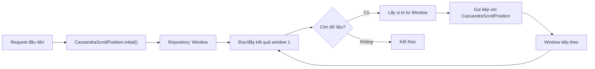
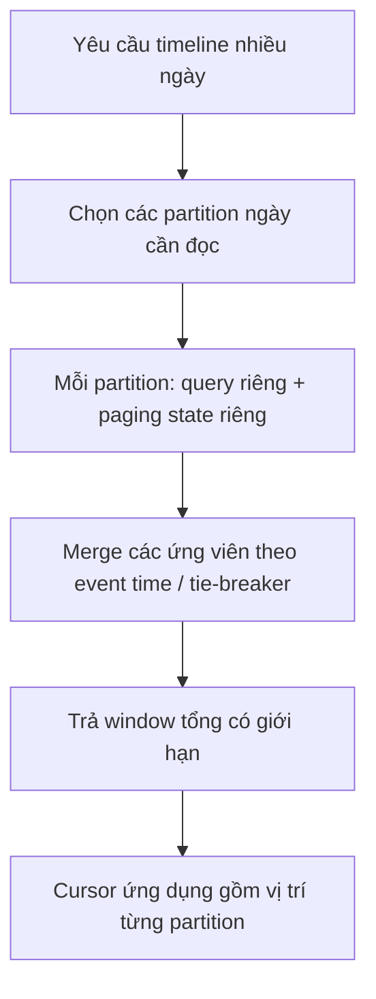

# CassandraScrollPosition và điều kiện phiên bản hỗ trợ scrolling

Khi một ứng dụng Spring Data Cassandra phải đọc nhiều bản ghi, có ba yêu cầu dễ bị nhầm lẫn: **chọn đúng những cột cần trả về (projection)**, **chia kết quả thành các phần nhỏ để xử lý (pagination)** và **tiếp tục đọc sau một vị trí đã biết (scrolling)**. Spring Data cung cấp khái niệm `Window<T>` và `ScrollPosition` cho scrolling; riêng Apache Cassandra có `CassandraScrollPosition`, là cách Spring Data bọc **paging state** của Cassandra. Cơ chế này khác cơ bản với `OFFSET` hoặc keyset scrolling thường thấy trong cơ sở dữ liệu quan hệ.

Bài thuộc chương **Chiếu và phân trang**, module **`SPRING_DATA_CASSANDRA`**. Trong module, chúng ta truy cập Cassandra bằng entity mapping, repository, `CassandraTemplate` và CQL; việc thiết kế bảng theo truy vấn, partition key, consistency level, paging và hiệu năng vẫn quyết định tính đúng của API. **CassandraScrollPosition không biến một truy vấn thiếu partition key thành truy vấn hợp lệ, và cũng không cung cấp snapshot giao dịch của toàn bộ dữ liệu đang thay đổi.**

**Sau bài này, bạn có thể:**

1. Hiểu `CassandraScrollPosition` lưu gì, khác `ScrollPosition.offset()` và keyset scrolling ở đâu.
2. Xác định **ngưỡng phiên bản** hỗ trợ: Spring Data Cassandra **4.2 trở lên** có lớp `CassandraScrollPosition`; module cũ không được giả định có API đó.
3. Khai báo repository trả `Window<T>` với `CassandraScrollPosition` và `Limit`, dùng `initial()` rồi lấy vị trí tiếp theo từ `Window`.
4. Phân biệt scrolling bằng `Window` với `Slice`/`CassandraPageRequest` và Java Driver paging.
5. Áp dụng giới hạn window, projection và kiểm soát consistency/timeout; xây cursor an toàn cho HTTP API.
6. Nhận biết những thay đổi query/schema, bucket dữ liệu hoặc môi trường khiến paging state không thể sử dụng lại một cách tùy tiện.

## 1. Scrolling là gì trong Spring Data?

Scrolling cho phép ứng dụng **đọc tuần tự qua những phần nhỏ của một tập kết quả lớn**. Thay vì lấy tất cả vào `List`, code nhận `Window<T>` chứa một nhóm phần tử và biết có thể tiếp tục hay không. Lần gọi kế tiếp mang theo `ScrollPosition` để đọc phần tiếp theo.



### Những thành phần cần biết

| Thành phần | Vai trò |
| --- | --- |
| `Window<T>` | Một nhóm phần tử đọc được trong một bước scrolling |
| `ScrollPosition` | Contract trừu tượng của Spring Data Commons về vị trí tiếp tục |
| `CassandraScrollPosition` | Implementation Cassandra-specific, **dùng paging state** |
| `Limit` | Mô tả giới hạn số phần tử truy vấn ở mức repository khi API hỗ trợ |
| `CassandraPageRequest` | `Pageable` riêng của Cassandra, cũng liên quan paging state nhưng dùng với `Slice` |
| `PagingState` của Java Driver | Trạng thái tiếp tục ở tầng CQL/driver, không phải số thứ tự trang |

**Không nên đồng nhất `Window` với `List` hoặc `Page`.** `List` chỉ chứa các phần tử, `Page` có contract hướng tới tổng số trang/phần tử, còn `Window` được thiết kế cho **duyệt tiến** từ vị trí hiện tại.

## 2. CassandraScrollPosition thực chất là gì?

Theo JavaDoc Spring Data Cassandra, lớp:

```java
org.springframework.data.cassandra.core.query.CassandraScrollPosition
```

là implementation của `org.springframework.data.domain.ScrollPosition`, lưu **vị trí liên quan đến Cassandra `PagingState`**. Nó không mã hóa `OFFSET 1000` và cũng không phải một map các giá trị keyset như `{occurredAt, eventId}`.

Những API cốt lõi trên nhánh **4.2+**:

```java
import java.nio.ByteBuffer;
import org.springframework.data.cassandra.core.query.CassandraScrollPosition;

// Vị trí bắt đầu đọc:
CassandraScrollPosition start = CassandraScrollPosition.initial();

// Giả sử continuationBytes đã được khôi phục từ một cursor tin cậy:
CassandraScrollPosition continuation =
        CassandraScrollPosition.of(ByteBuffer.wrap(continuationBytes));

// Chỉ đọc khi đây KHÔNG phải vị trí initial():
if (!continuation.isInitial()) {
    ByteBuffer buffer = continuation.getPagingState();
}
```

Đoạn ví dụ giả định biến `continuationBytes` đã được giải mã và xác thực bởi tầng ứng dụng. `getPagingState()` trả **`ByteBuffer` chỉ đọc**; gọi hàm trên `initial()` sẽ gây `IllegalStateException` vì chưa có paging state tiếp tục.

**Lưu ý phiên bản quan trọng:**

- `CassandraScrollPosition.initial()` và `of(ByteBuffer)` có trong API từ **4.2**.
- Một overload nhận trực tiếp đối tượng driver `PagingState` là **`CassandraScrollPosition.of(PagingState)`** được JavaDoc nhánh **5.0** đánh dấu thêm sau này. Không copy overload đó vào project **4.2–4.5** rồi kỳ vọng biên dịch.
- `getPagingState()` chỉ phù hợp cho continuation; không có bytes tiếp tục ở vị trí đầu tiên.

## 3. Điều kiện phiên bản: khi nào scrolling được hỗ trợ?

Không phải mọi ứng dụng Spring Boot dùng Spring Data đều có khả năng Cassandra scrolling theo kiểu `Window<T>`. **Spring Data Commons** có abstraction `ScrollPosition`/`Window`, nhưng module **Spring Data Cassandra** phải hỗ trợ đúng parameter type, mapping và cách chuyển Cassandra paging state.

| Phiên bản thành phần | Điều bạn có thể kỳ vọng | Cách xử lý |
| --- | --- | --- |
| **Spring Data Cassandra trước 4.2** | Không có `CassandraScrollPosition` theo JavaDoc (class có mốc **Since: 4.2**) | Dùng `CassandraPageRequest`/`Slice` hoặc Java Driver; không chép ví dụ scrolling 4.2+ |
| **Spring Data Cassandra 4.2.x** | Có `CassandraScrollPosition` và đường repository scrolling Cassandra-specific | Kiểm tra `Window`, `Limit`, `initial()`, `of(ByteBuffer)` trong dependency thực |
| **Spring Data Cassandra 4.3–4.5** | Có lớp scrolling và paging-state API trên cùng hướng thiết kế | Dùng JavaDoc tương ứng chính xác phiên bản, kiểm thử repository trên Cassandra thật |
| **Spring Data Cassandra 5.x** | Tiếp tục hỗ trợ scrolling; API có thể được bổ sung, chẳng hạn overload `of(PagingState)` từ 5.0 | Không trộn API 5.x với dependency 4.x khi chép mã |
| **Spring Data Commons** | Cung cấp `Window`, `ScrollPosition`, `Limit` | Chưa đủ để kết luận Cassandra module có scrolling |
| **Apache Cassandra Java Driver 4.x** | Hỗ trợ paging state ở tầng driver | Có thể dùng làm fallback nếu Spring Data module đang quá cũ |

### Đừng chỉ nhìn version Spring Boot trên README

Khi dự án sử dụng Spring Boot dependency management/BOM, phiên bản `spring-data-cassandra` và `spring-data-commons` thường được quản lý theo một release train. Nếu có **override dependency**, hai version có thể khác kỳ vọng. Vì vậy:

1. Xác định phiên bản **thực sự được resolve** của `spring-data-cassandra`.
2. Xác định phiên bản `spring-data-commons` và Java Driver tương ứng.
3. Kiểm tra IDE/Javadoc của chính dependency có class `CassandraScrollPosition` và chữ ký `Window<...>`.
4. Viết **integration test** chạy hai window liên tiếp; không lấy “code biên dịch được” làm bằng chứng runtime paging đúng.

Ví dụ một dự án Spring Boot 3.2 dùng BOM phù hợp thường đi cùng thế hệ Spring Data Cassandra 4.2, nhưng **không suy ngược từ số Boot nếu có override hoặc cấu hình tùy biến**. Cũng không nâng lẻ mỗi dependency Cassandra lên nhánh mới trong khi Commons/Framework vẫn cũ nếu chưa kiểm tra ma trận tương thích.

## 4. Phân biệt ba họ ScrollPosition

Spring Data Commons mô tả **offset scrolling** và **keyset scrolling** cho những kho dữ liệu có khả năng tương ứng. Cassandra cần được hiểu theo **paging state**.

| Kiểu | Cách xác định vị trí | Có phù hợp để truyền cho repository Cassandra scrolling? |
| --- | --- | --- |
| `OffsetScrollPosition` | Số lượng hàng đã bỏ qua/offset | **Không sử dụng như thay thế** cho Cassandra paging state |
| `KeysetScrollPosition` | Bộ giá trị của các cột sort/key từ hàng cuối | **Không tự động tương đương** Cassandra scroll của repository |
| `CassandraScrollPosition` | Paging state opaque của truy vấn Cassandra | **Đúng loại** cho Cassandra repository scrolling 4.2+ |

Ví dụ **không nên**:

```java
// Không giả định API Cassandra có OFFSET như SQL:
// repository.findByTenantId(tenantId, ScrollPosition.offset(1000));

// Cũng không giả định một keyset position của Commons
// tự chuyển thành CQL paging state cho Cassandra.
```

Nếu muốn **keyset pagination tự thiết kế** trên Cassandra, có thể dùng điều kiện trên clustering columns (`occurred_at < lastSeen`, tie-break theo `event_id`) theo schema phù hợp. Đó là **một thiết kế cursor khác**, không phải cách tạo `CassandraScrollPosition`.

## 5. Mô hình bảng xuyên suốt bài học

Giả sử API cần duyệt timeline sự kiện của một tenant trong một ngày theo thời gian giảm dần. Thiết kế bảng:

```sql
CREATE TABLE IF NOT EXISTS tenant_events_by_day (
    tenant_id uuid,
    event_day date,
    occurred_at timestamp,
    event_id uuid,
    event_type text,
    summary text,
    payload text,
    PRIMARY KEY ((tenant_id, event_day), occurred_at, event_id)
) WITH CLUSTERING ORDER BY (occurred_at DESC, event_id ASC);
```

**Tại sao thiết kế như vậy?**

- `(tenant_id, event_day)` là **partition key đầy đủ**; một lần đọc timeline được giới hạn trong một partition.
- `occurred_at` và `event_id` là **clustering columns**; Cassandra có thứ tự kết quả tự nhiên trong partition.
- `event_id` phân biệt những sự kiện có timestamp trùng nhau.
- `summary` là dữ liệu ngắn cho danh sách; `payload` có thể lớn, chỉ cần trong trang chi tiết.

Truy vấn CQL phù hợp:

```sql
SELECT tenant_id, event_day, occurred_at,
       event_id, event_type, summary, payload
FROM tenant_events_by_day
WHERE tenant_id = 5e039fd0-19a2-4be5-a60c-d104b6fae7c1
  AND event_day = '2026-11-25';
```

Về ý nghĩa, scrolling chia **kết quả truy vấn này** thành nhiều window. Nó không tự hỗ trợ `WHERE event_type = 'PAID'` nếu cột đó chưa có đường truy vấn/index phù hợp, cũng không tự gom tất cả các ngày của tenant thành một kết quả toàn cục.

## 6. Ánh xạ primary key tổng hợp bằng Spring Data Cassandra

Khóa Java:

```java
package example.timeline.data;

import java.io.Serializable;
import java.time.Instant;
import java.time.LocalDate;
import java.util.UUID;
import org.springframework.data.cassandra.core.cql.Ordering;
import org.springframework.data.cassandra.core.mapping.PrimaryKeyClass;
import org.springframework.data.cassandra.core.mapping.PrimaryKeyColumn;
import org.springframework.data.cassandra.core.mapping.PrimaryKeyType;

@PrimaryKeyClass
public class EventKey implements Serializable {

    @PrimaryKeyColumn(name = "tenant_id", ordinal = 0,
            type = PrimaryKeyType.PARTITIONED)
    private UUID tenantId;

    @PrimaryKeyColumn(name = "event_day", ordinal = 1,
            type = PrimaryKeyType.PARTITIONED)
    private LocalDate eventDay;

    @PrimaryKeyColumn(name = "occurred_at", ordinal = 2,
            type = PrimaryKeyType.CLUSTERED,
            ordering = Ordering.DESCENDING)
    private Instant occurredAt;

    @PrimaryKeyColumn(name = "event_id", ordinal = 3,
            type = PrimaryKeyType.CLUSTERED,
            ordering = Ordering.ASCENDING)
    private UUID eventId;

    public EventKey() {
    }

    // Bổ sung constructor/getter/setter/equals/hashCode.
}
```

Entity:

```java
package example.timeline.data;

import org.springframework.data.cassandra.core.mapping.Column;
import org.springframework.data.cassandra.core.mapping.PrimaryKey;
import org.springframework.data.cassandra.core.mapping.Table;

@Table("tenant_events_by_day")
public class TenantEvent {

    @PrimaryKey
    private EventKey key;

    @Column("event_type")
    private String eventType;

    @Column("summary")
    private String summary;

    @Column("payload")
    private String payload;

    public TenantEvent() {
    }

    // Bổ sung constructor/getter/setter cho các field.
}
```

Các đoạn là **ví dụ mapping tập trung vào annotation**, chưa phải hai compilation unit hoàn chỉnh. Trước khi chạy, cần bổ sung các thành viên Java, đặc biệt `equals`/`hashCode` cho khóa tổng hợp; cấu hình Spring scanning và schema phải khớp.

Thứ tự `ordinal` phải tương ứng thứ tự khóa trong `PRIMARY KEY`. Nếu mapping sai, sự cố có thể xảy ra **trước cả khi đến bước scroll**: repository tạo query không hợp lệ hoặc lấy dữ liệu sai.

## 7. Repository trả Window với CassandraScrollPosition

Đường repository scrolling được tài liệu **Spring Data Cassandra 4.2+** mô tả bằng chữ ký gồm **`Window<T>`**, **`CassandraScrollPosition`** và **`Limit`**.

Ví dụ theo kiểu khai báo truy vấn dẫn xuất:

```java
package example.timeline.data;

import java.time.LocalDate;
import java.util.UUID;
import org.springframework.data.cassandra.core.query.CassandraScrollPosition;
import org.springframework.data.domain.Limit;
import org.springframework.data.domain.Window;
import org.springframework.data.cassandra.repository.CassandraRepository;

public interface TenantEventRepository
        extends CassandraRepository<TenantEvent, EventKey> {

    Window<TenantEvent> findByKey_TenantIdAndKey_EventDay(
            UUID tenantId,
            LocalDate eventDay,
            CassandraScrollPosition position,
            Limit limit);
}
```

**Ý nghĩa chữ ký:**

1. `tenantId` và `eventDay` cung cấp **đầy đủ partition key** cho truy vấn.
2. `CassandraScrollPosition` là **special parameter**, không được hiểu là một cột Java để đưa vào `WHERE`.
3. `Limit` đặt số lượng mong muốn mỗi bước trong quá trình đọc; **giới hạn đầu vào ở tầng API** vẫn cần áp dụng.
4. `Window<TenantEvent>` chứa nhóm hàng được converter ánh xạ thành entity.

Tên method `Key_TenantId` và `Key_EventDay` chỉ rõ cách đi từ entity property `key` đến các property của khóa tổng hợp. Dùng dấu gạch dưới để tách ranh giới property path là convention của Spring Data; **cần integration test query được tạo** trên phiên bản Cassandra module đang dùng.

Đối với dự án có schema hoặc derived query phức tạp, dùng một query method `@Query` tường minh (nếu cơ chế scrolling tương ứng được module hỗ trợ cho dạng đó), hoặc một custom gateway. **Đừng dùng `@AllowFiltering` chỉ để ép tên method chạy** khi thiếu partition key.

## 8. Đọc window đầu tiên

Khi chưa có cursor:

```java
import java.time.LocalDate;
import java.util.UUID;
import org.springframework.data.cassandra.core.query.CassandraScrollPosition;
import org.springframework.data.domain.Limit;
import org.springframework.data.domain.Window;

UUID tenantId =
        UUID.fromString("5e039fd0-19a2-4be5-a60c-d104b6fae7c1");
LocalDate day = LocalDate.of(2026, 11, 25);

Window<TenantEvent> first = repository
        .findByKey_TenantIdAndKey_EventDay(
                tenantId, day,
                CassandraScrollPosition.initial(),
                Limit.of(20));

for (TenantEvent event : first) {
    // Đưa event vào DTO/phản hồi hoặc xử lý theo mục tiêu API.
}
```

Ở đây `CassandraScrollPosition.initial()` là **điểm bắt đầu**, không phải offset bằng 0 do client tự thiết lập. `Limit.of(20)` thể hiện kích thước mục tiêu của bước đọc; con số 20 là ngưỡng **minh họa**, phải kiểm chứng với payload thực tế.

Trong luồng HTTP, bạn nên trả **DTO chứa các field cần thiết**, không nhất thiết expose mọi thuộc tính của entity hoặc một cấu trúc `Window` đầy đủ cho client. Nếu window rỗng, thường kết thúc mà **không cần tạo continuation token**.

## 9. Lấy window tiếp theo từ vị trí cuối cùng

`Window` cung cấp `positionAt(index)` để lấy `ScrollPosition` do kết quả trả về. Với Cassandra repository 4.2+, vị trí liên quan đến paging state cần được xử lý như **`CassandraScrollPosition`**.

```java
Window<TenantEvent> window = repository
        .findByKey_TenantIdAndKey_EventDay(
                tenantId, day,
                CassandraScrollPosition.initial(),
                Limit.of(20));

if (!window.isEmpty() && !window.isLast()) {
    CassandraScrollPosition next =
            (CassandraScrollPosition) window.positionAt(window.size() - 1);

    Window<TenantEvent> second = repository
            .findByKey_TenantIdAndKey_EventDay(
                    tenantId, day, next, Limit.of(20));

    // Xử lý second; tiếp tục tương tự nếu còn kết quả.
}
```

**Điểm cần kiểm chứng bằng integration test:** đoạn code sử dụng `Window.positionAt(lastIndex)` theo contract scrolling của Spring Data. Hãy xác nhận repository tạo đúng `CassandraScrollPosition` và paging state được bảo toàn trong phiên bản của bạn. Không tự xây continuation bằng `ScrollPosition.offset(...)` hoặc dựa trên `window.size()` như “số hàng đã bỏ qua”.

### Vòng lặp xử lý với giới hạn an toàn

```java
int maxWindows = 10; // Giới hạn do nghiệp vụ/worker quyết định.
int count = 0;
CassandraScrollPosition position = CassandraScrollPosition.initial();

while (count < maxWindows) {
    Window<TenantEvent> window = repository
            .findByKey_TenantIdAndKey_EventDay(
                    tenantId, day, position, Limit.of(20));

    if (window.isEmpty()) {
        break;
    }

    for (TenantEvent item : window) {
        // Ghi nhận/xử lý phần tử, tránh gom vô hạn trong heap.
    }
    count++;

    if (window.isLast()) {
        break;
    }
    position = (CassandraScrollPosition)
            window.positionAt(window.size() - 1);
}
```

Vòng lặp này chỉ minh họa hướng **scroll forward**; ở production cần thêm timeout, cancellation, metrics, giới hạn tổng hàng/byte và xử lý lỗi theo nghiệp vụ. `WindowIterator` của Spring Data Commons có thể giúp bỏ boilerplate khi version/module tương thích, nhưng **không nên dùng nó mà quên chặn số window, backpressure và giới hạn công việc**.

## 10. Tại sao không tự tạo cursor bằng OFFSET?

Trong database quan hệ, có thể thấy:

```sql
-- Minh họa SQL quan hệ, KHÔNG phải mẫu paging Cassandra:
SELECT ... ORDER BY occurred_at DESC
OFFSET 1000 ROWS FETCH NEXT 20 ROWS ONLY;
```

Cassandra không hỗ trợ truy cập trang theo offset tùy ý với semantics/chi phí tương đương. Cách phổ biến là dùng paging state của query, hoặc tự thiết kế keyset theo clustering columns.

| Câu hỏi | Offset (SQL) | Cassandra paging state |
| --- | --- | --- |
| Trang sau ở đâu? | Số lượng dòng đã bỏ qua | Vị trí tiếp tục opaque do Cassandra/driver cung cấp |
| Nhảy thẳng trang 1000? | Có cú pháp, nhưng có thể rất tốn | **Không** có phép nhảy trực tiếp theo số trang |
| Có thể cộng `+20` vào cursor? | Thường có thể cộng offset | **Không**: paging state không phải số |
| Thay `WHERE`/`ORDER BY` rồi dùng lại cursor? | Truy vấn mới có offset riêng | **Không an toàn/không hợp lệ** với cursor cũ |
| Bảo đảm snapshot bất biến? | Không mặc nhiên | **Không** |

Do đó `CassandraScrollPosition` chỉ đại diện cho **vị trí tiếp tục của một query cụ thể**, không phải mã thứ tự của hàng trong một timeline vĩnh viễn.

## 11. So sánh Window và Slice/CassandraPageRequest

Ngay cả khi không có `CassandraScrollPosition`, Spring Data Cassandra đã có hỗ trợ **`Slice` và `CassandraPageRequest`** để duyệt kết quả.

| Mục tiêu | `Window<T>` + `CassandraScrollPosition` | `Slice<T>` + `CassandraPageRequest` |
| --- | --- | --- |
| Abstraction | Spring Data scrolling | Spring Data pagination |
| Trạng thái tiếp tục | Cassandra paging state trong scroll position | Cassandra paging state trong `Pageable` chuyên biệt |
| Bắt đầu | `CassandraScrollPosition.initial()` | `CassandraPageRequest.first(n)` |
| Tiếp tục | `Window.positionAt(lastIndex)` | `Slice.nextPageable()` |
| Sản phẩm trả về | `Window<T>` | `Slice<T>` |
| Điều kiện phiên bản | **Từ Cassandra 4.2** đối với lớp scroll | Có ở những phiên bản cũ hơn; kiểm tra API cụ thể |
| Truy cập trang ngẫu nhiên | Không | Không |

Ví dụ `Slice`:

```java
import org.springframework.data.cassandra.core.query.CassandraPageRequest;
import org.springframework.data.domain.Pageable;
import org.springframework.data.domain.Slice;

public interface TenantEventSliceRepository
        extends CassandraRepository<TenantEvent, EventKey> {

    Slice<TenantEvent> findByKey_TenantIdAndKey_EventDay(
            UUID tenantId, LocalDate eventDay, Pageable pageRequest);
}
```

Đọc các trang:

```java
Slice<TenantEvent> slice = sliceRepository
        .findByKey_TenantIdAndKey_EventDay(
                tenantId, day, CassandraPageRequest.first(20));

while (true) {
    // Xử lý slice.getContent(); không gom mọi slice vào bộ nhớ.
    if (!slice.hasNext()) {
        break;
    }
    slice = sliceRepository.findByKey_TenantIdAndKey_EventDay(
            tenantId, day, slice.nextPageable());
}
```

Code `Slice` trên chỉ để thấy **đường thay thế**, chưa thêm chính sách số trang tối đa. Nếu dùng trong job thực, phải có giới hạn kết quả, timeout và yêu cầu hủy tương tự như Window.

**Đặc điểm riêng:** ở những API hỗ trợ, `CassandraPageRequest.getScrollPosition()` cũng đã được thêm **từ 4.2**, giúp truy cập vị trí Cassandra-specific, nhưng không có nghĩa mọi `PageRequest` chung đều chứa paging state hợp lệ.

## 12. Window và Page: có cần tổng số bản ghi?

Với Cassandra, truy vấn `COUNT(*)` trên dữ liệu lớn có thể rất tốn chi phí, nhất là nếu phải scan nhiều partition. Màn hình chỉ có nút **“Xem thêm”** thường không cần tổng số trang.

- `Window` phù hợp khi muốn **duyệt tiếp từ một vị trí** và biết có phần tiếp theo hay không.
- `Slice` phù hợp khi muốn **trang tiếp theo** mà không nhất thiết tính tổng số hàng.
- `Page` có contract tổng số phần tử/trang; trong Cassandra, tính tổng trên bảng lớn có thể không thực tế nếu không có bảng tổng hợp hoặc cách lưu số liệu riêng.

Không phải mọi repository Cassandra đều hỗ trợ cùng mọi kiểu return như JPA. Phải kiểm tra **module/version** thay vì chỉ thấy `Page`, `Window` trong API chung của Spring Data Commons.

### Giới hạn window không thay thế giới hạn request

Một `Limit.of(20)` là giới hạn một bước đọc. Nếu controller tiếp tục vòng lặp 50.000 lần trong cùng HTTP request, nó vẫn có thể đọc rất nhiều dữ liệu. Hãy áp dụng **cả**:

1. Max rows/window.
2. Max windows/request hoặc max total rows.
3. Max response bytes.
4. Timeout/cancellation và concurrency cap.
5. Chính sách rate limit theo tenant/endpoint.

## 13. Projection giúp giảm payload khi scrolling

Một bảng có thể chứa cột `payload` lớn hoặc UDT/tuple phức tạp. Nếu màn hình timeline chỉ cần timestamp, event type và summary, việc đọc cả payload làm tăng I/O, network và CPU mapping trong mỗi window.

**CQL chọn cột cần thiết:**

```sql
SELECT tenant_id, event_day, occurred_at, event_id,
       event_type, summary
FROM tenant_events_by_day
WHERE tenant_id = ? AND event_day = ?;
```

**Interface projection** trong Spring Data có thể có dạng:

```java
package example.timeline.data;

import java.time.Instant;
import java.util.UUID;

public interface EventSummaryView {
    // Cách lấy thuộc tính khóa lồng nhau cần phù hợp mapping cụ thể.
    EventKey getKey();
    String getEventType();
    String getSummary();
}
```

Với những cấu hình/projection được module hỗ trợ, repository có thể trả về `Window<EventSummaryView>` thay vì full entity. Nhưng **không mặc định** interface projection sẽ làm Cassandra SELECT ít cột hơn trong tất cả tình huống: closed projection, open projection, nested property và cách dựng truy vấn của Spring Data version có thể ảnh hưởng cột thực sự được chọn.

Nếu mục tiêu giảm byte là quan trọng, hãy:

1. Kiểm tra **CQL phát sinh** và những column được SELECT.
2. So sánh `Row`, payload bytes và độ trễ, không chỉ kích thước DTO JSON.
3. Dùng `@Query`/`CqlOperations` để chọn column tường minh khi cần.
4. Giữ các thành phần khóa/tie-breaker cần thiết nếu mapper hoặc cursor logic dựa vào chúng.

**Projection và scrolling giải quyết hai vấn đề khác nhau:** projection giảm **bề rộng mỗi hàng**, scrolling giới hạn **số hàng xử lý trong một lần**. Kết hợp đúng có thể cải thiện cả latency, heap và throughput.

## 14. Paging state phải gắn với chính truy vấn tạo ra nó

Hãy tưởng tượng request đầu tiên:

```text
tenantId = A
eventDay = 2026-11-25
limit = 20
projection = eventId + occurredAt + eventType
sort = clustering order của bảng
```

Ứng dụng nhận một continuation position. Nếu request thứ hai thay thành:

```text
tenantId = B
eventDay = 2026-11-24
limit = 100
sort = một thứ tự khác
```

thì **không được tùy tiện dùng lại position cũ**. Paging state được tạo cho một câu CQL/statement và các tham số cụ thể. Cố gắn nó vào truy vấn khác có thể bị driver/Cassandra từ chối hoặc tạo kết quả không đúng.

### Những giá trị phải được gắn vào cursor context

| Trường dữ liệu | Vì sao cần ràng buộc |
| --- | --- |
| Tenant/principal | Chặn dùng cursor đọc dữ liệu của tenant khác |
| Query identity/phiên bản API | Bảo đảm tiếp tục đúng loại truy vấn |
| Partition key (tenant + ngày) | Không chuyển cursor giữa hai partition không liên quan |
| Bộ lọc hợp lệ | Tránh lấy paging state của điều kiện này gắn sang điều kiện khác |
| Sort/clustering direction | Đổi thứ tự có thể làm sai continuation |
| Projection/schema version | Đổi câu SELECT hoặc mapping có thể không còn tương thích |
| Window size/limits | Ràng buộc chính sách giới hạn cho request kế tiếp |
| Issued-at/expiry | Không duy trì cursor vô thời hạn |

**Một cursor nên được coi là dữ liệu opaque, không đáng tin cậy nếu được gửi từ client.** Không sử dụng trực tiếp bytes chưa xác minh để thực thi truy vấn hoặc cho rằng việc có paging state đã chứng minh caller có quyền đọc.

## 15. Serialize CassandraScrollPosition cho HTTP API

`CassandraScrollPosition.getPagingState()` trả về `ByteBuffer` dạng **read-only** khi có continuation. Nếu muốn cung cấp token cho HTTP client, ứng dụng thường cần chuyển bytes sang một chuỗi opaque (ví dụ Base64 URL-safe) rồi **bảo vệ tính toàn vẹn và phạm vi truy cập**.

### Chuyển ByteBuffer thành bytes

```java
import java.nio.ByteBuffer;

static byte[] copyPagingState(CassandraScrollPosition position) {
    if (position.isInitial()) {
        throw new IllegalArgumentException(
                "Initial position has no paging-state bytes");
    }

    ByteBuffer copy = position.getPagingState().asReadOnlyBuffer();
    byte[] bytes = new byte[copy.remaining()];
    copy.get(bytes);
    return bytes;
}
```

Hàm trên chỉ **sao chép bytes** và chưa làm thành một token HTTP an toàn. Có thể encode/decode bằng Base64 URL-safe:

```java
import java.nio.ByteBuffer;
import java.util.Base64;

String encoded = Base64.getUrlEncoder()
        .withoutPadding()
        .encodeToString(copyPagingState(nextPosition));

byte[] decoded = Base64.getUrlDecoder().decode(encoded);
CassandraScrollPosition next =
        CassandraScrollPosition.of(ByteBuffer.wrap(decoded));
```

**Cực kỳ quan trọng:** ví dụ Base64 chỉ trình bày kỹ thuật chuyển đổi bytes, **không phải thiết kế token production**. Base64 không mã hóa bí mật và không ngăn client sửa token. Khi triển khai thực tế cần HMAC/chữ ký hoặc mã hóa có xác thực, ràng buộc token với tenant/query shape, áp hạn và giới hạn chiều dài bytes trước khi parse/allocate.

### Hình dạng token logic nên có

```text
tokenVersion
queryVersion
tenantBinding
partitionKeyContext / filter fingerprint
windowLimit
issuedAt / expiresAt
pagingStateBytes
integrityTag (HMAC hoặc AEAD tag)
```

**Không nên gửi raw driver paging state rồi xem nó là credential độc lập**. Authorization phải được xác minh ở **mỗi request**. Nếu một cursor cần không thể bị đọc bởi client, chọn giải pháp mã hóa xác thực (AEAD) hoặc lưu server-side và chỉ phát ID tham chiếu ngắn.

## 16. Cursor có bền vững như khóa chính không?

Không. Cassandra paging state là **trạng thái tiếp tục của một query**, không phải một khóa định danh hàng vĩnh viễn. Không nên xem nó như:

- Mã page số 500 có thể tính toán trực tiếp.
- Bookmark vĩnh viễn sống qua mọi migration và nâng cấp driver/server.
- Bằng chứng dữ liệu không bị thay đổi giữa hai request.
- Token có thể đổi sang query/partition/cluster khác mà vẫn đúng.

Các thay đổi có thể làm continuation không còn phù hợp:

1. `CREATE/ALTER TABLE` thay đổi schema hoặc cách đọc cột.
2. Thay đổi projection hoặc phiên bản API/CQL.
3. Thay đổi partition key, số bucket, clustering order.
4. Chuyển sang keyspace/cluster khác hoặc nâng cấp môi trường có khác biệt giao thức.
5. Dữ liệu bị chèn/xóa/TTL, làm nội dung kết quả ở các trang khác thời điểm không còn ổn định.

**Chính sách ứng dụng nên có mã lỗi “cursor expired/invalid” rõ ràng**, cho phép client bắt đầu lại từ đầu hoặc theo một cursor nghiệp vụ được thiết kế khác. Không cố ép bytes cũ qua mọi release bằng cách tắt kiểm tra.

## 17. Scrolling không bảo đảm snapshot nhất quán dài hạn

Giả sử trang đầu tiên đọc được 20 event gần nhất. Trước khi client lấy trang thứ hai:

- Một event mới được thêm vào cùng partition.
- Một số event cũ được xóa/TTL hết hạn.
- Một backfill thêm dữ liệu với timestamp quá khứ.
- Replica phản hồi khác nhau tùy consistency level và trạng thái đồng bộ.

Vì vậy các trang của một quy trình scrolling **không mặc nhiên tạo thành snapshot cố định** của toàn bộ bảng. Với những dữ liệu thay đổi liên tục, có thể có tình huống trang bị lệch so với kỳ vọng theo thời gian.

### Nếu cần export/đối soát chính xác

Với một job cần không bỏ sót/không xử lý trùng:

1. Quy định **khoảng dữ liệu đóng** (ví dụ các event trước một watermark ingestion).
2. Chọn khóa và thứ tự duyệt ổn định, có tie-breaker.
3. Chấp nhận hoặc giải quyết at-least-once khi có retry, checkpoint và idempotency theo event ID.
4. Không giả định cursor native đồng nghĩa transaction snapshot.
5. Kiểm tra consistency level, retention/TTL và khả năng compaction xóa dữ liệu trước khi job hoàn thành.

Trong những trường hợp yêu cầu **resume rất lâu sau khi job dừng** hoặc có migration liên tục, một **cursor nghiệp vụ theo clustering keys** hay bảng job checkpoint có thể dễ quản lý hơn một paging state được giữ vô thời hạn.

## 18. Thay thế bằng keyset theo clustering columns khi cần

Đây là kỹ thuật **khác `CassandraScrollPosition`**, nhưng hữu ích để hiểu giới hạn của scrolling native. Với bảng:

```sql
PRIMARY KEY ((tenant_id, event_day), occurred_at, event_id)
WITH CLUSTERING ORDER BY (occurred_at DESC, event_id ASC)
```

Nếu cursor logic lưu `lastOccurredAt` và `lastEventId`, bạn có thể thiết kế truy vấn theo **thứ tự clustering hợp lệ**. Với nhiều clustering columns có hướng sort kết hợp, câu CQL range phải tuân thủ quy tắc thứ tự/tuple restrictions của Cassandra; **không tự copy SQL “(time, id) < (...)” từ RDBMS** mà chưa kiểm tra CQL/schema.

Một ví dụ đơn giản hơn với bảng có clustering column đơn:

```sql
CREATE TABLE IF NOT EXISTS simple_events_by_day (
    tenant_id uuid,
    event_day date,
    event_id timeuuid,
    summary text,
    PRIMARY KEY ((tenant_id, event_day), event_id)
) WITH CLUSTERING ORDER BY (event_id DESC);
```

Đường đọc sau một marker có thể là:

```sql
SELECT event_id, summary
FROM simple_events_by_day
WHERE tenant_id = ?
  AND event_day = ?
  AND event_id < ?
LIMIT 20;
```

Ví dụ dựa vào `timeuuid` có khả năng sắp xếp theo thời điểm được nhúng trong ID, nhưng hệ thống vẫn phải định nghĩa cách tạo ID và tie-breaking đúng. Đây là **keyset cursor do ứng dụng tự quản lý**, không phải `CassandraScrollPosition`; đổi lại bạn có thể giữ marker nghiệp vụ bền hơn trong một số tình huống, với chi phí tự thiết kế semantics.

### Bảng so sánh hai loại cursor

| Vấn đề | CassandraScrollPosition | Keyset tự thiết kế |
| --- | --- | --- |
| Vị trí | Opaque paging state | Giá trị khóa/clustering cuối |
| Integration Spring Data 4.2+ | `Window` thuận tiện | Thường tự viết query/DAO |
| Bám vào cùng query | Rất chặt | Phải giữ cùng thứ tự và điều kiện hợp lệ |
| Khả năng resume sau migration | Không nên kỳ vọng vô thời hạn | Có thể phù hợp hơn nếu key/schema ổn định |
| Rủi ro bỏ sót/trùng khi dữ liệu đổi | Vẫn tồn tại | Vẫn tồn tại, cần watermark/idempotency |
| Độ phức tạp ứng dụng | Thấp hơn với luồng scrolling chuẩn | Cao hơn vì tự xây cursor/query |

## 19. Scrolling qua nhiều partition/bucket

Trong ví dụ, dữ liệu bucket theo ngày. Muốn “100 event mới nhất của tenant trong **7 ngày**”, bạn không thể chỉ thay `eventDay` bằng null rồi dùng lại một `CassandraScrollPosition`.

Giải pháp có thể là:



Ứng dụng cần:

- Cap số ngày/bucket và số truy vấn đồng thời.
- Theo dõi paging state **riêng cho mỗi truy vấn partition**.
- Merge với thứ tự toàn cục có tie-breaker đủ rõ.
- Không dùng paging state partition A để tiếp tục partition B.
- Ràng buộc cursor với tập ngày được yêu cầu và quyền truy cập tenant.

Nếu đây là API quan trọng, cân nhắc **bảng theo truy vấn timeline nhiều ngày** với bucket phù hợp hơn, thay vì fan-out nhiều partition mỗi lần kéo xuống. Việc chọn bảng là quyết định data modeling, không phải lựa chọn `Window` hay `Slice`.

## 20. LIMIT, page size và Window size không hoàn toàn giống nhau

Ba khái niệm thường bị trộn:

| Cơ chế | Phạm vi | Điều cần nhớ |
| --- | --- | --- |
| CQL `LIMIT 100` | Số hàng tối đa của **một câu SELECT** | Không phải số page; vẫn có thể đọc tombstone trước khi trả hàng sống |
| Driver `setPageSize(20)` | Số hàng mục tiêu mỗi **fetch page** | Một truy vấn có thể còn trang tiếp |
| Repository `Limit.of(20)` trong phương thức scrolling | Giới hạn số kết quả của bước truy vấn theo API Spring Data | Cách tạo CQL và paging state phụ thuộc module/version |
| `Window<T>` | Nhóm phần tử và khả năng tiếp tục | Không đồng nghĩa một lần network round-trip trong mọi cấu hình |

Khi implementation scrolling sử dụng paging state, việc tiếp tục phải dùng **position do framework trả về**, không tự tính page bằng cách nhân `limit * pageIndex`.

### Có thể tăng Limit ở trang sau không?

Không nên tự do đổi kích thước window giữa các request khi bạn đang tái sử dụng cursor đã ký theo một query shape/giới hạn cũ. Tính hợp lệ của paging state gắn với truy vấn/các tùy chọn thực thi; hãy **cố định window size trong cursor contract** hoặc chứng minh sự thay đổi an toàn theo driver/phiên bản bằng integration test.

**Một cursor đã tạo cho query có `LIMIT` cụ thể không phải giấy phép đổi `LIMIT` và tiếp tục như chưa có gì xảy ra.**

## 21. Hiệu năng và giới hạn an toàn

Một ứng dụng kéo liên tục 20 hàng mỗi lần có thể làm nhiều request hơn khi tổng dữ liệu rất lớn. Mặt khác, một window chứa 10.000 hàng có thể làm tăng heap, network và độ trễ response.

Các yếu tố cần đo:

| Chỉ số | Câu hỏi |
| --- | --- |
| Latency p50/p95/p99 | Mỗi window trả về trong bao lâu? |
| Số hàng/bytes window | Một row có cột payload/UDT/tuple lớn không? |
| QPS theo tenant/partition | Có hot tenant/day gây tải trên cùng replica không? |
| Tombstones scanned | `LIMIT 20` có phải quét nhiều xóa/TTL trước khi tìm đủ hàng? |
| Timeout/retry | Request tiếp tục bị retry gây tải trùng không? |
| In-flight requests | Job có điều phối quá nhiều window song song không? |
| CPU/GC ứng dụng | Converter/projection có xử lý các object lớn không? |
| Compaction/I/O node | Tập dữ liệu có quá nhiều mutation/xóa không? |

**Đặc biệt:** `Window` không tự giải quyết hot partition. Nếu một tenant/ngày có quá nhiều event, hãy xem lại bucket theo giờ/loại workload; scrolling chỉ giúp **giới hạn số kết quả xử lý ở client**.

### Giới hạn ví dụ cho HTTP API

- Tối đa **50 hàng** mỗi lần kéo.
- Không cho query sang hơn **7 bucket ngày** trong một lần gọi.
- Cursor hết hạn sau một khoảng thời gian ngắn được hệ thống quy định.
- Rate limit theo tenant và giới hạn số request đang xử lý.
- Chỉ chọn projection cần thiết, giảm payload.

Các ngưỡng trên **không phải giá trị chuẩn của Cassandra**; phải benchmark với dữ liệu đại diện, kích thước partition và mục tiêu SLA của dự án.

## 22. Kiểm tra phiên bản hỗ trợ: checklist triển khai

Trước khi dùng code scrolling trong repository, kiểm tra:

1. **Spring Data Cassandra** có phải nhánh **4.2+** không?
2. **Spring Data Commons** có `Window`, `ScrollPosition` và `Limit` tương thích không?
3. IDE/JavaDoc có `org.springframework.data.cassandra.core.query.CassandraScrollPosition` không?
4. Trong class có `initial()`, `of(ByteBuffer)`, `isInitial()`, `getPagingState()` không?
5. Nếu sử dụng `of(PagingState)`, phiên bản có phải **5.0+** không?
6. Repository có chấp nhận method `Window<T> findBy...(CassandraScrollPosition, Limit)` không?
7. Query đã cung cấp **đầy đủ partition key** và clustering order phù hợp chưa?
8. Có kiểm thử window 1 → positionAt(last) → window 2 không trùng/mất ở dữ liệu tĩnh không?
9. Có xử lý **empty window**, window cuối cùng, invalid cursor và client retry không?
10. Có integration test với **schema, driver và cluster Cassandra** mà ứng dụng thực sự dùng không?
11. Đã kiểm tra **Spring Boot BOM** có bị override dependency không?
12. Nếu module cũ chưa hỗ trợ scrolling, đã chọn `Slice`/`CassandraPageRequest` hoặc driver fallback chưa?

### Bảng quyết định nâng cấp

| Tình huống | Lựa chọn |
| --- | --- |
| Project đang ở Spring Data Cassandra 4.1 hoặc thấp hơn | Chưa có `CassandraScrollPosition`; dùng `Slice`/`CassandraPageRequest` hoặc driver |
| Project ở Cassandra 4.2+ và cần scroll forward qua một partition | Dùng `Window` + `CassandraScrollPosition` nếu integration test PASS |
| Project đang dùng `Slice` ổn định, không cần đổi API | Tiếp tục `Slice`; không nâng cấp chỉ vì tên mới |
| Cần đọc async với backpressure/chuyên biệt của driver | Đánh giá API async/reactive hoặc `CqlSession` |
| Muốn nhảy tới trang 5000 bằng offset | Xem lại yêu cầu API; native Cassandra paging không hỗ trợ random jump như vậy |
| Cursor phải sống lâu qua nhiều migration | Cân nhắc keyset/checkpoint nghiệp vụ thay vì giữ raw paging state lâu |

## 23. Fallback khi không có CassandraScrollPosition

Nếu dependency **chưa có class `CassandraScrollPosition`**, bạn **không thể chỉ thêm một import từ Spring Data Commons** để có scrolling Cassandra-specific. Các lựa chọn:

**Lựa chọn A — Repository `Slice` + `CassandraPageRequest`:** phù hợp với những dự án Spring Data Cassandra cũ có khả năng pagination đã dùng được.

**Lựa chọn B — Java Driver 4.x:** dùng một `CqlSession` được Spring quản lý, prepared statement với đầy đủ partition key, và nhận/tiếp tục paging state theo API driver.

Ví dụ driver **đọc trang bất đồng bộ**:

```java
import java.util.concurrent.CompletionStage;
import com.datastax.oss.driver.api.core.cql.AsyncResultSet;
import com.datastax.oss.driver.api.core.cql.BoundStatement;
import com.datastax.oss.driver.api.core.cql.Row;

BoundStatement statement = prepared.bind(tenantId, day)
        .setPageSize(20);

CompletionStage<AsyncResultSet> stage =
        session.executeAsync(statement);

stage.thenCompose(page -> {
    for (Row row : page.currentPage()) {
        // Chuyển row sang DTO, giới hạn memory/bytes.
    }
    if (page.hasMorePages()) {
        return page.fetchNextPage();
    }
    return java.util.concurrent.CompletableFuture.completedFuture(page);
});
```

Ví dụ chỉ minh họa **cách gọi page đầu và một page kế**; để đi qua toàn bộ kết quả cần điều phối bất đồng bộ có giới hạn và xử lý lỗi/cancellation. Không viết vòng lặp recursion async vô hạn cho endpoint HTTP. Driver vẫn dùng **paging state**, không có OFFSET tùy ý.

**Lựa chọn C — Keyset cursor:** khi schema/clustering phù hợp và cần bookmark nghiệp vụ bền hơn, tạo query range theo clustering key, bao gồm tie-breaker và giới hạn.

**Không nên:** downgrade/upgrade ngẫu nhiên `spring-data-cassandra` mà không kiểm tra compatibility; không ép `OffsetScrollPosition` vào Cassandra; không dùng `ALLOW FILTERING` làm đường dự phòng cho truy vấn thiếu khóa.

## 24. Những lỗi thường gặp

| Triệu chứng | Nguyên nhân có thể | Hướng xử lý |
| --- | --- | --- |
| IDE không tìm thấy `CassandraScrollPosition` | Spring Data Cassandra **trước 4.2** hoặc dependency sai | Kiểm tra resolved version/BOM, dùng fallback |
| Có `ScrollPosition` nhưng repository Cassandra không chấp nhận | Commons có API chung nhưng module không hỗ trợ chữ ký | Dùng đúng `CassandraScrollPosition`/version |
| `getPagingState()` ném exception ngay lần đầu | Gọi trên `initial()` | Chỉ đọc bytes từ continuation |
| Cursor từ tenant A được dùng cho tenant B | Không ràng buộc token với quyền/partition | Ký token, kiểm tra tenant và query context |
| Cursor trang 2 bị từ chối | Query/filter/sort/schema/driver context thay đổi | Bắt đầu lại, kiểm tra contract cursor |
| Đọc bị trùng/thiếu khi dữ liệu đổi | Mong đợi snapshot mà Cassandra không cung cấp | Watermark/idempotency/keyset/checkpoint nếu cần |
| `Window` trả rỗng | Partition không có hàng hoặc đã duyệt hết | Kết thúc, không truy cập `positionAt(-1)` |
| `positionAt(...)` sai vị trí | Tự suy index/cast sai, dùng không phải window hiện tại | Lấy vị trí của **phần tử cuối window được trả về**, test |
| Query scrolling thiếu `event_day` | Composite partition key chưa đầy đủ | Bổ sung partition key, không dùng filtering |
| Trang quá lớn làm OOM | Window size và payload không giới hạn | Cap hàng/bytes, projection nhỏ |
| Scroll theo cột `event_type` chậm | Cột thường không có đường truy vấn phù hợp | Thiết kế bảng theo query/index |
| App muốn trang số 1000 ngay | Nhầm paging state với OFFSET | Thiết kế cursor forward hoặc API khác |
| Mất cursor qua deploy | Không có version/expiry/rollback strategy | Cursor versioned, chấp nhận restart an toàn |
| Lỗi khi dùng `of(PagingState)` trên 4.5 | Overload này được thêm từ 5.0 | Dùng `of(ByteBuffer)` với version 4.x |

## 25. Bài thực hành: đọc nhiều window an toàn

**Bước 1 — Tạo bảng** `tenant_events_by_day` như ở mục 5, trong keyspace thực hành và bảo đảm kết nối/replication phù hợp.

**Bước 2 — Ghi ít nhất 55 event** cho một `tenant_id`/`event_day`. Tạo giá trị `occurred_at` khác nhau để dễ kiểm tra thứ tự; dùng `event_id` UUID hợp lệ cho từng hàng.

**Bước 3 — Kiểm tra CQL theo khóa:**

```sql
SELECT tenant_id, event_day, occurred_at, event_id, event_type
FROM tenant_events_by_day
WHERE tenant_id = 5e039fd0-19a2-4be5-a60c-d104b6fae7c1
  AND event_day = '2026-11-25';
```

**Bước 4 — Xác nhận phiên bản** `spring-data-cassandra` có `CassandraScrollPosition` (4.2+). Nếu không có, thực hành `Slice` trước, không cố import class không tồn tại.

**Bước 5 — Gọi window đầu** với `CassandraScrollPosition.initial()` và `Limit.of(20)`; ghi lại số hàng, ID đầu/cuối và cờ `isLast()`.

**Bước 6 — Lấy window tiếp** từ `window.positionAt(window.size() - 1)`, ép kiểu Cassandra-specific theo API và truyền lại **cùng tenant, day, limit, sort**. Lặp lại cho đến khi hết dữ liệu (tối đa số window do bài tập đặt).

**Bước 7 — Kiểm tra kết quả:** trên dữ liệu tĩnh, nối các ID đã đọc rồi so sánh với tập dữ liệu nguồn: không ID trùng, không thiếu ID, thứ tự đúng clustering order, và xử lý trường hợp window cuối có ít hơn 20 hàng.

**Bước 8 — Kiểm tra vị trí đầu:** xác nhận `CassandraScrollPosition.initial().isInitial()` là true, không gọi `getPagingState()` trước khi có continuation.

**Bước 9 — Thử cursor sai:** giữ cursor của tenant/ngày A rồi đổi sang tenant/ngày B trong môi trường test. Ứng dụng production phải chặn ở tầng **cursor validation** trước khi truy cập database; không cần chờ driver báo lỗi.

**Bước 10 — Thử dữ liệu thay đổi:** thêm một event mới giữa window 1 và 2; ghi nhận việc native scrolling không hứa snapshot bất biến và thảo luận chiến lược watermark/idempotency.

**Bước 11 — So sánh projection:** đọc full entity có `payload` và một query chỉ chọn cột summary; đo bytes/latency với cùng window size và cùng dữ liệu.

**Bước 12 — Fallback:** lặp lại một phần bằng `Slice`/`CassandraPageRequest` hoặc Java Driver, đối chiếu semantics không có OFFSET và khả năng tiếp tục.

## 26. Câu hỏi tự kiểm tra

**Câu 1.** `CassandraScrollPosition` xuất hiện từ nhánh Spring Data Cassandra nào?

<details>
<summary>Gợi ý trả lời</summary>

Theo JavaDoc, **Since: 4.2**. Nếu project dùng 4.1 hoặc thấp hơn, không thể giả định import và repository scrolling API này có sẵn.
</details>

**Câu 2.** `ScrollPosition.offset(1000)` có thay thế được `CassandraScrollPosition` khi muốn trang thứ 1000 không?

<details>
<summary>Gợi ý trả lời</summary>

Không. Cassandra scrolling dựa trên paging state. Muốn đọc tới vị trí xa phải đi qua các phần dữ liệu tương ứng hoặc thiết kế query/cursor khác; không có bước nhảy offset hiệu quả như đang đếm hàng ở client.
</details>

**Câu 3.** `getPagingState()` có thể gọi trên `initial()` không?

<details>
<summary>Gợi ý trả lời</summary>

Không. Vị trí ban đầu chưa có paging state; `getPagingState()` trên initial ném `IllegalStateException`. Chỉ lấy bytes từ continuation.
</details>

**Câu 4.** Một `Window<T>` trả 20 hàng; muốn đọc tiếp, bạn nên dùng `ScrollPosition.offset(20)` hay vị trí từ `Window`?

<details>
<summary>Gợi ý trả lời</summary>

Dùng `window.positionAt(window.size() - 1)` theo contract Spring Data scrolling, rồi truyền vị trí Cassandra-specific vào lời gọi tiếp theo. Không tự cộng số hàng để tạo paging state.
</details>

**Câu 5.** Có thể dùng lại cursor của tenant A để truy cập tenant B không?

<details>
<summary>Gợi ý trả lời</summary>

Không. Phải ràng buộc cursor với quyền tenant, partition key, query shape và phiên bản; xác thực ở mỗi request. Raw paging state không phải chứng cứ quyền truy cập.
</details>

**Câu 6.** Vì sao scrolling và projection nên đi cùng nhau?

<details>
<summary>Gợi ý trả lời</summary>

Scrolling giới hạn số hàng xử lý từng lần; projection giảm số cột/byte phải truyền và giải mã. Hai cơ chế tối ưu hai chiều khác nhau của payload.
</details>

**Câu 7.** Spring Data Commons có `Window` thì có đủ để Spring Data Cassandra 4.1 hỗ trợ `CassandraScrollPosition` không?

<details>
<summary>Gợi ý trả lời</summary>

Không. Commons có abstraction chung; Cassandra-specific implementation/method binding phải được module Cassandra hỗ trợ. `CassandraScrollPosition` được thêm từ 4.2.
</details>

**Câu 8.** `CassandraScrollPosition.of(PagingState)` và `of(ByteBuffer)` có cùng điều kiện phiên bản không?

<details>
<summary>Gợi ý trả lời</summary>

Không. `of(ByteBuffer)` có ở nhánh 4.2+, còn overload `of(PagingState)` được JavaDoc ghi **Since: 5.0**. Hãy dùng API đúng phiên bản.
</details>

**Câu 9.** Có thể xem tất cả window nhận được là snapshot nhất quán duy nhất dù có thêm/xóa dữ liệu giữa các lần gọi không?

<details>
<summary>Gợi ý trả lời</summary>

Không. Paging state không cung cấp snapshot transaction dài hạn. Cần watermark, khóa thứ tự, checkpoint/idempotency hoặc cơ chế riêng khi yêu cầu dữ liệu ổn định.
</details>

**Câu 10.** Muốn timeline mới nhất trên 7 ngày, chỉ dùng một `CassandraScrollPosition` cho từng ngày nối tiếp có được không?

<details>
<summary>Gợi ý trả lời</summary>

Không nên. Mỗi partition/ngày là một truy vấn khác, có paging state riêng. Muốn kết quả chung phải fan-out có giới hạn và merge/cursor phù hợp, hoặc tạo bảng theo query timeline nhiều ngày.
</details>

## 27. Ghi nhớ

- **`CassandraScrollPosition` là vị trí scrolling riêng của Cassandra, dựa trên paging state**, không phải OFFSET hoặc keyset của Spring Data Commons.
- **Điều kiện phiên bản:** JavaDoc ghi **Since: Spring Data Cassandra 4.2**; `initial()` và `of(ByteBuffer)` phù hợp nhánh này. `of(PagingState)` là bổ sung từ **5.0**.
- Với repository hỗ trợ scrolling, mẫu chính là **`Window<T> findBy...(CassandraScrollPosition position, Limit limit)`**.
- **Bắt đầu bằng `CassandraScrollPosition.initial()`**; khi còn dữ liệu, tiếp tục bằng vị trí lấy từ **`Window.positionAt(lastIndex)`**, không tự tính offset.
- **`Window` khác `Slice`/`CassandraPageRequest`**, nhưng cả hai đều dùng cơ chế paging của Cassandra và chỉ phù hợp để **duyệt tiến**.
- **`getPagingState()` trên vị trí initial là không hợp lệ**. Paging state là bytes opaque phải gắn với query/tenant/version và được bảo vệ nếu đưa vào HTTP cursor.
- **Projection giảm độ rộng hàng; scrolling giảm số hàng mỗi lần xử lý**. Kết hợp hai cơ chế với partition key, limit và cap concurrency hợp lý.
- **Không có snapshot tự động và không có global cursor miễn phí xuyên nhiều partition**. Đòi hỏi lâu dài hoặc chính xác cao cần thiết kế watermark, checkpoint, keyset hoặc bảng khác.
- **Trước khi dùng trên production:** xác định dependency thực tế, kiểm thử hai window liên tiếp, empty/last window, tính tương thích cursor và hiệu năng trên dữ liệu đại diện.

### Tài liệu tham khảo

- [Spring Data Cassandra – Cassandra-specific Query Methods](https://docs.spring.io/spring-data/cassandra/reference/cassandra/repositories/query-methods.html)
- [Spring Data Cassandra 4.5 – CassandraScrollPosition JavaDoc (Since 4.2)](https://docs.spring.io/spring-data/cassandra/docs/4.5.x/api/org/springframework/data/cassandra/core/query/CassandraScrollPosition.html)
- [Spring Data Cassandra 5.0 – CassandraScrollPosition JavaDoc](https://www.springframework.org/spring-data/cassandra/reference/5.0/api/java/org/springframework/data/cassandra/core/query/CassandraScrollPosition.html)
- [Spring Data Cassandra – CassandraPageRequest JavaDoc](https://docs.spring.io/spring-data/cassandra/docs/current/api/org/springframework/data/cassandra/core/query/CassandraPageRequest.html)
- [Spring Data Commons – Scrolling](https://docs.spring.io/spring-data/commons/reference/repositories/scrolling.html)
- [Spring Data Cassandra – Object mapping](https://docs.spring.io/spring-data/cassandra/reference/object-mapping.html)
- [Apache Cassandra Java Driver – Paging](https://apache.github.io/cassandra-java-driver/4.18.0/core/paging/)
- [Apache Cassandra – Data modeling](https://cassandra.apache.org/doc/stable/cassandra/developing/data-modeling/intro.html)
