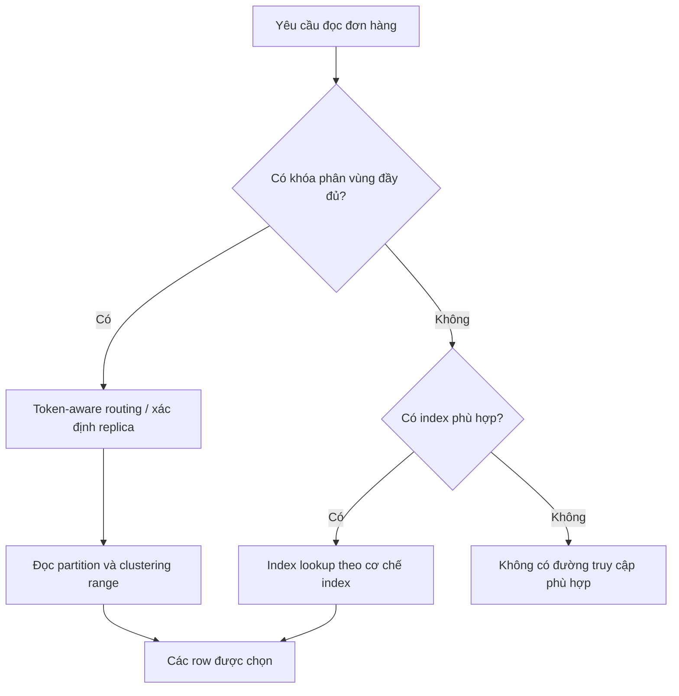
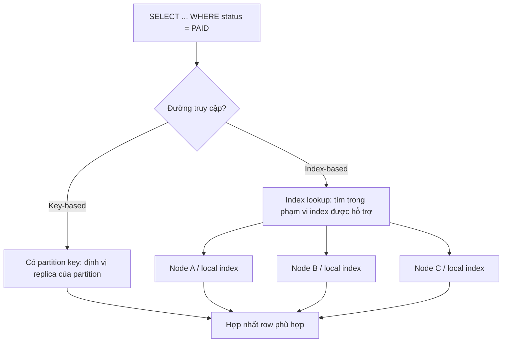

# Truy vấn theo khóa và vai trò của chỉ mục bổ sung

Khi bắt đầu với **Spring Data Cassandra**, lập trình viên thường quen viết repository method như `findByStatus("PAID")`, `findByCustomerId(...)` hoặc `findByCreatedAtAfter(...)`. Với cơ sở dữ liệu quan hệ, một truy vấn như vậy thường gợi ý dùng B-tree index hoặc tối ưu hóa của query planner. Nhưng với **Apache Cassandra**, câu hỏi phải đặt trước tiên là: **dữ liệu đang được chia vào những partition nào và điều kiện truy vấn có dẫn tới đúng partition đó không?**

Cassandra được thiết kế để phân phối dữ liệu trên nhiều node. **Partition key** xác định vị trí logic của dữ liệu và các replica cần tham gia. **Clustering columns** quyết định cách sắp xếp và tìm hàng bên trong partition. **Secondary index** hoặc các cơ chế tìm kiếm mở rộng có thể hỗ trợ một số kiểu lọc khác, nhưng không biến mọi truy vấn thành một phép tìm nhanh như trên cơ sở dữ liệu quan hệ.

Bài thuộc chương **Chỉ mục và mở rộng**. Chúng ta sẽ học cách:

- Thiết kế và nhận diện **truy vấn đi theo khóa** (*key-based access*).
- Hiểu vai trò của **secondary index truyền thống (2i)** và **Storage-Attached Index (SAI)** theo phiên bản/phân phối Cassandra.
- So sánh **index bổ sung** với **bảng read model được thiết kế theo query**.
- Phân biệt index với `ALLOW FILTERING`, `ORDER BY`, tính duy nhất và phân trang.
- Sử dụng Spring Data Cassandra repository, `CassandraTemplate` và CQL mà không vượt qua các ràng buộc của cluster.
- Đo độ chọn lọc, tải trên node, chi phí ghi và xử lý migration/index build trước khi triển khai production.

> **Thông điệp chính:** Trong Cassandra, **truy vấn theo partition key đầy đủ và clustering key phù hợp** thường là đường truy cập có chi phí dự đoán được nhất. **Index bổ sung là công cụ hỗ trợ có điều kiện**, không phải sự thay thế mặc định cho thiết kế bảng theo mẫu đọc.

## 1. Cassandra tìm dữ liệu theo cách nào?

Hãy tưởng tượng dịch vụ quản lý đơn hàng có hàng triệu đơn và nhiều tenant. Dữ liệu không nằm trong một bảng trung tâm trên một máy chủ duy nhất; Cassandra chia dữ liệu thành những **partition** rồi phân phối chúng trong cluster dựa trên token của partition key.

Một truy vấn như:

```sql
SELECT tenant_id, order_id, status
FROM commerce_ks.orders_by_id
WHERE tenant_id = 11111111-1111-1111-1111-111111111111
  AND order_id = 22222222-2222-2222-2222-222222222222;
```

có đầy đủ partition key của bảng mẫu sẽ được giới thiệu ở phần sau. Driver và coordinator có thể sử dụng thông tin khóa/metadata để định tuyến, liên hệ tập replica có trách nhiệm và thực hiện read theo consistency level.

Ngược lại:

```sql
SELECT tenant_id, order_id, status
FROM commerce_ks.orders_by_id
WHERE status = 'PAID';
```

không cung cấp partition key. Nếu không có cơ chế index/query phù hợp, Cassandra không có cách định vị một tập partition nhỏ chỉ từ regular column `status`.

### Sơ đồ về đường đọc



Đây là sơ đồ **logic**, không phải mô tả chính xác mọi bước của từng implementation. Index khác nhau có thể dùng cơ chế local lookup, phân phối request, filter hoặc paging khác nhau. Điều quan trọng là biết **đường truy cập thật** thay vì suy từ tên method Java.

## 2. Ba loại cột quan trọng: partition, clustering và regular

Một bảng Cassandra được thiết kế bằng **`PRIMARY KEY`**. Với khóa phân vùng tổng hợp, các cột nằm trong **cặp ngoặc đơn bên trong** tạo thành partition key; những cột đứng sau cặp ngoặc đó là clustering columns.

Ví dụ:

```sql
CREATE TABLE IF NOT EXISTS commerce_ks.order_events_by_customer_month (
    tenant_id uuid,
    customer_id uuid,
    bucket_month text,
    event_time timestamp,
    event_id uuid,
    order_id uuid,
    event_type text,
    summary text,
    PRIMARY KEY (
        (tenant_id, customer_id, bucket_month),
        event_time,
        event_id
    )
) WITH CLUSTERING ORDER BY (
    event_time DESC,
    event_id DESC
);
```

| Nhóm | Cột | Tác dụng trong bảng |
| --- | --- | --- |
| **Partition key** | `tenant_id`, `customer_id`, `bucket_month` | Xác định partition có các event của một khách trong một tháng |
| **Clustering columns** | `event_time`, `event_id` | Định danh/thứ tự các hàng trong partition |
| **Regular columns** | `order_id`, `event_type`, `summary` | Giá trị nghiệp vụ, không mặc nhiên là đường truy cập theo khóa |

Một partition có thể có nhiều hàng, được sắp theo thứ tự clustering đã khai báo. Điều đó làm truy vấn “25 sự kiện gần nhất của khách X trong tháng Y” phù hợp với bảng này.

```sql
SELECT event_time, event_id, order_id, event_type, summary
FROM commerce_ks.order_events_by_customer_month
WHERE tenant_id = 11111111-1111-1111-1111-111111111111
  AND customer_id = 33333333-3333-3333-3333-333333333333
  AND bucket_month = '2026-11'
LIMIT 25;
```

Đây là **truy vấn theo khóa**: không cần secondary index để xác định partition hay thực hiện thứ tự vốn đã có sẵn.

### Composite partition key cần được hiểu như một tổ hợp

Trong ví dụ, cả ba trường:

```text
(tenant_id, customer_id, bucket_month)
```

tạo nên **một partition key tổng hợp**. Chỉ có `tenant_id` chưa đủ để trỏ tới một partition cụ thể; chỉ có `tenant_id + customer_id` cũng chưa đủ khi `bucket_month` là thành phần còn lại.

Đừng đọc dấu ngoặc `((...))` trong CQL một cách hời hợt. Sự khác nhau giữa:

```sql
PRIMARY KEY ((tenant_id, customer_id, bucket_month), event_time)
```

và:

```sql
PRIMARY KEY (tenant_id, customer_id, bucket_month, event_time)
```

là **rất lớn**. Ở câu thứ hai, `tenant_id` là partition key đơn, còn những cột tiếp theo là clustering keys. Hai schema dẫn đến placement, cardinality và query patterns hoàn toàn khác.

## 3. Truy vấn theo partition key: đường ưu tiên

Cassandra phù hợp nhất khi ứng dụng có thể đưa **đầy đủ partition key** hoặc một đường token/key hợp lệ đã được thiết kế trước.

### Truy vấn một đơn theo định danh

Bảng:

```sql
CREATE TABLE IF NOT EXISTS commerce_ks.orders_by_id (
    tenant_id uuid,
    order_id uuid,
    customer_id uuid,
    status text,
    created_at timestamp,
    total_amount decimal,
    PRIMARY KEY ((tenant_id, order_id))
);
```

Một row được định danh bằng `(tenant_id, order_id)`:

```sql
SELECT customer_id, status, created_at, total_amount
FROM commerce_ks.orders_by_id
WHERE tenant_id = 11111111-1111-1111-1111-111111111111
  AND order_id = 22222222-2222-2222-2222-222222222222;
```

**Không cần index trên `order_id`** chỉ để phục vụ đường đọc này, vì nó đã nằm trong composite partition key và query cung cấp đầy đủ khóa.

Nếu API chỉ biết `order_id` mà không biết `tenant_id`, bạn có một vấn đề về **hợp đồng truy vấn và định danh**. Có thể cần truyền tenant từ ngữ cảnh xác thực hoặc thiết kế bảng lookup khác. Không nên tự tạo một index trên `order_id` rồi mặc định mọi truy vấn sẽ hiệu quả/đúng về phân quyền.

### Truy vấn nhiều hàng trong cùng partition

Bảng `order_events_by_customer_month` có nhiều event trong partition của khách/tháng. Query sử dụng:

```sql
WHERE tenant_id = ?
  AND customer_id = ?
  AND bucket_month = ?
```

và có thể thêm điều kiện theo **clustering columns** khi chúng tương thích quy tắc CQL.

Ví dụ giới hạn thời gian trong partition:

```sql
SELECT event_time, event_id, event_type, summary
FROM commerce_ks.order_events_by_customer_month
WHERE tenant_id = 11111111-1111-1111-1111-111111111111
  AND customer_id = 33333333-3333-3333-3333-333333333333
  AND bucket_month = '2026-11'
  AND event_time >= '2026-11-01T00:00:00Z'
LIMIT 25;
```

Bởi `event_time` là clustering column đầu tiên, đây là dạng điều kiện range hợp với đường đọc của partition. Muốn mở rộng điều kiện tới `event_id` phải tuân thủ quy tắc thứ tự/prefix của clustering và kiểm thử câu CQL cụ thể.

### Clustering order là thứ tự bên trong partition

```sql
WITH CLUSTERING ORDER BY (
    event_time DESC,
    event_id DESC
)
```

giúp trả kết quả mới nhất trước **trong một partition**. Nó không tạo sắp xếp toàn cluster cho mọi tenant hoặc mọi tháng.

Một số câu `ORDER BY` trong Cassandra có thể đảo chiều thứ tự clustering theo quy tắc được hỗ trợ, nhưng không hỗ trợ tự do sắp theo cột regular như trong SQL RDBMS. Nếu UI cần sắp theo `total_amount`, có thể cần bảng khác với khóa clustering phù hợp.

## 4. Những truy vấn tưởng đơn giản nhưng không theo khóa

Giả sử bảng `orders_by_id` có `status`, `customer_id` và `created_at` là regular columns:

```sql
-- Không có đường truy cập bằng partition key trên bảng hiện tại:
SELECT *
FROM commerce_ks.orders_by_id
WHERE status = 'PAID';
```

```sql
-- Chỉ có một phần composite partition key:
SELECT *
FROM commerce_ks.orders_by_id
WHERE tenant_id = 11111111-1111-1111-1111-111111111111;
```

```sql
-- Không thể chỉ yêu cầu sort theo regular column:
SELECT *
FROM commerce_ks.orders_by_id
ORDER BY created_at DESC;
```

Các câu này không thể được coi là tốt chỉ vì Java repository có method tương ứng. Nếu database từ chối điều kiện hoặc yêu cầu thêm filtering/index, phải quay về thiết kế read pattern.

### ALLOW FILTERING có thay thế index không?

Trong Cassandra, `ALLOW FILTERING` là cú pháp cho phép một số truy vấn mà Cassandra cần xử lý lọc bổ sung và có thể từ chối vì chi phí khó dự đoán. Nó **không tạo index** và không biến một query toàn bảng thành phép đọc theo khóa.

Ví dụ để **nhận diện nguy cơ**, không khuyến nghị chạy trên production:

```sql
SELECT tenant_id, order_id, status
FROM commerce_ks.orders_by_id
WHERE status = 'PAID'
ALLOW FILTERING;
```

Khi dataset lớn hoặc dữ liệu phân bố rộng, Cassandra có thể phải đọc rất nhiều hàng/partition rồi bỏ phần không thỏa điều kiện. Chi phí có thể tăng mạnh theo kích thước dữ liệu và số node, đặc biệt khi tỷ lệ bản ghi phù hợp nhỏ.

**Không dùng `ALLOW FILTERING` như giải pháp mặc định** cho một query production chưa có read model. Nó chỉ có thể chấp nhận trong một số trường hợp có phạm vi được chứng minh an toàn, dữ liệu nhỏ hoặc công việc quản trị có kiểm soát.

## 5. Chỉ mục bổ sung là gì?

**Secondary index** tạo ra một cấu trúc truy cập ngoài đường khóa chính để hỗ trợ tra cứu theo cột không thuộc partition key, tùy loại index và tính năng Cassandra thực tế.

Ví dụ, một bảng `orders_by_id` được tối ưu cho “đọc đơn theo ID”. Nếu đôi khi cần tìm theo `status`, ta có thể cân nhắc index trên cột đó, với điều kiện hiểu rõ kích thước dữ liệu, độ chọn lọc, phiên bản và khả năng phân tán của index.

### Index không thay primary key

Ngay cả khi có index trên `status`:

- Dữ liệu **vẫn được partition theo `(tenant_id, order_id)`**.
- Index giúp tìm tập hàng phù hợp theo một điều kiện khác; nó **không di chuyển** dữ liệu gốc sang bảng sắp theo status.
- Không tự tạo **unique constraint** để bảo đảm chỉ có một hàng với `status = 'PAID'`.
- Không tự cho phép `ORDER BY created_at DESC` toàn cluster.
- Không làm các query `JOIN`, group-by tùy ý hoặc transaction quan hệ trở thành khả dụng.
- Không làm các hàng của cùng status tự nằm trong một partition để đọc tuần tự như read model thiết kế theo status.

### Vì sao index có thể tốn chi phí phân tán?

Nhiều cơ chế secondary index trong Cassandra tổ chức index **cùng node/replica** với dữ liệu được lưu. Nếu query không xác định partition key, coordinator có thể cần liên hệ nhiều node hoặc nhiều shard/replica liên quan để tìm kết quả.



Sơ đồ chỉ minh họa khả năng **fan-out** của đường index không có partition key; không khẳng định mọi loại index luôn quét tất cả node hay thực hiện đúng một request mỗi node. Với SAI và từng phiên bản Cassandra, query planner/index internals có thể khác. Dù vậy, **có index không đồng nghĩa có một phép lookup hằng số chi phí trên toàn cluster**.

## 6. Secondary index truyền thống (2i)

Trong các phiên bản Cassandra có hỗ trợ secondary index mặc định, cú pháp tạo index thường là:

```sql
CREATE INDEX IF NOT EXISTS orders_by_id_status_idx
ON commerce_ks.orders_by_id (status);
```

Câu này minh họa **index truyền thống/default index** với một cột regular. Cú pháp và implementation mặc định phụ thuộc phiên bản và phân phối Cassandra; đừng suy rằng lệnh này tương đương SAI hoặc hoạt động giống hệt trên mọi cluster.

Khi hệ thống đã tạo index phù hợp, một dạng truy vấn có thể được hỗ trợ là:

```sql
SELECT tenant_id, order_id, customer_id, status
FROM commerce_ks.orders_by_id
WHERE status = 'PAID';
```

Đây là **minh họa khả năng index-based query**, không phải bảo đảm nó hiệu quả cho bảng sản xuất lớn. Cần xác minh trên đúng phiên bản, schema, index state và tập dữ liệu đại diện.

### Độ chọn lọc quan trọng hơn tên cột

Giả sử `status` chỉ có ba giá trị: `NEW`, `PAID`, `CANCELLED`. Trên bảng 10 triệu đơn, chỉ riêng `status = 'PAID'` có thể khớp một phần rất lớn dataset.

Khi đó:

- Query thiếu partition key.
- Điều kiện index có thể trả quá nhiều candidate rows.
- Coordinator/driver phải xử lý nhiều kết quả.
- Chỉ dùng `LIMIT 20` cũng chưa chắc khắc phục chi phí tìm kiếm hay tạo thứ tự “20 mới nhất”.
- Việc đọc rất nhiều đơn theo status có thể ảnh hưởng latency của query theo key đang phục vụ người dùng.

**Index trên một cột ít giá trị phân biệt không tự tạo một query tốt.** Độ chọn lọc phải được đánh giá cùng quy mô dữ liệu, phân bố trên node, khả năng giới hạn bằng partition key và mục đích nghiệp vụ.

### Khi nào 2i có thể xem xét?

Một số tình huống có thể hợp lý để đánh giá:

- Bảng/partition tương đối nhỏ, query phụ ít được gọi, có kiểm thử tải.
- Một cột có phân bố giá trị phù hợp với cơ chế index của phiên bản cụ thể.
- Truy vấn theo index có điều kiện khác giúp phạm vi đọc được kiểm soát, nếu Cassandra cho phép và có kế hoạch kiểm thử.
- Công cụ quản trị nhỏ hoặc truy vấn hỗ trợ nội bộ, không có SLA chặt như API chính.

Không nên coi 2i truyền thống là lựa chọn mặc định cho **feed toàn hệ thống, tìm kiếm toàn tenant lớn hoặc báo cáo khối lượng lớn**.

## 7. Storage-Attached Index (SAI) và phạm vi hỗ trợ

**Storage-Attached Index (SAI)** là một cơ chế index mới hơn trong hệ sinh thái Cassandra, được thiết kế để cải thiện khả năng tra cứu theo cột so với nhiều hạn chế của secondary index truyền thống. SAI có khả năng và implementation khác nhau tùy **Apache Cassandra version, bản phân phối và dịch vụ managed**.

Trong các môi trường hỗ trợ cú pháp SAI tương ứng, một ví dụ tạo index có thể là:

```sql
-- Chỉ dùng nếu phiên bản/phân phối hỗ trợ StorageAttachedIndex:
CREATE CUSTOM INDEX IF NOT EXISTS orders_by_id_status_sai
ON commerce_ks.orders_by_id (status)
USING 'StorageAttachedIndex';
```

**Đây là ví dụ có điều kiện theo phiên bản**. Trước khi chạy cần kiểm tra tài liệu và khả năng thực tế của cluster. Không giả định cluster cũ hoặc mọi dịch vụ Cassandra-compatible đều hỗ trợ cùng cú pháp/implementation.

Ngoài ra, **không nên tạo đồng thời index mặc định và index SAI trên cùng cột chỉ để thử cho biết**. Hai khối `CREATE INDEX` trong bài là **hai phương án minh họa riêng biệt**, nên thử trên schema test sạch theo đúng khả năng phiên bản.

### SAI khác 2i ở đâu về mặt quyết định thiết kế?

| Tiêu chí | Secondary index truyền thống | SAI |
| --- | --- | --- |
| Cách triển khai | Index cục bộ theo cơ chế legacy của phiên bản | Cơ chế index gắn với storage, dùng các cấu trúc tối ưu cho truy vấn được hỗ trợ |
| Hỗ trợ predicate | Phụ thuộc type/index và phiên bản | Có thể hỗ trợ nhiều kiểu predicate hơn theo version |
| Khả năng kết hợp điều kiện | Có giới hạn đáng kể | Có thể có khả năng kết hợp index predicates tốt hơn trong các bản hỗ trợ |
| Chi phí ghi/lưu trữ | Có overhead duy trì index | Vẫn có overhead build/ghi/lưu trữ index |
| Hiệu quả khi không có partition key | Phụ thuộc selectivity và fan-out | **Vẫn cần đo selectivity/fan-out**, không miễn phí |
| Thứ tự kết quả toàn cluster | Không tự có | Không tự có |
| Unique constraint | Không | Không |
| Thay thế mọi read model | Không | Không |

Không nên hứa chính xác rằng SAI hỗ trợ mọi tổ hợp `AND`, range, collection, tokenization hay index trên UDT. Những tính năng đó phải kiểm tra theo **Cassandra/distro và phiên bản index** đang chạy. Một tính năng có tên SAI trong một sản phẩm managed không nhất thiết mang nguyên tập khả năng như sản phẩm khác.

### SAI không phải search engine toàn năng

Nếu sản phẩm cần:

- Full-text search phong phú, tokenization, fuzzy search.
- Relevance ranking hoặc scoring.
- Sorting động theo nhiều field trên tập dữ liệu lớn.
- Phân tích/aggregation liên tenant và liên thời gian.
- Truy vấn tự do nhiều chiều với SLA nghiêm ngặt.

thì phải đánh giá read model, công cụ tìm kiếm hoặc hệ phân tích phù hợp. SAI là một công cụ truy cập trong hệ Cassandra, **không thay thế mặc nhiên** một search engine hoặc analytical database.

## 8. SASI và các mở rộng chỉ mục khác

Trong một số hệ Cassandra cũ hoặc bản phân phối nhất định, có thể gặp tên **SASI** (SSTable-Attached Secondary Index). Đây là công nghệ/extension có lịch sử và giới hạn riêng; việc hỗ trợ hoặc khuyến nghị sử dụng phụ thuộc phiên bản và chính sách sản phẩm.

Không nên vì thấy tài liệu cũ về SASI mà tự sao chép `CREATE CUSTOM INDEX` vào production mới. Trước khi chọn:

1. Xác minh nó có được bản Cassandra đang chạy hỗ trợ/chấp nhận hay không.
2. Kiểm tra trạng thái ổn định, chính sách khuyến nghị, các giới hạn vận hành và hỗ trợ nâng cấp.
3. So sánh với SAI, legacy 2i và read model được thiết kế theo truy vấn.
4. Chạy thử nghiệm dữ liệu thật, có workload ghi và compaction đại diện.

Mục tiêu của bài là **quyết định đường truy cập**, không phải chọn một tên công nghệ index đang được nhắc tới nhiều nhất.

## 9. Read model theo query: thường là lựa chọn tốt hơn cho đường đọc chính

Thay vì yêu cầu bảng `orders_by_id` tìm toàn bộ đơn có status theo ngày, ta có thể tạo một bảng chuyên cho danh sách này:

```sql
CREATE TABLE IF NOT EXISTS commerce_ks.orders_by_status_day (
    tenant_id uuid,
    status text,
    bucket_day date,
    created_at timestamp,
    order_id uuid,
    customer_id uuid,
    total_amount decimal,
    PRIMARY KEY (
        (tenant_id, status, bucket_day),
        created_at,
        order_id
    )
) WITH CLUSTERING ORDER BY (
    created_at DESC,
    order_id DESC
);
```

Mẫu đọc: “25 đơn mới nhất của tenant T có trạng thái PAID trong ngày D”.

```sql
SELECT created_at, order_id, customer_id, total_amount
FROM commerce_ks.orders_by_status_day
WHERE tenant_id = 11111111-1111-1111-1111-111111111111
  AND status = 'PAID'
  AND bucket_day = '2026-11-25'
LIMIT 25;
```

Giờ đây `status` không còn là một regular column cần index nữa: nó là **một thành phần partition key** của bảng chuyên dụng. Cassandra biết partition nào cần đọc; clustering columns hỗ trợ lấy những đơn mới nhất trong partition.

### Vì sao cần bucket ngày?

Nếu một tenant có hàng triệu đơn `PAID`, partition theo `(tenant_id, status)` có thể lớn và nóng. Thêm `bucket_day` giúp chia dữ liệu theo thời gian. Nhưng lựa chọn ngày/tuần/tháng phải dựa trên traffic và số hàng thực tế:

- Bucket quá lớn → partition có thể rất lớn/hot.
- Bucket quá nhỏ → query lịch sử phải đọc nhiều partition.
- Tenant có độ lớn khác nhau → có thể cần chính sách shard/bucket có cân nhắc.
- Truy vấn xuyên ngày → service phải điều phối nhiều partition/cursor.

Không có “kích thước partition tốt” cố định cho mọi workload. Cần đo bytes, số hàng, write rate và latency thực.

### Đổi status nghĩa là chuyển vị trí trong read model

Giả sử đơn đang `NEW` trong bảng `orders_by_status_day`, sau đó chuyển `PAID`. Vì `status` là một phần của **partition key**, thao tác cập nhật trạng thái cho read model không phải chỉ `UPDATE status = 'PAID'` trên cùng hàng.

Quy trình thường cần:

1. Ghi row mới vào partition `status = PAID`.
2. Xử lý row cũ ở partition `status = NEW`: xóa/retention theo policy.
3. Đảm bảo bảng `orders_by_id` và `orders_by_status_day` được đồng bộ theo hợp đồng.
4. Xử lý retry, sự kiện trùng và tình trạng lỗi một phần.
5. Đối soát dữ liệu trước khi tuyên bố read model đã hội tụ.

Cassandra không tự động cập nhật các bảng denormalized chỉ vì chúng biểu diễn cùng một đơn. Có thể chấp nhận trễ đồng bộ theo SLA, nhưng phải thiết kế rõ.

## 10. So sánh đường khóa, secondary index và read model

| Nhu cầu truy vấn | Đường theo khóa | Index bổ sung | Read model riêng |
| --- | --- | --- | --- |
| Tìm một đơn theo tenant + order ID | **Rất phù hợp** | Không cần | Bảng `orders_by_id` đã phù hợp |
| Lấy 25 event mới nhất của khách/tháng | **Rất phù hợp** | Không cần | Bảng theo customer-month |
| Đơn PAID theo ngày, dùng thường xuyên | Bảng by ID không đáp ứng | Cân nhắc nhưng có nguy cơ nhiều kết quả/fan-out | **Thường phù hợp hơn**: by_status_day |
| Truy vấn hỗ trợ hiếm, dữ liệu nhỏ | Tùy schema | Có thể đánh giá | Có thể chưa cần |
| Tìm theo mã đặc thù rất chọn lọc | Nếu key chưa hỗ trợ | Có thể thử index đúng phiên bản | Bảng lookup nếu đường đọc quan trọng |
| Full-text/relevance ranking | Không tự có | Tùy extension; thường chưa đủ | Search engine/read service thích hợp |
| Báo cáo tổng hợp toàn cluster | Không tối ưu nếu đọc nhiều partition | Không thay thế analytics | Aggregate/pipeline chuyên dụng |
| Sort tùy ý theo amount/date | Chỉ khi clustering schema phù hợp | Index không tự sắp toàn cục | Read model/analytics theo sort |
| Unique email/transaction reference | Khóa có thể được thiết kế để hỗ trợ | Index **không phải unique constraint** | Lookup/CAS/uniqueness workflow có kiểm soát |

Bảng là **hướng chọn kiến trúc**, không phải bảng xếp hạng tuyệt đối. Một SAI phù hợp và được benchmark trên version mới có thể phục vụ hiệu quả những nhu cầu mà trước đây phải thêm bảng. Nhưng quyết định phải dựa trên **query shape, selectivity, SLA và chi phí vận hành**, không chỉ khả năng tạo index.

## 11. Độ chọn lọc, cardinality và kết quả không cân bằng

**Cardinality** có thể hiểu ở đây là số lượng giá trị phân biệt của cột. **Selectivity** là tỷ lệ dữ liệu thỏa một điều kiện cụ thể so với phạm vi đang xét.

Ví dụ:

| Predicate | Đặc trưng minh họa | Điều cần cân nhắc |
| --- | --- | --- |
| `status = 'PAID'` | Ít giá trị phân biệt, có thể khớp rất nhiều hàng | Dễ tạo tập kết quả lớn |
| `payment_reference = 'ref-...'` | Có thể hiếm, khớp ít hàng | Có thể phù hợp index hoặc lookup table |
| `country = 'VN'` | Ít giá trị, nhiều hàng | Không nên coi là lọc hẹp trên bảng toàn cầu |
| `tenant_id = ?` | Giá trị có thể xác định tenant nhưng chưa đủ composite key | Phải xét đầy đủ khóa/schema |
| `created_at > ?` | Dải thời gian, có thể rất nhiều hàng | Cần bucket và clustering khi query thường xuyên |

Không thể đánh giá index chỉ bằng “cột có bao nhiêu giá trị phân biệt”:

- Một giá trị hiếm có thể phù hợp, nhưng query cần sort/aggregate gì sau lookup?
- Một giá trị phổ biến có thể làm index lookup trả số lượng lớn.
- Một tenant lớn có thể tạo hotspot trong khi tenant nhỏ không có vấn đề.
- Data skew làm kết quả khác xa giả định phân bố đều.
- Update/delete/TTL có thể gây chi phí index và tombstone khác nhau.

Một phép tính định hướng:

\[
\operatorname{selectivity}(v)
= \frac{\text{số hàng thỏa điều kiện }v}
       {\text{số hàng thuộc phạm vi xem xét}}
\]

Ví dụ 40% đơn ở trạng thái `PAID` nghĩa là predicate status riêng lẻ chưa hẹp. Không suy từ `LIMIT 25` rằng Cassandra chỉ cần xem 25 hàng; query planner/index implementation quyết định chi phí tìm ra 25 hàng, còn kết quả có thể chưa được sắp theo ý UI.

## 12. Index không đồng nghĩa ORDER BY và paging theo ý muốn

Một hiểu lầm thường gặp:

> “Đã index `status` và `created_at`, vậy query `WHERE status = 'PAID' ORDER BY created_at DESC LIMIT 20` sẽ giống SQL.”

Trong Cassandra, index trên một cột không tự biến một regular column khác thành clustering key được phép `ORDER BY`. Các giới hạn CQL về sort vẫn phải được tuân thủ; SAI cũng không mặc nhiên cung cấp sort toàn cluster.

Nếu cần “20 đơn PAID mới nhất”, hãy ưu tiên một bảng được thiết kế để **partition theo status/ngày và clustering theo thời gian**, hoặc một hệ truy vấn khác hỗ trợ sort mong muốn.

### LIMIT chỉ giới hạn số row của truy vấn

```sql
SELECT ...
FROM commerce_ks.orders_by_status_day
WHERE tenant_id = ?
  AND status = ?
  AND bucket_day = ?
LIMIT 20;
```

`LIMIT 20` lấy tối đa 20 row theo query và thứ tự clustering phù hợp, không phải cursor để đọc trang 2. Trong **Cassandra Java Driver**, **page size** và **paging state** điều khiển việc fetch các phần kết quả. Spring Data Cassandra có `Slice`/paging APIs tùy phiên bản. Không có offset pagination tổng quát rẻ như `OFFSET 10000` ở RDBMS.

### Index result không tạo thứ tự ổn định toàn cluster

Nếu một index-based query khớp nhiều partition, **không nên dựa vào thứ tự các row được trả** khi không có hợp đồng CQL về order. Sử dụng cursor/paging state đúng query và xác định UX cần gì. Nếu phải sort tập lớn ở service, có thể phải giữ lượng lớn dữ liệu; khi đó read model/query design cần xem lại.

## 13. Spring Data Cassandra: mapping entity và primary key

Bảng `orders_by_id` có composite partition key. Entity có thể biểu diễn bằng `@PrimaryKeyClass`.

```java
import java.io.Serializable;
import java.util.Objects;
import java.util.UUID;

import org.springframework.data.annotation.PersistenceCreator;
import org.springframework.data.cassandra.core.cql.PrimaryKeyType;
import org.springframework.data.cassandra.core.mapping.PrimaryKeyClass;
import org.springframework.data.cassandra.core.mapping.PrimaryKeyColumn;

@PrimaryKeyClass
public final class OrderKey implements Serializable {

    @PrimaryKeyColumn(
        name = "tenant_id",
        ordinal = 0,
        type = PrimaryKeyType.PARTITIONED
    )
    private final UUID tenantId;

    @PrimaryKeyColumn(
        name = "order_id",
        ordinal = 1,
        type = PrimaryKeyType.PARTITIONED
    )
    private final UUID orderId;

    @PersistenceCreator
    public OrderKey(UUID tenantId, UUID orderId) {
        this.tenantId = Objects.requireNonNull(tenantId);
        this.orderId = Objects.requireNonNull(orderId);
    }

    public UUID getTenantId() { return tenantId; }
    public UUID getOrderId() { return orderId; }

    @Override
    public boolean equals(Object value) {
        if (this == value) return true;
        if (!(value instanceof OrderKey other)) return false;
        return tenantId.equals(other.tenantId)
            && orderId.equals(other.orderId);
    }

    @Override
    public int hashCode() {
        return Objects.hash(tenantId, orderId);
    }
}
```

Entity:

```java
import java.math.BigDecimal;
import java.time.Instant;
import java.util.Objects;
import java.util.UUID;

import org.springframework.data.annotation.PersistenceCreator;
import org.springframework.data.cassandra.core.mapping.Column;
import org.springframework.data.cassandra.core.mapping.PrimaryKey;
import org.springframework.data.cassandra.core.mapping.Table;

@Table("orders_by_id")
public final class OrderById {

    @PrimaryKey
    private final OrderKey key;

    @Column("customer_id")
    private final UUID customerId;

    @Column("status")
    private final String status;

    @Column("created_at")
    private final Instant createdAt;

    @Column("total_amount")
    private final BigDecimal totalAmount;

    @PersistenceCreator
    public OrderById(
        OrderKey key,
        UUID customerId,
        String status,
        Instant createdAt,
        BigDecimal totalAmount
    ) {
        this.key = Objects.requireNonNull(key);
        this.customerId = customerId;
        this.status = status;
        this.createdAt = createdAt;
        this.totalAmount = totalAmount;
    }

    public OrderKey getKey() { return key; }
    public UUID getCustomerId() { return customerId; }
    public String getStatus() { return status; }
    public Instant getCreatedAt() { return createdAt; }
    public BigDecimal getTotalAmount() { return totalAmount; }
}
```

Ví dụ dùng Java 17+ cho pattern matching `instanceof` và text records. Khi dùng constructor binding cần metadata tên tham số (ví dụ `-parameters`) hoặc cơ chế tương thích; với production phải xác minh mapping CQL ↔ Java và nullability theo schema thực.

**Điểm quan trọng:** `@PrimaryKeyClass` và `@PrimaryKeyColumn` nói cho Spring Data biết primary key, không tạo secondary index cho `status`. Những index phụ, nếu có, thuộc về **schema Cassandra**, được quản lý bằng DDL/migration tương ứng.

## 14. Repository derived query: tên method không tạo index

Một repository theo ID:

```java
import java.util.Optional;
import java.util.UUID;

import org.springframework.data.cassandra.repository.CassandraRepository;

public interface OrderByIdRepository
        extends CassandraRepository<OrderById, OrderKey> {

    Optional<OrderById>
        findByKey_TenantIdAndKey_OrderId(
            UUID tenantId,
            UUID orderId
        );
}
```

Method này mô tả truy vấn bằng hai property thuộc `key`. Nó phù hợp với `orders_by_id` vì hai field cấu thành partition key.

Còn method như:

```java
// Chỉ là khai báo Java; chưa chứng minh CQL hiệu quả:
List<OrderById> findByStatus(String status);
```

**không tự tạo index** và cũng không tự chuyển truy vấn sang bảng `orders_by_status_day`. Khi chạy, Spring Data cần tạo CQL từ mapping; nếu schema không hỗ trợ query theo status, ứng dụng có thể nhận lỗi Cassandra hoặc đọc kém hiệu quả khi có index/filtering cho phép.

### Tên property Java không phải tên cột CQL

- Java property: `key.tenantId`, `key.orderId`, `status`.
- CQL column: `tenant_id`, `order_id`, `status`.
- Derived method dùng tên **property Java**, còn `@PrimaryKeyColumn(name=...)`/`@Column` ánh xạ sang tên cột thật.

Một method được parser chấp nhận **không chứng minh** rằng query tương ứng có path hợp lệ về mặt phân tán. Cần kiểm tra generated CQL và chạy integration test.

### Có nên dùng @Indexed trên entity?

Một số phiên bản Spring Data Cassandra có annotation hoặc metadata liên quan index. Nhưng **khai báo annotation mapping không đủ để khẳng định index đã được tạo trên cluster**, đặc biệt khi `SchemaAction.NONE` và migration độc lập được dùng trong production.

Nếu dự án áp dụng index annotation:

1. Kiểm tra annotation thực sự được hỗ trợ ở phiên bản hiện tại.
2. Xác minh nó tạo **loại index nào**, không mặc định là SAI.
3. Kiểm tra cấu hình schema action và quyền DDL.
4. Ưu tiên migration được review để tạo index ở môi trường production.
5. Xác minh index thật qua system schema/công cụ vận hành, thay vì chỉ nhìn Java code.

## 15. @Query và CassandraTemplate không vượt qua giới hạn CQL

Một câu `@Query` tường minh theo primary key:

```java
import org.springframework.data.cassandra.repository.Query;

@Query("""
    SELECT tenant_id, order_id, customer_id, status,
           created_at, total_amount
    FROM orders_by_id
    WHERE tenant_id = ?0 AND order_id = ?1
    """)
Optional<OrderById> findOneByCompositeKey(
    UUID tenantId,
    UUID orderId
);
```

Đây là phần khai báo method **minh họa nằm trong repository interface**, không phải class hoàn chỉnh chạy độc lập. CQL chọn đầy đủ hai thành phần partition key, nên không cần secondary index.

Với `CassandraTemplate`:

```java
import java.util.UUID;
import org.springframework.data.cassandra.core.query.Criteria;
import org.springframework.data.cassandra.core.query.Query;

Query query = Query.query(
    Criteria.where("tenant_id").is(tenantId)
        .and("order_id").is(orderId)
);

OrderById order =
    cassandraTemplate.selectOne(query, OrderById.class);
```

Đường template này vẫn dùng mapping và schema Cassandra. Nó không thay đổi quy tắc key-based access.

### Câu @Query theo status có cần index không?

```java
@Query("""
    SELECT tenant_id, order_id, customer_id, status,
           created_at, total_amount
    FROM orders_by_id
    WHERE status = ?0
    """)
List<OrderById> findByStatusIndexed(String status);
```

Câu này chỉ có thể được sử dụng nếu **Cassandra schema/index thực tế hỗ trợ điều kiện** và workload hợp lý. `@Query` không chỉ thị Cassandra tự tạo index, cũng không biến truy vấn này thành một query tốt vì method có chữ “Indexed”.

Với read model `orders_by_status_day`, thay vì tìm `status` trong bảng by ID, ta dùng câu CQL đúng khóa:

```sql
SELECT created_at, order_id, customer_id, total_amount
FROM commerce_ks.orders_by_status_day
WHERE tenant_id = ?
  AND status = ?
  AND bucket_day = ?
LIMIT 25;
```

Entity/repository riêng của read model sẽ map câu query đó. Một entity Spring Data không tự chứa tất cả bảng read model qua việc thêm nhiều method khác nhau nếu schema không khớp.

## 16. Index và request consistency: một vấn đề riêng

Nếu keyspace có RF = 3 tại datacenter cục bộ và request dùng `LOCAL_QUORUM`, coordinator cần đủ phản hồi cục bộ theo consistency policy của request/partition.

Index không tự thay đổi:

- **Replication factor** của bảng/keyspace.
- Số replica cần xác nhận theo **consistency level**.
- Quy tắc hợp nhất dữ liệu khi có ghi cạnh tranh theo timestamp.
- Mức độ sẵn sàng của node hay độ trễ giữa datacenter.
- Hợp đồng transaction nhiều partition.

Nếu query index có fan-out, nhiều node có thể tham gia xử lý, tạo độ trễ và failure surface khác với một point lookup theo khóa. Đừng suy từ một query index thành công rằng mọi query index kế tiếp đều rẻ hoặc có snapshot nhất quán toàn cluster.

### Index không phải optimistic locking

Giả sử có index trên `payment_reference`; điều đó **không tạo ràng buộc duy nhất** để ngăn hai đơn cùng reference. Nếu nghiệp vụ đòi uniqueness, cần thiết kế một key-based lookup/claim workflow, có thể dùng **LWT/CAS** ở phạm vi Cassandra hỗ trợ, cùng cơ chế idempotency và đối soát.

Một index hỗ trợ **tìm thấy** những hàng có reference; nó không phải là cơ chế **đặt trước quyền sử dụng duy nhất** cho reference đó.

## 17. Index có chi phí ghi, compaction và vận hành

Mỗi secondary index tạo thêm dữ liệu hoặc cấu trúc cần duy trì khi bảng cơ sở thay đổi. Dù implementation 2i và SAI khác nhau, chúng có điểm chung: **index không miễn phí**.

| Thành phần chi phí | Cần theo dõi |
| --- | --- |
| **Write amplification** | Một mutation tới cột được index có thể làm thêm công việc duy trì index |
| **Disk / storage** | Index tiêu thụ dung lượng bên cạnh SSTables dữ liệu |
| **Index build** | Khi tạo index trên bảng đã có dữ liệu, hệ thống cần xây trạng thái index |
| **Compaction** | Hoạt động lưu trữ/cleanup có thể liên quan tới cấu trúc index |
| **Tombstone / TTL** | Xóa và hết hạn có thể ảnh hưởng chi phí lookup/maintenance |
| **Fan-out / coordinator** | Query không có partition key có thể liên hệ nhiều node |
| **Read amplification** | Index lookup có thể tìm candidate rồi truy cập row thực |
| **P95/P99 latency** | Tail latency khi cluster chịu tải hoặc dữ liệu skew |
| **Availability / lỗi node** | Một lookup trải nhiều node có thể chịu ảnh hưởng của node chậm |
| **Backup / upgrade** | Quy trình snapshot, rebuild, rolling upgrade cần xét index |

Đây là danh sách nhóm chi phí, không khẳng định mọi implementation tạo cùng loại overhead. Đặc biệt SAI có thiết kế storage-specific; khi vận hành cần dùng **metrics và hướng dẫn của bản Cassandra/distro hiện tại**.

### Tạo index trên bảng có dữ liệu sẵn

Không nên coi việc `CREATE INDEX` trả thành công là tín hiệu mọi truy vấn index đã sẵn sàng và có hiệu năng ổn định. Tùy version, hệ thống có thể cần thời gian xây/index các SSTable hiện hữu và đồng bộ schema giữa node.

Một kế hoạch rollout tốt gồm:

1. Kiểm tra tương thích phiên bản và kiểu dữ liệu được index.
2. Đo dung lượng/tải hiện tại, ước lượng tác động và chọn thời điểm thích hợp.
3. Tạo index qua migration được review và theo dõi trạng thái build.
4. Xác nhận schema agreement/trạng thái index theo công cụ hỗ trợ.
5. Chạy truy vấn canary trên dữ liệu đại diện, đo số hàng, latency và resource.
6. Chỉ sau đó mở feature/traffic phụ thuộc index.
7. Có kế hoạch rollback/migration nếu query không đạt SLA.

Việc xóa index là một thay đổi schema có thể ảnh hưởng ứng dụng. Không nên xóa index chỉ vì thấy nó tốn disk mà chưa kiểm tra các query đang dựa vào nó.

## 18. Kiểm tra schema và index bằng CQL

Khi chẩn đoán, bắt đầu từ **schema thực** thay vì Java annotation.

Kiểm tra định nghĩa bảng:

```sql
SELECT keyspace_name, table_name
FROM system_schema.tables
WHERE keyspace_name = 'commerce_ks';
```

Kiểm tra các cột và loại key:

```sql
SELECT column_name, kind, position, type, clustering_order
FROM system_schema.columns
WHERE keyspace_name = 'commerce_ks'
  AND table_name = 'orders_by_id';
```

Kiểm tra metadata index ở những phiên bản Cassandra có bảng schema tương ứng:

```sql
SELECT index_name, kind, options
FROM system_schema.indexes
WHERE keyspace_name = 'commerce_ks'
  AND table_name = 'orders_by_id';
```

Kiểu hiển thị, các cột/option và mức chi tiết index trong system tables có thể khác theo phiên bản. Cần đọc đúng metadata của cluster đang chạy.

Trong `cqlsh`, có thể xem câu DDL dễ đọc:

```text
DESCRIBE TABLE commerce_ks.orders_by_id;
```

`DESCRIBE` là lệnh của **cqlsh**, không phải câu CQL thông thường gửi bằng repository. Nếu muốn xác minh SAI đã build và phục vụ query trên mọi node, cần thêm công cụ/trạng thái index tương ứng với bản Cassandra; chỉ có một row trong `system_schema.indexes` chưa phải toàn bộ kiểm chứng vận hành.

## 19. Làm sao đánh giá một index có hợp lý?

Một quy trình quyết định thực tế:

### Bước 1 — mô tả query bằng dữ liệu thật

Ví dụ:

```text
Mục tiêu:
  Trả 20 đơn PAID mới nhất của một tenant theo ngày.

Input:
  tenant_id, status = PAID, bucket_day.

Output:
  order_id, customer_id, created_at, total_amount.

Tải:
  1000 requests/giây ở giờ cao điểm.

SLA:
  P95 dưới ngưỡng do sản phẩm đặt ra.
```

Các số chỉ là **ví dụ về cách ghi yêu cầu**, không phải benchmark Cassandra thực tế.

### Bước 2 — so schema với query

`orders_by_id` phân vùng theo `(tenant_id, order_id)`. Câu query theo `status + day` không có partition key tương ứng. Cần một đường khác.

### Bước 3 — so phương án

- **Secondary index/SAI:** có thể đáp ứng một số predicate nhưng phải đo khả năng fan-out và sort; không mặc định phù hợp top-20 theo ngày.
- **Read model `orders_by_status_day`:** key xác định đúng partition, clustering giúp lấy mới nhất; đổi lại phải duy trì dữ liệu trùng và đồng bộ trạng thái.
- **Search/analytics:** hợp lý hơn nếu query tự do trên nhiều trường hoặc cần aggregate/relevance.
- **Cache/aggregate:** có thể hữu ích nếu query lặp nhiều, nhưng phải xử lý invalidation/freshness.

### Bước 4 — kiểm chứng

Đo trên tập dữ liệu đại diện:

| Nội dung đo | Tại sao cần? |
| --- | --- |
| Số partition/nodes bị liên hệ | Phân biệt point read với fan-out |
| Bytes đọc/trả về | Tránh trả nhiều dữ liệu không dùng |
| P50/P95/P99 theo tải | Kiểm tra SLA, nhất là tail latency |
| Throughput và in-flight requests | Xem tác động tăng tải |
| CPU, disk, compaction, tombstones | Đánh giá chi phí vận hành index |
| Write latency với index bật/tắt | Đo overhead của đường ghi |
| Kết quả khi có node lỗi | Đánh giá khả dụng theo CL |
| Thời gian/chi phí build index | Xem có triển khai được an toàn không |
| Query planning/version compatibility | Tránh phụ thuộc tính năng không ổn định |

Một benchmark không có dữ liệu skew, concurrent writes và TTL có thể đưa tới quyết định quá lạc quan.

## 20. Sự khác biệt giữa index và bảng lookup theo giá trị

Một nhu cầu khác: tìm đơn theo mã thanh toán `payment_reference`.

Nếu đây là đường tra quan trọng và mã tương đối duy nhất, có thể thiết kế **bảng lookup**:

```sql
CREATE TABLE IF NOT EXISTS commerce_ks.order_lookup_by_payment_ref (
    tenant_id uuid,
    payment_reference text,
    order_id uuid,
    PRIMARY KEY ((tenant_id, payment_reference))
);
```

Tra cứu:

```sql
SELECT order_id
FROM commerce_ks.order_lookup_by_payment_ref
WHERE tenant_id = 11111111-1111-1111-1111-111111111111
  AND payment_reference = 'pay-2026-0001';
```

Sau đó dùng `order_id` tìm chi tiết ở `orders_by_id`.

**Ưu điểm:** Query lookup đi theo partition key, dễ dự đoán hơn với request có đầy đủ tenant và reference.

**Chi phí:** Phải duy trì liên kết giữa bảng lookup và bảng chính; cần xử lý tạo/xóa/đổi reference, dữ liệu mồ côi và retry. Bảng lookup không tự bảo đảm uniqueness nghiệp vụ nếu ứng dụng có race; nếu uniqueness quan trọng, cần workflow/CAS thích hợp.

### Vì sao không luôn đặt payment_reference vào primary key bảng chính?

Một bảng cần phục vụ mẫu đọc chính. Nếu đổi primary key của `orders_by_id` theo payment reference, đường đọc theo `order_id` có thể trở nên bất tiện. Cassandra thường dùng **nhiều bảng được denormalize theo các truy vấn quan trọng**, thay vì cố một bảng đáp ứng mọi filter/sort.

## 21. Phân trang khi query theo khóa và query theo index

Với bảng `orders_by_status_day`:

```sql
SELECT created_at, order_id, customer_id
FROM commerce_ks.orders_by_status_day
WHERE tenant_id = 11111111-1111-1111-1111-111111111111
  AND status = 'PAID'
  AND bucket_day = '2026-11-25';
```

Driver có thể fetch nhiều trang theo page size. Spring Data Cassandra cung cấp các API như `Slice`/`CassandraPageRequest` theo version.

Với query index, paging vẫn phải tuân thủ khả năng index/driver và query shape. **Paging state không biến kết quả index thành sorted cursor theo thời gian**. Nếu API cần thứ tự “mới nhất” có thể kiểm soát và tải tiếp liên tục, read model có clustering key thường phù hợp hơn.

### Những điều cần tránh

- Dùng `PageRequest.of(1000, 20)` rồi mong Cassandra có OFFSET rẻ.
- Dùng `LIMIT 20` rồi coi đó là trang đầu tiên của tập kết quả không giới hạn mà có thể tiếp tục sau giới hạn ấy.
- Tái sử dụng paging state sau khi đổi key/filter/query.
- Dùng paging state của tenant A cho tenant B mà không kiểm tra authorization.
- Giả định nhiều trang là snapshot bất biến khi có concurrent writes.
- Quét toàn cluster qua index chỉ để lấy 20 row “mới nhất” mà không có thứ tự hợp lệ.

Nếu query lấy nhiều ngày, service cần quản lý nhiều partition/bucket; cursor có thể phải chứa bucket hiện tại và trạng thái trang phù hợp.

## 22. Thay đổi index hoặc khóa khi ứng dụng đang chạy

**Index creation** và **primary-key redesign** là hai loại migration khác nhau.

### Thêm index

Nếu schema/index hiện tại hỗ trợ, migration có thể thêm một index mới cho bảng đang chạy. Cần quan sát index build, schema agreement và impact lên read/write. Không coi `SchemaAction.CREATE_IF_NOT_EXISTS` trong Spring Boot là công cụ đồng bộ toàn bộ lifecycle index.

### Đổi partition/clustering key

Nếu từ bảng:

```sql
PRIMARY KEY ((tenant_id, order_id))
```

muốn chuyển sang:

```sql
PRIMARY KEY ((tenant_id, status, bucket_day), created_at, order_id)
```

thì đây là **thiết kế một bảng mới**, không phải thêm secondary index là tự tạo partition layout mong muốn. Quy trình thông thường:

1. Tạo bảng read model mới.
2. Cập nhật luồng ghi để duy trì cả hai bảng theo chính sách nhất quán mong muốn.
3. Backfill dữ liệu lịch sử theo batch/bucket có checkpoint.
4. Đối soát số lượng và giá trị theo khóa nghiệp vụ.
5. Chuyển query đọc dần sang bảng mới.
6. Theo dõi sự cố/rollback code, chỉ xóa đường cũ khi không còn consumer.

Cassandra không tự biến bảng cũ thành bảng mới và không tự copy dữ liệu sang một bảng khác khi Spring Data mapping thay đổi.

## 23. Bảo mật: index không thay thế tenant isolation

Giả sử ứng dụng dùng nhiều tenant chung keyspace. Một query:

```sql
SELECT tenant_id, order_id, status
FROM commerce_ks.orders_by_id
WHERE status = 'PAID';
```

có khả năng trả những hàng thuộc **nhiều tenant** nếu index/schema cho phép. Việc query trả các hàng không có nghĩa caller được phép xem tất cả.

Luôn:

- Xác định tenant từ **authentication/authorization context**, không tin field tenant do client gửi tự do.
- Thiết kế partition key và query path sao cho có thể giới hạn phạm vi tenant khi nghiệp vụ yêu cầu.
- Không coi việc thêm `WHERE tenant_id = ?` là đã an toàn nếu câu CQL không phù hợp key/index và bị chuyển sang lọc ở ứng dụng sau khi đọc dữ liệu các tenant khác.
- Kiểm tra quyền DB role, service authorization và data minimization.
- Tránh log bind values/index search result chứa dữ liệu cá nhân.
- Xem xét việc index một cột nhạy cảm có tăng phạm vi/cách truy cập dữ liệu hay không.

**Index không phải hệ thống phân quyền.** Một read model được thiết kế theo tenant có thể giúp query scope rõ ràng hơn, nhưng quyền truy cập vẫn phải được xác thực độc lập.

## 24. Các lỗi thường gặp và cách chẩn đoán

| Hiện tượng | Khả năng nguyên nhân | Hướng điều tra |
| --- | --- | --- |
| `findByStatus` bị từ chối | `status` là regular column, không có index/query hợp lệ | Xem key, index thực, generated CQL |
| Query có `ALLOW FILTERING` rất chậm | Lọc trên lượng dữ liệu/partition quá rộng | Thiết kế read model/query đúng khóa |
| Đã tạo index nhưng query vẫn P99 cao | Điều kiện kém chọn lọc, fan-out, index build, node tải cao | Đo query/cluster và selectivity |
| Query trả nhiều hàng không theo created_at | Index không cung cấp clustering order toàn cluster | Đọc bảng by_status_day hoặc sort theo mô hình khác |
| `CREATE INDEX` thành công nhưng node chưa sẵn sàng | Index build/schema agreement chưa hội tụ | Kiểm tra trạng thái index/node theo version |
| Spring Data annotation có index nhưng DB không thấy | SchemaAction/migration không tạo index | Kiểm tra system schema, cấu hình và DDL |
| CQL trên SAI bị từ chối | Cluster không hỗ trợ SAI/cú pháp/type/predicate | Kiểm tra Cassandra/distro/version, schema |
| Query theo `tenant_id` không chạy trên composite key | Chỉ bind một phần của `(tenant_id, order_id)` | Cấp đủ key hoặc bảng lookup/read model |
| Đổi status làm đơn xuất hiện cả NEW và PAID | Chưa xóa/đối soát row cũ trong read model theo status | Thiết kế event/dual-write và reconciliation |
| Index disk quá lớn | Cardinality/index type/khối lượng dữ liệu/write amplification | Đo storage/index metrics và kế hoạch cleanup |
| Xóa dữ liệu vẫn ảnh hưởng query | Tombstone/TTL/compaction/repair | Kiểm tra chính sách retention và node |
| Ghi chậm sau thêm index | Overhead duy trì index | Benchmark write P95/P99 trước/sau |
| Lookup payment reference trả nhiều kết quả | Nhầm index với unique constraint | Dùng key-based lookup/claim workflow, CAS nếu cần |
| Có dữ liệu ở DC A nhưng query ở DC B chưa thấy | Replication/CL/timing hoặc trạng thái replica | Kiểm tra RF, CL, topology, lag |
| Query thuộc tenant khác | Thiếu scope/authorization | Kiểm tra phân quyền và partition design |

**Thứ tự debug:** CQL thật → system_schema → partition/clustering key → index capability → consistency/replica → tải/metrics → mapping Spring Data. Không thay đổi đồng thời quá nhiều tầng rồi khó xác định nguyên nhân.

## 25. Thực hành có kiểm soát: so sánh ba hướng

Chỉ làm trên **keyspace test cô lập**. Không tạo hoặc xóa index trên production chỉ để làm bài tập.

### Bước A — query bằng khóa

1. Tạo `orders_by_id` với composite partition key như ví dụ.
2. Insert vài đơn cho tenant A và tenant B.
3. Đọc một đơn với đầy đủ `tenant_id` và `order_id`.
4. Ghi lại latency, câu CQL và số row trả về.

**Kỳ vọng:** Truy vấn định danh được partition và có path đọc rõ ràng, không cần index.

### Bước B — thử điều kiện không có khóa

1. Trên bảng chưa có index `status`, thử query `WHERE status = 'PAID'`.
2. Ghi nhận Cassandra xử lý/thông báo như thế nào.
3. Không thêm `ALLOW FILTERING` vào code production như giải pháp.
4. So sánh xem query có đáp ứng mẫu đọc thực tế không.

**Kỳ vọng:** Thấy khác biệt giữa query theo khóa và filter trên regular column; hành vi lỗi/thông báo phụ thuộc version.

### Bước C — thử secondary index trong môi trường phù hợp

1. Xác định phiên bản hỗ trợ loại index nào.
2. Trên keyspace **test**, tạo **một loại index** phù hợp cho `status`.
3. Đợi index build/trạng thái sẵn sàng theo công cụ version.
4. Chạy truy vấn index với tập dữ liệu nhỏ trước.
5. Tăng lượng dữ liệu có kiểm soát và đo read/write latency.
6. Quan sát rằng index không tự giải quyết thứ tự `created_at`.

**Kỳ vọng:** Hiểu **khả năng và chi phí thực** của index trong môi trường, không chỉ thấy query hết lỗi.

### Bước D — tạo read model theo status/day

1. Tạo `orders_by_status_day`.
2. Ghi bản ghi cùng đơn vào read model đúng partition status/day.
3. Thử query top-25 theo status/day, xem clustering order.
4. Chuyển một đơn từ NEW sang PAID và mô phỏng lỗi giữa lúc cập nhật hai partition.
5. Viết bước reconciliation để phát hiện hàng cũ/hàng mới.

**Kỳ vọng:** Read model làm query mục tiêu rõ ràng hơn nhưng yêu cầu trách nhiệm đồng bộ dữ liệu.

## 26. Bài tập tự kiểm tra

### Câu 1 — có cần index không?

Bảng `orders_by_id` có `PRIMARY KEY ((tenant_id, order_id))`. Dịch vụ có cả tenant ID và order ID khi tra một đơn.

**Câu hỏi:** Có cần tạo index trên `order_id` để query này nhanh hơn không?

<details>
<summary>Gợi ý đáp án</summary>

Không cần cho chính mẫu đọc **đầy đủ composite partition key**: query đã có đường định vị partition. Index thêm có chi phí lưu trữ/ghi, không tự làm point lookup theo khóa tốt hơn. Nếu có nhu cầu khác chỉ biết order ID, phải đánh giá riêng hợp đồng tenant và bảng lookup/query design.

</details>

### Câu 2 — status ít giá trị có nên index không?

Một bảng chứa hàng chục triệu đơn, `status` chỉ nhận NEW, PAID và CANCELLED. API hiển thị 20 đơn PAID mới nhất mỗi giây.

**Câu hỏi:** Chỉ thêm secondary index trên status đã đủ chưa?

<details>
<summary>Gợi ý đáp án</summary>

Chưa. Predicate có thể khớp nhiều hàng, index không tự tạo thứ tự created_at toàn cluster. Cần thiết kế bảng theo `tenant/status/bucket_day` với clustering theo thời gian hoặc một giải pháp truy vấn phù hợp, đồng thời đo chi phí duy trì read model và yêu cầu freshness.

</details>

### Câu 3 — một phần composite partition key

`orders_by_id` có `PRIMARY KEY ((tenant_id, order_id))`, nhưng query chỉ truyền `tenant_id`.

**Câu hỏi:** Cassandra có thể coi tenant_id là toàn bộ partition key không?

<details>
<summary>Gợi ý đáp án</summary>

Không. Trong bảng này cả `tenant_id` và `order_id` cùng tạo partition key tổng hợp. Chỉ có tenant ID không định vị một partition cụ thể; nếu cần “mọi đơn của tenant”, nên có read model phù hợp hoặc đường truy vấn được thiết kế riêng, không suy từ tên cột.

</details>

### Câu 4 — SAI giải quyết những gì?

Một dự án đã bật SAI trên `status`. Team đề xuất `ORDER BY total_amount DESC` toàn bộ đơn, không kèm tenant, vì “SAI giống index SQL”.

**Câu hỏi:** Đề xuất có được bảo đảm đúng không?

<details>
<summary>Gợi ý đáp án</summary>

Không. SAI hỗ trợ các index predicates theo khả năng version, không mặc nhiên cấp ORDER BY tùy ý hoặc global sort trên mọi partition. Cần kiểm tra quy tắc CQL và chọn read model/search/analytics phù hợp với nhu cầu sắp xếp.

</details>

### Câu 5 — index có đảm bảo unique không?

Ứng dụng tạo secondary index trên `payment_reference` rồi cho rằng không thể có hai đơn chung reference.

**Câu hỏi:** Điều này đúng không?

<details>
<summary>Gợi ý đáp án</summary>

Không. Secondary index không phải unique constraint. Nếu cần unique reference, phải thiết kế khóa/claim workflow và concurrency control thích hợp, có thể dùng conditional mutation/LWT trong phạm vi Cassandra hỗ trợ.

</details>

### Câu 6 — Spring Data repository method

Repository khai báo `List<OrderById> findByStatus(String status)`. Không có index hoặc read model theo status.

**Câu hỏi:** Chỉ vì Spring Data parse được method thì query đã hợp lệ chưa?

<details>
<summary>Gợi ý đáp án</summary>

Chưa. Parser chỉ diễn dịch tên property và điều kiện. Cassandra vẫn quyết định CQL có đường đọc phù hợp hay cần index/filtering. Phải kiểm tra generated CQL, schema và integration test; nếu query là đường đọc thường xuyên, ưu tiên thiết kế bảng theo query.

</details>

### Câu 7 — query xuyên nhiều ngày

Read model có `PRIMARY KEY ((tenant_id, status, bucket_day), created_at, order_id)`. UI muốn danh sách PAID của ba ngày mới nhất.

**Câu hỏi:** Một `ORDER BY created_at DESC` trên ba bucket đã bảo đảm thứ tự chung chưa?

<details>
<summary>Gợi ý đáp án</summary>

Chưa. Clustering order chỉ áp dụng trong từng partition/bucket. Service cần điều phối đọc các bucket theo thứ tự thời gian hoặc merge nhiều nguồn với cursor riêng, đồng thời cân nhắc read model khác nếu nhu cầu xuyên ngày rất phổ biến.

</details>

### Câu 8 — triển khai index trên bảng hiện hữu

Một migration vừa tạo index và lập tức bật 100% traffic query mới.

**Câu hỏi:** Còn thiếu bước nào?

<details>
<summary>Gợi ý đáp án</summary>

Cần xác nhận index build/readiness và schema agreement theo version, thử query canary, đo latency/write overhead/disk/compaction và có rollback plan. `CREATE INDEX` trả thành công không tự chứng minh cluster sẵn sàng xử lý workload production với SLA dự kiến.

</details>

## 27. Checklist chọn đường truy cập cho Spring Data Cassandra

- [ ] Đã liệt kê mẫu đọc thật: input, filter, sort, số hàng, SLA và tần suất.
- [ ] Đã kiểm tra **partition key đầy đủ**, không nhầm composite partition key với clustering columns.
- [ ] Đã xác định điều kiện range và ORDER BY có tương thích clustering schema không.
- [ ] Nếu query theo khóa đã đáp ứng, **không tạo index dư thừa**.
- [ ] Không dùng `findByXxx` như bằng chứng Cassandra có index hoặc query hiệu quả.
- [ ] Không coi `ALLOW FILTERING` là giải pháp production mặc định.
- [ ] Đã cân nhắc read model theo query trước khi chọn index cho đường đọc quan trọng.
- [ ] Nếu chọn secondary index, đã biết cụ thể **loại index, Cassandra version/distro và predicate được hỗ trợ**.
- [ ] Không đồng nhất legacy 2i, SAI, SASI và các search extensions.
- [ ] Đã đánh giá cardinality, selectivity và khả năng fan-out theo dữ liệu thật.
- [ ] Không giả định index cho phép global ORDER BY, unique constraint hay transaction SQL.
- [ ] Đã cân nhắc write amplification, index storage, compaction và index build.
- [ ] Đã xác minh `system_schema` và trạng thái index trên cluster, không chỉ annotation Java.
- [ ] Đã có migration, canary query, benchmark và phương án rollback trước rollout.
- [ ] Đã phân quyền DDL/migration riêng với runtime khi phù hợp.
- [ ] Đã đánh giá multi-tenant scope và authorization cho mọi query.
- [ ] Đã chọn consistency level phù hợp RF/replica, không nhầm index với consistency.
- [ ] Với bảng denormalized, đã có chiến lược dual-write/event/backfill/idempotency và reconciliation.
- [ ] Đã giới hạn partition size bằng bucket/shard khi workload cần.
- [ ] Đã dùng paging state/Slice đúng query, không dựa vào offset paging.
- [ ] Đã đo P95/P99, read/write throughput, bytes, CPU, disk và tải node với dữ liệu đại diện.
- [ ] Đã có integration test cho truy vấn theo key, query index và read model mới.
- [ ] Đã thử tình huống node lỗi, TTL/tombstone, index build đang chạy và data skew.

**Kết luận:** **Partition key** cho Cassandra biết dữ liệu nằm ở đâu; **clustering columns** cho phép đọc và sắp xếp hiệu quả trong một partition. **Secondary index** (2i, SAI hoặc extension được bản Cassandra hỗ trợ) có thể mở thêm đường lọc, nhưng đi kèm chi phí duy trì và giới hạn truy vấn. Với **Spring Data Cassandra**, repository và `CassandraTemplate` chỉ là cách diễn đạt/thi hành CQL trên schema đó: chúng không tự khắc phục một mô hình bảng sai. Bắt đầu từ **query-driven design**, đo dữ liệu thực và dùng index bổ sung khi có bằng chứng nó đáp ứng đúng workload sẽ giúp hệ thống có hiệu năng dự đoán được trong môi trường phân tán.
