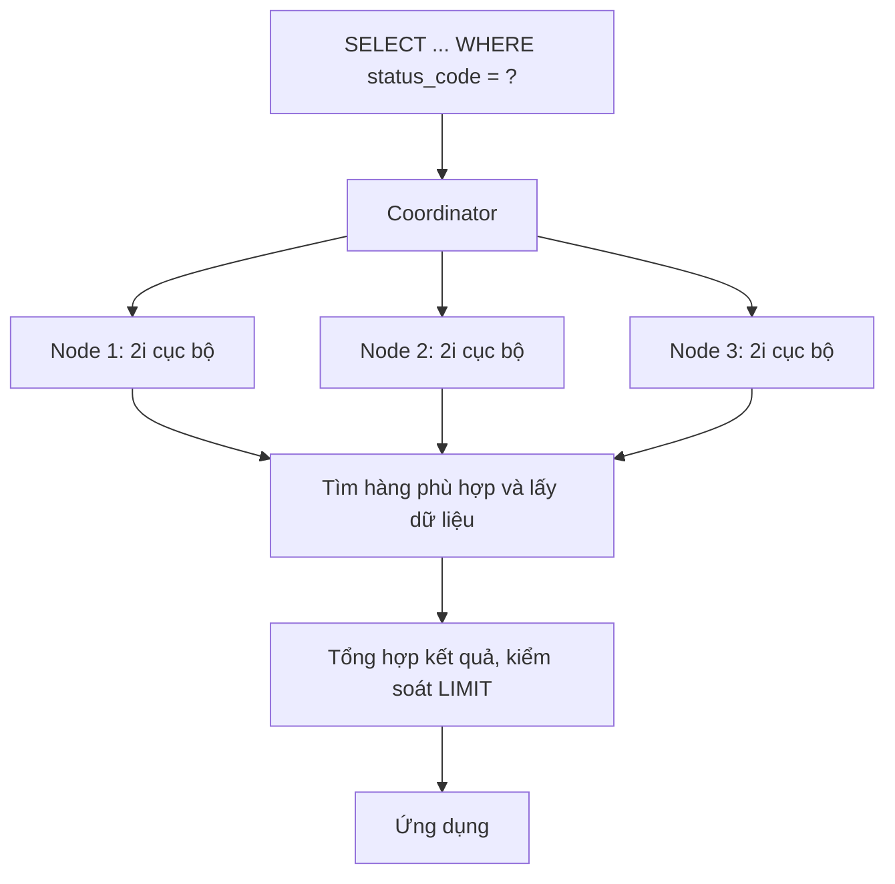
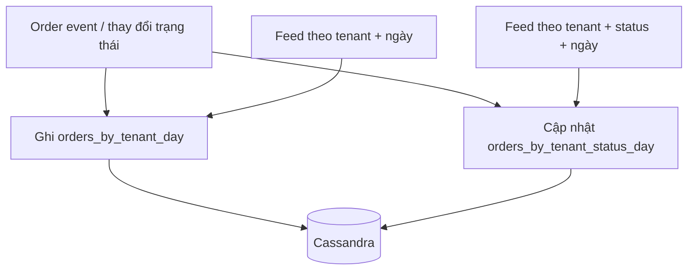

# Chỉ mục thứ cấp truyền thống và mẫu truy cập phù hợp

Trong **Spring Data Cassandra**, `CassandraRepository`, `CassandraTemplate` và `CqlTemplate` giúp biểu diễn các thao tác đọc/ghi, nhưng không quyết định được Cassandra phải tìm dữ liệu ở đâu. Khả năng định tuyến và chi phí truy vấn chủ yếu xuất phát từ **partition key**, **clustering columns**, kiểu cột và các đường truy cập bổ sung đã thiết kế. Khi muốn lọc theo một cột thường, lập trình viên thường nghĩ ngay tới **secondary index** (*chỉ mục thứ cấp*). Với Apache Cassandra, lựa chọn này cần được cân nhắc kỹ hơn so với việc thêm index vào một bảng SQL quan hệ.

Bài học thuộc chương **Chỉ mục và mở rộng**, tập trung vào **chỉ mục thứ cấp truyền thống — 2i**: nó hoạt động như thế nào trong cluster, những mẫu truy cập nào có thể chấp nhận được, tại sao một câu `WHERE` hợp lệ vẫn có thể chậm, và khi nào nên chọn **bảng đọc theo truy vấn** hoặc một loại index khác. Mục tiêu là thiết kế được đường đọc có chi phí dự đoán, chứ không chỉ làm cho Cassandra chấp nhận cú pháp CQL.

## 1. Vì sao bảng Cassandra cần access pattern rõ ràng?

Trong Cassandra, dữ liệu được phân phối theo **token của partition key**. Với một truy vấn có đủ partition key, coordinator có thể xác định tập replica sở hữu partition đó. Các **clustering columns** sắp xếp hàng bên trong partition, giúp đọc theo prefix/range hợp lệ.

Giả sử ứng dụng quản lý đơn hàng cần xem đơn của một tenant trong một ngày, mới nhất trước:

```sql
CREATE TABLE orders_by_tenant_day (
    tenant_id     text,
    order_day     date,
    created_at    timeuuid,
    order_id      uuid,
    status_code   text,
    customer_id   text,
    total_minor   bigint,
    PRIMARY KEY ((tenant_id, order_day), created_at, order_id)
) WITH CLUSTERING ORDER BY (created_at DESC, order_id DESC);
```

Ở đây:

| Cột | Vai trò | Hệ quả khi truy vấn |
| --- | --- | --- |
| `tenant_id` | Thành phần partition key | Giới hạn phạm vi tenant |
| `order_day` | Thành phần partition key | Xác định bucket ngày |
| `created_at` | Clustering column thứ nhất | Đọc các đơn theo thứ tự thời gian trong partition |
| `order_id` | Clustering column thứ hai | Phân biệt các đơn có cùng `created_at` |
| `status_code` | Cột thường | Không có đường tra cứu theo trạng thái mặc định |
| `customer_id` | Cột thường | Không có đường tra cứu theo khách hàng mặc định |

Truy vấn phù hợp với bảng:

```sql
SELECT created_at, order_id, status_code, total_minor
FROM orders_by_tenant_day
WHERE tenant_id = ?
  AND order_day = ?
LIMIT 30;
```

Câu CQL cung cấp **đầy đủ partition key**. Cassandra có thể định tuyến một partition và tận dụng thứ tự clustering để lấy các hàng đầu tiên.

Ngược lại:

```sql
-- Không có đường đọc theo partition key trên schema ban đầu.
SELECT * FROM orders_by_tenant_day
WHERE status_code = 'PAID';
```

`status_code` không nằm trong partition key, không phải clustering column và chưa có index. Cassandra không tự thực hiện một phép quét toàn bộ bảng giống cơ sở dữ liệu quan hệ để đáp ứng mọi truy vấn. Với tình huống này, cần **thiết kế đường truy cập**: index được hỗ trợ, bảng đọc riêng hoặc phương án nghiệp vụ khác.

## 2. Chỉ mục thứ cấp truyền thống (2i) là gì?

**2i** là loại secondary index truyền thống của Apache Cassandra. Nó duy trì cấu trúc tìm kiếm bổ sung liên hệ **giá trị của cột được index** với những hàng chứa giá trị đó. Từ đó, CQL có thể hỗ trợ một số điều kiện lọc không được phục vụ trực tiếp bởi primary key.

Ví dụ tạo index trên `status_code`:

```sql
CREATE INDEX IF NOT EXISTS orders_status_2i
ON orders_by_tenant_day (status_code);
```

Sau khi index tồn tại và **đã xây dựng đầy đủ**, một truy vấn tương ứng có thể thực thi:

```sql
SELECT tenant_id, order_day, created_at,
       order_id, status_code, total_minor
FROM orders_by_tenant_day
WHERE status_code = 'REFUNDED'
LIMIT 20;
```

Điểm quan trọng: 2i truyền thống được quản lý **tại các node sở hữu dữ liệu** thay vì trở thành một bảng toàn cục được partition theo `status_code` giống read model do ứng dụng thiết kế. Khi truy vấn chỉ có giá trị index và **không có partition key**, coordinator có thể phải tìm kiếm trên nhiều node/vùng token để xác định các hàng phù hợp.



Sơ đồ chỉ minh họa **scatter/gather** ở mức khái niệm; Cassandra có thể tối ưu routing hoặc gửi các yêu cầu khác nhau tùy phiên bản, index và execution plan. Không nên hiểu rằng mọi truy vấn 2i luôn gửi chính xác một request tới mỗi node.

**Kết luận đầu tiên:** Index có thể biến một truy vấn bị từ chối thành truy vấn được hỗ trợ, nhưng **không tự biến nó thành point lookup một partition**.

## 3. Selectivity và cardinality: cần hiểu cả hai

Hai khái niệm thường được dùng để đánh giá cột index:

- **Cardinality**: số **giá trị phân biệt** của cột. `status_code` có thể chỉ có `NEW`, `PAID`, `CANCELLED`, `REFUNDED` → cardinality thấp.
- **Selectivity**: phần dữ liệu được điều kiện trả về. Nếu 40% đơn có `PAID`, điều kiện `status_code = 'PAID'` có selectivity kém vì khớp quá nhiều hàng.

Giả sử có **50 triệu đơn** trong cluster:

| Điều kiện giả định | Tỷ lệ hàng khớp | Số hàng khớp ước tính | Nhận xét |
| --- | ---: | ---: | --- |
| `status_code = 'PAID'` | 40% | 20.000.000 | Lọc rất rộng; 2i có thể tạo tải đọc lớn |
| `status_code = 'REFUNDED'` | 0,2% | 100.000 | Chọn lọc hơn nhưng vẫn có nhiều hàng và phân tán |
| Một mã rất hiếm | 0,001% | 500 | Tập kết quả nhỏ hơn; vẫn cần xét fan-out và SLA |

Đây là **con số minh họa**, không phải benchmark hay ngưỡng chính thức của Cassandra. Một cột ít giá trị khác nhau **không mặc nhiên thích hợp với 2i**: nếu mỗi giá trị xuất hiện ở hàng triệu bản ghi, truy vấn theo một giá trị vẫn đụng nhiều dữ liệu. Mặt khác, một cột gần như duy nhất cho từng hàng có selectivity tốt nhưng cũng có thể tạo index lớn và phân tán; nếu truy vấn theo ID là đường đọc chính, đặt ID làm **partition key ở một bảng lookup** thường rõ ràng hơn.

Khi đánh giá index, cần xét đồng thời:

1. **Số hàng khớp thực tế**, không chỉ số lượng giá trị phân biệt.
2. **Phân bố theo tenant, bucket và node**: giá trị xuất hiện rộng hay tập trung?
3. **Tần suất truy vấn** và số request đồng thời.
4. **Tốc độ ghi/cập nhật/xóa** làm thay đổi index.
5. **Kích thước hàng và TTL/tombstone** ảnh hưởng lượng dữ liệu cần tìm/đọc.
6. **Yêu cầu thứ tự và phân trang**: truy vấn cần 20 hàng bất kỳ hay 20 hàng *mới nhất*?

## 4. Khi nào 2i truyền thống có thể phù hợp?

2i có thể là lựa chọn chấp nhận được khi **toàn bộ workload** và phiên bản Cassandra đã được kiểm chứng. Những tình huống đáng cân nhắc gồm:

- **Tra cứu phụ, không quá thường xuyên**, không phải đường nóng nhất của API, ví dụ công cụ điều tra một trạng thái hiếm.
- Điều kiện trả về **ít hàng trên tập dữ liệu thực tế**, đã được đo theo thời gian và có giới hạn kết quả.
- Dữ liệu và cụm có quy mô để chi phí tìm kiếm phân tán vẫn nằm trong SLA; có ngân sách timeout và đồng thời.
- Cột có kiểu, toán tử và **index implementation** được phiên bản Cassandra sử dụng hỗ trợ.
- Tổ chức chấp nhận **chi phí ghi và lưu trữ index** để không phải tạo một bảng read model riêng cho nhu cầu hiếm.
- Đã kiểm tra index build, monitoring, hành vi khi node suy giảm và kế hoạch schema change.

| Mẫu truy cập | Cân nhắc 2i truyền thống | Lý do |
| --- | --- | --- |
| Quản trị tìm một trạng thái hiếm, vài lần mỗi giờ | **Có thể thử nghiệm** | Query ít và tập kết quả có thể nhỏ |
| Feed `PAID` mới nhất của mọi tenant mỗi giây | **Thường không phù hợp** | Nhiều hàng khớp, thiếu global order, fan-out |
| Tìm một đơn bằng ID đã biết | **Không ưu tiên** | Bảng `orders_by_id` với ID làm partition key rõ hơn |
| Tìm đơn `PAID` của một tenant/ngày thường xuyên | **Nên cân nhắc bảng chuyên biệt** | Full partition key theo tenant/trạng thái/ngày |
| Lọc một cột thường trên partition rất nhỏ đã biết | **Có thể đọc partition rồi xử lý có giới hạn** | Không nhất thiết cần index mới |
| Tìm kiếm chuỗi con/full-text hoặc ranking | **Không phải chức năng 2i cơ bản** | Cần công nghệ/đường truy vấn được thiết kế riêng |

**Đừng biến “số dòng trả về trong UI rất ít” thành bằng chứng index hiệu quả.** `LIMIT 20` không có nghĩa Cassandra luôn chỉ kiểm tra 20 hàng ở một vài partition. Nếu điều kiện index lan rộng, tìm được 20 hàng hoặc bảo đảm thứ tự đúng có thể vẫn tốn tài nguyên.

## 5. Phân biệt truy vấn hợp lệ với truy vấn hiệu quả

Sau khi tạo 2i cho `status_code`, hai câu sau phục vụ những mục tiêu khác nhau:

```sql
-- Tra cứu index trên phạm vi dữ liệu rộng:
SELECT order_id, status_code
FROM orders_by_tenant_day
WHERE status_code = 'REFUNDED'
LIMIT 20;
```

```sql
-- Đọc theo full partition key, không cần index cho đường đọc này:
SELECT order_id, status_code
FROM orders_by_tenant_day
WHERE tenant_id = 'tenant-a'
  AND order_day = '2026-11-25'
LIMIT 20;
```

Query thứ nhất có thể hợp lệ sau khi index được tạo, nhưng **không có cam kết “20 đơn hoàn tiền mới nhất”**: các hàng khớp đến từ nhiều partition, trong khi clustering order chỉ có ý nghĩa bên trong từng partition.

Query thứ hai định vị một partition; nó trả hàng theo clustering order nhưng **không lọc riêng các đơn hoàn tiền**. Nếu partition nhỏ và đã được giới hạn chặt, service có thể lấy dữ liệu có kiểm soát và áp dụng một số logic lọc, nhưng cách làm này không được coi là tối ưu khi partition lớn và dữ liệu cần xem trải nhiều trang.

Một query kết hợp `tenant_id`, `order_day` và `status_code` có thể có cách thực thi/hạn chế khác nhau theo loại index, phiên bản Cassandra và cách query planner xử lý. **Không nên cam kết “có index là thêm bất kỳ điều kiện WHERE nào cũng chạy”**. Cần kiểm tra câu CQL đúng nguyên dạng trên cluster mục tiêu và đo hiệu năng.

### `ORDER BY` không biến thành global sort nhờ 2i

Cassandra hỗ trợ sắp xếp theo **clustering order** trong những trường hợp CQL cho phép, thông thường khi partition key đã được ràng buộc phù hợp. 2i trên `status_code` không tổ chức mọi đơn `PAID` trên toàn cluster thành một danh sách duy nhất theo `created_at`.

Nếu giao diện cần **top K mới nhất theo tenant và trạng thái**, phải có đường dữ liệu được sắp xếp theo những khóa đó, hoặc một chiến lược tổng hợp có giới hạn và được đo chi phí. Cố thêm `ORDER BY created_at DESC` vào query chỉ dựa trên index có thể bị từ chối hoặc không đạt semantics mong muốn.

## 6. Tác động vận hành: ghi, TTL, tombstone và index build

Chỉ mục không miễn phí. Khi dữ liệu được ghi/cập nhật/xóa, Cassandra phải duy trì đủ thông tin để index phản ánh các thay đổi của bảng gốc.

**Chi phí cần đánh giá:**

- **Write overhead:** cập nhật `status_code` từ `NEW` sang `PAID` không chỉ thay cell của bảng gốc, mà còn liên quan đến việc duy trì index cũ/mới.
- **Disk và compaction:** index cần lưu cấu trúc bổ sung, sinh I/O và tiêu thụ dung lượng; chi tiết phụ thuộc index implementation.
- **TTL/delete:** dữ liệu hết hạn hoặc bị xóa sinh tombstone và công việc dọn dẹp; query qua index có thể tốn thêm chi phí khi nhiều dữ liệu đã bị xóa/hết hạn.
- **Repair/rebuild:** trong một số tình huống sự cố hoặc nâng cấp, index có thể cần kiểm tra hoặc xây lại theo quy trình dành cho phiên bản Cassandra cụ thể.
- **Giai đoạn tạo index trên bảng có sẵn:** `CREATE INDEX` có thể kích hoạt quá trình xây index cho dữ liệu lịch sử. **Schema agreement** không đồng nghĩa chắc chắn mọi node đã hoàn tất index build và index đã sẵn sàng cho tải production.

Nếu một bảng có hàng trăm triệu hàng, việc tạo 2i mới trên production cần được xử lý như **thay đổi vận hành có rủi ro**: thử với dữ liệu đại diện, theo dõi tiến độ xây index theo công cụ của phiên bản đang chạy, kiểm tra node/đĩa và có kế hoạch dừng hoặc phục hồi.

Không nên để mỗi pod Spring Boot tự tạo index khi khởi động. DDL cần được triển khai bằng **migration có phiên bản, tách khỏi vòng đời của ứng dụng**, với quyền thao tác schema được kiểm soát.

## 7. Thiết kế bảng theo truy vấn thay cho 2i ở đường đọc nóng

Giả sử tính năng quan trọng là:

> Lấy 20 đơn `PAID` mới nhất của tenant `tenant-a` trong ngày UTC `2026-11-25`.

Thay vì index `status_code` rồi quét tìm những hàng khớp, ta có thể tạo **read model theo tenant, trạng thái và ngày**:

```sql
CREATE TABLE orders_by_tenant_status_day (
    tenant_id     text,
    status_code   text,
    order_day     date,
    created_at    timeuuid,
    order_id      uuid,
    total_minor   bigint,
    PRIMARY KEY ((tenant_id, status_code, order_day),
                 created_at, order_id)
) WITH CLUSTERING ORDER BY (created_at DESC, order_id DESC);
```

Query theo đúng primary key:

```sql
SELECT created_at, order_id, total_minor
FROM orders_by_tenant_status_day
WHERE tenant_id = ?
  AND status_code = ?
  AND order_day = ?
LIMIT 20;
```

Vì partition key là `(tenant_id, status_code, order_day)`, coordinator có thể định vị **một partition theo use case**, và clustering order phù hợp với việc lấy đơn mới nhất.



Đánh đổi:

1. **Write amplification:** cùng một đơn có thể phải ghi vào nhiều bảng.
2. **Trạng thái thay đổi:** khi đơn chuyển `NEW → PAID`, writer phải xóa/cập nhật bản ghi tại partition trạng thái cũ theo chính sách và thêm bản ghi ở partition trạng thái mới, nếu read model chỉ muốn phản ánh trạng thái hiện tại.
3. **Không có giao dịch ACID đa partition tùy ý:** có thể có giai đoạn một bảng đã được cập nhật nhưng bảng khác chưa; cần idempotency, retry, nguồn sự kiện đáng tin cậy và reconciliation.
4. **Partition nóng:** một tenant có quá nhiều đơn `PAID` trong một ngày vẫn có thể tạo partition lớn; cần bucket nhỏ hơn/sharding nếu đo đạc cho thấy rủi ro.
5. **TTL/retention:** hai bảng phải có chính sách thời hạn và đồng bộ xóa phù hợp.

**Lợi ích:** chi phí truy vấn thường có thể dự đoán hơn vì truy vấn sử dụng đúng khóa, không phải scatter/gather index trên toàn cluster. Đây là mô hình Cassandra thường ưu tiên: **nhân bản dữ liệu có chủ đích theo access pattern**.

## 8. Đưa 2i vào Spring Data Cassandra

**Entity mapping không tự bảo đảm có index trong cluster.** `@Table`, `@PrimaryKey`, `@Column` mô tả bảng/cột và cách ánh xạ, còn 2i cần tồn tại trong schema thực tế trước khi một repository query dựa vào nó.

Ví dụ ánh xạ bảng `orders_by_tenant_day`:

```java
import java.io.Serializable;
import java.time.LocalDate;
import java.util.UUID;
import org.springframework.data.cassandra.core.cql.Ordering;
import org.springframework.data.cassandra.core.mapping.PrimaryKeyClass;
import org.springframework.data.cassandra.core.mapping.PrimaryKeyColumn;
import org.springframework.data.cassandra.core.mapping.PrimaryKeyType;

@PrimaryKeyClass
public class OrderKey implements Serializable {
    @PrimaryKeyColumn(name = "tenant_id", ordinal = 0,
            type = PrimaryKeyType.PARTITIONED)
    private String tenantId;

    @PrimaryKeyColumn(name = "order_day", ordinal = 1,
            type = PrimaryKeyType.PARTITIONED)
    private LocalDate orderDay;

    @PrimaryKeyColumn(name = "created_at", ordinal = 2,
            type = PrimaryKeyType.CLUSTERED,
            ordering = Ordering.DESCENDING)
    private UUID createdAt;

    @PrimaryKeyColumn(name = "order_id", ordinal = 3,
            type = PrimaryKeyType.CLUSTERED,
            ordering = Ordering.DESCENDING)
    private UUID orderId;

    public OrderKey() {}
    // Bổ sung constructor, getters/setters, equals() và hashCode().
}
```

```java
import org.springframework.data.cassandra.core.mapping.Column;
import org.springframework.data.cassandra.core.mapping.PrimaryKey;
import org.springframework.data.cassandra.core.mapping.Table;

@Table("orders_by_tenant_day")
public class OrderRecord {
    @PrimaryKey
    private OrderKey key;

    @Column("status_code")
    private String statusCode;

    @Column("customer_id")
    private String customerId;

    @Column("total_minor")
    private Long totalMinor;

    public OrderRecord() {}
    // Bổ sung constructor và getters/setters để hoàn thiện mapping.
}
```

Đây là **khung mapping**: các method được ghi chú cần được hoàn thiện trước khi dùng trong dự án. Cột `created_at timeuuid` được ánh xạ thành `UUID`, nhưng khi **ghi** phải tạo UUID phiên bản time-based hợp lệ; `UUID.randomUUID()` thường là v4 và **không phù hợp** cho cột CQL `timeuuid`.

### 8.1. Repository query dựa vào index

```java
import java.util.List;
import java.time.LocalDate;
import org.springframework.data.cassandra.repository.CassandraRepository;
import org.springframework.data.cassandra.repository.Query;

public interface OrderRepository
        extends CassandraRepository<OrderRecord, OrderKey> {

    @Query("SELECT * FROM orders_by_tenant_day " +
           "WHERE status_code = ?0 LIMIT 20")
    List<OrderRecord> findSomeByStatus(String status);

    @Query("SELECT * FROM orders_by_tenant_day " +
           "WHERE tenant_id = ?0 AND order_day = ?1 LIMIT 20")
    List<OrderRecord> findLatestInDay(String tenantId, LocalDate day);
}
```

`findSomeByStatus` **phụ thuộc** index và truy vấn được cluster hỗ trợ. Không có index, việc khai báo `@Query` hoặc đặt tên `findByStatusCode` không tạo tự động một đường truy cập. Kết quả của `findSomeByStatus` là **một nhóm hàng khớp không bảo đảm sắp xếp toàn cục**, vì vậy không nên đặt tên nó thành `findLatestByStatus` hoặc đưa thẳng vào feed cần thứ tự thời gian.

`findLatestInDay` dùng đủ partition key, không cần 2i cho đường đọc cơ bản. Phương thức này là hướng đọc thích hợp hơn với yêu cầu danh sách theo tenant/ngày đã được bảng thiết kế phục vụ.

**Hai vấn đề độc lập:** repository có thể tạo CQL hợp lệ nhưng đọc rất chậm do index fan-out; ngược lại, một repository method không có index sẽ không được “cứu” chỉ bằng cách tăng consistency level.

### 8.2. CqlTemplate với bind values

Khi cần kiểm soát CQL và ánh xạ dữ liệu thô, có thể dùng `CqlTemplate`:

```java
import java.util.List;
import java.util.UUID;
import com.datastax.oss.driver.api.core.cql.SimpleStatement;
import org.springframework.data.cassandra.core.cql.CqlTemplate;

public record OrderSummary(
        String tenantId, UUID orderId, String statusCode) {}

public List<OrderSummary> findIndexed(
        CqlTemplate cql, String statusCode) {

    if (statusCode == null || statusCode.isBlank()) {
        throw new IllegalArgumentException("Thiếu status_code");
    }

    SimpleStatement statement = SimpleStatement.builder(
            "SELECT tenant_id, order_id, status_code " +
            "FROM orders_by_tenant_day " +
            "WHERE status_code = ? LIMIT 20")
            .addPositionalValue(statusCode)
            .build();

    return cql.query(statement, (row, rowNum) ->
            new OrderSummary(
                    row.getString("tenant_id"),
                    row.getUuid("order_id"),
                    row.getString("status_code")));
}
```

Bind marker giúp tránh nối giá trị người dùng vào CQL nhưng **không thay đổi quyền năng của index**, số node phải đọc hoặc bảo đảm về thứ tự. Trong ứng dụng nhiều tenant, câu CQL chỉ theo trạng thái có thể truy cập dữ liệu của nhiều tenant; nếu có chính sách cô lập tenant, **không nên đưa query global này ra API người dùng thông thường**. Thiết kế một bảng với tenant nằm trong partition key thường rõ ràng hơn cho cả bảo mật và hiệu năng.

## 9. Index trên collection và những giới hạn kiểu dữ liệu

Ngoài cột scalar như `status_code text`, Cassandra còn có cú pháp index trên một số kiểu collection, ví dụ `set`, `list` hoặc `map` theo khả năng của 2i và phiên bản cụ thể.

Giả sử bảng có thêm:

```sql
tags       set<text>
attributes map<text, text>
```

Ở CQL:

- `tags CONTAINS 'priority'` kiểm tra **phần tử** của set.
- `attributes CONTAINS KEY 'region'` kiểm tra **khóa** của map.
- `attributes CONTAINS 'apac'` kiểm tra **giá trị** của map.

Muốn đưa các biểu thức đó vào `WHERE`, cần xác minh **loại index, cú pháp, khả năng hỗ trợ toán tử** và hiệu năng trên phiên bản Cassandra đang dùng. Index cho **map key**, **map value** và **map entry** không nhất thiết giống nhau; một loại index phù hợp với `CONTAINS` trên value không tự bảo đảm `CONTAINS KEY` cũng được hỗ trợ.

Một `@Column` Java kiểu `Set<String>` hoặc `Map<String,String>` chỉ cung cấp mapping, không tự mở khóa mọi truy vấn membership. Cũng không nên dùng `CONTAINS` trên cột `text` để tìm **substring**; 2i truyền thống không phải công cụ full-text search.

Nếu tìm bài theo tag là đường đọc nóng, xây bảng `posts_by_tenant_tag_day` theo tenant/tag/ngày thường dễ dự đoán chi phí hơn việc dựa vào collection 2i trên một bảng rất lớn.

## 10. So sánh 2i truyền thống, SAI và bảng read model

**Storage-Attached Index (SAI)** là cơ chế index khác với 2i truyền thống, được hỗ trợ trong các phiên bản/phân phối Cassandra nhất định. SAI hướng tới một số giới hạn của 2i về tổ chức index và workload truy vấn, nhưng **không loại bỏ mọi ràng buộc của kiến trúc phân tán** và cũng không thay thế thiết kế truy vấn.

| Tiêu chí | 2i truyền thống | SAI (khi cluster hỗ trợ) | Bảng theo truy vấn |
| --- | --- | --- | --- |
| Cách bổ sung đường đọc | Index trên một số cột | Index lưu cùng cấu trúc dữ liệu SSTable theo triển khai | Partition/clustering key của bảng mới |
| Phụ thuộc phiên bản/type/operator | Có | Có, cần đối chiếu đặc tính hỗ trợ | Chủ yếu từ CQL primary key/schema |
| Truy vấn không có partition key | Có thể cần tìm trên nhiều node | Vẫn cần đánh giá routing/scan phân tán | Thiết kế khóa để xác định partition rõ |
| Global newest-first | Không tự bảo đảm | Không tự bảo đảm | Có thể phục vụ qua partition/clustering đã chọn |
| Ghi và lưu trữ | Chi phí duy trì index | Chi phí duy trì index khác | Chi phí ghi nhân bản dữ liệu |
| Phù hợp với API nóng, query contract cố định | Cần benchmark rất kỹ | Cần benchmark theo phiên bản/index | Thường dễ dự đoán hơn khi thiết kế đúng |

Trong những triển khai Cassandra mới có SAI được hỗ trợ, SAI thường là một lựa chọn đáng đánh giá **trước khi tạo thêm 2i truyền thống** cho trường hợp lọc không theo primary key. Tuy nhiên, không mặc định SAI hỗ trợ mọi toán tử hoặc cho kết quả sắp xếp toàn cục; cần kiểm tra tài liệu **đúng phiên bản cluster** và đo trên dữ liệu đại diện.

Khi access pattern ổn định, khối lượng lớn và yêu cầu p95/p99 chặt, **bảng chuyên biệt** với khóa phù hợp thường đem lại mô hình chi phí dễ giải thích hơn cả hai loại index.

## 11. Tạo và quản lý index trong production

Để triển khai 2i một cách an toàn, nên tách **schema migration** khỏi khởi động Spring Boot:

1. **Xác định query contract:** ai gọi, tần suất bao nhiêu, input gồm những gì, SLA và yêu cầu thứ tự?
2. **Đo baseline:** tỷ lệ khớp của giá trị index, partition/row size, tốc độ ghi/cập nhật, TTL và latency trước thay đổi.
3. **Kiểm tra khả năng hỗ trợ:** phiên bản Cassandra, kiểu cột, index implementation, CQL cụ thể.
4. **Thử trong staging:** dữ liệu đủ đại diện về phân bố/khối lượng và các giá trị nóng/hiếm.
5. **Review migration:** `CREATE INDEX` có tên rõ ràng, thứ tự chạy và kế hoạch kiểm tra metadata.
6. **Triển khai có kiểm soát:** theo dõi schema agreement, **tiến độ index build**, CPU/IO, disk và độ trễ truy vấn đang phục vụ khách hàng.
7. **Smoke test index query:** kiểm tra kết quả và độ trễ với dữ liệu mới lẫn dữ liệu đã có từ trước.
8. **Canary API dùng index:** tăng dần tỷ lệ truy vấn và theo dõi tải trước khi cho toàn bộ traffic sử dụng.
9. **Chuẩn bị đường rút lui:** tắt feature hoặc chuyển về query cũ nếu index query làm tăng latency; thay đổi DDL/destructive cần lịch riêng.

Có thể xem metadata index trong system schema của phiên bản Cassandra tương ứng, ví dụ:

```sql
SELECT index_name, kind, options
FROM system_schema.indexes
WHERE keyspace_name = 'orders'
  AND table_name = 'orders_by_tenant_day';
```

`'orders'` là tên keyspace minh họa. Metadata có index **không đồng nghĩa index trên mọi node đã xây xong**, cũng không chứng minh query đạt SLA. Kiểm tra thêm trạng thái build và metric mà phiên bản Cassandra/phương pháp vận hành hỗ trợ.

**Lưu ý về `IF NOT EXISTS`:** cú pháp này tránh một số lỗi khi index trùng tên đã tồn tại, nhưng không bảo đảm index đó được khai báo đúng cột và options mong đợi. Một hệ thống migration tốt phải phát hiện **schema drift**, không chỉ coi lệnh chạy không lỗi là thành công.

## 12. Consistency và dữ liệu thay đổi trong quá trình query

Truy vấn 2i vẫn là một thao tác Cassandra với **consistency level** cụ thể như `LOCAL_ONE` hoặc `LOCAL_QUORUM` (tùy đường truy cập/driver). Chọn CL ảnh hưởng điều kiện phản hồi replica, độ trễ và khả dụng nhưng **không làm index query rẻ hơn hoặc tự thêm partition key**.

Với một truy vấn index quét nhiều partition:

- Không có snapshot giao dịch duy nhất cho toàn bộ tập hàng khi writer vẫn cập nhật trạng thái.
- Kết quả trang đầu và trang tiếp theo có thể phản ánh dữ liệu ở các thời điểm khác nhau.
- Thay đổi `status_code` trong lúc đọc có thể làm kết quả của các request lân cận khác nhau; ứng dụng phải có quy tắc nghiệp vụ rõ ràng về dữ liệu thời điểm nào được chấp nhận.
- Nếu query liên quan nhiều node, một node chậm/không đáp ứng có thể tác động độ trễ đuôi.

Với API cần đọc chính xác ngay sau ghi, nên xem **cả write CL và read CL**, replication factor, topology và các trường hợp đồng thời. Một index không biến chuỗi `read → check → write` thành transaction nguyên tử; nếu nghiệp vụ cần điều kiện `IF NOT EXISTS` hoặc compare-and-set, phải đánh giá **LWT** và chi phí riêng.

## 13. Những sai lầm phổ biến

| Sai lầm | Hậu quả | Cách tiếp cận tốt hơn |
| --- | --- | --- |
| “`WHERE` thiếu partition key thì cứ thêm 2i” | Query hợp lệ nhưng fan-out lớn | Phân tích query contract và số partition |
| “Cột có ít giá trị là index tốt” | Một giá trị khớp hàng triệu hàng | Đo selectivity thực tế |
| “`LIMIT 20` nghĩa là index đọc đúng 20 hàng” | Đánh giá sai chi phí tìm kiếm phân tán | Đo p95/p99, số hàng/partition và tải node |
| Dùng 2i cho feed mới nhất toàn cluster | Không có global ordering từ clustering | Bảng feed/read model phù hợp |
| Tạo index production mà không quan sát build | Tải đĩa/CPU, kết quả chưa sẵn sàng | Migration có kiểm soát và xác nhận index build |
| Nhầm `@Query` hoặc derived method tạo index | CQL được sinh nhưng schema chưa có index | Triển khai index bằng migration |
| Thêm `ALLOW FILTERING` khi query index bị từ chối | Nguy cơ scan đắt | Sửa schema, loại index hoặc truy vấn |
| Dùng index global trong API cần cô lập tenant | Dễ đọc nhiều tenant, rủi ro quyền truy cập | Tenant-scoped read model và authorization |
| Bỏ qua update/delete/TTL | Index overhead, tombstone và query chậm | Giám sát write workload, TTL và compaction |
| Đánh đồng 2i với SAI | Cú pháp/khả năng vận hành sai kỳ vọng | Xác định implementation và phiên bản cụ thể |

## 14. Checklist lựa chọn chỉ mục thứ cấp

Trước khi quyết định tạo 2i trên một cột, tự trả lời:

1. **Bảng hiện tại được thiết kế cho truy vấn nào?** Partition key, clustering columns và thứ tự đã đúng chưa?
2. **Truy vấn cần index có thường xuyên không?** Đây là chức năng phụ hay đường đọc cốt lõi của sản phẩm?
3. **Giá trị lọc khớp bao nhiêu hàng?** Đừng chỉ nhìn cardinality; đo selectivity và biến động theo thời gian.
4. **Có yêu cầu latest-first, tenant isolation, paging hay top K?** 2i không tự tạo global order.
5. **Index type/operator có được cluster hỗ trợ không?** Test câu CQL nguyên dạng.
6. **Chi phí write amplification, TTL, tombstone và index build có chấp nhận được không?**
7. **Có thể tạo read model theo tenant/status/bucket thay vì index global không?**
8. **Đã so sánh 2i với SAI khi phiên bản hỗ trợ chưa?**
9. **Đã kiểm thử trên dữ liệu đại diện và tải đồng thời đúng SLA chưa?**
10. **Có kế hoạch migration, quan sát, canary và rollback ở tầng ứng dụng chưa?**

## 15. Bài tập tự kiểm tra

**Tình huống A — Trạng thái phổ biến.** Bảng chứa 50 triệu đơn, khoảng 40% có `status_code = 'PAID'`. Một API được gọi hàng trăm lần/giây cần lấy 20 đơn `PAID` mới nhất của một tenant. Có nên chỉ tạo 2i trên `status_code` rồi dùng `LIMIT 20`?

**Gợi ý:** Không nên mặc định. Số hàng `PAID` rất lớn và index global không tạo thứ tự mới nhất theo tenant. Hãy đánh giá bảng `orders_by_tenant_status_day` có partition key chứa tenant/status/bucket và clustering theo thời gian, rồi đo kích thước partition.

**Tình huống B — Truy vấn hiếm.** Công cụ vận hành mỗi ngày vài lần cần tìm một mã trạng thái hiếm, với hàng khớp ít trong cluster nhỏ. Có thể thử 2i không?

**Gợi ý:** Có thể, nếu loại cột/index được phiên bản hỗ trợ và thử nghiệm cho thấy độ trễ, tải và khả năng phục hồi đạt yêu cầu. Đây là **ứng viên để benchmark**, không phải kết luận tối ưu phổ quát.

**Tình huống C — Chỉ thêm repository.** Developer khai báo `List<OrderRecord> findByStatusCode(String status)` và cho rằng Spring Data Cassandra tự tạo secondary index. Điều gì sai?

**Gợi ý:** Derived query sinh điều kiện CQL; index là cấu trúc schema được tạo riêng. Không có index/đường đọc tương thích, query có thể bị từ chối hoặc yêu cầu filtering. Cần migration được kiểm soát hoặc bảng đọc khác.

**Tình huống D — Index build.** Sau `CREATE INDEX`, schema agreement thành công và ứng dụng ngay lập tức dồn toàn bộ traffic vào query mới. Thiếu bước nào?

**Gợi ý:** Cần xác minh index trên các node đã xây xong, test dữ liệu cũ/mới, đánh giá CPU/IO/latency và canary. Agreement về metadata chưa đủ chứng minh index sẵn sàng cho tải production.

**Tình huống E — Sắp xếp.** Một truy vấn `WHERE status_code = 'REFUNDED' LIMIT 20` qua 2i trả 20 hàng. Có thể khẳng định đó là 20 đơn hoàn tiền mới nhất toàn cluster?

**Gợi ý:** Không. Index không bảo đảm global sort theo `created_at`, trong khi clustering order áp dụng trong partition. Hãy làm rõ query contract và thiết kế đường đọc có thứ tự phù hợp.

## Kết luận

**Chỉ mục thứ cấp truyền thống (2i)** là một công cụ bổ sung cho Cassandra khi cần tìm dữ liệu bằng cột thường, nhưng nó đi kèm **chi phí duy trì index** và nguy cơ **đọc phân tán nhiều node** nếu truy vấn thiếu partition key. Đánh giá 2i phải xét **selectivity, cardinality, tần suất, update/TTL, số hàng khớp, khả năng index build, thứ tự kết quả và SLA**, không chỉ việc câu CQL có được chấp nhận hay không.

Trong Spring Data Cassandra, repository và template giúp viết lời gọi truy cập dữ liệu; chúng không làm thay công việc mô hình hóa. Khi truy vấn theo tenant, trạng thái và thời gian là đường đọc nóng, hãy ưu tiên **bảng thiết kế theo truy vấn** với partition/clustering key phù hợp; cân nhắc 2i hoặc SAI khi workload và phiên bản cluster chứng minh chúng hiệu quả. Trình tự thực hành là **định nghĩa access pattern → chọn khóa hoặc index → kiểm tra CQL → benchmark và quan sát → triển khai có kiểm soát**.
