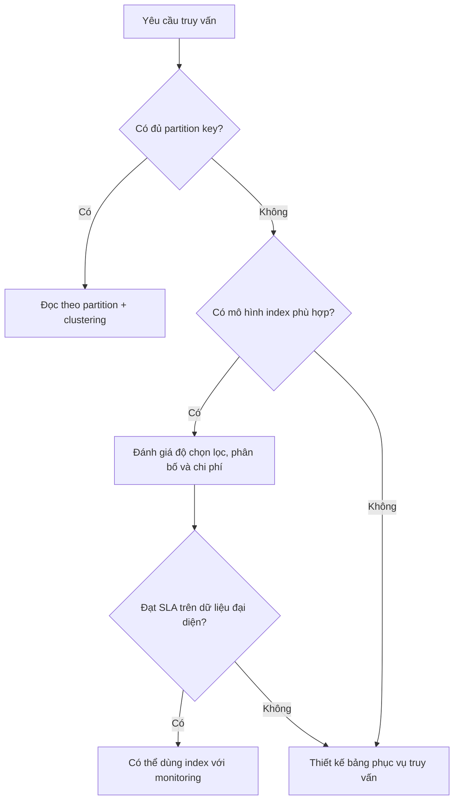
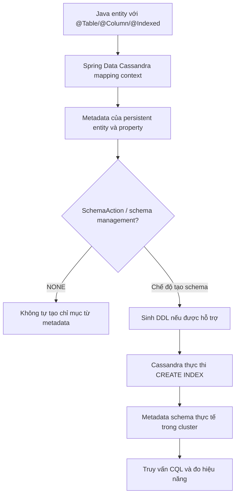

# @Indexed và quản lý chỉ mục từ metadata ánh xạ trong Spring Data Cassandra

Trong **Spring Data Cassandra**, annotation `@Indexed` có thể được đặt trên một thuộc tính của entity để khai báo **metadata của secondary index**. Khi cơ chế quản lý lược đồ của Spring Data được kích hoạt ở chế độ phù hợp, metadata này có thể được dùng để sinh thao tác tạo index trong Apache Cassandra. Tuy nhiên, **thêm annotation không đồng nghĩa ngay lập tức đã có index trong cluster**, và một index đã tồn tại cũng **không bảo đảm mọi truy vấn qua cột đó đều hiệu quả**.

Bài học thuộc chương **Chỉ mục và mở rộng** của module `SPRING_DATA_CASSANDRA`. Trọng tâm là cách `@Indexed` liên hệ với `@Table`, `@Column` và mapping context; cơ chế tạo index từ schema metadata; giới hạn của `SchemaAction`; cách kiểm tra schema thật; so sánh secondary index truyền thống với các cơ chế index nâng cao; và cách quyết định giữa **index** và **bảng chuyên cho từng mẫu truy vấn**. Các ví dụ sử dụng entity mapping, repository, CassandraTemplate, CQL và Java Driver, đồng thời xem xét partition key, consistency, paging, tombstone và chi phí vận hành phân tán.

> **Điểm cốt lõi:** `@Indexed` là **khai báo ở phía ứng dụng**, không phải lệnh tự động thay đổi mọi database đang chạy. Truy vấn theo cột đã index vẫn phải được đánh giá theo cardinality, số partition, volume, kiểu index và phiên bản Cassandra. Với đường đọc chính có tải lớn, thiết kế bảng theo truy vấn thường dễ dự đoán hơn.

## 1. Chỉ mục trong Cassandra khác chỉ mục RDBMS thế nào?

Trong một cơ sở dữ liệu quan hệ, developer thường tạo index trên cột rồi viết truy vấn với nhiều điều kiện lọc và sắp xếp, để query planner chọn chiến lược truy cập. Cassandra tổ chức dữ liệu khác:

- **Partition key** quyết định vị trí logic của dữ liệu theo token và các replica.
- **Clustering columns** quyết định thứ tự và phạm vi đọc **bên trong partition**.
- **Secondary index** bổ sung cách tìm dữ liệu theo một hoặc một số giá trị không phải khóa chính, tùy loại index được Cassandra hỗ trợ.
- **Query-driven design** ưu tiên tạo bảng có primary key phục vụ trực tiếp truy vấn quan trọng, kể cả khi phải phi chuẩn hóa và duy trì nhiều bảng.

Sơ đồ tư duy:



Một index có thể là lựa chọn hợp lý cho vài đường truy vấn bổ trợ với tính chọn lọc tốt và kích thước dữ liệu vừa phải. Nhưng một query định kỳ phải đọc mọi đơn hàng trong hệ thống theo một giá trị trạng thái phổ biến thường không phù hợp với secondary index truyền thống, cho dù có annotation `@Indexed`.

## 2. @Indexed là gì?

Trong Spring Data Cassandra, annotation thường dùng là:

```java
import org.springframework.data.cassandra.core.mapping.Indexed;
```

Annotation `@Indexed` đánh dấu **một thuộc tính persistent được ánh xạ** là ứng viên tạo secondary index. Nó làm việc ở tầng **metadata mapping** của Spring Data Cassandra, không phải một annotation tự thực thi CQL mỗi khi gọi `repository.findBy...()`.

Ví dụ:

```java
import java.time.Instant;
import java.util.UUID;

import org.springframework.data.cassandra.core.mapping.Column;
import org.springframework.data.cassandra.core.mapping.Indexed;
import org.springframework.data.cassandra.core.mapping.PrimaryKey;
import org.springframework.data.cassandra.core.mapping.Table;

@Table("tickets_by_id")
public class SupportTicket {

    @PrimaryKey("ticket_id")
    private UUID ticketId;

    @Column("tenant_id")
    private UUID tenantId;

    @Indexed("tickets_external_ref_idx")
    @Column("external_ref")
    private String externalRef;

    @Column("status")
    private String status;

    @Column("created_at")
    private Instant createdAt;

    // Constructor, getters/setters và validation theo nghiệp vụ.
}
```

Ý nghĩa:

1. `@Table("tickets_by_id")` xác định bảng CQL mà entity được mapping.
2. `@PrimaryKey("ticket_id")` chỉ ra primary key đơn, từ đó định vị partition theo ticket ID.
3. `@Column("external_ref")` nối thuộc tính Java `externalRef` với cột CQL `external_ref`.
4. `@Indexed("tickets_external_ref_idx")` yêu cầu mapping metadata ghi nhận index cho cột đó, với tên được khai báo.
5. `@Column("status")` **không tự động** được index chỉ vì nó là thuộc tính thông thường.

Trong những bản Spring Data Cassandra tương ứng, có thể dùng `@Indexed` không truyền tên để framework chọn tên chỉ mục theo quy tắc triển khai. Tuy nhiên, **tên chỉ mục tường minh** giúp migration, giám sát và so sánh DDL dễ đoán hơn. Cần kiểm tra đúng annotation API của dòng thư viện đang dùng; bài này không khẳng định một bản Spring Data bất kỳ hỗ trợ mọi tùy chọn annotation giống nhau.

**Không đồng nhất `@Indexed` với JPA `@Index` hoặc annotation index của một Spring Data store khác.** Mỗi module Spring Data có metadata và cơ chế schema riêng; phải import đúng package Cassandra.

## 3. Từ annotation đến schema Cassandra: những bước có thể diễn ra

Để thấy sự khác nhau giữa **khai báo** và **kết quả trong database**, xem luồng khái quát:



Có **ít nhất bốn điều kiện** để index khai báo trong Java thực sự có tác dụng:

- **Entity được Spring Data nhận diện:** lớp `@Table` thuộc package/mapping context cần quản lý.
- **Annotation được nhận dạng:** `@Indexed` đặt trên thuộc tính persistent và phù hợp API của phiên bản Spring Data.
- **Cơ chế DDL được bật và hỗ trợ kiểu index:** có cấu hình schema action phù hợp và tài khoản Cassandra đủ quyền.
- **DDL thực thi thành công và schema/index đã sẵn sàng:** index thực sự tồn tại trên keyspace và bảng đúng, được các node nhận metadata và có thể đáp ứng query.

Một thay đổi Java code đơn thuần không phải là migration đảm bảo index được thêm vào mọi môi trường. Trong production, nhiều nhóm chủ động dùng `SchemaAction.NONE` và tạo index bằng một migration CQL được phê duyệt thay vì dựa vào startup của ứng dụng.

## 4. CQL tương ứng với ví dụ @Indexed

Trước khi dùng metadata mapping, hãy hiểu schema mà index hướng tới:

```sql
CREATE TABLE tickets_by_id (
    ticket_id uuid PRIMARY KEY,
    tenant_id uuid,
    external_ref text,
    status text,
    created_at timestamp
);
```

Một secondary index truyền thống trên cột `external_ref` có thể được tạo bằng CQL:

```sql
CREATE INDEX IF NOT EXISTS tickets_external_ref_idx
ON tickets_by_id (external_ref);
```

Câu lệnh này minh họa **ý nghĩa mong muốn** của `@Indexed("tickets_external_ref_idx")`: một index gắn với cột `external_ref` của bảng `tickets_by_id`. Nó **không khẳng định** Spring Data trong mọi phiên bản sinh chính xác cùng câu CQL, option hay loại index. Muốn biết DDL thực tế phải kiểm tra metadata của Cassandra sau khi cơ chế quản lý schema chạy.

Khi bảng có hàng với `external_ref = 'EXT-1042'`, ứng dụng có thể muốn tìm:

```sql
SELECT ticket_id, tenant_id, external_ref, status, created_at
FROM tickets_by_id
WHERE external_ref = 'EXT-1042';
```

Nếu index khả dụng, phiên bản Cassandra và loại index hỗ trợ predicate này, truy vấn có thể được phục vụ bằng index. Nhưng có nhiều ràng buộc:

- Giá trị `external_ref` có thể trùng giữa tenant; **index không tự thực thi uniqueness**.
- Truy vấn chỉ theo `external_ref` có thể cần xem dữ liệu của nhiều node/partition, tùy loại index và phân bố dữ liệu.
- Index không tự áp điều kiện authorization về tenant.
- Thêm `ORDER BY created_at` không hợp lệ chỉ vì `external_ref` có index, bởi `created_at` không phải clustering key trong bảng.
- Với dữ liệu rất lớn và workload quan trọng, một bảng tra cứu theo `(tenant_id, external_ref)` có thể phù hợp hơn.

**Không nên bật `ALLOW FILTERING` để che việc thiếu index hoặc access pattern hợp lý.** Nó có thể khiến server thực hiện lọc rộng trên rất nhiều dữ liệu.

## 5. SchemaAction quyết định điều gì?

Spring Data Cassandra có nhiều lựa chọn cho quản lý schema, thường qua `org.springframework.data.cassandra.config.SchemaAction`. Những chế độ phổ biến:

| SchemaAction | Ý nghĩa khái quát | Liên quan @Indexed |
|---|---|---|
| `NONE` | Không tự động quản lý các đối tượng schema từ mapping | **Không tự tạo index** chỉ vì thấy annotation |
| `CREATE` | Tạo schema từ metadata của entity theo cơ chế thư viện | Có thể bao gồm index metadata, tùy phiên bản và đối tượng được hỗ trợ |
| `CREATE_IF_NOT_EXISTS` | Tạo các đối tượng còn thiếu trong phạm vi được hỗ trợ | **Không nên coi là migration đầy đủ** cho schema đang tồn tại |
| `RECREATE` | Drop/recreate các table/UDT ứng dụng quản lý | Có nguy cơ **xóa dữ liệu**; các index có thể bị drop theo bảng |
| `RECREATE_DROP_UNUSED` | Drop rộng hơn các table/UDT trong keyspace mục tiêu rồi dựng lại nhóm đã mapping | **Rất nguy hiểm** cho keyspace dùng chung; có thể xóa bảng ngoài mapping |

Với `CREATE`/`CREATE_IF_NOT_EXISTS`, việc Spring Data xử lý index trên **bảng đã tồn tại** cần kiểm tra cụ thể theo dòng thư viện và luồng tạo schema được bật. Không được kết luận chỉ từ tên mode rằng index đã được bổ sung hay một index sai định nghĩa đã được sửa. `CREATE_IF_NOT_EXISTS` không phải cơ chế tự phát hiện mọi thay đổi entity rồi chạy DDL tương đương database migration.

Đặc biệt, **`RECREATE` không phải cách thêm index an toàn vào bảng có dữ liệu**. Khi drop/recreate bảng, dữ liệu cũ của bảng có thể mất hoàn toàn; replication factor không thay thế backup.

### Cấu hình Spring Boot

Với các dòng Spring Boot hiện đại dùng cấu hình `spring.cassandra.*`:

```yaml
spring:
  cassandra:
    contact-points: 127.0.0.1
    port: 9042
    local-datacenter: dc1
    keyspace-name: helpdesk_lab
    schema-action: NONE
```

Ví dụ đặt `NONE` vì schema được quản lý bằng CQL/migration bên ngoài Spring application startup. Đối với một bài lab dùng keyspace **có thể xóa dữ liệu**, có thể khảo sát các chế độ tạo schema phù hợp với phiên bản đang dùng, nhưng không thử `RECREATE` trên database thật.

Ở các dòng Spring Boot cũ, tên property có thể là `spring.data.cassandra.*`; cần đối chiếu đúng dependency đã resolve.

Một cấu hình bằng Java thường kế thừa `AbstractCassandraConfiguration` và override `getSchemaAction()`:

```java
import org.springframework.data.cassandra.config.SchemaAction;

// Phương thức trong subclass AbstractCassandraConfiguration:
@Override
public SchemaAction getSchemaAction() {
    return SchemaAction.NONE;
}
```

Không đặt cấu hình Java và YAML chồng chéo mà không hiểu bean nào được dùng. Nếu Spring Boot auto-configure Cassandra, cần biết chính xác bean/session/template và package scan đang hoạt động.

## 6. Tại sao @Indexed không đồng nghĩa với một index được tạo?

Xét ba trạng thái khác nhau:

| Trạng thái | Cần bằng chứng gì? |
|---|---|
| `@Indexed` xuất hiện trong mã nguồn | Kiểm tra source và entity mapping |
| Spring Data mapping metadata có index | Mapping context nhận entity và thuộc tính |
| Cassandra đã tạo index trong keyspace | Kiểm tra system schema và DDL thực tế |

Một số lỗi thường gặp:

1. **Entity ngoài package scan.** Annotation có trong code nhưng Spring Data không nhận diện lớp.
2. **Sai table/column name.** `@Indexed` gắn vào property không được map đúng cột CQL hoặc naming strategy khác kỳ vọng.
3. **`schema-action: NONE`.** Không có thao tác DDL index tự động.
4. **Đã tạo bảng từ trước.** Việc thêm annotation sau đó không bảo đảm mode tạo schema tự động thực hiện migration còn thiếu.
5. **Tài khoản thiếu quyền `CREATE` index.** DDL không thực hiện thành công.
6. **Index trùng tên hoặc cấu hình không tương thích.** Lệnh tạo index có thể lỗi hoặc bị bỏ qua nếu tồn tại đối tượng không giống mong đợi.
7. **Schema agreement/index build chưa hoàn tất.** DDL được chấp nhận không đủ để kết luận mọi node đã sẵn sàng phục vụ truy vấn ngay lập tức.
8. **Driver/session trỏ sai keyspace.** Ứng dụng có thể xem metadata ở nơi khác với keyspace chứa bảng thật.

Bởi vậy, kết luận “đã index vì Java field có `@Indexed`” là không đủ cơ sở kỹ thuật.

## 7. Kiểm tra index thực tế bằng CQL và cqlsh

Cassandra lưu thông tin schema trong các bảng `system_schema`. Ví dụ:

```sql
SELECT keyspace_name, table_name, index_name, kind, options
FROM system_schema.indexes
WHERE keyspace_name = 'helpdesk_lab'
  AND table_name = 'tickets_by_id';
```

Kiểm tra DDL dưới `cqlsh`:

```sql
DESCRIBE TABLE helpdesk_lab.tickets_by_id;
DESCRIBE KEYSPACE helpdesk_lab;
```

`DESCRIBE` là lệnh tiện ích của `cqlsh`, không phải một câu SELECT CQL tùy ý có thể gửi nguyên bản qua mọi Java Driver API. Lệnh `system_schema.indexes` cho thấy **đối tượng schema được khai báo**, nhưng không chứng minh index đã build xong, query được route hiệu quả hoặc đạt SLA.

Khi đối chiếu Java với Cassandra, hãy ghi lại:

- Tên keyspace thực tế, bảng và cột đích.
- Tên index thực tế (đặc biệt nếu `@Indexed` không đặt tên).
- `kind` và `options` theo loại index được Cassandra triển khai.
- Trạng thái schema agreement và trạng thái index theo công cụ/phần mềm Cassandra đang dùng.
- Query shape thực tế, latency, số partition và tombstone liên quan.

Nếu table/index tồn tại trong hệ thống khác với metadata Java, **không tự xóa rồi tạo lại** trên production để “đồng bộ”. Cần có migration plan và đánh giá tác động dữ liệu.

## 8. Annotation @Indexed và secondary index truyền thống

Một secondary index truyền thống (thường gọi tắt là **2i**) giúp tra cứu thêm theo một cột ngoài primary key nhưng có giới hạn trong mô hình phân tán.

Giả sử bảng `tickets_by_id` phân vùng theo `ticket_id`. Nếu query theo `external_ref` mà không biết `ticket_id`, một index phụ có thể giúp server tìm các row phù hợp. Tuy nhiên, nó không biến cột `external_ref` thành **partition key gốc** của bảng.

Những yếu tố cần đánh giá:

| Yếu tố | Rủi ro khi dùng 2i |
|---|---|
| Độ chọn lọc | Giá trị xuất hiện ở quá nhiều hàng khiến truy vấn tốn kém |
| Phân bố dữ liệu | Kết quả rải ở nhiều node; coordinator có thể phải fan-out |
| Cardinality | Rất thấp hoặc rất cao đều có đặc điểm chi phí riêng tùy index/workload |
| Số hàng trả về | Một predicate có thể match hàng trăm nghìn bản ghi |
| Ghi và cập nhật | Duy trì index làm tăng công việc ghi/lưu trữ |
| TTL/delete | Tombstone và lifecycle của index có thể ảnh hưởng latency |
| Topology và consistency | RF/CL, node availability, repair và độ hội tụ dữ liệu vẫn quan trọng |

**Ví dụ anti-pattern:** `@Indexed` trên `status` có vài giá trị `NEW`, `PAID`, `CANCELLED`, sau đó truy vấn “mọi đơn PAID trong toàn cluster” trên hàng trăm triệu row. Giá trị `PAID` không chọn lọc; index không tạo một con đường đọc nhỏ, và việc thu thập toàn bộ kết quả có thể trở thành scan/fan-out đắt đỏ.

Cách làm tốt hơn tùy nhu cầu: tạo bảng chuyên theo status + time bucket + shard, hoặc một hệ thống phân tích/tìm kiếm phù hợp. Tất cả đều cần đánh giá chi phí duy trì dữ liệu và đọc/ghi thực tế.

## 9. Index nâng cao: SAI không mặc nhiên được tạo bởi @Indexed

Hệ sinh thái Cassandra có nhiều loại index. Cần phân biệt các cơ chế được hỗ trợ trong **phiên bản Cassandra và nền tảng triển khai** cụ thể:

- **Secondary index truyền thống (2i)**: cơ chế chỉ mục phụ có lịch sử lâu đời trong Apache Cassandra.
- **Storage-Attached Index (SAI)**: cơ chế chỉ mục được tích hợp vào các bản Cassandra/nền tảng có hỗ trợ; có tập khả năng và mô hình hiệu năng khác 2i.
- **SASI và các triển khai tùy chỉnh khác**: khả năng/hỗ trợ và khuyến nghị vận hành thay đổi theo phiên bản; không nên chọn chỉ vì cú pháp nghe có vẻ tiên tiến.

Một ví dụ DDL kiểu SAI trên môi trường có hỗ trợ cú pháp `StorageAttachedIndex`:

```sql
-- Chỉ dùng nếu Cassandra/version/deployment hỗ trợ SAI.
CREATE CUSTOM INDEX IF NOT EXISTS tickets_external_ref_sai
ON helpdesk_lab.tickets_by_id (external_ref)
USING 'StorageAttachedIndex';
```

Cú pháp chi tiết, tên index implementation và khả năng hỗ trợ phụ thuộc phiên bản Cassandra/nhà cung cấp. **Không copy câu này vào cluster chưa kiểm chứng SAI**.

Điểm quan trọng: `@Indexed` là metadata index tổng quát của Spring Data Cassandra; **không nên mặc định nó chọn SAI**, và cũng không nên coi một index 2i hiện có sẽ được tự động nâng cấp thành SAI khi đổi Java annotation. Muốn triển khai SAI hay index tùy chỉnh, hãy sử dụng DDL/migration rõ ràng và xác minh schema thực tế.

### Khi cân nhắc SAI

SAI có thể hữu ích với một số truy vấn theo cột thông thường, nhưng lựa chọn phải dựa trên:

1. Phiên bản Cassandra có hỗ trợ chính thức loại index ấy hay không.
2. Predicate/kiểu cột/collection và tổ hợp điều kiện được index thực sự hỗ trợ.
3. Độ chọn lọc, cardinality, dung lượng và số partition có thể liên quan.
4. Write amplification, kích thước index và compaction.
5. Cách phối hợp với partition key, consistency và kết quả paging.
6. Benchmark và monitoring trên workload đại diện.

Đừng suy luận rằng “SAI hỗ trợ tìm theo nhiều cột” đồng nghĩa có thể bỏ thiết kế partition key cho mọi query. Với những đường đọc chính và SLA chặt, vẫn cần so sánh với bảng chuyên biệt.

## 10. Repository và CassandraTemplate có tự dùng @Indexed không?

`@Indexed` **không phải hướng dẫn cho repository chọn index bằng tên**. Repository phát sinh CQL từ tên method/`@Query`; database quyết định query hợp lệ và thực hiện truy cập theo schema/index hiện có.

Ví dụ repository tìm theo cột được index:

```java
import java.util.List;
import org.springframework.data.cassandra.repository.CassandraRepository;

public interface TicketRepository
        extends CassandraRepository<SupportTicket, java.util.UUID> {

    List<SupportTicket> findByExternalRef(String externalRef);
}
```

Tùy phiên bản mapping, method `findByExternalRef` thường được diễn giải thành điều kiện trên cột `external_ref`. Đường đọc này **chỉ có thể chạy và hoạt động như mong đợi khi Cassandra schema/index hoặc access path cho phép**. Việc method Java compile không chứng minh index tồn tại.

Một query khai báo:

```java
import org.springframework.data.cassandra.repository.Query;

// Khai báo bên trong TicketRepository:
@Query("SELECT * FROM tickets_by_id WHERE external_ref = ?0")
List<SupportTicket> findByExternalRefCql(String externalRef);
```

`@Query` giúp CQL tường minh, **không tự tạo hoặc gắn chỉ mục**. Nếu index không tồn tại, CQL có thể bị Cassandra từ chối vì điều kiện lọc không hỗ trợ, hoặc phải dùng cơ chế lọc rộng nếu cố bật `ALLOW FILTERING`.

Với CassandraTemplate:

```java
import java.util.List;

import org.springframework.data.cassandra.core.CassandraOperations;
import org.springframework.data.cassandra.core.query.Criteria;
import org.springframework.data.cassandra.core.query.Query;

List<SupportTicket> tickets = operations.select(
    Query.query(Criteria.where("external_ref").is(reference)),
    SupportTicket.class
);
```

`operations` là bean `CassandraOperations` đã được inject; `reference` là giá trị đầu vào được validate. Query API hỗ trợ mapping entity nhưng **không thay đổi điều kiện của storage engine**. Nếu truy vấn trả về rất nhiều hàng, cần có chiến lược giới hạn/paging phù hợp thay vì materialize tất cả vào một `List`.

## 11. @Indexed không đảm bảo uniqueness hoặc authorization

Tạo index trên `external_ref` **không phải** định nghĩa rằng `external_ref` là duy nhất. Nếu hai ticket có cùng giá trị, query có thể trả nhiều hàng. Cassandra không biến secondary index thành unique constraint kiểu RDBMS.

Nếu mã ngoài được yêu cầu duy nhất theo tenant, cần mô hình khóa và cơ chế ghi thích hợp. Ví dụ bảng:

```sql
CREATE TABLE tickets_by_tenant_external_ref (
    tenant_id uuid,
    external_ref text,
    ticket_id uuid,
    status text,
    created_at timestamp,
    PRIMARY KEY ((tenant_id, external_ref))
);
```

Trong bảng này, `(tenant_id, external_ref)` tạo một partition key tổng hợp và định danh duy nhất một row theo CQL primary key. Truy vấn:

```sql
SELECT ticket_id, status, created_at
FROM tickets_by_tenant_external_ref
WHERE tenant_id = ?
  AND external_ref = ?;
```

Đó là một point lookup theo **đầy đủ partition key**, không cần index trên `external_ref`. Tuy nhiên, **ghi cùng primary key có upsert semantics**; nếu nghiệp vụ cần “chỉ tạo nếu chưa tồn tại” thì phải xem xét `INSERT ... IF NOT EXISTS` (LWT) với đánh đổi latency/consensus, và xây quy trình đồng bộ sang bảng `tickets_by_id`.

Authorization vẫn do ứng dụng chịu trách nhiệm. Một query `WHERE external_ref = ?` trên bảng index toàn hệ thống có thể trả ticket của tenant khác nếu không có kiểm soát quyền. Index không thể tự biết actor hiện tại được phép đọc tenant nào.

## 12. Lúc nào nên tạo bảng mới thay vì thêm index?

Hãy phân tích một vài access pattern cụ thể:

| Nhu cầu | Mẫu dữ liệu | Giải pháp thường hợp lý |
|---|---|---|
| Xem ticket bằng `ticket_id` | Một primary key đơn | `tickets_by_id`, không cần secondary index |
| Tìm ticket theo `tenant_id + external_ref` | Lookup có hai giá trị xác định | Bảng `tickets_by_tenant_external_ref` |
| 20 ticket mới nhất của một tenant trong ngày | Danh sách sắp thời gian | Bảng partition theo `tenant_id + bucket_day`, clustering theo thời gian |
| Lọc một thuộc tính phụ hiếm gặp | Ít kết quả, workload không quá lớn | Cân nhắc index hỗ trợ phiên bản, benchmark |
| Tìm toàn bộ ticket theo `status` phổ biến | Có thể match số lượng cực lớn | Query-driven projection/bucketing hoặc analytics |
| Tìm kiếm nhiều trường text tùy ý | Full-text hoặc nhiều predicate phức tạp | Công cụ tìm kiếm thích hợp, hoặc SAI nếu version/use case phù hợp |

Ví dụ bảng đọc theo tenant và ngày:

```sql
CREATE TABLE tickets_by_tenant_day (
    tenant_id uuid,
    bucket_day date,
    created_at timestamp,
    ticket_id uuid,
    status text,
    external_ref text,
    PRIMARY KEY ((tenant_id, bucket_day), created_at, ticket_id)
) WITH CLUSTERING ORDER BY (
    created_at DESC,
    ticket_id DESC
);
```

CQL:

```sql
SELECT ticket_id, created_at, status, external_ref
FROM tickets_by_tenant_day
WHERE tenant_id = ?
  AND bucket_day = ?
LIMIT 20;
```

Đây là truy vấn “mới nhất trước” **bên trong một partition**, dùng clustering order, không cần `@Indexed` cho `created_at`. Nhưng ứng dụng phải duy trì dữ liệu ở bảng `tickets_by_id` và `tickets_by_tenant_day`; Cassandra không tự đồng bộ các bảng denormalized chỉ vì chúng có cùng ticket ID.

**Đánh đổi:** thêm index thường có chi phí quản lý cấu trúc phụ do Cassandra đảm nhận; thêm bảng query-driven đòi hỏi ứng dụng/pipeline quản lý nhiều phép ghi và reconciliation. Chọn dựa trên mẫu truy vấn, SLA, độ chọn lọc và khả năng vận hành, không dựa trên số dòng code Java ngắn hơn.

## 13. Quản lý index trong production bằng migration có kiểm soát

Một quy trình thận trọng hơn cho môi trường chứa dữ liệu thật:

1. **Xác nhận nhu cầu truy vấn:** xác định cột, predicate, kết quả mong muốn, số partition và volume.
2. **Đánh giá alternatives:** partition/clustering key mới, denormalized table, 2i, SAI hoặc hệ thống analytics.
3. **Chốt Cassandra version:** loại index, cú pháp DDL, hỗ trợ kiểu dữ liệu và hạn chế của deployment.
4. **Xem schema hiện tại:** table, index, UDT, keyspace và các dịch vụ cùng dùng.
5. **Đánh giá tài nguyên:** dung lượng index, khối lượng dữ liệu cần build, ảnh hưởng CPU/I/O/network và compaction.
6. **Thử trên môi trường đại diện:** tạo index, chạy query, kiểm tra index build/readiness và số lượng kết quả.
7. **Backup và kế hoạch rollback:** hiểu rằng drop index không giống rollback dữ liệu, và tạo lại index có thể tốn thời gian.
8. **Triển khai DDL một cách có điều phối:** hạn chế thao tác schema đồng thời từ nhiều pod/service.
9. **Quan sát sau rollout:** index readiness, latencies, errors, repair/compaction, disk usage, p95/p99.
10. **Cập nhật metadata Java và tests:** `@Indexed` phải phù hợp với cách schema được quản lý và tài liệu vận hành; đừng để annotation mô tả sai thực tế.

Một migration CQL có thể rõ ràng như:

```sql
-- Chạy qua công cụ migration/quy trình có kiểm soát.
CREATE INDEX IF NOT EXISTS tickets_external_ref_idx
ON helpdesk_lab.tickets_by_id (external_ref);
```

`IF NOT EXISTS` giúp tránh lỗi trong một số lần chạy lại, **không so sánh toàn bộ định nghĩa index đã tồn tại** để đảm bảo trùng mọi option. Sau migration cần kiểm tra metadata và truy vấn; không dùng mỗi exit code DDL làm bằng chứng hệ thống đã sẵn sàng chịu tải.

Đối với thay đổi index, tránh lấy “restart service để Spring tự sửa schema” làm quy trình deploy khi mọi instance đều có quyền DDL. Đặc biệt, **không dùng `SchemaAction.RECREATE` để thêm một index** vì có thể xóa dữ liệu bảng.

## 14. Spring Data schema management và quyền hạn

Trong hệ thống production, thường tách vai trò:

- **Ứng dụng runtime:** quyền đọc/ghi dữ liệu phù hợp; hạn chế quyền thay đổi schema.
- **Migration job/operator:** quyền tạo/sửa/xóa schema theo quy trình phê duyệt.
- **Code mapping:** mô tả những entity/index mà ứng dụng kỳ vọng, không tự ý sửa DDL khi khởi động.

Điều này giảm rủi ro khi deploy nhiều replica ứng dụng cùng lúc. Nếu ứng dụng không có quyền tạo index nhưng đang cấu hình `CREATE` hoặc mode tự động DDL khác, startup có thể thất bại; đó không phải lỗi codec hay repository.

Khi dùng nhiều keyspace hoặc nhiều session, phải đối chiếu `@Table` và `@Indexed` với đúng mapping context, keyspace được cấu hình và bean `CqlSession`/`CassandraTemplate` đang sử dụng. **Không tự kết luận** một annotation trong source sẽ áp cho mọi keyspace mà ứng dụng có thể kết nối.

Một số dự án chọn không gắn `@Indexed` vào entity nếu việc khai báo đó dễ gây hiểu nhầm về nguồn sự thật của schema. Nếu dùng annotation, nên ghi rõ rằng **migrations mới là cơ chế triển khai chỉ mục thực tế** trong production và đảm bảo hai nơi thống nhất.

## 15. Lỗi thường gặp khi dùng @Indexed

| Triệu chứng | Nguyên nhân đáng kiểm tra | Hướng xử lý |
|---|---|---|
| Java có `@Indexed` nhưng `system_schema.indexes` rỗng | `SchemaAction.NONE`, entity chưa scan, DDL chưa chạy | Kiểm tra config và migration; tạo index có kiểm soát |
| `findByExternalRef` bị từ chối | Không có index hoặc predicate không hỗ trợ | Kiểm tra index/schema và CQL thực tế |
| Query có index nhưng vẫn chậm | Low selectivity, fan-out, tombstone, nhiều row | Benchmark; xét bảng query-driven khác |
| Index có tên lạ | Dùng tên generated hoặc naming strategy | Đặt tên tường minh, so metadata |
| Lỗi index đã tồn tại | Tên trùng/DDL không idempotent | So định nghĩa hiện có, không drop tùy tiện |
| Index vừa tạo nhưng query lỗi/không ổn định | Schema agreement hoặc index build chưa sẵn sàng | Theo dõi trạng thái cluster/index trước rollout |
| Query theo hai cột không được hỗ trợ | Kiểu index không hỗ trợ kết hợp predicate đó | Xem query restrictions; cân nhắc SAI/bảng khác |
| ORDER BY cột thường không chạy | Cột không phải clustering key | Dùng bảng có clustering theo sort key |
| Đổi `@Column` nhưng index vẫn trỏ cột cũ | Java metadata và schema không đồng bộ | Migration rõ ràng và kiểm tra CQL DDL |
| Tìm theo external_ref lộ ticket tenant khác | Thiếu kiểm tra quyền/tenant | Authorization và partition-aware design |
| Restart làm mất dữ liệu | Bật `RECREATE`/`RECREATE_DROP_UNUSED` | Tắt mode phá hủy, khôi phục theo backup đã kiểm chứng |
| Chuyển sang SAI chỉ bằng `@Indexed` | Annotation không bảo đảm loại index | DDL/migration hỗ trợ phiên bản và test thực tế |

Lỗi truy vấn không tự động có nghĩa “index không hoạt động”. Phải phân biệt lỗi **CQL không hợp lệ**, **index chưa có**, **schema chưa đồng bộ**, **cách query planner thực thi**, **consistency timeout** và **mô hình truy cập dữ liệu sai**.

## 16. Một bài lab: từ entity annotation đến index trong Cassandra

Thực hiện trên **keyspace test riêng có thể xóa**, không dùng production hay keyspace nhiều service chia sẻ.

### 16.1. Chuẩn bị

1. Khởi tạo Cassandra test và keyspace `helpdesk_lab` với replication phù hợp số node test.
2. Tạo bảng `tickets_by_id` ở mục 4 bằng CQL.
3. Khai báo `SupportTicket` có `@Indexed("tickets_external_ref_idx")` trên `externalRef`.
4. Dùng `schema-action: NONE` và kiểm tra `system_schema.indexes`: **annotation riêng lẻ không tạo index**.
5. Trong môi trường test, chạy migration `CREATE INDEX IF NOT EXISTS ...` như mục 13.
6. Kiểm tra metadata index; chỉ tiếp tục sau khi schema/index sẵn sàng theo công cụ của phiên bản Cassandra.

Có thể tạo dữ liệu mẫu:

```sql
INSERT INTO helpdesk_lab.tickets_by_id
    (ticket_id, tenant_id, external_ref, status, created_at)
VALUES
    (11111111-1111-1111-1111-111111111111,
     22222222-2222-2222-2222-222222222222,
     'EXT-1042', 'OPEN', '2026-11-25T08:00:00Z');

INSERT INTO helpdesk_lab.tickets_by_id
    (ticket_id, tenant_id, external_ref, status, created_at)
VALUES
    (33333333-3333-3333-3333-333333333333,
     22222222-2222-2222-2222-222222222222,
     'EXT-1043', 'CLOSED', '2026-11-25T08:05:00Z');
```

### 16.2. Thử ba truy vấn

Truy vấn theo primary key:

```sql
SELECT * FROM helpdesk_lab.tickets_by_id
WHERE ticket_id = 11111111-1111-1111-1111-111111111111;
```

Truy vấn theo cột có index:

```sql
SELECT * FROM helpdesk_lab.tickets_by_id
WHERE external_ref = 'EXT-1042';
```

Truy vấn theo cột thường không được index:

```sql
SELECT * FROM helpdesk_lab.tickets_by_id
WHERE status = 'OPEN';
```

**Kỳ vọng:** truy vấn đầu phù hợp partition key; truy vấn thứ hai có thể dùng index nếu index hỗ trợ và đã sẵn sàng; truy vấn thứ ba có thể bị Cassandra từ chối vì thiếu access path thích hợp. Không tự bật `ALLOW FILTERING` để buộc truy vấn thứ ba chạy và kết luận nó có hiệu năng tốt.

### 16.3. Kiểm tra ở Spring Data

Tạo repository `TicketRepository` với `findByExternalRef` rồi kiểm tra:

- Entity được scan và mapping chính xác.
- Query có trả đúng ticket dữ liệu mẫu không?
- Nếu thêm một ticket cùng external reference, query có thể trả nhiều hàng không?
- `CassandraOperations.select(...)` với `Criteria.where("external_ref").is(...)` có hành vi tương tự không?
- Khi xóa index ở môi trường test, query theo external reference có còn được hỗ trợ hay không?
- Latency thay đổi thế nào khi dữ liệu tăng lên hàng nghìn/hàng triệu row test?

Thử nghiệm với vài hàng **chỉ minh họa tính đúng CQL**; chưa đủ để kết luận index đáp ứng SLA cho production.

## 17. Bài tập tình huống

**Tình huống 1.** Một developer thêm `@Indexed` vào `status` của entity, build ứng dụng thành công, nhưng keyspace production dùng `schema-action: NONE`. Có thể coi index đã có không?

**Đáp án:** không. `NONE` không tự tạo schema từ annotation; phải kiểm tra `system_schema.indexes` và chạy migration nếu đã được phê duyệt.

**Tình huống 2.** Hệ thống có 50 triệu ticket, khoảng 40% có `status = 'OPEN'`. Query “tất cả ticket OPEN” dùng `@Indexed` có chắc nhanh không?

**Đáp án:** không. Predicate ít chọn lọc, kết quả quá lớn và phân tán. Cần thiết kế đường đọc riêng, chia bucket/shard hoặc công cụ analytics, và đo tải thực tế.

**Tình huống 3.** Cần tìm ticket theo `tenant_id` và `external_ref` với latency ổn định, kèm bảo đảm không đọc nhầm tenant. Nên dựa hoàn toàn vào một index trên `external_ref`?

**Đáp án:** nên đánh giá bảng tra cứu có `PRIMARY KEY ((tenant_id, external_ref))`, kết hợp authorization và logic duy trì nhiều bảng. Nó xác định trực tiếp một partition và tránh dựa hoàn toàn vào secondary index tìm kiếm rộng.

**Tình huống 4.** Muốn chuyển index cũ thành SAI. Có đủ khi thay annotation `@Indexed` và restart ứng dụng?

**Đáp án:** không. Loại index thực tế phụ thuộc CQL DDL, phiên bản Cassandra và quá trình migration. Phải lập kế hoạch tạo/xóa index phù hợp, kiểm tra chức năng và độ sẵn sàng.

**Tình huống 5.** Sau khi có index trên `external_ref`, developer thêm `ORDER BY created_at DESC` vào query theo external reference nhưng Cassandra từ chối. Vì sao?

**Đáp án:** secondary index không tự tạo thứ tự clustering trên `created_at`. Bảng ví dụ có primary key đơn `ticket_id`; cần thay data model để phục vụ yêu cầu sort hoặc xử lý một tập nhỏ ở tầng ứng dụng khi phù hợp.

## 18. Checklist trước khi thêm @Indexed

1. **Access pattern:** truy vấn sẽ lọc bằng cột nào, có cần một partition hay nhiều partition?
2. **Schema:** bảng, partition key, clustering key và kiểu CQL đã rõ chưa?
3. **Annotation:** import đúng `org.springframework.data.cassandra.core.mapping.Indexed` và mapping property đúng cột?
4. **Tên index:** có đặt tên tường minh dễ migration/monitoring không?
5. **Mapping context:** entity được scan và quản lý trong đúng keyspace không?
6. **SchemaAction:** production có `NONE` và migration riêng hay đang tự chạy DDL?
7. **Index type:** 2i, SAI hay cơ chế khác được đúng Cassandra version hỗ trợ?
8. **Hiệu năng:** cardinality, selectivity, fan-out, size, tombstone và latency có được đo không?
9. **Quyền:** truy vấn theo index có thể trả row ngoài tenant/role hay không?
10. **Độ sẵn sàng:** index đã tồn tại, build xong và được cluster nhận schema chưa?
11. **Dữ liệu cũ:** migration index trên bảng lớn có kế hoạch tài nguyên và giám sát chưa?
12. **Phân trang:** số hàng, `LIMIT`, driver page size và tải từ nhiều partition được kiểm soát chưa?
13. **Consistency:** RF/CL, timeout và retry có phù hợp workload không?
14. **Phương án thay thế:** bảng theo truy vấn có ổn định hoặc ít rủi ro hơn không?
15. **Thử nghiệm:** đã test query thực tế và xác minh CQL index metadata trên phiên bản production chưa?

**Kết luận:** `@Indexed` là một cầu nối giữa **Spring Data Cassandra mapping metadata** và **ý định tạo secondary index**. Giá trị của annotation nằm ở việc mô tả schema mong muốn, không ở việc tự động bảo đảm index tồn tại hay truy vấn nhanh. Một thiết kế tốt luôn phân biệt **metadata Java**, **schema/DDL thực tế** và **đường truy cập Cassandra**, đồng thời chọn chỉ mục dựa trên dữ liệu, truy vấn và khả năng vận hành. Với đường đọc quan trọng, hãy ưu tiên **query-driven design**, kiểm soát partition key/clustering, consistency, paging và đo hiệu năng trước khi quyết định dùng index.

## Tài liệu tham khảo

- [Spring Data Cassandra — Mapping](https://docs.spring.io/spring-data/cassandra/reference/object-mapping.html): persistent entities, mapping annotations và metadata.
- [Spring Data Cassandra — Schema Management](https://docs.spring.io/spring-data/cassandra/reference/cassandra/schema-management.html): SchemaAction và quản lý lược đồ.
- [Spring Data Cassandra — Indexed API](https://docs.spring.io/spring-data/cassandra/docs/current/api/org/springframework/data/cassandra/core/mapping/Indexed.html): annotation `@Indexed` và thuộc tính tên index.
- [Apache Cassandra — Secondary Indexes](https://cassandra.apache.org/doc/stable/cassandra/developing/cql/indexing/2i/2i-overview.html): khái niệm và giới hạn secondary index truyền thống.
- [Apache Cassandra — Storage Attached Indexes](https://cassandra.apache.org/doc/stable/cassandra/developing/cql/indexing/sai/sai-overview.html): SAI, yêu cầu phiên bản và khả năng truy vấn.
- [Apache Cassandra — CQL](https://cassandra.apache.org/doc/stable/cassandra/developing/cql/): cú pháp CREATE INDEX, SELECT và nguyên tắc truy vấn.
