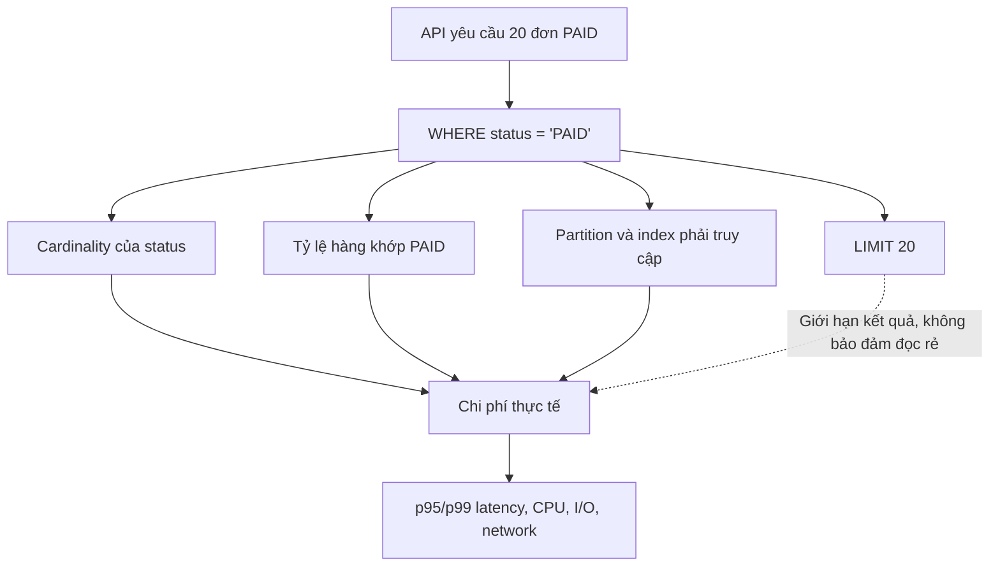
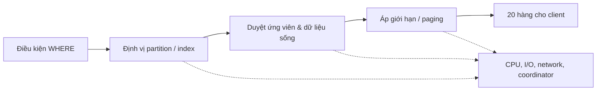
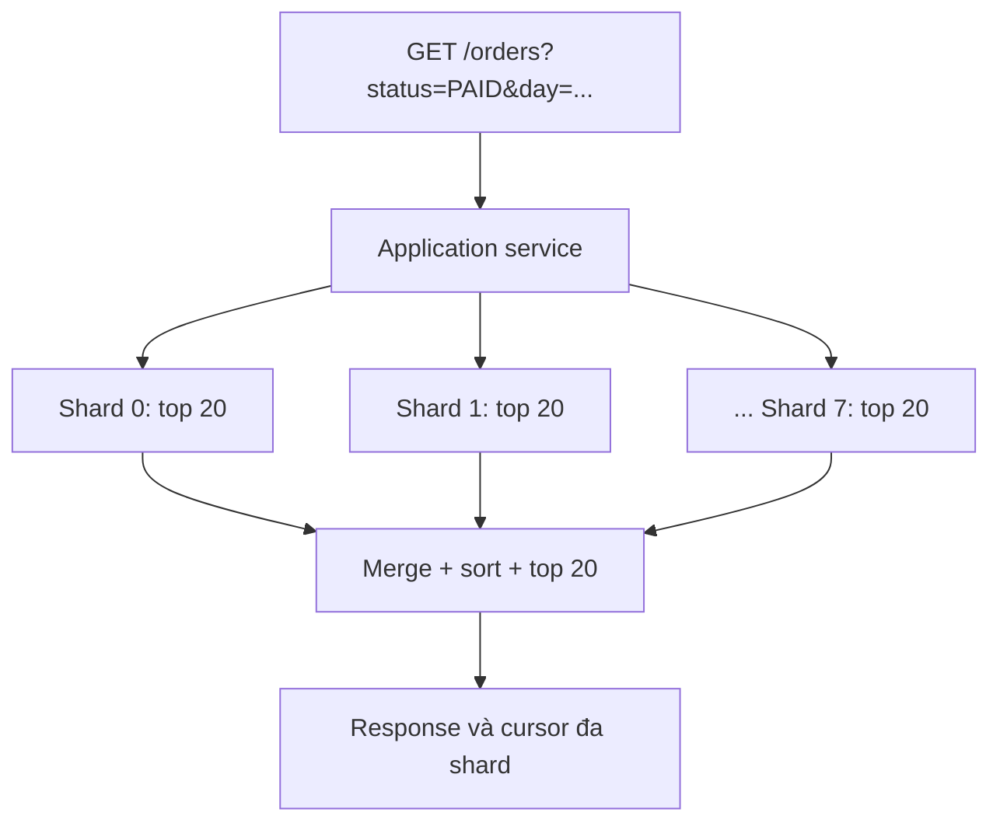

# Độ phân biệt giá trị, kích thước kết quả và chi phí truy vấn

## 1. Vì sao một chỉ mục có thể tồn tại nhưng truy vấn vẫn chậm?

Khi học **Spring Data Cassandra**, chúng ta thường bắt đầu với `@Table`, `@PrimaryKey`, repository, `CassandraTemplate` và truy vấn CQL theo partition key. Sau đó, yêu cầu nghiệp vụ mới xuất hiện: *“Tìm tất cả đơn hàng có trạng thái PAID”*, *“Tìm đơn theo mã tham chiếu bên ngoài”*, hoặc *“Hiển thị 20 đơn mới nhất của một trạng thái”*. Một phản ứng quen thuộc là thêm index lên cột cần lọc.

Nhưng **có chỉ mục** không đồng nghĩa **đọc ít dữ liệu**, và **trả ít kết quả** không đồng nghĩa **xử lý ít dữ liệu**. Độ trễ trong Apache Cassandra còn phụ thuộc vào số partition cần liên hệ, độ phổ biến của giá trị, số hàng phù hợp, lượng byte cần đọc, tombstone, replica, mức nhất quán, paging và tải hệ thống.

Ba câu hỏi phải được trả lời riêng:

1. **Độ phân biệt giá trị (cardinality):** cột có bao nhiêu giá trị *khác nhau*?
2. **Mức độ chọn lọc (selectivity):** một điều kiện cụ thể khớp bao nhiêu hàng so với tổng dữ liệu liên quan?
3. **Chi phí truy vấn:** để có kết quả ấy, cluster phải làm bao nhiêu công việc — tìm index, đọc partition, lọc, truyền mạng, giải mã, phân trang và hòa giải dữ liệu từ replica?



**Điều cần nhớ:** Spring Data Cassandra không tự chuyển một câu CQL khó thành truy vấn hiệu quả. Repository `@Query`, `CassandraTemplate` và Java Driver đều chịu cùng những ràng buộc của Cassandra. Vì thế phải thiết kế đường truy cập dựa trên truy vấn, sau đó mới cân nhắc index là phần mở rộng phù hợp hay không.

## 2. Ví dụ nền tảng: bảng theo ID và các kiểu điều kiện

Giả sử ứng dụng có bảng tra cứu đơn hàng theo ID:

```sql
-- Ví dụ thực hành local một node.
CREATE KEYSPACE IF NOT EXISTS shop_demo
WITH replication = {
    'class': 'SimpleStrategy',
    'replication_factor': 1
};

CREATE TABLE IF NOT EXISTS shop_demo.orders_by_id (
    order_id uuid PRIMARY KEY,
    customer_id uuid,
    created_at timestamp,
    status text,
    external_ref text,
    total_amount decimal,
    note text
);
```

`order_id` là **partition key**, đồng thời là toàn bộ primary key. Truy vấn sau có đường định vị trực tiếp:

```sql
SELECT order_id, status, total_amount
FROM shop_demo.orders_by_id
WHERE order_id = 11111111-1111-4111-8111-111111111111;
```

Ngược lại, những truy vấn sau **không tự nhiên có đường truy cập phù hợp** chỉ nhờ bảng `orders_by_id`:

```sql
-- Không tự hợp lệ/hiệu quả nếu không có index hoặc mô hình đọc phù hợp:
SELECT order_id, status
FROM shop_demo.orders_by_id
WHERE status = 'PAID';

SELECT order_id, status
FROM shop_demo.orders_by_id
WHERE external_ref = 'PAY-2026-000123';
```

**Không dùng `ALLOW FILTERING` làm giải pháp mặc định.** Nó có thể cho phép Cassandra thực hiện một số truy vấn lọc rộng, nhưng không tự thêm đường định vị dữ liệu. Với bảng lớn, số hàng phải xem xét có thể tăng rất nhanh. Nếu endpoint thường xuyên đọc theo `status` hoặc `external_ref`, cần quyết định rõ giữa index và **bảng đọc theo truy vấn**.

## 3. Cardinality: số giá trị khác nhau không phải số hàng

**Cardinality của một cột** là số giá trị phân biệt trong tập dữ liệu đang xét. Ví dụ một bảng có 20 triệu đơn:

| Cột | Số giá trị phân biệt giả định | Nhận xét |
| --- | ---: | --- |
| `status` | 4 | **Cardinality thấp**: `PENDING`, `PAID`, `SHIPPED`, `CANCELLED` |
| `region_code` | 30 | Thấp so với số hàng |
| `customer_id` | 500.000 | Tương đối cao nhưng khách có thể không phân bố đều |
| `external_ref` | 19.000.000 | Rất cao, gần như mỗi đơn một mã |
| `order_id` | 20.000.000 | Rất cao, mỗi hàng một khóa |

Các con số chỉ để phân tích; không phải dữ liệu đo từ một hệ thống thực.

**Cardinality thấp không có nghĩa index luôn vô dụng.** Nó có nghĩa một giá trị đơn lẻ có thể tương ứng với nhiều hàng, nhưng *mức độ tập trung cụ thể* còn phụ thuộc vào phân bố. Ví dụ `status` có bốn giá trị, nhưng `PAID` chiếm 90% còn `CANCELLED` chỉ 0,1%: hai truy vấn trên cùng index có thể có hành vi khác nhau đáng kể.

**Cardinality cao không đồng nghĩa truy vấn nhanh.** Tìm một `external_ref` gần như duy nhất nghe có vẻ rất chọn lọc, nhưng nếu index phải liên hệ nhiều node và duy trì một lượng lớn mục index, chi phí vận hành có thể lớn hơn một bảng lookup theo khóa.

### 3.1. Cardinality của tập dữ liệu nào?

Luôn nói rõ phạm vi:

- **Toàn bảng:** có bao nhiêu giá trị `status` trong tất cả đơn?
- **Trong một tenant:** có bao nhiêu trạng thái hoặc khách?
- **Trong một partition/day bucket:** có bao nhiêu giá trị `event_type`?
- **Theo thời gian:** tuần gần đây có khác dữ liệu lịch sử không?

Một trường có cardinality toàn bảng lớn vẫn có thể rất ít giá trị trong một partition cụ thể. Ngược lại, một partition nóng có thể chứa rất nhiều hàng của **cùng một giá trị ít phân biệt**.

### 3.2. Không chỉ đếm giá trị distinct

Cardinality không phản ánh **độ lệch phân bố**. Với 20 triệu đơn và 4 trạng thái, phép chia đều cho kết quả trung bình 5 triệu đơn/trạng thái. Nhưng thực tế có thể là:

| `status` | Số hàng giả định | Tỷ lệ |
| --- | ---: | ---: |
| `PAID` | 12.000.000 | 60% |
| `SHIPPED` | 5.000.000 | 25% |
| `CANCELLED` | 2.000.000 | 10% |
| `PENDING` | 1.000.000 | 5% |
| **Tổng** | **20.000.000** | **100%** |

`status` vẫn có cardinality là **4**, nhưng truy vấn `status = 'PAID'` có phạm vi phù hợp tiềm năng lớn gấp 12 lần truy vấn `status = 'PENDING'`. Khi đánh giá một index, nên kiểm tra **tần suất từng giá trị**, không chỉ số lượng giá trị distinct.

## 4. Selectivity: một điều kiện khớp bao nhiêu hàng?

Để tránh nhập nhằng thuật ngữ *selectivity* (một số tài liệu dùng quy ước càng chọn lọc thì selectivity càng cao), ở bài này định nghĩa rõ:

```text
N = tổng số hàng của tập dữ liệu đang xét
M = số hàng khớp điều kiện
match_ratio = M / N
```

- `match_ratio` **nhỏ**: điều kiện **chọn lọc cao**, ví dụ một external ID gần như duy nhất.
- `match_ratio` **lớn**: điều kiện **chọn lọc thấp**, ví dụ `status = 'PAID'` khớp phần lớn đơn.

Với bảng giả định 20 triệu hàng:

| Điều kiện | Hàng phù hợp giả định | `M / N` | Đánh giá |
| --- | ---: | ---: | --- |
| `order_id = ?` | 1 | 0,000005% | Rất chọn lọc và **có partition key trực tiếp** |
| `external_ref = ?` | 1 | 0,000005% | Rất chọn lọc, nhưng vẫn cần đường tra cứu |
| `status = 'PENDING'` | 1.000.000 | 5% | Kém chọn lọc hơn |
| `status = 'PAID'` | 12.000.000 | 60% | Chọn lọc rất thấp |

Từ đây, một index trên `external_ref` **có thể** hữu ích với một truy vấn trả rất ít kết quả; một index trên `status` phục vụ truy vấn `PAID` có thể phải quản lý tập khóa phù hợp rất lớn. Nhưng quyết định cuối cùng phải xét **loại index, cách dữ liệu phân phối, kết hợp điều kiện và workload thật**.

### 4.1. Selectivity sau khi biết partition key

Xét bảng:

```sql
CREATE TABLE IF NOT EXISTS shop_demo.orders_by_customer_day (
    customer_id uuid,
    day_bucket date,
    created_at timestamp,
    order_id uuid,
    status text,
    total_amount decimal,
    PRIMARY KEY ((customer_id, day_bucket), created_at, order_id)
) WITH CLUSTERING ORDER BY (created_at DESC, order_id ASC);
```

Nếu request cung cấp **đầy đủ** `(customer_id, day_bucket)`, Cassandra có thể định vị một partition. Trong phạm vi này, dù status chỉ có vài giá trị thì query đã tránh được tìm kiếm toàn bảng.

Tuy nhiên, `status` vẫn là **cột thường**: không thể tùy ý thêm `AND status = 'PAID'` rồi kỳ vọng CQL hợp lệ hoặc rẻ. Muốn lọc kết hợp theo status và customer/day thường xuyên, cần thiết kế thêm read model hoặc chọn chỉ mục được hỗ trợ với hiệu quả đo được.

**Chọn lọc của một giá trị và khả năng định vị partition là hai vấn đề khác nhau.** Đây là lý do bảng được thiết kế theo truy vấn thường có lợi thế đối với các API có khóa truy cập rõ ràng.

## 5. Kích thước kết quả không đồng nghĩa chi phí đọc

Câu hỏi hay gặp: *“API chỉ cần 20 hàng, thêm `LIMIT 20` là đủ nhanh không?”* Câu trả lời là **không chắc**.

Hãy phân biệt:

1. **Số hàng trả về** cho client (`rows returned`).
2. **Số mục index hoặc ứng viên phải tìm/kiểm tra** trước khi có kết quả.
3. **Số partition/replica cần liên hệ** để có kết quả.
4. **Số byte và cột phải đọc**, gồm cả các cột lớn/collections.
5. **Số tombstone hoặc bản dữ liệu hết hạn** ảnh hưởng quá trình đọc.
6. **Số page/round trip**, concurrency và lượng dữ liệu trung gian.



`LIMIT 20` **giới hạn số hàng của kết quả CQL**, không cam kết Cassandra chỉ xử lý 20 hàng vật lý. Một index tốt có thể dừng sớm khi tìm đủ ứng viên; một điều kiện lọc nghèo nàn, nhiều tombstone hoặc các hàng phân tán có thể cần công việc lớn hơn nhiều. Không khẳng định hệ thống phải quét toàn bộ 12 triệu hàng để trả 20 kết quả; cũng không khẳng định nó chỉ chạm đúng 20 hàng.

### 5.1. Chi phí theo số byte, không chỉ số hàng

Hai truy vấn cùng trả 20 hàng có thể khác xa:

```sql
-- Chỉ lấy cột cần cho danh sách.
SELECT order_id, status, created_at
FROM shop_demo.orders_by_id
WHERE order_id = ?;

-- Nếu dùng SELECT *, có thể tải cả payload lớn hoặc collections.
SELECT *
FROM shop_demo.orders_by_id
WHERE order_id = ?;
```

Với lookup theo ID, hai câu đều truy cập partition tương ứng, nhưng `SELECT *` có thể trả nhiều byte hơn. Trong một danh sách, projection chỉ lấy ID/trạng thái/thời gian thường giúp giảm network và Java mapping. **Projection không sửa được chi phí fan-out** nếu điều kiện WHERE vẫn bắt cluster tìm trong nhiều partition.

### 5.2. Không có sắp xếp toàn cục chỉ vì có index

Index trên `status` không làm cho câu *“20 đơn PAID mới nhất trong cả hệ thống”* tự nhiên có thứ tự toàn cục theo `created_at`. Cassandra cho phép `ORDER BY` theo clustering order trong các phạm vi truy vấn được hỗ trợ; không nên suy ra có thể `ORDER BY created_at DESC` tùy ý trên một tập hàng trải nhiều partition.

Muốn xem danh sách theo thời gian, hãy thiết kế **partition và clustering columns** phục vụ thứ tự mong muốn, rồi giới hạn thời gian/shard của API.

## 6. Chỉ mục thứ cấp truyền thống (2i): có đường tìm nhưng không phải miễn phí

Một secondary index kiểu truyền thống có thể được tạo, nếu phiên bản server đang dùng hỗ trợ cú pháp tương ứng:

```sql
-- Minh họa một secondary index truyền thống, không phải khuyến nghị mặc định.
CREATE INDEX IF NOT EXISTS orders_status_2i
ON shop_demo.orders_by_id (status);
```

Sau khi index được xây dựng xong, Cassandra có thể chấp nhận truy vấn theo `status` mà bảng gốc không có partition key trong WHERE:

```sql
SELECT order_id, status, total_amount
FROM shop_demo.orders_by_id
WHERE status = 'PAID'
LIMIT 20;
```

**Điều cần hiểu:** index cho phép thêm một đường tìm kiếm; nó không biến `status` thành partition key của bảng gốc, và không bảo đảm chi phí giống lookup `WHERE order_id = ?`. Các truy vấn trên index có thể liên quan nhiều node/partition tùy phân bố và cơ chế index.

### 6.1. Những yếu tố làm 2i khó vận hành

- **Giá trị phổ biến:** `PAID` chứa hàng triệu đơn có thể tạo khối lượng mục index/kết quả phù hợp lớn.
- **Dữ liệu phân tán:** không có một partition khóa nghiệp vụ để giới hạn tập đọc; có thể cần fan-out hoặc thêm công việc coordinator.
- **Cập nhật giá trị được index:** đổi `PENDING → PAID` làm phát sinh công việc duy trì index, có thể tạo tombstone/index-entry lifecycle.
- **Xóa và TTL:** việc ghi, hết hạn và xóa ảnh hưởng dữ liệu index, compaction và số lượng tombstone.
- **Dữ liệu lớn:** xây index trên bảng đã có rất nhiều hàng cần tài nguyên và thời gian; phải quan sát trạng thái build trước khi chuyển traffic.
- **Độ lệch dữ liệu:** cùng một index có thể chạy khác nhau giữa `status='PAID'` và `status='PENDING'`.

Không kết luận “2i luôn tệ” hoặc “index có sẵn nên không cần thiết kế bảng”. Việc sử dụng hợp lý phụ thuộc phiên bản Cassandra, phân bố dữ liệu, khối lượng update, độ trễ chấp nhận được và sự hiện diện của partition key trong truy vấn.

## 7. SAI: Storage-Attached Index và phạm vi áp dụng

Với các môi trường hỗ trợ **Storage-Attached Index (SAI)** — chẳng hạn **Apache Cassandra 5.x** — có thể dùng một cơ chế index được tích hợp với định dạng lưu trữ và tối ưu hơn cho một số workload tìm kiếm theo cột. SAI có cách duy trì và tra cứu khác **legacy 2i**, vì vậy không đánh đồng hai loại chỉ mục khi đánh giá hiệu năng.

Ví dụ cú pháp tham khảo cho môi trường hỗ trợ SAI:

```sql
-- Phương án thử nghiệm THAY THẾ 2i ở phần trước, không tạo cả hai chỉ
-- mục cùng mục đích trong một bài đo mà không kiểm soát biến thử nghiệm.
CREATE CUSTOM INDEX IF NOT EXISTS orders_status_sai
ON shop_demo.orders_by_id (status)
USING 'StorageAttachedIndex';
```

**Phụ thuộc phiên bản và bản phân phối:** khả năng hỗ trợ SAI, cú pháp tạo index, các toán tử, cách kết hợp nhiều điều kiện, giới hạn collection và các tùy chọn vận hành cần đối chiếu tài liệu của **đúng Cassandra distribution/version đang chạy**. Không giả định mọi cụm Cassandra 3.x/4.x hoặc mọi bản triển khai tương thích CQL đều có SAI mặc định.

### 7.1. SAI giúp gì?

Trong những use case phù hợp, SAI có thể cải thiện khả năng tìm kiếm theo cột so với kiểu secondary index cũ, hỗ trợ một số điều kiện có độ chọn lọc tốt và tránh phải tự thiết kế bảng phụ cho **mọi** bộ lọc đơn lẻ.

Nhưng SAI **không**:

- Tự tạo một global sorted index cho mọi trường/tổ hợp `ORDER BY`.
- Biến một điều kiện rất phổ biến thành truy vấn chỉ đọc vài byte.
- Thay thế giới hạn partition, thiết kế bucket hoặc phân trang hợp lý.
- Tự tạo transaction xuyên các bảng read model.
- Bảo đảm mọi tổ hợp `AND`, range và collection query đều được hỗ trợ trên mọi phiên bản.

### 7.2. 2i, SAI và bảng theo truy vấn

| Lựa chọn | Điểm mạnh | Chi phí và giới hạn chính |
| --- | --- | --- |
| **Lookup theo primary key** | Đường đọc rõ, định vị partition | Cần có đầy đủ key phù hợp với schema |
| **Legacy 2i** | Thêm khả năng tìm theo một số cột không thuộc key | Fan-out, cập nhật/xóa index, hành vi phụ thuộc cardinality và phân bố |
| **SAI (khi có hỗ trợ)** | Khả năng tìm theo cột linh hoạt hơn trong nhiều workload | Tăng chi phí ghi/lưu trữ, giới hạn kiểu query và phiên bản, không thay thế data modeling |
| **Bảng đọc chuyên biệt** | Chủ động partition/clustering theo endpoint, dễ kiểm soát thứ tự và paging | Ghi nhân bản, đồng bộ dữ liệu, backfill, vận hành nhiều bảng |

Quyết định nên dựa trên **workload cụ thể**: mức độ chọn lọc, số hàng phù hợp, lượng dữ liệu trả, tần suất đọc/ghi, cập nhật các cột được index, latency SLO và chi phí duy trì.

## 8. Thiết kế bảng theo truy vấn để tránh index trên giá trị phổ biến

Giả sử yêu cầu thực tế là:

> Hiển thị các đơn **PAID mới nhất trong một ngày**, tối đa 20 dòng, có thể tiếp tục xem những trang sau.

Index trên `status` không tự tạo thứ tự `created_at DESC` toàn cụm. Ta có thể dùng một read model riêng:

```sql
CREATE TABLE IF NOT EXISTS shop_demo.orders_by_status_day (
    status text,
    day_bucket date,
    created_at timestamp,
    order_id uuid,
    customer_id uuid,
    total_amount decimal,
    PRIMARY KEY ((status, day_bucket), created_at, order_id)
) WITH CLUSTERING ORDER BY (created_at DESC, order_id ASC);
```

Truy vấn:

```sql
SELECT order_id, created_at, customer_id, total_amount
FROM shop_demo.orders_by_status_day
WHERE status = 'PAID'
  AND day_bucket = '2026-11-25'
LIMIT 20;
```

Câu query biết **đầy đủ partition key** là `(status, day_bucket)` và đọc theo clustering `created_at DESC`. So với index chỉ theo status trên toàn bảng, phạm vi đã được thu hẹp vào **một status trong một ngày**.

Tuy nhiên, chính status `PAID` là **cardinality thấp**. Nếu cả hệ thống có hàng triệu đơn PAID mỗi ngày, partition `(PAID, 2026-11-25)` có thể quá lớn và bị ghi nóng. Bảng được thiết kế theo truy vấn **cũng phải kiểm soát kích thước partition**, không tự nhiên luôn hiệu quả.

### 8.1. Thêm shard khi một status/ngày quá lớn

Một biến thể dành cho workload lớn:

```sql
CREATE TABLE IF NOT EXISTS shop_demo.orders_by_status_day_shard (
    status text,
    day_bucket date,
    shard int,
    created_at timestamp,
    order_id uuid,
    customer_id uuid,
    total_amount decimal,
    PRIMARY KEY ((status, day_bucket, shard), created_at, order_id)
) WITH CLUSTERING ORDER BY (created_at DESC, order_id ASC);
```

Tầng service tính `shard` ổn định, ví dụ một giá trị trong khoảng `0..7` được dẫn xuất từ `order_id` bằng hàm hash được chuẩn hóa trong toàn bộ ứng dụng. Số shard cần được chọn theo **tốc độ ghi, kích thước partition và giới hạn fan-out**, không lấy 8 làm hằng số tối ưu cho mọi hệ thống.

Query trên một shard:

```sql
SELECT order_id, created_at, total_amount
FROM shop_demo.orders_by_status_day_shard
WHERE status = 'PAID'
  AND day_bucket = '2026-11-25'
  AND shard = 3
LIMIT 20;
```

Để hiển thị **20 đơn PAID mới nhất của cả ngày**, service phải đọc nhiều shard (có giới hạn concurrency), **merge theo `(created_at DESC, order_id ASC)`** rồi chọn 20 kết quả. Không có cơ chế để Cassandra tự sắp xếp toàn cục các partition chỉ vì tất cả cùng có clustering order.

Sơ đồ:



Ưu điểm là phân bố tải và giới hạn partition tốt hơn; chi phí là nhiều truy vấn mỗi request và cursor/phân trang phức tạp hơn. Phải đo cả **chi phí đọc lẫn ghi**, không chỉ số lượng phần tử trên trang.

### 8.2. Đường tra cứu theo `external_ref`

Với mã tham chiếu gần như duy nhất:

```sql
CREATE TABLE IF NOT EXISTS shop_demo.order_id_by_external_ref (
    external_ref text PRIMARY KEY,
    order_id uuid
);

SELECT order_id
FROM shop_demo.order_id_by_external_ref
WHERE external_ref = 'PAY-2026-000123';
```

Sau đó ứng dụng đọc `orders_by_id` theo `order_id`, hoặc lưu các trường cần thiết vào read model để tránh lượt lookup thứ hai. Đây là **bảng tra cứu theo khóa**, cho phép độ trễ và số partition dự đoán tốt hơn khi workload chủ yếu tìm chính xác một external ID.

Nhưng sự tồn tại của bảng lookup **không tự bảo đảm uniqueness nghiệp vụ xuyên mọi hệ thống**. Nếu cần chỉ định một external reference cho đúng một order một cách có điều kiện cạnh tranh, phải thiết kế ghi idempotent/LWT và quy trình đồng bộ tương ứng.

## 9. Spring Data Cassandra có thay đổi quyết định chọn index không?

Không. Một interface repository có thể biểu diễn CQL có index nhưng vẫn chịu chi phí Cassandra.

Ví dụ entity đơn giản:

```java
import java.math.BigDecimal;
import java.time.Instant;
import java.util.UUID;

import org.springframework.data.cassandra.core.mapping.Column;
import org.springframework.data.cassandra.core.mapping.PrimaryKey;
import org.springframework.data.cassandra.core.mapping.Table;

@Table("orders_by_id")
public class OrderById {

    @PrimaryKey("order_id")
    private UUID orderId;

    @Column("status")
    private String status;

    @Column("created_at")
    private Instant createdAt;

    @Column("total_amount")
    private BigDecimal totalAmount;

    protected OrderById() {
    }

    // Bổ sung constructor/getters để triển khai thực tế.
}
```

Khai báo repository có truy vấn theo index, **chỉ để minh họa** khi index tương ứng đã tồn tại và đã sẵn sàng:

```java
import java.util.List;
import java.util.UUID;

import org.springframework.data.cassandra.repository.CassandraRepository;
import org.springframework.data.cassandra.repository.Query;

public interface OrderByIdRepository
        extends CassandraRepository<OrderById, UUID> {

    @Query("""
        SELECT * FROM orders_by_id
        WHERE status = ?0
        LIMIT ?1
        """)
    List<OrderById> findSomeByIndexedStatus(String status, int limit);
}
```

`?0`, `?1` là bind parameters; điều này giúp tránh nội suy literal và query-shape explosion. Nhưng **`findSomeByIndexedStatus("PAID", 20)` không có nghĩa “20 đơn PAID mới nhất”**, không bảo đảm index hữu ích cho một tập matching rất lớn, và không trả lời bài toán phân trang theo thời gian. Khi cần semantics “mới nhất”, hãy dùng bảng có clustering order và giới hạn partition rõ ràng như phần trước.

Đối với bảng `orders_by_status_day_shard`, service hoặc persistence adapter có thể dùng prepared CQL:

```java
import java.time.LocalDate;
import java.util.UUID;

import com.datastax.oss.driver.api.core.CqlSession;
import com.datastax.oss.driver.api.core.cql.PreparedStatement;

public final class OrderStatusShardReader {

    private final CqlSession session;
    private final PreparedStatement readShard;

    public OrderStatusShardReader(CqlSession session) {
        this.session = session;
        this.readShard = session.prepare("""
            SELECT order_id, created_at, total_amount
            FROM shop_demo.orders_by_status_day_shard
            WHERE status = ? AND day_bucket = ? AND shard = ?
            LIMIT ?
            """);
    }

    public void readPage(String status, LocalDate day, int shard, int limit) {
        if (limit < 1 || limit > 100) {
            throw new IllegalArgumentException("limit không hợp lệ");
        }
        if (shard < 0 || shard >= 8) {
            throw new IllegalArgumentException("shard không hợp lệ");
        }

        var statement = readShard.bind(status, day, shard, limit)
            .setPageSize(Math.min(limit, 50));

        var resultSet = session.execute(statement);
        // Chuyển Row thành DTO và quản lý paging state theo API thực tế.
        // Không đưa ResultSet trực tiếp cho HTTP controller.
    }
}
```

Ví dụ cho thấy một request biết đủ **partition key**; không hề cần index phụ. Trong production, không hardcode số shard ở nhiều nơi: đưa quy tắc shard thành cấu hình hoặc hợp đồng versioned, và kiểm thử migration khi số shard thay đổi.

`CassandraTemplate` và `CqlTemplate` cũng không vượt qua giới hạn CQL: cùng một câu `WHERE status = ?` trên bảng không có đường truy cập phù hợp vẫn có vấn đề tương tự. Chọn công cụ để biểu đạt/mapping query, **không dùng việc đổi API để chữa data model**.

## 10. Paging, COUNT và các kết quả lớn

### 10.1. `LIMIT` không thay page size

Ví dụ CQL:

```sql
SELECT order_id, created_at, total_amount
FROM shop_demo.orders_by_status_day
WHERE status = 'PAID' AND day_bucket = '2026-11-25'
LIMIT 200;
```

Nếu driver đặt page size 50, một truy vấn có thể phải lấy nhiều page để duyệt đến 200 hàng. Với synchronous `ResultSet`, việc duyệt hết bằng vòng lặp có thể tự kích hoạt lấy thêm page; **không coi `setPageSize(50)` là hợp đồng trả đúng 50 hàng trong HTTP response**.

Ba khái niệm khác nhau:

| Khái niệm | Ý nghĩa |
| --- | --- |
| `LIMIT` | Giới hạn tổng số hàng trả về của câu query |
| Driver page size | Kích thước page mục tiêu của cơ chế fetch |
| Paging state | Trạng thái tiếp tục **cùng query và tham số tương ứng** |

Đối với API danh sách lớn, nên trả cursor opaque, ràng buộc với tenant/status/day/shard/filter và phiên bản truy vấn. Không dùng paging state như một offset chung cho mọi phân vùng hoặc cơ chế phân quyền. Phân trang theo các shard cần **trạng thái nhiều partition** do service quản lý.

### 10.2. Kích thước kết quả và tổng số kết quả khác nhau

Một trang chỉ có 20 đơn không cho biết tổng cộng có bao nhiêu đơn PAID. `COUNT(*)` trên nhiều partition hoặc một index predicate lớn có thể rất tốn kém; nó không tự được tối ưu thành một thao tác rẻ như trên một số cơ sở dữ liệu quan hệ.

Nếu UI cần `totalCount`, cân nhắc:

- Chỉ hiển thị **có trang tiếp theo** thay vì tổng số trang.
- Dùng số liệu tổng hợp đã được duy trì riêng nếu nghiệp vụ chấp nhận độ trễ/độ lệch.
- Thiết kế pipeline thống kê riêng cho báo cáo lớn.
- Tránh quét toàn bảng chỉ để cung cấp một con số trang trí trong API.

### 10.3. Kết quả lớn cần giới hạn phạm vi trước

Một endpoint `GET /orders?status=PAID` không giới hạn ngày hoặc tenant có thể tương ứng hàng triệu đơn. Index giúp tìm ứng viên, nhưng **không làm giảm nhu cầu nghiệp vụ đòi đọc hàng triệu hàng**. Nên yêu cầu cửa sổ thời gian, tenant hoặc một bộ lọc chính được hỗ trợ; hạn chế `LIMIT`/page size và lập kế hoạch export/analytics riêng nếu cần toàn bộ lịch sử.

## 11. Ghi, xóa và TTL làm thay đổi chi phí index

Index không chỉ tăng chi phí đọc; nó còn ảnh hưởng **đường ghi**:

```text
Đơn mới: INSERT status = PENDING
  -> ghi dữ liệu bảng gốc
  -> duy trì thông tin index tương ứng

Thanh toán: UPDATE status = PAID
  -> ghi giá trị mới
  -> xử lý index entry cho PENDING / PAID

Hết TTL hoặc DELETE
  -> dữ liệu không còn hiệu lực
  -> tombstone / compaction / cập nhật trạng thái index theo cơ chế server
```

Chi tiết implementation khác nhau giữa 2i và SAI, nhưng **write amplification, storage overhead và thời gian duy trì index** đều là yếu tố cần đo. Một index trên cột trạng thái thay đổi rất thường xuyên có thể tốn hơn index trên cột ít cập nhật.

Cũng phải nhớ tính chất **upsert** của Cassandra: `INSERT` và `UPDATE` có thể ghi đè giá trị theo primary key. Một cột `external_ref` thay đổi phải đồng bộ bảng tra cứu cũ/mới nếu dùng mô hình lookup riêng. Nếu update nhiều read models, service phải thiết kế **idempotency, retry, reconciliation và kỳ vọng eventual consistency**; không có annotation Spring nào tự biến các bảng Cassandra thành một transaction quan hệ.

## 12. Đo thực tế trước khi quyết định index

Thay vì tranh luận *“SAI hay bảng phụ nhanh hơn?”* theo cảm giác, hãy đo trên dữ liệu và workload đại diện.

### 12.1. Chuẩn bị tập thử nghiệm

Ít nhất có các nhóm:

1. **Độ phân biệt thấp:** `status` có vài giá trị, với phân bố lệch như `PAID` 60%.
2. **Độ phân biệt cao:** `external_ref` gần như duy nhất.
3. **Hot key:** một tenant/khách hoặc một bucket được truy cập và cập nhật nhiều.
4. **Dữ liệu có TTL và nhiều xóa:** để thấy ảnh hưởng tombstones.
5. **Hàng rộng/hàng hẹp:** `SELECT *` so với projection những cột cần.
6. **Bảng nhỏ và bảng lớn:** index đủ tốt khi dữ liệu nhỏ chưa chắc đáp ứng SLO ở quy mô tương lai.

So sánh tối thiểu ba phương án cho từng endpoint: **truy vấn theo primary key**, **index được hỗ trợ trên phiên bản đang chạy**, và **read model chuyên biệt** nếu use case đủ quan trọng.

### 12.2. Những số liệu cần theo dõi

| Chỉ số | Cho biết điều gì |
| --- | --- |
| p50/p95/p99 latency mỗi loại query | Độ trễ thông thường và tail latency |
| Rows returned và bytes returned | Quy mô kết quả thực chuyển về client |
| Số partition/node tham gia, fan-out | Chi phí phân tán không thể suy từ LIMIT |
| CPU, memory, disk I/O, network trên replica/coordinator | Tài nguyên để tìm và trả kết quả |
| Read/write throughput, latency ghi | Chi phí duy trì index và read model |
| Tombstone scans/compaction pressure | Tác động của DELETE/TTL/cột thay đổi |
| Query timeouts, retries, overload | Độ ổn định khi tải tăng |
| Dung lượng index và thời gian build | Chi phí lưu trữ/triển khai index |
| Hot partitions, partition size | Có nên thêm bucket/shard không |

Không phải mọi metric đều có cùng tên trong mọi Cassandra distribution, Java Driver hoặc hệ quan sát. Nên đối chiếu metrics/driver API của **phiên bản đang sử dụng** thay vì giả định một metric cụ thể luôn sẵn có.

### 12.3. CQL tracing và kiểm thử

Trong `cqlsh` có thể bật tracing khi thử một truy vấn hẹp:

```sql
TRACING ON;

SELECT order_id, status
FROM shop_demo.orders_by_id
WHERE order_id = 11111111-1111-4111-8111-111111111111;

TRACING OFF;
```

`TRACING ON/OFF` là lệnh điều khiển của **cqlsh**; trace có overhead và không nên bật tràn lan cho toàn bộ production workload. Tracing giúp xem một phần đường đi của truy vấn; không thay thế benchmark p95/p99 dưới concurrency thực tế. Không suy ra Apache Cassandra có câu `EXPLAIN` giống các RDBMS rồi dựa vào nó để phán đoán query plan.

### 12.4. Thí nghiệm có kiểm soát

1. **Baseline:** chạy query theo ID, query theo status (chỉ khi cú pháp hợp lệ), ghi nhận latency và lỗi.
2. **Index thử nghiệm:** trên môi trường có dữ liệu đại diện, tạo index phù hợp (2i *hoặc* SAI), chờ hoàn tất xây dựng, đo query theo giá trị phổ biến và hiếm.
3. **Đo write overhead:** cập nhật `status` nhiều lần, xóa/TTL và quan sát write p99 cùng compaction/index size.
4. **Read model:** tạo bảng theo status/day hoặc status/day/shard; backfill với tốc độ có kiểm soát, đo read latency và write amplification.
5. **Đánh giá nhiều mức tải:** so sánh concurrency, tỷ lệ read/write, số tenant, kích thước dataset, kết quả lớn/nhỏ.
6. **Chọn theo SLO và tổng chi phí:** không chỉ nhìn một truy vấn chạy nhanh trong môi trường local RF=1.

Lưu ý: tạo index trên bảng production lớn có chi phí và rủi ro riêng; cần kế hoạch vận hành và kiểm soát rollout. Đừng tạo/xóa index lặp lại để thử nghiệm trên cluster chính mà không có biện pháp bảo vệ.

## 13. Ma trận lựa chọn cho từng use case

| Use case | Cardinality/selectivity | Lựa chọn ưu tiên để đánh giá | Lý do |
| --- | --- | --- | --- |
| Tra cứu bằng `order_id` | Rất chọn lọc, ID duy nhất theo bảng | **Primary-key lookup** | Định vị partition trực tiếp |
| Tra cứu bằng `external_ref` gần như duy nhất | Cao, số match thấp | **Lookup table** hoặc SAI nếu workload phù hợp | Tránh tìm toàn bảng, cân nhắc chi phí duy trì |
| Liệt kê tất cả đơn `PAID` trong nhiều năm | Thấp, số match rất lớn | **Giới hạn API/analytics pipeline** | Index không biến yêu cầu tải hàng triệu hàng thành rẻ |
| 20 đơn PAID mới nhất trong một ngày | Status thấp cardinality, cần thứ tự thời gian | **Bảng theo status + day + clustering** | CQL truy cập có phạm vi và thứ tự |
| Nhóm `PAID` mỗi ngày có hàng triệu đơn | Partition nguy cơ lớn/hot | **Bucket nhỏ hơn hoặc shard có kiểm soát** | Phân bố tải, đánh đổi với merge/fan-out |
| Bộ lọc phụ không thường xuyên, có tính chọn lọc | Tùy thuộc dữ liệu và phiên bản | **Thử SAI/index phù hợp**, đo thực nghiệm | Có thể không đáng tạo bảng riêng cho bộ lọc hiếm |
| Tìm theo nhiều thuộc tính tùy ý | Nhiều tổ hợp lọc | **Đánh giá giới hạn index/search architecture** | Cassandra không phải engine SQL ad hoc toàn năng |

**Không dùng cardinality làm quy tắc duy nhất.** Cột có một triệu giá trị distinct vẫn có thể tạo index đắt nếu truy vấn phải tìm trên nhiều node, hoặc nếu tần suất cập nhật và TTL rất cao. Ngược lại, một chỉ mục trên cột cardinality thấp vẫn có thể chấp nhận được nếu truy vấn luôn có partition restriction tốt và workload chứng minh latency/chi phí phù hợp.

## 14. Các lỗi tư duy và cách khắc phục

| Nhận định sai | Vì sao sai | Cách sửa |
| --- | --- | --- |
| “Status có 4 giá trị nên index chắc chắn nhanh” | Mỗi giá trị có thể khớp hàng triệu hàng | Đo phân bố và tỷ lệ khớp từng giá trị |
| “External reference gần unique nên index luôn tối ưu” | Query có thể đi qua cơ chế index và nhiều node | So sánh SAI với bảng lookup theo primary key |
| “LIMIT 20 tức là database chỉ đọc 20 hàng” | Có thể phải duyệt ứng viên, tombstone, nhiều partition | Đo work/latency và test giá trị phổ biến/hiếm |
| “Có index thì ORDER BY toàn cluster được” | Cassandra sắp xếp chủ yếu theo clustering trong phạm vi hỗ trợ | Thiết kế read model theo thời gian |
| “Chỉ cần dùng `ALLOW FILTERING`” | Có thể quét dữ liệu không giới hạn | Chọn partition key, index hay bảng đọc phù hợp |
| “Index không ảnh hưởng ghi” | Phải duy trì index khi insert/update/delete/TTL | Benchmark read và write cùng nhau |
| “SAI có ở mọi phiên bản Cassandra” | Hỗ trợ phụ thuộc version/distribution | Xác minh tính năng trên cluster thật |
| “Ít hàng trả về thì ít byte xử lý” | `SELECT *` có thể tải payload/collection lớn | Projection đúng cột cần |
| “Bảng status/day chắc chắn không hot” | Status ít giá trị; một ngày có thể chứa rất nhiều hàng | Đo partition size, bucket và shard |
| “Spring repository tự tối ưu `findByStatus`” | Derived query không đổi giới hạn CQL | Bắt đầu từ schema/truy vấn, rồi chọn API |
| “Một cursor dùng được cho mọi filter/query” | Paging state gắn với query và tham số | Cursor versioned, opaque, ràng buộc quyền và bộ lọc |
| “COUNT(*) trên index luôn rẻ” | Đếm có thể phải xử lý tập dữ liệu lớn | Slice/cursor hoặc thống kê được duy trì riêng |

## 15. Bài tập thực hành

**Bài 1 — Cardinality và selectivity.** Một bảng có 10 triệu hàng; `status` có 5 giá trị và `PAID` chiếm 70%. Tính số hàng khớp `PAID` và `match_ratio`. Vì sao câu `WHERE status='PAID' LIMIT 20` không đủ chứng minh truy vấn nhẹ?

**Bài 2 — Hai giá trị cùng một index.** `CANCELLED` chiếm 0,1% còn `PAID` chiếm 70%. Cùng index trên status, hãy đề xuất benchmark hai truy vấn, các chỉ số cần đo và lý do không nên suy thời gian chạy từ cardinality tổng.

**Bài 3 — SAI và 2i.** Trên một Cassandra cluster được xác minh hỗ trợ SAI, mô tả cách thử SAI trên `external_ref` và so sánh với bảng lookup. Những yếu tố nào cần đo ở cả đọc, ghi, index build và vận hành? Vì sao phải tách phép thử với legacy 2i?

**Bài 4 — Top 20 theo thời gian.** Từ yêu cầu “20 đơn PAID mới nhất của một ngày”, hãy thiết kế bảng có partition key theo status/day và clustering `created_at DESC`. Trả lời vì sao index chỉ theo status không tự có thứ tự toàn cục.

**Bài 5 — Hot partition.** Một ngày có 4 triệu đơn PAID. Đề xuất chia theo shard hoặc bucket giờ; giải thích cách tính shard ổn định, số partition cần đọc cho API top 20, cách merge và cursor đa partition.

**Bài 6 — Projection và paging.** So sánh `SELECT *` với chỉ chọn `order_id`, `created_at`, `status` ở một bảng có `note` và payload lớn. Chỉ ra chiều nào của chi phí giảm, chiều nào vẫn phụ thuộc partition/index.

**Bài 7 — Ghi và xóa.** Một cột indexed `status` thay đổi từ `PENDING` sang `PAID` nhiều lần, đồng thời hệ thống có TTL. Đề xuất test quan sát write p99, index maintenance và tombstone, cùng biện pháp đối soát khi dùng bảng read model riêng.

### Câu hỏi tự kiểm tra

1. Cardinality, match ratio và số hàng trả về khác nhau như thế nào?
2. Vì sao một cột có cardinality thấp vẫn có sự khác biệt lớn giữa hai giá trị?
3. Điều kiện rất chọn lọc có tự bảo đảm truy vấn hiệu quả khi không có partition key không?
4. `LIMIT` ràng buộc điều gì, và không bảo đảm điều gì về I/O/CPU?
5. Vì sao secondary index không tự cấp khả năng `ORDER BY` toàn cục theo timestamp?
6. SAI và legacy 2i có thể đánh giá như cùng một cơ chế index không?
7. Khi nào nên thêm bảng `orders_by_status_day` thay vì chỉ thêm index trên `status`?
8. Vì sao phân shard làm giảm hot partition nhưng tăng công việc merge và paging?
9. `COUNT(*)` có phải thao tác nhẹ để hỗ trợ tổng số trang trên bảng lớn không?
10. Khi benchmark index, cần đo gì ngoài p50 latency của một câu SELECT?

## Kết luận

Trong **Spring Data Cassandra**, đánh giá index phải bắt đầu từ **độ phân biệt giá trị**, **tỷ lệ hàng thực sự khớp**, **kích thước kết quả**, và đặc biệt là **công việc phân tán cần thực hiện để trả kết quả đó**. Một giá trị như `PAID` có thể rất phổ biến, khiến truy vấn qua index phải xử lý tập ứng viên lớn dù `LIMIT 20`; một mã gần như duy nhất thì chọn lọc hơn, nhưng vẫn phải cân nhắc chi phí tìm kiếm và duy trì index. Legacy 2i, SAI và bảng đọc theo truy vấn là những lựa chọn khác nhau, có đánh đổi riêng ở đọc, ghi, TTL, compaction và vận hành. Với endpoint quan trọng, hãy thiết kế partition/clustering theo đường truy cập, giới hạn dữ liệu và cursor, đo p95/p99 trên workload thật rồi mới quyết định cơ chế mở rộng phù hợp. **Index có thể hỗ trợ đường đọc; nó không thay thế việc thiết kế dữ liệu Cassandra theo truy vấn.**
