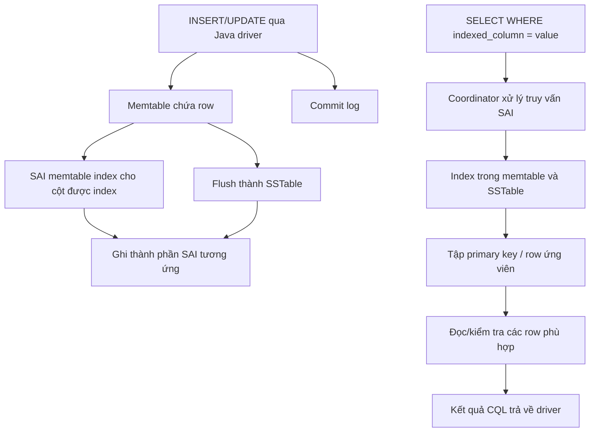

# Storage-Attached Indexing và điều kiện tương thích

Trong Apache Cassandra, đường truy vấn thường hiệu quả nhất là tìm dữ liệu bằng **partition key**, sau đó thu hẹp bằng **clustering columns**. Nhưng một ứng dụng Spring Data Cassandra đôi khi còn phải lọc theo `status`, `amount`, ngày đăng ký, nhãn của sản phẩm hoặc vector embedding — những trường không nằm trong khóa chính. Việc tạo một bảng mới cho mọi câu hỏi có thể làm tăng số lượng read model và công sức đồng bộ dữ liệu.

**Storage-Attached Indexing (SAI)** là cơ chế secondary index được tích hợp vào **Apache Cassandra 5.0**, cho phép lập chỉ mục các cột không phải khóa phân vùng và dùng chúng để lọc kết quả bằng CQL. SAI gắn dữ liệu chỉ mục với **memtable và SSTable** ở node lưu dữ liệu, khác với secondary index truyền thống (thường gọi là `2i`). SAI giúp mở rộng các mẫu truy vấn, nhưng **không biến Cassandra thành hệ SQL quan hệ có thể lọc/sắp xếp tùy ý**, không tự bảo đảm độ trễ thấp cho mọi điều kiện, và không thay thế hiểu biết về partition key, paging hay consistency.

Bài thuộc chương **Chỉ mục và mở rộng** của module **SPRING_DATA_CASSANDRA**. Phạm vi liên quan cả ba tầng: **Cassandra Server** phải hỗ trợ SAI; **Java driver** gửi được CQL và bind giá trị; **Spring Data Cassandra** có thể dùng repository, `CassandraTemplate` hoặc annotation `@SaiIndexed` để tích hợp mapping và quản lý schema.

> Ví dụ tập trung vào **Apache Cassandra 5.0** và **Spring Data Cassandra 4.5.x** với Java driver 4.x. Một số nhà cung cấp dịch vụ Cassandra có cơ chế SAI riêng từ trước hoặc khác Apache Cassandra nguồn mở; phải kiểm tra tài liệu và tính năng trên **server/cluster đang kết nối**, không suy diễn từ tên sản phẩm.

## 1. Mục tiêu học tập

Sau bài này, bạn có thể:

1. Giải thích **SAI**, mối quan hệ với SSTable/memtable và khác biệt với **primary index**, **2i** và **SASI**.
2. Chỉ ra mốc hỗ trợ SAI ở **Cassandra Server**, điều kiện client và vai trò của **`@SaiIndexed`** trong Spring Data Cassandra.
3. Tạo SAI bằng `CREATE INDEX ... USING 'sai'` và kiểm tra index đã **queryable**.
4. Viết `SELECT` dùng SAI cho **text equality**, **numeric range**, kết hợp `AND` và collection `CONTAINS`.
5. Phân biệt kiểu dữ liệu và toán tử được hỗ trợ với những trường hợp **không thể áp dụng SAI**, như `LIKE` cho tìm kiếm chuỗi tùy ý hoặc `UPDATE` theo cột chỉ được index.
6. Dùng `CassandraRepository`, `@Query`, `CassandraTemplate` và `CqlSession` truy vấn cùng schema.
7. Đánh giá chi phí **index build**, write amplification, độ chọn lọc, query fan-out, paging và các chỉ số vận hành trước khi triển khai production.
8. Biết khi nào **nên tạo read model riêng** thay vì cố giải quyết mọi access pattern bằng SAI.

## 2. SAI nằm ở đâu trong kiến trúc Cassandra?

### 2.1. Primary index, 2i và SAI

| Cơ chế | Nền tảng | Mục đích và giới hạn |
|---|---|---|
| **Primary index / partition routing** | Mọi phiên bản Cassandra | Tìm partition theo partition key, rồi đọc clustering range; thường là đường đọc hiệu quả nhất |
| **Secondary index truyền thống (2i)** | Có ở Cassandra trước 5.0 | Chỉ mục cục bộ kiểu cũ, có giới hạn đáng kể với một số workload phân tán/cardinality |
| **SASI (SSTable-Attached Secondary Index)** | Mở rộng/kiểu secondary index riêng trong các môi trường hỗ trợ | Không đồng nghĩa với SAI; khác cú pháp, khả năng và vòng đời |
| **Storage-Attached Indexing (SAI)** | **Apache Cassandra 5.0** | Chỉ mục theo cột, gắn với memtable/SSTable; phù hợp lọc nhiều loại giá trị, numeric range, collection và vector |
| **Read model phi chuẩn hóa** | Do ứng dụng thiết kế ở mọi phiên bản | Tối ưu một access pattern cụ thể bằng partition/clustering key; ứng dụng chịu trách nhiệm duy trì dữ liệu |

SAI không làm mất **primary key** của bảng. Row vẫn được lưu theo partition key và clustering key đã khai báo. Chỉ mục giúp Cassandra tìm **những khóa ứng viên** thỏa điều kiện trên một số cột khác.

### 2.2. “Storage-attached” nghĩa là gì?

Khi ứng dụng ghi vào Cassandra, dữ liệu đi qua commit log, **memtable**, rồi được flush thành **SSTable** bất biến. SAI duy trì cấu trúc lập chỉ mục tương ứng cho dữ liệu trong memtable và cho từng SSTable. Khi flush/compaction xảy ra, vòng đời index gắn với vòng đời lưu trữ.



Đặc điểm cần hiểu:

- **Index là theo cột**: một bảng có thể có nhiều SAI index, nhưng không có nghĩa một index tùy ý chứa mọi cột.
- **Write path thay đổi**: ghi/sửa/xóa dữ liệu liên quan cột có index kéo theo công việc duy trì index. SAI tối ưu chi phí so với những giải pháp cũ trong nhiều tình huống, nhưng không phải “index miễn phí”.
- **Read path vẫn phân tán**: nếu truy vấn chỉ biết `status = 'PAID'` và hàng `PAID` trải trên nhiều partition/node, coordinator có thể phải làm việc với nhiều vùng token. Có index không có nghĩa query luôn đi tới **một node**.
- **Kết quả vẫn là row Cassandra**: SAI không đổi consistency level, primary key, TTL, tombstone hoặc cách các bảng denormalized đồng bộ với nhau.

### 2.3. SAI là bộ lọc, không phải công cụ tìm kiếm toàn văn

SAI hỗ trợ điều kiện như `status = 'PAID'`, `amount_cents >= 100000` và `tags CONTAINS 'spring'` đối với collection có index phù hợp. Nó **không phải** một search engine với đầy đủ tính năng phân tích ngôn ngữ, fuzzy matching, relevance ranking, stemming và substring tìm tùy ý.

Ví dụ `customer_name LIKE '%an%'` không trở thành truy vấn SAI hợp lệ chỉ vì bạn tạo index trên `customer_name`. Nếu cần full-text search nâng cao, phải chọn thiết kế/chức năng thích hợp; SAI chủ yếu phục vụ **lọc theo giá trị** và một số dạng truy vấn khác được Cassandra 5.0 hỗ trợ.

## 3. Điều kiện tương thích: Server, Driver, Spring Data

### 3.1. Bảng năng lực theo phiên bản

| Lớp | Phiên bản/tình huống | Có thể làm gì với SAI? |
|---|---|---|
| **Apache Cassandra 3.x / 4.0 / 4.1** nguồn mở | Trước Cassandra 5.0 | **Không có SAI tích hợp như Cassandra 5.0**; `USING 'sai'` không mặc nhiên hợp lệ |
| **Apache Cassandra 5.0** | Có SAI built-in | Tạo, xây dựng, giám sát và truy vấn SAI bằng CQL; hỗ trợ vector index cho ANN |
| **Một dịch vụ hoặc distribution Cassandra khác** | Tùy nhà cung cấp | Có thể có SAI hoặc tính năng tương tự với khác biệt về phát hành/cú pháp; phải xác minh độc lập |
| **Java driver 4.x** | Driver nói chuyện CQL với Server 5.0 | Với **SAI trên scalar/collection thông thường**, không cần một `SaiQuery` API riêng: gửi `CREATE INDEX`/`SELECT` hợp lệ và bind tham số |
| **Java driver có hỗ trợ vector** | Từ **4.16** có bước đầu hỗ trợ CQL vector; API cải tiến từ **4.17** | Cần nếu ứng dụng muốn bind/đọc `vector<float, N>` qua codec `CqlVector` |
| **Spring Data Cassandra trước 4.5** | Không có `@SaiIndexed` chuẩn 4.5 | Vẫn có thể gửi CQL trực tiếp tới Server 5.0 qua driver/CqlTemplate nếu tương thích; không được mặc định annotation đã tồn tại |
| **Spring Data Cassandra 4.5+** | `@SaiIndexed` có từ **4.5** | Có metadata annotation cho **schema generation**; truy vấn vẫn phụ thuộc Server/index thực tế |

**Phân biệt năng lực client và server:** một dự án nâng Spring Data Cassandra lên 4.5 nhưng vẫn chạy Cassandra 4.1 sẽ **không** tự có SAI. Ngược lại, một client không gắn `@SaiIndexed` vẫn có thể đọc dữ liệu bằng index đã được tạo qua migration CQL trên Cassandra 5.0.

### 3.2. Kiểm tra server thật trước khi thử

Trên `cqlsh`:

```sql
SELECT release_version, data_center
FROM system.local;
```

Lệnh này mô tả **node mà phiên cqlsh đang kết nối**; với cluster nhiều node hoặc giai đoạn rolling upgrade, cần xác minh phiên bản và trạng thái của **toàn cluster** theo công cụ vận hành. Không chỉ dựa vào phiên bản Java driver trên máy phát triển.

Một số điểm cần kiểm tra cùng DBA/SRE:

1. Mọi node cần phục vụ SAI đã chạy bản server và cấu hình hỗ trợ.
2. Schema agreement đã đạt; đang không có rolling upgrade chưa hoàn tất.
3. Cluster dùng partitioner phù hợp; tài liệu SAI của Cassandra 5.0 nêu **Murmur3Partitioner**.
4. Có quyền tạo index và tài nguyên xây index (disk, heap/direct memory, I/O).
5. Nếu dữ liệu đã có sẵn, **index build** đã hoàn thành và index có thể được query.
6. Kế hoạch backup/restore, node bootstrap, repair, compaction và monitoring đã bao gồm SAI.

### 3.3. Không nhầm 2i với SAI

Câu lệnh không ghi `USING 'sai'`:

```sql
CREATE INDEX some_status_idx
ON sdc_sai_lab.orders_by_id (status);
```

không thể được mặc định hiểu là một SAI index theo tài liệu Cassandra 5.0. Muốn SAI, viết tường minh:

```sql
CREATE INDEX some_status_sai_idx
ON sdc_sai_lab.orders_by_id (status)
USING 'sai';
```

Ví dụ thứ nhất chỉ để **phân biệt cú pháp**; không chạy cùng chỉ mục thứ hai trong bài lab. Loại index thực tế, cấu hình và cách tạo mặc định phải được xác minh ở server và schema metadata, không dựa vào tên index chứa chữ “sai”.

## 4. Thực hành: tạo bảng và SAI index trên Cassandra 5.0

Ta thiết kế bảng để lấy **chi tiết đơn theo `order_id`** bằng primary key, đồng thời thử một số query lọc theo **tenant, trạng thái và khoảng giá trị** bằng SAI.

### 4.1. Keyspace và bảng thử

```sql
CREATE KEYSPACE IF NOT EXISTS sdc_sai_lab
WITH replication = {
    'class': 'SimpleStrategy',
    'replication_factor': 1
};

CREATE TABLE IF NOT EXISTS sdc_sai_lab.orders_by_id (
    order_id uuid PRIMARY KEY,
    tenant_id uuid,
    status text,
    amount_cents bigint,
    created_at timestamp,
    tags set<text>
);
```

Đây là ví dụ **lab một node**, không phải bản mẫu replication cho production. Với nhiều datacenter hãy dùng `NetworkTopologyStrategy` và replication factor thích hợp.

Phân biệt:

- `order_id` là **partition key một cột** và đã được Cassandra dùng để định tuyến; **không tạo SAI** trên cột duy nhất này.
- `tenant_id`, `status`, `amount_cents`, `created_at` và `tags` là **regular columns**.
- `tags set<text>` chỉ nên chứa tập giá trị có kích thước hữu hạn; nếu số tag/sự kiện tăng không giới hạn, cần mô hình bảng riêng.

### 4.2. Seed dữ liệu nhỏ

```sql
INSERT INTO sdc_sai_lab.orders_by_id
(order_id, tenant_id, status, amount_cents, created_at, tags)
VALUES (
    00000000-0000-0000-0000-000000000001,
    11111111-1111-1111-1111-111111111111,
    'PAID', 150000,
    '2026-11-25T08:00:00Z',
    {'spring', 'backend'}
);

INSERT INTO sdc_sai_lab.orders_by_id
(order_id, tenant_id, status, amount_cents, created_at, tags)
VALUES (
    00000000-0000-0000-0000-000000000002,
    11111111-1111-1111-1111-111111111111,
    'CREATED', 70000,
    '2026-11-24T08:00:00Z',
    {'cassandra'}
);

INSERT INTO sdc_sai_lab.orders_by_id
(order_id, tenant_id, status, amount_cents, created_at, tags)
VALUES (
    00000000-0000-0000-0000-000000000003,
    11111111-1111-1111-1111-111111111111,
    'PAID', 200000,
    '2026-11-23T08:00:00Z',
    {'spring', 'database'}
);

INSERT INTO sdc_sai_lab.orders_by_id
(order_id, tenant_id, status, amount_cents, created_at, tags)
VALUES (
    00000000-0000-0000-0000-000000000004,
    22222222-2222-2222-2222-222222222222,
    'PAID', 180000,
    '2026-11-25T10:00:00Z',
    {'frontend'}
);

INSERT INTO sdc_sai_lab.orders_by_id
(order_id, tenant_id, status, amount_cents, created_at, tags)
VALUES (
    00000000-0000-0000-0000-000000000005,
    22222222-2222-2222-2222-222222222222,
    'CANCELLED', 30000,
    '2026-11-22T08:00:00Z',
    {'spring'}
);
```

Sau khi seed, có năm row và **năm partition riêng** vì mỗi `order_id` khác nhau. Mỗi row có `tenant_id`, `status` và `tags` mà ta muốn thử lọc. Bộ dữ liệu nhỏ chỉ chứng minh cú pháp/mapping, **không chứng minh độ trễ của SAI trên hàng triệu row**.

### 4.3. Tạo các SAI index cần cho query

```sql
CREATE INDEX IF NOT EXISTS orders_tenant_sai_idx
ON sdc_sai_lab.orders_by_id (tenant_id)
USING 'sai';

CREATE INDEX IF NOT EXISTS orders_status_sai_idx
ON sdc_sai_lab.orders_by_id (status)
USING 'sai';

CREATE INDEX IF NOT EXISTS orders_amount_sai_idx
ON sdc_sai_lab.orders_by_id (amount_cents)
USING 'sai';
```

Ba chỉ mục trên phục vụ các bộ lọc ví dụ. **Mỗi index được khai báo trên một cột**. Với Cassandra 5.0, SAI có thể phối hợp những điều kiện theo nhiều index, nhưng việc gộp/đọc ứng viên vẫn có chi phí; nhiều index không đồng nghĩa mọi tổ hợp predicate đều nhanh.

**Không thêm index chỉ để “phòng khi cần”.** Với production, mô tả rõ mẫu truy vấn, selectivity và ngưỡng tải trước khi quyết định thêm từng index.

### 4.4. Kiểm tra index trong schema

```sql
DESCRIBE TABLE sdc_sai_lab.orders_by_id;
```

Phần output `DESCRIBE` cần thể hiện các `CREATE INDEX ... USING 'sai'` tương ứng. Nếu index đã có dữ liệu cần build, **sự tồn tại của DDL chưa đủ** để khẳng định index đã sẵn sàng phục vụ query.

Cassandra 5.0 cung cấp virtual table:

```sql
SELECT index_name, is_building, is_queryable
FROM system_views.indexes
WHERE keyspace_name = 'sdc_sai_lab'
  AND table_name = 'orders_by_id'
  AND index_name = 'orders_status_sai_idx';
```

- `is_building = true`: index đang được xây dựng (chưa nên coi là sẵn sàng).
- `is_queryable = true`: index có thể phục vụ truy vấn theo trạng thái hệ thống báo cáo.
- Virtual table cung cấp **thông tin theo node**; cần kiểm tra các node liên quan qua quy trình vận hành.
- Trên cluster/phiên bản không hỗ trợ virtual table tương ứng, hãy tham khảo tài liệu chính xác của distribution thay vì tự đoán.

## 5. Truy vấn SAI: text equality, numeric range, AND

### 5.1. Tìm đơn theo trạng thái

```sql
SELECT order_id, tenant_id, status, amount_cents, created_at
FROM sdc_sai_lab.orders_by_id
WHERE status = 'PAID'
LIMIT 20;
```

Với dữ liệu mẫu, có **ba đơn `PAID`**. Không có `WHERE order_id = ...`; câu query dựa vào SAI index `orders_status_sai_idx` để tìm các row ứng viên.

**Không kết luận** rằng SAI “đọc một partition”. Ngay cả khi chỉ cần 20 row, giá trị `PAID` xuất hiện trên nhiều node trong cluster thật nên coordinator có thể phải truy vấn nhiều token range.

### 5.2. Tìm theo khoảng giá trị số

```sql
SELECT order_id, status, amount_cents
FROM sdc_sai_lab.orders_by_id
WHERE amount_cents >= 100000
  AND amount_cents < 200000
LIMIT 20;
```

Với dữ liệu mẫu, các đơn giá **150000** và **180000** thỏa điều kiện, còn **200000** không thỏa vì dấu `<` là giới hạn trên loại trừ.

Numeric range là một trường hợp SAI có ưu thế so với một số loại secondary index trước đây. Tuy vậy, nếu miền giá trị cực rộng và hàng triệu row thỏa điều kiện, query vẫn phải xử lý lượng dữ liệu lớn. Chỉ mục không tự giảm **độ lớn tập kết quả**.

### 5.3. Giao của nhiều điều kiện

```sql
SELECT order_id, tenant_id, status, amount_cents
FROM sdc_sai_lab.orders_by_id
WHERE tenant_id = 11111111-1111-1111-1111-111111111111
  AND status = 'PAID'
LIMIT 20;
```

Với dữ liệu mẫu, có hai row `PAID` của tenant `1111…`. Các điều kiện này dựa trên hai SAI index `tenant_id` và `status` đã tạo.

**Cần lưu ý:**

- `AND` có thể dùng để thu hẹp kết quả nhưng **không có nghĩa server luôn giao đúng từng index một cách miễn phí**. Cassandra có thể tối ưu thứ tự xử lý ứng viên và post-filter một số điều kiện.
- Một truy vấn có nhiều index có thể tăng CPU/I/O/latency để hợp nhất và lọc row.
- Cột `status` thường có cardinality thấp: một điều kiện như `status = 'PAID'` có thể khớp rất nhiều partition, làm tăng fan-out.
- `tenant_id` được index không có nghĩa hệ thống đã có **tenant isolation**. Ứng dụng phải luôn áp dụng phân quyền; đừng cho người dùng tùy ý truyền tenant ID và xem đó là cơ chế bảo mật đủ.

### 5.4. Không dùng LIKE hay CONTAINS trên text tùy ý

SAI trên `status text` hỗ trợ lọc dạng equality, **không** mặc nhiên hỗ trợ:

```sql
-- Không phải truy vấn SAI hỗ trợ:
SELECT * FROM sdc_sai_lab.orders_by_id
WHERE status LIKE '%AID%';
```

`CONTAINS` là toán tử áp dụng cho **collection** trong các ví dụ SAI bên dưới, không phải tìm substring bất kỳ trong một cột `text`. Nếu cần tìm gần đúng theo câu từ, prefix, stemming hoặc full-text scoring, hãy chọn hệ tìm kiếm và mô hình index phù hợp.

### 5.5. LIMIT không tạo thứ tự toàn cục

```sql
SELECT *
FROM sdc_sai_lab.orders_by_id
WHERE status = 'PAID'
LIMIT 10;
```

Câu trên **không cam kết 10 đơn `PAID` mới nhất**, vì `created_at` là regular column và các row trải trên nhiều partition. Muốn danh sách “mới nhất theo tenant/status” có thứ tự và paging đáng tin cậy, xem thiết kế read model ở mục 11.

## 6. SAI trên collection và những giới hạn đặc thù

SAI cũng hỗ trợ các kiểu collection `set`, `list` và `map` theo cú pháp index/toán tử phù hợp.

### 6.1. Index cho set<text>

Với bảng hiện có:

```sql
CREATE INDEX IF NOT EXISTS orders_tags_sai_idx
ON sdc_sai_lab.orders_by_id (tags)
USING 'sai';
```

Truy vấn:

```sql
SELECT order_id, status, tags
FROM sdc_sai_lab.orders_by_id
WHERE tags CONTAINS 'spring'
LIMIT 20;
```

Với seed đã nạp, có ba row chứa tag `spring`: các đơn `...0001`, `...0003` và `...0005`.

**Giới hạn:** `CONTAINS` trên collection không đồng nghĩa `LIKE`/substring trên cột `text`. Không dùng một collection tăng không giới hạn chỉ vì có SAI index: collection lớn có chi phí mutation và đọc riêng.

### 6.2. Map hỗ trợ index theo keys, values và entries

Một bảng minh họa khác:

```sql
CREATE TABLE IF NOT EXISTS sdc_sai_lab.catalog_metadata (
    item_id uuid PRIMARY KEY,
    attrs map<text, text>
);
```

Trong Cassandra 5.0, cú pháp index cho map cần chọn **mức lập chỉ mục** phù hợp với kiểu truy vấn:

```sql
-- Index các key của map:
CREATE INDEX IF NOT EXISTS catalog_attrs_keys_sai_idx
ON sdc_sai_lab.catalog_metadata (KEYS(attrs))
USING 'sai';

-- Index các value của map:
CREATE INDEX IF NOT EXISTS catalog_attrs_values_sai_idx
ON sdc_sai_lab.catalog_metadata (VALUES(attrs))
USING 'sai';

-- Index cặp key/value:
CREATE INDEX IF NOT EXISTS catalog_attrs_entries_sai_idx
ON sdc_sai_lab.catalog_metadata (ENTRIES(attrs))
USING 'sai';
```

Những index này được đưa ra để **so sánh tính năng**. Trong production, chỉ tạo index cần thiết cho query đã xác định; mỗi loại index thêm chi phí.

Ví dụ:

```sql
INSERT INTO sdc_sai_lab.catalog_metadata (item_id, attrs)
VALUES (
    99999999-9999-9999-9999-999999999999,
    {'color': 'blue', 'size': 'M'}
);

SELECT item_id, attrs
FROM sdc_sai_lab.catalog_metadata
WHERE attrs CONTAINS KEY 'color';

SELECT item_id, attrs
FROM sdc_sai_lab.catalog_metadata
WHERE attrs CONTAINS 'blue';

SELECT item_id, attrs
FROM sdc_sai_lab.catalog_metadata
WHERE attrs['color'] = 'blue';
```

Ba truy vấn tương ứng với **KEYS**, **VALUES** và **ENTRIES** index. Không suy ra một index trên toàn bộ map luôn đủ cho mọi phép lọc theo key, value và entry.

### 6.3. Những kiểu cột cần tránh hoặc không hỗ trợ

Theo tài liệu Cassandra 5.0, SAI hỗ trợ nhiều kiểu scalar, collection, vector và một số UDT đã `frozen`. Các giới hạn quan trọng gồm:

- **`counter`:** không hỗ trợ làm SAI index.
- **Non-frozen UDT:** không hỗ trợ như một SAI index thông thường.
- **Partition key chỉ gồm một cột:** tạo SAI trên chính cột này bị từ chối do đã có primary index.
- **Một phần composite partition key:** có thể được lập SAI nếu access pattern cần lọc theo riêng phần đó; cần kiểm chứng vì chi phí có thể lớn.
- **Kiểu/tính năng đặc thù nhà cung cấp:** không suy ra được hỗ trợ từ các ví dụ scalar. Với geospatial hoặc extension khác, phải kiểm tra tài liệu server/distribution cụ thể.

Cụ thể, bảng `orders_by_id` có `order_id uuid PRIMARY KEY` thì câu:

```sql
-- Cố ý minh họa lỗi: không tạo SAI trên partition key duy nhất.
CREATE INDEX invalid_order_id_sai_idx
ON sdc_sai_lab.orders_by_id (order_id)
USING 'sai';
```

sẽ bị Cassandra 5.0 từ chối. Cách đúng để lấy row theo ID là:

```sql
SELECT *
FROM sdc_sai_lab.orders_by_id
WHERE order_id = 00000000-0000-0000-0000-000000000001;
```

Đọc theo primary key này **không cần SAI**.

## 7. Text index options: phân biệt chữ hoa, Unicode và ASCII

Với những cột text như `customer_name` hoặc `country`, SAI có các tùy chọn xử lý chuỗi.

Ví dụ bảng riêng:

```sql
CREATE TABLE IF NOT EXISTS sdc_sai_lab.customers_by_id (
    customer_id uuid PRIMARY KEY,
    display_name text
);

CREATE INDEX IF NOT EXISTS customers_name_sai_idx
ON sdc_sai_lab.customers_by_id (display_name)
USING 'sai'
WITH OPTIONS = {
    'case_sensitive': 'false',
    'normalize': 'true',
    'ascii': 'false'
};
```

Ý nghĩa:

| Tùy chọn | Mặc định theo tài liệu | Khi điều chỉnh |
|---|---|---|
| `case_sensitive` | `true` | `false` để match không phân biệt chữ hoa/chữ thường theo quy tắc SAI |
| `normalize` | `false` | `true` để chuẩn hóa Unicode theo dạng được hỗ trợ (NFC) |
| `ascii` | `false` | `true` để chuyển đổi một số ký tự ngoài Basic Latin sang tương đương ASCII nếu có |

**Không hiểu `normalize = true` là bỏ toàn bộ dấu tiếng Việt.** Unicode normalization NFC và ASCII folding là hai ý niệm khác nhau. SAI không phải một bộ máy phân tích ngôn ngữ tự nhiên.

Tạo index với option nào thì ứng dụng phải kiểm chứng behavior matching với dữ liệu thật, bao gồm chữ hoa/thường, Unicode tổ hợp, ký tự có dấu và trường hợp đồng âm.

**Thay đổi index options:** SAI index không hỗ trợ `ALTER INDEX` tùy ý. Muốn đổi option, phải có kế hoạch drop/recreate và chờ rebuild; không làm trên production mà chưa đánh giá thời gian gián đoạn đường truy vấn dùng index.

## 8. Spring Data Cassandra: ánh xạ entity và @SaiIndexed

### 8.1. @SaiIndexed có từ Spring Data Cassandra 4.5

Annotation:

```java
import org.springframework.data.cassandra.core.mapping.SaiIndexed;
```

JavaDoc Spring Data Cassandra 4.5 định nghĩa `@SaiIndexed` để mô tả index Storage-Attached Indexing cho một property. Annotation này liên quan đến **schema generation/creation**; **không bắt buộc** phải gắn lên mọi entity nếu index đã được tạo bằng migration CQL.

Ví dụ entity:

```java
import java.time.Instant;
import java.util.Set;
import java.util.UUID;

import org.springframework.data.cassandra.core.mapping.Column;
import org.springframework.data.cassandra.core.mapping.PrimaryKey;
import org.springframework.data.cassandra.core.mapping.SaiIndexed;
import org.springframework.data.cassandra.core.mapping.Table;

@Table("orders_by_id")
public class OrderById {

    @PrimaryKey("order_id")
    private UUID orderId;

    @Column("tenant_id")
    @SaiIndexed("orders_tenant_sai_idx")
    private UUID tenantId;

    @Column("status")
    @SaiIndexed("orders_status_sai_idx")
    private String status;

    @Column("amount_cents")
    @SaiIndexed("orders_amount_sai_idx")
    private Long amountCents;

    @Column("created_at")
    private Instant createdAt;

    @Column("tags")
    private Set<String> tags;

    public OrderById() {}

    public UUID getOrderId() { return orderId; }
    public void setOrderId(UUID value) { orderId = value; }

    public UUID getTenantId() { return tenantId; }
    public void setTenantId(UUID value) { tenantId = value; }

    public String getStatus() { return status; }
    public void setStatus(String value) { status = value; }

    public Long getAmountCents() { return amountCents; }
    public void setAmountCents(Long value) { amountCents = value; }

    public Instant getCreatedAt() { return createdAt; }
    public void setCreatedAt(Instant value) { createdAt = value; }

    public Set<String> getTags() { return tags; }
    public void setTags(Set<String> value) { tags = value; }
}
```

Giả sử `CqlSession`/Spring Boot đã đặt keyspace mặc định là `sdc_sai_lab`. Với `@Table("orders_by_id")`, entity sẽ ánh xạ bảng có tên đó trong keyspace của session.

**Khác biệt quan trọng:**

- `@SaiIndexed("orders_status_sai_idx")` là **metadata khai báo mong muốn**, không phải lời gọi “tự tạo index ngay khi repository chạy”.
- Index xuất hiện khi schema creation được bật và được framework thực hiện theo cấu hình; nếu ứng dụng quản lý DDL bằng migration, index nên được tạo **bằng CQL migration có kiểm soát**.
- Ứng dụng có thể truy vấn một SAI index **mà không đặt `@SaiIndexed`**, miễn CQL hợp lệ và index tồn tại/đã queryable.
- Không bật schema creation ở production chỉ để tiện cho ví dụ. Tạo index trên bảng đang có dữ liệu có thể tốn đáng kể tài nguyên và kéo dài quá trình khởi động ứng dụng.

### 8.2. @Indexed, @SASI và @SaiIndexed khác nhau

| Annotation | Ý nghĩa chính |
|---|---|
| `@Indexed` | Mô tả kiểu **secondary index truyền thống (2i)** trong mapping Spring Data |
| `@SASI` | Mô tả SASI index, phù hợp các hệ/phiên bản hỗ trợ SASI |
| **`@SaiIndexed`** | Mô tả **Storage-Attached Indexing** (Spring Data Cassandra 4.5+) |
| `@VectorType` | Mô tả **CQL vector data type**, thường cần cho schema generation của cột vector; bản thân không thay thế SAI index |

Không đổi `@Indexed` thành `@SaiIndexed` như một bước refactor Java thuần túy rồi cho rằng cluster sẽ thay toàn bộ loại index. Đó là **thay đổi schema database** với chi phí build/index lifecycle riêng.

### 8.3. Lời khuyên về quyền sở hữu schema

Trong nhóm phát triển, nên chọn rõ một chủ sở hữu:

1. **Migration scripts/DBA:** CQL `CREATE INDEX` được version hóa, kiểm soát thời điểm rollout và theo dõi index build. Java entity có thể giữ `@SaiIndexed` như tài liệu metadata hoặc bỏ nếu không dùng schema generation.
2. **Schema generation của Spring Data:** chỉ phù hợp môi trường được quản lý chủ đích, thường là lab/test; phải kiểm soát quyền và thời điểm khởi động.

Tránh để mọi application instance đồng thời cố tạo lại nhiều index nặng vào lúc scale-out, nhất là trên bảng production có dữ liệu lớn.

## 9. Truy vấn SAI từ CassandraRepository

Sau khi index đã tồn tại, repository dùng **truy vấn CQL bình thường**. Không có yêu cầu phải dùng một “SAI repository” riêng.

```java
import java.util.List;
import java.util.UUID;

import org.springframework.data.cassandra.repository.CassandraRepository;
import org.springframework.data.cassandra.repository.Query;

public interface OrderByIdRepository
        extends CassandraRepository<OrderById, UUID> {

    @Query("""
        SELECT order_id, tenant_id, status, amount_cents, created_at, tags
        FROM orders_by_id
        WHERE tenant_id = ?0 AND status = ?1
        LIMIT 20
        """)
    List<OrderById> findByTenantAndStatus(UUID tenantId, String status);

    @Query("""
        SELECT order_id, tenant_id, status, amount_cents, created_at, tags
        FROM orders_by_id
        WHERE amount_cents >= ?0 AND amount_cents < ?1
        LIMIT 20
        """)
    List<OrderById> findByAmountRange(long minInclusive, long maxExclusive);
}
```

Lưu ý:

- `?0`, `?1` là cú pháp **Spring Data Cassandra repository** để gắn tham số, không phải nối UUID/giá trị trực tiếp vào CQL.
- `findByTenantAndStatus` cần SAI phù hợp cho `tenant_id` và `status` trong schema bài lab, không phải phương thức tìm theo primary key.
- `List` materialize các row của query. `LIMIT 20` hạn chế tổng row trả về nhưng **không xếp theo thời gian toàn cục**.
- Một query thường xuyên trả tập rất lớn có thể cần `Slice`/paging state; dù có SAI index, vẫn phải giới hạn tải.
- Việc import `@Query` phải là `org.springframework.data.cassandra.repository.Query`, không phải `org.springframework.data.jpa.repository.Query`.

### 9.1. Gọi từ service và validate input

```java
import java.util.List;
import java.util.UUID;
import org.springframework.stereotype.Service;

@Service
public class IndexedOrderSearchService {

    private final OrderByIdRepository repository;

    public IndexedOrderSearchService(OrderByIdRepository repository) {
        this.repository = repository;
    }

    public List<OrderById> search(UUID tenantId, String status) {
        if (tenantId == null || status == null || status.isBlank()) {
            throw new IllegalArgumentException("Thieu dieu kien loc");
        }

        // Kiểm tra quyền truy cập tenantId tại tầng API/security.
        return repository.findByTenantAndStatus(tenantId, status);
    }
}
```

**Không xem `WHERE tenant_id = ?` là bảo mật tự động.** Nếu tài khoản dùng chung có quyền đọc toàn bảng, ứng dụng phải xác thực người gọi và bảo đảm giá trị tenant được gắn từ security context đáng tin cậy, không chỉ từ tham số request tự do.

### 9.2. CassandraTemplate dùng cùng index

`CassandraTemplate` có thể tạo query với `Criteria`:

```java
import java.util.List;
import java.util.UUID;

import org.springframework.data.cassandra.core.CassandraTemplate;
import org.springframework.data.cassandra.core.query.Criteria;
import org.springframework.data.cassandra.core.query.Query;

public class OrderTemplateSearch {

    private final CassandraTemplate template;

    public OrderTemplateSearch(CassandraTemplate template) {
        this.template = template;
    }

    public List<OrderById> search(UUID tenantId, String status) {
        Query query = Query.query(
            Criteria.where("tenant_id").is(tenantId),
            Criteria.where("status").is(status)
        ).limit(20);

        return template.select(query, OrderById.class);
    }
}
```

Spring Data dựa trên mapping để đọc row và ánh xạ entity. **SAI được thực thi ở server** nhờ CQL/DDL; đổi từ repository sang `CassandraTemplate` không làm index biến mất hay tự thêm index vào bảng.

### 9.3. Java driver CqlSession trực tiếp

Với câu CQL đặc thù, dùng prepared statement:

```java
import java.util.List;
import java.util.UUID;

import com.datastax.oss.driver.api.core.CqlSession;
import com.datastax.oss.driver.api.core.cql.PreparedStatement;

public class OrderDriverSearch {

    private final CqlSession session;
    private final PreparedStatement byTenantAndStatus;

    public OrderDriverSearch(CqlSession session) {
        this.session = session;
        this.byTenantAndStatus = session.prepare("""
            SELECT order_id
            FROM sdc_sai_lab.orders_by_id
            WHERE tenant_id = ? AND status = ?
            LIMIT 20
            """);
    }

    public List<UUID> searchIds(UUID tenantId, String status) {
        return session.execute(
            byTenantAndStatus.bind(tenantId, status)
        ).all().stream()
            .map(row -> row.getUuid("order_id"))
            .toList();
    }
}
```

`all()` ở đây chỉ minh họa với `LIMIT 20`, nên số row tối đa nhỏ. Không sao chép `all()` vào query không giới hạn có thể trả hàng triệu row; thay bằng streaming/paging có điều tiết.

**Driver 4.x không cần class `SaiStatement` riêng** cho truy vấn text/numeric index. Prepared CQL vẫn đi qua driver thông thường. Nếu query có cột vector mới, cần driver codec/vector API phù hợp như phần tiếp theo.

## 10. SAI và vector search: một nhánh khả năng khác

Apache Cassandra 5.0 cũng có kiểu **`vector<float, N>`** và khả năng tìm vector gần nhau bằng **ANN (Approximate Nearest Neighbor)** thông qua SAI index phù hợp.

Đây là **tính năng bổ sung** trên cùng nền tảng SAI, không phải mọi SAI trên `text` đều trở thành “semantic search”.

### 10.1. Schema vector ba chiều để minh họa

```sql
CREATE TABLE IF NOT EXISTS sdc_sai_lab.documents_by_id (
    document_id uuid PRIMARY KEY,
    title text,
    embedding vector<float, 3>
);

CREATE INDEX IF NOT EXISTS documents_embedding_sai_idx
ON sdc_sai_lab.documents_by_id (embedding)
USING 'sai'
WITH OPTIONS = {
    'similarity_function': 'COSINE'
};
```

Ghi thử:

```sql
INSERT INTO sdc_sai_lab.documents_by_id
(document_id, title, embedding)
VALUES (
    aaaaaaaa-aaaa-aaaa-aaaa-aaaaaaaaaaaa,
    'Spring Data',
    [0.9, 0.1, 0.0]
);

INSERT INTO sdc_sai_lab.documents_by_id
(document_id, title, embedding)
VALUES (
    bbbbbbbb-bbbb-bbbb-bbbb-bbbbbbbbbbbb,
    'Cassandra',
    [0.1, 0.9, 0.0]
);
```

Ví dụ ANN:

```sql
SELECT document_id, title
FROM sdc_sai_lab.documents_by_id
ORDER BY embedding ANN OF [1.0, 0.0, 0.0]
LIMIT 2;
```

**Điều kiện riêng của nhánh vector:**

- Server hỗ trợ `vector<float, 3>`, SAI vector index và `ANN OF` (Apache Cassandra 5.0).
- Vector truy vấn phải có đúng **số chiều** với schema; phần tử không được null.
- Với Java driver, nên dùng bản hỗ trợ `CqlVector` (bắt đầu từ 4.16, API thuận tiện hơn từ 4.17) nếu bind/đọc giá trị vector.
- Spring Data Cassandra 4.5 có `@VectorType(dimensions = ...)` và `@SaiIndexed` cho metadata; việc có annotation không khiến Server 4.1 hỗ trợ vector.
- ANN là **tìm gần xấp xỉ**, không bảo đảm luôn cho thứ tự nearest neighbor chính xác tuyệt đối trong mọi trạng thái index/tải.
- Chọn `COSINE`, `DOT_PRODUCT` hay `EUCLIDEAN` phải phù hợp với embedding model và được đánh giá bằng dữ liệu thực.

Nếu chỉ cần tìm `status = 'PAID'`, **không cần vector**. Nếu cần tìm gần nghĩa của văn bản, SAI text equality không thay cho việc tạo embedding và vector ANN.

## 11. Khi nào cần read model riêng thay vì SAI?

SAI mở rộng độ linh hoạt, nhưng một index trên regular column không thay đổi cách Cassandra **sắp xếp row theo clustering columns trong một partition**.

### 11.1. Ví dụ cần top 20 đơn mới nhất theo tenant

Một yêu cầu:

> “Hiển thị 20 đơn `PAID` mới nhất của một tenant, có nút tải thêm.”

Với bảng `orders_by_id`, một query SAI:

```sql
SELECT order_id, tenant_id, status, amount_cents, created_at
FROM sdc_sai_lab.orders_by_id
WHERE tenant_id = 11111111-1111-1111-1111-111111111111
  AND status = 'PAID'
LIMIT 20;
```

**không bảo đảm “mới nhất”**: `created_at` là regular column, trong khi mỗi `order_id` là một partition khác nhau. Không thể thêm `ORDER BY created_at DESC` tùy ý và kỳ vọng Cassandra sắp xếp toàn cluster theo cột ấy.

Một read model phù hợp hơn:

```sql
CREATE TABLE IF NOT EXISTS sdc_sai_lab.orders_by_tenant_status_month (
    tenant_id uuid,
    status text,
    order_month text,
    created_at timestamp,
    order_id uuid,
    amount_cents bigint,
    PRIMARY KEY (
        (tenant_id, status, order_month),
        created_at,
        order_id
    )
) WITH CLUSTERING ORDER BY (created_at DESC, order_id ASC);
```

Truy vấn:

```sql
SELECT order_id, created_at, amount_cents
FROM sdc_sai_lab.orders_by_tenant_status_month
WHERE tenant_id = 11111111-1111-1111-1111-111111111111
  AND status = 'PAID'
  AND order_month = '2026-11'
LIMIT 20;
```

Đường đọc lúc này có:

- **Composite partition key** chứa tenant, status và bucket tháng.
- **Clustering order** rõ ràng theo `created_at DESC`.
- `LIMIT 20` áp dụng trong partition đã xác định.
- Paging state có thể dùng để đọc tiếp lịch sử theo thứ tự của bảng.

Đánh đổi: phải quản lý **đồng bộ read models**. Nếu đơn chuyển `CREATED` sang `PAID`, ứng dụng cần ghi vào bucket mới và xử lý row của bucket cũ theo thiết kế nhất quán. Đây là trách nhiệm ứng dụng, không tự được SAI thực hiện.

### 11.2. Tiêu chí lựa chọn

| Nhu cầu | Lựa chọn khởi đầu |
|---|---|
| Tìm đúng một row theo `order_id` | Dùng primary key, **không cần SAI** |
| Bộ lọc phụ không quá thường xuyên theo `status`/giá trị số | Cân nhắc SAI nếu Server và selectivity phù hợp |
| Bộ lọc nhiều cột, không cần thứ tự toàn cục | SAI có thể hữu ích; đo cardinality và fan-out |
| Danh sách mới nhất có SLA chặt và paging theo thời gian | Read model theo partition/clustering key |
| Truy cập theo tenant bắt buộc và dữ liệu cực lớn | Thiết kế partition-aware read model; SAI chỉ là bổ trợ |
| Full-text search, fuzzy matching, ranking phức tạp | Hệ/chức năng tìm kiếm chuyên dụng |
| Vector nearest-neighbor trên embeddings | Cassandra 5.0 + SAI vector index, kiểm tra ANN và model |
| Viết/xóa row theo regular column | Thường phải tìm khóa trước rồi ghi/xóa **theo primary key**; SAI chủ yếu phục vụ `SELECT` |

**Không có quy tắc “SAI luôn tốt hơn read model”**. Trong nhiều hệ Cassandra, một read model với đúng partition key vẫn là lựa chọn hiệu quả, dự đoán được độ trễ và chi phí hơn cho hot path.

## 12. Khả năng truy vấn không đồng nghĩa khả năng UPDATE/DELETE qua index

SAI phục vụ **`SELECT`**, không cho phép thay primary key bằng predicate index trong `UPDATE` hoặc `DELETE`.

Ví dụ **không đúng** với bảng lab:

```sql
-- Cố ý minh họa sai: chỉ điều kiện status, không có order_id.
UPDATE sdc_sai_lab.orders_by_id
SET amount_cents = 0
WHERE status = 'CANCELLED';

-- Cố ý minh họa sai: DELETE theo regular indexed column.
DELETE FROM sdc_sai_lab.orders_by_id
WHERE status = 'CANCELLED';
```

Ngay cả khi `status` đã có SAI, các mutation này không được biến thành “cập nhật/xóa toàn bộ row thỏa index” theo cách SQL quan hệ.

Cách xử lý nếu nghiệp vụ buộc phải xử lý nhiều row:

1. Đọc **primary keys** bằng truy vấn SAI có giới hạn/phân trang và quyền phù hợp.
2. Xử lý tuần tự hoặc theo job/batch có điều tiết.
3. Ghi/xóa theo **primary key đầy đủ** trên từng row, có kiểm tra cạnh tranh/race.
4. Thiết kế idempotency, checkpoint và giới hạn concurrency cho job lớn.

Với xử lý quy mô lớn, cân nhắc read model hoặc pipeline dữ liệu chuyên dụng, không gọi `findAllByStatus` rồi gom toàn bộ row vào heap.

## 13. Chỉ số vận hành và vòng đời index

### 13.1. Xây index sau khi đã có dữ liệu

SAI có thể được tạo **trước hoặc sau** khi bảng có dữ liệu. Khi tạo sau, Cassandra phải xây index từ dữ liệu có sẵn. Quá trình này có thể cần CPU, I/O, bộ nhớ và không gian disk đáng kể.

Quy trình triển khai an toàn:

1. Đo bảng hiện có: số SSTable, dung lượng, tốc độ ghi và read latency.
2. Kiểm tra đủ dung lượng disk/memory và cluster health.
3. Tạo index trong khung triển khai đã được kiểm soát.
4. Theo dõi `is_building`, `is_queryable` **trên các node cần thiết**.
5. Chỉ chuyển traffic dựa trên index khi nó queryable.
6. Đo read latency, write latency, disk index và query fan-out sau rollout.
7. Chuẩn bị rollback về read model/endpoint cũ nếu index không đáp ứng SLA.

Đừng thực hiện `DROP INDEX`/`CREATE INDEX` trên production như một phép “sửa nhanh” cho câu query timeout mà chưa đánh giá tác động rebuild.

### 13.2. SAI index không ALTER trực tiếp

Muốn đổi option của index (ví dụ case sensitivity hoặc similarity function), thường phải:

```sql
-- Chỉ minh họa quy trình thay index trong môi trường được phép.
DROP INDEX IF EXISTS sdc_sai_lab.customers_name_sai_idx;

CREATE INDEX customers_name_sai_idx
ON sdc_sai_lab.customers_by_id (display_name)
USING 'sai'
WITH OPTIONS = {
    'case_sensitive': 'true',
    'normalize': 'false'
};
```

Giữa drop và thời điểm index được rebuild/queryable, truy vấn phụ thuộc index **không được giả định sẽ hoạt động**. Cần staging, lập kế hoạch chuyển traffic và quan sát chỉ số.

### 13.3. SAI metrics và tracing

Tài liệu Cassandra 5.0 mô tả các virtual tables:

- `system_views.indexes`: index state, số SSTable và tình trạng xây dựng.
- `system_views.sstable_indexes`: metadata theo SSTable/index.
- `system_views.sstable_index_segments`: metadata theo segment.

Qua **JMX/metrics** có thể quan sát:

| Metric/nhóm quan sát | Ý nghĩa |
|---|---|
| `DiskUsedBytes` | Dung lượng disk index |
| `TotalIndexBuildsInProgress` | Index đang xây dựng |
| `TotalQueryableIndexCount` | Số index queryable |
| `PartitionReads` | Bao nhiêu partition được đọc cho query dùng SAI |
| `RowsFiltered` | Mức post-filter row |
| `SSTableIndexesHit` | Lượng thành phần index SSTable đã truy cập |
| `QueryLatency` | Độ trễ các query SAI |
| Driver request latency/timeout | Ảnh hưởng tới ứng dụng cuối |
| Node CPU, direct memory, disk I/O | Tài nguyên nền trong build/query/compaction |

Tên metric trên đến từ tài liệu **SAI monitoring**, không mặc định là các metric Micrometer đã tự có trong mọi ứng dụng Spring Boot. Cần tích hợp JMX/exporter/monitoring của cluster phù hợp.

Trên môi trường test:

```sql
TRACING ON;

SELECT order_id, status
FROM sdc_sai_lab.orders_by_id
WHERE tenant_id = 11111111-1111-1111-1111-111111111111
  AND status = 'PAID'
LIMIT 20;

TRACING OFF;
```

Query trace có thể cho biết những thành phần index, segment và số row được post-filter. **Tracing có overhead**, không bật đại trà trên production.

### 13.4. Guardrails và số lượng index

Cassandra 5.0 có các guardrail nhằm tránh tạo số lượng SAI index quá mức; tài liệu FAQ đề cập cấu hình `sai_indexes_per_table_failure_threshold` với giá trị mặc định **10**. Đây là **giới hạn cấu hình**, không phải một định luật mọi cluster chỉ được đúng 10 index.

Ngay cả khi có thể tăng ngưỡng, không nên hiểu rằng thêm nhiều index luôn tăng hiệu năng:

- Mỗi index bổ sung công việc trên đường ghi/flush/compaction.
- Mỗi index có dung lượng và trạng thái xây dựng.
- Query nhiều predicate có thể phát sinh merge/intersection/post-filter.
- Cardinality, phân bố dữ liệu và số partition vẫn quyết định chi phí.

**Đánh giá thật bằng workload** quan trọng hơn số lượng index.

## 14. Tương tác với paging, consistency và prepared statements

### 14.1. SAI không tạo thứ tự toàn cluster

`SELECT ... WHERE status = ? LIMIT 20` chỉ yêu cầu tối đa 20 row thỏa bộ lọc; nếu query dùng index qua nhiều partition, nó không bảo đảm một thứ tự ổn định theo `created_at`.

Với API “Load more”, dùng **paging state** được cung cấp bởi driver hoặc Spring Data `Slice` khi phương thức truy vấn hỗ trợ, nhưng:

- Không có **offset tùy ý** như `OFFSET 100000` kiểu RDBMS.
- Phải giữ nguyên query shape và bind values giữa các trang.
- Ghi/xóa đồng thời có thể ảnh hưởng nội dung các trang; paging không phải snapshot bất biến.
- Page size/fetch size chỉ điều khiển lượng dữ liệu **mỗi lượt fetch**, không giới hạn tổng row.
- Nếu cần thứ tự cố định theo thời gian, dùng read model với clustering order thích hợp.

### 14.2. Consistency không sửa access pattern

Giá trị consistency (ví dụ `LOCAL_QUORUM`) quy định điều kiện phản hồi từ replica, **không tạo index mới** và không biến query SAI lọc rộng thành truy vấn trên một partition.

Khi đo hiệu năng, phải giữ consistent consistency settings cùng replication strategy, page size và mức tải; nếu không sẽ khó phân biệt tác động của index.

### 14.3. Prepared CQL và bind marker vẫn cần thiết

Ví dụ:

```java
PreparedStatement search = session.prepare("""
    SELECT order_id, status
    FROM sdc_sai_lab.orders_by_id
    WHERE tenant_id = ? AND status = ?
    LIMIT 20
    """);

var rows = session.execute(
    search.bind(tenantId, "PAID")
);
```

Đây là một query dùng SAI nhưng vẫn nên **bind parameters** theo kiểu `UUID`/`String` thay vì ghép raw request values vào CQL. Prepared statement giúp tách dữ liệu và cú pháp, **không tự khiến một cột không có index thành indexable**.

## 15. Các lỗi thường gặp và cách điều tra

| Triệu chứng | Nguyên nhân có thể | Cách xử lý |
|---|---|---|
| `CREATE INDEX ... USING 'sai'` báo không hỗ trợ | Server dưới Cassandra 5.0 hoặc distribution khác | Kiểm tra `release_version`/tài liệu cluster thực |
| Spring không tìm thấy `@SaiIndexed` | Spring Data Cassandra trước 4.5 | Dùng CQL migration hoặc nâng dependency tương thích |
| Có `@SaiIndexed` nhưng CQL không thấy index | Không bật schema generation; annotation chỉ là metadata | Chạy migration `CREATE INDEX` có kiểm soát; `DESCRIBE TABLE` |
| Index tồn tại nhưng query bị từ chối | Index đang build/chưa queryable hoặc query không hợp lệ | Kiểm tra `system_views.indexes`, kiểu và toán tử |
| Tạo index trên `order_id` bị từ chối | `order_id` là partition key **duy nhất** | Đọc theo `WHERE order_id = ...` bằng primary index |
| `LIKE '%foo%'` không chạy | SAI text không phải search substring | Dùng tìm kiếm chuyên dụng/thiết kế khác |
| `CONTAINS` trên cột text không hoạt động | `CONTAINS` là toán tử collection trong ngữ cảnh này | Index/list/set/map với cú pháp đúng hoặc dùng equality trên text |
| Query SAI theo `status` chậm | Giá trị có cardinality thấp, khớp nhiều node/partition | Thêm ràng buộc hữu ích hoặc thiết kế read model |
| Nhiều index làm write latency tăng | Thêm index write/flush/compaction overhead | Đo lại workload; bỏ index không dùng theo quy trình |
| Query SAI trả 20 row nhưng không phải mới nhất | `LIMIT` không sắp xếp toàn cluster | Bảng đọc theo tenant/status/thời gian |
| `UPDATE WHERE status = ...` bị từ chối | SAI chủ yếu phục vụ SELECT | Đọc primary key trước, ghi theo key |
| Query lộ dữ liệu tenant khác | Thiếu authorization hoặc filter tenant đáng tin cậy | Kiểm tra bảo mật tầng API, không tin client-provided tenant |
| Không thể thay option bằng `ALTER INDEX` | SAI index không ALTER trực tiếp | Kế hoạch drop/rebuild/migration |
| Query ANN/vector không bind được | Driver không có vector codec hoặc sai số chiều | Server 5.0, driver vector 4.16+/4.17+, schema/`@VectorType` phù hợp |
| Sau index build disk tăng mạnh | Index có chi phí lưu trữ và temporary build | Giám sát `DiskUsedBytes`, SSTable, I/O và dung lượng |

### 15.1. Quy trình điều tra theo lớp

1. **Server:** kiểm tra phiên bản thật, loại cluster/distribution, partitioner, schema agreement.
2. **Schema:** `DESCRIBE TABLE`; index phải ghi đúng `USING 'sai'` và trỏ tới cột đúng.
3. **Lifecycle:** queryable/building theo `system_views.indexes` trên node cần thiết.
4. **CQL:** xác nhận toán tử được hỗ trợ; thử query tương đương với literal trong `cqlsh` trước khi xét mapping Java.
5. **Spring Data:** kiểm tra version `@SaiIndexed`, `@Table`, `@Column` và repository `@Query`.
6. **Driver:** kiểm tra codec/bind types, đặc biệt với `vector`/collection/map.
7. **Hiệu năng:** đo row count, selectivity, number of partitions, index segments, disk I/O, memory và p95/p99.
8. **Quyết định thiết kế:** nếu query nóng cần order và paging bền vững, đánh giá read model thay vì thêm index vô hạn.

## 16. Bài tập thực hành

### Bài 1 — Chẩn đoán điều kiện phiên bản

Ứng dụng dùng Java driver 4.19 và Spring Data Cassandra 4.5, nhưng server là Cassandra **4.1**.

**Câu hỏi:** Chỉ cần thêm `@SaiIndexed` vào entity có thể dùng SAI không?

**Đáp án:** Không. Cassandra nguồn mở 4.1 không tích hợp SAI như Apache Cassandra 5.0; nâng client không thêm chức năng cho server.

### Bài 2 — Truy vấn theo status

Từ bảng `orders_by_id`, tạo `orders_status_sai_idx`, sau đó chạy:

```sql
SELECT order_id, status
FROM sdc_sai_lab.orders_by_id
WHERE status = 'PAID'
LIMIT 20;
```

**Câu hỏi:** Có bao nhiêu row `PAID` trong dữ liệu lab? Query có định tuyến vào một partition cụ thể không?

**Đáp án:** Có ba row. Không: SAI có thể phải tìm trên nhiều partition/token range.

### Bài 3 — Numeric range

Với index `amount_cents`, viết câu CQL lấy các đơn giá từ **100000 (bao gồm)** đến **200000 (không bao gồm)**. Tại sao đơn giá đúng **200000** không nằm trong kết quả?

**Đáp án:** Vì dùng `amount_cents < 200000`; dấu `<` loại trừ biên trên.

### Bài 4 — Collection CONTAINS

Tạo SAI trên `tags` rồi lấy đơn có tag `'spring'`. Giải thích vì sao `tags CONTAINS 'spring'` khác `status LIKE '%spring%'`.

**Đáp án:** `CONTAINS` ở đây lọc phần tử của `set<text>`; `LIKE` là kiểu tìm pattern text không được SAI scalar hỗ trợ.

### Bài 5 — Kiểm tra index readiness

Viết query dùng `system_views.indexes` theo `keyspace_name`, `table_name` và `index_name` để đọc `is_building`/`is_queryable`. Vì sao không nên chuyển traffic ngay sau khi CQL `CREATE INDEX` trả về nếu cluster đang build?

**Đáp án:** Index có thể chưa queryable trên các node liên quan; phải xác minh trạng thái hoàn thành theo quy trình rollout.

### Bài 6 — Spring Data @SaiIndexed

Thêm annotation `@SaiIndexed("orders_status_sai_idx")` cho field `status` của `OrderById`. Hãy phân biệt:

1. Metadata Java biểu diễn index.
2. CQL tạo index thực trên server.
3. Repository method được bind tham số và dùng index đang có.

**Gợi ý:** (1) không tự động đồng nghĩa (2) nếu schema generation không chạy; (3) không yêu cầu (1) nếu index được tạo sẵn.

### Bài 7 — UPDATE theo index có hợp lệ không?

Một bạn viết:

```sql
DELETE FROM sdc_sai_lab.orders_by_id
WHERE status = 'CANCELLED';
```

**Câu hỏi:** SAI trên `status` có cho phép DELETE như vậy không?

**Đáp án:** Không. Muốn xóa, phải biết và dùng primary key phù hợp. Nếu cần xử lý hàng loạt, thiết kế job đọc keys có checkpoint rồi mutation theo key.

### Bài 8 — SAI hay read model?

Yêu cầu một API: “Mỗi tenant hiển thị 20 đơn `PAID` mới nhất với cursor, p95 thấp”. Thiết kế `orders_by_tenant_status_month` với partition key `(tenant_id, status, order_month)` và clustering `created_at DESC`. So sánh với query SAI `WHERE tenant_id = ? AND status = ? LIMIT 20`.

**Đáp án định hướng:** Read model cung cấp thứ tự trong partition và đường đọc theo access pattern, đổi lại phải quản lý nhiều bản sao dữ liệu. SAI có thể đơn giản hơn cho bộ lọc nhưng không tạo global sort.

### Bài 9 — Vector index

Tạo bảng `documents_by_id` có `vector<float, 3>`, SAI index trên `embedding` và thử `ORDER BY embedding ANN OF [1.0, 0.0, 0.0] LIMIT 2`. Nêu ba điều kiện bắt buộc ở server, driver và Spring Data nếu muốn mapping vector từ entity Java.

### Bài 10 — Đo hiệu năng

Một bảng có hàng triệu order, 80% mang `status = 'PAID'`. So sánh hai query:

- `WHERE status = 'PAID' LIMIT 20`.
- `WHERE tenant_id = ? AND status = 'PAID' LIMIT 20`.

Đo latency, `PartitionReads`, `RowsFiltered`, bytes và các yêu cầu index/replica. Hãy giải thích tại sao **selectivity của từng predicate** và phân bố dữ liệu quan trọng hơn việc chỉ nhìn `LIMIT`.

## 17. Câu hỏi tự kiểm tra

1. **SAI được tích hợp vào Apache Cassandra nguồn mở từ bản nào?** **5.0**.
2. **Tên cú pháp tạo index SAI?** `CREATE INDEX ... ON table(column) USING 'sai'`.
3. **SAI có thay partition key không?** Không; primary key và token placement vẫn theo schema.
4. **SAI có tự biến Cassandra thành full-text search engine không?** Không. Nó chủ yếu là cơ chế indexing/filtering.
5. **`@SaiIndexed` xuất hiện từ Spring Data Cassandra bản nào?** **4.5**.
6. **Có cần `@SaiIndexed` mới được query một index đã tạo bằng migration không?** Không.
7. **Có được tạo SAI trên partition key duy nhất `order_id` không?** Không; dùng primary index hiện có.
8. **Có hỗ trợ SAI trên `counter` hoặc non-frozen UDT không?** Không.
9. **Có thể dùng SAI cho `set<text>` với `CONTAINS` không?** Có, khi tạo index tương ứng.
10. **SAI text có hỗ trợ `LIKE '%foo%'` không?** Không.
11. **SAI có thay thế WHERE primary key cho UPDATE/DELETE không?** Không.
12. **SAI index đang `is_building = true` có nên coi là đã sẵn sàng không?** Không; kiểm tra `is_queryable`.
13. **Có thể kết hợp nhiều index với `AND` không?** Có, trong giới hạn CQL/SAI; cần đo chi phí query và post-filter.
14. **`LIMIT 20` trên SAI có cho biết 20 order mới nhất toàn cluster không?** Không.
15. **Vector ANN trên Cassandra 5.0 cần gì?** Cột vector, SAI vector index, câu `ANN OF` và Java mapping/codec theo stack.
16. **Lựa chọn đầu tiên cho một API đọc thường xuyên với order/time rõ ràng?** Kiểm tra khả năng thiết kế read model theo partition/clustering key.
17. **Tại sao không thêm SAI vào mọi cột?** Index tốn CPU, bộ nhớ, disk và công duy trì; còn nhiều access pattern không được tối ưu bằng index.
18. **Khi nào mới đánh giá một SAI index tốt?** Khi workload thật cho latency/tải phù hợp và index vận hành ổn định, không chỉ vì CQL chạy được.

## 18. Tổng kết

- **SAI** là cơ chế secondary index gắn với storage engine, được tích hợp trong **Apache Cassandra 5.0**; nó không thay thế primary key hoặc read model.
- Dùng `CREATE INDEX ... USING 'sai'` và quan sát `system_views.indexes` để chắc chắn index **đã queryable** trước khi chuyển truy vấn quan trọng.
- SAI hỗ trợ equality, numeric range, kết hợp điều kiện và indexing collection; **không mặc nhiên hỗ trợ full-text `LIKE`** hoặc mutation `UPDATE/DELETE` dựa trên cột chỉ được index.
- Java driver 4.x có thể gửi CQL dùng SAI bình thường; **Spring Data Cassandra 4.5** cung cấp `@SaiIndexed` cho metadata/schema generation. Server phải thực sự hỗ trợ SAI.
- **SAI vector index** phục vụ ANN trên `vector<float, N>` với yêu cầu riêng về server/driver/mapper.
- Chọn index bằng cách đo **selectivity, phân bố token, fan-out, write cost, SSTable/index metrics và p95/p99**; với query cần thứ tự ổn định và giới hạn partition, read model thường là chiến lược đáng cân nhắc.

## Tài liệu tham khảo

1. [Apache Cassandra 5.0 — Indexing Concepts](https://cassandra.apache.org/doc/stable/cassandra/developing/cql/indexing/indexing-concepts.html): primary indexing, 2i và SAI theo phiên bản.
2. [Apache Cassandra 5.0 — Storage-Attached Indexing Overview](https://cassandra.apache.org/doc/stable/cassandra/developing/cql/indexing/sai/sai-overview.html): khái niệm và phạm vi sử dụng.
3. [Apache Cassandra 5.0 — SAI Concepts](https://cassandra.apache.org/doc/stable/cassandra/developing/cql/indexing/sai/sai-concepts.html): memtable/SSTable read/write path và quản lý vòng đời.
4. [Apache Cassandra 5.0 — SAI Quickstart](https://cassandra.apache.org/doc/stable/cassandra/getting-started/sai-quickstart.html): tạo table, index, dữ liệu mẫu và query.
5. [Apache Cassandra 5.0 — Working with SAI](https://cassandra.apache.org/doc/stable/cassandra/developing/cql/indexing/sai/sai-working-with.html): `CREATE INDEX`, map/collection, query và vector.
6. [Apache Cassandra 5.0 — SAI FAQ](https://cassandra.apache.org/doc/stable/cassandra/developing/cql/indexing/sai/sai-faq.html): toán tử, loại cột, guardrails, partitioner và giới hạn.
7. [Apache Cassandra 5.0 — CREATE INDEX](https://cassandra.apache.org/doc/stable/cassandra/reference/cql-commands/create-index.html): cú pháp `USING 'sai'` và các loại cột không hỗ trợ.
8. [Apache Cassandra 5.0 — Monitor SAI Indexes](https://cassandra.apache.org/doc/stable/cassandra/developing/cql/indexing/sai/operations/monitoring.html): `system_views.indexes` và JMX metrics.
9. [Spring Data Cassandra 4.5 — @SaiIndexed JavaDoc](https://docs.spring.io/spring-data/cassandra/docs/4.5.x/api/org/springframework/data/cassandra/core/mapping/SaiIndexed.html): giới thiệu từ bản 4.5, index name và các tùy chọn.
10. [Spring Data Cassandra 4.5 — Object Mapping](https://docs.spring.io/spring-data/cassandra/reference/4.5/object-mapping.html): annotation mapping, index creation và ảnh hưởng schema generation.
11. [Spring Data Cassandra — Repository Query Methods](https://docs.spring.io/spring-data/cassandra/reference/cassandra/repositories/query-methods.html): `@Query`, tham số và mapping.
12. [Apache Cassandra Java Driver — Prepared Statements](https://apache.github.io/cassandra-java-driver/4.19.0/core/statements/prepared/): query CQL cố định và bind values an toàn.
13. [Apache Cassandra 5.0 — Vector Search Quickstart](https://cassandra.apache.org/doc/stable/cassandra/getting-started/vector-search-quickstart.html): SAI vector index và `ANN OF`.
