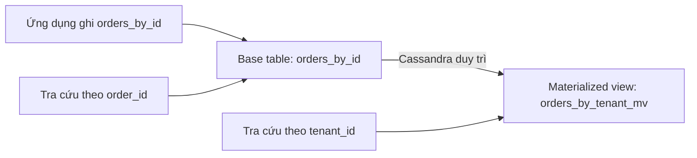
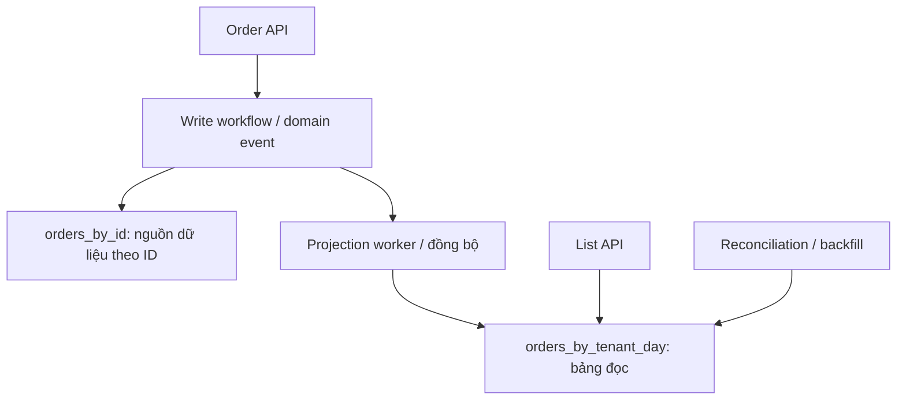
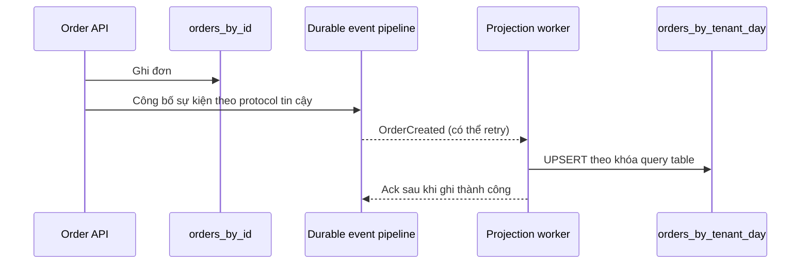

# Materialized view và so sánh với bảng truy cập do ứng dụng duy trì

Apache Cassandra khuyến khích **thiết kế bảng theo truy vấn** (*query-driven data modeling*). Một thực thể nghiệp vụ có thể được lưu dưới nhiều hình dạng khác nhau: bảng tìm theo ID, bảng liệt kê theo tenant, bảng tìm các bản ghi mới nhất trong một ngày. Hai cách phổ biến để tạo đường truy cập bổ sung là **materialized view (MV)** do Cassandra duy trì và **bảng đọc/bảng truy cập (query table)** do ứng dụng hoặc pipeline dữ liệu tự duy trì.

Hai giải pháp cùng giúp đọc dữ liệu theo một khóa khác, nhưng **không tương đương** về cấu trúc khóa, quyền kiểm soát dữ liệu, tính nhất quán, chi phí ghi, khả năng khôi phục và vận hành. Bài thuộc chương **Chỉ mục và mở rộng** của module **SPRING_DATA_CASSANDRA**, liên hệ trực tiếp với `CassandraRepository`, `CassandraTemplate`, `CqlTemplate`, mapping entity và các câu truy vấn CQL.

> **Giới hạn phiên bản:** Khả năng bật materialized view, trạng thái hỗ trợ, các ràng buộc schema và cơ chế đồng bộ có khác biệt giữa các phiên bản Apache Cassandra hoặc dịch vụ Cassandra được quản lý. Không mặc định MV được bật hoặc được khuyến nghị cho mọi cluster production. Trước khi triển khai, phải kiểm tra **phiên bản, tài liệu, cấu hình và chính sách hỗ trợ** của hệ thống cụ thể. Các ví dụ dưới đây dùng cú pháp MV thường gặp ở Apache Cassandra.

## 1. Vì sao một bảng không đáp ứng được mọi truy vấn?

Xét dịch vụ đơn hàng với bảng chính `orders_by_id`. Truy vấn chủ đạo là “tìm đơn có mã `order_id`”:

```sql
-- Giả sử keyspace commerce đã được tạo với replication strategy phù hợp.
CREATE TABLE commerce.orders_by_id (
    order_id uuid PRIMARY KEY,
    tenant_id text,
    order_day date,
    created_at timestamp,
    status text,
    total_amount decimal
);
```

Bảng này tối ưu cho:

```sql
SELECT *
FROM commerce.orders_by_id
WHERE order_id = 11111111-1111-1111-1111-111111111111;
```

Nhưng sản phẩm còn muốn:

1. “Liệt kê **mọi đơn của tenant `shop-42`**.”
2. “Lấy **20 đơn mới nhất của tenant `shop-42` trong ngày `2026-11-25`**.”
3. “Tìm đơn đang ở trạng thái `PAID` của một tenant.”

Không thể giả định các truy vấn sau sẽ hiệu quả:

```sql
-- tenant_id không phải partition key của orders_by_id.
SELECT * FROM commerce.orders_by_id
WHERE tenant_id = 'shop-42';

-- status cũng không nằm trong primary key của bảng này.
SELECT * FROM commerce.orders_by_id
WHERE status = 'PAID';
```

Tùy chỉ mục và điều kiện truy vấn, Cassandra có thể từ chối các câu CQL trên hoặc phải thực hiện đường truy cập đắt đỏ. `ALLOW FILTERING` không phải giải pháp mặc định cho workload lớn.

**Nguyên tắc:** Để đáp ứng access pattern mới, hãy xem xét một cấu trúc đọc khác có khóa phù hợp, sau đó quyết định **ai chịu trách nhiệm cập nhật cấu trúc đó**.

## 2. Materialized view là gì?

Một **materialized view** trong Cassandra là cấu trúc dữ liệu được lưu trữ có **primary key khác bảng gốc**, được định nghĩa từ một base table. Sau khi MV được tạo và xây dựng, Cassandra chịu trách nhiệm duy trì các bản ghi view theo các thay đổi của bảng gốc trong phạm vi cơ chế và giới hạn của tính năng.

Không nhầm MV với view ảo của một số RDBMS: MV **tốn dung lượng lưu trữ thực tế và tài nguyên cập nhật**, giống một đường truy cập dữ liệu bổ sung.



Tác dụng chính:

- Cho phép **đọc theo một primary key của view** thay vì primary key của base table.
- Ứng dụng **không phải tự viết hai câu lệnh INSERT** chỉ để duy trì MV theo cơ chế của Cassandra.
- Bản chất vẫn là **dữ liệu phi chuẩn hóa/nhân bản cho truy vấn**, nên phải tính đến hiệu năng và tính nhất quán khi vận hành.

### 2.1. Ví dụ tạo MV đọc đơn hàng theo tenant

Với bảng `orders_by_id` có khóa gốc `order_id`, tạo MV đặt `tenant_id` vào khóa phân vùng:

```sql
CREATE MATERIALIZED VIEW commerce.orders_by_tenant_mv AS
    SELECT order_id, tenant_id, order_day, created_at, status, total_amount
    FROM commerce.orders_by_id
    WHERE tenant_id IS NOT NULL
      AND order_id IS NOT NULL
    PRIMARY KEY ((tenant_id), order_id);
```

Giải thích:

| Cấu trúc | Partition key | Clustering column | Đường đọc |
| --- | --- | --- | --- |
| Base table `orders_by_id` | `order_id` | Không | Tìm đúng một đơn bằng ID. |
| View `orders_by_tenant_mv` | `tenant_id` | `order_id` | Tìm các đơn của tenant; phân biệt bằng ID. |

Truy vấn view:

```sql
SELECT order_id, status, total_amount
FROM commerce.orders_by_tenant_mv
WHERE tenant_id = 'shop-42'
LIMIT 20;
```

Đây là một truy vấn phù hợp với **partition key của view**. Tuy nhiên, **20 bản ghi đầu không đồng nghĩa 20 đơn mới nhất**: clustering column của view là `order_id uuid`, không phải `created_at`. Thêm `ORDER BY created_at DESC` không tự biến cột thường thành clustering column.

Điểm này rất quan trọng khi chọn giữa MV và bảng do ứng dụng duy trì.

### 2.2. Đọc và ghi diễn ra như thế nào?

Sau khi tạo view, một lần ghi hợp lệ vào bảng gốc:

```sql
INSERT INTO commerce.orders_by_id (
    order_id, tenant_id, order_day, created_at, status, total_amount
) VALUES (
    11111111-1111-1111-1111-111111111111,
    'shop-42',
    '2026-11-25',
    '2026-11-25T09:00:00Z',
    'PENDING',
    250000.00
);
```

sẽ được Cassandra xử lý để phản ánh dữ liệu tương ứng trong view theo cơ chế duy trì MV. Ứng dụng **không gửi một `INSERT` thứ hai vào MV**.

Nếu `tenant_id` thay đổi, bản ghi cần được phản ánh ở vị trí khóa view mới và loại bỏ khỏi vị trí cũ. Nếu bản ghi gốc bị xóa hoặc các ô hết TTL, view cũng cần phản ánh thay đổi. **Không coi các bước duy trì đó là một giao dịch ACID xuyên hai cấu trúc mà client có thể đọc tức thời như một snapshot duy nhất.**

Đặc biệt, việc base write trả ACK **không đủ để khẳng định mọi truy vấn tới MV ở mọi replica đã thấy cùng trạng thái ngay lập tức**. Phải tính đến độ trễ đồng bộ, lỗi node, repair, tiến trình xây dựng view và mức consistency khi thiết kế SLA đọc.

## 3. Các giới hạn quan trọng của MV

MV của Cassandra **không phải** công cụ “lấy bất kỳ câu `SELECT` rồi lưu thành view”.

### 3.1. Primary key của MV bị ràng buộc với base table

Trong mô hình MV thông dụng của Cassandra:

- **Tất cả các cột thuộc primary key của base table phải có trong primary key của view.**
- View có thể đổi vai trò partition/clustering để phục vụ một access pattern khác.
- Thông thường **chỉ được đưa tối đa một cột không thuộc primary key của base table vào primary key của view**.
- Các cột nằm trong khóa view cần đáp ứng điều kiện không `null` thích hợp; câu `WHERE` của định nghĩa view chịu những giới hạn riêng, không phải mệnh đề lọc tùy ý.

Với `orders_by_id`, view `PRIMARY KEY ((tenant_id), order_id)` sử dụng đúng một cột ngoài khóa gốc (`tenant_id`), nên phù hợp mẫu này.

Ngược lại, cấu trúc MV sau **không phải cách hợp lệ để tự tạo bảng đọc theo tenant, ngày và thời gian** từ base key chỉ gồm `order_id`:

```sql
-- Ví dụ ý tưởng KHÔNG HỢP LỆ theo giới hạn MV thông thường:
-- tenant_id, order_day, created_at đều là cột ngoài khóa của base.
--
-- PRIMARY KEY ((tenant_id, order_day), created_at, order_id)
```

Việc thêm ba cột ngoài khóa gốc vào primary key của MV vượt giới hạn trên. Nếu muốn query theo tenant/ngày và sắp xếp theo thời gian, **thiết kế một bảng query-driven do ứng dụng duy trì** thường là phương án trực tiếp hơn.

### 3.2. Không dùng MV như bộ lọc nghiệp vụ tùy ý

Một view có điều kiện:

```sql
-- Không giả định Cassandra MV hỗ trợ tùy ý:
-- WHERE status = 'PAID' AND created_at > ...
```

không tương đương một materialized query tùy biến trong RDBMS. Những điều kiện `WHERE` được phép khi định nghĩa MV bị giới hạn theo yêu cầu key/`IS NOT NULL` và phiên bản Cassandra. Nếu muốn “đơn `PAID` trong 7 ngày gần nhất” với khả năng phân trang tối ưu, nên thiết kế đường đọc riêng thay vì nghĩ MV tự duy trì mọi bộ lọc và phép sắp xếp.

### 3.3. MV không thay thế thiết kế partition và clustering

Từ `orders_by_tenant_mv`:

- `tenant_id` có ít giá trị hoặc một tenant quá lớn có thể tạo **hot/large partition**.
- View không tự bucket tenant theo ngày.
- Thứ tự trong partition được xác định bởi `order_id`, không phải thời gian tạo.
- `SELECT ... LIMIT 20` không thay đổi bản chất partition size hoặc đảm bảo dữ liệu “mới nhất”.

Các yếu tố partition key, clustering order, số replica và cách truy vấn cần được đánh giá **như với một bảng Cassandra bình thường**.

### 3.4. Bật tính năng và giới hạn theo phiên bản

Khi dùng MV, phải xác minh:

1. Cluster Cassandra và dịch vụ quản lý có hỗ trợ **CREATE MATERIALIZED VIEW** không?
2. Tính năng có được bật trong cấu hình vận hành của phiên bản đó không?
3. Giới hạn về base schema, static columns, counter columns, TTL, quyền và thay đổi schema là gì?
4. Có cơ chế kiểm tra **view build completion**, repair và xử lý sai lệch được hỗ trợ không?
5. Tình trạng hỗ trợ/khuyến nghị sử dụng production có phù hợp quy định của tổ chức không?

**Không nên suy ra MV luôn an toàn cho production chỉ vì câu `CREATE MATERIALIZED VIEW` chạy thành công trên môi trường dev.** Lịch sử và cơ chế sửa lỗi/đồng bộ MV của Cassandra phụ thuộc đáng kể vào phiên bản.

## 4. Bảng truy cập do ứng dụng duy trì là gì?

Một **application-maintained query table** là bảng Cassandra bình thường, có primary key được thiết kế cho một truy vấn cụ thể, nhưng **ứng dụng, consumer hoặc pipeline** chịu trách nhiệm ghi và đồng bộ dữ liệu vào đó.

Thay vì yêu cầu Cassandra suy ra MV, ta chủ động tạo bảng đọc:

```sql
CREATE TABLE commerce.orders_by_tenant_day (
    tenant_id text,
    order_day date,
    created_at timestamp,
    order_id uuid,
    status text,
    total_amount decimal,
    PRIMARY KEY ((tenant_id, order_day), created_at, order_id)
) WITH CLUSTERING ORDER BY (created_at DESC, order_id ASC);
```

Bảng này giải quyết trực tiếp truy vấn:

```sql
SELECT created_at, order_id, status, total_amount
FROM commerce.orders_by_tenant_day
WHERE tenant_id = 'shop-42'
  AND order_day = '2026-11-25'
LIMIT 20;
```

Vì đã có **đầy đủ composite partition key** và thứ tự clustering `created_at DESC`, Cassandra có thể đọc các đơn mới nhất của tenant trong ngày theo thiết kế mà không cần sort toàn bộ dữ liệu trong ứng dụng.

| Cột | Vai trò |
| --- | --- |
| `tenant_id` | Thành phần partition key thứ nhất. |
| `order_day` | Thành phần partition key thứ hai, bucket theo ngày. |
| `created_at` | Clustering column đầu, thứ tự giảm dần. |
| `order_id` | Clustering column tiếp theo để phân biệt các đơn trùng timestamp. |
| `status`, `total_amount` | Dữ liệu hiển thị trong danh sách. |

**Lưu ý:** `order_day` cần được tính nhất quán với múi giờ/quy tắc ngày kinh doanh (ví dụ ngày UTC). Đây là quyết định nghiệp vụ, không phải tính năng Cassandra tự suy ra từ `created_at`.

### 4.1. Quyền kiểm soát cao hơn, trách nhiệm cũng nhiều hơn

Bảng tự duy trì cho phép:

- Chọn **bao nhiêu cột** thuộc partition key và clustering key để thỏa truy vấn.
- Chọn bucket ngày/giờ/hash để tránh partition quá lớn hoặc quá nóng.
- Tạo projection chỉ chứa cột phục vụ UI, bỏ payload lớn.
- Biểu diễn dữ liệu chuyển đổi từ nhiều nguồn nếu nghiệp vụ cần.
- Kiểm soát lịch cập nhật, TTL, retry, backfill, reconciliation và quyền ghi.

Đổi lại, ứng dụng phải giải quyết **dual writes**, độ trễ đồng bộ, thứ tự sự kiện, xóa bản ghi cũ, nâng cấp schema và sửa dữ liệu sai lệch. Cassandra không tự biết bảng này được xây từ `orders_by_id` nếu application chưa tổ chức quy trình duy trì.



Sơ đồ là một mẫu logic. Một hệ thống có thể ghi đồng bộ cả hai bảng, hoặc phát event rồi để consumer cập nhật bảng đọc. **Không có một mẫu đúng cho mọi độ trễ và khả năng chịu lỗi.**

## 5. So sánh MV với bảng ứng dụng duy trì

| Tiêu chí | Materialized view | Bảng truy cập do ứng dụng duy trì |
| --- | --- | --- |
| Ai định nghĩa schema? | Cassandra MV DDL với các giới hạn primary key/WHERE. | Ứng dụng/nhóm dữ liệu thiết kế bảng CQL bình thường. |
| Ai cập nhật khi base thay đổi? | Cassandra duy trì theo cơ chế MV. | Service, worker, CDC hoặc pipeline do hệ thống triển khai. |
| Khả năng đổi partition/clustering key | Bị giới hạn bởi khóa gốc và quy tắc MV. | Linh hoạt hơn; chọn query-first. |
| Có thể thêm bucket ngày/giờ? | Chỉ khi schema base và giới hạn MV cho phép. | Có; ứng dụng chịu trách nhiệm xác định và ghi bucket. |
| Có thể biến đổi dữ liệu/aggregate tùy ý? | Hạn chế; không xem MV như engine tổng hợp tùy ý. | Có thể làm qua code/pipeline riêng. |
| Độ tươi dữ liệu | Phụ thuộc quá trình duy trì view và hội tụ replica. | Phụ thuộc chiến lược dual write/event/worker. |
| Ghi khuếch đại (*write amplification*) | Base write + cập nhật view và các thao tác nội bộ liên quan. | Base write + một hoặc nhiều ghi vào bảng đọc. |
| Chi phí lập trình | Ít code dual-write; tăng trách nhiệm vận hành MV. | Nhiều code, retry, observability, backfill. |
| Xử lý sai lệch | Phụ thuộc khả năng repair/rebuild view của phiên bản. | Do nhóm ứng dụng thiết kế reconciliation/replay. |
| Đọc theo Spring Data Cassandra | Có thể truy vấn view như nguồn CQL nếu mapping và quyền phù hợp. | Dùng repository/template bình thường trên bảng đọc. |
| Khả năng dùng production | Phải xác minh hỗ trợ và rủi ro của phiên bản/nhà cung cấp. | Mẫu query table phổ biến trong Cassandra, nhưng vẫn phải vận hành đúng. |

**Điểm cốt lõi:** MV giảm lượng code đồng bộ **nhưng giảm quyền tùy biến mô hình khóa**. Bảng ứng dụng duy trì tăng tính linh hoạt **nhưng chuyển trách nhiệm nhất quán và phục hồi sang ứng dụng**.

## 6. Spring Data Cassandra đọc materialized view như thế nào?

Về phía CQL, view có tên, schema và primary key riêng. Spring Data Cassandra có thể đọc các hàng từ đó bằng câu `SELECT` hợp lệ.

### 6.1. Truy vấn CQL qua CqlTemplate

Ví dụ chỉ cần kết quả gồm `order_id` và `status`:

```java
import java.util.List;
import java.util.UUID;
import org.springframework.data.cassandra.core.cql.CqlTemplate;
import org.springframework.stereotype.Service;

@Service
public class TenantOrderViewReader {

    private final CqlTemplate cqlTemplate;

    public TenantOrderViewReader(CqlTemplate cqlTemplate) {
        this.cqlTemplate = cqlTemplate;
    }

    public List<String> listStatuses(String tenantId) {
        return cqlTemplate.query(
            "SELECT order_id, status FROM commerce.orders_by_tenant_mv " +
            "WHERE tenant_id = ? LIMIT 20",
            (row, rowNum) -> row.getUuid("order_id")
                + ":" + row.getString("status"),
            tenantId
        );
    }
}
```

Ở đây, `?` là **bind marker CQL của CqlTemplate/driver**, không phải placeholder `?0` của annotation `@Query` trong repository. Giá trị `tenantId` được truyền riêng, không nối vào chuỗi CQL.

Ví dụ trả `List<String>` chỉ để minh họa row mapping; trong dự án thật nên dùng DTO rõ kiểu như `OrderSummary(UUID id, String status)`. Quyền `SELECT` trên view phải được cấp cho danh tính ứng dụng phù hợp.

### 6.2. Có thể dùng entity/repository không?

Có thể ánh xạ một loại entity chỉ để **đọc view** bằng `@Table("orders_by_tenant_mv")` và metadata primary key của **view**, rồi khai báo repository hoặc `CassandraTemplate`. Tuy nhiên:

- Metadata khóa phải theo **primary key của view** (`tenant_id, order_id`), không theo khóa của base table.
- Truy vấn như `findById(...)` cần **full primary key của view**; để lấy tất cả đơn của tenant, dùng query theo `tenant_id`.
- **Không thiết kế service ghi vào MV** bằng `repository.save(...)`, `CassandraTemplate.insert(...)` hoặc các lệnh CQL INSERT/UPDATE trực tiếp. Cơ chế duy trì view đến từ base table; view dùng như đường **đọc**.
- Annotation mapping không tự bảo đảm view được tạo hoặc đã xây dựng xong; việc quản lý DDL và trạng thái build thuộc quá trình triển khai/vận hành.

Dùng `CqlTemplate` giúp ví dụ đọc view tránh nhầm view là một entity có quyền ghi. Nếu dùng repository, có thể giới hạn interface chỉ phơi bày phương thức đọc do nhóm thiết kế quy định, thay vì để API nghiệp vụ tùy ý gọi tất cả CRUD kế thừa.

## 7. Spring Data Cassandra ghi bảng truy cập riêng

Với bảng `orders_by_tenant_day`, ứng dụng chủ động ghi một bản cho đường tra cứu theo ID và một bản cho đường liệt kê theo tenant/ngày.

Ví dụ minh họa bằng `CqlTemplate`:

```java
import java.math.BigDecimal;
import java.time.Instant;
import java.time.LocalDate;
import java.time.ZoneOffset;
import java.util.UUID;

public record NewOrder(
    UUID orderId,
    String tenantId,
    Instant createdAt,
    String status,
    BigDecimal totalAmount
) {
    public LocalDate orderDayUtc() {
        return LocalDate.ofInstant(createdAt, ZoneOffset.UTC);
    }
}
```

```java
import org.springframework.data.cassandra.core.cql.CqlTemplate;
import org.springframework.stereotype.Service;

@Service
public class OrderWriteService {
    private final CqlTemplate cqlTemplate;

    public OrderWriteService(CqlTemplate cqlTemplate) {
        this.cqlTemplate = cqlTemplate;
    }

    public void createOrder(NewOrder order) {
        // Ghi nguồn tra cứu theo ID.
        cqlTemplate.execute(
            "INSERT INTO commerce.orders_by_id " +
            "(order_id, tenant_id, order_day, created_at, status, total_amount) " +
            "VALUES (?, ?, ?, ?, ?, ?)",
            order.orderId(), order.tenantId(), order.orderDayUtc(),
            order.createdAt(), order.status(), order.totalAmount()
        );

        // Ghi đường đọc theo tenant/ngày.
        cqlTemplate.execute(
            "INSERT INTO commerce.orders_by_tenant_day " +
            "(tenant_id, order_day, created_at, order_id, status, total_amount) " +
            "VALUES (?, ?, ?, ?, ?, ?)",
            order.tenantId(), order.orderDayUtc(), order.createdAt(),
            order.orderId(), order.status(), order.totalAmount()
        );
    }
}
```

Hai thao tác trên là **hai yêu cầu CQL**. Ví dụ chỉ dùng để mô tả trách nhiệm; **nó chưa đủ an toàn cho một workflow production** có yêu cầu nhất quán mạnh.

Nếu lệnh ghi vào `orders_by_id` thành công nhưng ghi vào `orders_by_tenant_day` thất bại, API có thể để lại một đơn có thể tìm bằng ID nhưng không xuất hiện trong danh sách tenant/ngày. **Đặt `@Transactional` lên hàm Java không biến hai lần ghi Cassandra thành một giao dịch ACID xuyên partition.**

### 7.1. Tại sao không mặc định dùng BATCH?

Cassandra có `BEGIN BATCH ... APPLY BATCH`, nhưng batch không phải transaction quan hệ đa bản ghi/đa partition. Batch được thiết kế cho những trường hợp mutation cụ thể; logged batch có thêm chi phí điều phối và không cung cấp isolation tổng quát cho các reader.

Với hai đường truy cập ở **những partition khác nhau**, việc gộp vào batch không tự bảo đảm **mọi reader luôn thấy cả hai cấu trúc cùng lúc**. Cần xác định tính chất atomicity mong muốn, giới hạn batch, kích thước và topology trước khi lựa chọn. Không dùng batch lớn chỉ để tối ưu throughput.

### 7.2. Mẫu event-driven projection

Nếu chấp nhận **eventual consistency**, có thể:

1. Xác định `orders_by_id` hoặc event log là nguồn sự thật.
2. Ghi dữ liệu nghiệp vụ theo quy trình có thể phục hồi.
3. Phát `OrderCreated`/`OrderUpdated` qua cơ chế đảm bảo event không bị mất theo thiết kế.
4. Consumer cập nhật `orders_by_tenant_day` bằng câu lệnh idempotent theo primary key.
5. Theo dõi độ trễ projection, lỗi consumer và khả năng replay/rebuild.



Sơ đồ diễn đạt mục tiêu, **không tự giải quyết khoảng trống giữa ghi base table và phát event**. Nếu hai thao tác đó không có cơ chế atomic/recoverable, có thể ghi base thành công nhưng mất event. Cần thiết kế một protocol tin cậy, CDC phù hợp, reconciliation hoặc một nguồn event bền vững mà ứng dụng có thể phát lại.

## 8. Khi dữ liệu thay đổi: cập nhật, đổi khóa, xóa và TTL

Việc duy trì bảng đọc không chỉ là ghi một hàng khi tạo đơn.

### 8.1. Cập nhật cột thường

Giả sử trạng thái đổi `PENDING` → `PAID`. Với bảng query table, ứng dụng có thể cập nhật hai bản ghi theo hai khóa khác nhau:

```sql
UPDATE commerce.orders_by_id
SET status = 'PAID'
WHERE order_id = 11111111-1111-1111-1111-111111111111;

UPDATE commerce.orders_by_tenant_day
SET status = 'PAID'
WHERE tenant_id = 'shop-42'
  AND order_day = '2026-11-25'
  AND created_at = '2026-11-25T09:00:00Z'
  AND order_id = 11111111-1111-1111-1111-111111111111;
```

Ví dụ chủ động giữ `tenant_id`, `order_day` và `created_at` bất biến. Nếu chúng có thể thay đổi, ứng dụng cần biết **khóa cũ** để xóa bản ghi ở partition/hàng cũ rồi tạo bản ghi ở khóa mới.

Với MV, một lần thay đổi cột của base table khiến Cassandra chịu trách nhiệm cập nhật view theo cơ chế của nó, nhưng **không bảo đảm ngay lập tức mọi replica trả một snapshot đồng bộ**.

### 8.2. Đổi cột tham gia primary key của bảng đọc

Trong Cassandra, **không thể UPDATE primary key tại chỗ** như một cột dữ liệu thường. Nếu tenant hoặc ngày của đơn thay đổi, bảng `orders_by_tenant_day` phải được xử lý như một **di chuyển bản ghi**:

1. Biết đầy đủ old key của bản ghi đọc.
2. Xóa hoặc tombstone bản ghi ở old key.
3. Insert/upsert bản ghi tại new key.
4. Chống duplicate và xử lý retry có kiểm soát.
5. Nếu các bước thất bại một phần, đối soát để khôi phục trạng thái đúng.

Với MV, thay đổi giá trị của cột tham gia khóa view cũng khiến hệ thống phải xử lý vị trí view cũ/mới; đây là một nguồn phức tạp và chi phí duy trì, không phải thao tác miễn phí.

### 8.3. Xóa và TTL

Khi xóa base row, MV phải phản ánh xóa theo cơ chế duy trì. Khi bảng do ứng dụng duy trì, **ứng dụng phải xóa/đánh dấu xóa ở cả query table** theo chính sách dữ liệu.

```sql
DELETE FROM commerce.orders_by_tenant_day
WHERE tenant_id = 'shop-42'
  AND order_day = '2026-11-25'
  AND created_at = '2026-11-25T09:00:00Z'
  AND order_id = 11111111-1111-1111-1111-111111111111;
```

Với TTL, cần quyết định bảng đọc có giữ dữ liệu cùng thời hạn với bảng gốc hay không. TTL áp dụng cho các giá trị được ghi, có thể tạo tombstone và làm tăng chi phí đọc/compaction. **Không chỉ gắn TTL ngắn cho một vài cột của query table rồi mặc định cả bản ghi sẽ biến mất theo cùng thời điểm.**

### 8.4. Event trùng lặp và thứ tự sự kiện

Consumer nhận event theo cơ chế at-least-once có thể gặp:

- Cùng `OrderCreated` được phát lại nhiều lần.
- `OrderUpdated(PAID)` đến trước `OrderCreated(PENDING)`.
- Một sự kiện cũ đến trễ sau khi trạng thái đã đổi.

Vì vậy phải có chiến lược idempotency và thứ tự: event ID, version nghiệp vụ, timestamp hợp lý và/hoặc conditional write (`IF`/LWT) khi cần. Chỉ dựa vào “Cassandra INSERT là upsert” **không** ngăn một event cũ ghi đè trạng thái mới nếu timestamp/concurrency protocol không được kiểm soát.

## 9. Tính nhất quán: vì sao hai cấu trúc có thể tạm thời khác nhau?

So sánh một trường hợp đơn được tạo:

| Giai đoạn | Base table | MV do Cassandra duy trì | Bảng đọc do ứng dụng duy trì |
| --- | --- | --- | --- |
| Trước ghi | Không có đơn | Không có view row | Không có query row |
| Vừa nhận base write | Có thể đọc theo ID tùy CL/replica | Việc duy trì/đọc MV có thể chưa hội tụ | Chưa chắc đã ghi query row |
| Sau quá trình đồng bộ thành công | Có đơn | Có view row | Có query row |
| Có lỗi node hoặc consumer | Cần kiểm tra replica/repair | Có thể cần view repair/rebuild theo phiên bản | Có thể cần retry, replay hoặc reconciliation |
| Xóa/TTL | Base phản ánh mutation theo CQL | Phải được duy trì theo cơ chế MV | Ứng dụng/pipeline phải xử lý tương ứng |

Một request `SELECT` trên MV hoặc query table **không đọc trực tiếp base table rồi JOIN ngầm với dữ liệu mới nhất**. Nó đọc cấu trúc mà câu query chỉ định, và kết quả phụ thuộc trạng thái của cấu trúc đó tại thời điểm đọc.

Chọn `LOCAL_QUORUM` cho các request có thể cải thiện bảo đảm hội tụ trong những điều kiện nhất định, nhưng **không biến quá trình cập nhật base + view/query table thành một transaction duy nhất**. Với bài toán cần đọc sau ghi, phải xác định rõ SLA freshness, timeout, retry và tín hiệu “projection đã bắt kịp”.

### 9.1. Quan sát và sửa sai lệch

Với MV, các hoạt động cần cân nhắc theo phiên bản và hướng dẫn của cluster:

- Theo dõi trạng thái xây dựng view ban đầu và sau sự cố.
- Theo dõi lỗi write, timeout, view update và độ trễ.
- Thực hiện repair/khôi phục theo quy trình được hỗ trợ.
- Đối chiếu một mẫu hoặc toàn bộ dữ liệu base/view khi có dấu hiệu lệch.

Với bảng do ứng dụng duy trì:

- Lưu/đo `projectionLag`, backlog event, retry count, dead-letter queue.
- Có công cụ **rebuild** từ nguồn sự thật hoặc phát lại event đủ tin cậy.
- Đối chiếu key có trong base nhưng thiếu ở query table, và ngược lại.
- Đặt chính sách xử lý delete, expired record, version out-of-order.
- Không chạy backfill quá nhanh đến mức tạo hot partitions hoặc làm nghẽn cluster.

Đừng lấy **số hàng tổng cộng bằng nhau** làm bằng chứng tính đúng đắn: một base row có thể không đủ điều kiện vào MV do key null; bảng query table có thể bucket hoặc lưu nhiều dạng dữ liệu khác. Đối soát phải theo **hợp đồng ánh xạ và khóa** cụ thể.

## 10. Hiệu năng: read cost đổi lấy write cost

Cassandra tối ưu truy vấn khi biết partition key. Cả MV và bảng đọc đều đánh đổi **tài nguyên lưu trữ/ghi** lấy **đường đọc phù hợp**.

### 10.1. Chi phí của MV

Duy trì view có thể làm tăng:

- Số mutation và dữ liệu lưu trên disk.
- Công việc đọc-before-write/đối chiếu giá trị cũ trong một số trường hợp cập nhật khóa view.
- Traffic giữa node, I/O, compaction và yêu cầu repair.
- Độ phức tạp khi thay schema, rebuild view hoặc xử lý sự cố.

Một view có partition key mới **vẫn có thể bị hot partition**. Nếu hàng triệu đơn thuộc một tenant và MV dùng `tenant_id` làm một partition, việc bật MV không biến partition ấy thành nhiều bucket an toàn.

### 10.2. Chi phí của query table

Ứng dụng có thể chọn `(tenant_id, order_day)` để chia nhỏ dữ liệu, nhưng phải trả giá bằng:

- Ít nhất một ghi bổ sung mỗi khi base thay đổi và projection cần cập nhật.
- Hàng đợi/event pipeline, consumer, retry, checkpoint và khả năng replay.
- Chi phí vận hành schema migration, dữ liệu stale và reconciliation.
- Độ trễ giữa thời điểm base ghi xong và query table được cập nhật.

Nếu sử dụng nhiều bảng đọc cho các access pattern khác nhau, write amplification có thể tăng đáng kể. Không tạo bản sao cho mọi filter tùy ý; hãy xác định **truy vấn quan trọng**, đo tải và chọn số lượng bảng đọc hợp lý.

### 10.3. Cách đo khi chọn phương án

Dùng workload thực tế để đánh giá:

| Nhóm chỉ số | Điều nên đo |
| --- | --- |
| Đọc | p95/p99 latency, số partition bị chạm, rows/bytes trả về, paging. |
| Ghi | p95/p99 latency, write timeouts, request throughput, retry. |
| Lưu trữ | Dung lượng base, view, query table, compaction/tombstone. |
| Vận hành | View build duration, projection lag, backlog, repair/backfill. |
| Độ đúng dữ liệu | Số key thiếu/dư, version lệch, stale status theo SLA. |
| Chi phí thay đổi | Tác động khi thêm access pattern, đổi khóa, schema migration. |

Nếu yêu cầu thực tế là “20 đơn mới nhất của tenant/ngày”, hãy benchmark đúng câu `SELECT ... WHERE tenant_id=? AND order_day=? LIMIT 20` thay vì đo một truy vấn đơn theo `order_id` rồi suy ra độ tốt cho danh sách.

## 11. Materialized view, secondary index và query table

MV không phải giải pháp duy nhất để thêm access path. Cassandra có các biến thể **secondary index** (cơ chế và tính năng phụ thuộc phiên bản, ví dụ SAI ở các bản hỗ trợ), nhưng index khác cả MV lẫn bảng đọc:

- **Secondary index** hỗ trợ tìm kiếm theo một số cột/điều kiện mà cơ chế index cho phép. Hiệu quả phụ thuộc selectivity, cách tổ chức dữ liệu, số partition và phiên bản.
- **Materialized view** lưu một cấu trúc có **primary key riêng** và do Cassandra duy trì, nhưng ràng buộc chặt với base schema.
- **Query table** là bảng thông thường do ứng dụng tự ghi, linh hoạt về partition/clustering, TTL và shape dữ liệu.

| Nhu cầu | Cân nhắc ban đầu |
| --- | --- |
| Tìm đơn theo `order_id` | Base table `orders_by_id`, không cần index. |
| Tìm đơn của `tenant_id`, không cần sắp theo thời gian | MV có thể là ứng viên nếu cluster hỗ trợ và các hạn chế/phân vùng phù hợp. |
| Lấy đơn mới nhất theo `tenant_id + order_day` | Query table có composite partition key và clustering order đúng yêu cầu. |
| Lọc chọn lọc theo cột ít dùng | Đánh giá index được hỗ trợ, nhưng đo chi phí và tránh scan lớn. |
| Aggregate, biến đổi giá trị, bucketing, join dữ liệu ngoài | Pipeline/application-maintained read model, không kỳ vọng MV tự làm. |

Không nên quyết định chỉ dựa trên chữ “index” hoặc “view”; cần đối chiếu **access pattern, schema, tính nhất quán mong muốn và mức độ vận hành chấp nhận được**.

## 12. Chiến lược migration và lựa chọn an toàn

### 12.1. Khi cân nhắc tạo MV

Một quy trình cẩn trọng:

1. Xác minh phiên bản Cassandra và việc bật hỗ trợ MV trên cluster mục tiêu.
2. Chứng minh schema base cho phép khóa view mong muốn, không vi phạm quy tắc WHERE/primary key.
3. Dự tính dung lượng, thêm chi phí write và các partition có nguy cơ nóng.
4. Tạo MV trên môi trường thử nghiệm với dữ liệu đại diện, kiểm tra build/backfill.
5. Kiểm thử insert, update, delete, TTL, node lỗi và phục hồi/repair theo quy trình được hỗ trợ.
6. Đo read-after-write, độ trễ hội tụ, stale-result rate và hiệu năng.
7. Chỉ mở traffic đọc sau khi xác minh view đã được build và dữ liệu đạt tiêu chí chấp nhận.
8. Đặt runbook xử lý sai lệch và hướng rollback/đổi access path nếu MV không đáp ứng SLA.

Tạo MV trên bảng có dữ liệu lớn có thể kéo theo quá trình build tốn tài nguyên. **Không mặc định vừa chạy DDL xong là toàn bộ dữ liệu lịch sử đã sẵn sàng để truy vấn chính xác.**

### 12.2. Khi tạo query table mới

Với `orders_by_tenant_day`:

1. Chốt khóa phân vùng và clustering theo **truy vấn sản phẩm**.
2. Thiết kế schema migration và chỉ định dữ liệu cột nào là nguồn sự thật.
3. Xây đường ghi/consumer có retry, idempotency, versioning và đo projection lag.
4. Backfill dữ liệu lịch sử từ nguồn tin cậy, có giới hạn lưu lượng.
5. Theo dõi khoảng cách giữa backfill và các ghi mới trong thời gian chuyển đổi; tránh mất/ghi đè sự kiện.
6. Đối soát cả dữ liệu thiếu lẫn dữ liệu dư, kiểm tra trạng thái/timestamp/TTL.
7. Chuyển dần traffic đọc sang query table; chuẩn bị fallback hoặc quy trình quay lại.
8. Duy trì công cụ rebuild và runbook khắc phục lỗi consumer/projection.

**Chỉ tạo bảng mới rồi cho API đọc ngay** là thiếu một bước quan trọng: dữ liệu lịch sử và các cập nhật trong quá trình chuyển đổi phải được đồng bộ có thể kiểm chứng.

## 13. Lỗi thường gặp và cách xử lý

| Triệu chứng | Nguyên nhân khả dĩ | Cách xử lý |
| --- | --- | --- |
| `CREATE MATERIALIZED VIEW` bị từ chối | Cluster/tài khoản không hỗ trợ, MV bị tắt, DDL vi phạm giới hạn. | Kiểm tra phiên bản/cấu hình, quyền schema và khóa/WHERE. |
| MV query theo tenant nhưng không ra “đơn mới nhất” | Clustering theo `order_id`, không theo `created_at`. | Dùng query table với clustering order đúng use case. |
| MV chứa thiếu dữ liệu ngay sau tạo | View build/backfill chưa hoàn tất. | Theo dõi trạng thái build trước khi chuyển traffic. |
| View/base tạm khác nhau sau ghi | Quá trình duy trì và trạng thái replica chưa hội tụ. | Đánh giá SLA, CL, lỗi node và quy trình repair của version. |
| Một tenant làm node/partition quá tải | View partition chỉ theo `tenant_id`, tenant quá lớn. | Thiết kế lại access path, bucket theo thời gian/hash ở bảng ứng dụng. |
| API viết base thành công nhưng danh sách thiếu đơn | Ghi query table thứ hai thất bại hoặc consumer chậm. | Retry/replay, đối soát, đo projection lag. |
| Sau khi đổi tenant/ngày, đơn hiện ở cả hai partition | Chưa xóa old query-table row. | Lưu old key, delete/tombstone và upsert new key có kiểm soát. |
| Trạng thái đơn bị lùi từ PAID về PENDING | Event cũ đến muộn, timestamp/version không được kiểm soát. | Idempotency/version CAS và xử lý out-of-order. |
| Tombstone/compaction tăng mạnh | TTL/delete nhiều ở các cấu trúc dữ liệu bổ sung. | Đánh giá vòng đời dữ liệu, compaction, repair và bucket. |
| Repository `save` trên entity ánh xạ view lỗi | View không phải bảng ghi chủ động. | Chỉ đọc view; ghi base table. |
| `LOCAL_QUORUM` nhưng vẫn thấy dữ liệu read model chậm | CL không tạo atomicity xuyên base/view/query table. | Đo và quản lý tiến trình đồng bộ, không chỉ đổi CL. |
| Scan `ALLOW FILTERING` chạy chậm | Thiếu bảng/index phục vụ access pattern. | Thiết kế khóa đọc mới, hạn chế query quét. |

## 14. Checklist quyết định: chọn MV hay query table?

Trước khi chọn, trả lời:

1. **Truy vấn cụ thể là gì?** Theo ID, tenant, ngày, trạng thái hay thời gian?
2. Có thể biểu diễn primary key mong muốn của đường đọc bằng **giới hạn MV** trên base schema hiện tại không?
3. Có cần bucket, sort theo timestamp, lọc nghiệp vụ, projection phức tạp hoặc dữ liệu từ nguồn khác không?
4. Cluster thực tế có **hỗ trợ và cho phép dùng MV** với SLA/vận hành hiện tại không?
5. Ứng dụng có chấp nhận **độ trễ hội tụ** từ base sang đường đọc không? Cần đo như thế nào?
6. Có thể chấp nhận **tài nguyên write amplification**, dung lượng lưu trữ và compaction bổ sung không?
7. Với query table, có cơ chế **event tin cậy, retry, idempotency, replay và reconciliation** không?
8. Với MV, có quy trình **view build, repair, sự cố và phục hồi** phù hợp phiên bản không?
9. Ai sở hữu dữ liệu, schema, runbook, quyền truy cập và các thay đổi khi nghiệp vụ phát triển?
10. Đã có integration test và benchmark với **tenant lớn nhất, hot partition và failure scenario** chưa?

### Gợi ý chọn theo kịch bản

- **Kịch bản A:** Chỉ cần tìm đơn của tenant bằng `tenant_id`; base key là `order_id`. MV `orders_by_tenant_mv` có thể đáp ứng cú pháp nếu cluster hỗ trợ và phân vùng theo tenant không quá lớn. Nhưng vẫn cần kiểm tra mức độ phù hợp cho production và consistency.
- **Kịch bản B:** Cần 20 đơn mới nhất theo tenant/ngày, paging ổn định và giới hạn partition. Bảng `orders_by_tenant_day` do ứng dụng duy trì hợp với mô hình query-first hơn.
- **Kịch bản C:** Cần bản đọc được tổng hợp từ thanh toán, giao hàng và đơn hàng. MV Cassandra trên một bảng gốc không giải quyết luồng biến đổi nhiều nguồn; cần read model/pipeline riêng.
- **Kịch bản D:** Đội ngũ chưa có hạ tầng event đáng tin cậy và cluster không hỗ trợ MV. Trước khi thêm đường đọc, phải xây kế hoạch đồng bộ/backfill hoặc cân nhắc phương án truy vấn khác; không chọn giải pháp không có cơ chế đảm bảo dữ liệu.

## 15. Bài tập tự kiểm tra

**Câu 1.** Bảng base có `PRIMARY KEY (order_id)`. Vì sao MV `PRIMARY KEY ((tenant_id), order_id)` có thể là ứng viên, trong khi MV `PRIMARY KEY ((tenant_id, order_day), created_at, order_id)` không đáp ứng giới hạn MV thông dụng?

**Câu 2.** MV `orders_by_tenant_mv` dùng `PRIMARY KEY ((tenant_id), order_id)`. Truy vấn `WHERE tenant_id = 'shop-42' LIMIT 20` có bảo đảm trả 20 đơn mới nhất theo `created_at` không?

**Câu 3.** Vì sao `CassandraRepository` ánh xạ một view không nên được ứng dụng dùng `save()` như bảng thường?

**Câu 4.** Một lần ghi thành công vào `orders_by_id` có chứng minh chắc chắn query table đã có bản ghi tương ứng hay không? Nếu ứng dụng dùng hai câu INSERT riêng, điểm lỗi ở đâu?

**Câu 5.** Hai bảng có cùng `order_id` nhưng khác `status`. Nếu consumer nhận một event cũ, làm thế nào để tránh trạng thái bị lùi?

**Câu 6.** `LOCAL_QUORUM` có tạo giao dịch nguyên tử xuyên base và view hoặc query table không?

**Câu 7.** Khi tenant có hàng triệu bản ghi trong một partition MV, vì sao vấn đề không được giải quyết chỉ bằng `LIMIT 20`?

**Câu 8.** Sau khi tạo bảng đọc mới, tại sao phải backfill và đối soát dữ liệu trước khi chuyển traffic?

**Gợi ý trả lời:**

1. MV phải chứa mọi cột khóa gốc, và thường chỉ thêm tối đa một cột ngoài khóa gốc vào khóa MV. `tenant_id` là một cột thêm; ví dụ thứ hai cần thêm `tenant_id`, `order_day`, `created_at`.
2. Không. Thứ tự clustering là `order_id`, không phải `created_at`; `LIMIT 20` chỉ giới hạn số hàng trả.
3. MV được Cassandra duy trì từ base table; ứng dụng nên ghi base và dùng view chỉ để đọc.
4. Không. Sau khi ghi base, lệnh ghi query table có thể thất bại hoặc consumer chưa xử lý. Cần retry, replay và reconciliation.
5. Gắn version/sequence có ý nghĩa, áp dụng idempotent và/hoặc conditional write khi cần, tránh ghi sự kiện cũ đè trạng thái mới.
6. Không. CL liên quan ACK/replica, không thay thế transaction xuyên những cấu trúc dữ liệu khác nhau.
7. Partition vẫn lớn và nóng, gây chi phí ghi, compaction, tombstone và load mất cân đối. `LIMIT` không thay đổi phân bố partition.
8. Dữ liệu cũ không tự đi vào query table, trong khi dữ liệu mới có thể tiếp tục thay đổi. Cần bảo đảm không có khoảng trống hoặc sự kiện bị ghi đè trong giai đoạn chuyển đổi.

**Ghi nhớ:** **Materialized view** mang lại một đường đọc Cassandra tự duy trì nhưng bị ràng buộc chặt bởi **primary key và trạng thái hỗ trợ của phiên bản**. **Bảng truy cập do ứng dụng duy trì** cho phép tự chọn partition key, bucketing và clustering để phục vụ truy vấn, đổi lại phải xử lý **dual writes, eventual consistency, retry, idempotency và reconciliation**. Với Spring Data Cassandra, hãy bắt đầu từ access pattern và SLA dữ liệu, không chọn view hay index chỉ để tránh viết thêm một repository.

### Tài liệu tham khảo để đối chiếu theo phiên bản

- [Apache Cassandra — CQL materialized views](https://cassandra.apache.org/doc/stable/cassandra/developing/cql/mvs.html)
- [Apache Cassandra — CQL data modeling](https://cassandra.apache.org/doc/stable/cassandra/developing/data-modeling/index.html)
- [Spring Data Cassandra — Repository support](https://docs.spring.io/spring-data/cassandra/reference/cassandra/repositories.html)
- [Spring Data Cassandra — CQL template](https://docs.spring.io/spring-data/cassandra/reference/cassandra/cql-template.html)
