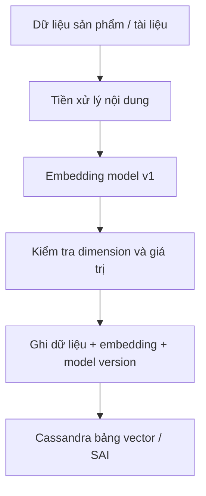
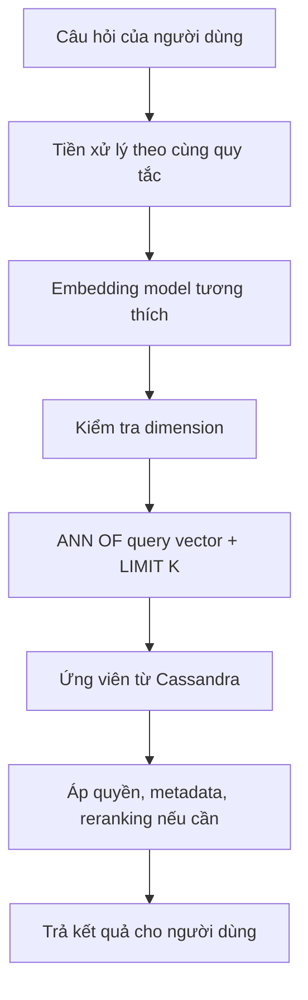
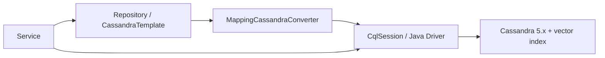

# Tìm kiếm vector, truy vấn ANN và yêu cầu phiên bản

## Mục tiêu học tập

Khi ứng dụng cần tìm sản phẩm **tương tự về ngữ nghĩa**, đoạn văn có nội dung gần giống câu hỏi hoặc tài liệu liên quan đến một ảnh, truy vấn bằng từ khóa chính xác không phải lúc nào cũng đủ. Một hướng tiếp cận là biến nội dung thành **embedding** — một vector số biểu diễn đặc trưng — rồi tìm các vector gần với vector của yêu cầu.

Apache Cassandra có những khả năng mở rộng cho bài toán này trong **các phiên bản và bản phân phối hỗ trợ vector search**. Trong hệ sinh thái Cassandra hiện đại, cần hiểu kiểu CQL `vector<float, N>`, **Storage-Attached Index (SAI)** và cú pháp **Approximate Nearest Neighbor (ANN)**. Nhưng một ứng dụng dùng Spring Data Cassandra **không tự có tính năng ANN chỉ nhờ thêm một dependency**; khả năng thực tế phụ thuộc phiên bản máy chủ, driver, Spring Data và cách triển khai chỉ mục.

Bài học thuộc chương **Chỉ mục và mở rộng** của module `SPRING_DATA_CASSANDRA`. Ngoài câu truy vấn CQL, chúng ta sẽ liên hệ tới entity mapping, repository, `CassandraTemplate`, mô hình bảng theo truy vấn, partition key, consistency, paging và tối ưu hiệu năng trong cơ sở dữ liệu phân tán.

Sau bài này, bạn có thể:

- Giải thích embedding, similarity, top-K và sự khác nhau giữa tìm kiếm vector **chính xác** với **ANN gần đúng**.
- Phân biệt vector CQL, chỉ mục SAI và câu truy vấn `ORDER BY ... ANN OF ... LIMIT ...`.
- Nhận biết **yêu cầu phiên bản Cassandra** và lý do phải kiểm tra tương thích Java Driver/Spring Data Cassandra.
- Thiết kế đường lưu embedding, sinh truy vấn, cập nhật chỉ mục và đọc chi tiết bản ghi.
- Phân biệt **giới hạn theo tenant/partition** với tìm kiếm toàn bộ không gian vector, tránh sai bảo mật và hot partition.
- Kiểm tra dimension, kiểu số, phiên bản embedding model và các yêu cầu về chất lượng, độ trễ, consistency.
- Đánh giá khi nào vector index của Cassandra đủ dùng và khi nào cần một kiến trúc tìm kiếm chuyên dụng khác.

## 1. Từ tìm kiếm từ khóa đến tìm kiếm vector

Một ứng dụng bán hàng có thể lưu:

```text
Sản phẩm A: "Giày chạy bộ nhẹ, thoáng khí"
Sản phẩm B: "Giày thể thao dành cho chạy đường dài"
Sản phẩm C: "Ấm điện dung tích 1,5 lít"
```

Nếu người dùng tìm “giày chạy marathon”, hai sản phẩm A và B có thể liên quan về ngữ nghĩa ngay cả khi không trùng chính xác mọi từ khóa. Hệ thống embedding có thể chuyển văn bản thành các vector số và sử dụng độ tương tự vector để tạo danh sách ứng viên.

Ví dụ với vector **3 chiều chỉ để minh họa**:

```text
embedding("giày chạy marathon") -> [ 0.12, -0.05, 0.31 ]
embedding("giày chạy bộ nhẹ")   -> [ 0.11, -0.06, 0.30 ]
embedding("ấm điện")            -> [-0.44,  0.19, 0.07 ]
```

Vector ở ví dụ không được tạo bằng mô hình thật, không chứng minh sản phẩm nào gần hơn theo metric cụ thể. Các embedding production thường có số chiều lớn hơn và được sinh bởi một mô hình bên ngoài Cassandra.

### Bốn khái niệm cốt lõi

| Khái niệm | Ý nghĩa |
| --- | --- |
| **Embedding** | Một dãy số thực biểu diễn nội dung trong không gian đặc trưng. |
| **Dimension** | Số phần tử của vector, ví dụ 3, 384, 768 hoặc một kích thước khác do model quy định. |
| **Similarity/distance** | Phương pháp đánh giá hai vector gần nhau đến đâu, ví dụ cosine, dot product hoặc Euclidean theo khả năng hệ thống. |
| **Top-K nearest neighbors** | Chọn K bản ghi có vector được đánh giá gần nhất với vector truy vấn. |

ANN là viết tắt của **Approximate Nearest Neighbor**: dùng cấu trúc chỉ mục/thuật toán để tìm **ứng viên gần nhất một cách xấp xỉ** thay vì buộc tính khoảng cách chính xác tới mọi vector.

**Tìm kiếm vector không đồng nghĩa tìm kiếm văn bản đầy đủ**. Một ứng dụng thường cần thêm bộ lọc nghiệp vụ, từ khóa, quyền truy cập và bước xếp hạng lại (*reranking*).

## 2. Tìm kiếm chính xác và ANN khác nhau thế nào?

Giả sử một bảng có một triệu embedding. Để tìm chính xác 10 vector gần nhất theo một metric, cách đơn giản về mặt lý thuyết là:

1. Đọc mọi vector ứng viên hợp lệ.
2. Tính độ tương tự với vector truy vấn.
3. Sắp xếp tất cả theo điểm.
4. Giữ 10 hàng đầu.

Cách đó có thể quá tốn CPU, I/O và băng thông, nhất là khi dữ liệu lớn và yêu cầu trả lời nhanh. Một **ANN index** tổ chức dữ liệu để hạn chế lượng ứng viên phải xét.

| Tiêu chí | Tìm kiếm chính xác (exact) | ANN |
| --- | --- | --- |
| Mục tiêu | Tìm đúng top-K theo metric trong tập được xét. | Tìm những kết quả gần top-K với chi phí thấp hơn. |
| Chi phí | Có thể cao khi phải so mọi vector. | Thường giảm công việc nhờ chỉ mục/thuật toán. |
| Độ chính xác tập kết quả | Có thể tạo ground truth để đối chiếu. | Có thể bỏ sót một số hàng thuộc top-K chính xác. |
| Chỉ số quan trọng | Thời gian và tài nguyên tìm đủ kết quả. | Recall@K, p95/p99 latency, tài nguyên, độ ổn định. |
| Tính phù hợp | Tập nhỏ, batch/offline, đánh giá chất lượng. | Search tương tác hoặc truy vấn vector ở quy mô lớn. |

ANN không bảo đảm cùng một tập kết quả trong mọi lần thực hiện dưới mọi trạng thái cụm. **Kết quả gần đúng** là tính chất của phương pháp tìm kiếm, không phải lỗi tự thân.

### Recall@K là gì?

Nếu top-10 chính xác chứa 10 kết quả, còn ANN trả 10 kết quả nhưng chỉ 8 trong số đó nằm trong top-10 chính xác, thì:

\[
\operatorname{Recall@10}=\frac{8}{10}=0.8
\]

Ở đây, recall được tính với **cùng tập dữ liệu, cùng metric và cùng bộ lọc**. Không thể so recall giữa hai embedding model khác nhau rồi kết luận đơn giản rằng chỉ mục nào “đúng hơn”.

## 3. Yêu cầu phiên bản: kiểm tra từ server đến Spring Data

Đây là phần quan trọng nhất trước khi viết code.

**Apache Cassandra 5.0** là mốc của dòng Cassandra mã nguồn mở có hỗ trợ kiểu dữ liệu vector và khả năng truy vấn ANN gắn với những tính năng chỉ mục phù hợp. Các hệ thống **Cassandra 4.x thông thường** không thể chạy nguyên các ví dụ `vector<float, N>` và `ANN OF` chỉ bằng cách nâng cấp Spring Data Cassandra.

Tuy nhiên, không nên đánh đồng mọi hệ thống có tên “Cassandra”:

- Apache Cassandra mã nguồn mở.
- Các bản phân phối thương mại/được quản lý và dịch vụ cloud tương thích CQL.
- Các phiên bản có backport hoặc extension riêng.
- Những phiên bản Java Driver và Spring Data hỗ trợ tập tính năng CQL khác nhau.

### Ma trận kiểm tra trước khi triển khai

| Tầng | Câu hỏi bắt buộc | Rủi ro nếu bỏ qua |
| --- | --- | --- |
| **Cassandra server** | Phiên bản máy chủ thực có hỗ trợ `vector<float, N>` và ANN không? | `CREATE TABLE` hoặc `SELECT ... ANN OF` bị từ chối. |
| **Vector index** | Bản triển khai có hỗ trợ SAI/vector index đúng loại không? | Có cột vector nhưng không thể tìm ANN như dự kiến. |
| **CQL syntax** | Cú pháp `CREATE INDEX`, `ANN OF` và tùy chọn metric được phiên bản này chấp nhận? | Lỗi parser hoặc cấu hình chỉ mục sai. |
| **Java Driver** | Driver có hiểu CQL vector type và codec tương ứng không? | Không bind/read được vector hoặc metadata không nhận dạng kiểu. |
| **Spring Data Cassandra** | Mapping/conversion có hỗ trợ kiểu Java vector định dùng không? | Entity/repository khởi động được nhưng truy vấn/ghi lỗi lúc thực thi. |
| **Spring Boot dependency set** | Starter và driver có đồng bộ phiên bản không? | Xung đột transitive dependency và lỗi runtime. |
| **Thực tế vận hành** | Index build, giới hạn dimension, metric, query filter, cluster health ra sao? | Query chạy nhưng kết quả hoặc độ trễ không đạt yêu cầu. |

**Không tự suy luận:** “Spring Boot mới” đồng nghĩa “Cassandra server hỗ trợ vector”; hoặc “Cassandra 5.x” đồng nghĩa mọi tính năng của một dịch vụ cloud dùng cú pháp giống hệt nhau.

Nếu dự án đang ở Cassandra 4.x và chưa có extension tương đương, các lựa chọn thường là **nâng cấp/di chuyển cluster** theo quy trình có kiểm soát hoặc **dùng hệ thống vector search khác**, thay vì chỉ thêm annotation vào entity.

### Gợi ý kiểm tra tương thích

1. Xác định version server và bản phân phối đang chạy, không chỉ version khai báo trong tài liệu dự án.
2. Đọc tài liệu CQL/SAI/ANN của **chính version ấy**.
3. Thử tạo bảng vector **trong môi trường test**, không thử nghiệm DDL trước trên production.
4. Thử tạo chỉ mục, nạp vài vector và thực thi một query `ANN OF`.
5. Chạy tích hợp với **đúng Java Driver và Spring Data** của ứng dụng.
6. Xác định các khác biệt cú pháp hoặc giới hạn và khóa chúng trong bộ test/ma trận hỗ trợ.

## 4. Vector CQL: vector<float, N> là gì?

Trong hệ thống hỗ trợ kiểu vector Cassandra, cú pháp minh họa:

```sql
embedding vector<float, 3>
```

Ý nghĩa:

- `vector` là một kiểu giá trị chứa các phần tử số.
- `float` là kiểu phần tử trong trường hợp minh họa.
- `3` là **số chiều cố định** của vector trong schema.
- Mọi giá trị đưa vào cột phải tuân thủ kiểu và kích thước mà schema yêu cầu.

Đoạn sau chỉ là giá trị vector trong CQL:

```sql
[0.12, -0.05, 0.31]
```

Đừng nhầm vector với `list<float>`. Chúng không nhất thiết có cùng codec, cùng ngữ nghĩa kích thước và khả năng lập chỉ mục ANN. Một cột `list<float>` được dùng để lưu danh sách số **không tự biến thành vector index**.

### Dimension do embedding model quyết định

Nếu model tạo 768 giá trị thì schema cần dimension tương ứng; không thể nhét 768 số vào cột `vector<float, 3>`. Cũng không nên tùy tiện lấy ba phần tử đầu của vector 768 chiều để “ép kiểu cho vừa”, vì điều đó làm thay đổi đặc trưng và chất lượng tìm kiếm.

Ví dụ:

```text
Model A -> vector 384 chiều
Model B -> vector 768 chiều

Schema dùng:
  embedding vector<float, 384>

=> Vector của Model B không tương thích dimension.
```

Với production, chọn dimension phải đi cùng kế hoạch model và ước lượng kích thước bảng/chỉ mục. Không tăng dimension chỉ vì “nhiều chiều chắc chắn tốt hơn”; độ chính xác thực tế phụ thuộc model, metric, tập dữ liệu và tài nguyên.

## 5. Một bảng CQL tối giản để học ANN

Trước tiên, sử dụng ví dụ **catalog đơn giản trong một môi trường không có phân tách tenant**. Việc bảo vệ dữ liệu nhiều tenant sẽ được giải quyết riêng ở các phần sau.

```sql
CREATE TABLE catalog_items_by_id (
    item_id uuid PRIMARY KEY,
    title text,
    category text,
    embedding_model text,
    embedding vector<float, 3>
);
```

Ở đây:

- `item_id` định danh một hàng.
- `title` và `category` là metadata hiển thị.
- `embedding_model` ghi lại phiên bản hoặc định danh model dùng để tạo vector.
- `embedding` chứa vector có ba phần tử.

Đây là một **bảng minh họa cách lưu dữ liệu và index**, không phải cấu trúc production tối ưu cho mọi truy vấn. Khóa đơn `item_id` giúp tra cứu sản phẩm theo ID; khả năng ANN sẽ đến từ **chỉ mục trên cột embedding**, không phải từ việc `embedding` nằm trong primary key.

### Ghi dữ liệu mẫu

```sql
INSERT INTO catalog_items_by_id (
    item_id, title, category, embedding_model, embedding
) VALUES (
    11111111-1111-4111-8111-111111111111,
    'Giày chạy bộ nhẹ', 'SHOES', 'demo-embedding-v1',
    [0.12, -0.05, 0.31]
);

INSERT INTO catalog_items_by_id (
    item_id, title, category, embedding_model, embedding
) VALUES (
    22222222-2222-4222-8222-222222222222,
    'Giày thể thao đường dài', 'SHOES', 'demo-embedding-v1',
    [0.11, -0.06, 0.30]
);

INSERT INTO catalog_items_by_id (
    item_id, title, category, embedding_model, embedding
) VALUES (
    33333333-3333-4333-8333-333333333333,
    'Ấm đun nước điện', 'KITCHEN', 'demo-embedding-v1',
    [-0.44, 0.19, 0.07]
);
```

Các vector dùng để diễn giải cú pháp, **không phải embedding đã được xác minh bằng model thật**. Ở production, ứng dụng cần sinh embedding bằng cùng model/tiền xử lý đã được lựa chọn.

## 6. Storage-Attached Index (SAI) và cột vector

SAI là một cơ chế chỉ mục trong Apache Cassandra được thiết kế để mở rộng những đường truy vấn theo điều kiện phù hợp. Với triển khai Cassandra hỗ trợ vector search/ANN, **vector index dựa trên SAI** cho phép tìm các ứng viên gần vector truy vấn.

Ví dụ CQL thường gặp ở Cassandra 5.x:

```sql
CREATE CUSTOM INDEX catalog_items_embedding_sai
ON catalog_items_by_id (embedding)
USING 'StorageAttachedIndex';
```

**Điều kiện quan trọng:** Cú pháp trên cần được đối chiếu với phiên bản/bản phân phối Cassandra thực. Một số hệ thống có cách khai báo `USING 'sai'` hoặc tên index implementation khác, và những tùy chọn cho vector similarity có thể khác nhau. Không copy lệnh index từ sản phẩm khác vào cluster mà chưa thử nghiệm.

### Vector column và index là hai việc khác nhau

| Bước | Tác dụng | Chưa bảo đảm |
| --- | --- | --- |
| `CREATE TABLE ... vector<float,3>` | Có nơi lưu vector. | Truy vấn nearest-neighbor hiệu quả. |
| `CREATE ... INDEX ... embedding` | Khai báo chỉ mục phù hợp theo khả năng server. | Index đã hoàn tất xây dựng ở các node cần phục vụ. |
| Nạp dữ liệu | Có các vector để truy vấn. | Embedding đúng model, cùng không gian và chất lượng. |
| Truy vấn ANN | Yêu cầu tìm top-K gần nhất. | Kết quả là exact top-K hoặc đáp ứng SLA. |

**Schema agreement không đồng nghĩa index đã sẵn sàng cho toàn bộ dữ liệu.** Với bảng đã có nhiều hàng, xây dựng chỉ mục có thể cần thời gian và tài nguyên. Quy trình triển khai phải xác nhận tình trạng index build/availability theo tài liệu và công cụ của phiên bản đang dùng.

### Không coi SAI là công cụ chữa mọi truy vấn

SAI có các trường hợp sử dụng và giới hạn riêng. Chọn thêm index không miễn phí: hệ thống cần duy trì dữ liệu chỉ mục trong quá trình ghi, cập nhật và compaction; mức ảnh hưởng phụ thuộc workload và cấu hình.

Nếu một màn hình vốn có thể đọc hiệu quả bằng **đầy đủ partition key**, hãy cân nhắc dùng truy vấn theo khóa trước khi đặt index chỉ vì muốn viết `WHERE` linh hoạt hơn.

## 7. Cú pháp ANN OF và LIMIT

Với bảng và index được hỗ trợ, một truy vấn vector minh họa:

```sql
SELECT item_id, title, category
FROM catalog_items_by_id
ORDER BY embedding ANN OF [0.10, -0.08, 0.30]
LIMIT 5;
```

Đọc câu lệnh:

1. `embedding` là **cột vector thật của bảng** đã được lập index ANN thích hợp.
2. `ANN OF [0.10, -0.08, 0.30]` cung cấp vector truy vấn.
3. `ORDER BY ... ANN OF ...` yêu cầu **xếp hạng theo độ gần vector**, không phải sắp xếp CQL thông thường theo clustering column.
4. `LIMIT 5` đặt số lượng kết quả top-K muốn lấy.
5. `SELECT item_id, title, category` không lấy toàn bộ vector ra mạng khi chỉ cần hiển thị kết quả.

**Đừng hiểu nhầm:** Cú pháp ANN là tính năng CQL chuyên biệt trên phiên bản có hỗ trợ vector search. Nó không có nghĩa Cassandra nay hỗ trợ `ORDER BY` tùy ý trên tất cả regular columns hoặc sắp mọi hàng của mọi bảng theo bất kỳ biểu thức Java nào.

### Vì sao LIMIT đặc biệt quan trọng?

Truy vấn nearest-neighbor thường cần **K kết quả tốt nhất**, ví dụ 5, 10 hoặc 20. ANN index được dùng để đưa ra một tập ứng viên có giới hạn, vì thế yêu cầu top-K cần được xác định rõ.

Một số phiên bản triển khai **bắt buộc** ANN query kèm giới hạn thích hợp và có thể có giới hạn tối đa cho K. Đừng viết API cho phép client truyền `limit` hàng triệu rồi kỳ vọng index sẽ trả vô hạn kết quả với chi phí nhỏ.

### Các phép thử cần làm với câu CQL

Trước khi tích hợp Spring Data, hãy kiểm tra trong môi trường test:

- Vector query có **đúng ba phần tử** như schema.
- Index trên `embedding` được hệ thống nhận diện và đã sẵn sàng.
- Câu `ORDER BY ... ANN OF ...` được parser của phiên bản Cassandra chấp nhận.
- `LIMIT` đáp ứng giới hạn kỹ thuật và giới hạn sản phẩm.
- Kết quả trả có các cột cần hiển thị và thứ tự phù hợp với mục đích.
- Khi thay data hoặc index, chất lượng/latency thay đổi ra sao.

Không lấy một bộ ba vector đồ chơi làm bằng chứng sản phẩm có tìm kiếm ngữ nghĩa chất lượng tốt.

## 8. ANN không tự tạo similarity score chuẩn hóa cho API

Một truy vấn `ORDER BY embedding ANN OF ...` được hiểu là yêu cầu **xếp hạng gần nhất**. Không nên mặc định kết quả CQL có sẵn một cột tên `score` hay có thể so trực tiếp “0,8” giữa hai embedding model.

Nếu ứng dụng cần điểm hiển thị hoặc reranking:

1. Xác định metric được index sử dụng và tùy chọn của phiên bản server.
2. Kiểm tra những hàm tính similarity được CQL hỗ trợ ở phiên bản đó; không tự bịa cú pháp.
3. Nếu cần, lấy vector của một số ứng viên rồi tính điểm bằng cùng metric ở tầng ứng dụng.
4. Quy định ý nghĩa điểm và cách chuẩn hóa trước khi hiển thị cho người dùng.

### Cosine, dot product và Euclidean

| Metric | Ý tưởng | Lưu ý thiết kế |
| --- | --- | --- |
| **Cosine similarity** | Quan tâm hướng tương đối giữa các vector. | Vector không có độ lớn hữu ích hoặc vector toàn 0 cần được xử lý cẩn thận. |
| **Dot product** | Tích vô hướng, chịu ảnh hưởng hướng và độ lớn. | Việc chuẩn hóa vector có thể thay đổi ý nghĩa xếp hạng. |
| **Euclidean distance** | Khoảng cách theo hình học trong không gian vector. | Nhỏ hơn nghĩa là gần hơn; scale các chiều ảnh hưởng kết quả. |

**Không khẳng định cả ba metric đều được chọn tự do trong mọi phiên bản Cassandra.** Danh sách metric và cách cấu hình index phải theo đúng server đang chạy. Điểm số từ hai metric khác nhau không thể dùng thay nhau mà không có phép chuyển đổi/định nghĩa phù hợp.

## 9. Embedding được tạo ở đâu?

Cassandra lưu và tìm vector; nó **không tự hiểu câu tiếng Việt** hoặc tự gọi một mô hình AI khi bạn `INSERT` text vào bảng thông thường.

Luồng ghi thường là:



Luồng truy vấn:



Các bước kiểm tra quyền ở sơ đồ chỉ là minh họa tổng thể; **ủy quyền dữ liệu phải được áp dụng trong đường truy vấn đủ an toàn**, không được chỉ lấy toàn bộ hàng không được phép rồi che bằng một bước lọc trên response.

### Bắt buộc thống nhất model và preprocessing

| Thành phần | Khi ghi | Khi tìm |
| --- | --- | --- |
| Embedding model | Tạo vector sản phẩm bằng model đã chọn. | Tạo query vector cùng không gian embedding. |
| Dimension | Đúng kích thước cột CQL. | Phải trùng dimension của cột/index. |
| Normalization | Quy tắc được xác định trước. | Áp dụng tương thích với dữ liệu đã lưu. |
| Ngôn ngữ và tiền xử lý | Quy tắc text cleaning/tokenization thích hợp. | Không tự đổi chuẩn khiến query và data lệch nhau. |
| Model version | Ghi metadata để biết nguồn vector. | Truy vấn vào tập vector cùng phiên bản thích hợp. |

Ngay cả khi hai model khác nhau đều cho vector 768 chiều, **chúng không mặc nhiên cùng hệ tọa độ/ngữ nghĩa**. Trộn embedding của model A và query vector model B trong một index có thể trả kết quả chất lượng kém mà không tạo lỗi CQL nào.

## 10. Kiểm tra dữ liệu vector trước khi ghi

Một API nhận embedding từ dịch vụ AI nên validate kỹ trước khi gọi repository hoặc driver.

Ví dụ Java minh họa cho một vector đã được tạo sẵn:

```java
public final class EmbeddingValidator {
    private EmbeddingValidator() {
    }

    public static void validate(float[] vector, int expectedDimensions) {
        if (vector == null || vector.length != expectedDimensions) {
            throw new IllegalArgumentException("Wrong vector dimension");
        }

        boolean nonZero = false;
        for (float component : vector) {
            if (!Float.isFinite(component)) {
                throw new IllegalArgumentException("Non-finite vector value");
            }
            if (component != 0.0f) {
                nonZero = true;
            }
        }

        if (!nonZero) {
            throw new IllegalArgumentException(
                    "Zero vector is not suitable for this similarity policy");
        }
    }
}
```

Việc từ chối vector toàn 0 ở đây là **chính sách minh họa khi sử dụng các metric như cosine**, không phải tuyên bố Cassandra luôn từ chối mọi vector 0 ở mọi cấu hình.

Ngoài dimension và số hữu hạn, hãy kiểm tra:

- Tính tương thích của model version.
- Giới hạn kích thước input và chi phí embedding.
- Dữ liệu nhạy cảm có được phép gửi đến dịch vụ embedding bên ngoài không.
- Chính sách retry/throttle khi gọi model.
- Quy tắc cập nhật vector khi nội dung gốc đổi.

Embedding có thể tiết lộ thông tin về nguồn dữ liệu; không xem nó là dữ liệu đã được ẩn danh chỉ vì chuyển thành các số thực.

## 11. Spring Data Cassandra: nơi mapping kết thúc và driver bắt đầu

Ở một ứng dụng Spring, luồng logic có thể được mô tả:



Ba tầng có trách nhiệm riêng:

1. **Cassandra server:** lưu kiểu vector, duy trì index và thực thi ANN query.
2. **Java Driver:** hiểu CQL, codec của kiểu vector, bind tham số và đọc kết quả.
3. **Spring Data Cassandra:** ánh xạ entity/property, chọn bảng và chạy repository/template query.

Chỉ khi cả ba tầng **đều hỗ trợ cùng kiểu dữ liệu/cú pháp cần dùng**, đường truy cập mới hoạt động trơn tru.

### Có thể khai báo @Column cho embedding không?

Có thể mô tả ý định mapping như sau:

```java
import java.util.UUID;

import org.springframework.data.cassandra.core.mapping.Column;
import org.springframework.data.cassandra.core.mapping.PrimaryKey;
import org.springframework.data.cassandra.core.mapping.Table;

@Table("catalog_items_by_id")
public class CatalogItem {
    @PrimaryKey("item_id")
    private UUID itemId;

    @Column("title")
    private String title;

    @Column("category")
    private String category;

    @Column("embedding_model")
    private String embeddingModel;

    // Thuộc tính vector: chọn kiểu Java/codec tương thích với
    // Cassandra Java Driver + Spring Data phiên bản thực tế.
    // Ví dụ ở driver có hỗ trợ vector: CqlVector<Float>.
    // private CqlVector<Float> embedding;

    // Constructor và accessor theo dự án.
}
```

Đây là **khung entity để giải thích trách nhiệm mapping**, không phải class đã hoàn chỉnh cho production. Để thực sự ghi/đọc cột `embedding`, cần bổ sung kiểu Java vector và converter/codec được **phiên bản đang dùng hỗ trợ**. Thêm `@Column("embedding")` vào một `float[]` không bảo đảm Spring Data tự biến nó thành CQL `vector<float, N>` trong mọi phiên bản.

### Những kiểu Java dễ gây hiểu nhầm

| Cách khai báo | Vấn đề |
| --- | --- |
| `List<Float>` | Có thể được hiểu là CQL collection, không tự là vector type. |
| `float[]` | Không bảo đảm codec/mapping Spring Data đã hỗ trợ cho vector CQL. |
| `ByteBuffer` | Phù hợp với blob, không phải tự động thay thế vector index. |
| Kiểu vector chuyên dụng của driver | Phù hợp hơn khi driver hỗ trợ, nhưng vẫn phải kiểm tra Spring Data conversions. |

Không nên viết một custom converter “chuyển vector thành text” rồi hy vọng ANN index vẫn hoạt động trên text. Index vector cần **đúng kiểu vector CQL** mà server hỗ trợ.

## 12. @Query và tham số ANN: tách cú pháp CQL khỏi giá trị

Khi repository/module của phiên bản hỗ trợ cú pháp ANN, câu truy vấn cần diễn đạt:

```sql
SELECT item_id, title, category
FROM catalog_items_by_id
ORDER BY embedding ANN OF ?
LIMIT ?;
```

Đây là **mẫu câu CQL có bind marker**; hãy xác nhận phiên bản driver/server hỗ trợ bind marker ở vị trí vector và giới hạn như mong muốn. Không nối danh sách float do client gửi vào văn bản CQL theo cách thủ công.

Ở tầng Spring Data, một khai báo `@Query` *theo ý định* có thể là:

```java
// Sơ đồ thiết kế repository; cần kiểm tra API/codec phiên bản.
//
// @Query("""
//     SELECT item_id, title, category
//     FROM catalog_items_by_id
//     ORDER BY embedding ANN OF ?0
//     LIMIT ?1
//     """)
// List<CatalogSearchHit> nearest(CompatibleVector vector, int limit);
```

Vì `CompatibleVector` là tên **đại diện** cho kiểu Java được driver và Spring Data hỗ trợ, ví dụ này **không phải code có thể compile nguyên vẹn**. Các điểm cần lựa chọn khi hiện thực:

- Kiểu Java vector chính xác do driver đang dùng hỗ trợ.
- Cách Spring Data bind kiểu đó vào CQL.
- Kiểu kết quả: entity đầy đủ, projection hoặc DTO.
- Việc chọn `item_id/title/category` mà bỏ `embedding` có thể tạo **partial entity**; không dùng partial entity để ghi ngược.
- Khả năng hỗ trợ ANN syntax trong repository parser của Spring Data; có thể cần gọi driver trực tiếp.

**Không nên ngụy tạo khả năng hỗ trợ từ annotation.** Nếu Spring Data Cassandra phiên bản hiện tại chưa hiểu kiểu vector mong muốn, hãy dùng adapter nhỏ dựa trên `CqlSession` với Java Driver có codec tương thích, rồi ánh xạ các cột trả về sang DTO.

## 13. Dùng CqlSession khi cần tính năng CQL mới

Một lợi ích của Spring Boot là các tầng dữ liệu có thể dùng **CqlSession do Spring quản lý**. Khi ANN là tính năng mới hơn lớp repository/mapping, service có thể đi trực tiếp qua session được inject:

```java
import com.datastax.oss.driver.api.core.CqlSession;
import com.datastax.oss.driver.api.core.cql.PreparedStatement;
import org.springframework.stereotype.Repository;

@Repository
public final class VectorSearchCqlGateway {

    private final CqlSession session;
    private final PreparedStatement search;

    public VectorSearchCqlGateway(CqlSession session) {
        this.session = session;
        this.search = session.prepare("""
            SELECT item_id, title, category
            FROM catalog_items_by_id
            ORDER BY embedding ANN OF ?
            LIMIT ?
            """);
    }

    // Phương thức query thực tế cần:
    // - kiểu Java vector được codec của driver hỗ trợ;
    // - bind(vector, boundedLimit);
    // - session.execute(bound);
    // - ánh xạ các Row thành SearchHit DTO.
}
```

Đây là **khung gateway có thể tổ chức trong dự án**, nhưng chưa có method thực thi vì phần codec vector phụ thuộc driver/version. Phần constructor sẽ prepare câu CQL ngay khi Spring tạo bean; điều đó yêu cầu bảng và index/schema liên quan đã sẵn sàng, nên cần phối hợp migration trước khi deploy.

### Vì sao dùng chung CqlSession?

- Session điều phối pool kết nối, metadata, load balancing và các tài nguyên driver.
- Prepared statement có thể tái sử dụng giữa nhiều request.
- Mỗi request cần **bound statement riêng**, với query vector và giới hạn được bind.
- Không mở/đóng session mỗi lần search.
- Service ANN và repository CRUD có thể dùng cùng cấu hình cluster/keyspace một cách có chủ đích.

Đừng đặt query vector hiện tại vào một biến mutable của Spring singleton rồi thay đổi nó trên mỗi HTTP request. Dữ liệu request phải được giữ trong scope riêng, tránh lẫn thông tin của người dùng.

## 14. Quy trình tìm kiếm thực tế: truy xuất, xác minh, xếp hạng lại

Một hệ thống tìm kiếm ngữ nghĩa thường không chỉ thực hiện một câu ANN:

```text
Input:
  text = "giày chạy bền"
  tenant = T1
  limit = 10

Bước 1: Kiểm tra quyền, scope, giới hạn input.
Bước 2: Sinh query embedding bằng model tương thích.
Bước 3: Kiểm tra dimension / non-finite values.
Bước 4: Truy vấn ANN trong tập dữ liệu được phép.
Bước 5: Nhận top-K hoặc một tập ứng viên lớn hơn.
Bước 6: Xác minh metadata và rerank nếu cần.
Bước 7: Trả tối đa 10 kết quả với contract ổn định.
```

Một biến thể retrieval có thể lấy 50 ứng viên ANN rồi rerank để trả 10 kết quả cuối. Nhưng **lấy nhiều ứng viên không thay thế điều kiện ủy quyền hoặc không gian dữ liệu phù hợp**. Reranking chỉ xử lý chất lượng thứ tự ứng viên được phép; nó không sửa mọi lỗi thiết kế partition, model mismatch hoặc index chưa sẵn sàng.

### Tìm kiếm vector và tìm kiếm từ khóa có thể bổ sung nhau

| Nhu cầu | Kỹ thuật nên cân nhắc |
| --- | --- |
| Tìm theo mã SKU chính xác | Truy vấn theo khóa/bảng được thiết kế cho SKU. |
| Tìm “sản phẩm tương tự về mô tả” | Embedding + ANN index. |
| Truy vấn có cả từ khóa và độ gần | Hybrid retrieval và logic hợp nhất/rerank nếu hệ thống hỗ trợ. |
| Lọc theo quyền hoặc tenant | Ràng buộc bắt buộc ở đường dữ liệu, không để hậu lọc không an toàn. |
| Lọc phạm vi giá, hàng tồn kho | Bảng/SAI hoặc cơ chế lọc phù hợp; kiểm tra giới hạn kết hợp với ANN. |

Không nên buộc mọi kiểu truy vấn thành một ANN search. Khi có khóa chính xác, việc tìm theo partition key thường đơn giản và dễ dự đoán hơn.

## 15. Multi-tenant: giới hạn dữ liệu trước khi trả kết quả

Đây là phần có tác động trực tiếp đến bảo mật.

Ví dụ bảng minh họa ở phần trước không có ranh giới tenant. Nếu ứng dụng thực lưu sản phẩm của nhiều tenant trong một bảng và chạy:

```sql
SELECT item_id, title
FROM catalog_items_by_id
ORDER BY embedding ANN OF [0.10, -0.08, 0.30]
LIMIT 10;
```

thì truy vấn **không mang điều kiện tenant**; kết quả không được coi là chỉ thuộc tenant hiện tại. Nếu sau đó service chỉ lọc những hàng khác tenant khỏi response, bạn có thể gặp đồng thời:

- Ứng viên của tenant khác đã được truy xuất/xử lý ngoài phạm vi mong muốn.
- Sau hậu lọc, chỉ còn một hoặc không có kết quả, dù tenant hiện tại có hàng phù hợp.
- Một sai sót ở code hậu lọc có thể làm lộ metadata giữa khách hàng.

### Các phương án thiết kế cần xem xét

1. **Ràng buộc tenant trong query được server hỗ trợ** và index/partition thích hợp, xác minh hỗ trợ filter kết hợp ANN ở phiên bản cụ thể.
2. **Tổ chức bảng hoặc keyspace theo phạm vi dữ liệu** nếu bài toán cách ly và quy mô yêu cầu, cùng với kiểm soát quyền thực.
3. **Tách hệ thống tìm kiếm hoặc index theo tenant** khi kỹ thuật/chi phí phù hợp.
4. Đặt lớp kiểm tra quyền độc lập ở phía service; không để câu truy vấn không có scope là tuyến mặc định chỉ vì có bước lọc trên response.

**Không khẳng định** rằng bất kỳ câu `WHERE tenant_id = ? ORDER BY embedding ANN OF ?` đều chạy trên mọi Cassandra 5.x hoặc mọi dịch vụ tương thích. Sự hỗ trợ kết hợp filter/index, vị trí tenant trong primary key và các giới hạn CQL phải được kiểm tra bằng query và integration test thật.

### Partition key và hot partition vẫn là vấn đề

Nếu chọn bảng:

```sql
-- Schema ý tưởng, chỉ minh họa cách đặt tenant vào khóa.
CREATE TABLE catalog_vectors_by_tenant (
    tenant_id uuid,
    item_id uuid,
    title text,
    embedding vector<float, 3>,
    PRIMARY KEY ((tenant_id), item_id)
);
```

thì mỗi tenant tương ứng một partition logic. Điều đó có thể phù hợp với tenant nhỏ nhưng **không tự an toàn khi tenant có hàng triệu sản phẩm hoặc tải tìm kiếm rất cao**. Cần đánh giá bucket/shard và khả năng truy vấn ANN theo partition, fan-out giữa các shard, rồi merge/rerank đúng cách.

Không thay đổi partition key theo cảm tính chỉ để dùng ANN. Thiết kế phải bắt đầu từ **mẫu truy vấn, isolation, cardinality và workload**, sau đó mới quyết định bảng/index.

## 16. ANN và dữ liệu phân tán: kết quả phụ thuộc điều kiện vận hành

Cassandra có replication và consistency level. Đọc một bảng theo khóa chính đã có những đánh đổi về khả dụng/nhất quán; tìm kiếm ANN còn liên quan đến **trạng thái và cập nhật của chỉ mục**.

Cần phân biệt:

- **Ghi vector thành công:** thao tác ghi CQL được xác nhận theo consistency level.
- **Index nhận dữ liệu:** cơ chế index của các node cần cập nhật trạng thái phục vụ tìm kiếm.
- **ANN query thành công:** query đã chạy với index được hệ thống hỗ trợ.
- **Chất lượng kết quả ổn định:** các ứng viên trả về đáp ứng recall/latency được đánh giá theo workload.

Không mặc định ba bước sau xảy ra đồng thời chỉ vì `repository.save(...)` đã trả thành công.

### Tình huống đổi embedding cho một sản phẩm

```text
T0: item I có embedding từ model v1
T1: hệ thống sinh embedding mới
T2: UPDATE embedding/model_version cho item I
T3: yêu cầu ANN search đồng thời với thay đổi
T4: các lần tìm sau sử dụng trạng thái dữ liệu/index theo cách server quản lý
```

Ứng dụng phải xác định kỳ vọng về **độ tươi kết quả**. Với đề xuất sản phẩm, trễ nhỏ có thể chấp nhận; với quyết định có tác động lớn, cần kiểm thử yêu cầu mới và kiến trúc thích hợp.

### Consistency level không bảo đảm exact top-K

Một request dùng `LOCAL_QUORUM` vẫn là **ANN** nếu câu CQL dùng thuật toán ANN. Consistency level là quy tắc nhận phản hồi replica, không biến thuật toán nearest-neighbor gần đúng thành tìm kiếm chính xác.

Tương tự, `paging state` không có nghĩa “trang 2 của top-K toàn cục chính xác” khi dữ liệu/index đang thay đổi. Phải kiểm tra cách phiên bản ANN thực hiện giới hạn, phân trang và sắp kết quả; không áp dụng trực giác phân trang theo clustering cho ANN một cách máy móc.

## 17. Khi model embedding thay đổi

Giả sử hệ thống đang dùng model `embed-v1` và muốn nâng sang `embed-v2`.

**Không cập nhật mỗi query model rồi giữ nguyên vector cũ mà không thử nghiệm.** Hai model khác nhau có thể dùng cùng dimension nhưng khác không gian đặc trưng.

Một kế hoạch chuyển đổi có thể gồm:

1. Chọn model mới và xác định dimension/metric/tiền xử lý.
2. Tạo bảng/cột/index mới hoặc cấu trúc song song phù hợp với khả năng schema và SLA.
3. Backfill embedding mới từ nguồn nội dung chuẩn.
4. Duy trì luồng ghi cho các bản ghi mới và cập nhật trong thời gian chuyển tiếp.
5. Đánh giá recall@K, chất lượng nghiệp vụ và p95/p99 latency trên tập query đại diện.
6. Chuyển lưu lượng từng phần, theo dõi và giữ đường rollback khi có thể.
7. Xóa cấu trúc cũ chỉ sau khi xác nhận dữ liệu và các service đều đã chuyển.

### Vì sao dùng hai cột hoặc hai bảng?

Nếu model mới đổi dimension, schema CQL `vector<float, N>` cũ không thể tự chứa vector với dimension khác. Ngay cả khi dimension không đổi, việc lưu trộn vector v1/v2 trong cùng một chỉ mục có thể làm chất lượng ranking suy giảm.

Tách không gian embedding theo phiên bản giúp:

- Không trộn vector khác model trong cùng truy vấn.
- So sánh kết quả A/B.
- Backfill có checkpoint.
- Chuyển đổi/rollback với điều kiện rõ ràng.

Thiết kế cụ thể nên xét kích thước bảng, chi phí duy trì hai chỉ mục và quy trình đồng bộ dữ liệu.

## 18. Đánh giá chất lượng và hiệu năng ANN

Không nên chỉ kiểm tra “query trả 10 hàng trong 20 ms trên ba bản ghi mẫu” rồi kết luận đã đủ cho production.

### Những chỉ số cần theo dõi

| Chỉ số | Câu hỏi |
| --- | --- |
| **Recall@K** | ANN tìm được bao nhiêu kết quả thuộc top-K exact trên tập mẫu? |
| **Precision/chất lượng nghiệp vụ** | Các kết quả có thật sự hữu ích với người dùng không? |
| **p50/p95/p99 latency** | Thời gian truy vấn dưới tải thật, kể cả đuôi chậm, ra sao? |
| **Throughput** | Bao nhiêu QPS đồng thời trước khi độ trễ tăng mạnh? |
| **Index size** | Chỉ mục chiếm bao nhiêu tài nguyên lưu trữ/bộ nhớ? |
| **Write amplification** | Thêm/sửa vector ảnh hưởng tốc độ ghi như thế nào? |
| **Index build/rebuild time** | Khi deploy migration hoặc khôi phục node, mất bao lâu để index sẵn sàng? |
| **Freshness** | Sau cập nhật dữ liệu, khi nào query có thể quan sát kết quả mong muốn? |
| **Tenant fairness** | Tenant lớn có ảnh hưởng độ trễ của tenant nhỏ không? |

Đối với vector search, tối ưu thường là bài toán **đa mục tiêu**: giảm latency có thể làm thay đổi recall; tăng K có thể tăng chi phí; thêm filter có thể làm tập ứng viên nhỏ hoặc khó tìm hơn.

### Bộ dữ liệu kiểm thử phải đại diện

Ít nhất nên có:

- Nhiều vector thuộc các nhóm nội dung gần nhau.
- Một số vector gần như trùng hoặc rất gần nhau.
- Nhiều vector không liên quan.
- Tập query phổ biến, query dài/ngắn, query tiếng Việt.
- Dữ liệu nhiều tenant nếu sản phẩm là multi-tenant.
- Kịch bản thêm/sửa/xóa vector khi đang truy vấn.
- Các partition hoặc nhóm dữ liệu có mức truy cập không đều.

Khi đo recall, so với **baseline exact trên cùng tập dữ liệu/metric**, không dùng nhãn đánh giá cảm tính thay cho mọi phép kiểm chứng.

## 19. Giới hạn liên quan paging và top-K

Repository thông thường có thể dùng `Slice`, `Pageable` hoặc `CassandraPageRequest` cho những câu query được Spring Data Cassandra hỗ trợ. Nhưng một truy vấn ANN với `ORDER BY ... ANN OF ... LIMIT K` có **ngữ nghĩa top-K chuyên biệt**.

Không được mặc định rằng:

```java
PageRequest.of(5, 20)
```

sẽ nhảy đến “20 kết quả gần nhất thứ 101–120” theo một thứ tự ANN ổn định như offset. Những câu hỏi cần kiểm tra:

1. Phiên bản Cassandra có hỗ trợ paging cho ANN query theo cách sản phẩm yêu cầu không?
2. Paging state có giữ nguyên ngữ cảnh top-K, filter và thứ tự kết quả không?
3. ANN có thể bỏ qua hoặc thay đổi thứ tự ứng viên khi index/data thay đổi giữa các lần gọi không?
4. K của `LIMIT` được hiểu là tổng số ứng viên hay số mỗi trang?
5. Có giới hạn kỹ thuật riêng cho ANN result count/oversampling không?

Nếu UI chỉ cần 10 kết quả gợi ý, giải pháp đơn giản thường là **một query top-10**. Nếu cần cuộn hàng trăm kết quả, hãy kiểm tra khả năng phân trang ANN thực tế hoặc thiết kế retrieval/candidate storage riêng; không tự suy ra từ API repository của truy vấn theo partition.

## 20. Trường hợp nào không nên dùng ANN của Cassandra?

ANN có thể hữu ích khi ứng dụng đã lưu dữ liệu trong Cassandra và mong muốn tìm tương tự vector **trên phiên bản có hỗ trợ**. Tuy nhiên, không nên mặc định nó tối ưu cho mọi workload.

| Nhu cầu | Hướng nên cân nhắc |
| --- | --- |
| Tìm một bản ghi bằng UUID hoặc mã nghiệp vụ | Truy vấn theo primary key/bảng tra cứu, không cần ANN. |
| Liệt kê theo tenant/ngày, sắp theo thời gian | Bảng query-driven với clustering order. |
| Tìm kiếm ngữ nghĩa top-K trên tập dữ liệu được quản lý bởi Cassandra | Vector column + SAI/ANN nếu version/workload phù hợp. |
| Full-text phức tạp, highlight, stemming, nhiều toán tử văn bản | Hệ thống tìm kiếm văn bản chuyên dụng hoặc khả năng được chứng minh tương đương. |
| Hybrid/vector retrieval quy mô rất lớn với tuning riêng | Đánh giá thêm vector engine/search platform chuyên dụng. |
| Bắt buộc exact nearest neighbors cho mọi query | Một chiến lược exact search phù hợp với quy mô; ANN gần đúng không đủ hợp đồng. |
| Cách ly tenant cực chặt, index theo phạm vi quyền đa dạng | Thiết kế isolation/query filtering đã được kiểm chứng, có thể cần hệ thống riêng. |

Chọn công nghệ cần dựa trên **SLA, dữ liệu, tính đúng, bảo mật và chi phí**, không chỉ dựa trên sự tiện lợi của một câu `ORDER BY ANN OF`.

## 21. Các lỗi thường gặp và cách chẩn đoán

| Triệu chứng | Khả năng cần kiểm tra | Hướng xử lý |
| --- | --- | --- |
| CQL không nhận `vector<float, N>` | Cassandra server/bản phân phối chưa hỗ trợ kiểu vector. | Xác định version thực; không chỉ nâng Spring dependency. |
| `CREATE ... INDEX ... StorageAttachedIndex` thất bại | SAI/vector index không được hỗ trợ hoặc cú pháp/tùy chọn không đúng. | Kiểm tra tài liệu và khả năng index của server phiên bản đang chạy. |
| ANN query báo lỗi parser ở `ANN OF` | Phiên bản CQL không hỗ trợ hoặc cách viết không đúng. | Thử query tối giản trên môi trường tương thích. |
| Vector lưu được nhưng ANN không hoạt động | Chưa tạo index thích hợp hoặc index chưa sẵn sàng. | Kiểm tra index definition, build status và logs. |
| Lỗi dimension | Query/data vector không khớp `vector<float, N>`. | Validate chiều dài trước khi bind/ghi. |
| Lỗi codec Java | Driver/Spring Data không hiểu kiểu vector của ứng dụng. | Kiểm tra version driver và mapping; dùng adapter/codec phù hợp. |
| Kết quả ngữ nghĩa kém | Model/preprocessing/metric không tương thích hoặc recall thấp. | Test query mẫu, model version, normalization và recall@K. |
| Kết quả có dữ liệu tenant khác | Query không giới hạn scope hoặc kiểm tra quyền sai. | Chặn ở đường truy vấn, review thiết kế bảo mật. |
| Kết quả khác nhau sau update | Data/index/replica state biến động, bản chất ANN gần đúng. | Kiểm tra consistency, freshness và cách đánh giá top-K. |
| Truy vấn chậm với K lớn | Tập dữ liệu lớn, filter phức tạp, index/tài nguyên chưa phù hợp. | Giới hạn K, benchmark, đánh giá phân vùng/index. |
| Sau đổi model, kết quả không hợp lý | Trộn embedding từ hai không gian model. | Tách version và backfill có kiểm soát. |
| Quá tải khi tạo index trên bảng lớn | Build index tốn I/O/CPU và ảnh hưởng workload. | Lập kế hoạch rollout, giám sát và giới hạn tải. |

### Trình tự debug gợi ý

1. **Server capability:** version Cassandra/bản phân phối hỗ trợ vector, SAI, ANN?
2. **Schema CQL:** cột vector đúng dimension, index đúng kiểu, trạng thái build?
3. **Data contract:** embedding được sinh bằng model nào, có trùng dimension/metric?
4. **Driver/Spring Data:** vector codec có hoạt động? Có thể prepare và bind đúng giá trị?
5. **Query semantics:** `ANN OF` đúng cú pháp, LIMIT hợp lệ, filter có được hỗ trợ?
6. **Scope/security:** tenant và quyền truy cập có được bảo đảm ở backend?
7. **Quality:** recall/precision với tập query đại diện?
8. **Performance:** latency, memory, index build, update rate, hot partition và topology?

Nếu query trả lỗi ngay ở `CREATE TABLE`, đừng bắt đầu bằng tối ưu `CassandraRepository`; vấn đề đầu tiên thường là **khả năng của server/CQL**.

## 22. Bài tập thực hành theo từng giai đoạn

### Bài 1 — Phân biệt version

Ứng dụng dùng Spring Data Cassandra mới nhưng server vẫn là Apache Cassandra 4.1. Lập trình viên viết:

```sql
CREATE TABLE demo_vectors (
    id uuid PRIMARY KEY,
    embedding vector<float, 3>
);
```

**Câu hỏi:** Chỉ nâng dependency Java có làm schema này chạy được không?

**Gợi ý:** Không. Hỗ trợ kiểu vector là tính năng của server CQL/bản phân phối. Phải xác minh version máy chủ, cách triển khai và kế hoạch nâng cấp hoặc giải pháp khác.

### Bài 2 — Phân biệt vector và list

Một bảng đang lưu `embedding list<float>`. Team muốn chạy `ORDER BY embedding ANN OF [...]`. Có thể chỉ thêm repository method không?

**Gợi ý:** Không. Cần cột vector đúng kiểu và index ANN thích hợp trên server hỗ trợ. `list<float>` không mặc nhiên là vector CQL.

### Bài 3 — Dimension

Schema có `vector<float, 384>` nhưng query embedding trả 768 phần tử. Nên xử lý ra sao?

**Gợi ý:** Từ chối hoặc điều phối đến schema/index dành cho model tương ứng. Không cắt ngẫu nhiên 384 phần tử, không tự ghi sai chiều.

### Bài 4 — Top-K

Ứng dụng yêu cầu 10 kết quả gợi ý nhưng dùng `LIMIT 100000` vì “lấy nhiều chắc đầy đủ”. Rủi ro nào cần xét?

**Gợi ý:** Chi phí ANN có thể tăng đáng kể và vượt giới hạn của phiên bản. Nên đặt K theo nhu cầu, đo recall/latency và dùng reranking hợp lý.

### Bài 5 — Bảo mật đa tenant

Team chạy ANN trên dữ liệu chung của mọi tenant rồi lọc `tenantId` ở Java trước khi trả response. Cách này đã đủ an toàn và bảo đảm top-10 của tenant chưa?

**Gợi ý:** Không. Scope cần được ràng buộc ở đường truy vấn/kiến trúc lưu trữ phù hợp; hậu lọc có thể mất ứng viên đúng và tạo nguy cơ lộ dữ liệu nếu có lỗi.

### Bài 6 — Cùng dimension, khác model

Model v1 và v2 đều có 768 chiều. Có nên trộn toàn bộ embedding của hai model vào một index và search bằng v2 ngay?

**Gợi ý:** Không tự mặc định. Hai model có thể có không gian biểu diễn khác nhau; cần benchmark, versioning và kế hoạch migration/backfill.

### Bài 7 — Recall

ANN trả 10 hàng, trong đó 7 hàng trùng với exact top-10 trên cùng tập dữ liệu/metric. Recall@10 là bao nhiêu?

**Gợi ý:** `7/10 = 0,7` hay 70%. Một con số đơn lẻ chưa đủ; đo trên nhiều truy vấn đại diện và cùng điều kiện filter.

### Bài 8 — Index readiness

Một job đã tạo index trên bảng có hàng triệu vector và schema agreement đạt. Có thể kết luận index đã hoàn tất và mở traffic production ngay không?

**Gợi ý:** Không. Cần xác minh trạng thái xây dựng/khả dụng của chỉ mục, query thực và tải ảnh hưởng, ngoài trạng thái schema agreement.

### Bài 9 — Paging

Client muốn nhảy trực tiếp đến “trang 1000 của ANN result” bằng `PageRequest.of(999, 20)`. Vì sao cần xem lại yêu cầu?

**Gợi ý:** ANN top-K và Cassandra paging không giống OFFSET ngẫu nhiên; cần kiểm tra khả năng paging ANN của version cụ thể và thiết kế giao diện/cursor phù hợp.

### Bài 10 — Phân biệt lớp lỗi

Một repository không bind được kiểu Java embedding nhưng CQL literal ANN chạy trong công cụ quản trị. Cần điều tra tầng nào trước?

**Gợi ý:** Java Driver codec và Spring Data mapping/conversion. Khả năng CQL ở server không tự chứng minh tầng Java hỗ trợ kiểu vector.

## Tổng kết

**Tìm kiếm vector** dùng embedding để biểu diễn nội dung, còn **ANN** tìm top-K vector tương tự một cách gần đúng nhờ cấu trúc chỉ mục. Trong các môi trường Apache Cassandra **5.x có hỗ trợ tính năng tương ứng**, cột `vector<float, N>`, vector index dựa trên **SAI** và truy vấn `ORDER BY embedding ANN OF ... LIMIT K` tạo một đường truy xuất ngữ nghĩa mới bên cạnh truy vấn theo partition key.

Điều quan trọng nhất trước khi dùng từ Spring Data Cassandra là **xác minh khả năng của server, CQL/index, Java Driver và mapping Spring Data theo đúng phiên bản**, rồi kiểm thử chất lượng/tải. Embedding phải có dimension, model, normalization và metric tương thích; dữ liệu phải được giới hạn theo tenant/quyền ở đường truy cập an toàn; chỉ mục phải sẵn sàng trước rollout.

ANN **không thay thế** thiết kế bảng theo truy vấn, primary key, consistency, paging hoặc kiểm soát hiệu năng. Hãy coi nó là một khả năng tìm kiếm chuyên biệt, được lựa chọn và vận hành bằng benchmark, monitoring và quy trình migration rõ ràng — không phải một tính năng tự động xuất hiện khi viết thêm `@Query` hay repository method.
