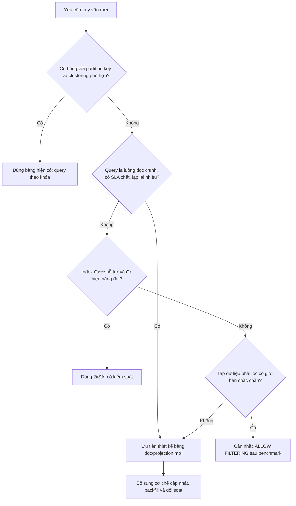
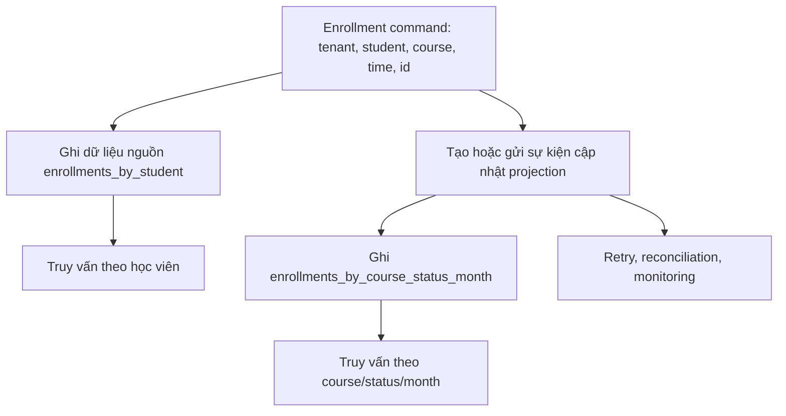
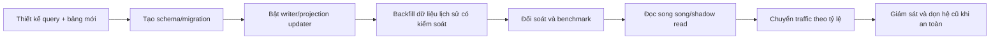

# Tiêu chí tạo bảng mới thay vì dựa vào chỉ mục hoặc ALLOW FILTERING

Trong **Spring Data Cassandra**, lập trình viên có thể truy cập Apache Cassandra qua **entity mapping**, `CassandraRepository`, `CassandraTemplate` và truy vấn CQL. Nhưng dù gọi bằng API nào, một câu truy vấn vẫn phải phù hợp với **mô hình dữ liệu phân tán**: Cassandra chia dữ liệu theo partition key, sắp các hàng trong partition theo clustering columns và phân phối partition qua các node.

Khi xuất hiện yêu cầu mới như “liệt kê tất cả học viên đang học một khóa học”, có ba cách thường được cân nhắc:

1. **Thiết kế thêm một bảng đọc theo truy vấn** (*query table*, *denormalized projection*), với partition key phù hợp.
2. **Dùng secondary index**, chẳng hạn 2i truyền thống hoặc Storage-Attached Index (SAI) ở phiên bản/distribution hỗ trợ.
3. **Dùng `ALLOW FILTERING`** để cho phép Cassandra thực hiện một số truy vấn mà bình thường hệ thống từ chối vì có thể phải lọc quá nhiều dữ liệu.

Không có lựa chọn nào luôn tốt trong mọi tình huống. Tuy nhiên, khi endpoint là luồng đọc chính, có lưu lượng cao, độ trễ phải dự đoán được và điều kiện tìm kiếm đã rõ, **tạo bảng mới theo truy vấn thường là giải pháp cần đánh giá trước**. Ngược lại, với các truy vấn phụ, độ chọn lọc cao và SAI được hỗ trợ, chỉ mục có thể là lựa chọn hợp lý. `ALLOW FILTERING` chỉ nên dùng khi đã **chứng minh phạm vi dữ liệu cần lọc được giới hạn và chi phí chấp nhận được**, không phải một cách sửa thiết kế bảng thiếu khóa.

Bài này thuộc chương **Chỉ mục và mở rộng** của module **SPRING_DATA_CASSANDRA**. Mục tiêu là giúp người học đưa ra quyết định kiến trúc dựa trên **query pattern, partition key, selectivity, fan-out, read/write SLA, paging và vận hành**, thay vì chỉ thử một câu CQL cho đến khi Cassandra không báo lỗi.

## 1. Kết quả cần đạt

Sau bài học, bạn có thể:

- Phân biệt **truy vấn định vị partition bằng khóa**, truy vấn qua **secondary index**, và truy vấn phải **filter** nhiều hàng.
- Đánh giá khi nào nên tạo **một bảng mới** để phục vụ query, thay vì thêm 2i/SAI hoặc `ALLOW FILTERING`.
- Hiểu vì sao một câu `LIMIT 20` có thể vẫn tốn nhiều tài nguyên nếu Cassandra phải tìm trong quá nhiều dữ liệu.
- Đọc đúng đặc điểm của **2i truyền thống**, **SAI** và sự khác nhau giữa Cassandra 4.x, 5.0 cùng các distribution khác.
- Thiết kế bảng read model với **partition key**, **clustering order** và **bucket** theo lưu lượng dự kiến.
- Ánh xạ bảng mới bằng Spring Data Cassandra và viết query theo đúng khóa của bảng.
- Phân tích chi phí của **phi chuẩn hóa**, gồm write amplification, backfill, retry, idempotency, eventual consistency và đối soát dữ liệu.
- Đo sự phù hợp bằng **p95/p99 latency, số partition được chạm, số hàng đọc, kích thước kết quả và chi phí lưu trữ**.
- Thiết kế thử nghiệm chứng minh lựa chọn trên Cassandra thật trước khi đưa vào production.

## 2. Ba chiến lược: định tuyến bằng khóa, tìm qua index và lọc

Trong Cassandra, partition key quyết định dữ liệu nằm ở những replica nào. Một query cung cấp đầy đủ partition key có thể định tuyến đến nhóm replica tương ứng, thay vì cần tìm kiếm rộng trên nhiều partition.



Đây là **cây quyết định định hướng**, không phải thuật toán mà Cassandra tự chạy.

| Phương án | Thế mạnh | Chi phí/rủi ro | Phù hợp nhất khi |
| --- | --- | --- | --- |
| Bảng mới theo truy vấn | Đường đọc cố định, partition rõ, clustering tối ưu, độ trễ dễ giới hạn hơn | Lặp dữ liệu, thêm ghi, migration/backfill, đồng bộ projection | Query thường xuyên, quan trọng, tải lớn |
| 2i truyền thống | Ít thay đổi mô hình ghi, DDL tương đối đơn giản | Chi phí duy trì index; query có thể phân tán rộng tùy predicate và cardinality | Query phụ có chọn lọc đủ tốt và được đo |
| SAI | Hỗ trợ một số dạng lọc/index tối ưu hơn 2i trong phiên bản phù hợp | Chi phí index, memory/storage, build, giới hạn CQL; không thay clustering tùy ý | Workload lọc có độ chọn lọc phù hợp và phiên bản hỗ trợ |
| `ALLOW FILTERING` | Dễ thử nghiệm, đôi khi chấp nhận được trong partition nhỏ/bounded | Có thể đọc rất nhiều dữ liệu để trả ít hàng; độ trễ khó dự đoán | Query nhỏ, ít dùng, phạm vi đọc được khống chế rõ |

**Điểm cần nhớ:** Cassandra không bảo đảm rằng số hàng trả về bằng số hàng đã phải xử lý để tìm chúng. Khi so sánh giải pháp, hãy đo **công việc thực hiện** chứ không chỉ `response.size()`.

## 3. Ví dụ xuyên suốt: đăng ký khóa học

Một hệ thống học tập có API:

```text
GET /tenants/{tenantId}/students/{studentId}/enrollments
```

Bảng ban đầu được thiết kế để đọc các đăng ký của **một học viên trong một tenant**. Giả sử keyspace `learning` đã tồn tại:

```sql
CREATE TABLE IF NOT EXISTS learning.enrollments_by_student (
    tenant_id uuid,
    student_id uuid,
    enrolled_at timestamp,
    enrollment_id uuid,
    course_id uuid,
    enrollment_status text,
    PRIMARY KEY ((tenant_id, student_id), enrolled_at, enrollment_id)
) WITH CLUSTERING ORDER BY (enrolled_at DESC, enrollment_id ASC);
```

Phân tích:

| Cột | Vai trò |
| --- | --- |
| `tenant_id`, `student_id` | **Partition key ghép**, dùng để định vị dữ liệu của một học viên |
| `enrolled_at` | Clustering column đầu tiên, mới nhất trước |
| `enrollment_id` | Clustering column thứ hai, phân biệt các hàng cùng timestamp |
| `course_id` | Regular column |
| `enrollment_status` | Regular column, ví dụ `ACTIVE`, `COMPLETED`, `CANCELLED` |

Câu query phù hợp:

```sql
SELECT enrolled_at, enrollment_id, course_id, enrollment_status
FROM learning.enrollments_by_student
WHERE tenant_id = ? AND student_id = ?;
```

Đường truy cập hợp lý vì query cung cấp đủ hai thành phần partition key.

### 3.1. Yêu cầu mới làm lộ giới hạn của bảng

Product muốn thêm endpoint:

```text
GET /tenants/{tenantId}/courses/{courseId}/students?status=ACTIVE
```

Mục tiêu: liệt kê **học viên đang ACTIVE trong một khóa học**, mới nhất trước, có nút “Xem thêm”.

Một người mới dùng Cassandra có thể thử:

```sql
-- Không phải đường truy cập mà bảng đã được thiết kế.
SELECT student_id, enrolled_at
FROM learning.enrollments_by_student
WHERE tenant_id = ?
  AND course_id = ?
  AND enrollment_status = 'ACTIVE';
```

Lệnh này không chứa đầy đủ partition key `(tenant_id, student_id)`. Cả `course_id` và `enrollment_status` là regular columns. Cassandra không tự tìm toàn bộ học viên phù hợp chỉ vì câu CQL trả rất ít cột.

Đây là một thay đổi **hướng truy vấn**: từ “học viên → các khóa học” sang “khóa học + trạng thái → các học viên”. Cần đánh giá lại access path, không chỉ đổi tên repository method.

### 3.2. Vì sao derived query không cứu được?

Nếu entity là `EnrollmentByStudent`, method như:

```java
List<EnrollmentByStudent> findByCourseIdAndEnrollmentStatus(
        UUID courseId, String enrollmentStatus);
```

có thể mô tả một predicate rõ ràng ở tầng Java, nhưng không biến `course_id` thành partition key. Spring Data Cassandra chỉ tạo truy vấn tương ứng với metadata; **Cassandra vẫn xác nhận các điều kiện khóa và index**.

Tương tự, `@Query`, `CassandraTemplate` hoặc `CqlSession` trực tiếp đều không làm query thiếu đường đọc trở nên tối ưu.

## 4. ALLOW FILTERING: vì sao chạy được không có nghĩa là ổn?

Một query bị Cassandra từ chối vì có khả năng phải lọc nhiều dữ liệu đôi khi có thể chạy khi thêm `ALLOW FILTERING`.

```sql
-- Ví dụ để minh họa rủi ro, không coi là query production mặc định.
SELECT student_id, enrolled_at
FROM learning.enrollments_by_student
WHERE tenant_id = ?
  AND course_id = ?
  AND enrollment_status = 'ACTIVE'
ALLOW FILTERING;
```

`ALLOW FILTERING` là sự cho phép Cassandra thực hiện **lọc dữ liệu không có access path thông thường**, không phải một secondary index mới và không phải trình tối ưu truy vấn có phép màu.

### 4.1. Tại sao nguy hiểm?

Giả sử cluster có hàng chục triệu đăng ký, trong đó khóa học được yêu cầu chỉ có 100 học viên ACTIVE. Cassandra có thể vẫn phải xem một khối lượng dữ liệu lớn hơn rất nhiều để xác định đúng những hàng đó, vì query không có partition key phù hợp.

Lưu ý:

- **Kết quả ít** không chứng minh **công việc đọc ít**.
- `LIMIT 20` giới hạn số hàng trả về, nhưng không đảm bảo hệ thống chỉ cần kiểm tra 20 hàng.
- Page size nhỏ không giới hạn tổng số partition/hàng phải xét khi tìm page đầu.
- Tải thực tế phụ thuộc phân phối dữ liệu, index, topology, consistency, số lượng tombstone và kích thước partition.
- Query chấp nhận được trên dữ liệu development nhỏ có thể quá chậm trên production.

### 4.2. Khi nào có thể xem xét?

Không nên tuyệt đối hóa rằng mọi `ALLOW FILTERING` đều sai. Ví dụ một bảng khác có **partition key đầy đủ** và cam kết mỗi partition có tối đa vài chục hàng, nhưng một regular column cần lọc hiếm khi dùng, chi phí lọc trong phạm vi đó có thể chấp nhận được.

CQL minh họa:

```sql
-- Chỉ đánh giá khi đã biết partition rất nhỏ và bounded.
SELECT course_id, enrollment_status
FROM learning.enrollments_by_student
WHERE tenant_id = ?
  AND student_id = ?
  AND enrollment_status = 'ACTIVE'
ALLOW FILTERING;
```

Ở đây điều kiện `(tenant_id, student_id)` giới hạn truy vấn vào một partition. Nếu hệ thống **thật sự bảo đảm giới hạn số enrollment mỗi học viên**, query có thể khác đáng kể so với truy vấn chỉ biết tenant/course và phải tìm trên nhiều partition.

Để chấp nhận, cần có bằng chứng:

1. Có đầy đủ partition key hoặc phạm vi đọc khác đã được giới hạn chắc chắn.
2. Giới hạn kích thước partition là một **invariant vận hành**, không phải “dữ liệu hiện tại có vẻ nhỏ”.
3. Query không ở hot path hoặc p95/p99 đã được đo ở tải dự kiến.
4. Có limit, deadline, giám sát và kế hoạch thay thế khi dữ liệu tăng.
5. Không dùng `ALLOW FILTERING` để che thiếu partition key của một endpoint quan trọng.

**Sự có mặt của `ALLOW FILTERING` trong mã là lý do để code review hỏi: “Đã đo chi phí đọc bao nhiêu dữ liệu chưa?”**

## 5. Secondary index truyền thống (2i): khi nào hữu ích?

Một **secondary index** cho phép truy vấn theo một số cột không phải primary key, với điều kiện hỗ trợ của phiên bản Cassandra và đặc điểm workload.

Ví dụ minh họa 2i truyền thống:

```sql
-- DDL minh họa cho Cassandra/distribution có hỗ trợ 2i.
CREATE INDEX IF NOT EXISTS enrollment_status_idx
ON learning.enrollments_by_student (enrollment_status);
```

Sau khi index đã được xây dựng và sẵn sàng, có thể thử các truy vấn có điều kiện trên `enrollment_status` theo khả năng phiên bản hỗ trợ.

Nhưng đừng suy luận rằng chỉ cần index trạng thái là endpoint `course_id + status` tối ưu. Nếu `course_id` không được định tuyến/chỉ mục phù hợp, câu query vẫn cần một access path khác. Ngay cả khi có thể kết hợp index, hiệu năng phải được kiểm chứng với cardinality và phân phối dữ liệu thực tế.

### 5.1. Cardinality và tính chọn lọc

- **Cardinality**: số giá trị khác nhau của cột, ví dụ `ACTIVE`, `COMPLETED`, `CANCELLED` có cardinality thấp.
- **Selectivity**: tỷ lệ dữ liệu được lọc còn lại so với tập có thể tìm; một predicate trả rất ít hàng thường có tính chọn lọc cao, nhưng cần xét **phân phối theo partition/node**.

Một index trên cột `enrollment_status` có ba giá trị có thể dẫn đến tập kết quả rất lớn cho `ACTIVE`. Điều này đặc biệt đáng chú ý với truy vấn toàn cluster hay dữ liệu bị lệch phân phối.

Ngược lại, predicate trên một giá trị hiếm, có index hỗ trợ tốt, đôi khi đáng cân nhắc hơn. Không có công thức “cardinality cao là luôn tốt” cho mọi index Cassandra: cách kết hợp predicate và khả năng **định vị partition** vẫn quan trọng.

### 5.2. Chi phí vận hành 2i

Index không miễn phí:

- Ghi và cập nhật giá trị indexed column cần duy trì index.
- Có thể làm tăng dung lượng lưu trữ và công việc compaction.
- Truy vấn có thể liên quan nhiều node/partition, tùy kế hoạch và điều kiện.
- Khi dữ liệu lớn, tạo index mới cần thời gian build và phải giám sát trạng thái.
- Số lượng index lớn làm tăng write amplification và chi phí vận hành.

**Không tạo index cho mọi cột mà product có thể lọc trong tương lai.** Điều đó chuyển chi phí truy vấn sang mọi thao tác ghi và giảm khả năng dự đoán hiệu năng.

## 6. Storage-Attached Index (SAI) và ranh giới phiên bản

**Storage-Attached Index (SAI)** là một cơ chế index được thiết kế gắn với cấu trúc lưu trữ Cassandra và có thể cải thiện các trường hợp truy vấn theo cột không phải primary key. Tuy nhiên, khả năng hỗ trợ **phụ thuộc bản Apache Cassandra và distribution**.

- **Apache Cassandra 5.0** có hỗ trợ SAI trong dòng upstream; cần kiểm tra phiên bản phát hành, syntax và giới hạn cụ thể.
- **Apache Cassandra 4.0/4.1 upstream** không nên mặc định có SAI chỉ vì driver hoặc Spring Data phiên bản mới.
- Một số distribution thương mại đã có biến thể SAI trước đó, nhưng cú pháp/khả năng có thể khác.
- **SASI** là một extension/index legacy/experimental trong một số môi trường, không nên xem là giải pháp mặc định thay cho SAI hiện đại hoặc bảng truy vấn.

Ví dụ **định hướng** cho việc tạo SAI, chỉ dùng sau khi đối chiếu CQL documentation của cluster đang chạy:

```sql
-- Ví dụ cú pháp tham khảo cho môi trường hỗ trợ SAI;
-- xác minh chính xác bằng tài liệu phiên bản/distribution trước khi chạy.
CREATE CUSTOM INDEX IF NOT EXISTS enrollments_course_sai_idx
ON learning.enrollments_by_student (course_id)
USING 'StorageAttachedIndex';
```

Một số phiên bản/distribution có thể dùng dạng `USING 'sai'` hoặc cách đặt class name khác. DDL trên là **ví dụ giáo dục**, không phải migration dùng chung cho mọi cluster Cassandra.

### 6.1. SAI có thay thế bảng mới không?

**Không tự động.** SAI có thể phù hợp với truy vấn lọc chọn lọc và tổ hợp predicate mà phiên bản hỗ trợ, nhưng vẫn cần kiểm tra:

1. Query có được index planner hỗ trợ không?
2. Tập kết quả dự kiến chiếm bao nhiêu phần trăm dữ liệu?
3. Query có giới hạn latency nghiêm ngặt ở p99 không?
4. Hệ thống cần **thứ tự mới nhất trước** theo clustering/order hay không?
5. Có nhiều người dùng cùng gọi một predicate phổ biến như `status = 'ACTIVE'` không?
6. Index build, ghi, cập nhật/xóa và storage có phù hợp ngân sách không?
7. Query có cần phân trang ổn định theo một bảng đã được thiết kế đúng thứ tự không?

SAI không biến CQL thành SQL có `JOIN` hoặc sort toàn cluster tùy ý. Nếu endpoint muốn trả học viên ACTIVE của một khóa học **theo enrolled_at DESC** với giới hạn latency chặt, một bảng có partition key theo course + status và clustering theo thời gian vẫn là phương án đáng đánh giá mạnh.

### 6.2. Không dựa vào tài liệu của driver để suy ra khả năng index

Spring Data Cassandra và Java Driver chủ yếu quản lý truy vấn, mapping và kết nối. Chúng **không tự nâng cấp engine index** của Cassandra. Nếu Java code có thể viết câu `WHERE`, điều đó không có nghĩa cluster hỗ trợ đúng index hoặc operator.

Khi sử dụng SAI, bắt buộc xác nhận **server/distribution/version**, DDL có thể triển khai và query semantics thực tế.

## 7. Tiêu chí quyết định: tạo bảng mới hay dùng index?

Cách đánh giá đáng tin cậy nhất là xuất phát từ **hợp đồng đọc** và **đặc tính dữ liệu**.

### 7.1. Tần suất và SLA của truy vấn

Một endpoint hot path có hàng nghìn request/giây, được gọi trong luồng người dùng chính và cần p99 thấp sẽ ưu tiên **đường truy cập được thiết kế trước**. Một báo cáo vận hành gọi một lần mỗi giờ có thể chấp nhận scan/index tùy số liệu đo.

Các câu hỏi:

- Query có chiếm phần lớn tải đọc không?
- Có yêu cầu p95/p99 và giới hạn lỗi timeout không?
- Có thể từ chối/giới hạn số request hoặc chạy async không?
- Lượng dữ liệu và tốc độ tăng trưởng trong 6–12 tháng ra sao?
- Chậm khi truy vấn một tenant lớn có ảnh hưởng đến tenant khác không?

### 7.2. Độ chọn lọc, cardinality và skew

Một cột như `status` thường có ít giá trị khác nhau. Nếu 70% enrollment là ACTIVE, index trên status không làm tập kết quả nhỏ đi nhiều.

Một trường như `course_id` có nhiều giá trị khác nhau, nhưng một khóa học nổi tiếng có thể có hàng triệu enrollment, còn các khóa khác chỉ có vài chục. **Phân phối lệch (skew)** khiến hiệu năng theo giá trị khác nhau rất lớn.

Đừng chỉ benchmark khóa học trung bình. Hãy kiểm tra cả **hot course**, **tenant lớn nhất** và điều kiện trả nhiều dữ liệu nhất.

### 7.3. Yêu cầu sắp xếp và phân trang

Nếu API phải:

```text
Lấy 20 học viên mới nhất đang ACTIVE của course X.
Sau đó tiếp tục bằng paging state.
```

thì index tìm được các hàng matching không đồng nghĩa có thứ tự `enrolled_at DESC` trên tập đó. Một bảng mới với đúng partition/clustering giúp tiếp cận dữ liệu theo thứ tự cần thiết mà không phải sort một tập rất lớn ở Java.

**Paging state** gắn với câu CQL và các bind values. Nó không biến một scan/index query thành một danh sách ổn định có thể truy cập bằng offset; khi thay filter, partition hoặc query, phải reset cursor.

### 7.4. Giới hạn chi phí ghi và lưu trữ

Bảng mới có chi phí:

- Ghi thêm bản sao dữ liệu vào một hoặc nhiều read models.
- Dùng thêm disk, cache, replication và compaction.
- Backfill dữ liệu lịch sử.
- Xử lý update/delete làm thay đổi khóa của projection.
- Giám sát độ trễ đồng bộ và khắc phục khi ghi một phần.
- Thực hiện migration schema, rollout và rollback có kiểm soát.

Nếu hệ thống ghi rất nhiều nhưng query bổ sung hiếm, index có thể kinh tế hơn. Nếu đọc nhiều, truy vấn lặp lại và quy tắc truy vấn ổn định, chi phí ghi thêm có thể đáng để đổi lấy đường đọc nhanh và dự đoán được.

### 7.5. Bảng quyết định thực dụng

| Dấu hiệu | Nghiêng về bảng mới | Nghiêng về index | `ALLOW FILTERING` có thể cân nhắc |
| --- | --- | --- | --- |
| Query trên hot path, p99 chặt | **Có** | Chỉ khi đo đạt SLA bền vững | Hiếm |
| Có partition key theo truy vấn mới | **Có** | Không bắt buộc | Không |
| Query cần thứ tự clustering rõ ràng | **Có** | Index có thể không đáp ứng thứ tự | Không |
| Predicate chọn lọc cao, ít gọi | Không bắt buộc | **Có thể** | Nếu phạm vi đọc cực nhỏ |
| Predicate phổ biến, trả rất nhiều hàng | **Thường có** | Dễ phải đánh giá rất kỹ | Không nên |
| Dữ liệu được chứng minh nhỏ và bounded | Không bắt buộc | Có thể không cần | **Có thể** |
| Dữ liệu tăng nhanh hoặc hot partitions | Thiết kế bảng và bucket | Phải benchmark worst case | Tránh |
| Chi phí duy trì projection quá cao | Cần cân nhắc | **Có thể** | Chỉ với query nhỏ |
| Server chưa hỗ trợ SAI | Vẫn có thể | Dùng khả năng index thực tế của phiên bản | Không thay được thiết kế |
| Cần nhiều filter tùy ý như search engine | Có thể cần nhiều read models hoặc search system | SAI có thể hữu ích tùy workload | Không phải giải pháp mặc định |

Kết luận từ bảng không phải “luôn chọn bảng mới”; đó là **đặt quyết định trong bối cảnh query + SLA + vận hành**.

## 8. Thiết kế bảng mới cho endpoint theo khóa học và trạng thái

Giả sử product muốn:

```text
GET /tenants/{tenantId}/courses/{courseId}/students?status=ACTIVE&month=202611
```

Yêu cầu: học viên mới nhất của **một khóa học**, theo trạng thái, trong một tháng. Ta có thể tạo một bảng đọc mới:

```sql
CREATE TABLE IF NOT EXISTS learning.enrollments_by_course_status_month (
    tenant_id uuid,
    course_id uuid,
    enrollment_status text,
    month_bucket int,
    enrolled_at timestamp,
    enrollment_id uuid,
    student_id uuid,
    PRIMARY KEY (
        (tenant_id, course_id, enrollment_status, month_bucket),
        enrolled_at,
        enrollment_id
    )
) WITH CLUSTERING ORDER BY (enrolled_at DESC, enrollment_id ASC);
```

Phân tích thiết kế:

| Cột | Vai trò | Lợi ích |
| --- | --- | --- |
| `tenant_id` | Partition component | Tách phạm vi tenant |
| `course_id` | Partition component | Định vị khóa học |
| `enrollment_status` | Partition component | Không cần lọc status sau khi đọc |
| `month_bucket` | Partition component | Giới hạn kích thước partition theo thời gian |
| `enrolled_at` | Clustering 1 | Đọc đăng ký mới nhất trước |
| `enrollment_id` | Clustering 2 | Đảm bảo định danh mỗi enrollment khi timestamp trùng |
| `student_id` | Regular column | Trả danh sách học viên |

Truy vấn tương ứng:

```sql
SELECT student_id, enrollment_id, enrolled_at
FROM learning.enrollments_by_course_status_month
WHERE tenant_id = ?
  AND course_id = ?
  AND enrollment_status = ?
  AND month_bucket = ?
LIMIT ?;
```

Đây là đường truy vấn có **đầy đủ partition key**. Cassandra định vị một partition của một course/status/month, đọc theo clustering order và trả dữ liệu cần thiết.

### 8.1. Tại sao month_bucket nằm trong partition key?

Nếu một khóa học có lượng đăng ký lớn trong nhiều năm, partition chỉ theo `(tenant_id, course_id, status)` có thể lớn và nóng. Thêm tháng tạo nhiều partition nhỏ hơn.

Nhưng chọn tháng không phải quy tắc cứng: nếu một khóa học có hàng triệu đăng ký mỗi ngày, **bucket theo ngày hoặc thêm shard** có thể phù hợp hơn. Nếu một khóa học có rất ít dữ liệu, bucket theo tháng làm phức tạp việc đọc không cần thiết.

**Phải chọn bucket từ số liệu:** kích thước row, tốc độ phát sinh, retention, phân phối course, giới hạn partition và yêu cầu phân trang.

### 8.2. Nếu API không yêu cầu month thì sao?

Khi truy vấn “tất cả tháng”, ứng dụng sẽ cần đi qua nhiều bucket theo thứ tự có kiểm soát. Không thể giả định Cassandra tự trả một danh sách toàn cục đã sắp từ nhiều partition chỉ bằng một câu `ORDER BY`.

Có thể thiết kế:

- API yêu cầu một khoảng tháng xác định hoặc giới hạn số bucket được quét.
- Service duyệt các bucket theo thời gian giảm dần và giữ **cursor gồm bucket hiện tại + paging state của query trong bucket**, nếu contract cho phép.
- Kết quả cần định nghĩa thứ tự tổng quát và xử lý trường hợp dữ liệu thay đổi giữa hai trang.
- Nếu fan-out qua bucket quá lớn, cân nhắc bảng khác phục vụ truy vấn top-N hoặc cơ chế tổng hợp.

Không dùng `ALLOW FILTERING` trên bảng cũ để tránh chi phí thiết kế cursor đa bucket khi yêu cầu đọc lớn và thường xuyên.

## 9. Spring Data Cassandra ánh xạ bảng đọc mới như thế nào?

Khi tạo bảng CQL mới, ứng dụng thường bổ sung **entity riêng** tương ứng với read model. Không dùng cùng một entity cho hai bảng có primary key khác nhau chỉ bằng cách thay tên table động.

### 9.1. Mapping composite key

```java
import java.io.Serializable;
import java.time.Instant;
import java.util.UUID;

import org.springframework.data.cassandra.core.cql.PrimaryKeyType;
import org.springframework.data.cassandra.core.mapping.PrimaryKeyClass;
import org.springframework.data.cassandra.core.mapping.PrimaryKeyColumn;

@PrimaryKeyClass
public class CourseStatusMonthKey implements Serializable {

    @PrimaryKeyColumn(name = "tenant_id", ordinal = 0,
                      type = PrimaryKeyType.PARTITIONED)
    private UUID tenantId;

    @PrimaryKeyColumn(name = "course_id", ordinal = 1,
                      type = PrimaryKeyType.PARTITIONED)
    private UUID courseId;

    @PrimaryKeyColumn(name = "enrollment_status", ordinal = 2,
                      type = PrimaryKeyType.PARTITIONED)
    private String enrollmentStatus;

    @PrimaryKeyColumn(name = "month_bucket", ordinal = 3,
                      type = PrimaryKeyType.PARTITIONED)
    private Integer monthBucket;

    @PrimaryKeyColumn(name = "enrolled_at", ordinal = 4,
                      type = PrimaryKeyType.CLUSTERED)
    private Instant enrolledAt;

    @PrimaryKeyColumn(name = "enrollment_id", ordinal = 5,
                      type = PrimaryKeyType.CLUSTERED)
    private UUID enrollmentId;

    protected CourseStatusMonthKey() {}

    // Constructor, getters/setters, equals và hashCode theo toàn bộ khóa.
}
```

Ordinal trong class trên mô tả vai trò và thứ tự thành phần khóa. Khi mã thực thi dùng class này như repository ID, cần cung cấp `equals/hashCode` theo toàn bộ primary key và constructor/accessor phù hợp với Spring Data version.

### 9.2. Entity riêng cho projection

```java
import java.util.UUID;

import org.springframework.data.cassandra.core.mapping.Column;
import org.springframework.data.cassandra.core.mapping.PrimaryKey;
import org.springframework.data.cassandra.core.mapping.Table;

@Table("enrollments_by_course_status_month")
public class CourseStatusMonthEnrollment {

    @PrimaryKey
    private CourseStatusMonthKey key;

    @Column("student_id")
    private UUID studentId;

    protected CourseStatusMonthEnrollment() {}

    public CourseStatusMonthKey getKey() { return key; }
    public UUID getStudentId() { return studentId; }

    // Bổ sung constructor và setter theo cách mapping được chọn.
}
```

Với cách này, repository đọc bảng `enrollments_by_course_status_month` có trách nhiệm riêng; nó không cần tự lọc `course_id` hoặc `enrollment_status` sau khi lấy toàn bộ `enrollments_by_student`.

### 9.3. Repository với điều kiện khóa

```java
import java.util.List;
import java.util.UUID;

import org.springframework.data.cassandra.repository.CassandraRepository;

public interface CourseStatusMonthRepository extends
        CassandraRepository<CourseStatusMonthEnrollment, CourseStatusMonthKey> {

    List<CourseStatusMonthEnrollment>
    findByKey_TenantIdAndKey_CourseIdAndKey_EnrollmentStatusAndKey_MonthBucket(
        UUID tenantId, UUID courseId, String enrollmentStatus,
        Integer monthBucket);
}
```

Spring Data phân tích property path `key.tenantId`, `key.courseId`, `key.enrollmentStatus` và `key.monthBucket`. Sau đó mapping metadata chuyển chúng về các cột CQL tương ứng.

Method trên minh họa query derivation theo đầy đủ partition key. Nếu endpoint có nhiều hàng, **đừng dùng List không giới hạn trên production**; cân nhắc `Slice`/`Pageable` tương thích Spring Data Cassandra phiên bản đang dùng hoặc dùng `CqlSession` để điều khiển page size và paging state trực tiếp.

### 9.4. CQL tường minh bằng @Query

Nếu muốn giới hạn cố định 20 hàng và tránh tên method quá dài:

```java
import java.util.List;
import java.util.UUID;

import org.springframework.data.cassandra.repository.Query;

@Query("""
    SELECT * FROM learning.enrollments_by_course_status_month
    WHERE tenant_id = ?0 AND course_id = ?1
      AND enrollment_status = ?2 AND month_bucket = ?3
    LIMIT 20
    """)
List<CourseStatusMonthEnrollment> findRecentTwenty(
    UUID tenantId, UUID courseId, String status, int monthBucket);
```

Đây là một **method để đặt trong repository interface**, không phải Java source top-level. Method dùng `@Query` vẫn phải tuân theo partition key; nó không tự tạo transaction hay đồng bộ bảng.

Nếu có nhu cầu paging nhiều trang, tránh nhầm `LIMIT 20` với page size: LIMIT chặn tổng số hàng của truy vấn. Hãy dùng paging phù hợp thay vì gọi đi gọi lại cùng câu LIMIT rồi mong có trang thứ hai.

## 10. Cập nhật hai bảng: chi phí thật của phi chuẩn hóa

Tạo bảng mới giúp đọc nhanh theo hướng query mới nhưng đòi hỏi **ghi cùng một sự kiện vào nhiều biểu diễn dữ liệu**.

Ví dụ một học viên đăng ký khóa học:



Đây là một **kiến trúc khái niệm**. Không mặc định hai nhánh ghi là một transaction ACID xuyên bảng hoặc mọi dữ liệu đều đồng bộ ngay sau khi request trả về.

### 10.1. Cùng enrollment phải có định danh ổn định

Mỗi đăng ký nên có `enrollment_id` được tạo **một lần**, và `enrolled_at` ổn định. Nếu retry lại sinh ID hoặc timestamp mới, Cassandra sẽ coi đó là **hàng khác** trong bảng clustering, gây trùng dữ liệu.

Để đồng bộ hiệu quả:

- Tạo event ID/enrollment ID ổn định trước khi ghi.
- Ghi cùng khóa đích cho các lần retry có cùng sự kiện.
- Tránh cập nhật các trường khóa bằng cách coi chúng như regular column.
- Theo dõi version/sequence khi nhiều sự kiện cập nhật cạnh tranh.
- Dùng write timestamp/điều kiện một cách có chủ đích nếu phải xử lý out-of-order events.

### 10.2. Chuyển trạng thái có thể đổi partition

Trong bảng mới, `enrollment_status` là một thành phần partition key. Khi đăng ký chuyển từ `ACTIVE` sang `COMPLETED`, không thể chỉ `UPDATE enrollment_status` như một regular column của cùng primary key.

Cần một **quy trình di chuyển biểu diễn**:

1. Xác định khóa cũ: `(tenantId, courseId, ACTIVE, monthBucket, enrolledAt, enrollmentId)`.
2. Ghi bản ghi ở khóa mới với `COMPLETED`.
3. Xóa bản ghi cũ `ACTIVE` theo đúng primary key.
4. Cập nhật bảng nguồn/record trạng thái theo thiết kế.
5. Dùng retry/idempotency và reconciliation nếu một bước thất bại.

Ví dụ CQL mang tính minh họa:

```sql
INSERT INTO learning.enrollments_by_course_status_month (
    tenant_id, course_id, enrollment_status, month_bucket,
    enrolled_at, enrollment_id, student_id
) VALUES (?, ?, 'COMPLETED', ?, ?, ?, ?);

DELETE FROM learning.enrollments_by_course_status_month
WHERE tenant_id = ?
  AND course_id = ?
  AND enrollment_status = 'ACTIVE'
  AND month_bucket = ?
  AND enrolled_at = ?
  AND enrollment_id = ?;
```

**Lưu ý:** thứ tự ghi mới/xóa cũ phải chọn theo hợp đồng eventual consistency của sản phẩm. Trong một khoảng thời gian, hai partition có thể đồng thời chứa enrollment hoặc không phản ánh cùng trạng thái. Retry chỉ an toàn nếu khóa, sự kiện và chính sách xử lý cập nhật trễ đã được thiết kế.

### 10.3. Batch có thay transaction quan hệ không?

Cassandra có batch và LWT, nhưng chúng **không phải transaction ACID có isolation tổng quát** giống một RDBMS qua mọi bảng/partition. Logged batch giúp phối hợp việc phát lại mutation theo ngữ nghĩa Cassandra, nhưng không nên dùng như công cụ tăng tốc mọi ghi hoặc để khẳng định các query đọc giữa chừng sẽ thấy một snapshot toàn cục.

Đối với đa projection, cần quyết định:

- **Nguồn sự thật** là bảng/luồng sự kiện nào?
- Endpoint cần **stronger read-after-write guarantee** hay chấp nhận eventual consistency?
- Khi một write thất bại, hệ thống có retry bền vững không?
- Có job đối soát các bảng đọc với trạng thái nguồn không?
- Làm sao phát hiện bản ghi “ACTIVE ma” sau khi chuyển sang COMPLETED?

Đây là chi phí mà một benchmark chỉ đo SELECT sẽ không thể hiện.

## 11. Ví dụ ghi projection bằng CqlSession

Với CQL có keyspace và primary key rõ ràng, ứng dụng có thể ghi bản sao trực tiếp qua `CqlSession` hoặc qua Spring Data repository/template.

Đoạn sau là một phần của một service/DAO đã được inject `CqlSession`:

```java
import java.time.Instant;
import java.util.UUID;

import com.datastax.oss.driver.api.core.CqlSession;
import com.datastax.oss.driver.api.core.cql.SimpleStatement;

public void writeCourseProjection(
        CqlSession session,
        UUID tenantId, UUID courseId, UUID studentId,
        String status, int monthBucket,
        Instant enrolledAt, UUID enrollmentId) {

    session.execute(SimpleStatement.newInstance(
        """
        INSERT INTO learning.enrollments_by_course_status_month
          (tenant_id, course_id, enrollment_status, month_bucket,
           enrolled_at, enrollment_id, student_id)
        VALUES (?, ?, ?, ?, ?, ?, ?)
        """,
        tenantId, courseId, status, monthBucket,
        enrolledAt, enrollmentId, studentId
    ));
}
```

Đây là minh họa phương pháp bind CQL, **không phải một workflow ghi hai bảng hoàn chỉnh**. Production cần quản lý `CqlSession` theo lifecycle ứng dụng, validate status, month bucket, quyền tenant, và thiết kế retry/đối soát.

`SimpleStatement.newInstance(...)` với các bind values tránh việc nối dữ liệu người dùng vào CQL. Không tạo một CqlSession mới cho mỗi request. Với đường ghi nóng, có thể sử dụng prepared statement được chuẩn bị một lần và tái sử dụng.

### 11.1. Tính month bucket nhất quán

Nếu `month_bucket` dựa trên tháng UTC của `enrolled_at`, mọi writer và reader phải sử dụng **cùng quy tắc**.

```java
import java.time.Instant;
import java.time.ZoneOffset;
import java.time.ZonedDateTime;

public static int utcMonthBucket(Instant enrolledAt) {
    ZonedDateTime utc = enrolledAt.atZone(ZoneOffset.UTC);
    return utc.getYear() * 100 + utc.getMonthValue();
}
```

Ví dụ `2026-11-25T10:00:00Z` cho `month_bucket=202611`. Khi nghiệp vụ quy định “tháng theo múi giờ địa phương”, không dùng UTC tùy tiện; hãy ghi rõ timezone trong contract và dùng thống nhất ở mọi writer/backfill/reader.

Nếu người dùng thay đổi `enrolled_at` sau khi tạo enrollment, nó có thể đổi bucket/primary key; cần xem đó là một migration của row, không phải update thường.

## 12. Quy trình rollout bảng mới an toàn

Một bảng đọc mới thường cần backfill và triển khai nhiều phiên bản ứng dụng. Không nên chạy `CREATE TABLE` rồi lập tức chuyển tất cả lưu lượng khi bảng mới chưa có dữ liệu đầy đủ.

### 12.1. Expand → backfill → verify → cutover



Phân tích từng bước:

1. **Thiết kế:** viết rõ endpoint, điều kiện lọc, sort, giới hạn, tenant isolation và kích thước partition dự kiến.
2. **Schema migration:** tạo keyspace/table và kiểm tra schema agreement trước khi code yêu cầu bảng mới; trên production không dựa vào entity auto-create tùy tiện.
3. **Dual write hoặc projection updater:** bảo đảm sự kiện mới không bị mất trong lúc backfill. Nếu dùng event log, phải thiết kế tính bền vững của event; ghi bảng rồi “hy vọng gửi event” không tự bảo đảm atomicity.
4. **Backfill:** đọc lịch sử theo token ranges/stream/batch có rate limit; tránh `SELECT *` quét toàn cluster bằng một request ứng dụng.
5. **Reconciliation:** so sánh số lượng/khóa/giá trị giữa nguồn và bảng mới theo sample, bucket và thời gian; phát hiện bản ghi trùng/thiếu.
6. **Shadow read:** gọi query mới ở nền có kiểm soát để so sánh kết quả, không ảnh hưởng phản hồi người dùng.
7. **Cutover:** tăng traffic từng bước, theo dõi p95/p99, error rate và lag của projection.
8. **Rollback:** giữ đường đọc cũ một thời gian hoặc chuyển lại khi phát hiện vấn đề; không xóa dữ liệu gốc sớm.

### 12.2. Backfill cần tránh điều gì?

- Không dồn tất cả dữ liệu lịch sử vào một `INSERT`/batch khổng lồ.
- Không giả định scan toàn bộ cluster bằng repository `findAll()` sẽ rẻ.
- Không chạy backfill song song vô hạn gây hot partitions hoặc saturate disk/CPU.
- Không thay khóa của một bản ghi mỗi lần retry.
- Không coi số hàng của hai bảng nhất thiết giống nhau nếu domain có retention, TTL hoặc quy tắc lọc khác nhau.
- Không bỏ qua các bản ghi đổi trạng thái trong khi backfill đang chạy.

Backfill phải có checkpoint, quan sát throughput/error và phương án resume.

## 13. Benchmark công bằng: đo index và bảng mới thế nào?

Một quyết định tốt cần **dữ liệu đại diện** thay vì chỉ chạy `SELECT` trên vài trăm row ở laptop.

### 13.1. Tập dữ liệu để kiểm thử

Mô phỏng:

- Tenant nhỏ, vừa và rất lớn.
- Course bình thường và hot course có lượng enrollment cao.
- Trạng thái ACTIVE phổ biến, COMPLETED/CANCELLED có tỷ lệ khác nhau.
- Dữ liệu trải nhiều tháng/bucket.
- Có insert/update/delete và tombstone theo vòng đời thực tế.
- Có workload đọc/ghi đồng thời gần với sản phẩm.
- Có giới hạn số lượng kết quả/page size như API thật.

So sánh từng phương án trên **cùng topology, workload và mức consistency**; nếu đổi đồng thời dữ liệu, RF và execution profile thì kết quả khó quy nguyên nhân.

### 13.2. Những phép đo tối thiểu

| Chỉ số | Câu hỏi cần trả lời |
| --- | --- |
| p50/p95/p99 latency | Có đạt SLA ở cả giá trị phổ biến và worst case không? |
| Request throughput | Tải tối đa trước khi timeout/tail latency tăng là bao nhiêu? |
| Số partition/node được chạm | Query có định tuyến gọn hay cần fan-out rộng? |
| Số hàng/byte đọc so với trả về | Hệ thống có phải đọc nhiều dữ liệu rồi lọc bỏ không? |
| Network và coordinator CPU | Index/filter query có tạo tải dồn vào coordinator không? |
| Tombstone warnings/compaction | TTL, delete và thay status có gây áp lực đọc không? |
| Storage overhead | Bảng mới và index tốn bao nhiêu dung lượng? |
| Write latency/throughput | Tạo bảng mới hoặc index làm write path tăng chi phí bao nhiêu? |
| Backfill/index build time | Triển khai/khôi phục cần bao lâu và ảnh hưởng cluster ra sao? |
| Projection lag/mismatch | Dữ liệu nhân bản lệch nhau trong thời gian nào? |

**Số lượng hàng trả về nhỏ không đủ để kết luận truy vấn hiệu quả.** Hãy quan sát metrics và nếu phù hợp sử dụng tracing/driver logging có kiểm soát để hiểu đường đọc mà không làm quá tải production.

### 13.3. Ví dụ phép tính minh họa

Giả sử (chỉ là **số liệu giả định**, không phải benchmark Cassandra):

- Bảng chứa 10.000.000 enrollment.
- Điều kiện course + ACTIVE trả 3.000 enrollment.
- API chỉ muốn page đầu 20 enrollment mới nhất.
- Mỗi ngày endpoint được gọi 500.000 lần.

Nếu giải pháp index/filter phải xét một tập dữ liệu lớn trước khi tìm 20 hàng theo đúng thứ tự, tải lặp lại có thể rất đắt. Bảng `enrollments_by_course_status_month` lại cho phép định vị trực tiếp một partition/bucket và đọc theo clustering order.

Ngược lại, nếu query báo cáo chỉ chạy mỗi tháng một lần, index hỗ trợ chọn lọc tốt và benchmark đạt SLA, việc duy trì bảng mới suốt vòng đời có thể không xứng đáng.

Mục đích phép so sánh là **chi phí dài hạn theo tần suất và đường truy cập**, không phải suy rằng Cassandra luôn scan đủ 10 triệu hàng khi có `ALLOW FILTERING`. Số hàng thực sự phải đọc phụ thuộc query, phân phối dữ liệu và phiên bản/engine.

## 14. Quy tắc về paging và consistency

### 14.1. Paging state vẫn gắn với query

Dù đọc bằng bảng mới hay index, paging state của Cassandra gắn với **cùng câu CQL, bind values và điều kiện truy vấn**. Không dùng token cho course A rồi chuyển sang course B hoặc từ `ACTIVE` sang `COMPLETED`.

Nếu API gộp nhiều month buckets, cursor ứng dụng phải mô tả đúng **bucket hiện tại và trạng thái continuation tương ứng**, không trộn paging state từ các partition khác nhau.

### 14.2. LIMIT không thay thế access path

```sql
SELECT student_id
FROM learning.enrollments_by_course_status_month
WHERE tenant_id = ?
  AND course_id = ?
  AND enrollment_status = ?
  AND month_bucket = ?
LIMIT 20;
```

Trên bảng đã thiết kế, Cassandra đọc từ một partition theo clustering order. `LIMIT 20` giới hạn tổng kết quả. Nếu query dựa vào `ALLOW FILTERING` mà phải xem nhiều dữ liệu, `LIMIT 20` không bảo đảm công việc xử lý được giới hạn tương ứng.

Page size điều khiển số hàng được fetch theo page, **không phải** số hàng tối đa của toàn query.

### 14.3. Consistency theo replica không đồng bộ projection

Mức như `LOCAL_ONE` hoặc `LOCAL_QUORUM` liên quan số replica cần trả lời theo replication factor và datacenter. Chúng **không làm hai bảng phi chuẩn hóa thành một transaction ACID**.

Khi một sự kiện được ghi vào bảng nguồn nhưng projection chưa cập nhật, query ở bảng đọc mới có thể trả thiếu dữ liệu dù consistency cao. Muốn xử lý phải thiết kế source-of-truth, event/retry và đối soát.

## 15. Integration test bằng Spring Data Cassandra

Unit test mock `CassandraRepository` chỉ chứng minh service gọi một method Java. Nó **không kiểm chứng** CQL của bảng mới, tính hợp lệ của primary key hoặc hiệu năng index.

### 15.1. Kịch bản chức năng

Dùng Testcontainers Cassandra hoặc cluster test cô lập:

1. Tạo keyspace `learning` cùng cả hai bảng bằng CQL migration.
2. Seed nhiều học viên vào một khóa học với các trạng thái và timestamp khác nhau.
3. Seed cùng học viên vào khóa học khác để kiểm tra phân vùng theo course.
4. Ghi bản ghi vào bảng mới theo `month_bucket` đúng quy tắc.
5. Gọi repository của bảng mới theo đầy đủ partition key.
6. Kiểm tra kết quả không chứa học viên/khóa học/status/tháng không khớp.
7. Kiểm tra thứ tự `enrolled_at DESC` và trường hợp timestamp trùng.
8. Chuyển trạng thái và xác minh projection cũ được xóa/new key được ghi.
9. Test retry cùng event ID không tạo enrollment nhân bản.
10. Test migration/backfill với bản ghi đang đổi trạng thái.

### 15.2. Mẫu assertion qua repository

Đoạn sau giả định `repository` đã được inject, schema/fixture đã chuẩn bị và khóa đang truy vấn có đúng một enrollment:

```java
import static org.assertj.core.api.Assertions.assertThat;

List<CourseStatusMonthEnrollment> rows =
    repository.findByKey_TenantIdAndKey_CourseIdAndKey_EnrollmentStatusAndKey_MonthBucket(
        tenantId, courseId, "ACTIVE", 202611);

assertThat(rows).hasSize(1);
assertThat(rows.get(0).getStudentId()).isEqualTo(studentId);
```

Đây là đoạn test rút gọn, không phải Java class độc lập. Trong test thật cần import `List`, `UUID`, inject repository và seed dữ liệu đúng primary key.

### 15.3. Test truy vấn bằng index

Nếu cân nhắc 2i/SAI, viết test riêng xác nhận:

- Cluster test **thực sự hỗ trợ** loại index và CQL DDL được chọn.
- Index đã xây dựng xong trước khi benchmark.
- Query thực tế được hỗ trợ, không yêu cầu `ALLOW FILTERING` ngoài ý muốn.
- Kết quả đúng khi giá trị indexed column thay đổi hoặc bị xóa.
- Tail latency vẫn ổn ở dữ liệu lớn và skew, không chỉ ở vài hàng.
- Không có fan-out/cost không phù hợp dưới lưu lượng đồng thời.

Testcontainers một node phù hợp để xác nhận cú pháp và chức năng, nhưng **không mô phỏng đầy đủ** fan-out, replica consistency hoặc tail latency của production nhiều node. Benchmark kiến trúc cần một môi trường có topology và dữ liệu đại diện.

## 16. Các tình huống quyết định cụ thể

### Tình huống A: màn hình chính “học viên ACTIVE của khóa học”

- Truy vấn gọi liên tục, cần mới nhất trước, phân trang.
- Status có cardinality thấp; khóa học hot có rất nhiều bản ghi.
- SLA p99 chặt; không chấp nhận scan toàn cluster.

**Ưu tiên đánh giá bảng theo course + status + bucket**, với cơ chế đồng bộ projection, clustering phù hợp và kiểm thử worst case. Index vẫn có thể được benchmark, nhưng không mặc định thay cho read model.

### Tình huống B: báo cáo hiếm, tìm một mã sự kiện hiếm

- Query gọi ít, predicate có chọn lọc cao.
- Server có SAI hỗ trợ đúng kiểu dữ liệu/điều kiện.
- Không cần ORDER BY toàn cluster theo một cột khác.

**Cân nhắc index trước**, benchmark và kiểm tra overhead ghi/lưu trữ. Tạo bảng mới có thể là chi phí vận hành không tương xứng với lợi ích.

### Tình huống C: lọc vài chục hàng trong một partition nhỏ

- Query đã có đầy đủ partition key.
- Số hàng của partition được giới hạn bằng quy tắc dữ liệu rõ ràng.
- Lọc regular column hiếm khi gọi; không có SLA chặt.

**Có thể xem xét lọc trong ứng dụng hoặc `ALLOW FILTERING` sau khi đo**, tùy semantics và giới hạn kết quả. Cần tránh lỗi lọc chỉ trên page đầu mà bỏ sót matching rows ở các page sau.

### Tình huống D: người dùng muốn lọc 12 trường tùy ý

- Query combinations gần như vô hạn.
- Dữ liệu lớn, nhiều trường text và nhiều kiểu sort.
- Không có một vài query patterns ổn định.

**Không tạo 2^12 bảng và không tự động tạo index cho mọi cột.** Cần phân tích nhu cầu, tập filter được phép, SAI nếu phù hợp, hoặc một hệ thống search/analytics chuyên biệt. Cassandra nên tiếp tục phục vụ các truy vấn nghiệp vụ có access path rõ ràng.

### Tình huống E: thêm SAI vào Cassandra 4.1 upstream

SAI không nên được giả định có sẵn trong upstream Cassandra 4.1. **Không dùng cú pháp index của Cassandra 5.0 như thể mọi cluster đều hỗ trợ.** Trước khi đưa migration, hãy xác nhận phiên bản/distribution; nếu chưa hỗ trợ, lựa chọn còn lại phải dựa vào 2i thực tế, bảng đọc khác hoặc công cụ phù hợp.

## 17. Anti-pattern và xử lý sự cố

| Hiện tượng | Nguyên nhân có thể | Cách xử lý |
| --- | --- | --- |
| `InvalidQueryException` vì thiếu partition key | Truy vấn khác access path của bảng | Thiết kế bảng theo query hoặc index được đánh giá |
| Thêm `ALLOW FILTERING` thì chạy nhưng p99 tăng mạnh | Lọc nhiều dữ liệu trước khi trả ít kết quả | Bỏ filtering khỏi hot path, tạo read model |
| `LIMIT 20` vẫn timeout | LIMIT chỉ giới hạn output, không bảo đảm chi phí tìm matching rows | Đo scanned/read work và chọn đường truy cập |
| Index theo `status` rất chậm với ACTIVE | Predicate phổ biến, selectivity thấp/fan-out lớn | Benchmark worst case, đổi partition model |
| SAI DDL bị từ chối | Version/distribution/syntax không hỗ trợ | Kiểm tra Cassandra server version và docs |
| Bảng mới đọc nhanh nhưng dữ liệu thiếu | Writer/backfill/projection chưa đồng bộ | Retry, checkpoint, reconciliation, cutover dần |
| Thay status tạo hai bản ghi | Projection chuyển partition chưa xóa khóa cũ hoặc retry sai | Quản lý chuyển trạng thái theo event ID và khóa cũ/mới |
| Partition bảng mới quá lớn | Bucket không phù hợp, hot course quá nhiều dữ liệu | Đánh giá shard/bucket, retention và SLA |
| API trả page 1 đúng nhưng page sau sai | Cursor đổi filter/bucket/CQL | Gắn paging state với query identity và bind values |
| Đổi consistency không làm hai bảng giống nhau | Consistency level không phải đồng bộ projection | Thiết kế nguồn sự thật và đối soát |
| Schema migration gây tải đột biến | Index build hoặc backfill không rate limit | Triển khai theo giai đoạn, giám sát và throttle |
| Code dùng `findByStatus` trên entity cũ | Spring Data derived query không thay khả năng CQL | Thiết kế bảng/index theo workload |
| Trùng enrollment khi retry | Tạo UUID/timestamp mới ở mỗi lần retry | Khóa sự kiện ổn định và idempotent writes |
| Test local xanh, production lỗi | Dữ liệu/test node không đại diện skew/topology | Benchmark nhiều node và dữ liệu gần thực tế |

### Debug theo thứ tự

1. Viết ra **query pattern** thực sự của endpoint và thứ tự yêu cầu.
2. Xác nhận **PRIMARY KEY** và clustering order của bảng đang truy vấn.
3. Kiểm tra **CQL thực tế**, predicate nào dùng key, predicate nào lọc regular column.
4. Xác nhận server có **2i/SAI** phù hợp và index đã sẵn sàng.
5. Đo **partition size, số hàng đọc, p95/p99 và fan-out** dưới điều kiện worst case.
6. Ước lượng chi phí bảng mới: disk, thêm ghi, backfill, projection lag.
7. Chạy một proof-of-concept trên Cassandra thật, sau đó quyết định dựa vào số liệu.
8. Nếu tạo bảng mới, lập kế hoạch migration, retry và đối soát ngay từ đầu.

## 18. Bài tập tự thực hành

Cho bảng:

```sql
CREATE TABLE learning.orders_by_customer (
    tenant_id uuid,
    customer_id uuid,
    created_at timestamp,
    order_id uuid,
    order_status text,
    total_amount decimal,
    PRIMARY KEY ((tenant_id, customer_id), created_at, order_id)
) WITH CLUSTERING ORDER BY (created_at DESC, order_id ASC);
```

Product có các yêu cầu:

- **Q1:** Xem 20 đơn hàng mới nhất của một customer trong tenant.
- **Q2:** Liệt kê tất cả đơn hàng `PENDING` của một tenant theo thời gian mới nhất.
- **Q3:** Mỗi quý, kiểm tra một `order_id` hiếm trong bảng dữ liệu lịch sử.
- **Q4:** Trong một customer chỉ có tối đa 25 đơn, lọc đơn có `total_amount >= 100` cho một màn hình nội bộ.
- **Q5:** Xem tất cả đơn hàng của tenant với 15 loại filter động và sort tùy ý.

Hãy trả lời:

1. Vì sao Q1 phù hợp trực tiếp với partition key `(tenant_id, customer_id)`?
2. Q2 có phù hợp với bảng hiện tại không? Có nên chỉ thêm `ALLOW FILTERING`?
3. Nếu tạo `orders_by_tenant_status_day` cho Q2, nên chọn partition key và clustering order nào?
4. Vì sao `order_status` có thể là predicate index khó khăn khi `PENDING` chiếm phần lớn dữ liệu?
5. Khi nào index cho `order_id` có thể hợp lý hơn một bảng mới?
6. Q4 là trường hợp gì khiến `ALLOW FILTERING` hoặc lọc trong ứng dụng **có thể** chấp nhận sau benchmark?
7. Vì sao Q5 không nên dẫn đến việc tạo hàng chục bảng hoặc index một cách máy móc?
8. `LIMIT 20` có chứng minh Cassandra chỉ đọc 20 hàng trên Q2 không?
9. Nếu trạng thái đơn hàng chuyển từ PENDING sang PAID, vì sao read model dùng status trong partition key cần xóa khóa cũ và ghi khóa mới?
10. Nếu chọn bucket theo ngày nhưng tenant lớn có 10 triệu đơn/ngày, cần đánh giá thêm điều gì?
11. Tại sao một integration test trên Cassandra một node không đủ kết luận p99 của index trên cluster nhiều node?
12. Khi thêm bảng mới, thứ tự rollout/backfill/cutover an toàn là gì?
13. Vì sao `LOCAL_QUORUM` không tự làm hai bảng read model đồng bộ tức thời?
14. Phân biệt `Slice` với `Page` trong API phân trang nhiều bản ghi Cassandra.
15. Những metric nào cần theo dõi sau khi chuyển traffic sang bảng mới?

**Gợi ý:** Q1 theo đúng partition key và clustering order. Q2 là hướng đọc mới; cần đánh giá bảng theo `(tenant_id, order_status, bucket)` hoặc mô hình phân phối phù hợp tải và dữ liệu, clustering theo `created_at DESC`. Q3 có thể cân nhắc index nếu selectivity/version/benchmark phù hợp, nhưng cũng có thể cần bảng lookup theo `order_id` nếu query phải cực nhanh. Q4 có tập bounded nhỏ. Q5 có thể cần search/analytics. Thay trạng thái làm đổi khóa partition; không có transaction ACID tự động giữa projections.

## 19. Checklist quyết định kiến trúc

- [ ] Đã viết rõ **đầu vào query**, điều kiện lọc, sort, kết quả và SLA.
- [ ] Đã xác nhận partition key/clustering của bảng hiện tại.
- [ ] Không suy luận “trả ít hàng = đọc ít hàng”.
- [ ] Đã phân biệt `LIMIT`, page size, paging state và `ALLOW FILTERING`.
- [ ] Đã kiểm tra loại index được server/distribution/version hỗ trợ.
- [ ] Có benchmark cho selectivity, skew và hot partitions.
- [ ] Đã so sánh read latency ở p95/p99, throughput và cost per query.
- [ ] Đã so sánh write amplification, disk/compaction, backfill và vận hành projection.
- [ ] Query quan trọng được thiết kế theo **partition key có chủ đích**.
- [ ] Nếu tạo bảng mới, bucket/shard được chọn theo tăng trưởng dự báo.
- [ ] Có CQL migration trước khi bật readers/writers.
- [ ] Có định danh sự kiện ổn định, xử lý retry và cập nhật trạng thái.
- [ ] Có backfill, shadow read, reconciliation, rollback và metrics.
- [ ] Không dùng `ALLOW FILTERING` làm cách sửa thiếu access path của hot path.
- [ ] Index được kiểm chứng với đúng phiên bản Cassandra và dữ liệu đại diện.
- [ ] Không trộn paging state khi đổi table, filter, partition hoặc câu CQL.
- [ ] Có test trên Cassandra thật và benchmark topology phù hợp production.

## 20. Ghi nhớ

**Tạo bảng mới khi cần một đường truy vấn có tải cao, điều kiện ổn định, thứ tự rõ và SLA khó đạt bằng index/filter.** Cassandra được thiết kế tốt khi partition key và clustering columns phản ánh cách dữ liệu được đọc, kể cả khi điều đó đòi hỏi lưu lặp có chủ đích.

**Index là công cụ hữu ích khi workload phù hợp, không phải thay thế mặc định cho data modeling.** 2i và SAI có phạm vi khác nhau; SAI phải được xác nhận theo server/distribution/version. `ALLOW FILTERING` chỉ chấp nhận được sau khi hiểu rõ phạm vi lọc và đã đo chi phí.

**Bảng mới không miễn phí**: cần thêm ghi, backfill, quản lý trạng thái, eventual consistency, idempotency và đối soát. Quyết định tốt không dựa vào “CQL chạy được” mà dựa vào **tính đúng đắn của query, khả năng dự đoán p99, chi phí vận hành và mức độ ổn định khi dữ liệu tăng trưởng**.

### Tài liệu tham khảo

- [Apache Cassandra — Data Modeling](https://cassandra.apache.org/doc/stable/cassandra/developing/data-modeling/)
- [Apache Cassandra — Secondary Indexes](https://cassandra.apache.org/doc/stable/cassandra/developing/cql/indexing/indexing-concepts.html)
- [Apache Cassandra — Storage-Attached Indexing](https://cassandra.apache.org/doc/stable/cassandra/developing/cql/indexing/sai/sai-overview.html)
- [Apache Cassandra — CQL Data Manipulation](https://cassandra.apache.org/doc/stable/cassandra/developing/cql/dml.html)
- [Apache Cassandra — CQL Data Definition](https://cassandra.apache.org/doc/stable/cassandra/developing/cql/ddl.html)
- [Spring Data Cassandra — Query Methods](https://docs.spring.io/spring-data/cassandra/reference/cassandra/repositories/query-methods.html)
- [Spring Data Cassandra — CassandraTemplate](https://docs.spring.io/spring-data/cassandra/reference/cassandra/template.html)
- [Spring Data Cassandra — Object Mapping](https://docs.spring.io/spring-data/cassandra/reference/object-mapping.html)
