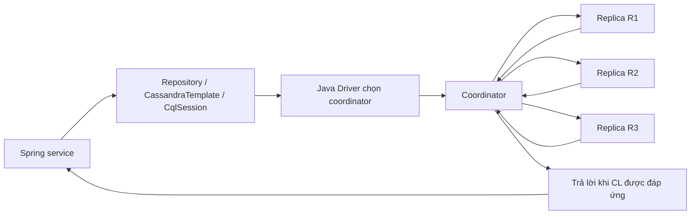
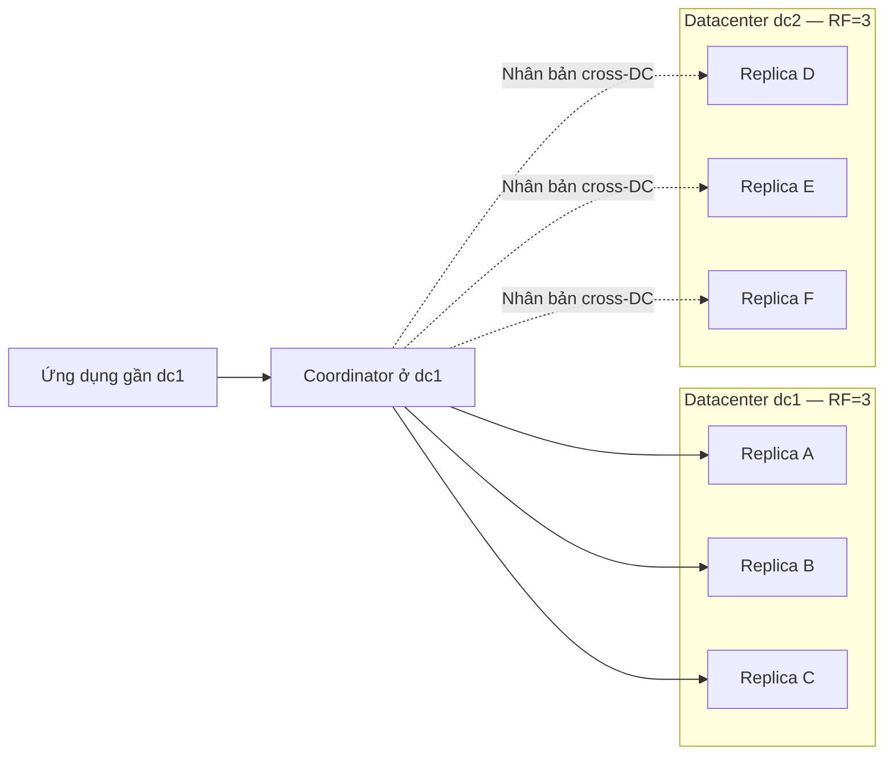

# ONE, QUORUM, ALL và các mức nhất quán theo datacenter

Trong Apache Cassandra, dữ liệu của một partition thường được nhân bản trên nhiều node. Một thao tác đọc hoặc ghi không nhất thiết phải chờ **tất cả** bản sao trả lời. Cassandra cho phép chọn **consistency level (CL)** cho từng request để xác định cần bao nhiêu replica tham gia xác nhận. Ba tên quen thuộc là `ONE`, `QUORUM`, `ALL`; với hệ thống nhiều datacenter còn có `LOCAL_ONE`, `LOCAL_QUORUM`, `EACH_QUORUM`. Hiểu sai các mức này có thể dẫn đến kỳ vọng không thực tế về độ mới của dữ liệu, khả năng chịu lỗi hoặc độ trễ liên vùng.

Bài thuộc chương **Tính nhất quán** của module `SPRING_DATA_CASSANDRA`. Ta sẽ liên hệ mô hình replica của Cassandra với những thao tác thực tế qua **Spring Data Cassandra**: repository, `CassandraTemplate`, `QueryOptions`, `@Consistency`, prepared statement và Java Driver. Song song, bài giải thích vì sao nhất quán không thể thay thế thiết kế bảng theo truy vấn, partition key, paging và kiểm soát hiệu năng của hệ thống phân tán.

**Cần ghi nhớ từ đầu:** consistency level là **quy tắc xác nhận của từng request**, không phải số node trong cluster, không phải replication factor, không phải isolation level của một transaction SQL và cũng không đồng nghĩa dữ liệu ở mọi replica đã giống nhau khi request trả về.

## 1. Các thuật ngữ nền tảng

| Thuật ngữ | Ý nghĩa trong Cassandra | Không nên nhầm với |
|---|---|---|
| **Node** | Một máy/tiến trình Cassandra tham gia cluster | Một replica logic của mọi partition |
| **Partition** | Đơn vị dữ liệu được xác định bởi partition key | Một hàng riêng lẻ hoặc một bảng |
| **Replica** | Node lưu một bản sao của partition theo replication strategy | Một contact point do client cấu hình |
| **Replication factor (RF)** | Số bản sao theo keyspace; với `NetworkTopologyStrategy` được cấu hình **theo datacenter** | Consistency level |
| **Coordinator** | Node nhận request từ driver và điều phối đến replica | Luôn là replica hoặc luôn là leader |
| **Consistency level (CL)** | Số/phạm vi replica cần đáp ứng để hoàn tất request | Số replica thực tế tồn tại hay đã nhận mutation |
| **Datacenter (DC)** | Nhóm node logic/vật lý phục vụ placement, locality và resilience | Một node hoặc một keyspace |
| **Token** | Giá trị tính từ partition key để xác định placement | Số thứ tự hàng hoặc thời gian ghi |
| **Quorum** | Đa số bản sao trong tập RF đang xét: `floor(RF / 2) + 1` | Một con số cố định bằng 2 |

Một bảng được phân vùng theo `account_id` thì mọi hàng có cùng `account_id` thuộc một logical partition, bất kể có bao nhiêu clustering rows. Replication strategy xác định node nào giữ partition đó.

Ví dụ: keyspace có RF=3 trong `dc1`. Mỗi partition có ba replica đích trong DC ấy. Đối với **một request**, `ONE` cần một replica đáp ứng, `QUORUM` cần hai, `ALL` cần ba. Coordinator vẫn có thể gửi mutation đến các replica còn lại; CL nói về **ngưỡng hoàn thành**, không phải giới hạn số node được gửi yêu cầu.

## 2. Consistency level xuất hiện ở đâu trong luồng đọc/ghi?



Ở mức khái quát:

1. Ứng dụng tạo CQL statement và gắn CL, hoặc dùng giá trị mặc định của driver/session.
2. Driver chọn coordinator theo topology và load-balancing policy. Nếu có routing key từ prepared statement, driver có thể ưu tiên một replica của partition.
3. Coordinator xác định những replica cần liên hệ theo partition key, keyspace và RF.
4. Khi xử lý request, coordinator chờ **đủ phản hồi theo CL** hoặc trả lỗi/timeout nếu không đạt.
5. Các replica còn lại có thể tiếp tục nhận/cập nhật dữ liệu theo cơ chế Cassandra.

**Không có một leader cố định cho mọi partition như trong một số hệ CSDL khác.** Bất kỳ node được chọn hợp lệ đều có thể làm coordinator; token-aware routing giúp giảm hop, nhưng không tự thay đổi CL.

Đường đọc và ghi không hoàn toàn giống nhau: write acknowledgment nói về số replica đã chấp nhận mutation theo giao thức; read response phải thu thập, đối chiếu dữ liệu/digest theo cơ chế đọc Cassandra. Vì vậy cần phân tích **read CL** và **write CL** riêng.

## 3. RF và keyspace quyết định tập replica

Một keyspace test ở một datacenter:

```sql
CREATE KEYSPACE IF NOT EXISTS consistency_lab
WITH replication = {
    'class': 'NetworkTopologyStrategy',
    'dc1': 3
}
AND durable_writes = true;
```

`dc1` là tên DC minh họa, phải khớp metadata của cluster. RF=3 chỉ có ý nghĩa vận hành lành mạnh khi DC có đủ node phù hợp để lưu ba replica của một partition. **Không đặt RF=3 trên lab chỉ có một node rồi kỳ vọng hành vi của cluster ba replica.**

Bảng minh họa:

```sql
CREATE TABLE consistency_lab.accounts_by_id (
    account_id uuid PRIMARY KEY,
    owner_name text,
    balance_minor bigint,
    updated_at timestamp
);
```

Đường truy vấn:

```sql
SELECT account_id, owner_name, balance_minor, updated_at
FROM consistency_lab.accounts_by_id
WHERE account_id = ?;
```

`account_id` là partition key đơn. Nếu mọi thao tác chính đều đọc/ghi theo ID, đây là access pattern thuận lợi. Nếu yêu cầu “mọi tài khoản có số dư lớn hơn N”, tăng CL không tạo được khả năng lọc hiệu quả theo `balance_minor`; phải thiết kế bảng/projection hoặc cơ chế tìm kiếm phù hợp.

**RF khác số contact point.** Driver có thể được cấu hình chỉ một hoặc vài contact point để khám phá cluster; RF vẫn do keyspace và replication strategy quyết định.

## 4. ONE: ưu tiên ngưỡng xác nhận nhỏ

**`ONE`** là mức nhất quán thông thường yêu cầu **một replica** đáp ứng để request được coi là thành công.

### Với ghi

Ở RF=3, coordinator có thể chuyển mutation đến ba replica, nhưng chỉ cần một phản hồi đáp ứng ngưỡng `ONE`. Điều này thường giảm latency và giữ availability khi một số replica chậm/không sẵn sàng.

Hệ quả: sau khi ghi `ONE` thành công, **không có bảo đảm từ chính CL đó rằng hai replica còn lại đã nhận cùng giá trị**. Một lần đọc `ONE` khác có thể gặp replica chưa hội tụ, đặc biệt khi có lỗi mạng hoặc ghi gần thời điểm đọc.

### Với đọc

Đọc `ONE` chỉ cần phản hồi từ một replica đủ điều kiện. Nếu replica đó chưa cập nhật mới nhất theo tình huống hệ thống, ứng dụng có thể thấy giá trị cũ.

**Ví dụ:**

- RF=3, `R1` đã nhận cập nhật số dư mới.
- `R2` và `R3` tạm chưa có cập nhật.
- Write `ONE` trả thành công sau khi `R1` xác nhận.
- Một read `ONE` có thể lấy giá trị ở replica chưa nhận cập nhật, vì ngưỡng một không buộc đọc giao với bản sao đã xác nhận ghi.

Do đó, **`ONE` thường phù hợp khi hệ thống chấp nhận độ trễ hội tụ nhất định**, như dữ liệu telemetry, một số dashboard hoặc workload read-heavy không yêu cầu lần đọc kế tiếp phải thấy ngay ghi vừa hoàn thành.

Trong môi trường nhiều DC, `ONE` đòi một replica đáp ứng theo semantics của mức toàn cục; việc driver ưu tiên local node là **chính sách chọn coordinator/replica**, không phải một lời cam kết locality tương đương `LOCAL_ONE`.

## 5. QUORUM: đa số replica phải đáp ứng

**`QUORUM`** tính theo tổng RF của keyspace trên tập datacenter liên quan. Công thức:

```text
Q = floor(N / 2) + 1

N = tổng RF của các DC trong keyspace (đối với QUORUM).
```

Ví dụ ở **một DC**:

| RF | `ONE` | `QUORUM` | `ALL` |
|---:|---:|---:|---:|
| 1 | 1 | 1 | 1 |
| 2 | 1 | 2 | 2 |
| 3 | 1 | 2 | 3 |
| 4 | 1 | 3 | 4 |
| 5 | 1 | 3 | 5 |

Với RF=3, `QUORUM` cần hai replica; có thể hoàn tất khi một replica không đáp ứng, **miễn là hai replica còn lại đáp ứng đúng thời hạn và điều kiện request**.

Một read `QUORUM` có cơ hội gặp ít nhất một replica từng xác nhận một write `QUORUM` trong cùng tập ba replica. Nguyên lý tập giao nhau này là cơ sở để Cassandra cung cấp mức nhất quán mạnh hơn khi chọn R/W phù hợp. Tuy nhiên, không nên tự tuyên bố mọi request `QUORUM` là transaction tuyến tính hóa: còn phải xem tính đồng thời, timestamp, trạng thái replica, retry và kiểu thao tác.

### QUORUM có miễn phí không?

Không. So với `ONE`, coordinator cần đợi nhiều replica phản hồi hơn. Khi một replica chậm, read/write `QUORUM` có thể chịu tail latency cao hơn. Ngược lại, so với `ALL`, `QUORUM` cho phép một số replica không đáp ứng mà request vẫn hoàn thành.

Trong cụm đa DC, `QUORUM` có thể cần phản hồi từ DC từ xa. Đây là lý do cần phân biệt thật rõ `QUORUM` với `LOCAL_QUORUM` khi thiết kế dịch vụ đa vùng.

## 6. ALL: ngưỡng xác nhận cao, availability thấp hơn

**`ALL`** cần **mọi replica trong tập RF** đáp ứng ngưỡng của request.

Với RF=3:

- Write `ALL` chỉ được xác nhận sau khi cả ba replica đáp ứng.
- Read `ALL` cần mọi replica theo semantics của mức ấy.
- Nếu một replica cần thiết không sẵn sàng hoặc không phản hồi kịp, request có thể thất bại dù hai replica còn lại hoạt động.

`ALL` không có nghĩa “toàn bộ node của cluster” khi keyspace RF nhỏ hơn số node; nó liên quan **các replica của partition**. Ví dụ cluster có 12 node nhưng RF=3, một request `ALL` không yêu cầu cả 12 node xác nhận.

`ALL` thường không phù hợp làm mặc định cho mọi request của dịch vụ online yêu cầu tính sẵn sàng cao, bởi chỉ một replica không đáp ứng có thể làm request không thành công. Trong môi trường nhiều DC, yêu cầu chờ đủ replica ở tất cả DC còn có thể tăng latency đáng kể.

**Cần lưu ý:** dù `ALL` trả thành công, Cassandra không vì thế tự tạo transaction ACID giữa nhiều bảng hoặc bảo đảm uniqueness cho cột thường. Dữ liệu vẫn chịu các quy tắc timestamp, conflict resolution và concurrency của hệ thống.

## 7. So sánh availability trong một DC RF=3

Giả định partition có ba replica `R1, R2, R3` trong cùng `dc1`, network và coordinator ngoài phạm vi được xem là hoạt động bình thường.

| Số replica khả dụng | `ONE` | `QUORUM` | `ALL` |
|---:|---|---|---|
| 3/3 | Có thể hoàn thành | Có thể hoàn thành | Có thể hoàn thành |
| 2/3 | Có thể hoàn thành | Có thể hoàn thành | Không đủ replica |
| 1/3 | Có thể hoàn thành | Không đủ replica | Không đủ replica |
| 0/3 | Không đủ replica | Không đủ replica | Không đủ replica |

Bảng nói về **ngưỡng replica**, không hứa mọi request đều thành công khi đủ số node: coordinator, timeout, tombstone, network, lỗi read/write và trạng thái dữ liệu vẫn có thể gây thất bại.

Không nhầm **số node sống** với **số replica sẵn sàng cho partition cụ thể**. Với RF nhỏ hơn số node DC, việc có ba node sống không chứng minh cả ba replica của một partition cụ thể đều còn sống.

### Trường hợp một node RF=1

Trên lab một node với keyspace RF=1, `ONE`, `QUORUM` và `ALL` cùng cần **một** replica. Thử ba CL trên lab ấy **không đo được khác biệt chịu lỗi** của RF=3. Muốn nghiên cứu quorum và failover, cần topology đủ replica và môi trường thử nghiệm riêng.

## 8. Công thức W + R > RF: ý nghĩa và giới hạn

Trong các tài liệu Cassandra, quy tắc quen thuộc là:

```text
R = số replica cần trả lời cho read CL
W = số replica cần xác nhận cho write CL
N = replication factor trong cùng tập replica

Nếu R + W > N
→ mọi tập R replica đọc sẽ giao với mọi tập W replica ghi
  (theo giả định tập replica và topology ổn định).
```

Với RF=3:

| Write CL | Read CL | W + R | Có bảo đảm giao nhau về tập replica? |
|---|---|---:|---|
| ONE (1) | ONE (1) | 2 | Không: 2 ≤ 3 |
| ONE (1) | QUORUM (2) | 3 | Không: 3 ≤ 3 |
| QUORUM (2) | ONE (1) | 3 | Không: 3 ≤ 3 |
| QUORUM (2) | QUORUM (2) | 4 | Có: 4 > 3 |
| ALL (3) | ONE (1) | 4 | Có: 4 > 3 |
| ONE (1) | ALL (3) | 4 | Có: 4 > 3 |

Ví dụ `QUORUM + QUORUM` trong RF=3 đảm bảo hai nhóm hai replica có **ít nhất một replica chung**. Nếu write đã hoàn thành trước khi read bắt đầu, không có ghi đè cạnh tranh hay thay đổi replica set bất thường, đây là cơ sở để đọc có thể phát hiện dữ liệu đã được ghi.

**Không được diễn giải quá mức:** quy tắc giao nhau chỉ nói về toán học tập hợp. Cassandra giải quyết xung đột theo timestamp và cơ chế read reconciliation. Write timeout có thể tạo trạng thái “không biết có ghi được hay chưa”; concurrent writes với timestamp không như mong đợi có thể dẫn đến kết quả nghiệp vụ khác. Muốn kiểm soát chuyển trạng thái cạnh tranh cần conditional updates/LWT hoặc cơ chế business versioning thích hợp.

Đặc biệt, **W và R phải được tính trên cùng tập replica/DC đang xét**. Nếu write `LOCAL_QUORUM` ở `dc1` nhưng read `LOCAL_QUORUM` tại `dc2`, hai tập được xác nhận không nằm trên cùng một tập local replicas; không thể lấy công thức `2 + 2 > 3` ở DC1 rồi khẳng định read DC2 đã thấy write.

## 9. Vì sao cần mức LOCAL trong hệ thống nhiều datacenter?

Giả sử keyspace có hai DC, mỗi DC ba replica:

```sql
CREATE KEYSPACE IF NOT EXISTS geo_lab
WITH replication = {
    'class': 'NetworkTopologyStrategy',
    'dc1': 3,
    'dc2': 3
};
```

Tổng RF của keyspace cho partition là **6**, nhưng mỗi DC có tập replica riêng với RF=3. Nếu dịch vụ đang chạy gần `dc1` và muốn tránh phụ thuộc latency/availability của `dc2`, các mức **LOCAL** thường phù hợp hơn mức toàn cục.



Trong mô hình này, coordinator có thể liên hệ những replica ở cả hai DC theo quy trình thực thi, nhưng **LOCAL_QUORUM chờ quorum ở DC cục bộ**, không bắt buộc chờ quorum remote DC trước khi xác nhận request. Điều đó cải thiện tính cô lập khi một DC khác gặp sự cố, đổi lại **không có bảo đảm dữ liệu mới đã được xác nhận ở DC còn lại** tại thời điểm request trả về.

## 10. LOCAL_ONE và LOCAL_QUORUM

### LOCAL_ONE

`LOCAL_ONE` cần **một replica trong datacenter cục bộ** đáp ứng. Nó gần với `ONE` về số lượng khi RF local lớn hơn 0, nhưng phạm vi replica bị ràng buộc vào DC cục bộ.

Trường hợp phù hợp: dịch vụ đọc telemetry không quá nhạy với dữ liệu cũ, muốn giảm latency và tránh phải lấy phản hồi từ DC xa. Nếu local DC bị mất toàn bộ replica của partition, một request `LOCAL_ONE` **không tự động chuyển qua remote DC** để vẫn đạt LOCAL_ONE.

### LOCAL_QUORUM

`LOCAL_QUORUM` cần **đa số replica trong DC cục bộ**:

```text
RF tại local DC = 3
LOCAL_QUORUM = floor(3 / 2) + 1 = 2
```

Với `geo_lab`, request ở `dc1` cần **hai trong ba replica của dc1**. Không cần chờ replica `dc2` để đạt ngưỡng này, nên có thể tiếp tục hoạt động khi remote DC mất kết nối. Đây là lựa chọn phổ biến khi một dịch vụ online đọc/ghi trong **một DC chính cho request** nhưng cần replicated data trên các DC khác.

**Đọc LOCAL_QUORUM ở dc1 và ghi LOCAL_QUORUM ở dc1** có tập xác nhận giao nhau nếu cùng RF=3, không có ghi cạnh tranh bất thường. Nhưng **đọc LOCAL_QUORUM ở dc2 ngay sau khi ghi LOCAL_QUORUM ở dc1** có thể thấy dữ liệu cũ nếu replication sang dc2 chưa hội tụ. Nếu nghiệp vụ bắt buộc cross-DC read-after-write ngay lập tức, phải thiết kế chính sách nhất quán và luồng điều phối tương ứng, không chỉ trông chờ chữ LOCAL.

### Quorum per-DC không phụ thuộc tổng RF

Nếu `dc1` RF=3 và `dc2` RF=2:

- LOCAL_QUORUM ở `dc1` cần 2.
- LOCAL_QUORUM ở `dc2` cần 2.
- QUORUM toàn cục tính theo RF=5 nên cần 3.

Không áp một công thức `RF=3` chung cho mọi DC khi replication strategy cấu hình khác nhau theo DC.

## 11. QUORUM, EACH_QUORUM và ALL khi có hai DC

Với `geo_lab` có `dc1:3`, `dc2:3`:

| Mức CL | Ngưỡng/phạm vi | Đặc trưng |
|---|---|---|
| `ONE` | 1 replica hợp lệ trong phạm vi toàn cục | Không bắt buộc local DC ở cấp CL |
| `LOCAL_ONE` | 1 replica thuộc DC cục bộ | Chỉ dựa vào local DC |
| `QUORUM` | 4/6 replica tổng cộng | Có thể đòi remote DC; không nhất thiết 2 ở mỗi DC |
| `LOCAL_QUORUM` | 2/3 replica trong DC cục bộ | Không chờ quorum remote DC |
| `EACH_QUORUM` | **Write**: 2/3 replica ở **mỗi** DC | Ngưỡng per-DC, tăng phụ thuộc cross-DC |
| `ALL` | 6/6 replica | Cần tất cả replica, phụ thuộc mọi DC |

**`EACH_QUORUM` dành cho write trong mô hình Cassandra này**, không phải lựa chọn read CL chung để “đọc quorum từ mọi DC”. Muốn đảm bảo một thao tác đọc thấy các mutation mới nhất ở mọi DC cần xem yêu cầu của hệ thống, chiến lược read/write và kỹ thuật đồng bộ chứ không chỉ đặt một tên CL không được hỗ trợ cho SELECT.

### Ví dụ DC2 gặp sự cố hoàn toàn

Giả sử cả ba replica ở `dc2` đều không phản hồi, ba replica `dc1` còn tốt:

- `LOCAL_ONE` hoặc `LOCAL_QUORUM` từ coordinator/đường local `dc1` **có thể** thành công.
- `QUORUM` toàn cục cần 4/6, nhưng chỉ còn 3/6 → **không đủ replica**.
- Write `EACH_QUORUM` cần quorum ở cả `dc1` lẫn `dc2` → **không đủ**.
- `ALL` cần 6/6 → **không đủ**.

Vì vậy, chọn `QUORUM` thay vì `LOCAL_QUORUM` cho một dịch vụ chạy ở DC1 có thể **vô tình buộc request phụ thuộc remote DC**, giảm khả năng hoạt động khi liên vùng mất kết nối.

### QUORUM toàn cục không chia đều replica

Quorum 4/6 có thể là 3 replica ở DC1 + 1 ở DC2, hoặc 2 + 2, tùy những replica đáp ứng. Nó **không bắt buộc mỗi DC cung cấp quorum riêng**, nên không thay thế EACH_QUORUM cho yêu cầu write per-DC.

## 12. Các mức khác: TWO, THREE, ANY, SERIAL, LOCAL_SERIAL

Ngoài các mức chính, Cassandra còn có những lựa chọn đặc biệt:

| Mức | Ý nghĩa | Lưu ý |
|---|---|---|
| `TWO` | Cần 2 replica đáp ứng | Ngưỡng tuyệt đối; không phải majority ở mọi RF |
| `THREE` | Cần 3 replica đáp ứng | Không có ý nghĩa nếu RF/tập replica không đáp ứng |
| `ANY` | **Write-only**: có thể xác nhận khi mutation được lưu như hint dù chưa đến replica đích | Không thể dùng cho read; chưa bảo đảm dữ liệu có thể đọc ngay |
| `SERIAL` | Serial consistency cho pha đồng thuận LWT theo phạm vi toàn cục | Không thay thế regular CL của mọi SELECT |
| `LOCAL_SERIAL` | Pha đồng thuận LWT cục bộ theo DC | Phù hợp khi LWT được thiết kế theo locality |
| `EACH_QUORUM` | Write quorum ở mỗi DC của keyspace | Không phải read level thông thường |

**ANY khác ONE.** Khi các replica đích của partition đều không khả dụng, một write `ANY` trong điều kiện phù hợp có thể được chấp nhận thông qua hint. Trả thành công ở `ANY` **không bảo đảm có thể đọc ngay dữ liệu đó bằng read ONE/LOCAL_ONE** khi replica chưa nhận lại mutation. Vì vậy không nên chọn ANY chỉ vì muốn “không bao giờ mất request” cho các thao tác nghiệp vụ nhạy cảm.

**SERIAL và LOCAL_SERIAL** liên quan đến lightweight transactions, sẽ nói kỹ ở mục 17. Chúng không đồng nghĩa `ALL`, và không biến một SELECT thường thành transaction có khóa.

## 13. Spring Data Cassandra: cấu hình kết nối không đồng nghĩa CL

Trong Spring Boot với Spring Data Cassandra, cấu hình kết nối có thể có dạng:

```yaml
spring:
  cassandra:
    contact-points:
      - 10.20.1.11
      - 10.20.1.12
    port: 9042
    local-datacenter: dc1
    keyspace-name: consistency_lab
    schema-action: NONE
```

Đây là **cấu hình minh họa**, không phải IP/keyspace của dự án thật. `local-datacenter` giúp driver xác định DC cục bộ và load-balancing locality. Nhưng chỉ định `local-datacenter: dc1` **không tự động có nghĩa mọi statement dùng LOCAL_QUORUM**; consistency mặc định còn phụ thuộc cấu hình Java Driver hoặc option cụ thể của statement.

`schema-action: NONE` giữ việc quản lý schema bên ngoài startup, tránh rủi ro lệnh `RECREATE` làm mất bảng/dữ liệu. Nó **không liên quan trực tiếp** đến số ACK cần chờ khi đọc/ghi.

Nếu ứng dụng cần một default CL cho đa số request, có thể cấu hình bằng driver execution profile, sau đó override ở các đường truy vấn quan trọng. Cách đặt profile/thuộc tính chính xác tùy Spring Boot và Java Driver version; không đặt nhiều defaults chồng chéo khi chưa rõ precedence.

### Driver config minh họa

Với Java Driver 4.x, một cấu hình HOCON có thể dùng:

```hocon
datastax-java-driver {
  basic.request.consistency = LOCAL_QUORUM
  basic.request.timeout = 3 seconds
}
```

Cần đảm bảo file cấu hình này **được đúng CqlSession thực tế load**, không chỉ tồn tại trên classpath. Nếu nhiều session hoặc execution profile, cần kiểm tra giá trị đã resolve. Ngoài ra, một số workload sẽ cần `LOCAL_ONE` hoặc CL khác theo use case; không nhất thiết ép tất cả vào cùng một default.

## 14. Đặt CL ngay trên repository method bằng @Consistency

Spring Data Cassandra hỗ trợ annotation `@Consistency` cho repository query methods trên những dòng phiên bản tương ứng.

```java
import java.util.UUID;

import com.datastax.oss.driver.api.core.DefaultConsistencyLevel;
import org.springframework.data.cassandra.repository.CassandraRepository;
import org.springframework.data.cassandra.repository.Consistency;
import org.springframework.data.cassandra.repository.Query;

public interface AccountRepository
        extends CassandraRepository<AccountById, UUID> {

    @Consistency(DefaultConsistencyLevel.LOCAL_QUORUM)
    @Query("SELECT * FROM accounts_by_id WHERE account_id = ?0")
    AccountById findWithLocalQuorum(UUID accountId);
}
```

Trong ví dụ, `AccountById` là entity ánh xạ bảng `accounts_by_id`; code entity đầy đủ phải có `@Table("accounts_by_id")`, `@PrimaryKey("account_id")` và mapping cho các cột khác. Keyspace được chọn qua cấu hình session.

Ưu điểm của annotation:

- Chính sách nhất quán của **phương thức** hiển thị ngay trong repository.
- Người dùng API khó quên truyền CL khi mọi lần gọi có cùng yêu cầu.
- Phù hợp khi use case ổn định và không cần thay đổi CL theo request.

Hạn chế: nếu cùng method phải có CL khác nhau theo đường đọc (ví dụ dashboard dùng LOCAL_ONE, đối soát dùng LOCAL_QUORUM), gắn cố định bằng annotation có thể không linh hoạt. Khi đó nên tách hai method hoặc dùng `QueryOptions` được hỗ trợ theo phiên bản.

**Không lẫn CL của SELECT với CL của các thao tác `save`/`insert` khác.** Một annotation trên query method không mặc nhiên thay default CL cho toàn bộ repository hoặc session.

## 15. QueryOptions: chọn consistency theo từng lần gọi

`QueryOptions` của Spring Data Cassandra có thể được truyền như một **special parameter** trong repository query method; nó không phải một thành phần bind của `WHERE`.

```java
import java.util.UUID;

import org.springframework.data.cassandra.core.cql.QueryOptions;
import org.springframework.data.cassandra.repository.CassandraRepository;
import org.springframework.data.cassandra.repository.Query;

public interface AccountRepository
        extends CassandraRepository<AccountById, UUID> {

    @Query("SELECT * FROM accounts_by_id WHERE account_id = ?0")
    AccountById findByIdWithOptions(
        UUID accountId,
        QueryOptions options
    );
}
```

Ví dụ hai kiểu gọi:

```java
import java.time.Duration;
import java.util.UUID;

import com.datastax.oss.driver.api.core.DefaultConsistencyLevel;
import org.springframework.data.cassandra.core.cql.QueryOptions;

QueryOptions quickRead = QueryOptions.builder()
    .consistencyLevel(DefaultConsistencyLevel.LOCAL_ONE)
    .timeout(Duration.ofSeconds(2))
    .pageSize(50)
    .build();

QueryOptions verifiedRead = QueryOptions.builder()
    .consistencyLevel(DefaultConsistencyLevel.LOCAL_QUORUM)
    .timeout(Duration.ofSeconds(3))
    .pageSize(50)
    .build();

AccountById a = repository.findByIdWithOptions(accountId, quickRead);
AccountById b = repository.findByIdWithOptions(accountId, verifiedRead);
```

`accountId` là **giá trị partition key**; `options` được Spring Data xử lý như tùy chọn statement. Nó không chiếm placeholder `?1` và không thay đổi bảng/query.

**Quan trọng:** `pageSize(50)` là số hàng mục tiêu mỗi lần driver fetch trang, **không phải CQL `LIMIT 50`**. Vì query ở đây chọn một hàng theo primary key đơn nên page size không mang lại nhiều khác biệt; tham số chỉ được đưa vào ví dụ để phân biệt giữa các loại tùy chọn.

Nếu method có cả `@Consistency` và `QueryOptions` override consistency, precedence có thể phụ thuộc phiên bản. Cách bảo trì dễ hiểu nhất là **chọn một nơi làm nguồn quyết định CL cho mỗi use case** và có integration test xác nhận statement thực tế.

## 16. Dùng CqlSession/PreparedStatement để kiểm soát từng statement

Nếu cần API driver trực tiếp hoặc prepared statement được tái sử dụng, đặt CL trên `BoundStatement`:

```java
import java.util.UUID;

import com.datastax.oss.driver.api.core.CqlSession;
import com.datastax.oss.driver.api.core.DefaultConsistencyLevel;
import com.datastax.oss.driver.api.core.cql.PreparedStatement;
import com.datastax.oss.driver.api.core.cql.BoundStatement;
import com.datastax.oss.driver.api.core.cql.Row;

public final class AccountReadDao {

    private final CqlSession session;
    private final PreparedStatement find;

    public AccountReadDao(CqlSession session) {
        this.session = session;
        this.find = session.prepare(
            "SELECT account_id, owner_name, balance_minor, updated_at " +
            "FROM consistency_lab.accounts_by_id WHERE account_id = ?"
        );
    }

    public Long readBalance(UUID id) {
        if (id == null) {
            throw new IllegalArgumentException("accountId is required");
        }

        BoundStatement bound = find.bind(id)
            .setConsistencyLevel(DefaultConsistencyLevel.LOCAL_QUORUM)
            .setTimeout(java.time.Duration.ofSeconds(3));

        Row row = session.execute(bound).one();
        if (row == null || row.isNull("balance_minor")) {
            return null;
        }
        return row.getLong("balance_minor");
    }
}
```

Lớp trên là một DAO minh họa: trên ứng dụng thật cần injection và lifecycle `CqlSession` do Spring Boot quản lý, đúng keyspace/schema và xử lý case account không tồn tại theo nghiệp vụ. `null` có thể mang nghĩa “không có hàng” hoặc “giá trị nullable”, nên API production thường dùng DTO/Optional có phân biệt các trạng thái.

**BoundStatement của Java Driver 4.x là immutable-style**: `setConsistencyLevel(...)` trả về statement mới; phải giữ giá trị trả về hoặc dùng builder. Đừng gọi setter rồi bỏ qua kết quả với giả định object bị mutate tại chỗ.

Ví dụ này cũng minh họa điểm độc lập của ba khái niệm:

- `WHERE account_id = ?` chọn partition.
- Prepared metadata giúp driver có thể chọn coordinator token-aware.
- `LOCAL_QUORUM` quyết định ngưỡng replica cần phản hồi trong DC, không thay đổi partition key hay cột được SELECT.

Đối với `CassandraTemplate`/`CassandraOperations`, có các overload nhận options thích hợp ở những phiên bản hỗ trợ. Khi dùng API cấp mapping, hãy xác minh đúng loại `QueryOptions`, `InsertOptions`, `UpdateOptions` hoặc `WriteOptions` tùy thao tác; **đừng mặc định một option của SELECT được áp nguyên xi cho mọi INSERT/UPDATE**.

## 17. SERIAL, LOCAL_SERIAL và lightweight transactions

Các yêu cầu như **“chỉ tạo tài khoản khi ID chưa tồn tại”** hoặc **“chỉ đổi trạng thái NEW → PAID nếu vẫn là NEW”** cần một phép kiểm tra điều kiện mang tính đồng thuận ở Cassandra.

Ví dụ:

```sql
INSERT INTO consistency_lab.accounts_by_id (
    account_id, owner_name, balance_minor, updated_at
) VALUES (?, ?, ?, ?)
IF NOT EXISTS;
```

Hoặc:

```sql
UPDATE consistency_lab.accounts_by_id
SET balance_minor = ?
WHERE account_id = ?
IF balance_minor = ?;
```

Những câu này dùng **lightweight transaction (LWT)**. Trong Java Driver, có thể đặt regular CL và serial CL theo API:

```java
BoundStatement conditional = prepared.bind(
        newBalance, accountId, oldBalance)
    .setConsistencyLevel(DefaultConsistencyLevel.LOCAL_QUORUM)
    .setSerialConsistencyLevel(DefaultConsistencyLevel.LOCAL_SERIAL);
```

Đoạn mã giả định `prepared` đã prepare câu UPDATE ở trên, các biến đúng kiểu CQL. `LOCAL_SERIAL` liên quan pha đồng thuận của LWT, còn `LOCAL_QUORUM` là regular CL cho giai đoạn request tương ứng. Cần đối chiếu quy tắc LWT với Cassandra version/replication topology và đảm bảo mọi client tham gia cùng khóa dùng semantics tương thích.

**Không nhầm:** đặt `LOCAL_SERIAL` lên một query không có `IF` **không tự thêm điều kiện so sánh**. Và LWT không phải một transaction SQL nhiều hàng/nhiều bảng với isolation tổng quát. Nó có chi phí coordinator/consensus cao hơn so với write thông thường, nên chỉ dùng khi yêu cầu uniqueness/conditional state thực sự cần.

Kết quả LWT cũng cần được kiểm tra để biết **điều kiện có được áp dụng hay không**, không chỉ dựa vào việc lệnh không ném exception. Trong Java Driver, kết quả conditional DML có thông tin áp dụng trong row đầu tiên (ví dụ `[applied]`). Với Spring Data, hãy sử dụng API/mapping trả kết quả conditional write đúng theo phiên bản.

## 18. Những gì CL không bảo đảm

Một số hiểu nhầm gây lỗi nghiêm trọng:

| Hiểu nhầm | Cách hiểu đúng |
|---|---|
| “Ghi QUORUM nghĩa là mọi replica đã có dữ liệu.” | Chỉ cần đa số theo tập RF; replica khác có thể chưa hội tụ |
| “Đọc ONE luôn thấy ghi ONE ngay trước đó.” | Không bảo đảm tập đọc và tập ghi giao nhau |
| “QUORUM đọc ở DC2 chắc thấy LOCAL_QUORUM write ở DC1.” | Không thể suy từ quorum local khác DC |
| “ALL nghĩa là toàn bộ node cluster.” | Chỉ các replica liên quan của partition/keyspace |
| “LOCAL_QUORUM nghĩa là RF=2.” | Quorum là hàm của RF trong DC cục bộ |
| “CL cao hơn luôn có nghĩa nghiệp vụ đúng hơn.” | Không ngăn ghi đè, timestamp conflict, read/write race hoặc sai partition key |
| “Set consistency bảo đảm unique external ID.” | Unique phải được thiết kế bằng primary key và có thể cần LWT |
| “Đặt CL cho repository tự đồng bộ các bảng projection.” | Denormalized tables cần cơ chế ghi/cập nhật riêng |
| “LOCAL_ONE tự chuyển sang remote DC khi local DC mất.” | LOCAL yêu cầu replica trong local DC; failover liên vùng cần chiến lược riêng |
| “Read QUORUM là read transaction snapshot.” | Cassandra không mặc định snapshot nhiều hàng/bảng như RDBMS |
| “Timeout chứng minh write chưa diễn ra.” | Mutation có thể đã đến replica trước khi timeout |

### Timestamp và xung đột ghi

Cassandra dùng cơ chế hòa giải giá trị có xét write timestamp. Nếu hai client ghi cùng cell với timestamp và thứ tự nghiệp vụ không phù hợp, **last-write-wins theo timestamp** có thể tạo kết quả không giống “request được gửi sau cùng”. CL không tự giải quyết vấn đề này. Trường hợp quan trọng nên quản lý timestamp/monotonic transitions và dùng LWT nếu cần điều kiện.

### Không có atomic transaction giữa nhiều projection

Ứng dụng có hai bảng `orders_by_id` và `orders_by_customer_day` có thể cập nhật một bảng thành công, bảng khác timeout. Dù đặt `LOCAL_QUORUM` cho cả hai, không có nghĩa một transaction nhiều bảng đã được commit nguyên tử và cô lập cho mọi query. Batch trong Cassandra có semantics và giới hạn riêng, không thay thế isolation/rollback tổng quát của RDBMS.

## 19. Read repair, hinted handoff, repair: quan hệ với consistency

Cassandra có các cơ chế để giúp replicas hội tụ hoặc khôi phục khi có lỗi:

- **Read reconciliation/read repair:** trong những tình huống và phiên bản phù hợp, một read có thể phát hiện khác biệt giữa bản sao và tham gia sửa chữa, với tác động latency/behavior cần hiểu.
- **Hinted handoff:** một coordinator có thể lưu hint cho replica tạm không khả dụng và chuyển mutation khi replica trở lại. Hint có giới hạn về cấu hình, thời gian và mức độ tin cậy.
- **Anti-entropy repair:** quy trình vận hành nhằm đồng bộ các bản sao, rất quan trọng với dữ liệu và tombstone trong cluster dài hạn.
- **Compaction:** hợp nhất SSTable và xử lý tombstone theo các điều kiện phù hợp; không phải cơ chế thay thế replication/repair.
- **Topology change/rebuild:** khi thêm, xóa hoặc thay node, metadata/token ownership thay đổi và cần xử lý streaming/schema.

`LOCAL_ONE` hoặc `QUORUM` **không tự loại bỏ nhu cầu repair**. Hệ thống cần thực hành backup, repair và monitoring phù hợp, nhất là dữ liệu có TTL, delete và sự cố replica kéo dài. Việc thiết kế retention và `gc_grace_seconds` phải nhất quán với chính sách repair để hạn chế rủi ro tái xuất hiện dữ liệu đã xóa.

**Không nên phụ thuộc hoàn toàn vào “read sẽ tự sửa replica”**, nhất là với những partition hiếm khi được đọc. Read repair behavior còn thay đổi theo phiên bản Cassandra và cách cấu hình bảng.

## 20. Lỗi thường gặp khi RF/CL không phù hợp

| Triệu chứng | Điều cần kiểm tra | Hướng xử lý |
|---|---|---|
| `UnavailableException` | Không đủ replica sống theo CL | Kiểm tra RF, DC, node health và chọn CL đúng yêu cầu |
| `ReadTimeoutException` | Chưa có đủ phản hồi đọc đúng hạn | Kiểm tra latency replica/coordinator, tombstone, mạng, timeout |
| `WriteTimeoutException` | Chưa đủ ACK ghi trong thời hạn | Không mặc định retry với ID mới; kiểm tra idempotency |
| `ReadFailureException` / `WriteFailureException` | Replica phản hồi lỗi trong quá trình thực thi | Tìm nguyên nhân server, lỗi truy vấn, trạng thái node |
| `LOCAL_QUORUM` thất bại ở single-node lab | RF local > số node có thể đáp ứng | Dùng RF phù hợp lab hoặc thêm replica thực |
| `QUORUM` chậm trong nhiều DC | Request có thể phụ thuộc cross-DC | Đánh giá `LOCAL_QUORUM` nếu semantics cho phép |
| Đọc ngay sau ghi đôi khi cũ | R+W không giao, khác DC, replica lag, concurrent writes | Xem read/write CL cùng tập replica và workflow |
| `ALL` thường xuyên fail khi có node lỗi | CL phụ thuộc mọi replica | Chỉ dùng khi mục tiêu nghiệp vụ chấp nhận trade-off |
| LWT chậm | Pha đồng thuận serial và contention | Giới hạn LWT cho những invariants thật cần |
| Query còn chậm khi giảm CL | Thiếu partition key, tombstone, fan-out hoặc hot partition | Sửa data model, paging và workload |
| Kết quả khác giữa DC | Replication chưa hội tụ hoặc local reads khác nhau | Kiểm tra repair/replica state và cross-DC consistency |

**Phân biệt unavailable với timeout:** unavailable thường nói về việc ngay từ đầu không đủ replica được biết là sống theo ngưỡng; timeout nói request không nhận đủ phản hồi kịp hạn dù đã được gửi theo plan. Một số lỗi khác xuất hiện giữa chừng do replica thất bại. Cách retry và thông báo nghiệp vụ phải dựa trên loại lỗi và tính idempotent của thao tác.

## 21. Bài lab: thực nghiệm ONE, QUORUM, ALL

Bài thực hành này chỉ được làm trên **cluster test riêng**, có thể dừng node mà không ảnh hưởng dữ liệu thật. Để quan sát các mức khác nhau, chọn **một DC với ít nhất ba node và keyspace RF=3**.

### Bước 1: tạo keyspace và bảng

```sql
CREATE KEYSPACE IF NOT EXISTS consistency_lab
WITH replication = {
    'class': 'NetworkTopologyStrategy',
    'dc1': 3
};

CREATE TABLE IF NOT EXISTS consistency_lab.accounts_by_id (
    account_id uuid PRIMARY KEY,
    owner_name text,
    balance_minor bigint,
    updated_at timestamp
);
```

Trong môi trường thật, tên DC có thể khác `dc1`; xác minh bằng công cụ quản trị trước khi tạo keyspace. Nếu cần thay RF của keyspace đã tồn tại, dùng quy trình thay đổi replication/repair phù hợp thay vì sửa rồi giả định dữ liệu lập tức có đủ replica.

### Bước 2: ghi và đọc bằng cqlsh

Trong **cqlsh**, `CONSISTENCY` là một **lệnh riêng của cqlsh**, không phải một mệnh đề thêm vào cuối mọi câu `SELECT`:

```sql
CONSISTENCY ONE

INSERT INTO consistency_lab.accounts_by_id (
    account_id, owner_name, balance_minor, updated_at
) VALUES (
    11111111-1111-1111-1111-111111111111,
    'Minh',
    100000,
    '2026-11-25T03:00:00Z'
);

CONSISTENCY QUORUM

SELECT account_id, owner_name, balance_minor
FROM consistency_lab.accounts_by_id
WHERE account_id = 11111111-1111-1111-1111-111111111111;

CONSISTENCY ALL

SELECT account_id, owner_name, balance_minor
FROM consistency_lab.accounts_by_id
WHERE account_id = 11111111-1111-1111-1111-111111111111;
```

Khi cả ba replica khỏe và dữ liệu đã hội tụ, các read có thể cho cùng kết quả. Điều đó **không chứng minh các CL tương đương**, chỉ chứng minh chưa có điều kiện phân biệt ở bài test.

### Bước 3: mô phỏng mất một replica trong lab

1. Xác định replica của partition bằng công cụ phù hợp; không giả định node nào cũng là replica khi topology/RF khác.
2. Dừng **một** node replica trong cluster test ba node.
3. Thực hiện cùng truy vấn với `ONE`, `QUORUM` và `ALL`.
4. Dự kiến `ONE` và `QUORUM` có thể thành công nếu hai replica còn lại đáp ứng; `ALL` không đủ replica.
5. Khởi động lại node, kiểm tra repair/hint/health theo đúng quy trình lab.
6. Không dừng node production hoặc làm mô phỏng lỗi mạng trên hệ thống có người dùng thật.

### Bước 4: kiểm tra khác biệt đa DC

Trong một cluster test khác có `dc1:3` và `dc2:3`:

- Ghi một giá trị với `LOCAL_QUORUM` từ `dc1`.
- Đọc lại bằng `LOCAL_QUORUM` từ `dc1`.
- Đọc từ `dc2` và thảo luận khả năng replica remote chưa hội tụ ngay ở những trường hợp mạng chậm/lỗi.
- Mô phỏng remote DC không sẵn sàng **chỉ trong lab**; so sánh `LOCAL_QUORUM` với `QUORUM`/`ALL`.
- Không dùng một lab RF=1 để rút kết luận về tính chịu lỗi cross-DC.

### Bước 5: kiểm tra statement options qua Spring

Dùng entity `AccountById` và một method repository nhận `QueryOptions`:

```java
QueryOptions one = QueryOptions.builder()
    .consistencyLevel(DefaultConsistencyLevel.LOCAL_ONE)
    .build();

QueryOptions quorum = QueryOptions.builder()
    .consistencyLevel(DefaultConsistencyLevel.LOCAL_QUORUM)
    .build();

AccountById a = repository.findByIdWithOptions(accountId, one);
AccountById b = repository.findByIdWithOptions(accountId, quorum);
```

Xác minh CQL được tạo đúng `WHERE account_id = ?`; đo latency, timeout, kết quả và CL thực trên đúng phiên bản Spring Data/Driver. Nếu chỉ so giá trị của hai Java object trên cluster hoàn toàn khỏe, bài test sẽ **không đủ** để đánh giá CL.

### Bảng dự kiến và không nên suy diễn

| Kiểm thử | Kỳ vọng mô hình | Không được tự kết luận |
|---|---|---|
| RF=3, 3 replica khỏe | ONE/QUORUM/ALL có thể thành công | CL khác nhau không có ý nghĩa |
| RF=3, một replica không khả dụng | ONE/QUORUM có thể; ALL không đủ | Mọi query QUORUM chắc chắn có latency thấp |
| RF=3, hai replica không khả dụng | ONE có thể; QUORUM/ALL không đủ | Write ONE đã tồn tại trên mọi replica |
| Hai DC RF=3 mỗi DC, DC2 mất | LOCAL_QUORUM DC1 có thể hoạt động | QUORUM toàn cục vẫn được đảm bảo |
| Write LOCAL_QUORUM DC1, read LOCAL_QUORUM DC2 ngay | Có thể phải chờ replication/convergence | W+R>RF của DC1 bảo đảm read DC2 |
| LWT IF NOT EXISTS | Có thông tin điều kiện được áp dụng | Không ném exception tức là insert đã tạo hàng |

## 22. Chọn CL theo từng nhóm nghiệp vụ

Không có một CL tối ưu cho mọi hệ thống. Quyết định cần dựa trên data model, mức chấp nhận dữ liệu cũ, độ trễ và topology.

| Workload | Lựa chọn để cân nhắc | Câu hỏi cần trả lời |
|---|---|---|
| Telemetry có thể trễ ngắn | `LOCAL_ONE` | Độ mới dữ liệu được chấp nhận đến mức nào? |
| Chi tiết đơn hàng vừa cập nhật trong cùng DC | `LOCAL_QUORUM` cho read/write nếu RF phù hợp | Có cần read-after-write? Có concurrent writers không? |
| Ghi quan trọng khi cả DC phải xác nhận | `EACH_QUORUM` cho write nếu yêu cầu/chấp nhận cross-DC | Có chấp nhận request thất bại khi remote DC down? |
| Báo cáo cần dữ liệu mới từ nhiều vùng | Chiến lược đọc/đồng bộ đa DC riêng, có thể `QUORUM` | Global freshness nào thực sự được cam kết? |
| Conditional state transition | LWT với `LOCAL_SERIAL`/`SERIAL` và regular CL phù hợp | Cần tính tuyến tính hóa cho khóa nào, đánh đổi latency ra sao? |
| Dịch vụ online uptime cao, nhiều vùng | `LOCAL_QUORUM` theo vùng hoặc `LOCAL_ONE` nếu chấp nhận eventual | Khi vùng bị lỗi thì routing/failover diễn ra thế nào? |

Bảng là **gợi ý đánh giá**, không phải cấu hình mặc định bắt buộc. Chẳng hạn dịch vụ tài chính không thể coi `LOCAL_QUORUM` tự giải quyết mọi yêu cầu về số dư và chuyển khoản; các invariant, atomic update, conflict resolution và audit trail vẫn cần thiết kế riêng.

Đối với query thiếu partition key hoặc quét nhiều partition, chọn `LOCAL_ONE` để giảm latency có thể không đủ. Thay đổi schema, giảm tombstone và quản lý paging thường tạo ảnh hưởng lớn hơn.

## 23. Checklist thiết kế và vận hành

1. **Tập replica:** biết RF theo từng datacenter của keyspace và partition đang truy vấn.
2. **Topology:** xác nhận DC/rack, node health, token map, local DC của driver.
3. **Read/write semantics:** xác định độ mới cần thiết sau ghi và cách xử lý concurrent writes.
4. **Tính toán:** chọn ONE/QUORUM/ALL theo ngưỡng; với nhiều DC phân biệt LOCAL_QUORUM, QUORUM và EACH_QUORUM.
5. **Quy tắc giao nhau:** chỉ áp `R + W > N` cho cùng tập replica, hiểu giới hạn timestamp/concurrency.
6. **Failover:** xác định khi mất một replica, cả DC hoặc đường mạng liên vùng thì request nào tiếp tục được.
7. **Phạm vi Java:** biết CL được đặt ở driver default, execution profile, `@Consistency` hay `QueryOptions`.
8. **Statement thực:** không mặc định một annotation hoặc cấu hình connection tự đặt CL cho mọi API.
9. **Prepared/routing:** query dùng đúng partition key và driver có metadata phù hợp để ưu tiên replica.
10. **Paging:** `pageSize` khác `LIMIT`; không materialize vô hạn một partition lớn.
11. **Timeout/retry:** phân biệt lỗi unavailable, timeout và failure; retry chỉ khi an toàn/idempotent.
12. **LWT:** chỉ dùng SERIAL/LOCAL_SERIAL khi thực sự có conditional transaction.
13. **Sửa chữa:** có repair, hinted handoff monitoring, backup và quy trình xử lý tombstone.
14. **Thử nghiệm:** lab đủ node/RF và topology đa DC đại diện; không gây lỗi giả trên production.
15. **Quan sát:** thu thập latency p95/p99, timeout, retry, read/write CL, replica health, hot partitions.
16. **Data model:** partition/clustering key và query-driven tables vẫn là nền tảng cho truy vấn hiệu quả.

**Kết luận:** `ONE` cần một replica, `QUORUM` cần đa số, `ALL` cần toàn bộ replica của partition theo RF. Trong hệ thống nhiều datacenter, `LOCAL_ONE` và `LOCAL_QUORUM` giới hạn ngưỡng xác nhận vào DC cục bộ; `QUORUM` tính đa số trên tổng RF, còn `EACH_QUORUM` yêu cầu quorum ghi ở mỗi DC. Với **Spring Data Cassandra**, các lựa chọn này được áp dụng qua cấu hình driver, `@Consistency`, `QueryOptions` hoặc statement options, nhưng hiệu quả và tính đúng đắn còn phụ thuộc **thiết kế bảng theo truy vấn, khóa phân vùng, đồng thời, độ trễ mạng, paging và vận hành cluster**.

## Tài liệu tham khảo

- [Apache Cassandra — Configuring Data Consistency](https://cassandra.apache.org/doc/stable/cassandra/managing/operating/consistency.html): nguyên tắc nhất quán đọc/ghi và quorum.
- [Apache Cassandra — Replication](https://cassandra.apache.org/doc/stable/cassandra/architecture/dynamo.html): mô hình phân tán, partition, replica và consistency.
- [Apache Cassandra — CQL Data Definition](https://cassandra.apache.org/doc/stable/cassandra/developing/cql/ddl.html): `CREATE KEYSPACE`, `NetworkTopologyStrategy` và replication.
- [Apache Cassandra Java Driver — Consistency](https://apache.github.io/cassandra-java-driver/4.18.1/core/consistency/): các mức consistency, statement options và serial consistency.
- [Spring Data Cassandra — Repository Query Methods](https://docs.spring.io/spring-data/cassandra/reference/cassandra/repositories/query-methods.html): `@Consistency` và `QueryOptions` trong repository.
- [Spring Data Cassandra — CassandraTemplate](https://docs.spring.io/spring-data/cassandra/reference/cassandra/template.html): mapped queries và options cho thao tác dữ liệu.
