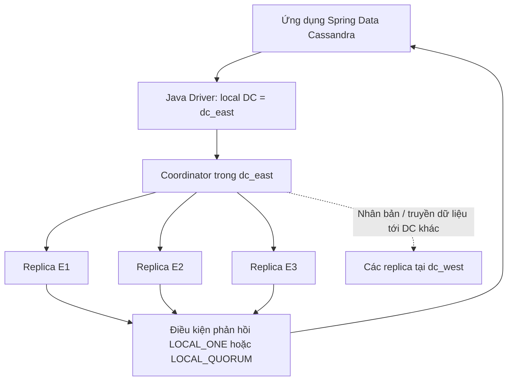
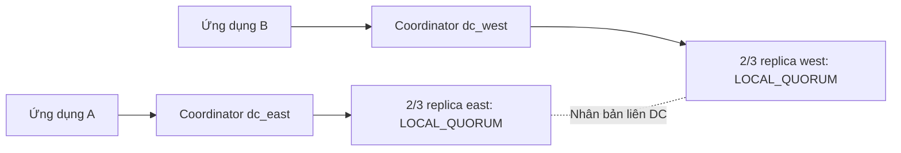

# LOCAL_ONE, LOCAL_QUORUM và vai trò local datacenter

Trong **Spring Data Cassandra**, một lệnh `findBy...`, `CassandraTemplate.select(...)` hoặc truy vấn thực thi qua `CqlTemplate` cuối cùng đều trở thành thao tác CQL trên **Apache Cassandra**. Kết quả của thao tác đó không chỉ phụ thuộc `WHERE`, partition key và dữ liệu thực tế, mà còn phụ thuộc **consistency level** (*mức nhất quán*) và cách dữ liệu được nhân bản giữa các **data center (DC)**.

Hai mức thường gặp là **`LOCAL_ONE`** và **`LOCAL_QUORUM`**. Cả hai đều có chữ `LOCAL`, nhưng không đồng nghĩa với việc “chỉ có một bản dữ liệu”, “đọc từ cache” hoặc “không có replication”. Chữ `LOCAL` mô tả **phạm vi data center dùng để đáp ứng yêu cầu consistency** của thao tác, không phải phạm vi tồn tại của dữ liệu.

Bài học thuộc chương **Tính nhất quán** của module `SPRING_DATA_CASSANDRA`, gắn lý thuyết replica và replication factor với cấu hình `local-datacenter` trong Spring Boot/Java Driver, `@Consistency` trên repository, consistency của statement và các tình huống lỗi trong môi trường phân tán.

## 1. Ba thành phần cần phân biệt: partition, replica và datacenter

Trước khi chọn một consistency level, cần hiểu đường đi của một thao tác.

1. **Partition key** xác định token của một partition. Dựa vào metadata cluster, Cassandra biết những node nào sở hữu dữ liệu của partition đó.
2. **Replica** là node giữ một bản sao dữ liệu của partition, theo replication strategy của keyspace.
3. **Datacenter (DC)** là nhóm node logic được Cassandra nhận diện qua cấu hình topology/snitch. Trong một hệ đa vùng, DC thường tương ứng một vùng triển khai, nhưng tên DC là **tên topology của Cassandra**, không mặc nhiên là tên cloud region.

Một **coordinator** nhận request từ ứng dụng và điều phối các replica. Coordinator không nhất thiết chính là replica đang giữ partition cần đọc. Local consistency được diễn giải **theo DC của coordinator**; vì vậy vị trí coordinator và cấu hình định tuyến của driver là một phần quan trọng của lời giải.



Sơ đồ chỉ minh họa luồng logic: **số lượng và loại request thực tế** đến từng replica có thể khác nhau theo phiên bản Cassandra, trạng thái node và thuật toán đọc. Nó không có nghĩa coordinator luôn gửi một lệnh giống hệt đến toàn bộ replica.

## 2. Replication factor phải xét theo data center

Trong production đa DC, một keyspace thường sử dụng `NetworkTopologyStrategy`, cho phép khai báo **replication factor (RF) riêng cho mỗi DC**.

```sql
-- Ví dụ topology có hai DC do Cassandra đặt tên.
-- Chỉ chạy DDL qua quy trình migration được kiểm soát.
CREATE KEYSPACE IF NOT EXISTS telemetry
WITH replication = {
    'class': 'NetworkTopologyStrategy',
    'dc_east': 3,
    'dc_west': 3
}
AND durable_writes = true;
```

Với keyspace giả định này:

| Thuộc tính | Giá trị | Ý nghĩa |
| --- | ---: | --- |
| RF của `dc_east` | 3 | Mỗi partition có ba replica được bố trí tại DC này |
| RF của `dc_west` | 3 | Mỗi partition có ba replica trong DC còn lại |
| Tổng replica theo cấu hình | 6 | Tổng số bản sao logic trên cả hai DC |
| `LOCAL_QUORUM` tại `dc_east` | 2 | Đa số của **3 replica dc_east**, không phải đa số của 6 |
| `LOCAL_QUORUM` tại `dc_west` | 2 | Đa số của **3 replica dc_west** |

Với RF cục bộ bằng `N`, quorum được tính:

\[
Q_{local} = \left\lfloor\frac{N}{2}\right\rfloor + 1
\]

Ví dụ:

| RF cục bộ | `LOCAL_ONE` yêu cầu | `LOCAL_QUORUM` yêu cầu |
| ---: | ---: | ---: |
| 1 | 1 replica | 1 replica |
| 2 | 1 replica | 2 replica |
| 3 | 1 replica | 2 replica |
| 5 | 1 replica | 3 replica |

**RF khác nhau giữa DC** làm số phản hồi cần thiết của `LOCAL_QUORUM` khác nhau tùy coordinator đang ở DC nào. Không lấy tổng RF của cluster để tính local quorum.

Tên `dc_east` và `dc_west` chỉ là ví dụ. Chúng phải khớp tên DC thực mà Cassandra báo cáo và topology thực tế; khai báo một tên không tồn tại hoặc RF không phù hợp số node sẽ gây vấn đề khả dụng và phân bố replica.

## 3. LOCAL_ONE: đợi một replica cục bộ

`LOCAL_ONE` yêu cầu thao tác **đọc hoặc ghi** được đáp ứng bởi **một replica phù hợp trong DC cục bộ** theo quy tắc consistency của Cassandra.

### Khi đọc

Coordinator có thể trả kết quả sau khi lấy đủ phản hồi từ một replica local. Vì không bắt buộc nhiều replica local cùng tham gia vào điều kiện thành công của thao tác đọc này, một replica đang chậm hội tụ có thể trả về **dữ liệu cũ** so với một ghi mới vừa được xác nhận ở replica khác.

### Khi ghi

Một ghi ở `LOCAL_ONE` có thể được xác nhận thành công khi **một replica local** đã đáp ứng yêu cầu. Cassandra vẫn có cơ chế gửi/duy trì mutation tới các replica sở hữu partition; **không có nghĩa nó chỉ ghi đúng một bản sao**. Nhưng ứng dụng không đợi tất cả các replica đó xác nhận trước khi nhận kết quả thành công.

### Trường hợp sử dụng

`LOCAL_ONE` có thể hợp lý cho dashboard, số liệu giám sát, danh sách có thể chấp nhận một khoảng độ trễ hội tụ hoặc những trường hợp ưu tiên khả dụng khi node suy giảm. Quyết định này phải xuất phát từ **hợp đồng nghiệp vụ**, không chỉ mong muốn giảm latency.

**Không được hiểu `LOCAL_ONE` là “luôn đọc giá trị mới nhất”** hoặc là một cam kết về read-after-write trong mọi trường hợp.

## 4. LOCAL_QUORUM: đợi đa số replica cục bộ

`LOCAL_QUORUM` yêu cầu đa số replica **trong DC của coordinator** đáp ứng điều kiện consistency. Với RF local = 3, một quorum gồm 2 replica.

### Khi đọc

Coordinator cần đủ phản hồi đọc từ local quorum. Khi các replica có phiên bản dữ liệu khác nhau, Cassandra có cơ chế so sánh/đối chiếu theo quy tắc của hệ thống. Đọc quorum thường **giảm khả năng quan sát dữ liệu cũ** sau một ghi quorum đã được xác nhận trong cùng DC, nhưng không tự biến mọi nghiệp vụ thành transaction tuyến tính hóa.

### Khi ghi

Một ghi `LOCAL_QUORUM` được coi là thành công khi đa số replica local đã xác nhận theo yêu cầu. Replica còn lại có thể chưa kịp áp dụng cập nhật tại thời điểm ứng dụng nhận ACK; hệ thống sẽ tiếp tục sử dụng các cơ chế hội tụ/sửa chữa dữ liệu thích hợp.

### Lợi ích và đánh đổi

`LOCAL_QUORUM` giúp tăng số replica tham gia vào điều kiện thành công, nên có ý nghĩa khi hệ thống cần độ mới dữ liệu cao hơn trong một DC. Đổi lại, thao tác có thể chịu **độ trễ đuôi lớn hơn** hoặc thất bại khi không còn đủ replica local sẵn sàng.

| Đặc điểm | `LOCAL_ONE` | `LOCAL_QUORUM` |
| --- | --- | --- |
| RF local = 3 | Cần 1 phản hồi local | Cần 2 phản hồi local |
| Khả năng tiếp tục khi hai replica local không sẵn sàng | Có thể còn hoạt động nếu một replica phù hợp sống | Không đủ quorum |
| Khả năng đọc dữ liệu cũ sau write yếu | Cao hơn | Có thể giảm, tùy write CL và điều kiện đồng thời |
| Độ trễ / tài nguyên | Thường nhẹ hơn | Có thể đợi thêm replica và xử lý đối chiếu |
| Bảo đảm global linearizability | Không | Không |

Không có mức nào “luôn tốt hơn”. Mức nhất quán, replication factor, số node khỏe, latency của mạng nội bộ và SLA phải được đánh giá **cùng nhau**.

## 5. R + W > RF: bảo đảm giao nhau trong cùng DC

Một nguyên tắc cơ bản thường dùng khi lập luận read-after-write là:

\[
R + W > RF
\]

Trong đó:

- `R` là số replica cần tham gia đáp ứng **một lần đọc**.
- `W` là số replica xác nhận **một lần ghi**.
- `RF` là replication factor **của cùng tập replica đang xem xét**.

Nếu cùng một partition được ghi và đọc **trong cùng DC có RF=3**:

| Write CL | Read CL | W + R | Ý nghĩa |
| --- | --- | ---: | --- |
| `LOCAL_QUORUM` (2) | `LOCAL_QUORUM` (2) | 4 > 3 | Hai tập quorum không thể hoàn toàn rời nhau |
| `LOCAL_ONE` (1) | `LOCAL_QUORUM` (2) | 3 = 3 | Có thể không giao nhau |
| `LOCAL_QUORUM` (2) | `LOCAL_ONE` (1) | 3 = 3 | Có thể không giao nhau |
| `LOCAL_ONE` (1) | `LOCAL_ONE` (1) | 2 < 3 | Không đủ điều kiện giao nhau |

Ví dụ write `LOCAL_QUORUM` có ACK từ E1, E2; read `LOCAL_QUORUM` có phản hồi từ E2, E3. Hai tập giao nhau tại E2. Đây là cơ sở lý luận cho khả năng thấy một **ghi đã được xác nhận** sau khi đọc quorum cục bộ.

**Nhưng không nên tuyên bố “quorum = strong consistency trong mọi tình huống”.** Kết quả vẫn liên quan tới tranh chấp ghi đồng thời, timestamp/cơ chế giải quyết xung đột, xóa/tombstone, timeout, topology và đặc tính thuật toán đọc. Quorum intersection không tạo transaction nhiều partition hoặc tự bảo vệ một chuỗi `read → check → write`.

Nếu nghiệp vụ cần “chỉ ghi nếu giá trị vẫn là X” hoặc “chỉ tạo nếu chưa tồn tại”, hãy đánh giá **lightweight transaction (LWT)** và serial consistency riêng, thay vì chỉ chọn `LOCAL_QUORUM` cho các lời gọi độc lập.

## 6. Vì sao local datacenter quan trọng?

Chữ `LOCAL` được hiểu theo **DC của coordinator thực sự phục vụ request**. Java Driver có cơ chế chọn và phân phối request tới các node; cấu hình **local datacenter** giúp driver ưu tiên các node trong DC đã xác định.

Giả sử:

- Ứng dụng A được triển khai gần `dc_east`.
- Ứng dụng B được triển khai gần `dc_west`.
- Cả hai gọi cùng keyspace có RF=3 ở mỗi DC.

Khi A gửi request đến coordinator tại `dc_east`, `LOCAL_QUORUM` đợi 2 replica local **east**. Khi B gửi request đến coordinator tại `dc_west`, cùng một CL đợi 2 replica local **west**.



### 6.1. LOCAL không có nghĩa “đồng bộ xuyên hai DC”

Một ghi `LOCAL_QUORUM` tại `dc_east` có thể thành công **trước khi** bản cập nhật đã được xác nhận bởi quorum ở `dc_west`. Nếu ứng dụng B đọc `LOCAL_QUORUM` tại `dc_west` ngay sau đó, **không thể suy từ phép tính 2 + 2 > 3 của từng DC mà khẳng định nó đã thấy ghi mới ở east**. Hai tập local quorum nằm ở **hai DC khác nhau**, không có giao nhau.

```text
dc_east: E1, E2, E3   -- write LOCAL_QUORUM có ACK từ E1, E2
dc_west: W1, W2, W3   -- read LOCAL_QUORUM có phản hồi W1, W2

Tập ghi được xác nhận và tập đọc ở DC khác không chung replica.
```

Đây là khác biệt quan trọng khi ứng dụng được triển khai active-active ở nhiều vùng. Với yêu cầu đọc-sau-ghi xuyên vùng nghiêm ngặt, cần thiết kế chiến lược nhất quán toàn hệ thống và thử nghiệm, thay vì mặc định chỉ cần đổi cả hai bên sang `LOCAL_QUORUM`.

### 6.2. Phân biệt LOCAL_QUORUM với QUORUM và EACH_QUORUM

Với keyspace có RF=3 tại mỗi DC, tổng RF=6:

| CL | Phạm vi đáp ứng | Số lượng trong ví dụ |
| --- | --- | --- |
| `LOCAL_ONE` | Một replica tại DC coordinator | 1 |
| `LOCAL_QUORUM` | Đa số tại DC coordinator | 2/3 của DC local |
| `QUORUM` | Đa số replica trên phạm vi tổng RF | 4/6 trên toàn cluster |
| `EACH_QUORUM` | Quorum ở **mỗi** DC; dành cho thao tác ghi được hỗ trợ | 2 tại east **và** 2 tại west |

`QUORUM` không có chữ `LOCAL` và có thể yêu cầu phản hồi từ replica ở DC xa, làm tăng độ trễ/phụ thuộc mạng liên vùng. `EACH_QUORUM` là lựa chọn mạnh hơn về điều kiện ACK của ghi đa DC, với đánh đổi khả dụng/latency đáng kể; **không dùng nó như một read CL thông thường**.

Khi đánh giá cross-DC consistency, còn phải xét phiên bản Cassandra, replication strategy, khả năng mất vùng và yêu cầu nghiệp vụ. Không chọn `EACH_QUORUM` một cách máy móc để “an toàn hơn”.

## 7. Cấu hình local datacenter trong Spring Boot

Với Spring Boot 3.x sử dụng Java Driver 4, ứng dụng thường cấu hình kết nối Cassandra qua `spring.cassandra.*`. Ví dụ:

```yaml
# application-prod.yml -- minh họa, không phải cấu hình thực tế.
spring:
  cassandra:
    contact-points:
      - cassandra-east.internal.example
    port: 9042
    local-datacenter: dc_east
    keyspace-name: telemetry
```

`local-datacenter: dc_east` phải khớp **tên DC mà Cassandra nhận biết**. Nó được Java Driver sử dụng trong chính sách load balancing/routing; không phải tên DNS, tên Kubernetes namespace, tenant ID hay tên tự đặt tùy ý.

**Hai cấu hình khác nhau:**

1. `spring.cassandra.local-datacenter` mô tả DC **mà driver coi là local để chọn coordinator** theo chính sách của nó.
2. Replication strategy/RF được khai báo trong **schema keyspace của Cassandra**; property local datacenter **không đổi số replica** hay vị trí dữ liệu.

Một hệ có nhiều service ở các vùng khác nhau có thể khai báo local DC khác nhau cho từng deployment, trong khi chúng truy cập **cùng keyspace** được nhân bản ở nhiều DC.

Tên và namespace property thay đổi giữa các phiên bản Spring Boot; các dự án Spring Boot cũ có thể dùng `spring.data.cassandra.*`. Nếu tự cấu hình `CqlSession`/driver, cần xác minh ứng dụng đang thực sự sử dụng thuộc tính nào. Không giả định một cấu hình YAML hiển thị trong source đã được runtime áp dụng.

### 7.1. Kiểm tra topology trước khi đưa vào production

Những câu hỏi phải trả lời:

- Cassandra hiện báo cáo đúng các DC và rack nào?
- Keyspace có dùng `NetworkTopologyStrategy` và RF hợp lý ở từng DC không?
- Driver thực sự chọn coordinator từ DC nào khi service phục vụ request?
- Contact points chỉ là điểm kết nối ban đầu hay đang bị hiểu nhầm là danh sách replica cố định?
- Khi một DC gặp sự cố, policy có chuyển coordinator sang DC khác không, và nếu có thì semantics của `LOCAL_QUORUM` thay đổi như thế nào?

Chính sách failover **xuyên DC** phải được thiết kế rõ, kiểm thử và truyền đạt tác động tới CL/latency. Không cho rằng `LOCAL_QUORUM` luôn có cùng ý nghĩa nếu coordinator bị chuyển qua một data center khác.

## 8. Ví dụ bảng theo truy vấn và repository Spring Data Cassandra

Giả sử service telemetry đọc sự kiện theo tenant, thiết bị và bucket ngày UTC:

```sql
CREATE TABLE telemetry.events_by_device_day (
    tenant_id     text,
    device_id     text,
    event_day     date,
    occurred_at   timestamp,
    event_id      uuid,
    event_type    text,
    PRIMARY KEY ((tenant_id, device_id, event_day),
                 occurred_at, event_id)
) WITH CLUSTERING ORDER BY (occurred_at DESC, event_id DESC);
```

Một câu đọc hợp lệ trong đúng partition:

```sql
SELECT occurred_at, event_id, event_type
FROM telemetry.events_by_device_day
WHERE tenant_id = ?
  AND device_id = ?
  AND event_day = ?
LIMIT 50;
```

CQL không chứa cú pháp `WITH CONSISTENCY LOCAL_QUORUM` bên trong câu `SELECT` trên driver thông thường; consistency được gửi như **execution option** của statement, hoặc được khai báo tại tầng repository theo cách framework hỗ trợ.

### 8.1. Mapping khóa ghép

```java
import java.io.Serializable;
import java.time.Instant;
import java.time.LocalDate;
import java.util.UUID;
import org.springframework.data.cassandra.core.cql.Ordering;
import org.springframework.data.cassandra.core.mapping.PrimaryKeyClass;
import org.springframework.data.cassandra.core.mapping.PrimaryKeyColumn;
import org.springframework.data.cassandra.core.mapping.PrimaryKeyType;

@PrimaryKeyClass
public class DeviceEventKey implements Serializable {
    @PrimaryKeyColumn(name = "tenant_id", ordinal = 0,
            type = PrimaryKeyType.PARTITIONED)
    private String tenantId;

    @PrimaryKeyColumn(name = "device_id", ordinal = 1,
            type = PrimaryKeyType.PARTITIONED)
    private String deviceId;

    @PrimaryKeyColumn(name = "event_day", ordinal = 2,
            type = PrimaryKeyType.PARTITIONED)
    private LocalDate eventDay;

    @PrimaryKeyColumn(name = "occurred_at", ordinal = 3,
            type = PrimaryKeyType.CLUSTERED,
            ordering = Ordering.DESCENDING)
    private Instant occurredAt;

    @PrimaryKeyColumn(name = "event_id", ordinal = 4,
            type = PrimaryKeyType.CLUSTERED,
            ordering = Ordering.DESCENDING)
    private UUID eventId;

    public DeviceEventKey() {}
    // Bổ sung constructor, getters/setters, equals() và hashCode().
}
```

```java
import org.springframework.data.cassandra.core.mapping.Column;
import org.springframework.data.cassandra.core.mapping.PrimaryKey;
import org.springframework.data.cassandra.core.mapping.Table;

@Table("events_by_device_day")
public class DeviceEvent {
    @PrimaryKey
    private DeviceEventKey key;

    @Column("event_type")
    private String eventType;

    public DeviceEvent() {}
    // Bổ sung constructor và getters/setters.
}
```

Đây là **khung mapping**: các phương thức được ghi chú cần hoàn thiện. Bảng CQL được định nghĩa tại keyspace `telemetry`; ví dụ entity dựa trên `keyspace-name: telemetry` của session. Kiểu `date` ánh xạ `LocalDate`, `timestamp` ánh xạ `Instant` và `uuid` ánh xạ `UUID`. Khi tạo khóa, cần thống nhất UTC và độ chính xác millisecond của `timestamp`.

### 8.2. Đặt CL trên repository query method

```java
import java.time.LocalDate;
import java.util.List;
import com.datastax.oss.driver.api.core.DefaultConsistencyLevel;
import org.springframework.data.cassandra.repository.CassandraRepository;
import org.springframework.data.cassandra.repository.Consistency;
import org.springframework.data.cassandra.repository.Query;

public interface DeviceEventRepository
        extends CassandraRepository<DeviceEvent, DeviceEventKey> {

    @Consistency(DefaultConsistencyLevel.LOCAL_ONE)
    @Query("SELECT * FROM events_by_device_day " +
           "WHERE tenant_id = ?0 AND device_id = ?1 " +
           "AND event_day = ?2 LIMIT 50")
    List<DeviceEvent> forDashboard(
            String tenantId, String deviceId, LocalDate day);

    @Consistency(DefaultConsistencyLevel.LOCAL_QUORUM)
    @Query("SELECT * FROM events_by_device_day " +
           "WHERE tenant_id = ?0 AND device_id = ?1 " +
           "AND event_day = ?2 LIMIT 50")
    List<DeviceEvent> forInvestigation(
            String tenantId, String deviceId, LocalDate day);
}
```

Hai methods dùng **cùng điều kiện và cùng bảng**, nhưng áp dụng hai mức consistency khác nhau. Đối với các phiên bản Spring Data Cassandra tương ứng Java Driver 4, `@Consistency` trong package repository nhận giá trị `DefaultConsistencyLevel`.

`@Consistency` trên một **query method** không tự áp dụng cho tất cả lệnh `save(...)`, `CassandraTemplate`, `CqlTemplate` hoặc `CqlSession` được gọi ở nơi khác. Nếu nghiệp vụ muốn lập luận về read-after-write, phải **xác minh write CL** của đường ghi tương ứng.

## 9. Tùy chọn trên statement với Java Driver và CqlTemplate

Đôi khi service cần CL theo từng lần gọi hoặc không sử dụng repository query method. Java Driver 4 hỗ trợ đặt consistency trực tiếp lên statement đã được bind:

```java
import java.time.LocalDate;
import com.datastax.oss.driver.api.core.CqlSession;
import com.datastax.oss.driver.api.core.DefaultConsistencyLevel;
import com.datastax.oss.driver.api.core.cql.BoundStatement;
import com.datastax.oss.driver.api.core.cql.PreparedStatement;
import com.datastax.oss.driver.api.core.cql.ResultSet;

public ResultSet findByDeviceDay(
        CqlSession session, String tenantId,
        String deviceId, LocalDate day) {

    PreparedStatement ps = session.prepare(
            "SELECT occurred_at, event_id, event_type " +
            "FROM telemetry.events_by_device_day " +
            "WHERE tenant_id = ? AND device_id = ? " +
            "AND event_day = ? LIMIT ?");

    BoundStatement bound = ps.bind(tenantId, deviceId, day, 50)
            .setConsistencyLevel(DefaultConsistencyLevel.LOCAL_QUORUM);

    return session.execute(bound);
}
```

Đây là ví dụ của **tầng driver**, cần tránh gọi `session.prepare` trong mọi request trên đường đọc nóng; hãy tái sử dụng `PreparedStatement` theo query shape cố định. Việc đặt `setConsistencyLevel` không thay đổi CQL và **không sửa truy vấn thiếu partition key**.

Với `CqlTemplate`:

```java
import java.time.LocalDate;
import java.util.List;
import java.util.UUID;
import com.datastax.oss.driver.api.core.DefaultConsistencyLevel;
import com.datastax.oss.driver.api.core.cql.SimpleStatement;
import org.springframework.data.cassandra.core.cql.CqlTemplate;

public record DeviceEventBrief(UUID eventId, String eventType) {}

public List<DeviceEventBrief> listEvents(
        CqlTemplate template, String tenantId,
        String deviceId, LocalDate day) {

    SimpleStatement stmt = SimpleStatement.builder(
            "SELECT event_id, event_type " +
            "FROM telemetry.events_by_device_day " +
            "WHERE tenant_id = ? AND device_id = ? " +
            "AND event_day = ? LIMIT 50")
            .addPositionalValues(tenantId, deviceId, day)
            .setConsistencyLevel(DefaultConsistencyLevel.LOCAL_ONE)
            .build();

    return template.query(stmt, (row, index) ->
            new DeviceEventBrief(
                    row.getUuid("event_id"),
                    row.getString("event_type")));
}
```

Đây là **ví dụ minh họa đường truy cập CQL thấp hơn**, không tạo một session mới mỗi request. `SimpleStatement` với bind values không tự tương đương một server-side `PreparedStatement` được tái sử dụng. Với `CassandraTemplate`, có thể chọn options/query execution theo API của phiên bản dự án; không nên tự suy rằng annotation trên repository sẽ ảnh hưởng sang template.

## 10. Một tình huống xuyên DC dễ sai

Hãy xét hai service triển khai ở hai vùng:

- **Service A** ở `dc_east`, nhận cập nhật trạng thái thiết bị, ghi `LOCAL_QUORUM`.
- **Service B** ở `dc_west`, phục vụ dashboard, đọc `LOCAL_QUORUM`.
- Mỗi DC có RF=3; các mutation đang được truyền giữa DC.

Chuỗi sự kiện:

```text
T1: A ghi event X, nhận ACK từ 2 replica east.
T2: Chưa có đủ replica west áp dụng event X.
T3: B đọc tại west, nhận phản hồi từ 2 replica west.
T4: B có thể vẫn không nhìn thấy event X.
T5: Các replica west dần hội tụ và B có thể đọc thấy X.
```

Điều này **không mâu thuẫn** với `R + W > RF` trong một DC, vì ghi east và đọc west sử dụng hai tập replica khác nhau. Nếu sản phẩm yêu cầu người dùng viết tại vùng A và đọc ngay tại vùng B, phải đặt ra **mô hình nhất quán xuyên vùng**, mục tiêu RPO/RTO, cách điều phối routing và khả năng chấp nhận stale read.

Những lựa chọn kiến trúc có thể gồm: yêu cầu đọc cùng vùng vừa ghi trong một khoảng thời gian, dùng acknowledgement toàn vùng mạnh hơn cho những thao tác thật sự cần, hoặc thiết kế xác nhận bất đồng bộ rõ ràng cho người dùng. Mỗi phương án có chi phí mạng, độ trễ và khả dụng khác nhau; cần thử trong môi trường đại diện.

## 11. Khi node lỗi: LOCAL_ONE và LOCAL_QUORUM khác nhau thế nào?

Giả sử `dc_east` có đúng ba replica E1/E2/E3 của một partition:

| Trạng thái replica east | `LOCAL_ONE` | `LOCAL_QUORUM` |
| --- | --- | --- |
| Cả 3 khỏe | Có thể đáp ứng | Có thể đáp ứng |
| 1 replica lỗi, còn 2 | Có thể đáp ứng | Có thể đáp ứng nếu hai replica còn lại phản hồi đủ |
| 2 replica lỗi, còn 1 | Vẫn có thể đáp ứng | Không đủ local quorum |
| Cả 3 không sẵn sàng | Không đủ replica local | Không đủ replica local |

Đây là phân tích **số lượng replica**, không phải bảo đảm thành công cho mọi truy vấn: overload, network timeout, coordinator sự cố hoặc xác thực/schema sai vẫn có thể khiến request thất bại.

Nếu `dc_west` vẫn khỏe nhưng coordinator đang phục vụ từ `dc_east`, `LOCAL_QUORUM` **không tự cộng thêm hai replica ở west** để thay cho local quorum east. Việc chọn coordinator ở DC khác là quyết định routing/failover riêng và có thể thay đổi semantics/độ trễ.

### Phân biệt lỗi

| Tình huống | Ý nghĩa | Ứng dụng nên làm gì |
| --- | --- | --- |
| Không tìm thấy hàng, query thành công | Không có hàng phù hợp trong trạng thái quan sát được | Xử lý theo API và yêu cầu dữ liệu |
| `Unavailable` / thiếu replica phù hợp | Không đủ replica đáp ứng CL tại thời điểm thực thi | Kiểm tra topology, RF, node và sự cố |
| `ReadTimeout` / `WriteTimeout` | Không đủ phản hồi trong thời hạn | Quan sát latency, tải, lỗi mạng và retry policy |
| Driver kết nối sai DC | Coordinator/routing không như giả định | Kiểm tra local DC, contact points, session configuration |
| Query sai partition key | CQL không có đường truy cập hợp lệ hoặc đắt | Sửa schema/query; đổi CL không giải quyết được |

Không biến mọi timeout thành “không có dữ liệu” và không **tự hạ CL** để che giấu sự cố mà không được phép từ hợp đồng nghiệp vụ. Retry phải có giới hạn và xét **idempotency** của thao tác ghi.

## 12. Paging, partition key và độ trễ

Cho dù dùng `LOCAL_ONE` hay `LOCAL_QUORUM`, Cassandra vẫn dựa vào thiết kế partition/clustering key để đọc dữ liệu.

Ví dụ bảng `events_by_device_day` được bucket theo `(tenant_id, device_id, event_day)`. Nếu API truy vấn dữ liệu 7 ngày, service phải đọc **bảy partition ngày** (hoặc số bucket liên quan theo chiến lược của hệ thống), không thể tăng CL để biến tất cả thành một partition.

Đối với truy vấn nhiều hàng:

- Giới hạn phạm vi theo full partition key và khoảng ngày được phép.
- Dùng `LIMIT` và cơ chế paging state/cursor thích hợp; không giả lập `OFFSET` lớn.
- Phân biệt **page size của driver** với **giới hạn tổng số hàng** và kích thước trang API.
- Không mặc định mỗi trang là một snapshot nhất quán khi writer cập nhật song song.
- Với `LOCAL_QUORUM`, cần đo ảnh hưởng tới p95/p99 trong các tình huống partition lớn, tombstone nhiều hoặc replica bị chậm.

`LOCAL_QUORUM` giúp tăng yêu cầu phản hồi replica, **không làm dữ liệu được đọc ít hơn**. Tối ưu CQL, giới hạn fan-out và thiết kế bucket vẫn cần thực hiện độc lập.

## 13. Kiểm thử và quan sát local DC trong production

Một bộ kiểm thử đáng tin cậy nên có hơn việc gọi repository và thấy dữ liệu:

1. **Xác minh topology:** tên DC/rack mà Cassandra báo cáo đúng như cấu hình driver, keyspace sử dụng replication strategy/RF dự kiến.
2. **Kiểm tra driver local DC:** xác minh coordinator cho request bình thường nằm trong DC mong muốn; không chỉ nhìn `application.yml`.
3. **Kiểm tra CL của statement:** `@Consistency` trên repository và `setConsistencyLevel(...)` trên driver được áp dụng đúng đường đọc; dùng công cụ quan sát/tracing phù hợp.
4. **Đọc sau ghi trong cùng DC:** thử cả `LOCAL_ONE` và `LOCAL_QUORUM` với write CL đã biết, khi node khỏe và khi một replica chậm trong môi trường thử nghiệm.
5. **Tình huống cross-DC:** ghi tại east, đọc tại west trong khi đường truyền có độ trễ; xác minh API không giả định dữ liệu đã đồng bộ tức thời.
6. **Fault injection có kiểm soát:** thử mất một replica/đứt mạng local trong staging, không gây lỗi trên production chỉ để chứng minh công thức quorum.
7. **Quan sát vận hành:** p50/p95/p99, read/write timeout, unavailable, retry, speculative execution nếu có, số replica khỏe, backlog repair/streaming và độ trễ liên vùng.
8. **Kiểm tra paging/fan-out:** query có CL cao nhưng đọc nhiều partition vẫn có thể gây timeout và tải vượt ngân sách.

Tracing hoặc logging ở mức chi tiết có overhead; chỉ bật có kiểm soát và tránh ghi bind values chứa dữ liệu nhạy cảm. Nếu các phép thử thực hiện trên cluster đơn DC, **không thể suy ra** hệ đa DC sẽ có cùng hành vi khi failover hoặc đồng bộ giữa các vùng.

## 14. Checklist chọn consistency level

| Câu hỏi | Lý do |
| --- | --- |
| API cần thấy ghi mới nhất trong **cùng DC** hay **qua DC khác**? | Local quorum ở hai DC khác nhau không giao nhau |
| RF của keyspace tại DC coordinator là bao nhiêu? | Xác định local quorum cần bao nhiêu phản hồi |
| Write CL của dữ liệu này là gì? | Để lập luận read-after-write cần cả `R` và `W` |
| Java Driver coi DC nào là local? | Chi phối coordinator/routing của request bình thường |
| Khi mất một node hoặc cả DC, hệ phải làm gì? | CL khác nhau tạo đánh đổi về tính khả dụng và latency |
| Dữ liệu có thể bị ghi cạnh tranh, xóa hoặc TTL không? | Quorum không tự bảo vệ mọi invariant nghiệp vụ |
| Câu CQL có đủ partition key và giới hạn hàng không? | CL không sửa được truy vấn thiếu access pattern |
| Có thực sự cần LWT hoặc một quy trình xác nhận xuyên vùng không? | Tránh dùng local quorum để thay thế transaction/đồng bộ toàn hệ |

Một quyết định CL tốt phải được **ghi trong hợp đồng API hoặc tài liệu kiến trúc**, gồm lý do, cấu hình DC/RF, lỗi được chấp nhận và kế hoạch quan sát. Đừng chọn dựa vào một con số latency thử đơn lẻ.

## 15. Bài tập tình huống

**Tình huống A — Công thức quorum.** Keyspace dùng `NetworkTopologyStrategy` với `dc_east: 5` và `dc_west: 3`. Một request đến coordinator east. `LOCAL_QUORUM` cần bao nhiêu phản hồi?

**Đáp án gợi ý:** `floor(5/2)+1 = 3` replica east. Không lấy tổng RF=8 để tính, cũng không dùng RF=3 của west.

**Tình huống B — Read-after-write.** Writer tại east dùng `LOCAL_ONE`, reader cũng ở east dùng `LOCAL_QUORUM`; RF east=3. Có thể khẳng định đọc luôn thấy ghi đã xác nhận không?

**Đáp án gợi ý:** Không chỉ dựa vào CL. `W=1`, `R=2`, `R+W=3` không lớn hơn 3; tập replica đọc có thể không giao với replica đã ACK ghi.

**Tình huống C — Cross-DC.** Writer tại east `LOCAL_QUORUM`, reader tại west cũng `LOCAL_QUORUM`, mỗi DC có RF=3. Có bảo đảm read-your-write ngay lập tức không?

**Đáp án gợi ý:** Không. Quorum east và quorum west không chung replica. Cần kiến trúc định tuyến/xác nhận đồng bộ theo yêu cầu xuyên vùng và kiểm thử thực tế.

**Tình huống D — Sai local DC.** Ứng dụng chạy gần `dc_east` nhưng cấu hình driver `local-datacenter: dc_west`. Nó vẫn gọi `LOCAL_ONE`. Vấn đề có thể là gì?

**Đáp án gợi ý:** Driver có thể chọn coordinator tại west, làm tăng latency liên vùng và khiến `LOCAL_ONE` được đánh giá theo west thay vì east. Cần sửa/kiểm tra routing theo topology thực.

**Tình huống E — Mất replica.** Trong một DC RF=3, hai replica của partition đang lỗi. Có thể đổi read CL từ `LOCAL_QUORUM` sang `LOCAL_ONE` để có kết quả không?

**Đáp án gợi ý:** Về mặt số lượng replica, `LOCAL_ONE` vẫn có thể đáp ứng nếu replica cuối khỏe; nhưng đó là **thay đổi hợp đồng nhất quán** và có thể đọc dữ liệu cũ. Chỉ dùng khi cơ chế suy giảm được nghiệp vụ chấp thuận, không tự động che lỗi.

## Kết luận

**`LOCAL_ONE`** cần một replica đáp ứng trong data center cục bộ, còn **`LOCAL_QUORUM`** cần đa số replica cục bộ theo **replication factor của chính DC đó**. Local consistency thường giúp tránh việc phải đợi replica ở DC xa để hoàn tất một request, nhưng không tự bảo đảm đọc-sau-ghi giữa hai data center và không biến các truy vấn thành transaction tuyến tính hóa.

Trong Spring Data Cassandra, hãy theo trình tự **hiểu topology và RF → cấu hình đúng local datacenter cho driver → thiết kế partition key/CQL → chọn read và write CL theo nghiệp vụ → áp dụng trên repository hoặc statement → kiểm thử lỗi và quan sát latency**. Cách tiếp cận đó vừa bảo vệ tính đúng đắn của dữ liệu phân tán, vừa giúp giới hạn độ trễ và sự cố trong phạm vi mà sản phẩm có thể chấp nhận.
