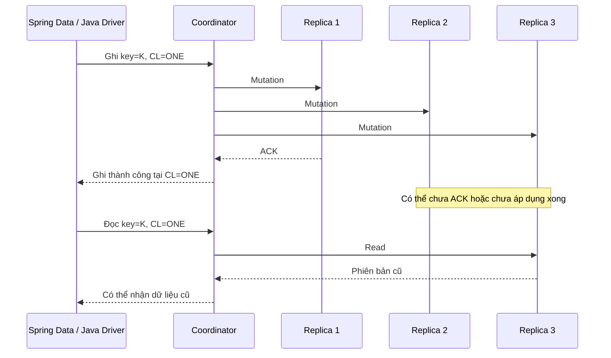
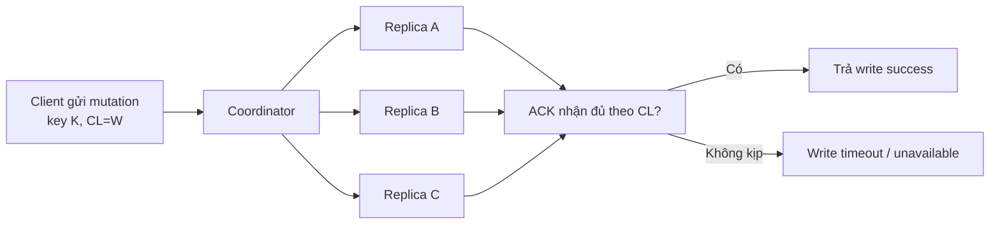
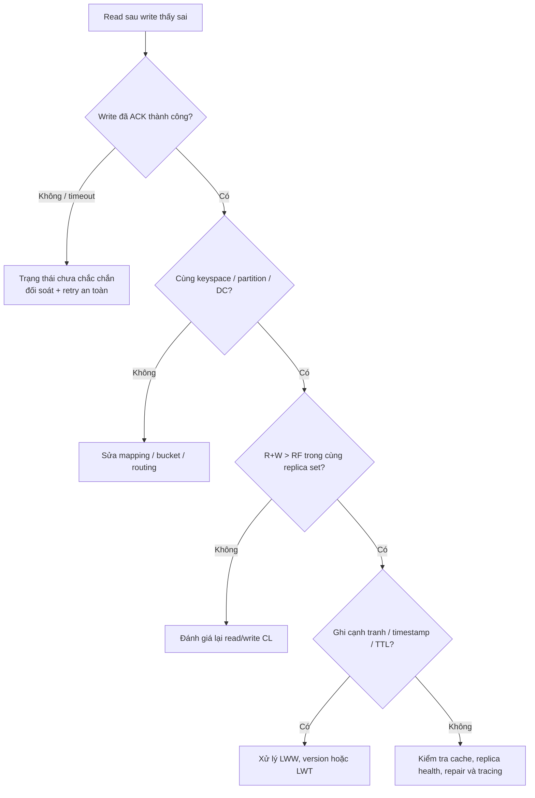

# Nhất quán cuối cùng và các điều kiện của việc đọc sau ghi

## 1. Bài toán: ghi thành công nhưng đọc ngay chưa thấy dữ liệu?

Hãy hình dung một dịch vụ Spring Boot sử dụng **Spring Data Cassandra** để lưu tên hiển thị của người dùng. API thực hiện:

1. Ghi `display_name = "An"` theo `user_id`.
2. Cassandra phản hồi thao tác ghi thành công.
3. API khác lập tức đọc lại cùng `user_id`, nhưng đôi khi vẫn thấy giá trị cũ.

Điều này nghe bất thường nếu quen với cơ sở dữ liệu quan hệ chạy trong một máy, nhưng có thể xảy ra khi thao tác đọc/ghi Cassandra dùng **consistency level (CL)** thấp và các bản sao (**replica**) chưa đồng bộ. Trong hệ phân tán, một ghi được xác nhận ở một số replica không có nghĩa **mọi replica** đã nhận và áp dụng giá trị ấy tại cùng thời điểm.

Đây là điểm xuất phát để hiểu:

- **Nhất quán cuối cùng (eventual consistency)**: nếu không có cập nhật mới, các replica còn hoạt động và được đồng bộ đầy đủ sẽ tiến tới cùng trạng thái theo cơ chế hòa giải của Cassandra. Không có một mốc thời gian cố định bảo đảm điều đó xảy ra với mọi sự cố.
- **Read-after-write / read-your-writes**: sau một ghi đã hoàn tất, một lượt đọc phụ thuộc cần nhìn thấy dữ liệu vừa ghi. Đây là **yêu cầu của luồng nghiệp vụ**, không phải bảo đảm mặc định của mọi tổ hợp CL.
- **Tunable consistency**: Cassandra cho phép chọn số replica phải phản hồi ở từng thao tác. Lựa chọn này đánh đổi giữa độ trễ, khả năng đáp ứng khi node lỗi và mức nhất quán mà ứng dụng có thể suy luận.
- **Last-write-wins (LWW)**: Cassandra hòa giải giá trị từng cell theo timestamp của mutation và các quy tắc liên quan, nên “ghi sau theo thời gian đồng hồ người dùng” chưa chắc là giá trị thắng.
- **Lightweight transactions (LWT)**: cơ chế ghi điều kiện dựa trên đồng thuận khi cần bảo vệ một số chuyển trạng thái cạnh tranh; chi phí và phạm vi của nó khác ghi thông thường.

Bài thuộc chương **Tính nhất quán** trong module `SPRING_DATA_CASSANDRA`: dùng entity mapping, repository, `CassandraTemplate` và CQL để làm việc đúng với dữ liệu phân tán, bên cạnh thiết kế partition key, paging và kiểm soát hiệu năng.

**Kết quả cần đạt:** Người học không chỉ nhớ công thức `R + W > RF`, mà còn biết **giả định của công thức**, chọn đúng CL theo topology/DC, xử lý timeout và retry, và kiểm thử hành vi đọc sau ghi trên cluster thật.

## 2. Mô hình bản sao, coordinator và đường ghi/đọc

Giả sử keyspace có **replication factor RF = 3** trong một data center. Theo partition key, một hàng có ba replica, ký hiệu `R1`, `R2`, `R3`.



Sơ đồ là **tình huống có thể xảy ra**, không phải lịch trình bắt buộc của mọi request.

Các điểm cần nhớ:

1. **Coordinator** tiếp nhận yêu cầu CQL, xác định replica theo token/partition key và phối hợp đọc/ghi.
2. **RF** quy định số bản sao dữ liệu mà topology/keyspace mong muốn duy trì cho partition; RF không phải số replica đã phản hồi thành công trong một request cụ thể.
3. **Write CL** quy định số replica cần ACK trước khi coordinator báo thành công cho client. Coordinator thường cố gắng gửi mutation đến các replica thích hợp, chứ không chỉ gửi cho đúng `W` replica.
4. **Read CL** quy định số phản hồi cần thiết để hoàn tất yêu cầu đọc. Coordinator có thể đối chiếu các bản sao, hòa giải giá trị theo quy tắc Cassandra; số phản hồi không tự nói dữ liệu có “mới nhất” theo đồng hồ nghiệp vụ hay không.
5. Một **replica tạm thời chậm hoặc mất liên lạc** có thể làm các lần đọc gần nhau quan sát những trạng thái khác nhau nếu CL cho phép hoàn tất bằng một tập replica nhỏ.
6. **Partition key** quyết định nơi dữ liệu nằm. CL không giúp tìm một bản ghi nếu câu query dùng sai partition key hoặc sai bucket ngày.

### Phân biệt những kiểu “nhất quán” dễ bị gộp làm một

| Thuật ngữ | Câu hỏi nó trả lời | Không nên suy diễn |
| --- | --- | --- |
| **Eventual consistency** | Các bản sao có thể hội tụ nếu cơ chế đồng bộ được thực hiện và sự cố được xử lý? | Không quy định độ trễ hội tụ tối đa trong mọi hoàn cảnh. |
| **Read-your-writes** | Một luồng đọc sau khi ghi thành công có thấy ít nhất giá trị vừa ghi? | Không mặc nhiên có ở mọi CL. |
| **Monotonic reads** | Một client đã thấy phiên bản mới có luôn tránh thấy phiên bản cũ ở lần đọc sau? | Không được bảo đảm chỉ vì repository giữ nguyên object Java. |
| **Quorum overlap** | Tập replica đọc và tập replica ACK ghi có ít nhất một replica chung? | Không phải transaction toàn cục hoặc sự đồng bộ đồng thời mọi replica. |
| **Linearizability** | Các thao tác có thể sắp theo một thứ tự duy nhất tôn trọng thứ tự thời gian thực? | Không suy ra từ `QUORUM` thông thường cho mọi trường hợp. |
| **LWT conditional update** | Điều kiện ghi cạnh tranh có được phối hợp bằng cơ chế đồng thuận phù hợp? | Không tự biến nhiều partition/bảng thành một transaction ACID kiểu RDBMS. |

## 3. RF, CL và số replica cần phản hồi

### 3.1. Những consistency level cơ bản

| CL | Ý nghĩa đơn giản | Điểm cần lưu ý |
| --- | --- | --- |
| `ONE` | Một replica thích hợp phản hồi. | Có thể hoàn tất nhanh, nhưng đọc có thể gặp replica cũ. |
| `LOCAL_ONE` | Một replica tại **local DC** phản hồi. | Hữu ích cho truy cập ưu tiên DC gần; phụ thuộc cấu hình local DC của driver. |
| `QUORUM` | Đa số của RF cho operation theo phạm vi replica tương ứng. | Với tổng RF=3, quorum là 2; trong multi-DC cần tính toán theo total RF, không đồng nhất với local quorum. |
| `LOCAL_QUORUM` | Đa số replica trong **local DC**. | Với local RF=3, cần 2 replica tại local DC. |
| `ALL` | Tất cả replica cần phản hồi. | Độ khả dụng kém khi một replica chậm hoặc lỗi. |
| `EACH_QUORUM` | Quorum ở từng DC, chủ yếu dùng cho thao tác ghi phù hợp. | Không phải lựa chọn mặc định cho read; cần hiểu ràng buộc operation. |
| `ANY` | Mức dành cho ghi, có thể thỏa bằng hinted write trong trường hợp đặc biệt. | **Không** mang lại bảo đảm read-after-write; không dùng làm read CL. |

Đối với một DC với RF = 3:

```text
RF = 3
QUORUM = floor(3 / 2) + 1 = 2
LOCAL_QUORUM = 2 (khi local RF cũng bằng 3)
```

Nếu RF = 5, quorum = 3. Nếu lab RF = 1, quorum = 1, không có cơ chế chịu lỗi của cụm ba replica.

### 3.2. RF và CL nằm ở đâu trong cấu hình?

**RF nằm ở keyspace/schema của Cassandra**:

```sql
-- CHỈ cho lab một node DC=dc1:
CREATE KEYSPACE IF NOT EXISTS learning
WITH replication = {
    'class': 'NetworkTopologyStrategy',
    'dc1': 1
};
```

Trong một cluster thử nghiệm **ít nhất ba node hoạt động trong dc1**, keyspace với RF=3 có thể được thiết kế bằng chính sách replication tương ứng:

```sql
-- CHỈ áp dụng khi cluster dc1 có đủ node và topology phù hợp.
-- Không chạy RF=3 trên lab một node rồi kỳ vọng quorum 2/3.
CREATE KEYSPACE IF NOT EXISTS learning_rf3
WITH replication = {
    'class': 'NetworkTopologyStrategy',
    'dc1': 3
};
```

Khi thay đổi RF trên keyspace đã có dữ liệu, cần quy trình đồng bộ/repair và đối chiếu placement; không coi sửa DDL là đã tự động sao chép đúng toàn bộ dữ liệu cũ.

**CL nằm ở thao tác đọc/ghi** qua CQL client, Spring Data hoặc Java Driver. Thay CL của một request **không sửa RF**, không tạo thêm replica và không tự chuyển một partition sang data center khác.

## 4. Điều kiện giao nhau của quorum: R + W > RF

Đặt:

- `RF`: số replica của partition trong **phạm vi đang xét**.
- `W`: số replica xác nhận một ghi thành công.
- `R`: số replica tham gia phản hồi thành công cho thao tác đọc.

Trong một mô hình đơn giản **một DC, replica set ổn định**, hai tập kích thước `W` và `R` trên cùng `RF` phần tử **bắt buộc giao nhau** nếu:

\[
R + W > RF
\]

Tại sao? Nếu hai tập không giao nhau, chúng có tổng kích thước tối đa `RF`. Khi tổng vượt `RF`, ít nhất một replica thuộc cả hai tập.

### 4.1. Ví dụ một DC, RF = 3

| Write CL | W | Read CL | R | W + R | Có giao nhau bắt buộc? |
| --- | ---: | --- | ---: | ---: | --- |
| `ONE` | 1 | `ONE` | 1 | 2 | **Không** |
| `ONE` | 1 | `QUORUM` | 2 | 3 | **Không** |
| `QUORUM` | 2 | `ONE` | 1 | 3 | **Không** |
| `QUORUM` | 2 | `QUORUM` | 2 | 4 | **Có** |
| `ALL` | 3 | `ONE` | 1 | 4 | **Có**, nhưng ghi cần tất cả replica |
| `ONE` | 1 | `ALL` | 3 | 4 | **Có**, nhưng đọc cần tất cả replica |

**Điểm hay nhầm:** `1 + 2 = 3` **không đủ** vì điều kiện cần là `> 3`, không phải `>= 3`.

Với `QUORUM + QUORUM`, sau một ghi được xác nhận, lượt đọc quorum trên **cùng replica set** buộc quan sát ít nhất một replica đã ACK. Trong điều kiện thích hợp, reconciliation của Cassandra có thể chọn mutation vừa ghi thay vì giá trị cũ.

### 4.2. Công thức là điều kiện tập hợp, không phải phép màu

Câu “`R + W > RF` bảo đảm read-after-write” chỉ chính xác khi nêu rõ **các giả định**:

1. Ghi đã **nhận ACK thành công** ở write CL đã chọn; không phải trạng thái timeout không xác định.
2. Đọc cùng **primary key / partition / column** mà ghi tác động; keyspace và routing nhất quán.
3. Tập replica được xét là **cùng một tập** (hoặc các tập có giao nhau theo thiết kế), không lẫn local quorum từ hai DC khác nhau.
4. Không có một ghi mới **cạnh tranh** đã thay đổi giá trị, hoặc một mutation có timestamp **cao hơn** khiến giá trị khác thắng theo hòa giải.
5. Đồng hồ/timestamp của các writer được quản lý phù hợp, không có mutation cũ mang timestamp tương lai và đè lên cập nhật mới.
6. Dữ liệu chưa bị xóa hoặc hết hạn TTL theo đúng nghiệp vụ; không có rủi ro tombstone/repair chưa được kiểm soát.
7. Đọc thật sự hoàn tất theo CL mong muốn, không bị ứng dụng trả dữ liệu từ **cache** ngoài Cassandra mà thiếu cơ chế invalidation.

Vì vậy, `R + W > RF` mô tả **giao nhau của tập phản hồi**, chứ **không phải một cơ chế khóa hay transaction tuyến tính giữa mọi client**.

### 4.3. Multi-DC: không lấy tổng một cách máy móc

Giả sử keyspace có:

```text
dc1: RF = 3
dc2: RF = 3
tổng RF = 6
```

Một ghi ở `LOCAL_QUORUM` của `dc1` cần 2 replica **trong dc1**. Một đọc ở `LOCAL_QUORUM` tại **dc2** cần 2 replica **trong dc2**. Hai tập này **không bắt buộc giao nhau**, mặc dù cả hai thao tác đều được gọi là “local quorum”.

Hệ quả:

- **Cùng DC**, `LOCAL_QUORUM` ghi và `LOCAL_QUORUM` đọc (local RF=3) có giao nhau trong phạm vi DC ấy, dưới các giả định phần trên.
- **Khác DC**, không suy luận read-after-write tức thời từ hai local quorums riêng biệt; replication giữa DC có thể chưa bắt kịp.
- `QUORUM` toàn cụm và `LOCAL_QUORUM` là hai lựa chọn khác phạm vi/độ trễ/khả dụng. Cần thiết kế theo topology thực tế và nơi ứng dụng được phép đọc/ghi.

Không cố “sửa” một ứng dụng multi-DC bằng cách tăng CL bừa bãi; hãy xác định **cặp operation ghi/đọc** nào phải nhìn thấy nhau và DC nào chịu trách nhiệm cho luồng đó.

## 5. Đường ghi của Cassandra và những gì ACK thực sự chứng minh

Một mutation bình thường đi qua coordinator tới các replica tương ứng. Replica ghi vào cấu trúc lưu trữ như commit log/memtable theo cơ chế engine và trả phản hồi khi đã xử lý đủ điều kiện của operation.



Một số hiểu lầm cần tránh:

- **ACK tại CL=ONE** chứng minh request đạt ngưỡng phản hồi một replica thích hợp; nó **không chứng minh cả RF replica đã áp dụng**.
- **ACK tại CL=QUORUM** chứng minh ngưỡng quorum phù hợp đã xác nhận; các replica còn lại vẫn có thể chậm.
- **ACK tại CL=ALL** giảm khả năng hoàn tất khi một node lỗi; không làm ghi trở thành một transaction nhiều bảng theo chuẩn ACID.
- **Write timeout** nghĩa là client không nhận đủ xác nhận trong thời gian chờ, **không** chứng minh không replica nào đã ghi. Một request có thể đã thay đổi dữ liệu một phần hoặc đủ nhưng phản hồi tới client bị trễ.
- Một write thành công cũng không loại trừ **cập nhật đồng thời** với cùng khóa. Quy tắc hòa giải theo timestamp có thể khiến giá trị quan sát được khác giá trị business “vừa gửi”.

### Cơ chế giúp replica hội tụ

Cassandra có nhiều cơ chế xử lý replica lệch nhau, tùy phiên bản/cấu hình, chẳng hạn:

- **Hinted handoff**: ghi lại hint trong một số tình huống replica tạm thời không nhận được mutation, rồi cố chuyển lại khi phù hợp. Hints có giới hạn thời gian/khả năng và **không thay thế anti-entropy repair**.
- **Read reconciliation/read repair**: khi đọc nhiều replica, coordinator có thể phát hiện khác biệt và xử lý theo chiến lược/version/schema. Đừng mặc định mọi `SELECT` đều sửa mọi replica.
- **Anti-entropy repair** (ví dụ quy trình `nodetool repair`): đồng bộ những khác biệt giữa replica, đặc biệt cần thiết khi node mất liên lạc lâu hoặc hint hết thời hạn.
- **Tombstone/TTL và compaction**: góp phần xử lý xóa/giữ dữ liệu, nhưng compaction **không thay thế repair**; quản lý sai thời hạn xóa và repair có thể dẫn đến dữ liệu cũ xuất hiện lại trong những điều kiện nhất định.

Nhất quán cuối cùng là một đặc điểm hệ thống cần **vận hành tốt**: không phải lời hứa rằng replica lỗi nhiều ngày vẫn tự hồi phục dữ liệu đầy đủ mà không cần quy trình repair/recovery.

## 6. Đường đọc: tại sao ONE có thể thấy cũ, QUORUM giúp gì?

### 6.1. Một ví dụ với hai lần đọc

Trước ghi, ba replica đều có:

```text
K = { display_name: "Tên cũ" }
```

Sau ghi `"Tên mới"` được xác nhận ở CL `ONE`, trạng thái tạm thời có thể là:

| Replica | Giá trị đang có |
| --- | --- |
| `R1` | `Tên mới` |
| `R2` | `Tên cũ` |
| `R3` | `Tên cũ` |

Đọc `ONE` từ `R2` có thể thấy `Tên cũ`; đọc `ONE` từ `R1` thấy `Tên mới`. Việc “request thứ hai xảy ra sau request thứ nhất” tại application không ép hai request truy cập cùng replica.

Nếu write `QUORUM` thành công tại `R1` và `R2`, rồi read `QUORUM` thành công từ bất kỳ hai replica nào trong cùng replica set, chúng có ít nhất một replica chung đã ACK. Read reconciliation có cơ sở chọn giá trị mới **nếu đây là mutation thắng theo timestamp và không có ghi cạnh tranh**.

### 6.2. Không được dùng cache cũ để kết luận Cassandra nhất quán sai

Đường trả dữ liệu có thể bao gồm:

```text
HTTP -> API cache -> Service -> Repository -> Java Driver -> Cassandra
```

Nếu API đọc từ Redis, cache trong JVM, CDN hay bản sao tìm kiếm được cập nhật bất đồng bộ, tăng Cassandra read CL **không cập nhật cache**. Khi chẩn đoán read-after-write, cần xác định request có thật sự đi tới Cassandra và qua cùng keyspace/query hay không.

### 6.3. Đọc nhiều cột và nhiều partition là vấn đề khác

Cassandra hòa giải mutation ở mức dữ liệu/cell theo timestamp, không cung cấp mặc định một snapshot transaction toàn cục cho mọi cột, bảng và partition. Ví dụ cập nhật hồ sơ ở bảng A rồi cập nhật bảng phục vụ tìm kiếm ở bảng B: một reader có thể thấy A đã cập nhật nhưng B vẫn cũ.

Read quorum cho **một hàng** không biến hai cập nhật ở hai bảng thành thao tác nguyên tử chung. Nếu cần đồng bộ nhiều read model, thiết kế trạng thái, event-driven projection, idempotency và reconciliation thích hợp.

## 7. Timestamp của mutation và last-write-wins: một nguyên nhân gây hiểu nhầm

Cassandra dùng **write timestamp** cho các cell để giải quyết các mutation cạnh tranh. Thông thường timestamp được biểu diễn theo microseconds ở tầng CQL write time, khác với giá trị cột CQL `timestamp` (thường có độ chính xác milliseconds).

Giả sử:

1. Writer A tạo mutation `display_name = "A"` với write timestamp **lớn**.
2. Writer B đến sau ở thời gian thực nhưng ghi `display_name = "B"` với write timestamp **nhỏ hơn** do đồng hồ lệch hoặc application cung cấp timestamp cũ.
3. Replica hòa giải các mutation và **"A" có thể thắng**, dù B nhận write ACK hợp lệ.

```text
Thứ tự thực:    A -----------------> B
Write timestamp: 2_000_000          1_999_000

Giá trị thắng theo timestamp: có thể là A
```

Vì vậy:

- `updated_at` là cột dữ liệu do ứng dụng ghi, **không** tự đồng nhất với write timestamp mà Cassandra dùng hòa giải.
- `QUORUM` có thể giúp reader thấy mutation đã ACK và được chọn theo quy tắc reconciliation; nó **không tự sửa clock skew**.
- Tránh dùng thời gian máy client không đồng bộ để quyết định phiên bản của dữ liệu quan trọng.
- Nếu cần **thứ tự cập nhật theo điều kiện phiên bản**, xem xét `@Version`/optimistic locking và LWT trên đường persistence được hỗ trợ, thay vì chỉ tăng CL.
- Khi backfill dữ liệu cũ bằng `USING TIMESTAMP`, phải kiểm tra ảnh hưởng đến các ghi mới: một timestamp “tương lai” có thể khiến giá trị cũ tiếp tục thắng về sau.

### Không nhầm ba loại thời gian

| Loại | Ví dụ | Vai trò |
| --- | --- | --- |
| **Write timestamp** | CQL `WRITETIME(display_name)` | Hòa giải các giá trị cell theo quy tắc Cassandra. |
| **CQL timestamp column** | `updated_at timestamp` | Dữ liệu nghiệp vụ mô tả thời điểm; không phải cơ chế CAS. |
| **Application time** | `Instant.now()` | Đồng hồ nơi code chạy; có thể lệch giữa các instance. |

Nếu dùng một cột `occurred_at` làm clustering key trong bảng sự kiện, đó lại là **định danh/thứ tự hàng theo schema**, không phải cơ chế giải quyết đồng thời các write vào cùng cell. Một value có thời gian mới nhất theo nghiệp vụ không nhất thiết là mutation có write timestamp lớn nhất.

## 8. Điều kiện cụ thể để thiết kế read-after-write

Dưới đây là checklist theo thứ tự dành cho một API **ghi xong đọc lại cùng khóa**.

### Điều kiện A — Ghi đã hoàn tất thật sự

Không chỉ gửi lệnh ghi bất đồng bộ rồi đọc ngay khi `Future` chưa hoàn tất. Cần chờ kết quả write thành công ở CL yêu cầu trước khi phụ thuộc vào nó:

```text
Sai:
asyncWrite(K, V);
read(K);              // Có thể chạy trước khi write hoàn tất

Đúng về thứ tự gọi:
await write(K, V);    // Kiểm tra result/error
read(K);              // Tiếp tục xét CL và các điều kiện còn lại
```

Với reactive Spring Data, phải **compose** publisher thay vì tách hai `subscribe()` độc lập không có thứ tự. Đúng thứ tự ứng dụng là điều kiện cần, nhưng **chưa đủ** để có bảo đảm read-after-write trên các replica.

### Điều kiện B — Chọn cặp CL có giao nhau

Trong một DC ổn định RF = 3, một chính sách thường được cân nhắc là:

```text
write CL = LOCAL_QUORUM   -> W = 2 ở dc1
read  CL = LOCAL_QUORUM   -> R = 2 ở dc1
W + R = 4 > RF(local) = 3
```

Cặp CL cần áp dụng **thực sự lên từng statement**. Không chỉ đặt CL cho lệnh đọc mà quên lệnh ghi, hoặc giả định repository tự truyền CL từ request trước sang request sau.

### Điều kiện C — Đọc đúng cùng định danh dữ liệu

Phải nhất quán:

- Keyspace và tên bảng.
- Partition key, kể cả **mọi thành phần** của composite partition key.
- Clustering key nếu truy cập một hàng cụ thể.
- Quy tắc tính bucket ngày/tháng và múi giờ.
- Column mapping và converter; kiểm tra `UUID`, `LocalDate`, `Instant` và `BigDecimal` tương ứng.

Sai bucket/ngày khiến truy vấn nhắm sang partition khác; không CL nào sửa được.

### Điều kiện D — Không có writer cạnh tranh làm thay đổi dữ liệu mong đợi

Nếu một writer khác ghi cùng key giữa thao tác ghi và đọc, kết quả có thể phản ánh **mutation cạnh tranh**. Đọc “giá trị mình vừa ghi” phải được định nghĩa theo nghiệp vụ: có chấp nhận phiên bản mới hơn từ tác nhân khác hay cần từ chối xung đột?

Nếu không chấp nhận lost update, dùng conditional write/version, không chỉ dựa vào read-after-write dưới quorum.

### Điều kiện E — Timestamp, TTL, cache, replica topology được kiểm soát

Cần xét:

- Write timestamp hợp lý, không lệch đồng hồ nghiêm trọng.
- Cột chưa hết hạn TTL, chưa bị DELETE hợp lệ.
- Không có cache/consumer trung gian trả dữ liệu cũ.
- Local DC và RF được định nghĩa đúng.
- Không thay đổi topology/replica placement trong lúc test mà không kiểm soát bootstrap/repair.

### Điều kiện F — Có cách xử lý timeout và lỗi bất định

Nếu ghi timeout, luồng đọc sau đó không có một tiền đề “ghi đã thành công”. Cần kiểm tra lại trạng thái theo ID nghiệp vụ, áp dụng retry/backoff có giới hạn hoặc phương án đối soát.

**Tóm lại:** cặp `LOCAL_QUORUM/LOCAL_QUORUM` trong một DC là lựa chọn giúp tăng khả năng suy luận read-after-write, **nhưng vẫn phải kiểm soát các điều kiện A–F**.

## 9. Lab CQL: thử đọc/ghi theo từng consistency level

### 9.1. Bảng demo một hàng theo ID

Tạo bảng trong keyspace `learning` được cấu hình từ phần 3:

```sql
CREATE TABLE IF NOT EXISTS learning.profile_by_user (
    user_id uuid PRIMARY KEY,
    display_name text,
    updated_at timestamp
);

INSERT INTO learning.profile_by_user
    (user_id, display_name, updated_at)
VALUES (
    11111111-1111-1111-1111-111111111111,
    'Tên ban đầu',
    '2026-11-25T01:00:00Z'
);

SELECT user_id, display_name, updated_at
FROM learning.profile_by_user
WHERE user_id = 11111111-1111-1111-1111-111111111111;
```

Các thao tác trên dùng **một partition key đơn**. Khi lab chỉ có RF = 1 và một node, bạn kiểm tra được cú pháp, mapping và lựa chọn CL, nhưng **không thể mô phỏng replica chậm hoặc quorum 2/3**.

### 9.2. Cách đặt CL trong cqlsh

`cqlsh` có lệnh shell riêng để chọn CL cho các statement sau:

```text
CONSISTENCY LOCAL_ONE;
CONSISTENCY LOCAL_QUORUM;
CONSISTENCY QUORUM;
```

Các dòng này là **lệnh của cqlsh**, không phải biểu thức `WHERE` hay thuộc tính schema. Sau khi chọn CL, thực thi `INSERT`/`UPDATE`/`SELECT` bình thường.

Ví dụ:

```sql
UPDATE learning.profile_by_user
SET display_name = 'Tên mới',
    updated_at = '2026-11-25T02:00:00Z'
WHERE user_id = 11111111-1111-1111-1111-111111111111;

SELECT display_name, updated_at
FROM learning.profile_by_user
WHERE user_id = 11111111-1111-1111-1111-111111111111;
```

Khi `RF=1` và node duy nhất còn hoạt động, `LOCAL_ONE` và `LOCAL_QUORUM` đều cần một replica. Kết quả đọc ngay sau ghi trong lab một node **không phải chứng cứ đủ** về eventual consistency trên cluster RF=3.

### 9.3. Muốn quan sát replica lệch nhau thì cần cluster nhiều node

Trong **môi trường thử nghiệm được cấp riêng**, có ít nhất ba node trong cùng DC và keyspace `RF=3`:

1. Tạo một hàng ở trạng thái ban đầu và xác nhận cả ba replica đã đồng bộ.
2. Ghi `display_name` bằng `LOCAL_ONE`, ghi lại ACK, nơi ứng dụng đọc và CL của từng request.
3. Tạo tình huống replica chậm/mất kết nối **chỉ nếu lab cho phép**, rồi đọc ở `LOCAL_ONE` và ghi nhận sự khác nhau có thể xảy ra.
4. Đồng bộ/khôi phục node theo runbook vận hành, quan sát khi dữ liệu hội tụ.
5. Lặp lại với ghi `LOCAL_QUORUM` và đọc `LOCAL_QUORUM`, đối chiếu điều kiện tập replica giao nhau và latency.
6. Thử trường hợp ghi đồng thời, TTL hoặc timeout **có kiểm soát** để minh họa giới hạn của công thức.

Không chủ động ngắt node hoặc thay RF trong cluster dùng chung/production chỉ để làm bài tập. Failure injection phải có kế hoạch và quyền điều phối của nhóm vận hành.

## 10. Spring Data Cassandra: đặt CL cho lệnh đọc bằng QueryOptions

Với **Spring Boot 3.x** và starter Spring Data Cassandra:

```groovy
dependencies {
    implementation 'org.springframework.boot:spring-boot-starter-data-cassandra'
}
```

Một cấu hình lab cơ bản:

```yaml
spring:
  cassandra:
    contact-points: 127.0.0.1
    port: 9042
    local-datacenter: dc1
    keyspace-name: learning
    schema-action: NONE
```

`schema-action: NONE` giữ schema do CQL/migration quản lý. Nếu app chạy trong Docker container khác, `127.0.0.1` trỏ về container ứng dụng; dùng hostname service phù hợp trong Docker network. Chọn local DC khớp `system.local`; không mặc định tên `dc1` cho mọi cluster.

### 10.1. Entity mapping

```java
package com.example.consistency.domain;

import java.time.Instant;
import java.util.UUID;

import org.springframework.data.cassandra.core.mapping.Column;
import org.springframework.data.cassandra.core.mapping.PrimaryKey;
import org.springframework.data.cassandra.core.mapping.Table;

@Table("profile_by_user")
public class UserProfile {

    @PrimaryKey("user_id")
    private UUID userId;

    @Column("display_name")
    private String displayName;

    @Column("updated_at")
    private Instant updatedAt;

    public UserProfile() { }

    public UUID getUserId() { return userId; }
    public String getDisplayName() { return displayName; }
    public Instant getUpdatedAt() { return updatedAt; }

    public void setUserId(UUID userId) { this.userId = userId; }
    public void setDisplayName(String displayName) { this.displayName = displayName; }
    public void setUpdatedAt(Instant updatedAt) { this.updatedAt = updatedAt; }
}
```

`updatedAt` ở đây là **dữ liệu hiển thị**, không phải một cột `@Version` và không bảo đảm compare-and-set. Nếu ứng dụng cần bảo vệ cập nhật cạnh tranh, phải chọn giải pháp khác ở phần 13.

### 10.2. Repository method nhận QueryOptions

```java
package com.example.consistency.repository;

import java.util.Optional;
import java.util.UUID;

import org.springframework.data.cassandra.core.cql.QueryOptions;
import org.springframework.data.cassandra.repository.CassandraRepository;
import org.springframework.data.cassandra.repository.Query;

import com.example.consistency.domain.UserProfile;

public interface UserProfileRepository
        extends CassandraRepository<UserProfile, UUID> {

    @Query(
        "SELECT user_id, display_name, updated_at " +
        "FROM profile_by_user WHERE user_id = ?0"
    )
    Optional<UserProfile> findWithOptions(
        UUID userId, QueryOptions options
    );
}
```

`QueryOptions` là **tham số đặc biệt** của Spring Data Cassandra, không bind thành `?1`. Nó cho phép áp dụng các lựa chọn thực thi như CL, page size hoặc timeout cho câu `@Query`.

Service:

```java
package com.example.consistency.service;

import java.time.Duration;
import java.util.Optional;
import java.util.UUID;

import com.datastax.oss.driver.api.core.DefaultConsistencyLevel;
import org.springframework.data.cassandra.core.cql.QueryOptions;

import com.example.consistency.domain.UserProfile;
import com.example.consistency.repository.UserProfileRepository;

public final class UserProfileLookup {

    private final UserProfileRepository repository;

    public UserProfileLookup(UserProfileRepository repository) {
        this.repository = repository;
    }

    public Optional<UserProfile> readAtLocalQuorum(UUID userId) {
        QueryOptions options = QueryOptions.builder()
            .consistencyLevel(DefaultConsistencyLevel.LOCAL_QUORUM)
            .timeout(Duration.ofSeconds(3))
            .build();

        return repository.findWithOptions(userId, options);
    }
}
```

**Quan trọng:** Code trên chỉ thể hiện **read CL**. Muốn đánh giá read-after-write, phải kiểm soát **write CL** của thao tác ghi tương ứng, không suy luận repository `save(...)` trước đó đã dùng cùng CL trừ khi được cấu hình/kiểm tra rõ.

## 11. Java Driver: kiểm soát rõ cả write CL và read CL

Một cách minh họa dễ kiểm chứng là thực hiện cả ghi và đọc qua `CqlSession` được Spring quản lý. Đoạn sau không bắt buộc thay repository trong toàn dự án; nó làm rõ **cặp CL** của hai statement.

```java
package com.example.consistency.gateway;

import java.time.Instant;
import java.util.Optional;
import java.util.UUID;

import com.datastax.oss.driver.api.core.CqlSession;
import com.datastax.oss.driver.api.core.DefaultConsistencyLevel;
import com.datastax.oss.driver.api.core.cql.PreparedStatement;
import com.datastax.oss.driver.api.core.cql.Row;

public final class ProfileGateway {

    private final CqlSession session;
    private final PreparedStatement upsert;
    private final PreparedStatement findById;

    public ProfileGateway(CqlSession session) {
        this.session = session;

        this.upsert = session.prepare(
            "INSERT INTO learning.profile_by_user " +
            "(user_id, display_name, updated_at) VALUES (?, ?, ?)"
        );

        this.findById = session.prepare(
            "SELECT user_id, display_name, updated_at " +
            "FROM learning.profile_by_user WHERE user_id = ?"
        );
    }

    public void write(UUID userId, String name, Instant updatedAt) {
        session.execute(
            upsert.bind(userId, name, updatedAt)
                .setConsistencyLevel(DefaultConsistencyLevel.LOCAL_QUORUM)
        );
    }

    public Optional<String> readName(UUID userId) {
        Row row = session.execute(
            findById.bind(userId)
                .setConsistencyLevel(DefaultConsistencyLevel.LOCAL_QUORUM)
        ).one();

        return row == null
            ? Optional.empty()
            : Optional.ofNullable(row.getString("display_name"));
    }
}
```

Luồng gọi đồng bộ:

```java
UUID userId = UUID.fromString(
    "11111111-1111-1111-1111-111111111111"
);

gateway.write(userId, "Lan", Instant.now());
Optional<String> name = gateway.readName(userId);
```

**Điều gì được kiểm soát ở ví dụ?** Cả write và read đều đặt `LOCAL_QUORUM`. Trong cùng DC RF=3 với hai request thành công, cùng key, không có ghi cạnh tranh/timestamp bất thường, ta có cơ sở suy luận đọc sau ghi theo giao nhau quorum.

**Điều gì chưa được bảo đảm?** Nếu một writer khác cập nhật cùng key, hoặc ứng dụng có cache cũ, hoặc đọc ở DC khác, yêu cầu “trả đúng chuỗi Lan” có thể không được thỏa. Cũng không có transaction nhiều bảng, chỉ vì hai method nằm trong cùng Java class.

### Dùng @Consistency và cấu hình mặc định?

Tùy phiên bản Spring Data Cassandra, có thể đặt consistency ở annotation repository, options của `CassandraTemplate` hoặc driver execution profile. Nhưng **không nên trộn nhiều nguồn chính sách mà không xác định precedence**.

Với một luồng phụ thuộc read-after-write, cần tài liệu hóa **hai statement thực sự gửi đi** và CL của cả hai, rồi test behavior theo RF/DC thực tế. Nếu hệ thống có nhiều đường ghi cùng bảng (repository, template, driver, batch job), phải đảm bảo các đường đó không vô tình bỏ qua chính sách.

## 12. Reactive, asynchronous và thứ tự thực thi

Một ứng dụng WebFlux/Reactive Cassandra có thể tạo hai publisher:

```java
Mono<Void> write = saveProfile(...);
Mono<UserProfile> read = findProfile(...);
```

Điểm cần hiểu: nếu hai publisher được **subscribe độc lập**, thứ tự thực thi không chắc chắn. Cần compose read sau khi write hoàn tất, ví dụ theo ý tưởng:

```java
return saveProfile(userId, value)
    .then(findProfile(userId));
```

Đoạn này là **pseudocode ở tầng service**: hai method cần trả đúng kiểu `Mono` và áp dụng chính sách CL cho operation tương ứng theo API thực tế.

Ngay cả khi `then(...)` bảo đảm thứ tự ở tầng reactive, **CL và các giả định quorum vẫn cần thỏa mãn**. Ngược lại, nếu CL đúng nhưng application gửi đọc trước khi write thành công, một lượt đọc sớm vẫn có thể thấy giá trị cũ.

Với asynchronous Java Driver, cần chain `CompletionStage`/future đúng thứ tự; không giả định callback chưa hoàn thành đã tương đương ACK.

## 13. Khi nào cần @Version hoặc LWT thay vì chỉ tăng CL?

### 13.1. Lost update và ghi đồng thời

Giả sử hai request đọc cùng trạng thái:

```text
Request A đọc version=7 -> muốn đổi tên thành "A"
Request B đọc version=7 -> muốn đổi tên thành "B"
A ghi thành công
B ghi thành công
```

Nếu cả hai dùng ghi CQL không điều kiện, Cassandra sẽ hòa giải theo write timestamp. Một yêu cầu có thể vô tình **ghi đè** thay đổi của yêu cầu kia dù cả hai có write/read CL=QUORUM.

Đây là lỗi **concurrency control**, không phải chỉ lỗi replication lag. Khi cần từ chối ghi dựa trên trạng thái đã thay đổi, cân nhắc:

- **Spring Data `@Version`** với đường persistence hỗ trợ optimistic locking, được kiểm thử trên phiên bản Spring Data Cassandra cụ thể.
- **LWT** với `IF NOT EXISTS` hoặc `IF version = ...` để ghi có điều kiện.
- Thiết kế event append-only/idempotency nếu phù hợp nghiệp vụ thay vì cập nhật mutable state liên tục.

### 13.2. CQL condition và kết quả [applied]

Ví dụ bảng lưu version riêng:

```sql
CREATE TABLE IF NOT EXISTS learning.profile_versioned_by_user (
    user_id uuid PRIMARY KEY,
    display_name text,
    version bigint
);

INSERT INTO learning.profile_versioned_by_user
    (user_id, display_name, version)
VALUES (
    11111111-1111-1111-1111-111111111111,
    'Bản đầu',
    1
) IF NOT EXISTS;
```

Khi đọc version `1` và muốn cập nhật sang `2`:

```sql
UPDATE learning.profile_versioned_by_user
SET display_name = 'Bản mới', version = 2
WHERE user_id = 11111111-1111-1111-1111-111111111111
IF version = 1;
```

Lệnh LWT trả kết quả điều kiện, thường có trường `[applied]`. Nếu hai writer cùng cố gắng chuyển từ `1` sang `2`, chỉ một update thỏa điều kiện tại thời điểm phối hợp; writer thất bại phải xử lý conflict hoặc đọc lại.

Ví dụ đọc kết quả bằng Java Driver:

```java
Row result = session.execute(
    conditionalUpdate.bind(
        "Bản mới", 2L, userId, 1L
    )
).one();

boolean applied =
    result != null && result.getBoolean("[applied]");
```

`conditionalUpdate` trong đoạn trên là `PreparedStatement` tương ứng câu CQL `UPDATE ... IF version = ?` được chuẩn bị trước; ví dụ tập trung vào cách đọc trạng thái `[applied]`, không phải class Java đầy đủ.

**LWT dùng protocol đồng thuận** và có thêm độ trễ/chi phí so với ghi thông thường. Normal consistency và **serial consistency** (như `SERIAL`/`LOCAL_SERIAL`) có phạm vi khác nhau; phải thiết kế cả hai nếu dùng operation điều kiện. LWT chỉ cung cấp các bảo đảm trong phạm vi thao tác/partition được hỗ trợ, không biến mọi bảng thành transaction quan hệ.

### 13.3. @Version không bảo vệ những đường CQL bỏ qua version

Nếu repository dùng `@Version` nhưng job backfill hoặc `CqlSession` chạy `UPDATE` thường, job đó có thể bỏ qua điều kiện version mà code repository dựa vào. Khi thiết kế optimistic locking, mọi writer cùng dữ liệu cần tuân thủ quy tắc bảo vệ tương ứng, hoặc được phân loại rõ những writer được phép ghi ngoài cơ chế version.

## 14. Timeout, retry và idempotency trong read-after-write

### 14.1. Ghi timeout: có thể đã ghi rồi

Nếu client gọi:

```text
write(K, V) -> WriteTimeout
```

đừng kết luận hàng chưa có. Coordinator có thể chưa nhận đủ ACK theo CL dù một số replica đã áp dụng mutation. Retry với **ID mới** cho cùng sự kiện nghiệp vụ có thể tạo bản ghi trùng.

Một quy trình an toàn hơn:

1. Ghi log/tracing có request ID và query fingerprint (tránh log PII thô).
2. Giữ **ID/idempotency key ổn định** theo một thao tác nghiệp vụ.
3. Quy định retry có giới hạn/backoff theo loại statement và tính idempotent đã được đánh giá.
4. Khi kết quả không chắc chắn, dùng readback/đối soát có CL phù hợp hoặc conditional write theo nghiệp vụ.
5. Không dùng kết quả đọc `null` ở CL thấp để kết luận tuyệt đối rằng ghi chưa xảy ra.
6. Khi có LWT, kiểm tra `[applied]`; timeout của LWT cần chiến lược xác minh/khôi phục riêng.

### 14.2. Đọc timeout không giống “hàng không tồn tại”

`ReadTimeout`/`Unavailable` mang nghĩa **không lấy được một kết quả thành công theo điều kiện CL/thời gian**, không phải giá trị `Optional.empty()`. Ở tầng API phải phân biệt:

| Kết quả | Ý nghĩa |
| --- | --- |
| Query thành công, không có hàng | Không tìm thấy hàng theo CL/query đã dùng tại thời điểm đó. |
| Query thành công, có hàng giá trị cũ | Có thể do CL, mutation cạnh tranh, timestamp, TTL, cache hoặc sai key/bucket. |
| `ReadTimeout` | Không đủ kết quả trong hạn định; **không biết** giá trị đúng chỉ từ lỗi này. |
| `Unavailable` | Không đủ replica sẵn sàng theo CL; thay đổi CL sẽ đổi trade-off availability/correctness. |
| `WriteTimeout` | Không có đủ write ACK trong hạn định; mutation có thể đã được áp dụng một phần. |

Không bắt mọi exception Cassandra rồi trả HTTP `404`: như vậy đã biến **lỗi nhất quán/khả dụng** thành dữ liệu “không tồn tại”.

### 14.3. Idempotent không phải một nhãn trang trí

Với Java Driver, `BoundStatement.setIdempotent(true)` là một **lời khẳng định của ứng dụng** để driver có thể áp dụng retry/speculative execution theo policy. Nó không biến một phép tăng counter hay một ghi tạo ID mới thành idempotent.

Các ví dụ:

- `SELECT` theo primary key thường không làm mutation nên có thể coi là idempotent.
- Ghi lại cùng một hàng với cùng dữ liệu/ID có thể có tính chất retry thích hợp **nếu** đã xem xét timestamp, TTL, ghi đồng thời và semantics của mutation.
- `UPDATE counter = counter + 1` không idempotent khi thực thi nhiều lần.
- Với `INSERT ... IF NOT EXISTS`, retry cần kiểm tra phản hồi điều kiện và ID ổn định; không tự nhận “lần đầu thất bại” khi lần sau `[applied]=false`.

## 15. Mối liên hệ với entity mapping, partition key và paging

### 15.1. Consistency không sửa schema truy vấn sai

Giả sử lưu sự kiện theo:

```sql
PRIMARY KEY ((tenant_id, event_day), occurred_at, event_id)
```

Đọc theo `tenant_id` mà thiếu `event_day` chưa xác định đầy đủ partition. Tăng read CL từ `LOCAL_ONE` lên `LOCAL_QUORUM` không bổ sung key bị thiếu.

Tương tự, nếu writer tính `event_day` theo UTC nhưng reader tính theo `Asia/Ho_Chi_Minh`, query sẽ vào **partition khác**. Đây là lỗi quy ước bucket/timezone; CL không thể cứu.

### 15.2. Paging không tạo snapshot nhất quán nhiều trang

Một API sử dụng `CassandraPageRequest`, `Slice` hoặc paging state của Java Driver sẽ thực hiện việc đọc theo từng đoạn. Trong khi client đang tải trang 2, các writer có thể thêm/sửa/xóa dữ liệu.

- Read CL có thể giúp tăng tính nhất quán replica **trong mỗi request**, nhưng không tạo **snapshot bất biến** của mọi trang.
- Paging state là token để tiếp tục query; nó không tự bảo đảm một tập kết quả không thay đổi theo thời gian.
- Keyset pagination theo đủ clustering key tránh lỗi offset/trùng timestamp trong nhiều trường hợp, nhưng vẫn không phải snapshot transaction.
- Nếu cần export/audit nhất quán, cân nhắc mô hình event bất biến, watermark/checkpoint, đóng băng tập dữ liệu hoặc pipeline chuyên dụng.

### 15.3. Consistency cao hơn có chi phí

| Lựa chọn | Có thể cải thiện | Chi phí / không cải thiện |
| --- | --- | --- |
| Ghi `LOCAL_QUORUM` | Nhiều local replica ACK hơn trước khi báo thành công. | Latency/availability có thể kém hơn `LOCAL_ONE`; không sửa clock skew. |
| Đọc `LOCAL_QUORUM` | Đọc/hòa giải từ quorum trong local DC. | Tốn phản hồi nhiều replica; không tạo transaction đa bảng. |
| `ALL` | Ngưỡng phản hồi cao. | Dễ không khả dụng nếu một replica chậm/lỗi; không dùng làm mặc định cho mọi endpoint. |
| `LWT` | Điều kiện ghi cạnh tranh được phối hợp. | Có thêm chi phí consensus, conflict và timeout; không dùng thay thiết kế data model. |
| Driver paging phù hợp | Giới hạn một đợt fetch. | Không làm thay đổi semantics của CL hoặc sửa query thiếu partition key. |

Do đó, phải đo p95/p99 latency, timeout rate, số retry, replica health và partition size trên workload thật, không chọn CL chỉ vì “số càng lớn càng tốt”.

## 16. Các kịch bản kiểm thử cần có

### 16.1. Ma trận chức năng

| Kịch bản | Thiết lập/đầu vào | Kết luận cần kiểm tra |
| --- | --- | --- |
| RF=1 lab | `LOCAL_ONE` write/read | Cú pháp và mapping hoạt động; **không** suy ra quorum 2/3. |
| RF=3, W=ONE R=ONE | Cùng partition, các replica có độ trễ khác nhau | Có thể đọc phiên bản cũ sau write ACK. |
| RF=3, W=ONE R=QUORUM | `1+2=3` | Không có bảo đảm giao nhau bắt buộc. |
| RF=3, W=QUORUM R=QUORUM | `2+2=4 > 3` | Có giao nhau trong một replica set ổn định; xét timestamp/concurrency. |
| RF=3, W=ALL R=ONE | `3+1=4 > 3` | Có giao nhau nhưng write availability giảm. |
| Multi-DC | Ghi `LOCAL_QUORUM` dc1, đọc `LOCAL_QUORUM` dc2 | Không mặc nhiên giao nhau giữa hai local DC. |
| Concurrent writers | Hai mutation cùng key | LWW có thể khác thứ tự business; test CAS/LWT nếu cần. |
| Client clock skew | Một mutation có write timestamp lớn bất thường | Ghi đến sau không chắc thắng nếu timestamp nhỏ hơn. |
| Write timeout | Giả lập lỗi ACK/network trong lab | Không coi timeout là “chưa ghi”. |
| Read timeout | CL không đạt trong hạn | Không biến timeout thành empty result/HTTP 404. |
| TTL/delete | Giá trị vừa ghi bị xóa/hết hạn | Read-after-write phải xét chính sách lưu giữ dữ liệu. |
| Cache cũ | Spring Data read không được gọi do cache hit | CL Cassandra không điều khiển dữ liệu cache. |
| Composite key | Reader dùng sai bucket theo zone | Không tìm thấy dù CL cao; cần sửa key/query. |
| Paging hai trang | Writer thêm dữ liệu giữa hai lần fetch | Không có snapshot tự động. |
| Conditional update | Hai writer đồng thời `IF version = ...` | Kiểm tra một thao tác bị từ chối và đọc `[applied]`. |

### 16.2. Thực hành một: chứng minh công thức tập hợp

Với ba replica `A`, `B`, `C`:

- Cho tập ACK ghi `{A, B}`.
- Liệt kê mọi tập đọc có hai replica: `{A, B}`, `{A, C}`, `{B, C}`.
- Xác nhận mọi tập đọc đều chứa ít nhất một phần tử chung với tập ACK ghi.
- Đặt tập ACK ghi chỉ `{A}`, rồi tìm tập đọc hai replica `{B, C}` không giao nhau.

**Kết luận cần viết ra:** giao nhau của tập replica giúp lý giải quorum reads; nó chưa đủ để bảo đảm thứ tự cập nhật trong trường hợp writer cạnh tranh.

### 16.3. Thực hành hai: kiểm tra CL trong Java

Dùng `ProfileGateway` ở phần 11:

1. Ghi một `display_name` với `LOCAL_ONE` trong lab RF=1, đọc lại cùng ID.
2. Chuyển cả write/read sang `LOCAL_QUORUM` và xác nhận thao tác vẫn chạy trên RF=1 (quorum local bằng 1).
3. Trên cluster thử nghiệm RF=3, quan sát response/latency khi một replica chậm theo kịch bản được phép.
4. Kiểm tra `QueryOptions` ở repository read đặt CL đúng như kế hoạch.
5. Chỉ kết luận những điều mà topology được dùng thật sự có thể kiểm chứng.

### 16.4. Thực hành ba: timeout và retry

Trong lab riêng, cố tình tạo một tình huống write timeout có kiểm soát. Ghi lại request ID, write CL, exception và trạng thái đọc sau đó. Thiết kế một flow retry **giữ cùng user ID/event ID**, có backoff và thời hạn, không cấp ID mới cho cùng một sự kiện nghiệp vụ.

Nếu không có lab nhiều node, hãy mô phỏng điều kiện timeout ở tầng unit test và **không** tuyên bố đó là kiểm chứng replication thực tế.

### 16.5. Thực hành bốn: mất cập nhật khi không có điều kiện

Khởi tạo `profile_versioned_by_user` version=1. Hai tiến trình đọc version=1 rồi cùng gửi `UPDATE ... IF version=1`. Kiểm tra `[applied]`; gọi lại thao tác từ trạng thái đã reload thay vì ghi đè không điều kiện.

So sánh với hai `UPDATE` CQL thông thường trên cùng key: cả hai có thể được Cassandra nhận như upsert, và bản ghi cuối cùng được hòa giải theo timestamp.

## 17. Lỗi thường gặp và quy trình chẩn đoán

| Triệu chứng | Nguyên nhân khả dĩ | Điều cần xác minh |
| --- | --- | --- |
| Vừa ghi xong nhưng đọc vẫn thấy cũ | W/R không giao nhau bắt buộc; replica lag; cache; mutation cạnh tranh. | Cùng keyspace/key/DC? CL thực tế? Cache? Write ACK? |
| Dùng `QUORUM` cho read mà vẫn thấy bất ngờ | Write `ONE`, hoặc nhiều DC, timestamp/cạnh tranh. | `R+W>RF` có đúng phạm vi không? |
| Ghi báo thành công nhưng một DC khác đọc cũ | Ghi/read ở hai DC bằng local quorum riêng biệt. | Topology và CL theo DC; chiến lược cross-DC. |
| CL cao hơn làm request timeout nhiều | Không đủ replica đáp ứng, network/replica chậm. | RF, DC, node health, request timeout, CL. |
| Tên đổi ngược về giá trị cũ | Mutation có write timestamp tương lai, client clock skew, writer cạnh tranh. | `WRITETIME(column)` và timestamp nguồn; mọi đường ghi. |
| Thêm `@Version` nhưng hàng cũ không update được | Legacy row có version null, hoặc đường ghi khác bypass version. | Schema/backfill, Spring Data version mapping, LWT exceptions. |
| Ghi timeout, retry tạo hai sự kiện | Cấp UUID mới cho cùng business event. | Idempotency key và retry flow. |
| API trả `404` khi cluster lỗi | Bắt mọi exception thành Optional.empty. | Tách not-found, timeout, unavailable, invalid query. |
| Không thấy sự kiện theo ngày | Partition key/bucket zone khác khi ghi và đọc. | Quy tắc tính bucket, LocalDate, ZoneId. |
| Trang 2 lặp hoặc mất hàng | Paging state không khớp query hoặc keyset cursor thiếu clustering key. | CQL, sort, token, thời gian và dữ liệu đồng thời. |
| Truy vấn đọc quá chậm | Partition lớn, nhiều tombstone, CL cao, nhiều trang. | Metrics query/cluster, limit/page size, thiết kế bảng. |
| Replica lỗi lâu, dữ liệu không hội tụ | Hints không đủ, repair thiếu, tombstone/TTL quản lý sai. | Runbook repair, vòng đời node, thời hạn xóa và retention. |

### Quy trình khoanh vùng theo thứ tự



Nhìn vào **dữ liệu thực sự đã được gửi tới Cassandra**, không chỉ biến Java. Thông tin hữu ích gồm query fingerprint, keyspace, partition key đã băm/ẩn khi nhạy cảm, RF/CL, DC, mã lỗi, thời gian ACK, version/write timestamp và việc request có đi qua cache hay không. Tránh log nguyên bản dữ liệu cá nhân hoặc credentials.

## 18. Checklist khi thiết kế read-after-write

- [ ] Đã xác định **cặp ghi/đọc phụ thuộc** cần thấy nhau, cùng bảng/khóa và quy tắc mapping.
- [ ] RF/keyspace và DC được hiểu từ topology thực tế, không suy ra từ môi trường lab một node.
- [ ] Write CL và read CL được cấu hình rõ cho **cả hai statement**, không chỉ một bên.
- [ ] Nếu dựa vào quorum overlap, đã kiểm tra `R + W > RF` **trong cùng replica set/phạm vi DC**.
- [ ] Write hoàn tất thành công trước khi bắt đầu read phụ thuộc, kể cả với async/reactive.
- [ ] Tính đến concurrent writes, write timestamp/LWW, clock skew và tombstone/TTL.
- [ ] Không nhầm quorum overlap với linearizability hoặc transaction nhiều partition.
- [ ] Các writer sử dụng ID/idempotency key ổn định và chính sách retry/backoff có giới hạn.
- [ ] Write timeout được xem là trạng thái có thể **không chắc chắn**, không mặc định “chưa ghi”.
- [ ] Read timeout/unavailable không bị biến thành kết quả rỗng hoặc `404`.
- [ ] Cache, read model khác bảng và replication cross-DC có chính sách cập nhật/quan sát riêng.
- [ ] Khi cần bảo vệ cập nhật cạnh tranh, đã đánh giá `@Version`/LWT và chi phí của chúng.
- [ ] Schema theo query pattern, partition key/bucket, clustering order và paging được thiết kế riêng.
- [ ] Có quy trình vận hành hinted handoff/anti-entropy repair, TTL/tombstone và theo dõi replica health.
- [ ] Test đúng với topology nhiều node và failure scenario trong **môi trường được phép**, không dựa chỉ vào unit test.
- [ ] Các trade-off latency, availability và consistency đã được đo/giải thích theo SLO nghiệp vụ.

## 19. Tài liệu tham khảo

- [Apache Cassandra — Dynamo / Architecture](https://cassandra.apache.org/doc/latest/cassandra/architecture/dynamo.html): replication, consistency và cơ chế đọc/ghi của Cassandra.
- [Apache Cassandra — Consistency](https://cassandra.apache.org/doc/latest/cassandra/architecture/guarantees.html): bảo đảm nhất quán và điều kiện của các thao tác phân tán.
- [Apache Cassandra — Data Manipulation](https://cassandra.apache.org/doc/latest/cassandra/developing/cql/dml.html): CQL INSERT/UPDATE/SELECT và conditional statements.
- [Spring Data Cassandra — Cassandra repositories](https://docs.spring.io/spring-data/cassandra/reference/cassandra/repositories/query-methods.html): repository `@Query` và `QueryOptions`.
- [Java Driver 4.x — Statements](https://apache.github.io/cassandra-java-driver/4.18.0/core/statements/): cấu hình bound statement, consistency và timeout.

Các đường dẫn tham khảo giúp tra cứu thêm; khi áp dụng vào dự án, phải đối chiếu **phiên bản Cassandra, Spring Data Cassandra, Spring Boot và Java Driver** thực tế đang dùng.

**Kết luận:** Cassandra hỗ trợ **nhất quán cuối cùng với mức nhất quán tùy chỉnh**, nên việc đọc ngay sau ghi **không tự động có cùng bảo đảm trong mọi cấu hình**. Với một replica set ổn định, cặp đọc/ghi có `R + W > RF` tạo giao nhau giữa các tập phản hồi; khi ghi đã hoàn tất, đọc cùng khóa, không có mutation cạnh tranh hay timestamp bất thường, quorum giúp suy luận mạnh hơn về dữ liệu quan sát được. Nhưng **quorum không thay thế kiểm soát đồng thời, LWT, idempotency, repair, cache, thiết kế partition và vận hành đa DC**.
