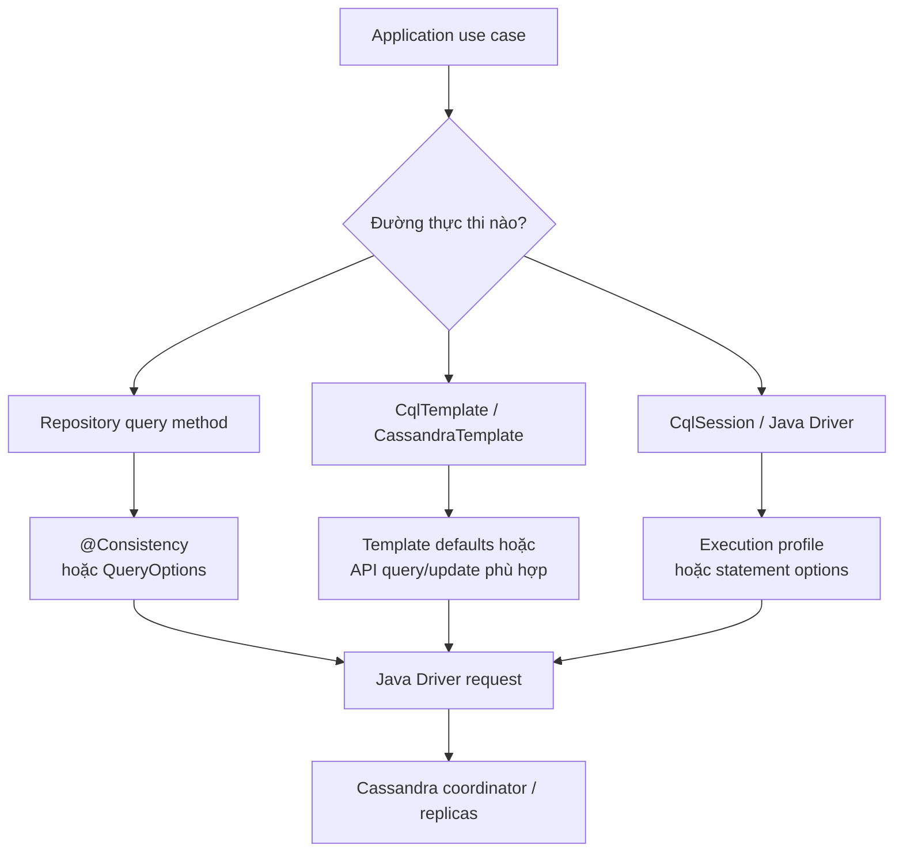

# Cấu hình consistency qua annotation, QueryOptions và Driver profile

## 1. Consistency là quyết định của từng đường truy cập dữ liệu

Apache Cassandra là cơ sở dữ liệu phân tán: một partition có thể được sao chép tới nhiều **replica** theo replication strategy của keyspace. Với **Spring Data Cassandra**, lập trình viên có thể truy cập những replica này thông qua repository, `CassandraTemplate`, `CqlTemplate` hoặc Java Driver. **Consistency level (CL)** xác định điều kiện về số replica phải đáp ứng để một thao tác đọc/ghi được xem là hoàn tất thành công.

Vì vậy, yêu cầu nghiệp vụ *“người dùng vừa thanh toán xong phải nhìn thấy trạng thái mới”* có thể cần chính sách truy cập khác với *“đọc dashboard thống kê có thể trễ một chút”*. Cách chọn CL phải xét đồng thời:

- Replication factor (RF), tên datacenter và vị trí replica của keyspace.
- Mức độ mới của dữ liệu ứng dụng cần đọc và những cạnh tranh ghi có thể xảy ra.
- Độ trễ, số replica phải liên hệ và khả năng tiếp tục hoạt động khi node bị lỗi.
- Ranh giới giữa **một partition/bảng** với các **read model phi chuẩn hóa** phải được cập nhật riêng.
- Retry, timeout, loại truy vấn, LWT và cơ chế paging.

Trong Spring Data Cassandra có ba điểm cấu hình thường gặp:

1. **`@Consistency` trên repository query method:** khai báo mức consistency **tĩnh** cho một loại truy vấn.
2. **`QueryOptions` truyền vào repository method:** chọn consistency và các request options **cho từng lời gọi**.
3. **Execution profile của Java Driver:** định nghĩa một nhóm chính sách dùng lại cho nhiều statements, đồng thời thiết lập **mặc định** khi statement không ghi đè riêng.



**Không có một mức consistency tốt nhất cho mọi lệnh.** Mức cao hơn thường tăng số replica phải đáp ứng, nên có thể cải thiện điều kiện đọc-sau-ghi trên cùng dữ liệu nhưng cũng tăng nguy cơ lỗi/độ trễ khi replica không khả dụng. Ngược lại, mức thấp hơn giúp giảm yêu cầu phản hồi từ replica nhưng không bảo đảm luôn đọc được bản cập nhật mới nhất.

## 2. Hiểu các mức consistency trước khi viết annotation

Các tên mức consistency phổ biến trong Cassandra:

| Consistency level | Ý nghĩa khái quát | Điểm cần cân nhắc |
| --- | --- | --- |
| `ONE` | Một replica đáp ứng điều kiện đọc/ghi | Mức đảm bảo thấp hơn quorum; không giới hạn trong datacenter local |
| `LOCAL_ONE` | Một replica trong DC local | Phù hợp với một số đường đọc độ trễ thấp chấp nhận dữ liệu cũ |
| `QUORUM` | Đa số replica của tập RF liên quan, xét theo phạm vi quorum của Cassandra | Khi nhiều DC, không đồng nghĩa quorum của riêng DC local |
| `LOCAL_QUORUM` | Đa số replica của **DC local** | Thường dùng trong kiến trúc phục vụ theo DC, với RF local phù hợp |
| `ALL` | Tất cả replica liên quan phải đáp ứng | Khả dụng thấp nếu replica không phản hồi |
| `EACH_QUORUM` | Quorum tại từng DC có replication, dùng trong trường hợp ghi được hỗ trợ | Chi phí và phụ thuộc nhiều DC; không dùng mặc định |
| `SERIAL`, `LOCAL_SERIAL` | **Serial consistency cho pha điều kiện của LWT** | Không thay thế consistency thông thường cho SELECT/UPDATE không điều kiện |

Đây là mô tả khái quát; một số CL còn phụ thuộc loại lệnh (đọc hay ghi), phiên bản Cassandra và môi trường nhiều DC. Không chọn `QUORUM`/`EACH_QUORUM` bằng trực giác khi chưa kiểm tra topology và RF của keyspace.

### 2.1. Ví dụ RF = 3 trong một datacenter

Giả sử `dc1` có **ba replica** cho một partition:

```text
Keyspace: RF(dc1) = 3

Replica A   Replica B   Replica C
    ●           ●           ●

LOCAL_ONE    cần 1 replica đáp ứng
LOCAL_QUORUM cần 2 replica đáp ứng
ALL          cần 3 replica đáp ứng
```

Với RF = 3, quorum là `floor(3 / 2) + 1 = 2`. Khi **write CL = LOCAL_QUORUM** và **read CL = LOCAL_QUORUM** trong cùng DC, tổng điều kiện `W + R = 2 + 2 > 3` tạo ra **sự giao nhau của tập replica cần tham gia** ở mức quorum. Trong các điều kiện thông thường, đây là cơ sở để giảm nguy cơ đọc bản cũ sau khi ghi thành công.

Nhưng công thức quorum không phải lời hứa **linearizability** cho mọi nghiệp vụ:

- Phải là **cùng partition/keyspace/nhóm replica liên quan**, không phải hai bảng khác nhau.
- Không có bảo đảm thứ tự nghiệp vụ nếu nhiều writer ghi cạnh tranh hoặc timestamp/clock bị lệch.
- Timeout có thể xảy ra sau khi một phần hoặc toàn bộ replica đã nhận dữ liệu.
- Replica lỗi, repair, hinted handoff, tombstones và thay đổi topology ảnh hưởng cách dữ liệu được đồng bộ/quan sát.
- Nếu muốn compare-and-set hoặc kiểm tra điều kiện cạnh tranh, hãy cân nhắc **LWT** chứ không chỉ tăng consistency.

### 2.2. Sơ đồ khả dụng so với yêu cầu replica

| Replica hoạt động trong DC (RF=3) | `LOCAL_ONE` | `LOCAL_QUORUM` | `ALL` |
| --- | --- | --- | --- |
| 3/3 | Có thể đáp ứng | Có thể đáp ứng | Có thể đáp ứng |
| 2/3 | Có thể đáp ứng | Có thể đáp ứng | **Không đáp ứng** |
| 1/3 | Có thể đáp ứng | **Không đáp ứng** | **Không đáp ứng** |
| 0/3 | Không đáp ứng | Không đáp ứng | Không đáp ứng |

Bảng chỉ xét **số replica có khả năng đáp ứng**, chưa tính coordinator, lỗi mạng, áp lực tải, latency, retry policy hoặc hạn chế loại request. Ngay cả khi có đủ replica, thao tác vẫn có thể timeout.

## 3. Chuẩn bị schema và entity cho ví dụ

Để minh họa consistency trong một hệ thống RF=3 thực, giả sử đã triển khai một cluster có datacenter tên `dc1` với ít nhất ba node phù hợp:

```sql
-- Chỉ chạy khi dc1 thực sự tồn tại và topology cho phép RF=3.
CREATE KEYSPACE IF NOT EXISTS shop_app
WITH replication = {
    'class': 'NetworkTopologyStrategy',
    'dc1': 3
};

CREATE TABLE IF NOT EXISTS shop_app.orders_by_id (
    order_id uuid PRIMARY KEY,
    customer_id uuid,
    status text,
    updated_at timestamp
);
```

**Không dùng schema RF=3 này như cấu hình local một node.** Với local RF=1, `LOCAL_QUORUM` có số replica cần đáp ứng bằng 1 nên không thể quan sát sự đánh đổi của quorum giống ví dụ RF=3. Tạo keyspace, datacenter và schema phải phù hợp môi trường đang chạy.

Entity:

```java
import java.time.Instant;
import java.util.UUID;

import org.springframework.data.cassandra.core.mapping.Column;
import org.springframework.data.cassandra.core.mapping.PrimaryKey;
import org.springframework.data.cassandra.core.mapping.Table;

@Table("orders_by_id")
public class OrderById {

    @PrimaryKey("order_id")
    private UUID orderId;

    @Column("customer_id")
    private UUID customerId;

    @Column("status")
    private String status;

    @Column("updated_at")
    private Instant updatedAt;

    protected OrderById() {
    }

    public UUID getOrderId() {
        return orderId;
    }

    public String getStatus() {
        return status;
    }

    public Instant getUpdatedAt() {
        return updatedAt;
    }

    // Bổ sung constructor/accessors theo mô hình tạo đối tượng của dự án.
}
```

`order_id` là **partition key**, nên `WHERE order_id = ?` định vị một partition rõ ràng. Một CL tốt không làm cho câu `WHERE status = 'PAID'` trở thành truy vấn hiệu quả nếu bảng không có đường truy cập theo status.

## 4. Cấu hình tĩnh bằng `@Consistency` trên repository

`org.springframework.data.cassandra.repository.Consistency` là annotation dành cho **repository query methods**. Với Spring Data Cassandra dùng Java Driver 4.x, giá trị có thể là enum `com.datastax.oss.driver.api.core.DefaultConsistencyLevel`.

```java
import java.util.Optional;
import java.util.UUID;

import com.datastax.oss.driver.api.core.DefaultConsistencyLevel;
import org.springframework.data.cassandra.repository.CassandraRepository;
import org.springframework.data.cassandra.repository.Consistency;
import org.springframework.data.cassandra.repository.Query;

public interface OrderByIdRepository
        extends CassandraRepository<OrderById, UUID> {

    @Consistency(DefaultConsistencyLevel.LOCAL_QUORUM)
    @Query("SELECT * FROM orders_by_id WHERE order_id = ?0")
    Optional<OrderById> findAuthoritativeView(UUID orderId);

    @Consistency(DefaultConsistencyLevel.LOCAL_ONE)
    @Query("SELECT * FROM orders_by_id WHERE order_id = ?0")
    Optional<OrderById> findLowLatencyView(UUID orderId);
}
```

Hai method cùng đọc theo `order_id`, nhưng chính sách consistency tĩnh khác nhau. Ví dụ dùng hai method để **dạy cách cấu hình**, không có nghĩa sản phẩm nhất thiết nên xuất ra hai API cho cùng một use case. Tầng service phải quyết định khi nào phù hợp đọc `LOCAL_ONE` và khi nào cần `LOCAL_QUORUM`.

`@Consistency` có các giới hạn quan trọng:

1. **Đặt trên query method** theo API Spring Data Cassandra, không phải thuộc tính của entity `@Table`, cột `@Column` hay primary key.
2. Là cấu hình **tĩnh**: cùng method thường sử dụng cùng CL mỗi lần được gọi.
3. Ảnh hưởng các query chạy qua **repository proxy** tương ứng; nó không tự tác động đến câu `CqlSession.execute(...)` viết ở service khác.
4. Không quyết định cách retry, timeout, partition key, `ORDER BY`, paging hoặc đồng bộ hai bảng denormalized.
5. Không biến một truy vấn SELECT thông thường thành LWT hay kiểm tra điều kiện nghiệp vụ.

Đừng nhầm `@Consistency` của Spring Data Cassandra với các annotation của JPA, Spring Data MongoDB hoặc cơ chế transaction isolation trong RDBMS.

### 4.1. Có nên gắn `@Consistency` lên `save()`?

Trong bài học này, ví dụ annotation được đặt trên các method query khai báo tường minh. Không nên giả định rằng gắn annotation tùy ý lên interface repository hoặc trên entity sẽ tự thay đổi **mọi** lời gọi CRUD kế thừa từ `CassandraRepository`.

Khi cần chính sách ghi cụ thể cho `save`, hãy kiểm tra API thực tế của phiên bản Spring Data Cassandra, sử dụng tùy chọn ghi được framework hỗ trợ hoặc một adapter dùng CQL/driver có consistency rõ ràng. Quan trọng nhất là **xác minh request thực sự gửi đi với CL mong muốn** trong integration test.

## 5. Cấu hình động qua `QueryOptions` trên repository method

`org.springframework.data.cassandra.core.cql.QueryOptions` cho phép chọn **request options theo từng lời gọi**. Theo hợp đồng của Spring Data Cassandra, một đối số `QueryOptions` trong repository query method là **tham số đặc biệt**, không bị tính là giá trị để bind vào các dấu `?0`, `?1` của CQL. Cách này phù hợp khi một method phải phục vụ nhiều chính sách được application service quyết định.

```java
import java.util.Optional;
import java.util.UUID;

import org.springframework.data.cassandra.core.cql.QueryOptions;
import org.springframework.data.cassandra.repository.CassandraRepository;
import org.springframework.data.cassandra.repository.Query;

public interface OrderFlexibleRepository
        extends CassandraRepository<OrderById, UUID> {

    @Query("SELECT * FROM orders_by_id WHERE order_id = ?0")
    Optional<OrderById> findWithOptions(UUID orderId, QueryOptions options);
}
```

Tầng service xây options:

```java
import java.time.Duration;
import java.util.Optional;
import java.util.UUID;

import com.datastax.oss.driver.api.core.DefaultConsistencyLevel;
import org.springframework.data.cassandra.core.cql.QueryOptions;
import org.springframework.stereotype.Service;

@Service
public class OrderReadService {

    private final OrderFlexibleRepository repository;

    public OrderReadService(OrderFlexibleRepository repository) {
        this.repository = repository;
    }

    public Optional<OrderById> readAfterConfirmedWrite(UUID id) {
        QueryOptions options = QueryOptions.builder()
            .consistencyLevel(DefaultConsistencyLevel.LOCAL_QUORUM)
            .timeout(Duration.ofSeconds(2))
            .build();

        return repository.findWithOptions(id, options);
    }

    public Optional<OrderById> readForNonCriticalWidget(UUID id) {
        QueryOptions options = QueryOptions.builder()
            .consistencyLevel(DefaultConsistencyLevel.LOCAL_ONE)
            .timeout(Duration.ofSeconds(1))
            .build();

        return repository.findWithOptions(id, options);
    }
}
```

Trong ví dụ, CL đến từ **QueryOptions truyền vào request**. Không nên đồng thời đặt `@Consistency` khác giá trị trên chính method này mà không kiểm tra precedence của phiên bản Spring Data Cassandra được chọn.

### 5.1. Những option thường dùng

| QueryOptions builder | Mục đích | Không được hiểu sai |
| --- | --- | --- |
| `consistencyLevel(...)` | CL thông thường của request | Không xác nhận điều kiện nghiệp vụ |
| `serialConsistencyLevel(...)` | CL cho pha serial của LWT khi thích hợp | Không dùng như CL thay thế cho đọc bình thường |
| `executionProfile("...")` | Chọn profile Java Driver đã định nghĩa | Profile phải tồn tại trong đúng session |
| `pageSize(...)` | Kích thước page mục tiêu khi fetch | Không phải `LIMIT` hay cursor của API |
| `timeout(Duration)` | Ngân sách chờ phía client cho request | Timeout không khẳng định ghi chưa được áp dụng |
| `idempotent(boolean)` | Gợi ý tính idempotent cho driver/retry policy | Không biến counter increment thành idempotent |
| `tracing(boolean)` | Bật tracing request để chẩn đoán | Có overhead, tránh bật rộng trên production |

Chỉ những option được thiết lập mới được áp vào query. Các API builder cụ thể có thể phát triển theo phiên bản; ví dụ trên hướng đến dòng Spring Data Cassandra dùng Java Driver 4.x và cần được kiểm thử với BOM của Spring Boot đang sử dụng.

### 5.2. QueryOptions không phải CQL parameter

Đây là điểm dễ mắc lỗi:

```java
@Query("SELECT * FROM orders_by_id WHERE order_id = ?0")
Optional<OrderById> findWithOptions(UUID id, QueryOptions options);
```

`?0` ứng với `id`. Đối số `options` được Spring Data nhận diện để cấu hình statement, **không** phải marker `?1` trong câu CQL. Nếu thêm điều kiện `WHERE order_id = ?0 AND status = ?1`, phải có một đối số nghiệp vụ tương ứng với `?1`, không dùng `QueryOptions` để thay thế.

### 5.3. Khi nào chọn QueryOptions thay cho annotation?

Chọn **`@Consistency`** nếu đường đọc có một CL cố định, rõ ràng và được kiểm tra trong code review. Chọn **`QueryOptions`** nếu application service cần điều chỉnh policy cho từng use case hoặc user journey mà không nhân đôi nhiều method query tương đương.

Đừng biến `QueryOptions` thành quyền cho HTTP client tùy chọn bất kỳ CL nào. Nên ánh xạ từ một số **chính sách nghiệp vụ có whitelist**, ví dụ `LOW_LATENCY_READ` hoặc `CONFIRMED_ORDER_READ`, sang options nội bộ; kiểm tra quyền và hạn mức request ở service.

## 6. Execution profile trong Java Driver: chính sách dùng chung

Java Driver 4.x hỗ trợ các **execution profiles** để định nghĩa nhóm request options tái sử dụng. Profile được cấu hình trong file HOCON (thường là `application.conf` hoặc một cấu hình driver tương đương), không phải annotation của entity.

Ví dụ `application.conf` trên classpath:

```hocon
datastax-java-driver {
  basic.request {
    consistency = LOCAL_ONE
    timeout = 2 seconds
    page-size = 500
  }

  profiles {
    critical-read {
      basic.request.consistency = LOCAL_QUORUM
      basic.request.timeout = 3 seconds
      basic.request.page-size = 100
    }

    dashboard-read {
      basic.request.consistency = LOCAL_ONE
      basic.request.timeout = 1 second
      basic.request.page-size = 50
    }
  }
}
```

Các giá trị chỉ minh họa **những chính sách đã được đánh giá**, không phải đề xuất latency/timeout mặc định cho mọi sản phẩm. Page size là số hàng mục tiêu mỗi lần fetch và không giới hạn tổng dữ liệu trả về nếu code duyệt tiếp các page.

**Quan trọng khi dùng Spring Boot:** ứng dụng phải thực sự nạp file cấu hình driver vào **cùng `CqlSession`** mà Spring Data Cassandra sử dụng. Việc tạo một `CqlSession` riêng với `application.conf` khác có thể khiến repository và code driver trực tiếp dùng hai cấu hình trái ngược. Kiểm tra khả năng tích hợp config loader, file trên classpath, cấu hình Spring Boot và phiên bản driver thật thay vì chỉ tin rằng một property bất kỳ trong `application.yml` sẽ tự điều khiển CL.

### 6.1. Chọn profile khi dùng Java Driver trực tiếp

```java
import java.util.UUID;

import com.datastax.oss.driver.api.core.CqlSession;
import com.datastax.oss.driver.api.core.cql.BoundStatement;
import com.datastax.oss.driver.api.core.cql.PreparedStatement;
import com.datastax.oss.driver.api.core.cql.Row;
import org.springframework.stereotype.Repository;

@Repository
public class DriverOrderReader {

    private final CqlSession session;
    private final PreparedStatement readById;

    public DriverOrderReader(CqlSession session) {
        this.session = session;
        this.readById = session.prepare("""
            SELECT order_id, status
            FROM shop_app.orders_by_id
            WHERE order_id = ?
            """);
    }

    public String readStatus(UUID id) {
        BoundStatement statement = readById.bind(id)
            .setExecutionProfileName("critical-read");

        Row row = session.execute(statement).one();
        return row == null ? null : row.getString("status");
    }
}
```

Chú ý:

- `readById` là **mẫu prepared CQL**, còn `bind(id)` tạo một statement riêng cho request.
- `setExecutionProfileName("critical-read")` chọn profile được định nghĩa sẵn trong **session thực thi**.
- Câu query chỉ định **đầy đủ partition key**, không dùng index không cần thiết.
- `row == null` biểu diễn không tìm thấy hàng, **khác** việc hàng tồn tại nhưng `status` có giá trị null.

Nếu muốn ghi đè riêng một option cho một request:

```java
import com.datastax.oss.driver.api.core.DefaultConsistencyLevel;

BoundStatement statement = readById.bind(id)
    .setExecutionProfileName("dashboard-read")
    .setConsistencyLevel(DefaultConsistencyLevel.LOCAL_QUORUM);
```

Trong Java Driver, một consistency level **đặt tường minh trên statement** có ưu tiên so với giá trị CL được kế thừa từ profile. Trường hợp này cố ý minh họa precedence, không phải pattern nên áp dụng tùy tiện: việc chọn profile `dashboard-read` nhưng lại ghi đè CL khác có thể khiến code khó đọc. Trong code production, nên chọn profile phản ánh đúng use case hoặc đặt option tường minh có chủ đích và ghi rõ lý do.

### 6.2. Chọn profile thông qua Spring Data QueryOptions

Nếu repository method nhận `QueryOptions`:

```java
QueryOptions options = QueryOptions.builder()
    .executionProfile("critical-read")
    .build();

repository.findWithOptions(orderId, options);
```

Cách này đưa tên profile vào query options mà Spring Data dùng để cấu hình statement, **không yêu cầu tạo `CqlSession` mới**. Nhưng cần có profile `"critical-read"` thực trong driver config; nên integration test xác nhận cấu hình này có hiệu lực.

### 6.3. Không tạo profile động cho từng request

Một execution profile là **nhóm chính sách được đặt tên**, nên số lượng profile cần nhỏ và có chủ đích: ví dụ `critical-read`, `dashboard-read`, `bulk-export`. Không sinh profile mới từ user ID hoặc UUID của từng request. Driver có thể hỗ trợ derived execution profiles, nhưng tạo liên tục có chi phí và gây khó kiểm soát caching/observability.

## 7. Thứ tự ưu tiên giữa các tầng cấu hình

Không có một thứ tự duy nhất cho **mọi API Spring Data** nếu dùng lẫn annotation, query options và các dạng template/driver trên cùng method. Để tránh suy diễn sai, hiểu theo ranh giới:

| Đường thực thi | Cấp quyết định thường gặp | Nếu không cung cấp riêng |
| --- | --- | --- |
| Repository query method có `@Consistency` | CL được khai báo trên method | Query tiếp tục theo thiết lập còn lại của framework/driver |
| Repository query method có `QueryOptions` | Các option được truyền cho lần gọi | Option không chỉ định kế thừa từ tầng bên dưới |
| `CqlTemplate` | Default của chính template và các request/statement options được hỗ trợ | Java Driver profile/default |
| `CqlSession` + `Statement` | Option tường minh trên `Statement` | Execution profile đã chọn hoặc profile mặc định |
| Java Driver không có override | Execution profile mặc định | Cấu hình/giá trị mặc định của driver |

### Quy tắc thực hành

1. **Chỉ chọn một nơi khai báo CL chính** cho một đường truy vấn cụ thể.
2. Với method có `@Consistency`, tránh truyền thêm `QueryOptions.consistencyLevel(...)` mâu thuẫn nếu chưa kiểm tra precedence trên phiên bản thực tế.
3. Với driver trực tiếp, ưu tiên **profile** nếu muốn chia sẻ chính sách; dùng statement override khi có lý do cụ thể.
4. Template default là **mặc định**, không nên cho rằng nó chắc chắn thắng mọi statement option.
5. Kiểm tra hiệu lực thực bằng integration test và logging/tracing có kiểm soát; không đoán chỉ từ tên bean.

Chính sách consistency nên được **tài liệu hóa theo use case**, không để một người đổi HOCON rồi vô tình thay đổi những lệnh nghiệp vụ quan trọng mà không có test.

## 8. Cấu hình mặc định trên CqlTemplate và ranh giới CassandraTemplate

`CqlTemplate` thuộc `org.springframework.data.cassandra.core.cql` và có thể được cấu hình consistency mặc định qua API của lớp cha `CassandraAccessor`.

```java
import com.datastax.oss.driver.api.core.CqlSession;
import com.datastax.oss.driver.api.core.DefaultConsistencyLevel;
import org.springframework.context.annotation.Bean;
import org.springframework.context.annotation.Configuration;
import org.springframework.data.cassandra.core.cql.CqlTemplate;

@Configuration
public class CassandraReadTemplateConfig {

    @Bean("quorumCqlTemplate")
    CqlTemplate quorumCqlTemplate(CqlSession session) {
        CqlTemplate template = new CqlTemplate(session);
        template.setConsistencyLevel(DefaultConsistencyLevel.LOCAL_QUORUM);
        return template;
    }
}
```

Bean có tên riêng để không nhầm với `CqlTemplate` auto-configured mặc định. Khi inject, dùng `@Qualifier("quorumCqlTemplate")` nếu ứng dụng có nhiều template; không tạo nhiều `CqlSession` chỉ để có nhiều CL.

Đây là cách đặt **mặc định trên template**, không bảo đảm mọi statement tự viết hoặc repository query đều dùng cùng CL. Cấu hình mặc định cũng cần được kiểm tra nếu method tạo statement với option ghi đè khác.

`CassandraTemplate` là API mapping entity cấp cao hơn, có các thao tác và tùy chọn theo phiên bản Spring Data. Nếu cần CL riêng cho một câu CQL hoặc một update cụ thể, hãy dùng **API query/write options được phiên bản hỗ trợ**; nếu không rõ hoặc cần kiểm soát statement chi tiết, đưa truy vấn vào adapter sử dụng `CqlSession`/`CqlTemplate`. Không sao chép API của Spring Data MongoDB/JPA sang Cassandra vì cùng tên `Template`.

## 9. LWT: serial consistency không giống normal consistency

Khi nghiệp vụ cần chuyển trạng thái có điều kiện:

```sql
UPDATE shop_app.orders_by_id
SET status = 'PAID'
WHERE order_id = 11111111-1111-4111-8111-111111111111
IF status = 'PENDING';
```

Cassandra thực hiện **lightweight transaction (LWT)** để kiểm tra điều kiện trong phạm vi được hỗ trợ. LWT có chi phí so với ghi không điều kiện, và trả kết quả `[applied]`. Hai loại consistency liên quan:

| Loại | Ví dụ | Vai trò |
| --- | --- | --- |
| **Normal consistency** | `LOCAL_QUORUM` | Áp dụng cho phần ghi/đọc thông thường của request theo cơ chế Cassandra |
| **Serial consistency** | `LOCAL_SERIAL` | Điều khiển phạm vi serial/quorum cho pha điều kiện LWT |

Không truyền `LOCAL_SERIAL` vào `setConsistencyLevel(...)` như thể nó là `LOCAL_QUORUM`. Với driver, khai báo riêng hai option:

```java
import com.datastax.oss.driver.api.core.DefaultConsistencyLevel;

var conditional = session.prepare("""
    UPDATE shop_app.orders_by_id
    SET status = ?
    WHERE order_id = ?
    IF status = ?
    """);

var bound = conditional.bind("PAID", orderId, "PENDING")
    .setConsistencyLevel(DefaultConsistencyLevel.LOCAL_QUORUM)
    .setSerialConsistencyLevel(DefaultConsistencyLevel.LOCAL_SERIAL);

boolean applied = session.execute(bound).wasApplied();
```

Đoạn mã giả định có sẵn `session` và `orderId` đúng kiểu `CqlSession`/`UUID`, minh họa setting và kết quả. `wasApplied()` chỉ nên được dùng để suy ra kết quả nghiệp vụ khi **request thực sự trả kết quả**; nếu timeout, **không** được tự suy `false`.

LWT không làm cho hai bảng denormalized khác nhau được cập nhật theo một transaction ACID quan hệ. Nó cũng không thay đổi partition key và không tự quyết định cách retry khi request gặp lỗi mạng.

### Khi nào dùng `SERIAL` thay cho `LOCAL_SERIAL`?

Việc chọn serial CL phụ thuộc phạm vi replica/datacenter và yêu cầu đồng bộ điều kiện; với cụm phục vụ theo DC, `LOCAL_SERIAL` thường là lựa chọn cần xem xét để giảm phạm vi điều phối, nhưng không có nghĩa mọi workload/multi-DC đều phù hợp. Không đặt `SERIAL` cho tất cả request vì nghĩ rằng “serial chắc chắn an toàn hơn” mà không xét hiệu năng và topology.

## 10. Consistency có giải quyết được các bài toán nào?

### 10.1. Đọc-sau-ghi trên cùng bảng

Một ví dụ chính sách:

```text
Write orders_by_id tại LOCAL_QUORUM
    ↓ nhận xác nhận thành công
Read orders_by_id tại LOCAL_QUORUM
    ↓ theo cùng primary key
Kỳ vọng quan sát trạng thái mới trong điều kiện không có ghi cạnh tranh
```

Với RF local 3 và W=R=2, có sự giao nhau quorum như đã phân tích. Nhưng nếu read đi qua bảng **khác**, replica đã được ghi ở bảng A không nhất thiết là trạng thái tương ứng của bảng B.

### 10.2. Hai bảng theo hai truy vấn

Hệ thống có thể lưu:

```text
orders_by_id            -> GET /orders/{id}
orders_by_customer_day  -> GET /customers/{id}/orders?day=...
```

Sau khi đổi status:

```text
Service:
  1. update orders_by_id (LOCAL_QUORUM)
  2. update orders_by_customer_day (LOCAL_QUORUM)
```

Nếu bước 1 thành công và bước 2 thất bại hoặc đang chờ retry, dashboard theo khách vẫn có thể đọc status cũ. **Không có mức CL nào tự đồng bộ giữa hai bảng này.** Service cần idempotency, retry có giới hạn, thông báo độ mới của dữ liệu và cơ chế đối soát. Batch/LWT có phạm vi riêng, không nên bị coi là transaction nghiệp vụ nhiều bảng chỉ vì mức consistency cao.

### 10.3. Consistency không giải quyết truy vấn sai partition key

`LOCAL_QUORUM` không giúp câu `WHERE status = 'PAID'` chạy nhanh trên bảng chỉ có partition key `order_id`. Với API list, phải thiết kế bảng đọc có partition key và clustering order phù hợp; dùng repository, `CassandraTemplate`, paging hoặc SAI/index theo workload sau khi đo. Query design và consistency là **hai chiều độc lập**.

## 11. Timeout, Unavailable và retry theo nghiệp vụ

Trong Cassandra, timeout không luôn đồng nghĩa với **không có dữ liệu nào được ghi**. Ví dụ:

```text
Client                    Replica/coordinator
   |  UPDATE status = PAID     |
   |-------------------------->|
   |       Đã ghi ở một số replica
   |         response lỗi/mất  X
   |   Client không biết chính xác
```

Nâng CL có thể làm yêu cầu ghi chờ nhiều replica hơn; nó không loại bỏ mọi timeout hay khả năng trạng thái một phần trong thời gian lỗi.

| Loại tình huống | Ý nghĩa khái quát | Hướng xử lý |
| --- | --- | --- |
| `Unavailable` | Không đủ replica đáp ứng yêu cầu consistency theo trạng thái nhận biết | Kiểm tra RF, topology, replica up/down, chính sách CL |
| `ReadTimeout` | Không nhận đủ phản hồi đọc trong thời gian quy định | Đo latency, tải và CL; retry có giới hạn theo SLO |
| `WriteTimeout` | Không nhận đủ xác nhận ghi trong thời gian quy định | Không đoán ghi thất bại hoàn toàn; xác định tính idempotent |
| `Request timeout` phía client | Deadline phía client kết thúc | Server có thể còn xử lý hoặc đã áp dụng lệnh |
| LWT `[applied] = false` | Điều kiện không thỏa trong một phản hồi hợp lệ | Trả kết quả nghiệp vụ/đọc trạng thái mới; không coi như lỗi mạng |

### 11.1. Đừng đánh dấu mọi câu CQL là idempotent

- Đọc theo khóa không thay đổi dữ liệu thường có thể retry theo chính sách.
- Gán một trạng thái cố định theo khóa có thể **idempotent về giá trị**, nhưng phải xét timestamps, TTL và tác động tới read model khác.
- `INSERT` dùng UUID mới ở mỗi lần retry có thể tạo thêm hàng nghiệp vụ.
- `counter = counter + 1` **không idempotent**; retry sau timeout có thể làm tăng hai lần.
- LWT cần xử lý kết quả điều kiện, cạnh tranh và trường hợp timeout không rõ applied.

`QueryOptions.idempotent(true)` hoặc `.setIdempotent(true)` chỉ **khai báo** tính idempotent với hạ tầng driver/retry policy; không tự khiến một phép ghi không idempotent trở thành an toàn. Cần định nghĩa idempotency key và retry budget ở tầng service khi nghiệp vụ yêu cầu.

## 12. Những lỗi cấu hình thường gặp

| Biểu hiện | Nguyên nhân có thể | Bước kiểm tra |
| --- | --- | --- |
| Đã thêm `@Consistency` nhưng query khác vẫn dùng mặc định | Annotation chỉ đặt trên một repository method | Xác định đúng đường truy cập và query method được gọi |
| Truyền `QueryOptions` nhưng giá trị không được áp dụng | Repository method/API không đúng hoặc options chưa được build | Kiểm tra import, method signature và version Spring Data |
| Method có annotation và options CL khác nhau | Không rõ precedence ở tầng Spring Data | Chỉ giữ một nguồn CL hoặc test request thực |
| Profile `"critical-read"` không tìm thấy | Driver config chưa được nạp vào session đang dùng | Kiểm tra HOCON, session và profile name |
| Profile đã đặt CL nhưng request vẫn dùng mức khác | Statement/QueryOptions đang override | Kiểm tra options tường minh và default |
| `LOCAL_QUORUM` thất bại trên cluster local | RF/local DC không đúng hoặc không đủ replica | Xác minh keyspace replication, topology và `local-datacenter` |
| `LOCAL_SERIAL` dùng như CL thường | Nhầm serial phase của LWT | Dùng `serialConsistencyLevel` riêng |
| Ghi RF3 tại quorum rồi đọc qua read model khác thấy cũ | Hai bảng không tự đồng bộ | Thiết kế retry/đối soát ở application service |
| Chọn `ALL` để “luôn mới nhất” | Một replica lỗi có thể làm unavailable; không xử lý cạnh tranh | Xác định SLO và bất biến nghiệp vụ |
| Tăng CL để chữa p99 cao do fan-out | Lý do chính nằm ở data model/query | Đo partition key, tombstones, fan-out và payload |
| Timeout rồi tự retry mọi ghi | Có thể ghi trùng counter/ID | Phân loại idempotence và chính sách retry |
| `pageSize` được hiểu là giới hạn số hàng toàn request | Driver có thể fetch page tiếp | Dùng `LIMIT`, cursor và kiểm soát vòng lặp |

## 13. Kế hoạch kiểm thử consistency theo từng tầng

### 13.1. Unit test: chính sách của application service

Unit test kiểm tra:

1. Use case `readAfterConfirmedWrite` chọn `LOCAL_QUORUM`.
2. Use case dashboard ít quan trọng chọn `LOCAL_ONE`.
3. Client HTTP không được truyền một string `"ALL"` hay `"EACH_QUORUM"` để override CL trực tiếp.
4. Đường counter hoặc LWT không bị đánh dấu idempotent sai.
5. Khi dependency báo timeout, service không tự báo “chưa ghi”, không retry vô hạn.

Mock repository có thể chứng minh service chọn đường gọi đúng, nhưng **không chứng minh CL thật đã đến Cassandra**.

### 13.2. Integration test với Cassandra RF=3 và Spring

Chuẩn bị cluster thử nghiệm có **ít nhất ba replica trong DC** cùng keyspace RF=3. Testcontainers có thể hỗ trợ tạo môi trường Cassandra, nhưng nhiều node/topology phải được cấu hình thực tế; **một container RF=1 không kiểm thử được quorum failure**.

Các bước:

1. Khởi tạo Spring context, xác minh `CqlSession` kết nối đúng local DC và keyspace.
2. Kiểm tra repository method có `@Consistency` chạy thành công với đủ replica.
3. Kiểm tra repository method nhận `QueryOptions` với `LOCAL_ONE`/`LOCAL_QUORUM` có hiệu lực theo yêu cầu.
4. Nạp driver HOCON với hai execution profiles; thử một `BoundStatement` dùng từng profile và một câu có override tường minh.
5. Ghi một đơn ở `LOCAL_QUORUM`, đọc lại cùng khóa ở `LOCAL_QUORUM`; thử ghi/đọc trong điều kiện không có ghi cạnh tranh.
6. Tạm ngắt một replica, quan sát `LOCAL_ONE`/`LOCAL_QUORUM`/`ALL`; sau đó ngắt hai replica để quan sát khả dụng và timeout.
7. Test LWT `IF status = ...` với normal CL và serial CL, kiểm tra cả trường hợp applied=true/false.
8. Test ghi vào hai read models với lỗi giữa hai bước, bảo đảm service nhận diện và đối soát.

Không cần phá mạng hoặc tắt node trên cluster production. Với automation, ghi rõ cách khôi phục replica, tránh để môi trường thử có trạng thái thiếu repair sau bài test.

### 13.3. Quan sát trên hệ thống thật

| Nhóm đo | Mục đích |
| --- | --- |
| p50/p95/p99 latency theo CL và query family | Hiểu cái giá của mức consistency |
| Read/write timeouts và unavailable | Phân biệt thiếu replica và cluster quá tải |
| Retry counts theo loại request | Phát hiện retry storm hoặc thao tác non-idempotent |
| Replica health, repair/compaction metrics | Đánh giá tình trạng đồng bộ và tail latency |
| LWT applied/failed/latency | Theo dõi tranh chấp và chi phí điều kiện |
| Partition size, tombstone, số bucket | Đo data model độc lập với CL |
| Divergence giữa read models | Phát hiện chậm đồng bộ nghiệp vụ |

Tên metric cụ thể phụ thuộc phiên bản Cassandra, Java Driver, Spring Boot và hệ thống quan sát. Không suy ra có một metric tên cố định tồn tại trên mọi phiên bản.

## 14. Quy trình chọn consistency cho API mới

Một quy trình ra quyết định có thể tái sử dụng:

1. **Mô tả yêu cầu nghiệp vụ:** đọc-sau-ghi tức thời hay cho phép stale read trong vài giây?
2. **Xác định bảng/partition:** query có đúng khóa và chỉ một read model hay cần đồng bộ nhiều bảng?
3. **Đọc topology và RF:** local DC nào, replication ở mỗi DC bao nhiêu, có yêu cầu đa DC không?
4. **Phân tích R/W:** cùng dữ liệu có được đọc/ghi với CL giao quorum không? Có writer cạnh tranh hay LWT không?
5. **Chọn nguồn cấu hình:** `@Consistency` cho method tĩnh, `QueryOptions` cho từng lời gọi, execution profile cho nhóm chính sách dùng chung.
6. **Chọn timeout và retry budget:** không dùng default tùy tiện cho mọi loại thao tác, phân loại idempotence.
7. **Kiểm thử failure mode:** replica down, read/write timeout, LWT false, trạng thái chưa đồng bộ giữa hai bảng.
8. **Theo dõi SLO:** đo latency và tính khả dụng dưới tải thực, điều chỉnh CL cùng data model khi cần.

### Ma trận lựa chọn minh họa

| Use case | Cách cấu hình cân nhắc | Lý do | Điều kiện kèm theo |
| --- | --- | --- | --- |
| Đọc chi tiết ngay sau xác nhận ghi | Repository `@Consistency(LOCAL_QUORUM)` hoặc QueryOptions tương đương | Chính sách đọc được khai báo rõ | Ghi phù hợp, cùng bảng/khóa, RF local đủ và không có cạnh tranh phá giả định |
| Dashboard có thể trễ | Driver profile `dashboard-read` với `LOCAL_ONE` | Giảm yêu cầu replica | Hợp đồng stale data và monitoring |
| Service nhiều chế độ đọc theo use case | Repository method nhận `QueryOptions` | Chọn CL khi gọi | Policy whitelist, không nhận CL tùy ý từ client |
| Truy vấn CQL trực tiếp cần tùy chọn chi tiết | BoundStatement + execution profile | Kiểm soát request và paging | Bind, session dùng chung, theo dõi hiệu lực |
| Chuyển trạng thái có điều kiện | LWT + normal CL và serial CL | Kiểm tra cạnh tranh tại Cassandra | Kiểm tra `[applied]`, retry/timeout hợp lệ |
| Cập nhật hai bảng denormalized | Application service + policy từng bảng | CL chỉ áp trên mỗi thao tác | Idempotency, retry, đối soát và trạng thái đồng bộ |

## 15. Bài tập thực hành

**Bài 1 — Quorum và khả dụng:** Với RF(dc1)=3, hãy xác định số replica cần cho `LOCAL_ONE`, `LOCAL_QUORUM`, `ALL`. Khi một hoặc hai replica lỗi, các mức này thay đổi tính khả dụng như thế nào? Vì sao “có đủ replica” vẫn chưa bảo đảm request không timeout?

**Bài 2 — Annotation tĩnh:** Viết repository `OrderByIdRepository` có `@Query` tìm theo `order_id` và `@Consistency(DefaultConsistencyLevel.LOCAL_QUORUM)`. Giải thích vì sao method này không tự thay đổi CL của những câu `CqlSession.execute()` khác.

**Bài 3 — QueryOptions theo use case:** Tạo method repository nhận `UUID` và `QueryOptions`. Service gọi lần A với `LOCAL_ONE`, lần B với `LOCAL_QUORUM`, đặt timeout riêng. Vì sao `QueryOptions` không phải bind marker `?1` của câu CQL?

**Bài 4 — Driver profile:** Cấu hình profile `critical-read` và `dashboard-read` trong HOCON. Dùng `BoundStatement.setExecutionProfileName(...)` để chọn profile. Sau đó đặt `.setConsistencyLevel(...)` riêng và giải thích sự ghi đè này.

**Bài 5 — LWT:** Chỉ cho phép `PENDING -> PAID`. Viết CQL `IF status = 'PENDING'`, bind bằng Java Driver, cấu hình `LOCAL_QUORUM` và `LOCAL_SERIAL`, kiểm tra `wasApplied()`. Điều gì khác nhau giữa applied=false và timeout?

**Bài 6 — Hai read models:** Service đổi status trong `orders_by_id` và `orders_by_customer_day`. Cả hai update đều dùng quorum nhưng update bảng thứ hai bị timeout. Giải thích vì sao chưa thể nói hai bảng đã đồng bộ; đề xuất cơ chế retry và đối soát.

**Bài 7 — Giới hạn của local test:** Nhóm chạy Cassandra một node với RF=1, cấu hình `LOCAL_QUORUM` rồi kết luận “quorum bền vững và sẵn sàng ngay cả khi replica lỗi”. Chỉ ra sai lầm của phép thử và đề xuất integration test ba replica.

### Câu hỏi tự kiểm tra

1. Consistency level kiểm soát điều gì trong thao tác đọc/ghi Cassandra?
2. Trong RF=3, vì sao `LOCAL_QUORUM` yêu cầu hai replica?
3. Tại sao `W + R > RF` không bảo đảm transaction ACID xuyên nhiều bảng?
4. `@Consistency` khác `QueryOptions.consistencyLevel(...)` ở chỗ nào?
5. `QueryOptions` có bị tính là một tham số CQL cần bind không?
6. Execution profile là gì, và nó nằm ở Spring Data hay Java Driver?
7. Khi statement khai báo CL tường minh, quan hệ với CL từ profile là gì?
8. Normal consistency và serial consistency khác nhau trong LWT như thế nào?
9. Vì sao timeout của ghi không chứng minh dữ liệu chưa được áp dụng?
10. Khi nào có thể chọn `LOCAL_ONE` và khi nào cần xem xét `LOCAL_QUORUM`?
11. Cách nào kiểm tra CL thực sự có hiệu lực thay vì chỉ đọc annotation trong code?
12. Vì sao nâng CL không giúp truy vấn thiếu partition key trở nên hiệu quả?

## Kết luận

Với **Spring Data Cassandra**, consistency là **chính sách truy cập dữ liệu theo workload**, không phải annotation trang trí hoặc một mức “càng cao càng tốt”. Dùng `@Consistency` để cố định CL cho repository query method, `QueryOptions` để truyền các lựa chọn theo request, và **Java Driver execution profile** để quản lý nhóm cấu hình được tái sử dụng. Các tùy chọn trên statement/template phải được hiểu đúng ranh giới và kiểm tra hiệu lực khi tích hợp. Việc chọn `LOCAL_ONE`, `LOCAL_QUORUM` hay mức khác phụ thuộc **replication factor, datacenter, số replica khả dụng, độ trễ và yêu cầu đọc-sau-ghi**. Khi cần kiểm tra trạng thái cạnh tranh, tách **normal consistency** khỏi **serial consistency của LWT**; khi dữ liệu nằm ở nhiều bảng, phải thiết kế idempotency và đồng bộ ở application service. Không một mức CL nào thay thế được **thiết kế bảng theo partition key, paging có kiểm soát, xử lý timeout/retry và đo hiệu năng thực tế** trong hệ thống Cassandra phân tán.
