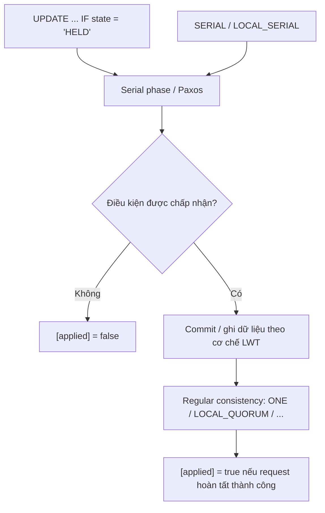

# Serial consistency và phân biệt với mức nhất quán thông thường

Khi truy cập Apache Cassandra, một câu lệnh có thể mang **consistency level thông thường** như `ONE`, `LOCAL_QUORUM` hoặc `QUORUM`. Nhưng với câu lệnh **có điều kiện** như `INSERT ... IF NOT EXISTS` hoặc `UPDATE ... IF state = 'HELD'`, Cassandra còn có **serial consistency level**, thường là `SERIAL` hoặc `LOCAL_SERIAL`. Hai nhóm tùy chọn này không thay thế nhau: chúng giải quyết **những giai đoạn và mục tiêu nhất quán khác nhau**.

Đây là bài học thuộc chương **Tính nhất quán** của module **`SPRING_DATA_CASSANDRA`**. Trong module, chúng ta sử dụng entity mapping, Repository, `CassandraTemplate` và CQL để truy cập Cassandra; đồng thời thiết kế bảng theo truy vấn, partition key, paging và hiệu năng trên cơ sở dữ liệu phân tán. Bài này tập trung vào việc **chọn đúng serial consistency khi dùng lightweight transaction (LWT)**, kiểm tra kết quả điều kiện và tránh ngộ nhận rằng một consistency level cao tự tạo được giao dịch.

**Sau bài học, bạn có thể:**

1. Phân biệt consistency thông thường với serial consistency về mục tiêu, phạm vi và thời điểm áp dụng.
2. Hiểu liên hệ giữa **Paxos/LWT**, `SERIAL`, `LOCAL_SERIAL` và các mức `ONE`, `LOCAL_QUORUM`, `QUORUM`.
3. Viết `INSERT ... IF NOT EXISTS` và `UPDATE ... IF`, rồi xử lý cột `[applied]` một cách đúng nghiệp vụ.
4. Chỉ định **cả hai mức consistency** trên `BoundStatement` của Java Driver 4.x.
5. Chọn phạm vi phù hợp cho hệ **một datacenter** và **nhiều datacenter**, nhận biết rủi ro khi trộn chính sách.
6. Nhận diện ảnh hưởng đến độ trễ, retry, timeout, hot partition và dữ liệu cập nhật đồng thời.
7. Biết khi nào Repository/`CassandraTemplate` đủ dùng và khi nào nên xuống `CqlSession` để kiểm soát phản hồi LWT.

## 1. Hai câu hỏi khác nhau về nhất quán

Hãy tưởng tượng hệ thống có ba replica của cùng một partition.

**Consistency thông thường** trả lời: **“Có bao nhiêu replica phải tham gia phản hồi để thao tác đọc/ghi đạt điều kiện hoàn tất?”** Ví dụ, trong một datacenter có replication factor (RF) bằng 3, `LOCAL_QUORUM` thường cần **2 replica của DC đó** phản hồi.

**Serial consistency** trong ngữ cảnh LWT trả lời: **“Phạm vi các replica nào tham gia vào pha đồng thuận cho thao tác có điều kiện?”** Nó liên quan đến việc nhiều writer cạnh tranh có được thống nhất cùng một quyết định cập nhật hay không; không phải chỉ là số replica xác nhận một `UPDATE` thông thường.

| Câu hỏi | Consistency thông thường | Serial consistency |
| --- | --- | --- |
| Mục đích chính | Mức phản hồi cho **read/write** thông thường và pha áp dụng của LWT | Mức nhất quán cho **pha Paxos/conditional transaction** |
| Giá trị điển hình | `ONE`, `LOCAL_ONE`, `QUORUM`, `LOCAL_QUORUM`, `ALL` | `SERIAL`, `LOCAL_SERIAL` |
| Khi nào quan trọng? | Mọi truy vấn có yêu cầu mức nhất quán cụ thể | LWT như `IF NOT EXISTS`, `IF column = value`; một số đọc serial theo CQL/driver |
| Có tự tạo CAS không? | **Không** | **Không**, cần câu lệnh có điều kiện/phương thức phù hợp |
| Đảm bảo toàn bộ cluster là một giao dịch đa bảng? | Không | Không |
| Cách đặt trong Java Driver 4.x | `setConsistencyLevel(...)` | `setSerialConsistencyLevel(...)` |

**Kết luận ban đầu:** `LOCAL_QUORUM` và `LOCAL_SERIAL` **không phải hai mức thay thế trực tiếp**; một conditional statement có thể được cấu hình với **cả hai**.

## 2. Nhắc lại cách Cassandra ghi và đọc thông thường

Cassandra phân phối dữ liệu theo **partition key**. Một partition có nhiều replica tùy **replication factor** và topology/keyspace strategy. Khi client gửi một query:

1. Driver chọn coordinator phù hợp, ưu tiên token-aware routing nếu có thông tin khóa.
2. Coordinator liên hệ replica theo hoạt động đọc/ghi.
3. Thao tác hoàn tất phía client khi đạt yêu cầu của consistency level hoặc hết hạn/lỗi.

Trong một datacenter có `RF = 3`:

| Consistency level | Ý nghĩa ở ví dụ RF = 3 |
| --- | --- |
| `ONE` | Một replica phản hồi theo quy tắc consistency của thao tác |
| `LOCAL_ONE` | Một replica ở datacenter cục bộ |
| `QUORUM` | Quorum replica theo tổng RF của cấu hình replication liên quan |
| `LOCAL_QUORUM` | Quorum trong DC cục bộ, ở đây là **2/3** |
| `ALL` | Mọi replica liên quan phải đáp ứng; nhạy với sự cố hơn |

Với **NetworkTopologyStrategy nhiều DC**, cách tính quorum `LOCAL_QUORUM` dựa trên RF ở **DC cục bộ**. `QUORUM` và `LOCAL_QUORUM` có phạm vi khác nhau; không dùng chúng thay thế nhau mà không xét RF từng DC và nhu cầu phối hợp xuyên DC.

### Quorum đọc và ghi không phải CAS

Đối với một partition được sao chép với RF = 3, điều kiện giao nhau quen thuộc `R + W > RF` giúp suy luận về sự giao nhau giữa read quorum và write quorum trong những giả định thích hợp. Tuy nhiên:

- Giao nhau giữa quorum **không biến một chuỗi đọc → tính toán → ghi thành một thao tác atomic có điều kiện**.
- Hai client cùng đọc giá trị cũ rồi ghi giá trị mới vẫn có thể **lost update**.
- Last-write-wins theo timestamp và quá trình reconcile giữa replica không đồng nghĩa với một **trình tự cập nhật nghiệp vụ**.

Nếu nghiệp vụ đòi **“chỉ ghi khi giá trị vẫn là X”**, bạn cần xem xét **conditional update/LWT**, không chỉ tăng `ONE` lên `QUORUM`.

## 3. Bài toán minh họa: hai khách cùng giữ một slot

Giả sử mỗi slot đặt phòng chỉ được cấp cho một booking tại một thời điểm. Bảng được thiết kế theo **slot ID** để mọi writer cạnh tranh trên cùng một partition:

```sql
CREATE TABLE IF NOT EXISTS reservations_by_slot (
    slot_id uuid PRIMARY KEY,
    booking_id uuid,
    state text,
    updated_at timestamp
);
```

**Vì sao chọn `slot_id` làm partition key?** Vì câu hỏi nghiệp vụ là “slot này đã được giữ chưa?” và tất cả writer cho cùng slot phải đi tới cùng đối tượng cạnh tranh. Nếu mỗi request ghi một partition khác nhau theo `booking_id` rồi truy vấn kiểm tra riêng, một LWT trên mỗi partition **không bảo đảm** chỉ có một booking cho cùng slot trên toàn hệ thống.

Khi hai khách cùng cố tạo reservation:

```sql
INSERT INTO reservations_by_slot (
    slot_id, booking_id, state, updated_at
) VALUES (?, ?, 'HELD', ?)
IF NOT EXISTS;
```

Nếu cả hai thao tác có cùng `slot_id`, điều kiện `IF NOT EXISTS` yêu cầu Cassandra đạt đồng thuận theo giao thức LWT để một thao tác không âm thầm ghi đè thao tác kia theo kiểu upsert thông thường.

### Điều gì xảy ra nếu bỏ IF NOT EXISTS?

```sql
-- Câu lệnh này là upsert thông thường.
INSERT INTO reservations_by_slot (
    slot_id, booking_id, state, updated_at
) VALUES (?, ?, 'HELD', ?);
```

Hai request đều có thể nhận thành công, dù cuối cùng giá trị lưu lại chỉ phản ánh một bản ghi theo reconciliation/timestamp. Kết quả đó **không đáp ứng hợp đồng “chỉ một người được chấp nhận giữ slot”** nếu cả hai client đều đã được thông báo thành công.

## 4. Lightweight transaction và Paxos

**Lightweight transaction (LWT)** là cơ chế Cassandra sử dụng **Paxos** để hỗ trợ các thao tác có điều kiện, như:

```sql
-- Chỉ tạo nếu hàng/partition mục tiêu chưa có dữ liệu theo điều kiện:
INSERT ... IF NOT EXISTS;

-- Chỉ đổi trạng thái khi vẫn đúng giá trị kỳ vọng:
UPDATE ... SET state = 'CONFIRMED' WHERE slot_id = ? IF state = 'HELD';

-- Chỉ xóa nếu điều kiện cho phép (theo cú pháp CQL/version):
DELETE ... WHERE slot_id = ? IF state = 'EXPIRED';
```

Ở mức khái niệm, Paxos cho phép các bên tham gia đạt một quyết định đồng thuận khi có cạnh tranh, thay vì chỉ áp dụng hai mutation độc lập rồi để kết quả thắng/thua theo timestamp.

```mermaid
sequenceDiagram
    participant A as Client A
    participant B as Client B
    participant C as Coordinator
    participant R as Paxos replicas
    A->>C: INSERT slot=42 IF NOT EXISTS
    B->>C: INSERT slot=42 IF NOT EXISTS
    C->>R: Pha đồng thuận (Paxos)
    R-->>C: Quyết định điều kiện/giá trị
    C-->>A: [applied] = true (ví dụ)
    C-->>B: [applied] = false (ví dụ)
    Note over C,R: Thứ tự thắng có thể ngược; chỉ minh họa
```

**Lưu ý:** đây là sơ đồ khái niệm, không phải bản ghi chi tiết mọi round trip. Chi tiết Paxos/đường tối ưu phụ thuộc phiên bản Cassandra và giao thức được triển khai; không lấy một số vòng network cố định làm hằng số cho mọi release.

### LWT không phải transaction SQL tổng quát

LWT:

- Không cung cấp **JOIN**, foreign key hoặc transaction ACID đa bảng theo nghĩa RDBMS.
- Không thay thế thiết kế partition key; phạm vi điều kiện và dữ liệu phải phù hợp với **partition/câu lệnh CQL được hỗ trợ**.
- Có chi phí coordination cao hơn ghi thường, đặc biệt ở workload cạnh tranh và nhiều datacenter.
- Có thể bị **contention**, timeout hoặc điều kiện `IF` thất bại; ứng dụng phải xử lý tất cả những kết quả đó.

Không biến mọi `INSERT` trong hệ thống thành LWT chỉ vì muốn “nhất quán hơn”. Hãy dành LWT cho các **invariant** quan trọng mà cơ chế ghi thường không đáp ứng.

## 5. SERIAL và LOCAL_SERIAL quyết định điều gì?

Hai giá trị serial consistency phổ biến là:

| Giá trị | Phạm vi pha Paxos/LWT | Khi cân nhắc |
| --- | --- | --- |
| **`SERIAL`** | Pha đồng thuận có phạm vi **quorum serial trên các replica tham gia theo chiến lược replication**, không giới hạn chỉ một DC cục bộ | Khi cần bảo đảm phối hợp LWT trên các DC theo mô hình replication và yêu cầu toàn cục |
| **`LOCAL_SERIAL`** | Pha đồng thuận **giới hạn ở DC cục bộ** | Khi các writer/đường nghiệp vụ được kiểm soát hoạt động trong cùng DC và muốn tránh chi phí đồng thuận xuyên DC |

Với **một DC**, khác biệt vận hành có thể không lớn vì local và global cùng phạm vi replica có liên quan. Với **nhiều DC**, lựa chọn rất quan trọng:

- `SERIAL` có thể kéo theo phối hợp và độ trễ giữa các DC.
- `LOCAL_SERIAL` tập trung pha đồng thuận trong DC cục bộ.
- Hai yêu cầu cạnh tranh dùng **LOCAL_SERIAL ở hai DC khác nhau** không nên được giả định có cùng một thứ tự tuyến tính toàn cục như khi tất cả writer tham gia một phạm vi đồng thuận nhất quán.

**Cảnh báo kiến trúc:** nếu nghiệp vụ cần invariant toàn cục “một slot chỉ được giữ một lần” trên nhiều vùng địa lý, đừng cấu hình `LOCAL_SERIAL` độc lập ở từng DC rồi coi đó là CAS toàn hệ thống. Cần lựa chọn phạm vi đồng thuận và chiến lược phân vùng/định tuyến writer theo thiết kế.

### Không suy ra LOCAL_SERIAL là một biến thể của LOCAL_QUORUM

Hai tên đều có tiền tố `LOCAL` nhưng một tên là **serial consistency cho LWT**, tên kia là **regular consistency**:

```text
LOCAL_SERIAL  -> phạm vi Paxos/điều kiện LWT trong local DC
LOCAL_QUORUM  -> mức replica phản hồi cho regular phase / regular read-write
```

Một câu LWT có thể dùng **`LOCAL_SERIAL` + `LOCAL_QUORUM`**. Không phải đặt một trong hai là đã cấu hình đủ cả hai.

## 6. Vì sao LWT có hai consistency levels?

Đối với câu CQL có `IF`, Cassandra cần xử lý **pha điều kiện/Paxos** và **pha ghi/áp dụng thông thường** theo giao thức thực thi. Java Driver cho phép khai báo riêng:

```java
bound
    .setSerialConsistencyLevel(DefaultConsistencyLevel.LOCAL_SERIAL)
    .setConsistencyLevel(DefaultConsistencyLevel.LOCAL_QUORUM);
```

**Cách hiểu:**

1. `setSerialConsistencyLevel(...)` định hướng **serial phase** của lightweight transaction.
2. `setConsistencyLevel(...)` cấu hình **regular consistency** cho hoạt động áp dụng/đọc ghi theo statement.
3. Các giá trị thực tế còn phải phù hợp topology, RF, cách coordinator/driver dùng local DC và chính sách nghiệp vụ.

Sơ đồ trách nhiệm:



Sơ đồ trên mô tả **các vai trò cấu hình**, không phải mô phỏng thứ tự wire-level của Paxos ở mọi phiên bản. Trong thực tế, timeout ở bất kỳ giai đoạn nào có thể khiến client **không biết chắc kết quả cuối**, nên `[applied]` chỉ được tin khi nhận response thành công.

## 7. Ví dụ Java Driver 4.x: cả serial và regular consistency

Đây là cách minh bạch nhất để thấy hai tùy chọn tách biệt. Giả sử ứng dụng Spring đã cung cấp một bean `CqlSession` dùng chung.

```java
package example.booking.data;

import java.time.Instant;
import java.util.UUID;

import com.datastax.oss.driver.api.core.CqlSession;
import com.datastax.oss.driver.api.core.DefaultConsistencyLevel;
import com.datastax.oss.driver.api.core.cql.BoundStatement;
import com.datastax.oss.driver.api.core.cql.PreparedStatement;
import com.datastax.oss.driver.api.core.cql.ResultSet;
import com.datastax.oss.driver.api.core.cql.Row;

public class SlotReservationGateway {
    private final CqlSession session;
    private final PreparedStatement reserveIfAbsent;

    public SlotReservationGateway(CqlSession session) {
        this.session = session;
        this.reserveIfAbsent = session.prepare("""
            INSERT INTO reservations_by_slot (
                slot_id, booking_id, state, updated_at
            ) VALUES (?, ?, 'HELD', ?)
            IF NOT EXISTS
            """);
    }

    public boolean tryReserve(
            UUID slotId, UUID bookingId, Instant now) {

        BoundStatement request = reserveIfAbsent
                .bind(slotId, bookingId, now)
                .setConsistencyLevel(DefaultConsistencyLevel.LOCAL_QUORUM)
                .setSerialConsistencyLevel(
                        DefaultConsistencyLevel.LOCAL_SERIAL);

        ResultSet result = session.execute(request);
        Row row = result.one();
        if (row == null) {
            throw new IllegalStateException(
                    "Missing LWT response row");
        }
        return row.getBoolean("[applied]");
    }
}
```

Đoạn code giả định schema tồn tại, CQL được cấp quyền, keyspace đã chọn đúng và `LOCAL_SERIAL` được chấp thuận theo thiết kế triển khai. Nếu **nhiều DC đều được phép nhận writer cạnh tranh cho cùng slot**, cần đánh giá lại serial level: dùng `SERIAL` hoặc định tuyến tất cả cạnh tranh vào một phạm vi phù hợp trước khi chạy production.

### Tại sao không close session trong phương thức?

`CqlSession` là tài nguyên dùng chung, quản lý connection pool/metadata/routing. Không tạo/đóng session cho mỗi lần `tryReserve`. `PreparedStatement` được chuẩn bị và dùng lại theo query shape; `BoundStatement` được tạo với giá trị và options cho **một thao tác**.

### PreparedStatement không tự biến truy vấn thành LWT

`session.prepare(...)` giúp bind tham số và reuse CQL. Câu lệnh thành LWT vì có **`IF NOT EXISTS` hoặc `IF ...`**, không phải vì đã prepare, cũng không phải chỉ vì bạn gọi `setSerialConsistencyLevel(...)`.

## 8. Đổi state bằng CAS: UPDATE ... IF

Sau khi giữ chỗ, một worker muốn chuyển `HELD` sang `CONFIRMED`. Nếu dữ liệu đã bị hủy/hết hạn/chuyển trạng thái bởi tác vụ khác, worker không được ghi đè:

```sql
UPDATE reservations_by_slot
SET state = 'CONFIRMED',
    updated_at = ?
WHERE slot_id = ?
IF state = 'HELD' AND booking_id = ?;
```

`booking_id` trong điều kiện giúp hạn chế một booking khác vô tình chiếm quyền cập nhật trạng thái của slot. Trong CQL, những điều kiện `IF` chỉ áp dụng theo cú pháp, kiểu cột và các hạn chế của phiên bản server; ví dụ này dùng các cột không thuộc primary key.

Java Driver:

```java
PreparedStatement confirmIfHeld = session.prepare("""
    UPDATE reservations_by_slot
    SET state = 'CONFIRMED', updated_at = ?
    WHERE slot_id = ?
    IF state = 'HELD' AND booking_id = ?
    """);

BoundStatement bound = confirmIfHeld.bind(now, slotId, bookingId)
        .setConsistencyLevel(DefaultConsistencyLevel.LOCAL_QUORUM)
        .setSerialConsistencyLevel(DefaultConsistencyLevel.LOCAL_SERIAL);

ResultSet outcome = session.execute(bound);
Row response = outcome.one();
boolean applied = response != null
        && response.getBoolean("[applied]");
```

**Cần xử lý kết quả:**

- `applied == true`: điều kiện đã được đáp ứng và thao tác được xác nhận theo giao thức request.
- `applied == false`: điều kiện **không đạt**; không có nghĩa driver bị timeout.
- Có **exception/timeout**: không đồng nhất với `false`; request có thể đã thành công ở cluster nhưng client không nhận được kết quả chắc chắn.

Nếu một conditional update thất bại, response có thể mang **giá trị hiện tại** ở những cột nhất định để hỗ trợ chẩn đoán. Không giả định lúc nào response cũng có cùng đầy đủ field/kiểu dữ liệu khi `[applied]` là `true` và `false`; hãy dựa vào contract/result metadata thực tế.

## 9. Phân biệt ba kết quả: applied, not applied và uncertain

| Kết quả phía client | Ý nghĩa | Hành động ứng dụng |
| --- | --- | --- |
| `[applied] = true` | Conditional mutation đã được áp dụng | Tiếp tục bước nghiệp vụ được cho phép |
| `[applied] = false` | Điều kiện tại thời điểm quyết định **không thỏa** | Báo conflict/state changed; đọc lại nếu cần; không coi là network failure |
| Timeout/unknown outcome | Client không có xác nhận đáng tin cậy về kết quả cuối | Đọc kiểm chứng, áp dụng idempotency/reconciliation; không retry mù quáng |
| Syntax/schema/type error | Query hoặc mapping không hợp lệ | Sửa schema/code; retry tức thì không có ích |
| Overload/contention | Khối xử lý hoặc partition đang chịu cạnh tranh/tải | Giới hạn request, backoff, metrics, xem lại data model |

Một API có thể biểu diễn:

```text
RESERVED           : [applied] = true
ALREADY_RESERVED   : [applied] = false
UNKNOWN_RECONCILE  : client timeout/không rõ kết quả
ERROR              : lỗi khác không thể tiếp tục
```

**Đừng viết** `catch (Exception e) { return false; }`, vì nó trộn **thua điều kiện** với **không biết kết quả**. Một hệ thống thanh toán/booking xử lý sai sự khác biệt này có thể cấp quyền giữ chỗ hai lần hoặc gửi thông báo sai.

### Cơ chế idempotency ở tầng ứng dụng

Khi request có thể được gửi lại sau timeout:

1. Gán `booking_id` ổn định cho một ý định đặt chỗ, không tạo UUID hoàn toàn mới khi retry cùng nghiệp vụ.
2. Sau timeout, đọc trạng thái hiện tại theo `slot_id` với consistency phù hợp.
3. Nếu `booking_id` hiện có trùng ý định đang xử lý, trả kết quả theo chính sách idempotency.
4. Nếu slot thuộc booking khác, báo conflict.
5. Nếu vẫn không xác định được, đưa vào reconciliation/đợi theo chính sách thay vì retry không giới hạn.

LWT không tự thực thi toàn bộ quy trình idempotency và side effects bên ngoài Cassandra như gửi email, gọi cổng thanh toán hoặc phân bổ tồn kho ở hệ khác.

## 10. Ví dụ so sánh: UPDATE không IF và UPDATE có IF

Hai lệnh trông gần giống nhau nhưng semantics khác:

```sql
-- A. Ghi thông thường: không thực thi điều kiện state cũ.
UPDATE reservations_by_slot
SET state = 'CONFIRMED'
WHERE slot_id = ?;

-- B. LWT: chỉ ghi khi state vẫn là HELD.
UPDATE reservations_by_slot
SET state = 'CONFIRMED'
WHERE slot_id = ?
IF state = 'HELD';
```

| Tiêu chí | A: UPDATE thường | B: UPDATE ... IF |
| --- | --- | --- |
| Dùng Paxos/serial phase | Không | Có |
| `setSerialConsistencyLevel` có tạo điều kiện CAS? | **Không** | Cấu hình phạm vi pha đồng thuận |
| Có `[applied]` để biết điều kiện? | Không có contract conditional applied | Có |
| Chi phí coordination | Thường thấp hơn | Thường cao hơn |
| Có tự bảo đảm multi-table transaction? | Không | Không |
| Mục tiêu | Ghi state khi không cần kiểm tra giá trị cũ | Bảo vệ chuyển trạng thái/invariant |

Ngay cả khi A dùng `ConsistencyLevel.ALL`, nó **vẫn không trở thành B**. Mức phản hồi từ replica không phải điều kiện so sánh và cập nhật atomic.

## 11. SERIAL và LOCAL_SERIAL trong một DC, nhiều DC

Giả sử keyspace dùng NetworkTopologyStrategy:

```sql
CREATE KEYSPACE IF NOT EXISTS booking_demo
WITH replication = {
    'class': 'NetworkTopologyStrategy',
    'dc_east': 3,
    'dc_west': 3
};
```

**Lưu ý:** tên `dc_east`, `dc_west` chỉ là ví dụ. Phải đặt tên DC **đúng topology cluster** và chính sách replication của môi trường; không chạy DDL này trên production như một cấu hình mặc định.

### Phương án A: writer tập trung một DC

Nếu ứng dụng chỉ cho phép các thao tác LWT cạnh tranh với cùng slot trong `dc_east`, có thể cân nhắc `LOCAL_SERIAL` (serial phase trong DC đó) và `LOCAL_QUORUM` (regular phase trong DC đó). Cần thiết kế failover: **không tự chuyển writer sang DC khác rồi giả định cùng phạm vi đồng thuận**.

### Phương án B: writer cạnh tranh ở nhiều DC

Nếu hai DC đều có thể nhận `IF NOT EXISTS` cho cùng `slot_id` và invariant phải đúng **toàn cục**, `LOCAL_SERIAL` ở mỗi DC độc lập không phải lựa chọn an toàn mặc định. Cân nhắc `SERIAL` theo replication/topology hoặc một kiến trúc **single-writer ownership** cho mỗi slot/tenant. Đánh đổi là round trip xuyên DC và độ trễ cao hơn.

### Bảng quyết định

| Yêu cầu | Serial consistency gợi ý | Điều kiện bổ sung |
| --- | --- | --- |
| Cluster chỉ có một DC | `LOCAL_SERIAL` hoặc `SERIAL` theo chính sách/khả năng | RF và regular CL phù hợp |
| Multi-DC, **chỉ một DC sở hữu writer cho mỗi key** | Có thể dùng `LOCAL_SERIAL` | Phải enforce ownership và failover an toàn |
| Multi-DC, writer có thể cạnh tranh trên cùng key từ nhiều DC | Ưu tiên đánh giá `SERIAL`/thiết kế đồng thuận toàn cục | Kiểm thử latency, topology, failure |
| Muốn giảm latency bằng mọi giá nhưng vẫn đòi CAS toàn cục | Không có lựa chọn miễn phí | Cân bằng SLA/consistency/kiến trúc |
| Chỉ đọc/ghi thường, không có `IF` | Không dùng serial level thay regular CL | Chọn `ONE`/`LOCAL_QUORUM`/v.v. theo yêu cầu |

**Không trộn tùy tiện `SERIAL` và `LOCAL_SERIAL` trên các writer cùng tác động một invariant** mà chưa phân tích toàn bộ lịch sử giao dịch và phạm vi Paxos. Một hệ thống có thể hoạt động tốt ở điều kiện bình thường nhưng bộc lộ vấn đề khi failover DC hoặc có request đồng thời.

## 12. Điều kiện toán học của quorum không giải thích hết LWT

Với regular operations, một số mô hình giải thích bằng `R + W > RF` để nói các tập replica đọc/ghi có khả năng giao nhau. Nhưng LWT dùng **một giao thức đồng thuận** để bảo vệ điều kiện, không chỉ đếm các xác nhận ghi.

Ví dụ:

```text
RF trong một DC = 3
LOCAL_QUORUM = 2 replica
LOCAL_SERIAL = phạm vi serial/Paxos ở local DC
```

Chúng không giống nhau:

- `LOCAL_QUORUM` không phải tên của pha Paxos.
- `LOCAL_SERIAL` không phải một cách nói khác của “đọc từ hai replica thông thường”.
- `SERIAL` không được dùng như một “regular consistency cao hơn `ALL`”.

Tùy mục tiêu, có thể cấu hình **regular `LOCAL_QUORUM`** và **serial `LOCAL_SERIAL`** trên **cùng** conditional statement. Đây là cơ chế driver/Cassandra được thiết kế để tách biệt hai trách nhiệm.

## 13. Có dùng SERIAL cho SELECT không?

Tài liệu CQL mô tả **serial consistency** đặc biệt đối với LWT; trong một số đường đọc được hỗ trợ, `SELECT` ở mức `SERIAL`/`LOCAL_SERIAL` có thể tham gia giải quyết trạng thái của transaction Paxos đang thực hiện trước khi trả kết quả.

Tuy nhiên:

- Đây **không phải cách đọc thường xuyên mặc định** cho mọi API.
- Câu `SELECT` thông thường thường dùng regular consistency như `ONE`, `LOCAL_ONE`, `LOCAL_QUORUM` hoặc `QUORUM`.
- API/version driver quyết định cách chỉ định serial consistency cho read; không suy ra việc `setSerialConsistencyLevel` lên bất kỳ query nào cũng khiến nó trở thành một serial read.
- Serial read có thể tăng chi phí/độ trễ nếu cần hoàn tất trạng thái LWT đang diễn ra.

Nếu cần đọc lại sau LWT để xác minh kết quả, hãy xác định **mức nhất quán đọc**, phạm vi DC và liệu cần giải quyết giao dịch đang chờ hay không. Không dùng `SERIAL` như một “mẹo bắt buộc để lúc nào cũng đọc mới nhất” cho toàn hệ thống.

## 14. Spring Data Cassandra: Repository và Template có gì khác?

Spring Data Cassandra cung cấp:

- **Repository** cho CRUD, query methods và `@Query`.
- **`CassandraTemplate`** cho entity mapping và thao tác qua `Query`/`Update`/options.
- **`CqlOperations`/`CqlTemplate`** cho CQL, bind arguments và `RowMapper`/callback.
- **`CqlSession`** của Java Driver cho thao tác statement/response trực tiếp.

Một số API Spring Data có hỗ trợ conditional operations hoặc consistency options, nhưng mức độ thể hiện **serial consistency và kết quả LWT** có thể khác nhau giữa phiên bản.

### Khi nào ở lại với Repository?

Nếu đường dữ liệu chỉ là `findById`, `save` hoặc truy vấn cố định không cần CAS, Repository thường đủ rõ ràng. Một `@Query` chứa `IF` **không đồng nghĩa** với việc mọi kiểu return của repository tự biểu diễn chính xác cột `[applied]` và toàn bộ metadata response; cần kiểm tra contract/version.

### Khi nào dùng CassandraTemplate?

Khi cần query builder/criteria, mapping entity hoặc các options per-operation đã được Spring Data hỗ trợ. Với conditional statements, hãy kiểm tra:

1. Có chỉ định được **regular CL** và **serial CL** đúng ý định không?
2. API có trả về **thông tin applied** rõ ràng không?
3. Timeout/conditional failure được phân biệt như thế nào?
4. Custom conversion, entity mapping và query shape có tương thích không?

Nếu thiếu một khả năng quan trọng, dùng **custom DAO** dựa trên `CqlSession` là lựa chọn hợp lý hơn ép `save(...)` trở thành thao tác CAS.

### Khi nào đi thẳng Java Driver?

Khi cần **`setSerialConsistencyLevel`, `setConsistencyLevel` và `[applied]` rõ ngay trong code**, hoặc cần xử lý exception/metadata của Paxos chi tiết. Bạn vẫn có thể dùng **cùng bean `CqlSession` của Spring**, không phải tự tạo connection pool thứ hai.

## 15. Kiến trúc kết hợp: Repository cho đọc, Driver cho CAS

Một service có thể sử dụng:

```text
ReservationService
    |
    +-- ReservationRepository
    |       findById(slotId)          -> đọc theo khóa
    |
    +-- SlotReservationGateway
            CqlSession.prepare(...)
            INSERT ... IF NOT EXISTS  -> CAS để giữ slot
            UPDATE ... IF state = ... -> CAS chuyển trạng thái
```

Lợi ích:

1. CRUD/query không cần điều kiện vẫn gọn và dễ bảo trì.
2. CAS được đặt vào một gateway có **chính sách nhất quán, timeout và retry riêng**.
3. Service có thể biểu diễn rõ ba kết quả `APPLIED`/`NOT_APPLIED`/`UNKNOWN`.
4. Đọc/ghi đều tuân đúng partition key `slot_id`.
5. Không cần để mọi controller nắm API driver và tự gắn serial consistency.

**Cảnh báo:** điều này không có nghĩa an toàn khi dùng repository `save` thông thường **để cập nhật chính hàng cần CAS**. Nếu một số writer bỏ `IF`, invariant mà LWT đang bảo vệ có thể không còn đúng. **Mọi đường ghi liên quan đến cùng quy tắc cạnh tranh** phải được kiểm soát nhất quán, bao gồm job backfill, admin tools, retry workers và đường failover.

## 16. Tránh trộn conditional và unconditional writes

Giả sử writer A dùng:

```sql
UPDATE reservations_by_slot
SET state = 'CONFIRMED'
WHERE slot_id = ?
IF state = 'HELD';
```

Nhưng writer B lại dùng:

```sql
UPDATE reservations_by_slot
SET state = 'CANCELLED'
WHERE slot_id = ?;
```

B không tham gia giao thức CAS cho điều kiện state, nên lịch sử cập nhật **không nên được xem như toàn bộ đã được serialize theo LWT**. Một conditional write đúng riêng lẻ không thể bảo đảm mọi writer còn lại tôn trọng invariant nếu họ ghi trực tiếp không có điều kiện.

Biện pháp kiến trúc:

- Đưa các trạng thái quan trọng vào **state machine** với phép chuyển hợp lệ.
- Quy định **mọi thay đổi state của một slot** đều đi qua cùng gateway có kiểm tra điều kiện (khi invariant yêu cầu).
- Không cho batch/admin job bypass gateway mà không có quy trình bảo toàn invariant.
- Kiểm tra idempotency cho các side effects ngoài Cassandra.
- Test concurrency trong cùng DC và kịch bản failover/multi-DC nếu có.

**Không giải quyết được vấn đề trộn write bằng cách nâng regular CL lên ALL**. Đó vẫn là lệnh ghi không có điều kiện.

## 17. LWT có thể khóa được bao nhiêu dữ liệu?

Một LWT không phải **distributed lock server tổng quát** để đảm bảo nguyên tử cho mọi bảng trong Cassandra.

Ví dụ có hai bảng phục vụ hai query shapes:

```text
reservations_by_slot        (partition key = slot_id)
reservations_by_customer    (partition key = customer_id)
```

Nếu ứng dụng:

1. LWT `INSERT ... IF NOT EXISTS` vào `reservations_by_slot`.
2. Sau đó ghi thông thường vào `reservations_by_customer`.

thì hai bước **không tự trở thành giao dịch ACID đa bảng**. Nếu bước hai thất bại, cần cơ chế **retry, outbox/event, reconciliation hoặc bù trừ** để hai bảng cuối cùng nhất quán theo nghiệp vụ.

Tương tự, LWT trên **slot A** không tự đồng thuận với LWT trên **slot B** nếu là hai partition khác nhau. Nếu invariant đòi “một booking không được giữ hai slot cùng lúc”, phải thiết kế ownership/idempotency và giao thức nghiệp vụ ở phạm vi phù hợp, không chỉ dựa vào một row CAS.

### Cassandra BATCH không thay thế transaction quan hệ

CQL `BATCH` chủ yếu giúp nhóm mutations ghi, với các giới hạn về atomicity/semantics tùy phạm vi partition và loại batch. Không coi `BATCH` nhiều partition là một cách biến mọi điều kiện `IF` thành giao dịch global chi phí thấp. Hãy xác định chính xác invariant và ranh giới đồng thuận cần thiết.

## 18. Serial consistency và lựa chọn latency/availability

LWT thường đắt hơn ghi thường vì phải phối hợp đồng thuận. Ở tải thấp, overhead có thể chấp nhận được; ở tải cao hoặc multi-DC, chi phí trở nên rõ rệt:

| Yếu tố | Tác động có thể có |
| --- | --- |
| `SERIAL` trên multi-DC | Có thể tăng độ trễ do đồng thuận xuyên DC |
| `LOCAL_SERIAL` | Có thể giảm độ trễ liên DC, nhưng phạm vi bảo đảm bị giới hạn |
| Hot partition | Nhiều CAS tranh cùng key, tăng contention và tail latency |
| Quá nhiều LWT trên mọi CRUD | Tăng coordination dù nghiệp vụ không cần CAS |
| Replica chậm/down | Paxos/regular phase có thể timeout hoặc không đạt điều kiện phản hồi |
| Retry không giới hạn | Khuếch đại tải và tranh chấp; làm p99 tệ hơn |
| Paxos state trong lúc lỗi | Client có thể không biết chắc thao tác đã hoàn tất hay chưa |

Độ trễ thực tế không chỉ phụ thuộc serial consistency. Còn có request routing, RF, topology, năng lực node, GC/compaction, network, số request đồng thời và tỷ lệ cạnh tranh trên cùng partition.

### Đánh đổi nhất quán – độ trễ – tính sẵn sàng

Chọn `SERIAL`/`LOCAL_SERIAL` là **quyết định kiến trúc**. Nếu không đủ replica hợp lệ để hoàn thành pha đồng thuận, request có thể thất bại thay vì bỏ qua điều kiện để ghi. Đây là một phần của đánh đổi trong hệ phân tán, không phải bug của Spring Data.

Nếu sản phẩm thực sự cần global uniqueness trên nhiều DC, phải chấp nhận chi phí/độ phức tạp tương ứng hoặc thiết kế **quyền sở hữu writer theo vùng/key**. Không có tổ hợp consistency nào tự loại bỏ mọi độ trễ và mọi failure mode.

## 19. Timeout của LWT có thể để lại kết quả không rõ

Một lỗi thường gặp là:

```java
try {
    boolean applied = gateway.tryReserve(slotId, bookingId, now);
    if (!applied) {
        return "ALREADY_HELD";
    }
    return "RESERVED";
} catch (RuntimeException ex) {
    // Không được suy ra chắc chắn rằng chưa có ghi nào xảy ra!
    throw ex;
}
```

Khi timeout, request có thể đã chạm replica hoặc thậm chí được áp dụng nhưng client chưa nhận được response. Vì vậy:

1. **Không** mặc định báo `[applied] = false`.
2. **Không** gửi side effect cấp phát/hoàn tiền hai lần chỉ vì một retry.
3. Dùng `booking_id` ổn định, read-after-timeout/reconciliation và state machine.
4. Có policy backoff, hạn mức retry và circuit breaker phù hợp.
5. Phân biệt exception timeout, unavailable, overload và lỗi CQL/schema.

Một số phiên bản driver có các exception cụ thể cho **CAS write timeout/contention**. Trước khi bắt theo type, hãy xem đúng Java Driver version. Quan trọng hơn tên lớp exception là **phân loại kết quả uncertain** và cách khôi phục theo nghiệp vụ.

### Retry có thể an toàn hay không?

LWT làm rõ điều kiện cập nhật, nhưng không tự bảo đảm mọi retry có ý nghĩa giống nhau. Ví dụ retry cùng `INSERT ... IF NOT EXISTS` sau lần đầu thực sự applied sẽ nhận `false`; đó có thể là **cùng booking đang sở hữu slot**, không phải một khách khác. Muốn trả kết quả idempotent, ứng dụng phải so `booking_id` đã lưu với ý định gốc.

## 20. Tách kết quả business conflict khỏi lỗi hạ tầng

Một DAO tốt nên biểu diễn outcome rõ:

```java
public enum ReservationOutcome {
    RESERVED,
    ALREADY_RESERVED,
    UNKNOWN_RECONCILE
}
```

Ví dụ ánh xạ trong service:

```text
Driver response [applied]=true
    -> RESERVED

Driver response [applied]=false
    -> ALREADY_RESERVED (sau khi xem xét owner/idempotency)

Timeout không xác định
    -> UNKNOWN_RECONCILE (đọc xác minh hoặc xử lý hậu kỳ)

Schema / permission / transport error không thể khôi phục tức thì
    -> ERROR theo chính sách API
```

Chọn HTTP semantics phù hợp (ví dụ `201 Created` hoặc `200 OK` cho nghiệp vụ idempotent thành công; `409 Conflict` cho slot đã có owner khác; `503`/retry advice cho outage có kiểm soát). Mã HTTP cụ thể phụ thuộc API contract; không bao giờ đánh đồng việc driver không ném lỗi với `[applied] = true`.

## 21. Quản lý consistency qua configuration và per-statement

Trong một dự án Spring Boot, driver/session có thể nhận **default consistency** và **default serial consistency** qua cấu hình driver/execution profile. Nhưng tên property và khả năng Spring Boot bind chúng có thể khác theo phiên bản Boot/Driver. Vì vậy ví dụ tối giản, tường minh nhất là **per-statement**:

```java
BoundStatement lwt = prepared.bind(slotId, bookingId, now)
        .setConsistencyLevel(DefaultConsistencyLevel.LOCAL_QUORUM)
        .setSerialConsistencyLevel(DefaultConsistencyLevel.LOCAL_SERIAL);
```

Nếu dùng `ExecutionProfile`, hãy xác nhận profile thực sự áp dụng cho statement và serial level không bị override bởi nơi khác. Đặc biệt với Repository hoặc `CassandraTemplate`, **không mặc định rằng mọi method kế thừa đúng profile chuyên dụng cho LWT** chỉ vì project có một cấu hình chung.

### Kiểm tra cài đặt

- Log/metrics ở tầng driver để xem **regular CL** và **serial CL** thực sự được gắn trên request.
- Xác nhận local DC của driver đúng topology; `LOCAL_*` phụ thuộc khái niệm DC cục bộ.
- Test kịch bản nhiều writer cạnh tranh và failover.
- Kiểm tra phản hồi `[applied]`, không chỉ HTTP status.
- Giữ quyền sở hữu session/close thuộc Spring application context.

Một cấu hình **default serial level** sai có thể ảnh hưởng toàn bộ đường LWT mà application team không chú ý. Tùy mức độ quan trọng, gateway LWT nên gắn tường minh hai giá trị hoặc dùng execution profile riêng có kiểm thử.

## 22. Monitoring và benchmark LWT

Không đánh giá serial consistency chỉ bằng thời gian chạy một câu CQL trong môi trường nhàn rỗi.

| Nhóm chỉ số | Cần theo dõi |
| --- | --- |
| Latency | p50/p95/p99 của LWT, tách với write thường |
| Conditional outcome | Tỷ lệ `[applied] = true`/`false` |
| Contention | Nhiều thao tác CAS cùng `slot_id`, retry vì cạnh tranh |
| Timeout/unavailable | Lỗi Paxos/regular phase, số lần không rõ outcome |
| Replication/topology | RF, local DC, độ trễ giữa DC, replica health |
| Request concurrency | In-flight, queueing, hot key, backpressure |
| Network | RTT intra-DC/inter-DC nếu dùng `SERIAL` |
| Storage | Tombstone, compaction, CPU và I/O của node |
| Recovery | Số request phải reconciliation sau timeout |

### Cách benchmark công bằng

1. Tạo dữ liệu đại diện và xác định các partition nóng/lạnh.
2. So sánh **write thường** và **LWT** trên cùng loại khóa, nhưng nhớ chúng có **semantics khác nhau**, không chỉ overhead khác nhau.
3. Với LWT, thử cả **ít contention** và **nhiều writer cùng key**.
4. So sánh `SERIAL` và `LOCAL_SERIAL` chỉ khi topology/mô hình writer cho phép và nêu rõ **phạm vi bảo đảm khác nhau**.
5. Cố định regular CL, RF, kích thước request, concurrency và đường network nếu muốn đo riêng tác động serial CL.
6. Ghi cả tỷ lệ conflict/unknown outcome, không chỉ throughput thành công.

**Không kết luận `LOCAL_SERIAL` “tốt hơn” `SERIAL` chỉ vì latency thấp** nếu invariant yêu cầu đồng thuận xuyên DC mà cấu hình local không đáp ứng.

## 23. Các ngộ nhận thường gặp

| Ngộ nhận | Thực tế |
| --- | --- |
| “`LOCAL_QUORUM` là đủ để tránh hai khách cùng giữ một slot.” | Không. Quorum không tạo điều kiện `IF NOT EXISTS` hoặc CAS. |
| “`SERIAL` chỉ là consistency level mạnh hơn `ALL`.” | Sai. Serial level dành cho Paxos/LWT, khác regular CL. |
| “Đặt `setSerialConsistencyLevel` trên UPDATE thường là có LWT.” | Sai. Cần cú pháp/operation conditional hợp lệ. |
| “`LOCAL_SERIAL` và `LOCAL_QUORUM` là cùng một cấu hình.” | Sai. Một cái cho serial phase, một cái cho regular phase. |
| “`LOCAL_SERIAL` ở mọi DC luôn bảo vệ uniqueness toàn cục.” | Không được giả định; phạm vi đồng thuận local cần chính sách writer/ownership. |
| “`[applied] = false` tức Cassandra lỗi mạng.” | Sai. Điều kiện không đạt là kết quả nghiệp vụ, không phải transport failure. |
| “Timeout thì chắc chắn chưa ghi.” | Sai. Kết quả có thể chưa xác định phía client. |
| “PreparedStatement làm câu lệnh thành LWT.” | Sai. LWT đến từ `IF`/CAS CQL. |
| “Mọi write trên hàng có LWT đều đã tham gia Paxos.” | Sai. Unconditional writes có thể bypass invariant. |
| “LWT bảo đảm mọi bảng cùng commit.” | Sai. Không phải transaction ACID đa partition/bảng. |
| “Đổi từ Repository sang Template sẽ sửa contention.” | Không. Contention gắn với key/workload, không phải API. |
| “Thấy QUORUM nghĩa là ứng dụng luôn đọc một snapshot bất biến.” | Không. Read quorum khác snapshot/transaction. |

## 24. Bài thực hành: chứng minh khác biệt regular và serial CL

Thực hành trên **keyspace test** đã cấu hình đúng RF/topology. Không chạy tranh chấp LWT trên dữ liệu booking production.

### Bước 1 — Tạo bảng

```sql
CREATE TABLE IF NOT EXISTS reservations_by_slot (
    slot_id uuid PRIMARY KEY,
    booking_id uuid,
    state text,
    updated_at timestamp
);
```

### Bước 2 — Ghi thường: hai writer có thể được chấp nhận

Giả sử hai request đồng thời ghi cùng `slot_id` bằng:

```sql
INSERT INTO reservations_by_slot (
    slot_id, booking_id, state, updated_at
) VALUES (?, ?, 'HELD', ?);
```

Quan sát rằng đây là upsert, không có điều kiện tạo mới. Không cần thử xác suất race không xác định trong production; có thể dùng integration test với hai client/concurrency để phân tích.

### Bước 3 — Dùng IF NOT EXISTS

Xóa sạch slot test hoặc tạo `slot_id` mới, rồi chạy hai request:

```sql
INSERT INTO reservations_by_slot (
    slot_id, booking_id, state, updated_at
) VALUES (?, ?, 'HELD', ?)
IF NOT EXISTS;
```

Hai request phải dùng **cùng slot ID** nhưng **booking IDs khác nhau**. Khi thực thi thành công và điều kiện cạnh tranh được xử lý bởi cùng phạm vi LWT, kỳ vọng một request applied, request còn lại not applied; winner có thể tùy thứ tự xử lý.

### Bước 4 — Chỉ định hai mức consistency

```java
BoundStatement request = prepared.bind(slotId, bookingId, now)
    .setConsistencyLevel(DefaultConsistencyLevel.LOCAL_QUORUM)
    .setSerialConsistencyLevel(DefaultConsistencyLevel.LOCAL_SERIAL);
```

Đọc lại `[applied]`. Xác nhận rằng kết quả `false` là business conflict, không phải exception. Với cluster multi-DC, **không thử đồng thời từ hai DC ở LOCAL_SERIAL rồi coi đó là bằng chứng unique toàn cục**.

### Bước 5 — Thay đổi state có điều kiện

```sql
UPDATE reservations_by_slot
SET state = 'CONFIRMED'
WHERE slot_id = ?
IF state = 'HELD';
```

Thử gọi hai lần theo thứ tự. Nếu lần đầu thành công, lần sau sẽ không còn state `HELD`, nên nhận `[applied] = false`, trừ khi có writer khác thay state giữa hai lần.

### Bước 6 — Mô phỏng retry/timeout

Trong integration test có kiểm soát, tạo tình huống client không nhận được kết quả cuối (ví dụ timeout client có chủ đích), sau đó đọc lại bằng khóa `slot_id` và đối chiếu `booking_id` ổn định. Mục tiêu là viết xử lý **UNKNOWN_RECONCILE**, không vội trả “đã thất bại” hoặc tự cấp booking mới.

### Bước 7 — Benchmark contention

So sánh nhóm request cạnh tranh **cùng một slot** với nhóm request dùng **slot IDs khác nhau**, giữ concurrency, RF và consistency cố định. Đo p95/p99, conditional false rate, timeout, request throughput. Kết quả giúp thấy chi phí cạnh tranh trên partition cụ thể.

### Bước 8 — Kiểm tra chính sách DC

Với môi trường multi-DC, viết rõ **writer ownership**: chỉ một DC xử lý CAS cho cùng slot, hay nhiều DC cùng được phép ghi? Từ đó chọn `LOCAL_SERIAL` hoặc `SERIAL` và xác nhận bằng test failover/độ trễ phù hợp.

## 25. Câu hỏi tự kiểm tra

**Câu 1.** `LOCAL_QUORUM` và `LOCAL_SERIAL` có cùng chức năng không?

<details>
<summary>Gợi ý trả lời</summary>

Không. `LOCAL_QUORUM` là regular consistency cho read/write/pha áp dụng; `LOCAL_SERIAL` là serial consistency cho pha Paxos/LWT trong DC cục bộ.
</details>

**Câu 2.** Tăng `UPDATE` từ `ONE` lên `ALL` có tự biến nó thành CAS không?

<details>
<summary>Gợi ý trả lời</summary>

Không. CAS cần thao tác có điều kiện `IF` và cơ chế LWT. `ALL` chỉ thay đổi điều kiện replica phản hồi cho thao tác thường, không kiểm tra giá trị cũ một cách atomic.
</details>

**Câu 3.** Khi nào chọn `SERIAL` thay cho `LOCAL_SERIAL`?

<details>
<summary>Gợi ý trả lời</summary>

Khi cần đánh giá đồng thuận LWT vượt một DC, nhất là có writer cạnh tranh ở nhiều DC trên cùng key. `LOCAL_SERIAL` chỉ giới hạn phạm vi local; không mặc nhiên bảo vệ invariant toàn cục.
</details>

**Câu 4.** Một conditional `UPDATE` trả `[applied] = false`. Có phải lỗi Cassandra không?

<details>
<summary>Gợi ý trả lời</summary>

Không. Đó là kết quả điều kiện không được đáp ứng. Ứng dụng xử lý conflict/state changed và có thể đọc trạng thái hiện tại để đưa ra quyết định.
</details>

**Câu 5.** Một LWT timeout có chắc chắn không được thực hiện trên server không?

<details>
<summary>Gợi ý trả lời</summary>

Không. Kết quả có thể chưa xác định đối với client. Cần idempotency key, read verification/reconciliation và retry có giới hạn, không đồng nhất timeout với `false`.
</details>

**Câu 6.** Tại sao một `INSERT ... IF NOT EXISTS` theo `booking_id` có thể không ngăn hai booking cho cùng slot?

<details>
<summary>Gợi ý trả lời</summary>

Vì hai booking IDs là hai partition khác nhau; điều kiện chỉ kiểm tra sự tồn tại theo mỗi booking ID, không bảo vệ invariant chung theo slot. Nên mô hình hóa partition/khóa đồng thuận theo `slot_id` hoặc thiết kế cơ chế ownership khác.
</details>

**Câu 7.** Vì sao không nên dùng repository `save` thường để đổi `state` nếu các worker khác đang dùng LWT để bảo vệ state machine?

<details>
<summary>Gợi ý trả lời</summary>

Vì write thường không tham gia kiểm tra điều kiện CAS; nó có thể phá invariant mà LWT đang bảo vệ. Cần mọi đường ghi liên quan tuân chính sách state transition.
</details>

**Câu 8.** LWT hoàn tất giữ slot nhưng ghi vào bảng `reservations_by_customer` thất bại. Có phải hai bảng đã rollback không?

<details>
<summary>Gợi ý trả lời</summary>

Không. LWT không tự biến hai thao tác ở hai bảng/partition thành transaction quan hệ. Cần retry, reconciliation hoặc bù trừ để duy trì các bảng phục vụ query.
</details>

**Câu 9.** Tại sao benchmark `SERIAL` và `LOCAL_SERIAL` phải ghi rõ topology/mô hình writer?

<details>
<summary>Gợi ý trả lời</summary>

Vì hai mức có **phạm vi bảo đảm khác nhau** trong multi-DC. So latency khi bỏ qua yêu cầu uniqueness/invariant toàn cục có thể dẫn đến lựa chọn sai dù p99 thấp hơn.
</details>

**Câu 10.** `PreparedStatement` có đảm bảo `[applied] = true` không?

<details>
<summary>Gợi ý trả lời</summary>

Không. Prepared statement chỉ chuẩn bị CQL và hỗ trợ bind. LWT điều kiện có đạt hay không phụ thuộc trạng thái dữ liệu và cạnh tranh thực tế; phải đọc phản hồi `[applied]`.
</details>

## 26. Ghi nhớ

- **Consistency thông thường** (`ONE`, `LOCAL_QUORUM`, `QUORUM`, ...) quyết định mức replica phản hồi cho read/write; **serial consistency** (`SERIAL`/`LOCAL_SERIAL`) dành cho pha Paxos/conditional transaction.
- **LWT bắt nguồn từ câu CQL có `IF`**, không phải từ việc chọn quorum lớn hay gọi `PreparedStatement`.
- Một LWT có thể cần **cả regular CL và serial CL**. Java Driver phân biệt `setConsistencyLevel` với `setSerialConsistencyLevel`.
- **`SERIAL` và `LOCAL_SERIAL` không thay thế nhau trong multi-DC**: local chỉ đồng thuận trong DC cục bộ; yêu cầu invariant toàn cục phải được thiết kế theo đúng phạm vi writer/Paxos.
- **`[applied] = true`** là điều kiện đã được áp dụng; **`false`** là conflict/điều kiện không đạt; **timeout** có thể để lại kết quả chưa rõ đối với client.
- **Quorum không bảo vệ read-modify-write atomic**. Nếu cần so sánh state cũ rồi cập nhật, dùng LWT và state machine được thiết kế đúng.
- **Không trộn write thường với conditional write trên cùng invariant** một cách tùy tiện; các đường admin/job/failover cũng cần tuân chính sách.
- **LWT không cung cấp transaction ACID đa partition/bảng**; các bảng denormalized cần cơ chế đồng bộ và reconciliation riêng.
- **Độ trễ, contention và availability** là đánh đổi thực tế. Đo p95/p99, tỷ lệ applied/failed, timeout, hot partition và độ trễ liên DC trước khi quyết định.
- Repository, `CassandraTemplate` và `CqlSession` chỉ là các mức API. **Data model và semantics của Cassandra** mới quyết định bảo đảm nhất quán có đúng với nghiệp vụ hay không.

### Tài liệu tham khảo

- [Apache Cassandra – CQL consistency levels](https://cassandra.apache.org/doc/stable/cassandra/developing/cql/consistency.html)
- [Apache Cassandra – Lightweight transactions](https://cassandra.apache.org/doc/stable/cassandra/developing/cql/dml.html)
- [Apache Cassandra – Distributed architecture and transactions](https://cassandra.apache.org/doc/stable/cassandra/architecture/overview.html)
- [Apache Cassandra Java Driver – Consistency levels](https://apache.github.io/cassandra-java-driver/4.18.0/core/consistency/)
- [Apache Cassandra Java Driver – Prepared statements](https://apache.github.io/cassandra-java-driver/4.18.0/core/statements/prepared/)
- [Spring Data for Apache Cassandra – CqlTemplate](https://docs.spring.io/spring-data/cassandra/reference/cassandra/cql-template.html)
- [Spring Data for Apache Cassandra – CassandraTemplate](https://docs.spring.io/spring-data/cassandra/reference/cassandra/template.html)
- [Spring Data for Apache Cassandra – Repository query methods](https://docs.spring.io/spring-data/cassandra/reference/cassandra/repositories/query-methods.html)
