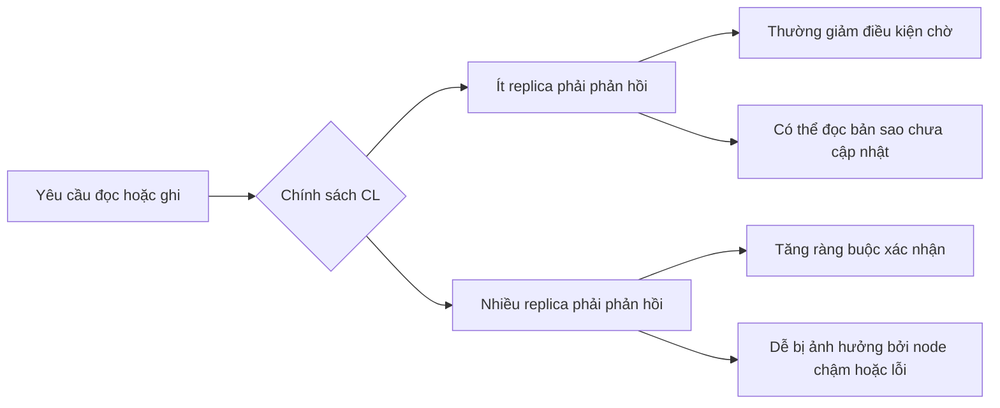
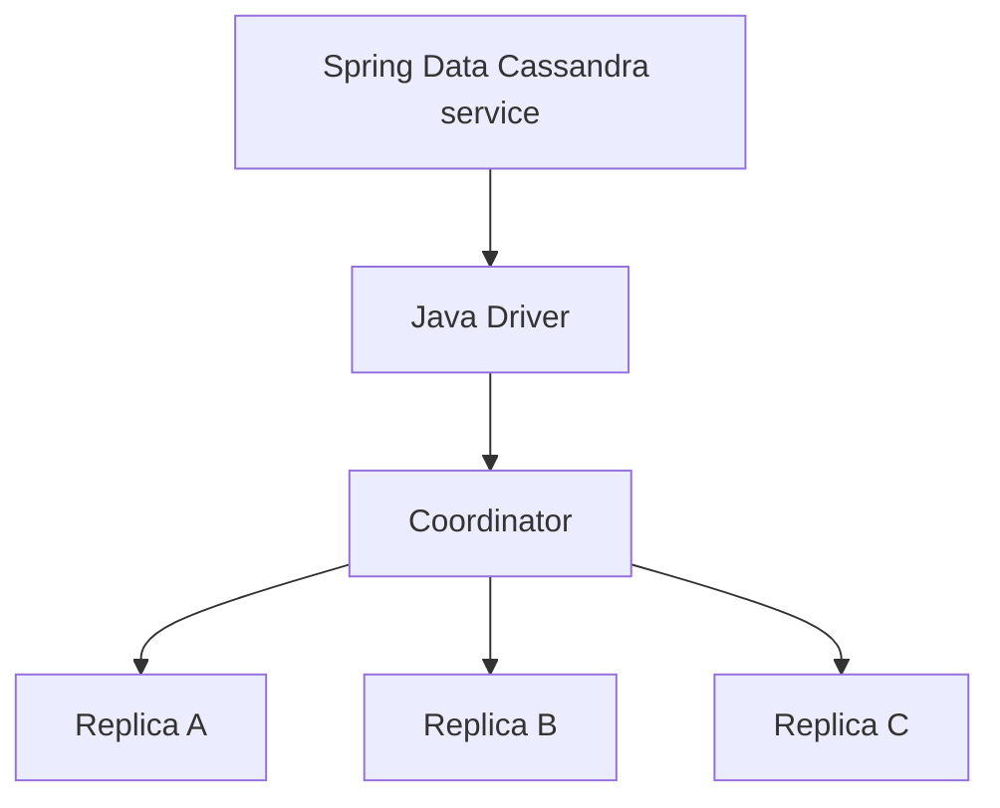
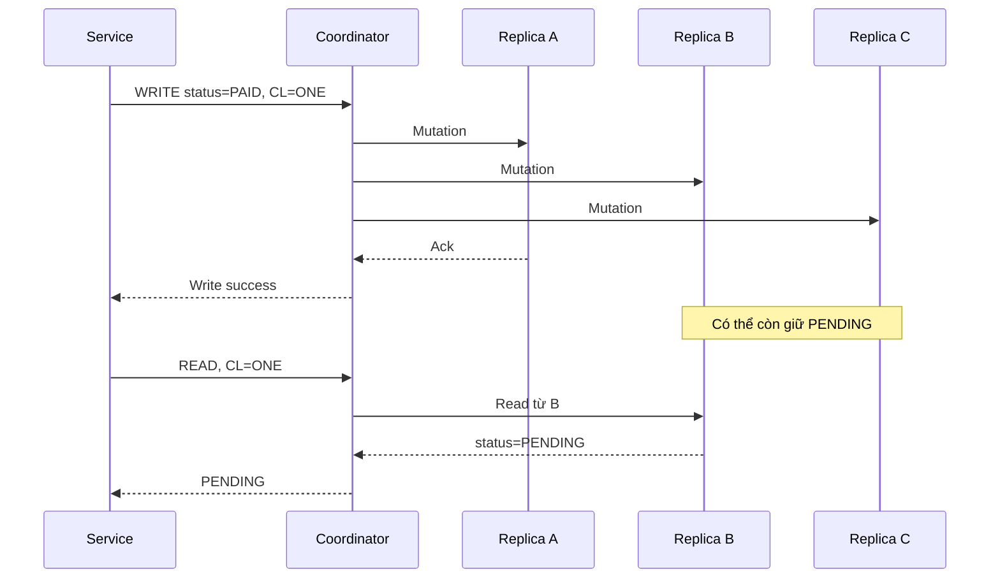
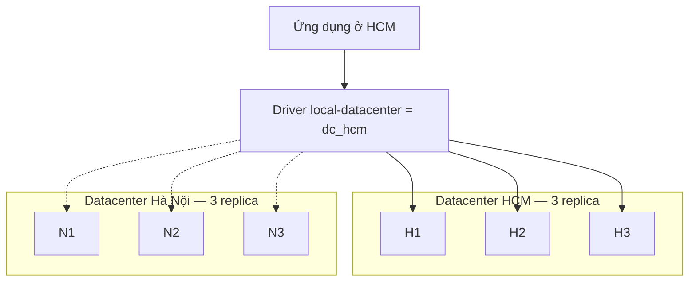
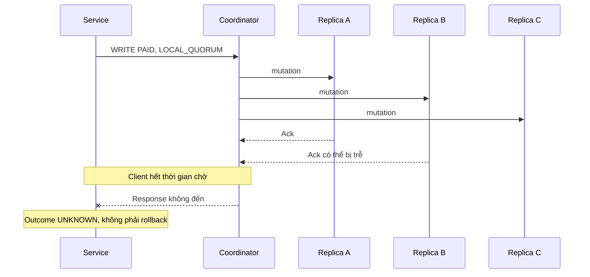
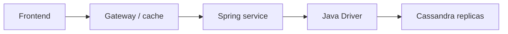

# Đánh đổi giữa độ mới, độ trễ và khả năng đáp ứng khi node lỗi

Trong ứng dụng **Spring Data Cassandra**, một thao tác `repository.save(...)` thành công chưa chắc đồng nghĩa **mọi bản sao** của dữ liệu đã cập nhật. Và một lệnh `findById(...)` ngay sau đó chưa chắc quan sát được trạng thái mới, nhất là khi hệ thống có nhiều datacenter hoặc chỉ yêu cầu một replica trả lời. Đây không nhất thiết là lỗi của repository: đó là một phần của cách **Apache Cassandra** phân phối và sao chép dữ liệu.

Cassandra cho phép chọn **consistency level (CL)** cho từng yêu cầu đọc hoặc ghi. Lựa chọn này ảnh hưởng ba mục tiêu có thể xung đột:

1. **Độ mới (*freshness*):** Có thấy phiên bản đã được ghi gần đây hay vẫn có thể thấy dữ liệu cũ?
2. **Độ trễ (*latency*):** Request cần đợi bao nhiêu replica và kết quả trả về nhanh đến đâu?
3. **Khả năng đáp ứng (*availability*):** Khi replica, node hoặc kết nối giữa datacenter gặp lỗi, request còn đạt đủ điều kiện thành công không?

Bài thuộc chương **Tính nhất quán** và tập trung vào đánh đổi này khi dùng entity mapping, repository, `CassandraTemplate`, CQL và Java Driver. Ta sẽ tính quorum, mô phỏng node failure, phân biệt LOCAL với global consistency, xử lý timeout, kiểm soát ghi cạnh tranh và thực hành với code.

> **Ghi nhớ từ đầu:** CL quy định **mức xác nhận từ replica cho từng request**; nó không tự biến Cassandra thành cơ sở dữ liệu có transaction ACID nhiều partition, không bảo đảm mọi datacenter đã đồng bộ tức thì và không thay thế idempotency hoặc quy tắc nghiệp vụ.

## 1. Một câu chuyện: đơn hàng vừa chuyển sang PAID

Giả sử một người dùng vừa thanh toán. Service ghi `status = PAID`, rồi màn hình chi tiết ngay lập tức tải lại đơn hàng. Kỳ vọng của người dùng là nhìn thấy `PAID`.

Trong một cluster với ba replica, có thể xảy ra:

```text
Trước cập nhật:
  Replica A: status = PENDING
  Replica B: status = PENDING
  Replica C: status = PENDING

Ngay sau một write được xác nhận ở CL ONE:
  Replica A: status = PAID       (đã áp dụng)
  Replica B: status = PENDING    (chưa hội tụ)
  Replica C: status = PENDING    (chưa hội tụ)
```

Một read tiếp theo với CL `ONE` có thể được phục vụ từ replica chưa cập nhật và trả `PENDING`. Coordinator vẫn cố gắng gửi mutation tới các replica theo cơ chế của Cassandra; CL ONE chỉ cho biết **bao nhiêu xác nhận đủ để báo thành công**, không giới hạn số replica cuối cùng sẽ nhận mutation.

Nếu nghiệp vụ không thể chấp nhận trường hợp đó, ta cần cân nhắc chính sách read/write cùng datacenter với quorum giao nhau hoặc workflow mạnh hơn, chứ không chỉ đổi kiểu trả về Java từ `Order` sang `Optional<Order>`.

### Ba mục tiêu nhìn cùng một lúc



Sơ đồ mô tả **xu hướng**, không phải cam kết latency: `ONE` vẫn có thể rất chậm nếu replica hoặc coordinator quá tải; `LOCAL_QUORUM` có thể nhanh trên một cluster khỏe mạnh.

## 2. RF, partition key và replica: nền tảng trước khi tính CL

Một bảng Cassandra được chia theo **partition key**. Replication strategy xác định các node lưu bản sao của từng partition, còn **replication factor (RF)** chỉ số replica mong muốn trong phạm vi datacenter/chiến lược tương ứng.

Ví dụ keyspace test có RF = 3 ở `dc_hcm`:

```sql
CREATE KEYSPACE IF NOT EXISTS commerce_ks
WITH replication = {
    'class': 'NetworkTopologyStrategy',
    'dc_hcm': 3
};
```

Đây là schema minh họa. Một cluster một node không có ba replica độc lập chỉ vì cấu hình RF3; khi kiểm thử chịu lỗi cần triển khai topology phù hợp. Ở production, keyspace thường được quản lý bằng migration/DDL có kiểm soát, không để ứng dụng tự tạo tùy tiện.

Bảng tra cứu đơn theo ID:

```sql
CREATE TABLE IF NOT EXISTS commerce_ks.orders_by_id (
    tenant_id uuid,
    order_id uuid,
    status text,
    total_amount decimal,
    updated_at timestamp,
    PRIMARY KEY ((tenant_id, order_id))
);
```

Hai cột `tenant_id` và `order_id` tạo **composite partition key**; Cassandra dùng tổ hợp ấy để tính token/định vị replica. Câu truy vấn đi theo khóa:

```sql
SELECT tenant_id, order_id, status, total_amount, updated_at
FROM commerce_ks.orders_by_id
WHERE tenant_id = 11111111-1111-1111-1111-111111111111
  AND order_id = 22222222-2222-2222-2222-222222222222;
```

Không cần index bổ sung để tìm hàng bằng đầy đủ partition key này.



**Không nhầm RF với số node toàn cluster.** Cluster có thể có 12 node nhưng mỗi partition chỉ có ba replica khi RF của DC là 3. Khi một node lỗi, tác động đến request phụ thuộc **replica set của partition cụ thể**.

## 3. Consistency level dùng để xác nhận điều gì?

Trong các thao tác thông thường, **read CL** là điều kiện về số replica phải phản hồi đủ cho một read; **write CL** là điều kiện về số replica phải xác nhận đủ cho một write.

| CL | Read RF3 một DC | Write RF3 một DC | Ghi chú |
| --- | --- | --- | --- |
| `ONE` | Cần 1 replica | Cần 1 xác nhận | Nhiều khả năng đáp ứng khi replica lỗi, có nguy cơ đọc stale |
| `LOCAL_ONE` | 1 replica local | 1 replica local | Ưu tiên phạm vi datacenter của coordinator |
| `TWO` | 2 replica | 2 xác nhận | Số cố định, phải đối chiếu RF |
| `THREE` | 3 replica | 3 xác nhận | Với RF3, nhạy với một replica lỗi |
| `QUORUM` | 2 replica | 2 xác nhận | Quorum tổng RF; RF3 ở một DC cần 2 |
| `LOCAL_QUORUM` | 2 replica local | 2 local xác nhận | Quorum trong local DC, rất quan trọng với multi-DC |
| `ALL` | Cả 3 | Cả 3 | Nhạy với bất kỳ replica cần thiết nào không đáp ứng |
| `ANY` | Không dùng | Write có semantics đặc biệt liên quan hint | Không bảo đảm dữ liệu vừa ack đã đọc được |
| `EACH_QUORUM` | Không phải read CL thông thường | Quorum trong **mỗi DC** | Dùng với phạm vi viết phù hợp và strategy hỗ trợ |

`SERIAL` và `LOCAL_SERIAL` dành cho phần **serial/Paxos của lightweight transaction (LWT)**, không phải tên khác của ordinary quorum read/write. Ta sẽ xét riêng.

### ONE không có nghĩa chỉ một replica được ghi

Một write CL ONE có thể được coordinator chuyển mutation tới mọi replica đích, nhưng client được báo thành công khi đủ một xác nhận. Nếu những replica khác đang chậm, dữ liệu có thể chưa hội tụ khi client đọc tiếp.

### ALL không có nghĩa đọc toàn cluster

`ALL` liên quan **mọi replica của partition tương ứng** theo RF, không phải tất cả node trong cluster. Khi RF3 và cả ba replica của partition đều phải đáp ứng, một replica chậm/down làm request dễ lỗi hơn.

## 4. Công thức quorum và điều kiện giao nhau

Với RF lẻ hay chẵn, quorum được tính:

\[
Q = \left\lfloor\frac{RF}{2}\right\rfloor + 1
\]

Với RF3:

\[
Q = \left\lfloor\frac{3}{2}\right\rfloor + 1 = 2
\]

Vì thế `LOCAL_QUORUM` trong DC có RF3 cần hai replica local. Trong một mô hình replica set ổn định, nếu số replica read `R` và write `W` thỏa:

\[
R + W > RF
\]

thì **bất kỳ hai tập replica** dùng để xác nhận write và phục vụ read đều có ít nhất một replica giao nhau.

| Write | Read | `W+R` với RF3 | Giao nhau bắt buộc? |
| --- | --- | --- | --- |
| `ONE` (1) | `ONE` (1) | 2 | Không |
| `ONE` (1) | `QUORUM` (2) | 3 | Không chỉ từ công thức |
| `QUORUM` (2) | `ONE` (1) | 3 | Không chỉ từ công thức |
| `QUORUM` (2) | `QUORUM` (2) | 4 | Có |
| `ALL` (3) | `ONE` (1) | 4 | Có, nếu write ALL hoàn tất |
| `ONE` (1) | `ALL` (3) | 4 | Có, nếu read ALL hoàn tất |

**Phạm vi phải trùng nhau.** RF3 ở HCM và RF3 ở Hà Nội là hai tập replica local khác nhau. Ghi `LOCAL_QUORUM` HCM và đọc `LOCAL_QUORUM` Hà Nội **không có giao nhau bắt buộc** chỉ nhờ cùng tên CL.

### Điều kiện R + W không tạo linearizability tuyệt đối

Nó là lập luận về **giao nhau giữa các tập replica**, rất hữu ích để suy luận về độ mới của một write đã xác nhận. Nhưng cần thận trọng với:

- Ghi cạnh tranh có timestamp khác nhau hoặc clock skew.
- Cassandra giải quyết xung đột của cell theo timestamp/semantics.
- Read và write trên nhiều partition không tạo snapshot chung.
- Topology, transient replication, repair, timeout và trạng thái replica thực tế.
- Các side effect ngoài Cassandra không bị ràng buộc bởi CL.

Vì vậy, không được tuyên bố “`QUORUM` = transaction tuyến tính hóa mọi thứ”. Khi cần **compare-and-set**, dùng LWT/CAS theo hợp đồng riêng.

## 5. Vì sao ONE đọc được trạng thái cũ?

Giả sử ba replica A, B, C ban đầu có `PENDING`. Một write `PAID` được xác nhận từ A ở CL ONE. B và C chưa kịp nhận hoặc áp dụng.



Sơ đồ là **một diễn biến khả dĩ**, không phải Cassandra luôn chọn B. Driver routing, coordinator, replica preference và tình trạng node quyết định đường thực tế.

**Ứng dụng phải chọn** liệu loại stale read này có chấp nhận được không. Với feed hoặc gợi ý, có thể chấp nhận một độ trễ nhất định. Với xác nhận thanh toán hoặc kiểm tra điều kiện nghiệp vụ, cần policy mạnh hơn và có thể cả LWT.

## 6. Quorum đọc/ghi giúp gì?

Với RF3, write `LOCAL_QUORUM` được xác nhận bởi hai replica, ví dụ A và B. Bất kỳ read local quorum hai replica đều giao với tập `{A,B}`:

```text
Write quorum: {A, B}

Read quorum có thể là:
  {A, B}  -> giao nhau
  {A, C}  -> giao ở A
  {B, C}  -> giao ở B
```

Điều này hỗ trợ yêu cầu **read-after-write** trong cùng local DC khi write đã được xác nhận, không có write cạnh tranh gây conflict, và các giả định về replica/đọc được thỏa.

Nhưng quorum **không tự**:

- Kiểm tra trạng thái cũ trước khi thay đổi.
- Cấp optimistic locking theo `updated_at`.
- Rollback một `repository.saveAll(...)` có nhiều partition.
- Giữ snapshot ổn định qua hai lần paging.
- Đồng bộ ngay mọi datacenter từ một write local.
- Đồng bộ hai bảng read model riêng.
- Ngăn ứng dụng thu tiền nhiều lần khi retry.

**Độ mới của dữ liệu đọc** khác với **tính đúng của quy trình nghiệp vụ**. Cần xử lý cả hai.

## 7. Khả năng đáp ứng khi replica lỗi

Với **một partition RF3 trong một DC**, điều kiện số lượng khi replica mất phản hồi:

| Replica còn khả dụng | `ONE/LOCAL_ONE` | `QUORUM/LOCAL_QUORUM` | `ALL` |
| --- | --- | --- | --- |
| 3 trên 3 | Đủ | Đủ | Đủ |
| 2 trên 3 | Đủ | Đủ | Không đủ |
| 1 trên 3 | Đủ | Không đủ | Không đủ |
| 0 trên 3 | Không đủ | Không đủ | Không đủ |

“Đủ” nghĩa là **đủ số replica theo điều kiện lý thuyết**. Request vẫn có thể bị timeout nếu các node còn sống quá tải, network có packet loss hoặc query tốn kém.

### Nút sống không đồng nghĩa đáp ứng kịp

Một node hiển thị `UN` (Up/Normal) trong `nodetool status` vẫn có thể phản hồi chậm vì:

- Disk I/O/compaction hoặc GC.
- Hot partition hoặc request queue.
- Network packet loss.
- Tombstones, partition lớn hoặc truy vấn thiếu đường khóa.
- Driver chọn coordinator/route không phù hợp.

Nên phân biệt:

| Lỗi | Diễn giải |
| --- | --- |
| `Unavailable` | Coordinator xác định không đủ replica cần thiết cho CL hoặc điều kiện request |
| `ReadTimeout` | Chờ read không đủ phản hồi trong thời hạn |
| `WriteTimeout` | Chờ write không đủ xác nhận trong thời hạn |
| `Overloaded`/transport failure | Node/quá tải hoặc đường kết nối gặp vấn đề |
| Lỗi cú pháp/schema | Không liên quan việc hạ CL; phải sửa query/schema |

**Đừng tăng timeout để “chữa” thiếu replica quorum**. Nếu local RF3 chỉ còn một replica và request cần LOCAL_QUORUM, điều kiện xác nhận vẫn không đủ.

## 8. Tính số replica theo partition, không theo toàn cluster

Giả sử một DC có chín node và RF3.

```text
Partition P1 có replica: A, B, C
Partition P2 có replica: D, E, F
Partition P3 có replica: G, H, I
```

Nếu A và B không khả dụng:

- `P1` chỉ còn C → `LOCAL_QUORUM` không đủ.
- `P2` vẫn có D, E, F → `LOCAL_QUORUM` có thể đủ.
- `P3` vẫn có G, H, I → `LOCAL_QUORUM` có thể đủ.

Đây là sơ đồ mô phỏng đơn giản về placement, không phải cấu trúc token ring chính xác của cluster.

Do đó “cluster còn 7/9 node” không cho biết mọi partition đều đạt CL nào. Cần xem replica placement và khả năng đáp ứng của **partition bị truy vấn**.

### Hệ quả cho ứng dụng

- Một số request `findById` có thể thành công, số khác bị unavailable.
- Một `saveAll` gồm nhiều entity/partition có thể **thành công một phần**.
- Một lô import không tự rollback chỉ vì có node lỗi.
- Khi xử lý lỗi, cần giữ key/operation ID để đối soát những kết quả chưa rõ.

## 9. Hai datacenter làm thay đổi phép tính quorum

Giả sử mỗi partition có RF3 ở HCM và RF3 ở Hà Nội:

```sql
CREATE KEYSPACE IF NOT EXISTS commerce_ks
WITH replication = {
    'class': 'NetworkTopologyStrategy',
    'dc_hcm': 3,
    'dc_hn': 3
};
```

Tổng RF danh nghĩa = 6, nhưng RF mỗi DC = 3.



| CL | Số replica/phạm vi phải phản hồi | Tác động quan trọng |
| --- | --- | --- |
| `LOCAL_ONE` | 1 local | Không cần đợi remote cho điều kiện CL local |
| `LOCAL_QUORUM` | 2 trong DC local | Giảm phụ thuộc WAN nhưng không bảo đảm remote DC đã thấy write |
| `QUORUM` | 4 trong tổng 6 replica | Có thể cần phản hồi xuyên DC |
| `EACH_QUORUM` write | 2 ở HCM **và** 2 ở HN | Nhạy với sự cố của từng DC |
| `ALL` | Cả 6 | Rất nhạy với node hoặc DC không phản hồi |

**Không nhầm QUORUM với LOCAL_QUORUM** khi có nhiều DC. Tổng quorum của RF6 là 4, còn quorum của một DC RF3 chỉ là 2.

### Cross-DC read-after-write

```text
t0: Service HCM ghi status=PAID với LOCAL_QUORUM
t1: Hai replica HCM xác nhận, client nhận success
t2: Traffic được chuyển sang ứng dụng tại HN
t3: Ứng dụng HN đọc với LOCAL_QUORUM
t4: Các replica HN có thể chưa áp dụng mutation mới
    -> client vẫn thấy status=PENDING
```

Hai local quorum trong **hai DC khác nhau không tự giao nhau**. Nếu sản phẩm yêu cầu đọc ngay tại DC khác sau khi ghi, cần thiết kế routing, replication expectations, global consistency policy hoặc workflow có tính đến độ trễ WAN. Không thể chỉ đặt cùng tên `LOCAL_QUORUM` ở cả hai DC rồi coi như đã đạt mục tiêu.

## 10. Khi mất kết nối giữa các datacenter

Giả sử HCM và HN không liên lạc được nhưng mỗi DC còn đủ ba replica local.

- Ứng dụng ở HCM có thể tiếp tục read/write `LOCAL_QUORUM` tại HCM.
- Ứng dụng ở HN có thể tiếp tục read/write `LOCAL_QUORUM` tại HN.
- Hai bên có thể **tạm thời diverge** nếu cùng cập nhật một key khi đường giữa DC bị chia cắt.
- `QUORUM` trên tổng RF6 cần 4 replica; chỉ ba local không đủ.
- `EACH_QUORUM` write cần quorum ở cả hai DC, nên không đạt nếu WAN bị chia cắt theo cách cản xác nhận.
- Khi mạng phục hồi, Cassandra phải hội tụ theo timestamp/repair và cơ chế liên quan, không có transaction hợp nhất nghiệp vụ tự động.

### Vì sao không nên nói Cassandra “luôn AP” hay “luôn CP”?

CAP nêu một đánh đổi khi xảy ra **network partition**, nhưng Cassandra có **tunable consistency** theo request và các khả năng riêng cho conditional mutation. Trong sự cố WAN, **cùng một cluster** có thể đáp ứng request LOCAL_ONE/LOCAL_QUORUM ở một số phạm vi nhưng từ chối QUORUM tổng RF.

Suy luận tốt hơn là ghi rõ: *partition nào, RF nào, local DC nào, CL nào, các replica nào đang sẵn sàng, và nghiệp vụ có cho phép đọc stale hay không*.

## 11. Độ trễ: chờ một hay nhiều replica?

Ví dụ minh họa độ trễ của ba replica cùng DC:

```text
Replica A:  4 ms
Replica B:  9 ms
Replica C: 60 ms

ONE:    có thể hoàn tất với phản hồi sớm phù hợp.
QUORUM: cần đủ hai phản hồi.
ALL:    phải đợi cả ba, gồm replica C chậm.
```

Các số chỉ giúp hình dung, không phải công thức đo driver. Coordinator có thể chọn replica ưu tiên, gửi request đồng thời, retry, speculative execution hoặc bị ảnh hưởng bởi các bước xử lý khác.

| Yếu tố | Có thể ảnh hưởng latency |
| --- | --- |
| Replica chậm/GC/disk I/O | Làm quorum hoặc ALL phải chờ lâu |
| Hot partition | Tăng queue/CPU cho cùng nhóm replica |
| Network và WAN | Tăng RTT, jitter, packet loss |
| CL cao | Tăng số phản hồi bắt buộc |
| Query không đi theo partition key | Fan-out/lọc rộng, có thể rất đắt |
| Tombstone/partition lớn | Read amplification |
| Driver routing sai DC | Gửi request xa hoặc chọn coordinator không tối ưu |
| Retry/speculative execution | Có thể giảm tail latency nhưng thêm tải |
| Mapping Java | Thêm CPU sau khi Row được trả |

**P95/P99 có thể quan trọng hơn trung bình**: chỉ một replica thường xuyên chậm cũng có thể làm CL ALL có tail latency rất xấu. Nhưng không nên hạ CL nếu bottleneck chính là query sai schema hoặc thiếu tài nguyên.

## 12. Ghi cạnh tranh: dữ liệu mới chưa chắc là trạng thái đúng

Hai request cùng đọc `PENDING` rồi ghi:

```text
Request A: status = PAID
Request B: status = CANCELLED
```

Cả hai có thể dùng `LOCAL_QUORUM` và vẫn gây conflict. Cassandra giải quyết cạnh tranh ở cấp cell/mutation thường theo **write timestamp**, không tự hiểu luật “đã thanh toán không được hủy”.

**Last-write-wins** không hoàn toàn đồng nghĩa với “HTTP request hoàn tất cuối”. Timestamp có thể được gán từ nhiều nguồn và clock skew/client-supplied timestamps có thể ảnh hưởng kết quả.

Do đó:

- Đừng dùng `LOCAL_QUORUM` thay optimistic locking hoặc CAS.
- Đừng coi `updated_at` là version concurrency tự động.
- Đừng suy request trả thành công trước sẽ luôn bị write sau thay thế theo thời gian thực.
- Khi chuyển trạng thái có điều kiện, xem **LWT** hoặc workflow điều phối phù hợp.
- Với side effect tài chính, cần idempotency key riêng.

## 13. Lightweight transaction: khi cần điều kiện trạng thái

Cassandra hỗ trợ **LWT (lightweight transaction)** cho mutation có điều kiện, ví dụ:

```sql
UPDATE commerce_ks.orders_by_id
SET status = 'PAID'
WHERE tenant_id = 11111111-1111-1111-1111-111111111111
  AND order_id = 22222222-2222-2222-2222-222222222222
IF status = 'PENDING';
```

Ứng dụng phải kiểm tra kết quả **applied**. Nếu condition không đúng, thao tác không được áp dụng dù CQL request được xử lý hợp lệ.

| Loại consistency | Vai trò |
| --- | --- |
| Regular CL như `LOCAL_QUORUM` | Điều kiện nhất quán của những pha read/write/commit thích hợp |
| `SERIAL` | Điều phối serial/Paxos theo phạm vi được hỗ trợ |
| `LOCAL_SERIAL` | Điều phối serial/Paxos theo local DC với các giới hạn đa DC tương ứng |

Không tự động dùng `LOCAL_SERIAL` nếu cùng key có conditional writes ở nhiều DC mà chưa hiểu phạm vi serial. Không trộn chính sách serial tùy tiện giữa client. LWT tăng chi phí coordination/latency và **không biến nhiều partition hoặc nhiều bảng thành một transaction SQL chung**.

### Quorum không làm thay LWT

```text
READ PENDING (LOCAL_QUORUM)
if status == PENDING:
    WRITE PAID (LOCAL_QUORUM)
```

Đây vẫn là **read–check–write không nguyên tử**: một writer khác có thể thay đổi status sau bước read và trước write. LWT đưa điều kiện vào mutation để Cassandra xử lý theo cơ chế CAS thay vì dựa vào khoảng giữa hai lệnh Java.

## 14. Timeout là trạng thái chưa rõ, không phải rollback

Giả sử service gửi write CL `LOCAL_QUORUM`. Một replica áp dụng mutation, replica thứ hai có thể cũng áp dụng nhưng ack bị trễ hoặc mất. Driver nhận `WriteTimeout`.



Không thể kết luận một write timeout nghĩa là “không có gì được ghi”. Một số replica có thể đã lưu dữ liệu dù client không nhận success.

### Ba trạng thái cần phân biệt

| Trạng thái ứng dụng | Ý nghĩa | Hành động |
| --- | --- | --- |
| **CONFIRMED** | Đã nhận phản hồi thành công đạt điều kiện CL | Tiếp tục quy trình theo hợp đồng |
| **REJECTED** | Dữ liệu/CQL/điều kiện bị từ chối rõ theo semantics | Sửa lỗi hoặc xử lý business conflict |
| **UNKNOWN** | Timeout/mất kết nối khiến outcome chưa xác định | Đối soát rồi retry có điều kiện/idempotent |

Ví dụ: Không được **thu tiền lần nữa** chỉ vì ghi status vào Cassandra timeout. Payment gateway có side effect độc lập và phải dùng **payment operation ID** ổn định để đối soát trước khi làm thêm bất cứ hành động tài chính nào.

### Retry một mutation có luôn an toàn?

Không. Cần xét:

- Ghi lại cùng giá trị trên cùng primary key có thể có timestamp/TTL mới.
- Writer khác có thể đã ghi trạng thái sau đó.
- Increment counter không giống một phép set idempotent.
- LWT có kết quả applied/not-applied cần diễn giải.
- Ghi nhiều read model có thể thất bại từng phần.
- Gửi email/thu tiền/phát event ngoài database có thể bị thực thi trùng.

Một retry policy đúng có **giới hạn, backoff, idempotency key và đối soát outcome**.

## 15. Hinted handoff, read repair và hội tụ dữ liệu

Cassandra có nhiều cơ chế hỗ trợ eventual convergence:

**Hinted handoff:** Khi replica đích tạm thời không nhận mutation, coordinator có thể lưu hint trong những điều kiện/cấu hình phù hợp để chuyển sau. Hints có giới hạn lưu giữ và không thay thế quy trình repair. CL `ANY` ở ghi có semantics đặc biệt liên quan hint; một write được xác nhận theo kiểu này **không bảo đảm đọc được ngay ở CL ONE**.

**Read repair:** Khi read phát hiện dữ liệu không đồng nhất giữa replica, Cassandra có thể đối chiếu/sửa trong phạm vi theo phiên bản và thiết lập. Chi tiết blocking hoặc những trường hợp áp dụng đã thay đổi qua các version, nên không tuyên bố mọi read đều repair toàn bộ replica.

**Anti-entropy repair:** Hoạt động repair đồng bộ replica để khắc phục phân kỳ mà những cơ chế khác chưa xử lý hết. Tổ chức repair, giữ tombstone, compaction, backup và khôi phục node đều cần quy trình vận hành.

**Hệ quả:** Không thể chọn CL thấp rồi khẳng định “hints/read repair sẽ lập tức làm mọi replica đồng nhất”. Muốn biết độ mới thực tế, phải đo replication lag/canary theo workflow và theo dõi sức khỏe cluster.


## 16. Chọn CL theo loại dữ liệu và kỳ vọng người dùng

Không có một CL duy nhất là “tốt nhất” cho tất cả tính năng. Hãy phân tích **đường ghi**, **đường đọc**, **phạm vi datacenter**, **độ mới chấp nhận được** và **hệ quả khi dữ liệu cũ xuất hiện**.

| Use case | Yêu cầu độ mới | Chính sách cần đánh giá | Lưu ý |
| --- | --- | --- | --- |
| Đọc trạng thái thanh toán vừa được xác nhận trong cùng DC | Cao | `LOCAL_QUORUM` cho các read/write liên quan | Vẫn cần concurrency policy và idempotency |
| Xem danh sách hoạt động, có thể chậm cập nhật vài giây | Trung bình | `LOCAL_ONE` read có thể chấp nhận | UI phải chịu được event chưa xuất hiện |
| Ghi telemetry có thể replay | Phụ thuộc SLA | CL phù hợp durability/throughput | Cần chống mất/trùng event theo pipeline |
| Đọc cấu hình bảo mật/giới hạn tài nguyên | Cao | Quorum/nguồn dữ liệu có thẩm quyền | Cache stale có thể gây quyết định sai |
| Gợi ý sản phẩm hay thống kê không thời gian thực | Thấp hơn | Có thể chọn local read CL thấp | Không dùng để xác nhận tiền/tồn kho |
| Đọc ngay sau write ở DC khác | Rất cao | Cân nhắc policy cross-DC/routing | Local quorum ở hai DC không tự giao nhau |
| Chuyển `PENDING` → `PAID` chỉ khi điều kiện còn đúng | Cần tránh race | LWT cùng consistency policy thích hợp | Ordinary quorum không phải CAS |
| Job backfill/báo cáo | Cần tính đầy đủ, có mốc | CL + checkpoint + đối soát | CL không tạo snapshot nhiều trang |

Đây là **hướng đặt câu hỏi**, không phải cấu hình áp dụng hàng loạt. Nếu ứng dụng có yêu cầu compliance hoặc tài chính, cần tiêu chuẩn nhất quán được review cùng logic nghiệp vụ.

### Ví dụ consistency contract cho một operation

```text
Operation: ConfirmPaymentState
Table:     orders_by_id
Key:       (tenant_id, order_id)
Write CL:  LOCAL_QUORUM
Read CL:   LOCAL_QUORUM
DC:        Ưu tiên cùng DC trong khoảng xác nhận
CAS:       Có, nếu state transition yêu cầu điều kiện
Retry:     Giới hạn và dùng stable operation ID
Unknown:   Đối soát trước khi retry side effect
Latency:   Theo P95/P99 của hợp đồng sản phẩm
```

Bản contract là quy ước nội bộ ở tầng service, không phải file cấu hình Cassandra tự hiểu.

## 17. Cấu hình CL mặc định với Spring Boot

Spring Boot/Spring Data Cassandra hiện đại có cấu hình Cassandra qua nhóm `spring.cassandra`. Ví dụ định hướng:

```yaml
spring:
  cassandra:
    contact-points:
      - 127.0.0.1:9042
    local-datacenter: dc_hcm
    keyspace-name: commerce_ks
    request:
      consistency: LOCAL_QUORUM
      timeout: 5s
```

Đây chỉ là **ví dụ cấu hình**:

- `127.0.0.1` là địa chỉ minh họa, không dùng cho cluster production phân tán.
- Đặt đúng tên datacenter theo topology thực tế.
- Bổ sung auth/TLS và cấu hình bảo mật theo môi trường.
- Chọn timeout từ SLA và đo latency, không sao chép số `5s` cho mọi endpoint.
- Đối chiếu tên properties với **phiên bản Spring Boot, Spring Data Cassandra và driver** được khóa trong dự án. Nếu ứng dụng dùng thêm `application.conf`/driver config, cần hiểu precedence.

Một **default CL** giúp thống nhất phần lớn request. Nhưng khi các nhóm nghiệp vụ có nhu cầu khác nhau, phải xác định cách override hợp lệ theo API/version, tránh cấu hình ngầm không thể kiểm tra.

### Đừng suy từ cqlsh ra Spring Boot

Trong `cqlsh` có thể đặt:

```text
CONSISTENCY LOCAL_QUORUM;
```

Đây là **lệnh tương tác của cqlsh**, không phải phần của CQL `SELECT`. Cấu hình cqlsh không tự thay đổi CL của Java Driver trong ứng dụng. Hai client có thể đang dùng hai policy khác nhau mà đều chạy query giống hệt.

## 18. Java Driver 4: ghi rõ CL cho từng statement

Spring Data Cassandra sử dụng **Cassandra Java Driver** ở bên dưới. Khi cần kiểm soát một truy vấn cụ thể và xác minh lựa chọn consistency, có thể dùng `CqlSession` và prepared statement.

Ví dụ truy vấn trạng thái theo composite partition key:

```java
import java.util.Optional;
import java.util.UUID;

import com.datastax.oss.driver.api.core.CqlSession;
import com.datastax.oss.driver.api.core.DefaultConsistencyLevel;
import com.datastax.oss.driver.api.core.cql.BoundStatement;
import com.datastax.oss.driver.api.core.cql.PreparedStatement;
import com.datastax.oss.driver.api.core.cql.Row;

public final class OrderStatusReader {

    private final CqlSession session;
    private final PreparedStatement selectStatus;

    public OrderStatusReader(CqlSession session) {
        this.session = session;
        this.selectStatus = session.prepare("""
            SELECT status
            FROM commerce_ks.orders_by_id
            WHERE tenant_id = ? AND order_id = ?
            """);
    }

    public Optional<String> findAtLocalQuorum(
            UUID tenantId, UUID orderId) {

        BoundStatement statement = selectStatus
            .bind(tenantId, orderId)
            .setConsistencyLevel(
                DefaultConsistencyLevel.LOCAL_QUORUM
            );

        Row row = session.execute(statement).one();

        return row == null
            ? Optional.empty()
            : Optional.ofNullable(row.getString("status"));
    }
}
```

Trong code mẫu:

1. `PreparedStatement` được chuẩn bị một lần, có thể dùng lại cho nhiều lần bind.
2. `BoundStatement` mang giá trị khóa và `LOCAL_QUORUM` cho **request cụ thể**.
3. `Row` có thể không tồn tại khi query trả 0 hàng.
4. Ví dụ gộp cả “không có row” và “có row nhưng status null” thành `Optional.empty()`. Nếu ứng dụng cần phân biệt hai trạng thái, hãy dùng return type/DTO riêng.
5. Lỗi `ReadTimeout`, `Unavailable` hoặc lỗi quyền/schema **không phải** `Optional.empty()`. Không catch-all rồi trả empty.

### Ghi với CL tường minh

```java
PreparedStatement update = session.prepare("""
    UPDATE commerce_ks.orders_by_id
    SET status = ?
    WHERE tenant_id = ? AND order_id = ?
    """);

BoundStatement statement = update.bind(
        "PAID", tenantId, orderId)
    .setConsistencyLevel(
        DefaultConsistencyLevel.LOCAL_QUORUM
    );

session.execute(statement);
```

Đây là đoạn mã **nằm bên trong service đã có `session`, `tenantId`, `orderId`**, không phải class chạy độc lập. Nó cập nhật theo key với ordinary Cassandra mutation; nó **không** kiểm tra status cũ và không giúp service thanh toán đạt exactly-once.

### LWT: phân biệt regular CL với serial CL

```java
PreparedStatement cas = session.prepare("""
    UPDATE commerce_ks.orders_by_id
    SET status = ?
    WHERE tenant_id = ? AND order_id = ?
    IF status = ?
    """);

BoundStatement statement = cas.bind(
        "PAID", tenantId, orderId, "PENDING")
    .setConsistencyLevel(
        DefaultConsistencyLevel.LOCAL_QUORUM
    )
    .setSerialConsistencyLevel(
        DefaultConsistencyLevel.LOCAL_SERIAL
    );

Row applied = session.execute(statement).one();

if (applied == null || !applied.getBoolean("[applied]")) {
    // Domain xử lý trường hợp conditional update không thành công.
}
```

**Chú ý:** `LOCAL_SERIAL` minh họa cách đặt serial consistency, không phải đề xuất dùng mặc định cho mọi hệ thống đa DC. Chính sách Paxos/serial phải nhất quán với mô hình writer và yêu cầu concurrent updates. Kiểm chứng API và hành vi trên Java Driver/Cassandra version đang chạy.

## 19. Repository và CassandraTemplate có CL từ đâu?

Ví dụ:

```java
public interface OrderRepository
        extends CassandraRepository<OrderById, OrderKey> {
}
```

Service gọi:

```java
OrderById order = repository.findById(key).orElseThrow();
repository.save(order.withStatus("PAID"));
```

Cả hai request đi qua Spring Data/driver. **Chỉ nhìn tên method không biết request dùng CL nào**. CL có thể đến từ default driver configuration hoặc các request/statement options được đường gọi đó áp dụng.

Tương tự:

```java
OrderById order =
    cassandraTemplate.selectOneById(key, OrderById.class);
```

vẫn chịu CL và request timeout được cấu hình cho template/driver. Một `@Table` entity **không sở hữu CL cố định**; CL là quyết định cho request. Những ví dụ entity, repository và `withStatus` giả định đã khai báo đầy đủ theo mapping của dự án.

### Cách làm an toàn với nhiều use case

- Đặt **default CL rõ ràng** cho những request thường gặp.
- Tài liệu hóa operation nào cần override và **lý do nghiệp vụ**.
- Nếu API template/module hỗ trợ statement options, dùng đúng phiên bản; không tự nghĩ ra method `repository.setConsistencyLevel(...)`.
- Nếu cần minh bạch tối đa cho một critical statement, dùng `CqlSession` với options như phần trước.
- Tạo integration test hoặc instrumentation xác nhận **CL thật được gửi**, không chỉ giá trị mong muốn trong cấu hình.
- Không ghi log dữ liệu cá nhân, token hoặc toàn bộ bind values để debug CL.

## 20. Read-your-writes từ góc nhìn sản phẩm

Một người dùng thay đổi tên hồ sơ rồi lập tức tải lại trang. Nếu API thấy tên cũ, vấn đề có thể nằm ở nhiều tầng:



Trước khi đổi CL, hãy kiểm tra:

1. Frontend có đang hiển thị cache cũ không?
2. Gateway hoặc cache service có TTL dài không?
3. Ghi và đọc có vào cùng keyspace, partition key và bảng không?
4. Request ghi đã được **xác nhận thành công** hay chỉ nhận timeout?
5. Hai request có dùng cùng DC hay đã bị chuyển sang DC khác?
6. CL của read và write là gì, có điều kiện giao nhau không?
7. Có writer khác cập nhật cùng field với timestamp khác không?
8. Có read model denormalized hoặc pipeline event chưa theo kịp không?

Có thể dùng kết quả write đã xác nhận để cập nhật UI một cách hợp lý, nhưng không được che việc **outcome chưa rõ** khi write timeout.

### Cache stale không được sửa bằng quorum

Nếu Cassandra đã thấy dữ liệu mới ở `LOCAL_QUORUM` nhưng Redis vẫn giữ phiên bản cũ, tăng CL từ `QUORUM` lên `ALL` không làm cache hết stale. Cần cache invalidation, versioned keys hoặc TTL/refresh policy đúng.

## 21. Paging và nhiều entity không có snapshot chung

Một service lấy hai trang lịch sử sự kiện:

```text
Trang 1: đọc tại T1
Trang 2: đọc tại T2
Giữa T1 và T2: có event mới hoặc delete/TTL
```

Dù cả hai đọc ở `LOCAL_QUORUM`, chúng **không mặc định tạo một snapshot bất biến**. Paging state cho biết vị trí tiếp tục query, không cung cấp transaction snapshot nhiều request.

Tương tự, một repository method:

```java
repository.findAllById(List.of(key1, key2, key3));
```

có thể đọc **nhiều partition** ở những thời điểm khác nhau. Không có một quorum chung cho cả `List` và không có transaction nhiều partition chỉ nhờ gọi một phương thức.

### Hai bảng read model cần đồng bộ riêng

Giả sử ứng dụng ghi `orders_by_id` và `orders_by_status_day` cho cùng đơn hàng. Ghi thành công CL `LOCAL_QUORUM` ở bảng đầu **không tự cập nhật bảng thứ hai**. Cần dual-write/event propagation, retry, backfill và đối soát theo hợp đồng; riêng replication của Cassandra chỉ sao chép **dữ liệu của cùng partition/table**, không tự đồng bộ các bản ghi denormalized khác nhau.

Để đọc danh sách lớn có hiệu năng, vẫn phải thiết kế **partition key, clustering key và paging** đúng; CL cao không sửa một query quét rộng.

## 22. Có nên hạ CL khi node lỗi?

Một ý tưởng phổ biến là: nếu `LOCAL_QUORUM` không còn đủ replica, tự động thử `LOCAL_ONE` để API luôn trả kết quả. Đây là **thay đổi hợp đồng nghiệp vụ** chứ không phải retry cùng semantics.

| API | Khả năng cân nhắc degraded mode | Rủi ro |
| --- | --- | --- |
| Gợi ý sản phẩm, nội dung không quan trọng | Có thể cho phép dữ liệu trễ | Chất lượng hiển thị thấp tạm thời |
| Danh sách hoạt động gần đây | Tùy mức stale cho phép | Sự kiện mới chưa xuất hiện |
| Đọc trạng thái thanh toán | Cần thận trọng | Có thể báo sai đã thanh toán/chưa thanh toán |
| Xác nhận tồn kho hoặc giới hạn tài khoản | Cần thận trọng cao | Quyết định nghiệp vụ sai do stale |
| Kiểm tra quyền truy cập | Phải theo security policy | Dữ liệu quyền cũ có thể gây lỗ hổng |
| Báo cáo cuối ngày | Có thể trì hoãn và đối soát | Dữ liệu không đầy đủ nếu trả kết quả quá sớm |

Một chính sách fallback hợp lý phải được **định nghĩa và review trước sự cố**. Không catch mọi exception rồi tự chuyển CL xuống thấp hơn ở tất cả repository methods.

### Ví dụ hai policy trái ngược

```text
ViewRecommendations:
  - Normal read: LOCAL_ONE
  - Failure: bounded retry, có thể dùng cache đã biết stale
  - UI: hiển thị theo freshness policy

ConfirmPayment:
  - Normal write: LOCAL_QUORUM và idempotency workflow
  - Failure: không tự hạ CL không điều kiện
  - UNKNOWN: lưu operation ID, đối soát với nguồn thanh toán
  - UI: phản hồi PENDING khi chưa thể xác định outcome
```

## 23. Retry, speculative execution và timeout

Cassandra Java Driver hỗ trợ chính sách retry và có thể hỗ trợ speculative execution trong những điều kiện nhất định.

### Retry cần biết request có lặp an toàn không

- Ghi một giá trị mới vào cùng key có thể tương đối dễ retry nếu không có writer cạnh tranh, nhưng timestamp/TTL và side effect vẫn phải đánh giá.
- **Counter increment** không tương đương set idempotent.
- Một lần gửi thanh toán ra bên ngoài không được lặp chỉ vì Cassandra bị timeout.
- LWT cần xử lý kết quả applied và trạng thái sau timeout.
- Retry quá nhiều tăng tải trên cluster đang chậm, có thể tạo vòng xoáy timeout.

Chính sách retry nên có giới hạn lần thử, giới hạn tổng thời gian, backoff/jitter, metric và đường đối soát cho outcome unknown.

### Speculative execution không miễn phí

Driver có thể gửi request tương đương tới coordinator khác khi request đầu chậm, với điều kiện statement/policy cho phép. Điều này có thể cải thiện tail latency nhưng làm tăng tải và số request đang xử lý.

Không dùng speculative execution như cách chữa hot partition, sai schema, disk saturation hoặc thiếu replica quorum. Cần hiểu **idempotence của statement** trước khi áp dụng.

### Timeout phải khớp SLO

| Timeout | Cần đối chiếu |
| --- | --- |
| Driver request timeout | Thời gian driver chờ kết quả |
| API gateway timeout | Thời gian client HTTP còn chờ |
| Service deadline | Thời gian toàn bộ workflow |
| Retry/backoff window | Tổng thời gian các lần thử |
| Cassandra replica latency | Phân bố P95/P99 của read/write thực |

Nếu driver timeout dài hơn HTTP deadline, service có thể tiếp tục gửi request khi frontend đã bỏ cuộc. Nếu timeout quá ngắn, request khỏe vẫn có thể bị báo lỗi. Phải đo và cấu hình đồng bộ ở các tầng.

## 24. Chẩn đoán khi vừa ghi xong mà đọc ra trạng thái cũ

Thứ tự điều tra hiệu quả:

1. **Khóa:** Read/write có cùng `tenant_id`, `order_id` không?
2. **Bảng:** Có đọc đúng bảng được ghi hay nhầm read model chưa đồng bộ?
3. **Client:** Có cache ở frontend, gateway hoặc service không?
4. **Cấu hình:** CL thực của read/write là gì, có override không?
5. **Datacenter:** Read ở cùng DC hay DC khác với write?
6. **Kết quả write:** Có ack thành công hay timeout/UNKNOWN?
7. **Cạnh tranh:** Có writer khác, timestamp hoặc TTL làm thay đổi giá trị?
8. **Replica:** Node có up nhưng timeout, lag, repair/hints bất thường không?
9. **Query:** Có đầy đủ partition key, không bị filtering hoặc paging khác phiên?
10. **Business contract:** Nếu yêu cầu trạng thái không thể quay lùi, đã có CAS/idempotency chưa?

### Bảng triệu chứng và cách xử lý

| Triệu chứng | Nguyên nhân cần xem | Hành động đầu tiên |
| --- | --- | --- |
| `Unavailable` ở `LOCAL_QUORUM` | Không đủ replica local | Xem RF, topology và sức khỏe node |
| `ReadTimeout` dù node up | Replica chậm, hot partition, tombstones, mạng | Đo P95/P99 và slow query |
| `WriteTimeout` nhưng row đã đổi | Mutation đã áp dụng một phần hoặc ack mất | Đối soát; không coi timeout là rollback |
| Ghi HCM, đọc HN thấy cũ | Cross-DC propagation chưa hội tụ | Kiểm tra routing và yêu cầu cross-DC |
| `ONE` đọc PENDING sau ONE write PAID | Replica đọc chưa cập nhật | Xem read/write quorum, cache và thời gian |
| Quorum vẫn không giữ quy tắc PENDING→PAID | Ghi cạnh tranh, thiếu CAS | Xem LWT và version/idempotency |
| API list mất bản ghi giữa page | Không có snapshot; TTL/concurrent write | Kiểm tra cursor, dữ liệu thay đổi, tie-breaker |
| Nâng CL không làm query nhanh hơn | Schema/query hoặc I/O mới là bottleneck | Đo partition size, query path |
| Spring Boot CL khác cqlsh | Hai client cấu hình độc lập | Kiểm tra driver statement options |
| RF3 nhưng chỉ có 1 node test | Không có topology đủ replica độc lập | Dùng cluster test thật để đánh giá lỗi |
| Read trả lỗi bị service biến thành 404 | Catch exception quá rộng | Tách lỗi hạ tầng khỏi not-found |

## 25. Quan sát vận hành: metric nào cho biết đánh đổi đang xảy ra?

Một dashboard nên kết hợp **client metrics**, **cluster health** và **business freshness**:

| Nhóm | Metric/vấn đề cần theo dõi |
| --- | --- |
| Request | P50, P95, P99 theo operation và CL |
| Error | `Unavailable`, `ReadTimeout`, `WriteTimeout`, transport failures |
| Retry | Retry count, speculative requests, in-flight requests |
| Node | `UN/DN`, gossip, CPU, GC, network, disk I/O |
| Storage | Compaction, SSTables, partition size, tombstone pressure |
| Replication | Repair progress, hints, dấu hiệu lệch DC |
| Query | Số partition được đọc, bytes/row, page size, filtering |
| Business | Thời gian từ write confirmed đến khi consumer thấy version mới |
| Workflow | Số operation UNKNOWN, số yêu cầu retry/đối soát, tuổi backlog |

**Node up không bảo đảm CL request sẽ hoàn tất.** Một node khỏe về membership nhưng quá tải vẫn có thể timeout.

### Đo freshness thực tế

Ứng dụng có thể ghi **operation ID/version** rồi chạy canary read tại các DC/CL để ước lượng độ trễ nhìn thấy phiên bản mới. Nếu dùng timestamp thời gian thực, cần tính đến clock skew; đừng diễn giải chênh lệch đồng hồ thành replication lag.

Không log toàn bộ PII hoặc dữ liệu nhạy cảm để lấy metric consistency. Ưu tiên identifier đã chuẩn hóa, counters và histogram.

## 26. Kiểm thử tích hợp: phải có topology thích hợp

Một unit test mock repository không chứng minh được quorum, replica lỗi hay cross-DC replication. Cần cluster test đủ số node/RF và kiểm soát fault injection.

### Kịch bản A — một DC, RF3, mọi replica khỏe

1. Tạo keyspace test RF3 và bảng theo composite partition key.
2. Ghi row ở `LOCAL_QUORUM`.
3. Đọc ở `LOCAL_QUORUM`, xác minh giá trị.
4. Xác minh code thực sự gửi CL dự kiến.
5. Thử thêm đường `LOCAL_ONE` nếu có mô phỏng replica lag và quan sát sự khác biệt.

**Mục tiêu:** Xác minh wiring, mapping và chính sách request, không coi một happy-path test là bằng chứng chịu lỗi.

### Kịch bản B — một replica của partition không khả dụng

Khi còn 2/3 replica:

- `LOCAL_ONE` đủ điều kiện số lượng.
- `LOCAL_QUORUM` đủ điều kiện số lượng.
- `ALL` không đủ điều kiện.
- Đo latency và loại exception; phần replica còn sống vẫn có thể bị chậm.

Sau test, khôi phục node và kiểm tra hội tụ/repair theo quy trình.

### Kịch bản C — hai replica không khả dụng

Khi còn 1/3 replica:

- `LOCAL_ONE` có thể được phục vụ.
- `LOCAL_QUORUM` không đủ số lượng.
- Không tự suy đây là mất dữ liệu vĩnh viễn; cần đánh giá trạng thái replica/offline và quá trình khôi phục.
- Kiểm chứng service hiển thị degraded mode hoặc lỗi đúng hợp đồng.

### Kịch bản D — hai DC RF3 + RF3

1. Ghi tại HCM bằng `LOCAL_QUORUM`.
2. Mô phỏng đường kết nối giữa HCM–HN bị gián đoạn.
3. Thử đọc tại HN bằng `LOCAL_QUORUM` và ghi nhận dữ liệu có thể stale.
4. Kiểm tra `QUORUM` tổng RF = 6 cần bốn replica.
5. Sau phục hồi, kiểm tra hội tụ và chính sách repair.

### Kịch bản E — timeout và retry nghiệp vụ

1. Gửi một mutation với operation ID ổn định.
2. Mô phỏng mất response/timeout.
3. Đối soát row và trạng thái xử lý bên ngoài.
4. Retry có điều kiện, tránh tác dụng phụ trùng.
5. Kiểm tra flow có dùng LWT/counter ở bước nào và tách policy phù hợp.

**Chỉ thực hiện fault injection trên môi trường test được phép**, không gây gián đoạn production ngoài quy trình phê duyệt và kế hoạch bảo vệ dữ liệu.

## 27. Bài tập thực hành

### Bài 1 — còn hai replica

Một partition RF3 trong HCM có một replica down, hai replica còn lại bình thường. CL `LOCAL_ONE`, `LOCAL_QUORUM` và `ALL` có đủ điều kiện số lượng không?

<details>
<summary>Đáp án gợi ý</summary>

`LOCAL_ONE` cần 1 → đủ. `LOCAL_QUORUM` cần 2 → đủ. `ALL` cần 3 → không đủ. Đây là điều kiện số lượng; hai replica còn sống vẫn có thể timeout do tải hoặc mạng.

</details>

### Bài 2 — đọc ONE sau ghi ONE

Write `status=PAID` ở `ONE` thành công, read `ONE` ngay sau trả `PENDING`. Có nhất thiết là Spring Data Cassandra mapping sai không?

<details>
<summary>Đáp án gợi ý</summary>

Không. RF3 với `W=1, R=1` không bảo đảm giao nhau. Replica được đọc có thể chưa nhận mutation. Cần kiểm tra read/write CL, cache, routing và ghi cạnh tranh trước khi quy lỗi cho mapper.

</details>

### Bài 3 — tính RF5

Một DC có RF5, hai replica mất phản hồi. Quorum là bao nhiêu và còn đủ số lượng không?

<details>
<summary>Đáp án gợi ý</summary>

`floor(5/2)+1=3`. Khi còn ba replica, `LOCAL_QUORUM` vẫn đủ điều kiện số lượng nếu chúng thật sự phục vụ được request.

</details>

### Bài 4 — hai DC RF3 + RF3

Ghi ở HCM bằng `LOCAL_QUORUM` rồi đọc tại Hà Nội bằng `LOCAL_QUORUM`. Điều kiện giao nhau có được bảo đảm không?

<details>
<summary>Đáp án gợi ý</summary>

Không, vì hai local quorum thuộc hai replica sets khác nhau. Hà Nội có thể chưa nhận mutation mới. Cần policy cross-DC/routing và SLA replication rõ ràng.

</details>

### Bài 5 — QUORUM khác LOCAL_QUORUM

Với RF3 HCM và RF3 Hà Nội, `QUORUM` cần bao nhiêu replica? `LOCAL_QUORUM` tại HCM cần bao nhiêu?

<details>
<summary>Đáp án gợi ý</summary>

`QUORUM` tổng RF6 cần `floor(6/2)+1=4` replica. `LOCAL_QUORUM` tại HCM RF3 cần 2 replica local. Vì vậy phạm vi và phụ thuộc WAN khác nhau.

</details>

### Bài 6 — timeout thanh toán

API ghi `PAID` ở `LOCAL_QUORUM` nhưng nhận `WriteTimeout`. Có nên gọi cổng thanh toán để thu tiền lần nữa?

<details>
<summary>Đáp án gợi ý</summary>

Không retry tác dụng phụ tài chính một cách mù quáng. Write timeout không đồng nghĩa mọi replica chưa ghi. Phải đối soát bằng operation/payment ID và dùng cơ chế idempotency trên toàn workflow.

</details>

### Bài 7 — quorum có thay CAS không?

Hai service cùng đọc `PENDING` ở `LOCAL_QUORUM` rồi ghi `PAID` và `CANCELLED`. Đặt CL cao đã bảo đảm trạng thái hợp lệ chưa?

<details>
<summary>Đáp án gợi ý</summary>

Chưa. Hai ordinary writes vẫn có thể cạnh tranh. Nếu quy tắc bắt buộc “chỉ đổi từ PENDING nếu còn PENDING”, cần LWT/conditional update hoặc cơ chế điều phối tương ứng.

</details>

### Bài 8 — query sai key

Một query `findByStatus("PAID")` trên bảng phân vùng theo `(tenant_id,order_id)` dùng `ALLOW FILTERING` và có P99 rất cao. Giảm CL từ `QUORUM` xuống `ONE` có sửa gốc vấn đề không?

<details>
<summary>Đáp án gợi ý</summary>

Không. Query vẫn thiếu đường truy cập theo khóa và có thể quét/lọc rất nhiều dữ liệu. Cần thiết kế read model theo status/day hoặc index phù hợp có benchmark. Hạ CL có thể ảnh hưởng latency/freshness nhưng không sửa query shape.

</details>

### Bài 9 — node Up nhưng timeout

Ba replica đều hiện `UN` trong `nodetool status` nhưng nhiều read `LOCAL_QUORUM` timeout. Nên kiểm tra gì?

<details>
<summary>Đáp án gợi ý</summary>

`UN` không đồng nghĩa node phản hồi tốt. Kiểm tra CPU/GC/disk, compaction, tombstones, hot partitions, network, driver timeout, request queue và latency thực.

</details>

### Bài 10 — paging có snapshot không?

Service đọc Slice 1 và Slice 2 ở `LOCAL_QUORUM`, nhưng giữa chúng có event mới. Hai trang có tạo snapshot cố định không?

<details>
<summary>Đáp án gợi ý</summary>

Không. CL điều khiển điều kiện replica phản hồi cho từng read. Paging state không tự tạo transaction snapshot nhiều trang. Nếu cần dữ liệu cố định, phải thiết kế cutoff/watermark hoặc pipeline snapshot.

</details>

## 28. Checklist chọn consistency cho production

- [ ] Biết RF của keyspace và **số replica của từng datacenter**.
- [ ] Biết local DC của driver và request routing policy.
- [ ] Phân biệt `ONE`, `LOCAL_ONE`, `QUORUM`, `LOCAL_QUORUM` và `ALL`.
- [ ] Không nhầm `ANY` với read consistency và `EACH_QUORUM` với ordinary read.
- [ ] Hiểu vai trò riêng của `SERIAL`/`LOCAL_SERIAL` đối với LWT.
- [ ] Tính quorum của **đúng RF/phạm vi**, không tính theo tổng node của cluster một cách tùy ý.
- [ ] Hiểu điều kiện `R+W>RF` cùng phạm vi replica và các giới hạn của lập luận giao nhau.
- [ ] Định nghĩa độ mới chấp nhận được cho mỗi operation.
- [ ] Có policy read-after-write trong cùng DC và cross-DC.
- [ ] Không xem ordinary quorum là optimistic locking hay transaction ACID nhiều partition.
- [ ] Dùng LWT/conditional mutation khi trạng thái bắt buộc được chuyển có điều kiện.
- [ ] Xử lý `WriteTimeout` như outcome có thể chưa rõ, không tự rollback.
- [ ] Có idempotency và reconciliation trước khi retry side effect.
- [ ] Không tự động hạ CL critical workflow khi replica lỗi nếu chưa có policy.
- [ ] Giới hạn retry, speculative execution và timeout theo SLO.
- [ ] Không dùng CL cao để chữa query thiếu partition key hoặc over-fetching.
- [ ] Xác minh generated CQL và CL thực của repository/template/driver.
- [ ] Đánh giá cache, denormalized read model, TTL và cập nhật cạnh tranh.
- [ ] Có quy trình theo dõi hints, repair, tombstones và replication health.
- [ ] Đo P95/P99, timeout/unavailable và độ trễ nhìn thấy version mới.
- [ ] Kiểm thử lỗi replica trên cluster test có đủ RF/topology.
- [ ] Kiểm thử mất kết nối giữa DC nếu hệ thống thực sự multi-DC.
- [ ] Có thông điệp UI và degraded mode cho dữ liệu chưa đủ mới.
- [ ] Không chạy fault injection trên production ngoài quy trình phê duyệt.

**Kết luận:** **Consistency level** quyết định số replica cần phản hồi để một request được xác nhận. `LOCAL_ONE` có thể ưu tiên khả năng đáp ứng và độ trễ khi chỉ còn ít replica, nhưng tăng nguy cơ đọc dữ liệu chưa cập nhật. `LOCAL_QUORUM` giúp read/write giao nhau trong cùng DC RF phù hợp và thường cân bằng giữa độ mới với khả năng chịu lỗi một replica. `ALL` đòi tất cả replica nên nhạy với sự cố hơn. Với **Spring Data Cassandra**, hãy chọn CL theo **từng nghiệp vụ và từng phạm vi datacenter**, dùng partition key để truy vấn hiệu quả, và bổ sung LWT, idempotency, retry có giới hạn và đối soát khi một ordinary read/write không đủ bảo đảm điều cần thiết.
