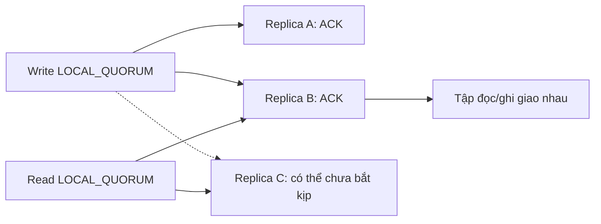
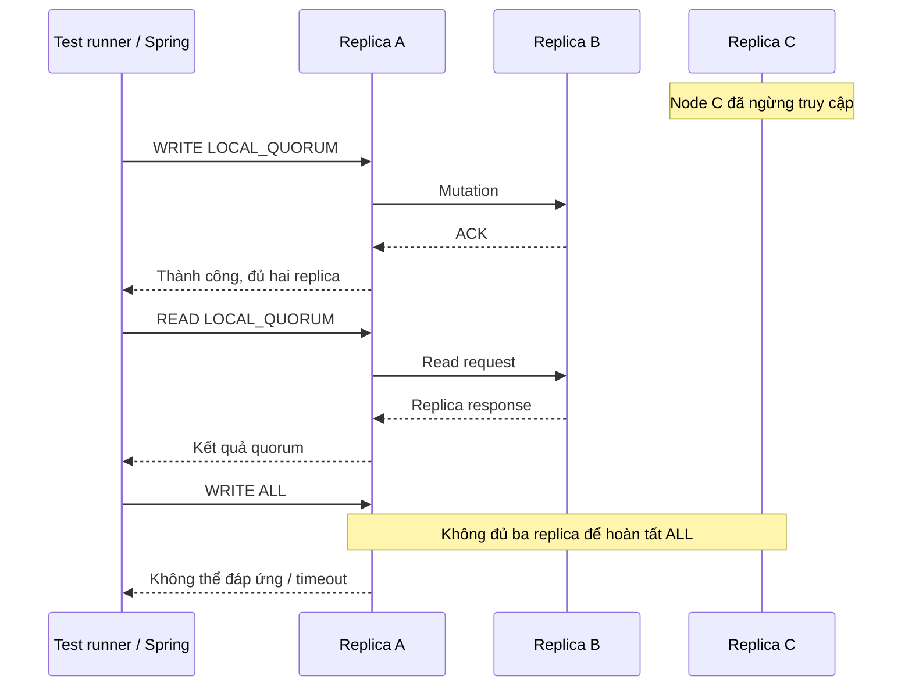
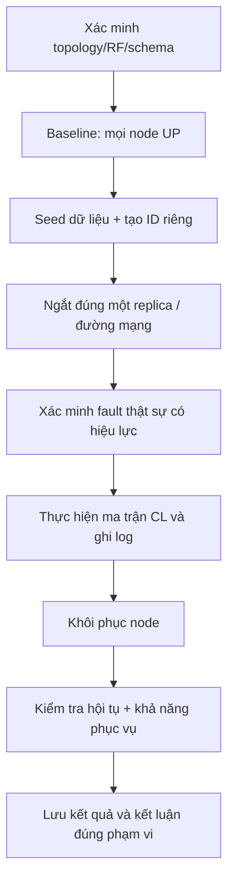
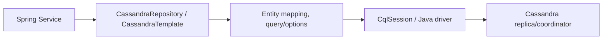

# Kiểm thử mức nhất quán trên cụm nhiều node với Spring Data Cassandra

Trong Apache Cassandra, một câu lệnh `INSERT` trả về thành công **không có nghĩa tất cả node đã lưu cùng một giá trị**, và một câu lệnh `SELECT` trả về dữ liệu **không tự chứng minh các replica đã hội tụ**. Kết quả phụ thuộc vào **replication factor (RF)**, **consistency level (CL)** của từng thao tác, trạng thái node, datacenter, timestamp và các ghi đồng thời.

Bài thuộc chương **Tính nhất quán** trong module **SPRING_DATA_CASSANDRA**. Mục tiêu là xây một quy trình **kiểm thử có thể lặp lại trên cụm Cassandra nhiều node**, thực thi các phép đọc/ghi qua Java driver và hạ tầng Spring, gây lỗi một hoặc nhiều node trong môi trường thử nghiệm, rồi giải thích đúng những gì kết quả chứng minh — và không chứng minh.

Các ví dụ dùng Spring Boot 3.x, Spring Data Cassandra, Java driver 4.x, JUnit 5 và một cluster thử nghiệm. Lệnh cấu hình minh họa cần được điều chỉnh theo phiên bản Cassandra, topology và quy định vận hành cụ thể.

## 1. Xác định chính xác điều mình muốn kiểm thử

Trước khi viết test, cần tách các câu hỏi khác nhau:

1. **Tính sẵn sàng:** Khi một replica ngừng hoạt động, đọc/ghi ở `ONE`, `LOCAL_QUORUM` hoặc `ALL` còn thực hiện được không?
2. **Khả năng đọc sau ghi:** Sau một ghi được xác nhận, câu đọc với CL nhất định có nhận được giá trị mới nhất trong điều kiện kiểm thử không?
3. **Sự hội tụ:** Node đã ngừng có bắt kịp các mutation sau khi quay lại và hệ thống thực hiện các cơ chế đồng bộ phù hợp không?
4. **Tranh chấp ghi:** Hai writer cập nhật cùng một khóa có tuân theo quy tắc nghiệp vụ hay chỉ dựa vào timestamp/last-write-wins?
5. **Điều kiện nguyên tử:** Nếu thật sự cần compare-and-set, câu lệnh LWT có xử lý đúng `[applied]`, serial consistency và timeout không?
6. **Multi-datacenter:** Một phép `LOCAL_QUORUM` trong DC A có bảo đảm điều gì ở DC B?

Không nên dùng duy nhất một test “ghi xong đọc lại thấy đúng” rồi kết luận hệ thống đã kiểm chứng tính nhất quán của một cụm phân tán.

| Loại kiểm thử | Điều cần chứng minh | Điều nó không tự chứng minh |
| --- | --- | --- |
| Baseline, mọi node còn hoạt động | Cấu hình RF, keyspace, driver và CL hoạt động. | Khả năng chịu lỗi khi node ngừng. |
| Đọc/ghi khi mất replica | Số replica còn lại đủ đáp ứng CL cụ thể. | Mọi bản ghi và mọi replica đều hoàn toàn giống nhau. |
| Đọc sau ghi | Một quan sát phù hợp kỳ vọng ở CL được chọn. | Linearizability cho mọi thao tác đồng thời. |
| LWT `IF` | Có bảo đảm điều kiện theo protocol LWT ở phạm vi phù hợp. | Transaction ACID đa bảng/đa partition. |
| Khôi phục và repair | Dữ liệu dần hội tụ khi node quay lại. | Không bao giờ xảy ra lỗi hoặc mất dữ liệu trong tương lai. |

## 2. Mô hình nền tảng: RF, W và R

**Replication factor** cho biết Cassandra lưu bao nhiêu replica logic của một partition trong topology được cấu hình. **Consistency level** của request xác định số replica/phạm vi cần đáp ứng để coordinator trả kết quả thành công.

Với một datacenter có **RF = 3** và cả ba replica liên quan đều đang hoạt động:

| CL | Đọc | Ghi | Số replica cần phản hồi trong ví dụ |
| --- | --- | --- | --- |
| `ONE` | Được hỗ trợ | Được hỗ trợ | 1 replica. |
| `LOCAL_ONE` | Được hỗ trợ | Được hỗ trợ | 1 replica trong local DC. |
| `QUORUM` | Được hỗ trợ | Được hỗ trợ | Đa số tổng replica: `floor(RF / 2) + 1 = 2`. |
| `LOCAL_QUORUM` | Được hỗ trợ | Được hỗ trợ | Đa số replica của partition trong local DC: 2. |
| `ALL` | Được hỗ trợ | Được hỗ trợ | Cả 3 replica. |
| `ANY` | Không dùng cho đọc thông thường | Chỉ một số ghi | Có thể chấp nhận hint mà chưa có replica lưu dữ liệu; **không dùng để kiểm thử read-after-write như `ONE`**. |

`QUORUM` và `LOCAL_QUORUM` có cùng ngưỡng **2** trong ví dụ chỉ có một DC, nhưng **khác ngữ nghĩa khi keyspace trải nhiều DC**. Tương tự, `ONE` và `LOCAL_ONE` không phải hai tên có thể tùy tiện thay thế trong môi trường đa datacenter.

### 2.1. Quy tắc giao nhau của quorum

Một trực giác thường dùng:

\[
W + R > RF
\]

Trong đó `W` là số replica xác nhận ghi và `R` là số replica tham gia đọc **trong cùng phạm vi replica có liên quan**.

Với RF = 3, ghi `LOCAL_QUORUM` (`W = 2`) rồi đọc `LOCAL_QUORUM` (`R = 2`) sẽ có ít nhất một replica nằm trong cả tập ghi và tập đọc, nếu cả hai cùng local DC và topology đúng như giả định.



**Nhưng đây không phải lời hứa linearizability tổng quát.** Cassandra vẫn có cơ chế hòa giải dựa trên write timestamp, concurrent updates, delete/tombstone, retry và các điều kiện đọc/ghi. Phép thử read-after-write nên dùng **một khóa riêng, không có writer cạnh tranh**, thống nhất timestamp và xác nhận không bị TTL/xóa chen ngang.

### 2.2. Đặt giả thuyết trước khi thử

Giả sử có ba node `A`, `B`, `C` cùng thuộc `dc1`; keyspace có RF = 3 tại `dc1`, nên mỗi partition được nhân bản lên cả ba node trong cụm ba node này.

| Tình trạng replica | Số replica sẵn sàng | `LOCAL_ONE` | `LOCAL_QUORUM` | `ALL` |
| --- | ---: | --- | --- | --- |
| A, B, C đều sống | 3 | Có thể đáp ứng | Có thể đáp ứng | Có thể đáp ứng |
| C ngừng hoạt động | 2 | Có thể đáp ứng | Có thể đáp ứng | Không đủ replica để đáp ứng |
| B và C ngừng hoạt động | 1 | Có thể đáp ứng nếu replica còn lại truy cập được | Không đủ replica | Không đủ replica |
| A, B, C đều không truy cập được | 0 | Không | Không | Không |

“Có thể đáp ứng” nghĩa là **đủ số replica về lý thuyết**; request vẫn có thể thất bại bởi timeout, lỗi network/coordinator, schema, authentication hoặc quá tải. Ở chiều ngược lại, một thao tác báo lỗi/timeout không luôn chứng minh **không replica nào đã nhận mutation**.

## 3. Dựng môi trường thử nghiệm thực sự có nhiều replica

### 3.1. Yêu cầu tối thiểu

Để thử ngưỡng `LOCAL_QUORUM` khi mất một replica:

- **Ba Cassandra node riêng biệt** nằm trong cùng cluster, cùng `dc1`; mỗi node có tiến trình, storage và network riêng.
- Keyspace thử nghiệm với `NetworkTopologyStrategy` và **RF = 3 trong `dc1`**.
- Ứng dụng hoặc test runner kết nối tới cluster bằng driver với `local-datacenter = dc1`.
- Có quyền **tạm dừng, khởi động lại và quan sát từng node** trong môi trường riêng biệt.
- Đảm bảo không có dữ liệu production và không dùng tên keyspace/bảng đang phục vụ người dùng thật.

**Một `CassandraContainer` mặc định trong Testcontainers chỉ chạy một Cassandra node.** Nó phù hợp cho integration test mapping/repository/CQL, **không chứng minh được ngưỡng `LOCAL_QUORUM` hay hành vi khi ba replica bị phân tán**. Nếu muốn tự động hóa chaos test, cần một cluster nhiều node thật hoặc môi trường mô phỏng phân tán có đặc tính phù hợp.

### 3.2. Kiểm tra cluster trước khi tạo dữ liệu

Trên máy có quyền vận hành cluster thử nghiệm, kiểm tra topology bằng `nodetool status` trên một node và xác nhận cả ba node đều ở trạng thái mong đợi (`UN` — Up/Normal), thuộc đúng datacenter.

```text
# Chạy trên môi trường thử nghiệm; đây là lệnh công cụ vận hành.
nodetool status

# Kiểm tra trong cqlsh để thấy tên local datacenter của node đang kết nối.
SELECT data_center FROM system.local;
```

Dòng `SELECT` là CQL; `nodetool status` là lệnh shell chứ không phải CQL. Nếu kết quả `data_center` không phải `dc1`, phải thay RF/local DC theo **thực tế**, không đổi tên DC trong client để “ép test chạy”.

### 3.3. Tạo keyspace và bảng test

```sql
CREATE KEYSPACE IF NOT EXISTS consistency_lab
WITH replication = {
    'class': 'NetworkTopologyStrategy',
    'dc1': 3
}
AND durable_writes = true;

CREATE TABLE IF NOT EXISTS consistency_lab.state_by_id (
    item_id uuid PRIMARY KEY,
    state text,
    revision int,
    changed_at timestamp
);
```

Schema đơn giản cố ý chọn `PRIMARY KEY (item_id)`. Mỗi test dùng `UUID` mới để tránh lỗi do dữ liệu còn lại từ lần chạy trước.

**Cảnh báo kiểm thử:** Nếu keyspace đã tồn tại với RF khác, `CREATE KEYSPACE IF NOT EXISTS` không sửa lại replication strategy. Cần xác minh RF của keyspace qua schema/metadata; không suy đoán từ việc câu lệnh DDL chạy thành công.

Không tạo bảng với TTL mặc định hoặc cập nhật timestamp thủ công trong các phép thử cơ bản, trừ khi TTL/timestamp là chủ đề phép thử: chúng có thể gây ra sai lệch không liên quan đến consistency.

### 3.4. Cấu hình Spring Boot

Ví dụ cấu hình test (các hostname chỉ mang tính minh họa):

```yaml
spring:
  cassandra:
    contact-points: node-a.test:9042,node-b.test:9042,node-c.test:9042
    local-datacenter: dc1
    keyspace-name: consistency_lab
    # Nếu cluster bật authentication/TLS, cung cấp credential
    # và trust material từ secret manager/test environment.
```

Spring Boot có thể tạo bean `CqlSession` được các `CassandraRepository` và `CassandraTemplate` chia sẻ. Dùng cùng session đó để thực hiện CQL test ở mức driver; **không đóng `CqlSession` được inject trong mỗi test**.

Một danh sách ba contact points **không tự chứng minh cluster có ba node**: driver dùng các contact point để khám phá topology, còn số replica thực phụ thuộc keyspace và cluster. Vì thế phải kiểm tra cả `nodetool status`, RF và driver connectivity.

## 4. Kiểm thử baseline: LOCAL_QUORUM ghi rồi LOCAL_QUORUM đọc

Trong Spring Data Cassandra, hai chỗ có thể chỉ định consistency:

1. **Mặc định ở driver/Spring configuration:** áp dụng cho những statement không override.
2. **Từng statement hoặc operation options:** `InsertOptions`/`QueryOptions`, `CqlTemplate` với statement hoặc `CqlSession` trực tiếp.

Để test rõ ràng, ta dùng **Java driver 4.x** trên bean `CqlSession` do Spring quản lý; như vậy CL của mỗi lệnh là dữ liệu ngay trong test. Đây không phải lời khuyên bỏ `CassandraRepository`: repository vẫn phù hợp với nghiệp vụ bình thường, còn low-level statement hữu ích để xác minh consistency.

### 4.1. Integration test với JUnit 5

```java
import static org.junit.jupiter.api.Assertions.assertEquals;
import static org.junit.jupiter.api.Assertions.assertNotNull;

import java.time.Instant;
import java.util.UUID;

import com.datastax.oss.driver.api.core.CqlSession;
import com.datastax.oss.driver.api.core.DefaultConsistencyLevel;
import com.datastax.oss.driver.api.core.cql.Row;
import com.datastax.oss.driver.api.core.cql.SimpleStatement;

import org.junit.jupiter.api.Test;
import org.springframework.beans.factory.annotation.Autowired;
import org.springframework.boot.test.context.SpringBootTest;

@SpringBootTest
class CassandraConsistencyIntegrationTest {

    @Autowired
    CqlSession session;

    @Test
    void quorumWriteThenQuorumReadReturnsValueWithoutConcurrentWrites() {
        UUID id = UUID.randomUUID();

        SimpleStatement write = SimpleStatement.builder(
                "INSERT INTO consistency_lab.state_by_id " +
                "(item_id, state, revision, changed_at) " +
                "VALUES (?, ?, ?, ?)")
            .addPositionalValues(id, "READY", 1, Instant.now())
            .setConsistencyLevel(DefaultConsistencyLevel.LOCAL_QUORUM)
            .build();

        session.execute(write);

        SimpleStatement read = SimpleStatement.builder(
                "SELECT state, revision " +
                "FROM consistency_lab.state_by_id WHERE item_id = ?")
            .addPositionalValue(id)
            .setConsistencyLevel(DefaultConsistencyLevel.LOCAL_QUORUM)
            .build();

        Row row = session.execute(read).one();

        assertNotNull(row);
        assertEquals("READY", row.getString("state"));
        assertEquals(1, row.getInt("revision"));
    }
}
```

Đây là **baseline test**. Nó cho biết client và cluster đã thực hiện được yêu cầu đọc/ghi với `LOCAL_QUORUM` và đọc lại đúng trong điều kiện test. Nó **chưa chứng minh** một replica bị tắt vẫn chịu lỗi được, vì test không gây lỗi node.

### 4.2. Vì sao test này có ý nghĩa?

- `item_id` mới, không có ghi cạnh tranh, giúp quan sát read-after-write dễ giải thích.
- `LOCAL_QUORUM` là CL được chỉ định riêng cho ghi **và** đọc, không phụ thuộc mặc định driver.
- Có đủ partition key trong `WHERE` để truy vấn được định tuyến chính xác.
- Đọc trả row/field đã ghi; không dựa vào thứ tự scan hoặc index.
- Mỗi test có ID riêng để chạy song song mà không xung đột với test khác.

Nhưng `assertEquals` sau một lần đọc vẫn không đo được **độ trễ hội tụ toàn bộ replica**, cũng không nói gì về write timeout hay ngưỡng khi mất node.

## 5. Kiểm thử khi mất một replica: điều gì phải xảy ra?

### 5.1. Quy trình gây lỗi có kiểm soát

Chỉ thực hiện trên **cluster test có thể dừng/khôi phục**:

1. Xác minh cả ba node ở trạng thái Up/Normal, RF = 3 trong `dc1` và test baseline `LOCAL_QUORUM` chạy thành công.
2. Tạo một ID riêng cho phép thử hỏng node; nếu cần đối chiếu, ghi giá trị chuẩn bằng CL `ALL` trước khi dừng.
3. Dừng hoặc cô lập **một** Cassandra node, ví dụ node C, bằng công cụ điều phối được phép sử dụng.
4. Chờ driver/node còn lại nhận biết topology mới hoặc đặt giới hạn thời gian chờ rõ ràng.
5. Ghi và đọc **theo `LOCAL_QUORUM`**; với hai replica còn truy cập được, về lý thuyết phải còn khả năng phục vụ.
6. Dùng một ID khác để thử **`ALL`**; kỳ vọng không thể đáp ứng đầy đủ ba replica khi node C còn mất kết nối.
7. Ghi nhận lỗi trả về, latency, coordinator, trạng thái replica và thông tin request.
8. Khôi phục node C, xác nhận cluster trở lại trạng thái khỏe và xử lý repair/hints theo quy trình vận hành thử nghiệm.



Sơ đồ là **mô hình khái niệm**, không diễn tả chi tiết toàn bộ thông điệp Cassandra. Coordinator không nhất thiết là replica A; driver có thể chọn node coordinator khác, và các loại timeout/lỗi phụ thuộc thời điểm nhận biết lỗi.

### 5.2. Kết quả mong đợi phải phân biệt rõ

| Phép thử khi node C ngừng | Kỳ vọng | Cần quan sát thêm |
| --- | --- | --- |
| `WRITE LOCAL_ONE` | Có thể thành công với một replica sống. | Replica nào nhận ghi; không khẳng định mọi replica đồng bộ. |
| `READ LOCAL_ONE` | Có thể thành công. | Có thể đọc stale nếu replica được chọn chưa bắt kịp. |
| `WRITE LOCAL_QUORUM` | Có thể thành công với hai replica sống. | p95 latency, timeout, availability. |
| `READ LOCAL_QUORUM` | Có thể thành công với hai replica sống. | Giá trị trả về dưới điều kiện không có writer khác. |
| `WRITE ALL` | Không thể đạt đủ ba ACK khi một replica mất. | Phân loại lỗi; **không khẳng định mọi mutation đều bị rollback**. |
| `READ ALL` | Không đủ replica để đáp ứng. | Unavailable hoặc timeout tùy trường hợp. |

Khi test `WRITE ALL` gặp lỗi, đừng khẳng định “không có dữ liệu được ghi”. Một mutation có thể đã tới một hoặc hai replica trước khi client biết request không thể đạt `ALL`. Nếu test sau đó dùng cùng ID để đọc rồi nhận thấy giá trị mới, đó không nhất thiết là Cassandra vi phạm consistency.

### 5.3. Ví dụ câu lệnh kiểm tra bằng CQL shell

`cqlsh` hỗ trợ lệnh thiết lập consistency cho session tương tác. Chỉ dùng trên cluster thử nghiệm:

```text
CONSISTENCY LOCAL_QUORUM;

-- CQL: câu lệnh trong shell.
INSERT INTO consistency_lab.state_by_id (item_id, state, revision)
VALUES (22222222-2222-2222-2222-222222222222, 'ONE_DOWN', 1);

SELECT state, revision FROM consistency_lab.state_by_id
WHERE item_id = 22222222-2222-2222-2222-222222222222;

CONSISTENCY ALL;

-- Đổi sang ID khác, tránh làm nhiễu kết quả đã xác minh.
INSERT INTO consistency_lab.state_by_id (item_id, state, revision)
VALUES (33333333-3333-3333-3333-333333333333, 'ALL_TRY', 1);
```

`CONSISTENCY` là lệnh của `cqlsh`, không phải cú pháp CQL gửi trong một prepared statement. Nếu câu lệnh `ALL` thất bại, cần ghi **loại exception và nguyên nhân** thay vì chỉ kiểm tra có exception bất kỳ rồi kết luận pass.

## 6. Hai replica ngừng: vì sao ONE và QUORUM khác nhau?

Trong cụm ba replica thuộc một DC, nếu chỉ còn **một replica** truy cập được:

- `LOCAL_ONE` vẫn **có thể** thành công đối với partition có replica còn sống ấy.
- `LOCAL_QUORUM` cần **hai** replica, nên không thể đáp ứng.
- `ALL` cần cả **ba**, nên cũng không thể đáp ứng.

Đây là khác biệt đánh đổi giữa **availability** và **consistency guarantee**. Chọn CL cao hơn tăng số phản hồi cần thiết, nhưng giảm khả năng phục vụ khi nhiều replica gặp lỗi.

**Không tự động giảm CL từ `LOCAL_QUORUM` xuống `LOCAL_ONE` khi gặp timeout** nếu nghiệp vụ chưa cho phép. Việc giảm CL giúp giữ availability có thể thay đổi bảo đảm read-after-write và khả năng nhìn thấy dữ liệu.

Trong các bài test, lưu rõ CL được yêu cầu và CL thực tế mà client thực thi. Thay CL vì retry/fallback cần có một test case và chính sách nghiệp vụ riêng, không phải chi tiết bị che trong retry handler.

## 7. Đọc stale: làm thế nào kiểm thử mà không tạo kết luận sai?

Một thí nghiệm phổ biến:

1. Ghi `state='OLD'` ở `ALL` khi ba node khỏe.
2. Làm một replica chậm hoặc bị cô lập.
3. Ghi `state='NEW'` ở `LOCAL_QUORUM` lên hai replica còn sống.
4. Cho replica cũ quay lại, rồi đọc `LOCAL_ONE` nhiều lần.
5. Quan sát xem có lần nào trả `OLD` không.

**Quan trọng:** Đây là thí nghiệm **quan sát khả năng stale**, không phải test xác định bắt buộc phải có stale. Driver có chiến lược chọn coordinator, replica có thể đã được đồng bộ qua hints/read repair/repair, và thời gian hồi phục có thể thay đổi giữa các lần chạy.

Không viết:

```java
// Sai: giả định stale read luôn phải xuất hiện sau khi một node được khôi phục.
// assertEquals("OLD", readAtConsistency(LOCAL_ONE));
```

Nếu thí nghiệm không thấy stale, điều đó **không chứng minh `LOCAL_ONE` luôn đọc giá trị mới nhất**. Nếu thấy stale, cần ghi log điều kiện: CL ghi/đọc, replica còn sống, thời gian, node coordinator, bản ghi và thời điểm node hồi phục.

### 7.1. Kiểm thử tính đúng thay vì cố gây stale bằng xác suất

Những assertion bền vững hơn:

- Với một khóa mới và không có concurrent writer: `WRITE LOCAL_QUORUM` thành công, sau đó `READ LOCAL_QUORUM` trong cùng DC trả đúng dữ liệu.
- Khi một trong ba replica không thể truy cập: thao tác đòi `ALL` **không thể hoàn tất với đủ replica**, nếu đã xác minh fault injection.
- Khi chỉ còn một replica: thao tác đòi `LOCAL_QUORUM` không thể thỏa ngưỡng.
- Với `LOCAL_ONE`: test **chỉ quan sát kết quả**, không mặc định nó luôn mới hoặc luôn cũ.

Để xác minh dữ liệu thật sự hiện diện tại **từng replica**, cần kế hoạch quan sát nội bộ/đọc cục bộ/repair phù hợp với cluster test; chỉ gửi nhiều request qua một driver không bảo đảm chúng đều đọc các replica khác nhau.

## 8. Phân biệt timeout, unavailable và trạng thái ghi không chắc chắn

Một trong những lỗi kiểm thử nghiêm trọng nhất là suy ra **không có mutation** chỉ vì client nhận exception.

Có ít nhất ba lớp hiện tượng:

| Hiện tượng | Diễn giải | Ứng dụng nên làm |
| --- | --- | --- |
| Không đủ replica sống để đáp ứng CL tại thời điểm coordinator đánh giá | Thường báo lỗi kiểu unavailable. | Kiểm tra topology/RF/CL và chính sách retry/fallback. |
| Đủ replica dự kiến nhưng không phản hồi trước timeout | Read/write timeout. | Kiểm tra latency, load, network; đừng suy đoán mutation không xảy ra. |
| Client/connection mất trước khi biết kết quả | **Trạng thái không chắc chắn**. | Đối soát trạng thái, retry có idempotency phù hợp. |

Trong Java driver, có thể gặp `UnavailableException`, `ReadTimeoutException`, `WriteTimeoutException` hoặc lỗi kết nối/driver khác. Không viết test kiểu `assertThrows(RuntimeException.class, ...)` rồi kết luận thất bại do CL: **một lỗi thiếu bảng, sai mật khẩu hoặc cú pháp CQL cũng có thể làm assertion đó pass**.

Một test fault-injection nên:

1. Kiểm tra các node dự kiến đã thật sự mất/khôi phục.
2. Kiểm tra schema và phép đọc/ghi baseline trước khi gây lỗi.
3. Bắt và phân loại exception cụ thể; nếu lỗi không thuộc lớp mong đợi, đánh dấu **test fail**.
4. Với write thất bại/timeout, đọc lại theo quy trình phù hợp và **chấp nhận trạng thái chưa biết** nếu không thể xác minh.
5. Dùng ID mới cho mỗi scenario để không lẫn mutation từ một phép thử khác.

### 8.1. Ghi và retry theo tính idempotent

`INSERT`/`UPDATE` trong Cassandra thường là upsert theo primary key. Một mutation ghi cùng giá trị vào cùng key có thể thích hợp để retry trong một số tình huống, nhưng:

- Write timestamp không được quản lý có thể khiến dữ liệu mới/phiên bản cũ cạnh tranh.
- Các thao tác counter không có cùng tính chất retry an toàn.
- LWT và workflow bên ngoài Cassandra (thanh toán, gửi email) cần xử lý riêng.
- Retry tự động quá nhiều có thể làm quá tải cluster đang gặp sự cố.

Khi yêu cầu sản phẩm có tính đúng nghiệp vụ, hãy xác định **idempotency key**, trạng thái mong đợi và quy tắc reconciliation, thay vì chỉ đếm số lệnh CQL thành công.

## 9. Kiểm thử tính nhất quán khi ghi đồng thời

`LOCAL_QUORUM` giúp xác nhận số replica, nhưng không tự biến mọi thao tác đọc-sửa-ghi thành một transaction cạnh tranh.

Ví dụ hai worker cùng đọc `revision=5` rồi muốn đặt `state` khác nhau:

```text
Worker A: SELECT revision=5
Worker B: SELECT revision=5
Worker A: UPDATE state='APPROVED', revision=6
Worker B: UPDATE state='CANCELLED', revision=6
```

Nếu cả hai dùng UPDATE thường:

- Cả hai có thể được xác nhận thành công theo CL đã chọn.
- Giá trị thắng phụ thuộc timestamp và cơ chế giải quyết xung đột, không phải thứ tự nghiệp vụ mà developer mong muốn.
- Ghi vào nhiều partition/bảng không trở thành transaction ACID bởi lựa chọn `LOCAL_QUORUM`.

Nếu nghiệp vụ cần **chỉ một writer được phép thay từ revision 5**, dùng conditional CQL và LWT:

```sql
UPDATE consistency_lab.state_by_id
SET state = 'APPROVED',
    revision = 6
WHERE item_id = 11111111-1111-1111-1111-111111111111
IF revision = 5;
```

Cassandra trả `[applied] = true/false`. Cần **đọc và assert** cờ này, thay vì chỉ xác nhận statement không ném exception.

### 9.1. Java driver kiểm thử LWT

```java
import static org.junit.jupiter.api.Assertions.assertFalse;
import static org.junit.jupiter.api.Assertions.assertTrue;

import java.util.UUID;
import com.datastax.oss.driver.api.core.DefaultConsistencyLevel;
import com.datastax.oss.driver.api.core.cql.SimpleStatement;

UUID id = UUID.randomUUID();

// Giả định id chưa tồn tại trong keyspace test.
SimpleStatement first = SimpleStatement.builder(
        "INSERT INTO consistency_lab.state_by_id " +
        "(item_id, state, revision) VALUES (?, ?, ?) IF NOT EXISTS")
    .addPositionalValues(id, "PENDING", 1)
    .setConsistencyLevel(DefaultConsistencyLevel.LOCAL_QUORUM)
    .setSerialConsistencyLevel(DefaultConsistencyLevel.LOCAL_SERIAL)
    .build();

SimpleStatement second = SimpleStatement.builder(
        "INSERT INTO consistency_lab.state_by_id " +
        "(item_id, state, revision) VALUES (?, ?, ?) IF NOT EXISTS")
    .addPositionalValues(id, "DUPLICATE", 1)
    .setConsistencyLevel(DefaultConsistencyLevel.LOCAL_QUORUM)
    .setSerialConsistencyLevel(DefaultConsistencyLevel.LOCAL_SERIAL)
    .build();

assertTrue(session.execute(first).wasApplied());
assertFalse(session.execute(second).wasApplied());
```

Đoạn code được đặt trong ngữ cảnh test đã có `CqlSession session`; nếu dùng JUnit, chuyển nó vào method `@Test` với session inject. `LOCAL_SERIAL` phục vụ pha điều kiện của LWT; `LOCAL_QUORUM` ở regular phase có ngữ nghĩa riêng. Đối với multi-DC, phải cân nhắc phạm vi `SERIAL` so với `LOCAL_SERIAL` và đặc tính ghi của mọi client khác.

**Không đồng nhất test LWT với test `W + R > RF`.** LWT có protocol điều kiện/đồng thuận riêng; test phải kiểm tra giá trị `wasApplied()` và các tình huống conflict/timeout.

## 10. Cluster nhiều datacenter: LOCAL khác GLOBAL

Giả sử keyspace nằm trên hai datacenter:

- `dc1` có RF = 3.
- `dc2` có RF = 3.

Cấu hình CQL minh họa:

```sql
CREATE KEYSPACE IF NOT EXISTS consistency_multidc_lab
WITH replication = {
    'class': 'NetworkTopologyStrategy',
    'dc1': 3,
    'dc2': 3
};
```

**Mô hình này cần ít nhất đủ node theo topology để đặt replica đúng**, không thể chỉ có ba node tổng cộng rồi khai RF = 3 ở cả hai DC và mong mọi thứ giống cụm sáu replica.

| CL | Cần đáp ứng ở đâu? | Ý nghĩa khi test đa DC |
| --- | --- | --- |
| `LOCAL_ONE` | Một replica ở DC local của coordinator. | Ưu tiên đường đọc/ghi nội vùng. |
| `LOCAL_QUORUM` | Đa số replica trong **DC local**. | 2/3 replica trong `dc1` nếu client dùng `dc1`; không chờ quorum `dc2`. |
| `QUORUM` | Đa số trên **tổng RF toàn keyspace**. | Với 6 replica, ngưỡng thường là 4; có thể cần replica từ DC khác. |
| `EACH_QUORUM` | Đa số **mỗi DC**, dành cho write CL được hỗ trợ. | 2/3 ở `dc1` **và** 2/3 ở `dc2`. |
| `ALL` | Cả sáu replica. | Khó chịu lỗi; độ trễ/availability phụ thuộc mọi replica. |

Khi ghi `LOCAL_QUORUM` tại `dc1`, thao tác không cần quorum của `dc2` để trả thành công. Vì vậy một phép đọc `LOCAL_ONE`/`LOCAL_QUORUM` tại `dc2` ngay sau đó **không có bảo đảm read-after-write xuyên DC tương đương việc cùng DC sử dụng quorum**, nhất là lúc kết nối liên vùng chậm hoặc lỗi.

### 10.1. Kịch bản kiểm thử liên vùng

1. Ghi bản ghi mới với `LOCAL_QUORUM` tại `dc1`.
2. Đọc ngay với `LOCAL_QUORUM` tại `dc1`; kiểm tra kết quả.
3. Đọc tại `dc2` với client có `local-datacenter = dc2`; **ghi nhận** thời gian cho đến khi nhìn thấy dữ liệu mới, không khẳng định phải thấy ngay.
4. Ngắt đường truyền giữa hai DC trong môi trường test; kiểm tra khả năng đọc/ghi ở từng DC theo CL local và ghi nhận stale reads.
5. Khôi phục liên vùng, kiểm tra khả năng hội tụ, hints/repair và dữ liệu cuối cùng.
6. Lặp lại với CL global hoặc mỗi DC khi hợp đồng nghiệp vụ thực sự cần, đo thêm latency và tỷ lệ lỗi.

**Không dùng một instance CqlSession khai `local-datacenter=dc1` rồi giả định một truy vấn `LOCAL_QUORUM` gửi tới `dc2` có tính chất “local của client tại dc2”.** Phải kiểm soát coordinator và client routing đúng như giả thuyết.

## 11. Node quay lại: hints, repair và hội tụ

Sau khi replica C bị ngừng trong lúc A và B vẫn xử lý ghi:

- Node C có thể thiếu các mutation được tạo khi nó không truy cập được.
- Cassandra có thể sử dụng **hinted handoff** để chuyển lại một số mutation trong khoảng downtime theo cấu hình và giới hạn.
- **Anti-entropy repair** giúp đối soát dữ liệu giữa các replica theo chính sách vận hành.
- Đọc với CL thích hợp và các cơ chế read repair có thể ảnh hưởng đến cách replica hội tụ, tùy phiên bản Cassandra.

**Không kiểm thử bằng cách “bật node rồi ngủ 2 giây; chắc chắn đã đồng bộ”.** Hints không phải cơ chế thay thế vĩnh viễn cho repair, có cửa sổ retention và không luôn được bảo đảm đầy đủ sau mọi sự cố.

### 11.1. Quy trình xác minh hồi phục

1. Khôi phục node C và xác nhận nó trở lại trạng thái bình thường.
2. Theo dõi lỗi stream/hints/repair và số request thất bại.
3. Theo quy trình vận hành của cluster test, thực hiện đối soát/repair cần thiết nếu bài test yêu cầu chứng minh replica đã hội tụ.
4. Đọc lại các ID riêng của kịch bản, sử dụng các mức CL phù hợp.
5. Nếu yêu cầu **chứng minh từng replica** có dữ liệu, dùng công cụ kiểm tra nội bộ có kiểm soát thay vì chỉ gửi nhiều lần `SELECT` ở `LOCAL_ONE`.
6. Xác minh dịch vụ trở lại trạng thái bình thường, không còn timeout bất thường hay backlog lớn.

Không chạy thao tác repair nặng trên production chỉ để chứng minh bài học; với cluster thật, repair có tác động I/O, disk và network, phải theo runbook vận hành.

## 12. Viết test fault injection đúng và có thể lặp lại

Một bài test đa node đáng tin nên được tổ chức theo **từng pha**:



### 12.1. Các điều kiện test phải cố định

- **Topology:** số node, DC/rack, token map và replication factor của keyspace.
- **Version:** Cassandra, driver, Spring Data Cassandra và cấu hình coordinator/CL.
- **Dataset:** keyspace test riêng, UUID khác nhau giữa các scenario.
- **Thứ tự:** baseline → fault injection → kiểm thử → recovery; không chạy chaos song song thiếu phối hợp.
- **Thời hạn:** timeout driver và thời hạn chờ cluster nhận biết node down.
- **Điều kiện phục hồi:** node Up/Normal, repair/hint trạng thái phù hợp và kiểm chứng dữ liệu.
- **Logging:** request ID, `item_id`, CL đọc/ghi, loại lỗi, thời gian, topology và node bị dừng.

### 12.2. Không dùng assert sai ngữ nghĩa

| Assertion dễ viết nhưng sai | Thay bằng |
| --- | --- |
| “`WRITE ONE` thành công nên cả 3 node có dữ liệu.” | Chỉ kết luận ngưỡng `ONE` đạt; kiểm tra hội tụ riêng. |
| “`READ ONE` không stale nên mọi lần đọc ONE đều nhất quán.” | Chỉ ghi nhận một quan sát; không khái quát thành bảo đảm. |
| “`WRITE ALL` timeout nên không replica nào đã ghi.” | Ghi nhận trạng thái chưa chắc chắn; kiểm tra hiện trạng nếu cần. |
| “`LOCAL_QUORUM` thành công nên có ACID transaction.” | Chỉ kết luận request được xác nhận theo CL tương ứng. |
| “Testcontainers một node chạy được QUORUM nên chịu lỗi 1 node.” | Tạo môi trường có đủ replica và gây lỗi node thật. |
| “Thấy state mới sau restart nên mọi replica đã repair xong.” | Dùng runbook/quan sát thích hợp để xác minh hội tụ. |

### 12.3. Mẫu bảng ghi kết quả test

| Scenario | RF/DC | Live replicas | Write CL | Read CL | Kỳ vọng | Kết quả thực tế |
| --- | --- | ---: | --- | --- | --- | --- |
| Baseline | 3 / dc1 | 3 | LOCAL_QUORUM | LOCAL_QUORUM | Ghi/đọc thành công, đúng giá trị | Điền khi chạy |
| Mất một node | 3 / dc1 | 2 | LOCAL_QUORUM | LOCAL_QUORUM | Vẫn phục vụ nếu cluster khỏe | Điền khi chạy |
| Mất một node | 3 / dc1 | 2 | ALL | — | Không thể đáp ứng ALL | Điền khi chạy |
| Mất hai node | 3 / dc1 | 1 | LOCAL_ONE | LOCAL_ONE | Có thể phục vụ trên replica còn lại | Điền khi chạy |
| Mất hai node | 3 / dc1 | 1 | LOCAL_QUORUM | — | Không đủ quorum | Điền khi chạy |
| Sau hồi phục | 3 / dc1 | 3 | LOCAL_QUORUM | LOCAL_QUORUM | Đọc đúng trong điều kiện không ghi cạnh tranh | Điền khi chạy |

Trường “kết quả thực tế” nên ghi cả độ trễ và loại lỗi cụ thể, không chỉ `PASS`/`FAIL`.

## 13. Theo dõi hiệu năng và hệ quả vận hành

Mức CL cao hơn có thể ảnh hưởng tới latency, nhất là khi một replica chậm. Cần đo:

| Nhóm chỉ số | Ví dụ |
| --- | --- |
| Client | p50/p95/p99 latency theo CL, timeout, retry, error rate. |
| Driver | Coordinator được chọn, số request thất bại, connection health. |
| Cluster | Node Up/Down, replica availability, pending tasks, dropped messages. |
| Ghi/đọc | Tỷ lệ success, `Unavailable`, read/write timeouts, tải trên partition nóng. |
| Recovery | Hint backlog, repair progress, thời gian đến khi đọc hội tụ. |
| LWT | Tỷ lệ `[applied]=false`, contention, latency serial phase. |

Không chỉ benchmark throughput tối đa trên cluster khỏe rồi kết luận chọn được CL tốt nhất. Một chiến lược CL là **quyết định nghiệp vụ** giữa độ trễ, khả năng phục vụ và những bảo đảm quan sát được.

Ví dụ:

- Log sự kiện có thể chấp nhận đọc trễ trong một khoảng thời gian → CL thấp hơn có thể phù hợp.
- Trạng thái thanh toán cần xác nhận read-after-write trong DC → cân nhắc quorum đọc/ghi trong cùng DC và một protocol concurrency phù hợp.
- Tạo tài nguyên duy nhất theo business key → dùng LWT/điều kiện hoặc thiết kế workflow tương ứng, **không chỉ tăng CL**.

Tối ưu partition key, paging và hạn chế số hàng được đọc vẫn cần thiết: tăng CL không sửa được một truy vấn quét nhiều partition hoặc hot partition.

## 14. Tích hợp consistency test với CassandraRepository và CassandraTemplate

Trong mã nghiệp vụ, Spring Data Cassandra thường dùng `CassandraRepository` hoặc `CassandraTemplate`, không nhất thiết `CqlSession` trực tiếp. Đường đi:



Cần kiểm tra consistency ở **tầng thực sự áp dụng**:

1. CL mặc định của session/driver cấu hình ra sao?
2. Có `InsertOptions`, `QueryOptions` hoặc `UpdateOptions` override ở operation cụ thể không?
3. Có method `@Query` dùng statement options khác so với CRUD không?
4. Các call của repository có dùng chung keyspace/local DC như bài test raw driver không?
5. Các đường đọc danh sách có phân trang hoặc projection khiến nhiều request đọc xảy ra không?

Ví dụ về ý tưởng khi Spring Data Cassandra version hỗ trợ consistency level theo `InsertOptions`:

```java
import com.datastax.oss.driver.api.core.DefaultConsistencyLevel;
import org.springframework.data.cassandra.core.InsertOptions;
import org.springframework.data.cassandra.core.CassandraTemplate;

// template là bean do Spring inject.
InsertOptions options = InsertOptions.builder()
    .consistencyLevel(DefaultConsistencyLevel.LOCAL_QUORUM)
    .build();

// entity phải được ánh xạ đúng tới bảng trong keyspace test.
template.insert(entity, options);
```

**Không tự suy ra** repository `save(entity)` dùng cùng CL với một statement tự viết đã đặt `LOCAL_QUORUM`. Nếu code production dựa vào driver default còn integration test chỉ kiểm tra statement override, đó là hai đường cấu hình khác nhau. Cần test cả đường production hoặc xác minh cấu hình mặc định thực tế.

Với paging, từng page là một phần của chuỗi request và **không cung cấp snapshot tự động**; CL không thay thế những ràng buộc về dữ liệu thay đổi giữa các trang.

## 15. Tình huống và câu hỏi tự kiểm tra

### Tình huống A — Mất một node

Cluster có ba node ở `dc1`, keyspace RF = 3. Một node ngừng, hai node còn khỏe. Team chạy:

- `INSERT` ở `LOCAL_QUORUM`.
- `SELECT` ở `LOCAL_QUORUM`.
- `INSERT` mới ở `ALL`.

Hãy dự đoán request nào có thể thành công, request nào không thể đạt ngưỡng và tại sao `INSERT ALL` thất bại không chứng minh không có mutation.

### Tình huống B — ONE đôi lúc đọc cũ

Team ghi ở `LOCAL_QUORUM` nhưng đọc ở `LOCAL_ONE` và đôi khi quan sát trạng thái cũ trong lúc replica hội tụ. Có phải Spring Data Cassandra làm sai mapping không? Điều gì cần kiểm tra trước khi tăng timeout?

### Tình huống C — Test stale không tái hiện

Một test cố chứng minh `LOCAL_ONE` có thể stale, nhưng chạy 100 lần đều trả giá trị mới. Có thể kết luận `LOCAL_ONE` bảo đảm đọc mới nhất không? Vì sao?

### Tình huống D — Ghi đồng thời

Hai worker cùng đọc `revision=3`, rồi mỗi worker cập nhật trạng thái và đặt `revision=4` với `LOCAL_QUORUM`. Điều gì bảo đảm chỉ một worker thắng? Nếu không có, cần dùng câu CQL nào?

### Tình huống E — Multi-DC

Keyspace có RF = 3 ở `dc1` và RF = 3 ở `dc2`. Một ghi `LOCAL_QUORUM` tại `dc1` thành công. Đọc ngay `LOCAL_QUORUM` từ một client ở `dc2` có luôn nhìn thấy ghi đó không? Phân biệt `LOCAL_QUORUM`, `QUORUM` và `EACH_QUORUM`.

### Tình huống F — Timeout khi ghi

Client gửi mutation và nhận `WriteTimeoutException`. Test đang assert rằng bảng không có record đó. Assertion này có vững không? Cần thay bằng phương án kiểm tra nào?

### Tình huống G — Khôi phục node

Node C trở lại trạng thái Up/Normal sau downtime. Có thể dùng một lần `SELECT LOCAL_ONE` trả dữ liệu đúng để kết luận node C đã đồng bộ toàn bộ không? Vì sao?

**Đáp án gợi ý:**

1. Hai replica đủ cho `LOCAL_QUORUM` nên ghi/đọc có thể thành công; `ALL` cần cả ba nên không thể đạt ngưỡng. Ghi ALL thất bại có thể vẫn để lại mutation ở replica đã nhận trước khi báo lỗi.
2. Không nhất thiết do mapping. Cần xem RF, CL thực tế, replica, timestamp, concurrent writes, hints/repair và cấu hình client.
3. Không. Kết quả chỉ là quan sát có điều kiện; replica có thể đã hội tụ, driver chọn replica mới hoặc race không tạo stale.
4. `LOCAL_QUORUM` không bảo đảm một writer thắng theo revision. Cần LWT như `UPDATE ... IF revision = 3` và kiểm tra `[applied]`.
5. Không có bảo đảm giao nhau cùng DC khi đọc tại DC khác. `LOCAL_QUORUM` chỉ chờ đa số của local DC; `QUORUM` xét tổng replicas; `EACH_QUORUM` dành cho ghi cần quorum ở từng DC.
6. Không. Timeout không chứng minh mutation chưa đến replica nào. Cần đối soát bằng read phù hợp, trạng thái/idempotency và chính sách retry có kiểm soát.
7. Không. Một query có thể không đọc node C; cần quy trình xác minh replica/repair được hỗ trợ.

**Ghi nhớ:** Kiểm thử consistency ở Cassandra phải dựa trên **RF, CL, topology và failure injection thật**. Với RF = 3 trong một DC, `LOCAL_QUORUM` cần 2 replica; `ALL` cần 3. Một thao tác CL cao không biến Cassandra thành hệ giao dịch quan hệ, và một timeout không đồng nghĩa đã rollback. Trong Spring Data Cassandra, hãy xác minh CL được áp dụng ở **đúng thao tác**, tách test availability khỏi test read-after-write, kiểm soát cạnh tranh bằng LWT khi nghiệp vụ đòi hỏi, và đo cả sự hội tụ sau khi node trở lại.

### Tài liệu để đối chiếu theo phiên bản

- [Apache Cassandra — Consistency levels](https://cassandra.apache.org/doc/stable/cassandra/dml/dmlAboutDataConsistency.html)
- [Apache Cassandra — Data replication](https://cassandra.apache.org/doc/stable/cassandra/architecture/dynamo.html)
- [Apache Cassandra — Repair](https://cassandra.apache.org/doc/stable/cassandra/managing/operating/repair.html)
- [Apache Cassandra Java Driver 4 — Consistency](https://docs.datastax.com/en/developer/java-driver/4.17/manual/core/consistency/)
- [Spring Data Cassandra — Reference](https://docs.spring.io/spring-data/cassandra/reference/)
