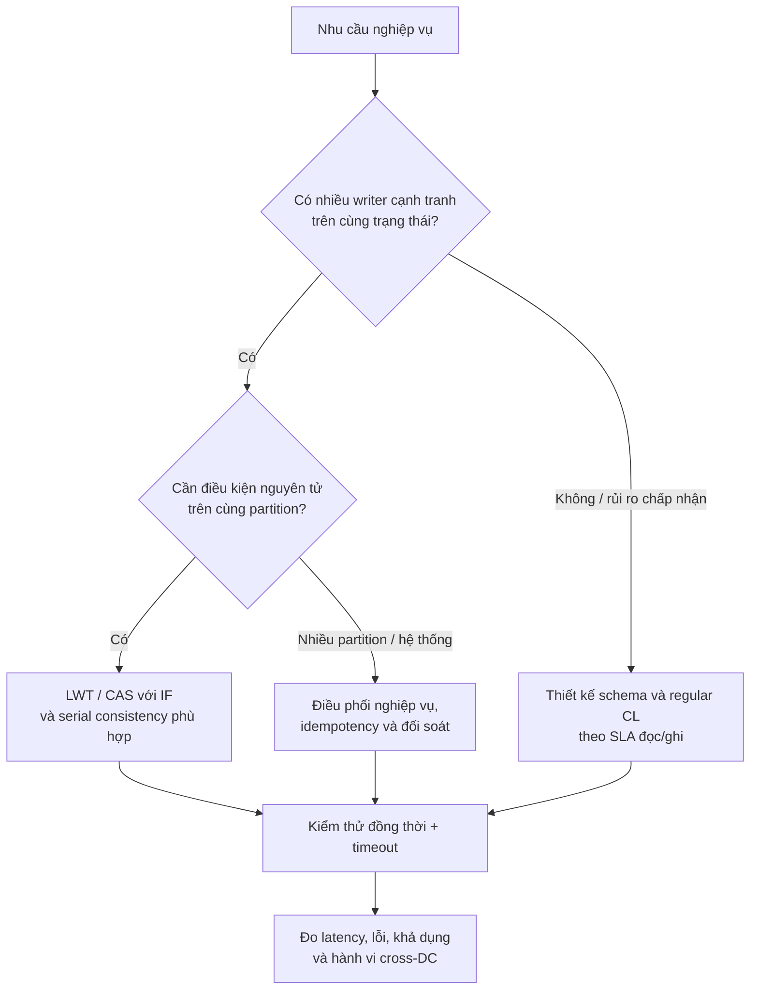

# Giới hạn của việc suy ra tính tuần tự chỉ từ phép tính quorum

## Mục tiêu học tập

Khi làm việc với **Spring Data Cassandra**, chúng ta thường gặp công thức:

\[
R + W > N
\]

Trong đó `N` là **replication factor** (số bản sao của dữ liệu trong phạm vi đang xét), `R` là số replica cần phản hồi cho lần đọc, còn `W` là số replica cần xác nhận cho lần ghi. Nếu `N = 3`, chọn `R = 2` và `W = 2` thì mọi tập hợp hai replica trong cùng nhóm ba replica đều giao nhau.

Đó là một quan sát toán học hữu ích. Nhưng **một tập hợp replica giao nhau không tự chứng minh ứng dụng có một lịch sử thao tác tuần tự đúng với mọi yêu cầu nghiệp vụ**. Để nói về tính tuần tự hoặc tuyến tính hóa, ta còn phải xem **cách xử lý ghi đồng thời, timestamp, phạm vi dữ liệu, read-modify-write, datacenter, retry và cơ chế điều kiện**.

Bài học thuộc chương **Tính nhất quán** của module `SPRING_DATA_CASSANDRA`. Mục tiêu là giúp bạn dùng repository, `CassandraTemplate`, `CqlTemplate` hoặc `CqlSession` mà không lầm tưởng việc chọn `QUORUM` hoặc `LOCAL_QUORUM` có thể thay thế một giao thức đồng bộ truy cập dữ liệu.

Sau bài, bạn có thể:

- Tính quorum cho replication factor cụ thể và chứng minh điều kiện giao nhau.
- Phân biệt **quorum intersection**, **sequential consistency**, **linearizability** và **serializability**.
- Giải thích vai trò của **last-write-wins theo timestamp**, kể cả khi request ghi đến sau đã nhận xác nhận quorum.
- Nhận diện race condition kiểu **read-modify-write** mà quorum không giải quyết.
- Phân tích sự khác nhau giữa `QUORUM` và `LOCAL_QUORUM` khi ứng dụng chạy nhiều datacenter.
- Sử dụng đúng **lightweight transactions (LWT)** và điều kiện `IF` khi cần cơ chế compare-and-set trên một partition.
- Thiết kế retry, đọc/ghi qua Spring Data và kiểm thử đồng thời dựa trên một **hợp đồng nhất quán rõ ràng**, thay vì dựa vào tên consistency level.

## 1. Các khái niệm dễ bị đánh đồng

Trước khi bàn về quorum, cần phân biệt một số thuộc tính nhất quán.

| Khái niệm | Nội dung chính | Điều không được suy ra |
| --- | --- | --- |
| **Quorum intersection** | Hai tập replica đáp ứng ngưỡng đọc/ghi có ít nhất một replica chung. | Không có nghĩa các thao tác đã được sắp thành một lịch sử logic duy nhất. |
| **Sequential consistency** (*nhất quán tuần tự*) | Kết quả tương đương một thứ tự tuần tự của các thao tác, vẫn giữ thứ tự chương trình của từng client. | Không nhất thiết giữ thứ tự thời gian thực giữa các client khác nhau. |
| **Linearizability** (*tính tuyến tính hóa*) | Mỗi thao tác dường như xảy ra tức thời ở một điểm giữa lúc bắt đầu và lúc trả kết quả; thứ tự thời gian thực được tôn trọng. | Không tự tạo một giao dịch nguyên tử qua nhiều đối tượng/partition. |
| **Serializability** (*khả tuần tự hóa*) | Kết quả các transaction tương đương một thứ tự transaction tuần tự nào đó. | Không đồng nghĩa mọi database operation đơn lẻ được tuyến tính hóa theo thời gian thực. |
| **Last-write-wins (LWW)** | Trong xung đột giá trị, Cassandra so sánh timestamp và quy tắc giải quyết xung đột của dữ liệu. | Timestamp lớn hơn không nhất thiết là request được người dùng gửi sau về thời gian thực. |

Từ “tính tuần tự” trong thảo luận nhóm đôi khi được dùng chung để chỉ nhiều tính chất trên. Khi thiết kế hệ thống, **hãy gọi tên chính xác tính chất cần bảo đảm**: một lịch sử nhất quán theo thứ tự client, tính tuyến tính hóa của thao tác trên một khóa, hay một giao dịch bao trùm nhiều hàng.

### Ví dụ về thứ tự thời gian thực

Giả sử thao tác A hoàn thành và trả thành công **trước khi** client bắt đầu thao tác B:

```text
Thời gian thực ───────────────────────────────────────────>

Client A:   [ write(status = "PAID") ]-- trả thành công

Client B:                                      [ write(status = "SHIPPED") ]
                                              ^ bắt đầu sau khi A hoàn tất
```

Nếu API hứa **linearizability** cho register `status`, B là thao tác ghi đến sau về thời gian thực và lịch sử phải tôn trọng điều đó. Chỉ có một replica thuộc giao của các quorum không tự tạo ra quy tắc thứ tự ấy.

## 2. Quorum trong Cassandra: một phép tính tập hợp

Giả sử mỗi partition có `N = 3` replica:

```text
Replica của partition P:
  { A, B, C }

Write quorum W = 2:
  { A, B } xác nhận lần ghi

Read quorum R = 2:
  { B, C } phản hồi lần đọc

Giao nhau:
  { A, B } ∩ { B, C } = { B }
```

Vì `W + R = 4 > 3`, **mọi tập con hai replica** lấy từ tập ba replica đều có ít nhất một phần tử chung.

Tổng quát, với các tập `Wset` và `Rset` thuộc cùng tập `N` replica:

\[
|Wset \cap Rset| \geq R + W - N
\]

Do đó, nếu `R + W > N`, vế phải lớn hơn 0 và giao không rỗng.

### Vì sao giao nhau hữu ích?

Nếu một giá trị mới đã được ghi và được xác nhận trên quorum, một lần đọc quorum sau đó trong **cùng phạm vi replica** có cơ hội quan sát ít nhất một bản sao đã nhận ghi đó. Cassandra có thể so sánh các phản hồi để chọn phiên bản dữ liệu theo ngữ nghĩa của hệ thống.

Trong tình huống một khóa, không có cạnh tranh phức tạp, timestamp được quản lý đúng và các replica tham gia tuân thủ những giả định cần thiết, quorum đọc/ghi có thể cho mức quan sát mạnh và hữu ích. Đây là lý do `QUORUM` và `LOCAL_QUORUM` được dùng trong nhiều workload.

Tuy nhiên, **chứng minh tập hợp giao nhau là điều kiện về vị trí bản sao**, chưa phải chứng minh về **thứ tự thao tác ứng dụng**.

### Bảng tính một số mức consistency

Với `RF = 3` trong một datacenter:

| CL ghi | Ngưỡng W | CL đọc | Ngưỡng R | R + W > 3? |
| --- | ---: | --- | ---: | --- |
| `ONE` | 1 | `ONE` | 1 | Không, 2 ≤ 3. |
| `ONE` | 1 | `QUORUM` | 2 | Không, 3 ≤ 3. |
| `QUORUM` | 2 | `QUORUM` | 2 | Có, 4 > 3. |
| `ALL` | 3 | `ONE` | 1 | Có, 4 > 3. |
| `ALL` | 3 | `QUORUM` | 2 | Có, 5 > 3. |

Điều kiện `R + W > N` là **quy tắc đếm ngưỡng trên một tập replica cố định**. Không thể bỏ qua topology, consistency level đặc biệt, các replica đang chuyển trạng thái và khác biệt local/global rồi thay trực tiếp mọi giá trị vào công thức.

## 3. Từ giao nhau đến lịch sử tuần tự: bước suy luận còn thiếu

Hình dung một **register** có khóa `item_id` và một trường trạng thái:

```sql
CREATE TABLE item_status_by_id (
    item_id uuid PRIMARY KEY,
    status text
);
```

Giả sử `RF = 3`, mọi write/read đều đặt `QUORUM`. Một phép đọc sau khi một phép ghi hoàn thành có thể lấy phản hồi từ quorum giao với quorum đã ghi. Nhưng để kết luận “đây là register linearizable”, còn cần chứng minh:

1. **Phép ghi nào được coi là mới hơn?** Hệ thống có sử dụng thứ tự thời gian thực giữa các thao tác thành công không?
2. **Khi hai client ghi đồng thời thì sao?** Có một cơ chế điều phối/đồng thuận cho thứ tự đó không?
3. **Timestamp được cấp thế nào?** Nó có thể khác giữa client hoặc coordinator không?
4. **Phép đọc xử lý các phiên bản cạnh tranh thế nào?** Chọn phiên bản nào khi có nhiều timestamp?
5. **Thành công/timeout có nghĩa gì?** Một request chưa có response vẫn có thể đã ảnh hưởng một số replica.
6. **Phạm vi cam kết là gì?** Một cell, một row, một partition hay nhiều partition?
7. **Các read/write có dùng cùng phạm vi datacenter/replica không?**

Không câu hỏi nào trong số đó được trả lời chỉ bằng bất đẳng thức `R + W > N`.

### Điểm nhấn

**Giao quorum có thể giúp tìm thấy một phiên bản đã được ghi, nhưng tự nó không xác định phiên bản nào phải là “mới nhất” theo hợp đồng nghiệp vụ.**

Quorum hoạt động trong một hệ thống cụ thể, với quy tắc chọn giá trị, timestamp và xử lý lỗi cụ thể. Không thể xem quorum như một thuật toán đồng thuận hoàn chỉnh.

## 4. Phản ví dụ quan trọng: timestamp và last-write-wins

Trong Cassandra, ghi thông thường dùng timestamp để phân giải xung đột giữa các giá trị. Cột có timestamp lớn hơn thường thắng cột có timestamp nhỏ hơn, theo quy tắc LWW/tombstone và các chi tiết phân giải xung đột của Cassandra.

Timestamp không nhất thiết trùng với thứ tự request hoàn thành trên đồng hồ của người dùng. Ứng dụng có thể cung cấp timestamp CQL tường minh, hoặc timestamp được tạo ở một client/coordinator có đồng hồ lệch.

### 4.1. Một lịch sử với hai phép ghi *không đồng thời*

Ban đầu `status = 'NEW'`.

```text
Thời gian thực ─────────────────────────────────────────────>

A: UPDATE status='PAID',    timestamp=2_000_000
   [========== QUORUM thành công ==========]

B:                                         UPDATE status='SHIPPED',
                                           timestamp=1_000_000
                                           [=== QUORUM thành công ===]

C:                                                              QUORUM READ
                                                                 -> 'PAID'
```

Trong ví dụ này B bắt đầu **sau khi A đã hoàn tất**, nhưng B mang timestamp **nhỏ hơn** timestamp của A. Cassandra có thể nhận thao tác B ở mức quorum, trong khi quy tắc LWW vẫn chọn giá trị A khi đọc.

Lệnh CQL minh họa việc cấp timestamp:

```sql
-- Một UUID đã có trong bảng, ví dụ phục vụ thí nghiệm.
UPDATE item_status_by_id
USING TIMESTAMP 2000000
SET status = 'PAID'
WHERE item_id = 11111111-1111-4111-8111-111111111111;

-- Được gửi sau khi thao tác trên trả thành công,
-- nhưng cố ý sử dụng timestamp nhỏ hơn:
UPDATE item_status_by_id
USING TIMESTAMP 1000000
SET status = 'SHIPPED'
WHERE item_id = 11111111-1111-4111-8111-111111111111;

SELECT status
FROM item_status_by_id
WHERE item_id = 11111111-1111-4111-8111-111111111111;
```

Hai câu `UPDATE` chỉ minh họa xung đột timestamp. Để tái hiện tình huống quorum, **consistency level phải được đặt ở công cụ gọi/driver**, không thể chỉ nhìn văn bản CQL rồi kết luận thao tác dùng `QUORUM`.

### 4.2. Vì sao ví dụ phá vỡ suy luận linearizability?

Nếu A đã hoàn tất trước khi B bắt đầu, một lịch sử tuyến tính hóa các phép ghi vào **một register có semantics ghi đè** phải đặt A trước B. Phép đọc C sau khi B hoàn tất phải nhận giá trị B nếu không có thao tác ghi khác.

Nhưng ở lịch sử trên, C đọc lại A do timestamp A lớn hơn. Vì thế không thể suy ra tính tuyến tính hóa chỉ từ việc **cả ba request đều dùng quorum**.

Điểm sai không nằm ở công thức giao nhau: **quorum vẫn giao nhau**. Điểm sai là thay thế **thứ tự thời gian thực của thao tác** bằng **thứ tự timestamp** mà không chứng minh chúng luôn tương thích.

### 4.3. Ở production có thể có lệch timestamp như thế nào?

- Các client hoặc coordinator có đồng hồ hệ thống lệch nhau.
- Ứng dụng chủ động gắn timestamp để replay/backfill dữ liệu.
- Một bản ghi cũ được replay với timestamp lớn bất thường.
- Các service triển khai quy tắc cấp timestamp không đồng nhất.
- Retry hoặc request gửi trễ mang timestamp được tạo từ trước.

Java Driver có thể cung cấp cơ chế tạo timestamp nhằm giảm vấn đề ở phạm vi client, nhưng **một cơ chế monotonic trong một process không chứng minh timestamp tăng toàn cục giữa mọi client/datacenter**.

**Bài học:** khi cần tuân thủ thứ tự nghiệp vụ, không thể chỉ dựa vào đồng hồ/timestamp LWW cộng với quorum. Cần thiết kế điều kiện hoặc protocol phù hợp.

## 5. Hai phép ghi đồng thời: quorum không quyết định “ai thắng đúng nghiệp vụ”

Hai dịch vụ cùng cập nhật một trạng thái:

```text
Service A                       Service B
   |                                |
   |--- UPDATE status='APPROVED' -->|
   |                                |--- UPDATE status='REJECTED'
   |                                |
   +--- QUORUM ACK                  +--- QUORUM ACK
                   \                /
                    \              /
                     Đọc trạng thái cuối
                        theo LWW
```

Nếu A và B diễn ra đồng thời, hợp đồng linearizability có thể chấp nhận một thứ tự nhất quán giữa hai thao tác, nhưng **quorum intersection không tự cung cấp quy tắc nghiệp vụ chọn thứ tự nào**. Cassandra giải quyết xung đột bằng timestamp và các quy tắc dữ liệu, không hỏi “quy trình xét duyệt nào được phép ghi sau”.

Điều đáng lo hơn là các trạng thái có thể mang **ràng buộc nghiệp vụ**: sau `APPROVED` không được tự chuyển sang `REJECTED` nếu chưa có bước hoàn tác. Một phép ghi `UPDATE` thông thường không tự kiểm tra máy trạng thái.

Quorum chỉ nói thao tác đã được đủ replica xác nhận theo consistency level, **không nói trạng thái mới là chuyển tiếp hợp lệ**.

### Dữ liệu nhiều cột và thay đổi trạng thái

Giả sử bảng có `status`, `approved_by`, `approved_at`. Ngay cả khi CQL ghi được nhiều cột trong một thao tác theo những bảo đảm atomicity tương ứng của Cassandra, **đừng suy ra các thay đổi trong hai thao tác nghiệp vụ khác nhau đã được xếp thành một lịch sử transaction toàn cục**.

Nếu workflow cần so sánh trạng thái trước khi chuyển, hãy mô hình hóa điều kiện rõ ràng.

## 6. Read-modify-write: lỗi lost update dù đọc/ghi đều QUORUM

Một lỗi phổ biến không đòi hỏi lệch đồng hồ.

Giả sử một SKU còn **1 đơn vị hàng tồn** và hai đơn hàng muốn giữ hàng cùng lúc:

```sql
CREATE TABLE stock_by_sku (
    sku text PRIMARY KEY,
    remaining int,
    version bigint
);
```

Dữ liệu đầu:

```text
sku = 'SKU-001'
remaining = 1
version = 7
```

Hai service cùng thực hiện:

```text
Thời điểm       Service A                       Service B
--------------------------------------------------------------------
T1              QUORUM READ -> remaining=1
T2                                              QUORUM READ -> remaining=1
T3              Kiểm tra >0, quyết định giữ 1
T4                                              Kiểm tra >0, quyết định giữ 1
T5              QUORUM UPDATE remaining=0
T6                                              QUORUM UPDATE remaining=0
T7              Báo giữ hàng thành công          Báo giữ hàng thành công
```

Cả hai service đều có thể nhận đủ xác nhận quorum, trạng thái lưu cuối vẫn là `remaining = 0`, nhưng **hai đơn hàng đã cùng được báo giữ thành công cho một đơn vị tồn kho**.

Đây là **check-then-act race**, còn gọi là lỗi *read-modify-write* hoặc một dạng *lost update* của quy trình nghiệp vụ.

### Vì sao R + W > N không cứu được?

Phép đọc của A và B đều hợp lệ và có thể cùng thấy giá trị `1`, bởi vì tại lúc đó chưa có cập nhật nào được commit. Phép tính giao quorum **không khóa hàng giữa phép đọc và phép ghi**; nó không buộc B phải kiểm tra lại dữ liệu ngay trước khi xác nhận giữ hàng.

Nâng `ONE` lên `QUORUM` làm thay đổi ngưỡng replica phản hồi, **không biến hai câu lệnh riêng thành một compare-and-set nguyên tử**.

### Lưu ý về counter

`counter` của Cassandra cung cấp ngữ nghĩa tăng/giảm khác với ghi số nguyên thường, nhưng không nên coi counter là giải pháp hoàn chỉnh cho bài toán tồn kho có điều kiện không âm hoặc giữ hàng một lần. Retry counter, ràng buộc nghiệp vụ và lỗi giữa nhiều hệ thống vẫn cần thiết kế riêng.

## 7. LWT: khi cần so sánh trạng thái rồi mới ghi

Đối với ràng buộc một hàng/partition, Cassandra cung cấp **lightweight transactions (LWT)** thông qua các câu lệnh có điều kiện, ví dụ `INSERT ... IF NOT EXISTS`, `UPDATE ... IF ...` hoặc `DELETE ... IF EXISTS` trong phạm vi được CQL hỗ trợ.

Các thao tác điều kiện sử dụng **Paxos/consensus** theo ngữ nghĩa của Cassandra, để quyết định thao tác có được áp dụng hay không.

### 7.1. Compare-and-set theo version

Đối với bảng `stock_by_sku`, có thể dùng:

```sql
UPDATE stock_by_sku
SET remaining = 0,
    version = 8
WHERE sku = 'SKU-001'
IF version = 7;
```

Hai client cùng cố chuyển version `7 → 8`:

```text
Ban đầu: remaining=1, version=7

Service A: IF version=7 -> áp dụng thành công
           remaining=0, version=8

Service B: IF version=7 -> không được áp dụng
           vì version hiện tại không còn là 7
```

Phần kiểm tra `IF version = 7` cùng việc ghi các giá trị là một **conditional operation**. Với ngữ nghĩa LWT và phạm vi được hỗ trợ, chỉ một thao tác cạnh tranh có thể thắng điều kiện ban đầu.

Khi nhận thất bại điều kiện, service B phải **đọc lại trạng thái và quyết định nghiệp vụ**: thông báo hết hàng, thử lại theo quy tắc có giới hạn, hay chọn một SKU khác. Không được coi `[applied]=false` là thành công chỉ vì request CQL không bị lỗi mạng.

### 7.2. IF NOT EXISTS cho tạo bản ghi độc nhất

```sql
INSERT INTO stock_by_sku (sku, remaining, version)
VALUES ('SKU-001', 1, 1)
IF NOT EXISTS;
```

Nếu hai tiến trình đồng thời muốn tạo cùng khóa, câu lệnh điều kiện giúp tránh việc cả hai tự tin đã tạo hàng mới. Tuy nhiên **khóa phải được thiết kế đúng phạm vi duy nhất**: nếu SKU chỉ duy nhất trong tenant thì primary key cũng phải thể hiện tenant.

### 7.3. IF EXISTS cho thao tác có điều kiện tồn tại

```sql
DELETE FROM stock_by_sku
WHERE sku = 'SKU-001'
IF EXISTS;
```

Với lệnh này, kết quả điều kiện giúp phân biệt “đã áp dụng xóa” và “không áp dụng vì không có hàng”, tùy trạng thái được hệ thống quan sát. Nó không bảo đảm byte dữ liệu bị dọn khỏi mọi SSTable ngay sau khi xóa.

## 8. SERIAL, LOCAL_SERIAL và consistency thường

Với LWT, cần phân biệt **serial consistency level** của giai đoạn điều kiện/đồng thuận với **regular consistency level** của thao tác dữ liệu.

| Loại | Ví dụ | Chức năng |
| --- | --- | --- |
| **Regular CL** | `ONE`, `LOCAL_QUORUM`, `QUORUM` | Mức xác nhận replica cho read/write theo quy tắc CQL. |
| **Serial CL** | `SERIAL`, `LOCAL_SERIAL` | Phạm vi/điều kiện phối hợp của giao thức LWT. |

**`QUORUM` không phải tên khác của `SERIAL`.** Một lệnh `UPDATE ...` thông thường được gửi với `QUORUM` vẫn không phải thao tác CAS.

### SERIAL và LOCAL_SERIAL khác nhau ở đâu?

- `SERIAL` áp dụng phạm vi serial consistency phù hợp với mô hình LWT toàn cụm theo semantics của Cassandra.
- `LOCAL_SERIAL` giới hạn phạm vi điều phối serial consistency theo **datacenter cục bộ** trong những tình huống được hỗ trợ, có đánh đổi khác với phạm vi toàn cụm.

Trong triển khai nhiều datacenter, nếu hai khu vực cùng cạnh tranh trên một khóa, **không tự mặc định LOCAL_SERIAL ở hai DC sẽ tạo cùng bảo đảm điều phối toàn cục như SERIAL**. Cần xác định một chiến lược serial consistency nhất quán với topology và hợp đồng nghiệp vụ, không trộn tùy tiện các mức khi cần một điểm tuần tự hóa duy nhất.

### Không lạm dụng LWT

LWT có chi phí phối hợp cao hơn ghi thông thường và có thể ảnh hưởng latency/throughput, đặc biệt khi có nhiều request tranh chấp cùng partition. Nó phù hợp khi **điều kiện nguyên tử thực sự cần thiết**.

Không chuyển mọi thao tác cập nhật log hoặc timestamp thành LWT chỉ vì muốn “nhất quán hơn”. Đầu tiên hãy xác định:

1. Quy tắc nghiệp vụ có cần phát hiện cạnh tranh không?
2. Quy tắc ấy áp dụng trong cùng một partition/khóa không?
3. Tất cả writer có dùng cùng protocol không?
4. Chi phí latency và tranh chấp có chấp nhận được không?
5. Nếu LWT thành công ở bảng này nhưng ghi bảng khác lỗi, sẽ xử lý thế nào?

## 9. Java Driver: đặt regular CL và serial CL đúng vị trí

Spring Data Cassandra dựa trên Java Driver cho giao tiếp CQL. Khi cần một thao tác có điều kiện rõ ràng, có thể dùng `CqlSession` do Spring quản lý để chủ động câu lệnh và consistency levels.

Ví dụ Java Driver 4.x:

```java
import com.datastax.oss.driver.api.core.CqlSession;
import com.datastax.oss.driver.api.core.DefaultConsistencyLevel;
import com.datastax.oss.driver.api.core.cql.BoundStatement;
import com.datastax.oss.driver.api.core.cql.PreparedStatement;
import com.datastax.oss.driver.api.core.cql.ResultSet;

public final class StockCasGateway {

    private final CqlSession session;
    private final PreparedStatement updateIfVersion;

    public StockCasGateway(CqlSession session) {
        this.session = session; // Spring quản lý session/lifecycle.
        this.updateIfVersion = session.prepare("""
            UPDATE stock_by_sku
            SET remaining = ?, version = ?
            WHERE sku = ?
            IF version = ?
            """);
    }

    public boolean tryUpdate(
            String sku,
            int newRemaining,
            long observedVersion) {

        long newVersion = Math.addExact(observedVersion, 1);

        BoundStatement statement = updateIfVersion.bind(
                newRemaining,
                newVersion,
                sku,
                observedVersion
        )
        .setConsistencyLevel(DefaultConsistencyLevel.LOCAL_QUORUM)
        .setSerialConsistencyLevel(DefaultConsistencyLevel.LOCAL_SERIAL);

        ResultSet result = session.execute(statement);
        return result.wasApplied();
    }
}
```

Trong ví dụ:

- Prepared CQL có `IF version = ?` nên đây là **LWT**, không phải cập nhật thường.
- `setConsistencyLevel(...)` đặt regular CL.
- `setSerialConsistencyLevel(...)` đặt serial CL cho thao tác điều kiện.
- `result.wasApplied()` cho biết điều kiện có được áp dụng hay không.
- Tạo `PreparedStatement` một lần cho gateway; mỗi lời gọi tạo `BoundStatement` với tham số riêng.
- `CqlSession` được inject, **không tự đóng sau mỗi request**.

Đây là ví dụ đặt `LOCAL_QUORUM + LOCAL_SERIAL` cho workload có chiến lược điều phối **trong phạm vi datacenter phù hợp**. Nó **không phải cấu hình khuyến nghị cho mọi ứng dụng đa DC**. Với yêu cầu điều phối toàn cụm, cần đánh giá `SERIAL`, regular CL tương ứng, topology và phiên bản Cassandra đang dùng.

### Chỉ bảo đảm một phần của nghiệp vụ

`tryUpdate(...)` trả `true` không nói:

- Một đơn hàng ở bảng khác đã được ghi thành công.
- Thanh toán đã hoàn tất.
- Reservation đã được xác nhận ở dịch vụ bên ngoài.
- Không có một writer khác cố tình ghi `remaining` bằng câu lệnh **không điều kiện**.

Nếu nghiệp vụ giữ hàng trải nhiều bảng/hệ thống, cần mô hình trạng thái, idempotency key, đối soát hoặc quy trình bù trừ phù hợp.

## 10. Spring Data Repository và CassandraTemplate: CL không làm thay đổi semantics

Repository thông dụng:

```java
import org.springframework.data.cassandra.repository.CassandraRepository;

public interface StockRepository
        extends CassandraRepository<Stock, String> {
}
```

với entity:

```java
import org.springframework.data.cassandra.core.mapping.Column;
import org.springframework.data.cassandra.core.mapping.PrimaryKey;
import org.springframework.data.cassandra.core.mapping.Table;

@Table("stock_by_sku")
public class Stock {
    @PrimaryKey
    private String sku;

    @Column("remaining")
    private Integer remaining;

    @Column("version")
    private Long version;

    // Constructor, getters/setters theo quy ước dự án.
}
```

Gọi:

```java
Stock stock = repository.findById("SKU-001").orElseThrow();
stock.setRemaining(stock.getRemaining() - 1);
repository.save(stock);
```

là mẫu **đọc rồi ghi**. Nếu không có cơ chế điều kiện đi kèm, việc chọn regular CL `QUORUM` vẫn không biến ba dòng trên thành CAS nguyên tử; hai service có thể cùng đọc một version và đưa ra cùng quyết định.

Đoạn mã là minh họa logic, giả định đã bổ sung getters/setters và inject repository. Đừng copy vào một luồng đặt hàng production mà không có bảo vệ cạnh tranh.

### Có thể dùng optimistic locking của Spring Data không?

Một số thế hệ Spring Data Cassandra có hỗ trợ mô hình version/optimistic locking và cơ chế ghi có điều kiện tùy API/phiên bản. Nhưng không nên suy luận rằng **mọi** trường `version` hay mọi `repository.save()` đều tự động trở thành Paxos/LWT chỉ vì property được đặt tên `version`.

Khi muốn dùng cơ chế đó:

1. Kiểm tra support và annotation/API theo phiên bản Spring Data Cassandra thực.
2. Kiểm tra CQL thực sự có điều kiện `IF` hoặc đường CAS phù hợp.
3. Kiểm tra cách báo lỗi khi version không khớp.
4. Đảm bảo mọi writer quan trọng tuân theo cùng chính sách.
5. Có integration test với hai thao tác cạnh tranh cùng một khóa.

Nếu API tầng Spring Data chưa diễn đạt được ràng buộc cần thiết, **prepared CQL qua `CqlSession` hoặc `CqlTemplate` thích hợp** là lựa chọn rõ ràng hơn việc tự suy đoán semantics.

## 11. LOCAL_QUORUM trong nhiều datacenter: phép giao có thể biến mất

Giả sử keyspace dùng `NetworkTopologyStrategy` và có hai datacenter:

```text
Datacenter DC-A:  A1, A2, A3   (RF=3)
Datacenter DC-B:  B1, B2, B3   (RF=3)
```

Một ghi dùng `LOCAL_QUORUM` tại DC-A chỉ cần **2 trong 3 replica của DC-A** xác nhận theo quy tắc tương ứng.

Một lần đọc dùng `LOCAL_QUORUM` tại DC-B chỉ cần **2 trong 3 replica của DC-B** phản hồi.

```text
Write quorum tại DC-A: { A1, A2 }

Read quorum tại DC-B:  { B1, B2 }

Giao nhau:
  { A1, A2 } ∩ { B1, B2 } = ∅
```

**Ở đây không có giao replica giữa hai tập local quorum.** Nhân bản sang DC-B vẫn có thể đang diễn ra khi request ở DC-A đã trả thành công; một phép đọc sớm tại DC-B có thể quan sát dữ liệu cũ theo những điều kiện vận hành nhất định.

### Sai lầm trong phép tính

Không được tính:

```text
DC-A: RF=3, W_LOCAL_QUORUM=2
DC-B: RF=3, R_LOCAL_QUORUM=2

2 + 2 > 3  => suy ra giao nhau
```

vì hai số `2` trên **không chọn replica từ cùng một tập ba replica**. Để áp dụng bất đẳng thức giao, phải xác định tập gốc và phạm vi quorum cho đúng.

### Dùng cùng datacenter thì sao?

Khi cả read và write dùng `LOCAL_QUORUM` trong **cùng DC** với RF=3, các tập local quorum hai phần tử trong DC đó có giao nhau. Đây là một lý do LOCAL_QUORUM hữu ích để giảm độ trễ xuyên DC.

Nhưng **giao local quorum vẫn không chứng minh linearizability** của những thao tác có timestamp cạnh tranh hoặc read-modify-write không có điều kiện.

### Một số điểm cần xét khi đọc xuyên vùng

| Yêu cầu | Điều cần làm rõ |
| --- | --- |
| Người dùng ghi ở DC-A, đọc ngay ở DC-A | Đánh giá regular CL cùng phạm vi, timestamp và dữ liệu cạnh tranh. |
| Ghi ở DC-A, đọc tức thì ở DC-B | Không dùng phép tính local quorum của mỗi DC để chứng minh giao toàn cục. |
| Yêu cầu thao tác điều kiện trên nhiều DC | Xác định serial consistency và chiến lược client routing toàn cụm. |
| Cần độ trễ thấp tại từng vùng | Thừa nhận và thiết kế rõ mức chậm đồng bộ xuyên vùng nếu phù hợp. |
| Chuyển vùng khi DC lỗi | Kiểm tra semantics sau failover, khả năng đọc stale và các ghi chưa hoàn tất. |

Consistency level **không thay thế** việc ghi rõ hợp đồng đọc-sau-ghi giữa các khu vực.

## 12. Ghi/đọc lỗi timeout: phản hồi không phải nhật ký tuần tự hoàn chỉnh

Một request có thể timeout vì client chưa nhận đủ phản hồi trong thời gian cho phép. Điều đó **không chứng minh Cassandra chưa xử lý request**.

Ví dụ:

```text
Client         Coordinator             Replicas
  |                |                      |
  |--- UPDATE ---->|                      |
  |                |--- gửi tới A, B, C -->
  |                |<--- A đã nhận -------|
  |                |<--- B phản hồi chậm -|
  |<-- TIMEOUT ----|                      |
  |                                       |
  |   Không biết chắc trạng thái cuối chỉ từ timeout
```

Sau timeout, có thể xảy ra các trạng thái khác nhau tùy loại thao tác, mức consistency, các replica đã nhận và những request khác.

### Nguy cơ retry mù quáng

Nếu client thử lại một phép `UPDATE status='PAID'` mà không có thao tác cạnh tranh và semantics cho phép, retry có thể tương đối dễ xử lý hơn. Nhưng nếu:

- Có một ghi `status='REFUNDED'` vừa xảy ra sau đó.
- Client retry bằng timestamp mới cao hơn.
- Tác vụ còn phát sự kiện, gửi email, trừ tiền hoặc cộng counter.

thì retry có thể ghi đè trạng thái hợp lệ mới hoặc gây tác dụng phụ lặp.

Quorum không cung cấp **exactly-once execution**. Khi thiết kế retry, cần tính đến **idempotency**, trạng thái nghiệp vụ, thứ tự thao tác và kết quả không xác định của timeout.

### LWT timeout cũng cần xử lý thận trọng

Một LWT bị timeout không thể mặc định coi như điều kiện đã thất bại; quyết định có thể đã được áp dụng hoặc đang được hoàn tất. Với workflow quan trọng:

1. Ghi lại operation ID/ý định ở mức nghiệp vụ nếu cần.
2. Đọc/xác minh trạng thái với semantics phù hợp trước khi thử lại.
3. Chỉ retry có điều kiện, cùng khóa và cùng chính sách.
4. Không biến exception timeout thành xác nhận “chưa đặt hàng”.

## 13. Read repair, anti-entropy và tombstone không thay thế consensus

Cassandra có các cơ chế giúp replica dần hội tụ và xử lý khác biệt, chẳng hạn **read repair** theo khả năng phiên bản, **repair/anti-entropy**, hinted handoff và compaction.

Các cơ chế này quan trọng về mặt vận hành, nhưng **mục đích của chúng khác với sắp thứ tự tuyến tính hóa tất cả request ứng dụng**.

### Read repair

Khi read path phát hiện replica có dữ liệu khác nhau, Cassandra có thể sử dụng cơ chế đối soát/repair theo phiên bản và cấu hình. Điều đó có thể cải thiện sự hội tụ của bản sao, nhưng không làm một quá trình:

```text
read remaining
if remaining > 0:
    write remaining - 1
```

trở thành một thao tác CAS nguyên tử.

### Repair và dữ liệu bị xóa

Tombstone đánh dấu giá trị/hàng đã xóa để các replica không tự đưa dữ liệu cũ trở lại trong các điều kiện thích hợp. Quá trình repair/compaction và cấu hình `gc_grace_seconds` có ảnh hưởng tới an toàn xóa.

**Không nên giảm `gc_grace_seconds` hoặc bỏ repair chỉ để cải thiện hiệu năng** khi chưa hiểu topology và quy trình vận hành. Những thay đổi đó có thể ảnh hưởng tới tính đúng đắn của dữ liệu đã xóa.

### Hinted handoff

Hinted handoff có thể giúp chuyển lại một số ghi cho replica tạm thời vắng mặt theo giới hạn cơ chế của Cassandra. Nó không phải một “transaction log toàn cục” có thể chứng minh mọi thao tác đã được tuần tự hóa hay ngay lập tức xuất hiện ở mọi DC.

### Kết luận phần này

**Replica convergence** và **operation serialization** là hai mục tiêu khác nhau. Một hệ thống có thể dần hội tụ về một giá trị theo timestamp nhưng không đáp ứng yêu cầu “hai client không bao giờ cùng giữ thành công đơn vị tồn cuối cùng”.

## 14. Tính đúng trên nhiều partition và nhiều bảng

Cassandra khuyến khích **thiết kế bảng theo truy vấn**. Một thực thể nghiệp vụ có thể có nhiều cách nhìn:

```sql
CREATE TABLE orders_by_id (
    order_id uuid PRIMARY KEY,
    customer_id uuid,
    order_status text
);

CREATE TABLE orders_by_customer (
    customer_id uuid,
    placed_at timestamp,
    order_id uuid,
    order_status text,
    PRIMARY KEY ((customer_id), placed_at, order_id)
);
```

Một đơn hàng được ghi ở cả hai bảng phục vụ:

- Đọc chi tiết theo `order_id`.
- Liệt kê đơn theo `customer_id` và `placed_at`.

Giả sử service ghi hai bảng đều bằng `QUORUM`:

```text
1) INSERT orders_by_id            -> QUORUM thành công
2) INSERT orders_by_customer      -> TIMEOUT hoặc lỗi
```

Mỗi thao tác có thể đã tuân thủ ngưỡng quorum của riêng nó, nhưng **hai bảng có thể không đồng bộ với nhau**.

### Vì sao R + W > N không đủ?

Bất đẳng thức được lập cho **một tập replica của một partition**; nó không nói rằng hai thao tác trên hai partition/bảng sẽ:

- Commit cùng nhau.
- Rollback cùng nhau.
- Được mọi reader nhìn thấy như một transaction nguyên tử.
- Giữ một invariant xuyên hai bảng.

CQL `BATCH` có những bảo đảm atomicity/ghi theo cơ chế Cassandra, nhưng **không nên đồng nhất với transaction ACID có isolation và rollback của RDBMS trên mọi partition**. Batch nhiều partition còn tạo chi phí điều phối và không phải mẹo tăng tốc ghi.

### Các hướng kiến trúc

Tùy nghiệp vụ:

1. Xác định **bảng nguồn** của trạng thái chính.
2. Dùng ID thao tác/idempotency key để việc thử lại không tạo tác dụng phụ lặp.
3. Theo dõi những cách nhìn dữ liệu cần được cập nhật.
4. Thiết kế retry/đối soát khi một bảng phụ chưa được ghi.
5. Với workflow quan trọng, dùng trạng thái chuyển tiếp hoặc một kiến trúc điều phối phù hợp.

Không hứa “mọi danh sách/chi tiết đơn luôn nhất quán đồng thời” chỉ vì hai repository được cấu hình `LOCAL_QUORUM`.

## 15. Thế nào là một hợp đồng nhất quán có thể kiểm thử?

Thay vì phát biểu:

> “Hệ thống dùng QUORUM nên dữ liệu luôn tuần tự.”

hãy mô tả **bất biến nghiệp vụ** và phạm vi cần được bảo vệ.

Ví dụ:

| Bài toán | Hợp đồng có thể kiểm thử | Cơ chế cần cân nhắc |
| --- | --- | --- |
| Đọc cấu hình sau ghi trong một DC | Sau write thành công, read trong cùng DC theo chính sách đã chọn quan sát dữ liệu hợp lệ khi không có ghi cạnh tranh. | `LOCAL_QUORUM` đọc/ghi, đồng bộ timestamp và kiểm thử. |
| Không bán quá số lượng tồn | Hai request tranh chấp trên cùng SKU không cùng xác nhận giữ đơn vị cuối. | CAS/LWT hoặc một cơ chế điều phối tồn kho khác. |
| Không tạo hai hàng cùng định danh nghiệp vụ | Hai yêu cầu create trùng khóa không cùng được báo tạo mới. | `IF NOT EXISTS` trên khóa được thiết kế đúng. |
| Quy trình trạng thái có điều kiện | Chỉ `NEW → PAID` khi trạng thái hiện tại là `NEW`. | `UPDATE ... IF status='NEW'`, kiểm tra applied. |
| Hiển thị đơn ngay sau khi ghi cả hai bảng | Chi tiết và danh sách không bị lệch quá mức đã cam kết. | Điều phối/đối soát, xử lý partial failure. |
| Đọc ngay sau ghi xuyên DC | Trạng thái từ DC-A phải được thấy tại DC-B theo SLA cụ thể. | Xác định chính sách cross-DC; không suy từ hai local quorum rời nhau. |

### Những câu hỏi cần đặt trước khi chọn consistency

- “Thành công” nghĩa là có bao nhiêu replica xác nhận, hay một quyết định nghiệp vụ đã được thống nhất?
- Phải bảo đảm nhất quán **trên một key**, một partition, nhiều partition hay nhiều dịch vụ?
- Có **nhiều writer đồng thời** không?
- Thứ tự nào phải được giữ: thứ tự trong một client hay thời gian thực giữa nhiều client?
- Có thể chấp nhận dữ liệu chậm đồng bộ bao lâu ở datacenter khác?
- Nếu timeout, client sẽ kiểm tra hay thử lại theo chính sách nào?
- Có yêu cầu không lặp tác dụng phụ (đặt hàng, thanh toán, thông báo) không?

Những câu hỏi này tạo ra hợp đồng, từ đó mới chọn regular CL, serial CL, mô hình khóa và workflow.

## 16. Consistency level và hiệu năng: cần đánh đổi có đo lường

Chọn mức xác nhận replica mạnh hơn thường ảnh hưởng **độ trễ và khả dụng**:

- `ONE` có thể phản hồi sớm hơn trong những tình huống nhất định, nhưng không bảo đảm giao với một read quorum nhỏ khác.
- `LOCAL_QUORUM` yêu cầu đa số replica của local DC phản hồi, cân bằng giữa quan sát trong vùng và chi phí.
- `QUORUM` được tính theo phạm vi replica thích hợp; trong nhiều DC, cách chọn replica/phạm vi có thể khác yêu cầu local.
- `ALL` cần tất cả replica thuộc phạm vi quy định phản hồi, có tác động đáng kể đến khả dụng nếu có node lỗi.
- `SERIAL`/`LOCAL_SERIAL` cho LWT có thêm giai đoạn đồng thuận và chi phí tranh chấp.

Không có một bảng mức CL duy nhất bảo đảm **vừa latency tối thiểu, vừa khả dụng tối đa, vừa transaction tuyến tính hóa trên toàn cụm**.

### Bảng thực nghiệm cần thu thập

| Chỉ số | Mục tiêu kiểm tra |
| --- | --- |
| p50/p95/p99 latency đọc và ghi | Ảnh hưởng của CL dưới tải thật. |
| Timeout và unavailable errors | Khả dụng khi node/DC chậm hoặc mất kết nối. |
| Tỷ lệ LWT applied=false | Mức tranh chấp nghiệp vụ. |
| LWT latency | Chi phí CAS khi nhiều client cùng cập nhật một khóa. |
| Retry và kết quả không xác định | Tần suất phải đối soát sau timeout. |
| Read repair/repair backlog | Tình trạng hội tụ và bảo trì replica. |
| Hot partition/tombstone | Nguyên nhân query chậm không nằm ở mức CL. |
| Cross-DC observation lag | Mức trễ dữ liệu mà người dùng giữa các vùng thực sự thấy. |

**Không sửa partition nóng bằng cách chuyển mọi query thành QUORUM**, cũng không giải quyết lost update bằng cách tăng page size.

## 17. Paging và tính nhất quán nhiều lần đọc

Giả sử một repository trả:

```java
Slice<Event> first = repository.findDailyEvents(
        tenantId, deviceId, eventDay,
        CassandraPageRequest.first(20));
```

Đoạn mã là ví dụ bối cảnh, giả định các class/repository đã được định nghĩa và Spring Data Cassandra phiên bản đang dùng hỗ trợ API đó.

Client lấy slice thứ hai vài giây sau:

```java
Slice<Event> next = repository.findDailyEvents(
        tenantId, deviceId, eventDay,
        first.nextPageable());
```

Ngay cả khi mỗi lần đọc dùng `QUORUM` hoặc `LOCAL_QUORUM`:

- Một hàng có thể được ghi mới hoặc xóa giữa hai lần gọi.
- TTL có thể hết hạn.
- Paging state là trạng thái tiếp tục truy vấn, **không phải một transaction snapshot xuyên nhiều HTTP request**.
- Dữ liệu từ partition/ngày khác không tự được ghép vào cùng cursor.

Nếu ứng dụng cần báo cáo “ảnh chụp dữ liệu tại đúng một thời điểm”, phải thiết kế cơ chế snapshot/điểm chốt riêng theo yêu cầu, không suy ra chỉ từ **quorum + paging**.

Tương tự, consistency của các lần đọc độc lập không tạo một **giao dịch đọc nhiều bảng** có cùng thời điểm quan sát.

## 18. Một quy trình lựa chọn công cụ



Hình minh họa không thay thế đánh giá chuyên môn của từng hệ thống, nhưng giúp phân biệt ba nhóm vấn đề:

1. **Chọn ngưỡng replica trả lời** → regular consistency level.
2. **Quyết định có áp dụng thay đổi có điều kiện hay không** → LWT/CAS với serial consistency.
3. **Giữ invariant nhiều thao tác/bảng/hệ thống** → thiết kế workflow, idempotency, đối soát hoặc cơ chế transaction thích hợp khác.

## 19. Lỗi thường gặp và hướng chẩn đoán

| Triệu chứng | Kết luận sai thường gặp | Nguyên nhân/hướng kiểm tra đúng |
| --- | --- | --- |
| Write QUORUM thành công nhưng read sau thấy giá trị cũ | “Quorum bị hỏng.” | Kiểm tra timestamp/LWW, ghi cạnh tranh, topology, read CL và phạm vi DC. |
| Hai đơn cùng giữ đơn vị hàng cuối | “Tăng lên ALL là hết.” | Đây là race read-modify-write; cần CAS hoặc cơ chế điều phối. |
| LOCAL_QUORUM ở DC-B chưa thấy ghi từ DC-A | “2 + 2 > 3 nên phải thấy.” | Hai quorum thuộc **hai tập replica khác nhau**, giao có thể rỗng. |
| LWT không được áp dụng | “Cassandra báo lỗi ghi.” | Kiểm tra `[applied]`/`wasApplied()`: xung đột điều kiện là một kết quả hợp lệ. |
| LWT timeout | “Chắc chắn chưa áp dụng.” | Kết quả có thể chưa xác định ở client; cần xác minh/truy vấn lại. |
| Ghi vào bảng A rồi bảng B lỗi | “Cùng QUORUM nên tự rollback.” | Hai thao tác trên hai bảng không tạo một transaction RDBMS. |
| Đọc sau paging trả kết quả thay đổi | “QUORUM phải tạo snapshot.” | Paging state không là snapshot transaction; dữ liệu có thể biến động. |
| Retry làm trạng thái bị ghi đè | “Mỗi lần QUORUM thành công là an toàn.” | Xem timestamp, thứ tự thời gian thực, idempotency và nghiệp vụ. |
| Chỉ một node trả dữ liệu khác | “Tăng CL là đủ, khỏi repair.” | Kiểm tra replica divergence, read repair/repair và tombstone. |
| LWT latency tăng đột biến | “Cứ thêm session mới.” | Kiểm tra contention trên partition, quorum/serial CL, topology và tải. |

### Trình tự debug khuyến nghị

1. **Viết rõ invariant:** điều gì được coi là kết quả đúng của nghiệp vụ?
2. **Ghi lại lịch sử request:** thời điểm bắt đầu/kết thúc, client, khóa, dữ liệu, status, timeout.
3. **Xác nhận schema và partition key:** mọi thao tác đang nhắm tới cùng partition hay nhiều partition?
4. **Xác nhận CL từng request:** regular CL nào? Có LWT và serial CL hay chỉ ghi thường?
5. **Xác nhận timestamp và writer cạnh tranh:** có giá trị timestamp bất thường hay client ngoài quy trình?
6. **Xác nhận topology/DC:** QUORUM hay LOCAL_QUORUM, replica thuộc phạm vi nào?
7. **Kiểm tra kết quả CAS:** `wasApplied()`, version hiện tại và nhánh conflict của service.
8. **Kiểm tra retry/timeout:** có request được gửi lặp hoặc tác dụng phụ đã xảy ra không?
9. **Đo khả dụng/hiệu năng:** p95 latency, replica health, repair, tombstone và contention.

Nếu mục tiêu là chứng minh tính tuyến tính hóa, **đừng dùng một vài lần đọc-ghi tuần tự trong integration test làm bằng chứng duy nhất**; cần các lịch sử cạnh tranh và một mô hình kiểm tra phù hợp.

## 20. Bộ kiểm thử có chủ đích

### 20.1. Thử nghiệm lệch timestamp

Chuẩn bị một bản ghi trạng thái với hai thao tác `UPDATE ... USING TIMESTAMP ...` trên cùng khóa. Cho phép request thứ nhất hoàn tất trước khi gửi request thứ hai nhưng cấp timestamp nhỏ hơn cho request thứ hai.

Kỳ vọng:

- Hai thao tác đều có thể được xác nhận theo regular CL đã đặt.
- Giá trị cuối có thể do timestamp lớn hơn quyết định.
- Kiểm thử chỉ ra **quorum ACK không đồng nghĩa thứ tự thời gian thực của write thắng**.

Chỉ làm trên môi trường kiểm thử; đừng tạo timestamp bất thường trên dữ liệu production.

### 20.2. Thử nghiệm lost update

Tạo `stock_by_sku` có `remaining=1, version=7`. Dùng hai luồng đồng thời:

1. Cùng đọc `remaining=1` với `QUORUM`.
2. Cùng quyết định ghi `remaining=0`.
3. Cùng gửi `UPDATE` thông thường với `QUORUM`.
4. Quan sát cả hai service có thể tự ghi nhận “đã giữ hàng”.

Đây là test về **nghiệp vụ**, nên phải kiểm tra số lần service xác nhận giữ hàng, không chỉ giá trị cuối `remaining`.

### 20.3. Thử nghiệm cùng dữ liệu nhưng có CAS

Thay câu lệnh ghi thông thường bằng:

```sql
UPDATE stock_by_sku
SET remaining = 0, version = 8
WHERE sku = 'SKU-001'
IF version = 7;
```

Đảm bảo hai client dùng serial consistency phù hợp, cùng một phạm vi khóa/cluster và không có writer không điều kiện chen vào.

Kỳ vọng:

- Khi hai client tranh chấp cùng version ban đầu, không thể cả hai đều nhận kết quả **điều kiện được áp dụng** cho cùng transition đó.
- Client không được áp dụng phải xử lý nhánh conflict.
- Test cần thử thêm timeout/retry, không chỉ các trường hợp phản hồi thành công rõ ràng.

### 20.4. Thử nghiệm hai datacenter

Với hệ thống test phù hợp:

1. Xác định replication factor ở từng DC.
2. Ghi bằng `LOCAL_QUORUM` tại DC-A.
3. Đọc ngay tại DC-B bằng `LOCAL_QUORUM`.
4. Quan sát hành vi trong điều kiện đồng bộ bình thường và khi có độ trễ/link failure.

Mục tiêu là chứng minh **hai local quorum không tự có giao nhau**, không phải cố tình tạo một bài benchmark kết luận mọi cross-DC read sẽ luôn chậm.

### 20.5. Thử nghiệm nhiều bảng

Giả lập ghi vào `orders_by_id` thành công rồi `orders_by_customer` lỗi. Kiểm tra cơ chế retry/đối soát có thể khôi phục cách nhìn danh sách, không phát sự kiện tạo đơn hai lần hoặc gắn sai trạng thái.

## 21. Bài tập vận dụng

**Câu 1 — Tính giao quorum.** Một partition có ba replica. Write CL cần hai replica, read CL cần hai replica. Giao tối thiểu là bao nhiêu?

**Gợi ý:** `2 + 2 - 3 = 1`. Có ít nhất một replica chung nếu hai tập đều được chọn từ **cùng tập ba replica**.

**Câu 2 — Công thức và tuyến tính hóa.** Hai ghi cùng khóa có timestamp lần lượt 2.000.000 và 1.000.000; ghi thứ hai bắt đầu sau khi ghi thứ nhất hoàn tất. Cả hai được xác nhận bằng QUORUM. Có thể kết luận lần đọc cuối chắc chắn thấy ghi thứ hai không?

**Gợi ý:** Không. LWW có thể ưu tiên timestamp lớn hơn của ghi thứ nhất. Giao quorum không chứng minh thứ tự theo thời gian thực.

**Câu 3 — Read-modify-write.** Hai service cùng đọc số lượng tồn bằng 1 ở QUORUM, rồi cùng cập nhật về 0 ở QUORUM. Có bảo đảm chỉ một đơn được xác nhận không?

**Gợi ý:** Không. Hai bước đọc/ghi riêng không có điều kiện nguyên tử. Cần CAS/LWT hoặc cơ chế điều phối đúng nghiệp vụ.

**Câu 4 — LOCAL_QUORUM đa vùng.** Ghi tại DC-A với LOCAL_QUORUM và đọc ở DC-B với LOCAL_QUORUM. Tại sao không được tính trực tiếp `2 + 2 > 3`?

**Gợi ý:** Hai tập quorum thuộc hai DC khác nhau; tập replica không có phần tử chung theo cấu trúc ví dụ.

**Câu 5 — IF và kết quả.** Một lệnh `UPDATE ... IF version = 7` trả `wasApplied() == false`. Có nên trả HTTP “đặt hàng thành công” không?

**Gợi ý:** Không. Điều kiện không được áp dụng; cần xử lý conflict và trạng thái hiện tại theo nghiệp vụ.

**Câu 6 — Serial CL.** Đặt `setConsistencyLevel(LOCAL_QUORUM)` trên một UPDATE thông thường có tương đương đặt `setSerialConsistencyLevel(LOCAL_SERIAL)` cho thao tác điều kiện không?

**Gợi ý:** Không. Regular CL xác định ngưỡng replica phản hồi; serial CL liên quan đến giao thức LWT. Không có `IF` thì không có CAS từ cách gọi đó.

**Câu 7 — Timeout.** Sau một LWT timeout, client có được kết luận “không có gì xảy ra” không?

**Gợi ý:** Không. Phải xử lý kết quả chưa xác định, kiểm tra lại dữ liệu/operation ID và retry có điều kiện.

**Câu 8 — Hai bảng.** Ghi vào `orders_by_id` và `orders_by_customer` đều dự kiến QUORUM. Nếu thao tác thứ hai lỗi, bảng đầu có tự rollback không?

**Gợi ý:** Không. Cần cơ chế workflow/đối soát; quorum áp dụng theo phạm vi replica của từng thao tác.

**Câu 9 — Read repair.** Read repair có tự giải quyết lỗi hai đơn cùng giữ đơn vị cuối cùng không?

**Gợi ý:** Không. Repair giúp dữ liệu replica hội tụ, còn việc kiểm tra tồn kho rồi trừ có điều kiện là bài toán điều phối thao tác.

**Câu 10 — Phân trang.** Hai slice đều đọc bằng QUORUM. Có được coi chúng là cùng một snapshot bất biến không?

**Gợi ý:** Không. Dữ liệu có thể được ghi/xóa giữa hai lần đọc, paging state không tạo transaction snapshot.

## Tổng kết

Với replication factor `N`, điều kiện **`R + W > N`** chứng minh **quorum đọc và quorum ghi giao nhau** khi cả hai được chọn từ cùng tập replica thích hợp. Điều kiện này giúp lý giải vì sao các mức CL như `QUORUM` và `LOCAL_QUORUM` có thể cải thiện khả năng quan sát dữ liệu đã được xác nhận, nhưng **không tự chứng minh sequential consistency, linearizability hoặc serializability** của toàn bộ ứng dụng.

Để đánh giá tính tuần tự, còn phải xét **timestamp và last-write-wins**, ghi đồng thời, thứ tự thời gian thực, read-modify-write, timeout/retry, phạm vi datacenter và nhiều bảng. Khi cần **compare-and-set nguyên tử trên khóa/partition**, hãy dùng LWT với `IF` và serial consistency phù hợp; khi invariant trải nhiều partition hay hệ thống, cần thiết kế quy trình nghiệp vụ, idempotency và đối soát riêng.

Trong Spring Data Cassandra, repository, `CassandraTemplate` và `CqlSession` chỉ là những tầng truy cập khác nhau. **Chọn consistency level là chọn một phần hợp đồng về replica, không phải bật công tắc “mọi thao tác đều tuần tự”.** Hãy bắt đầu từ bất biến nghiệp vụ, chọn cơ chế tương ứng, rồi kiểm thử lịch sử cạnh tranh, dữ liệu xuyên vùng và hiệu năng trên mô hình phân tán thực tế.
