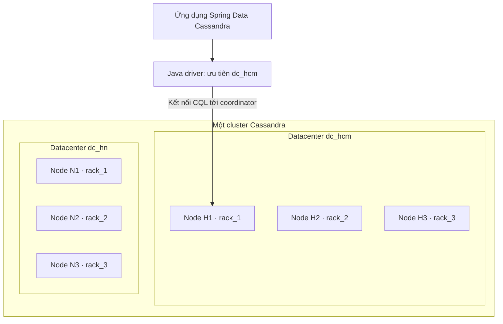
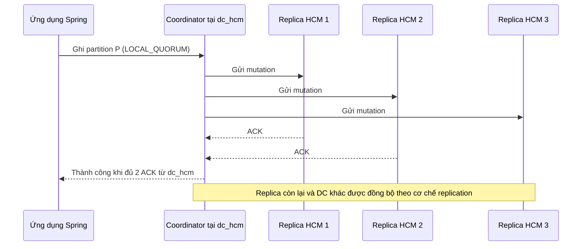

# Cluster, node, datacenter và rack trong Apache Cassandra

Apache Cassandra là cơ sở dữ liệu NoSQL phân tán theo mô hình *peer-to-peer*: dữ liệu được chia thành nhiều **partition**, phân bố trên các **node** và nhân bản để hệ thống tiếp tục phục vụ khi một số máy hoặc vùng hạ tầng gặp sự cố. Khi dùng **Spring Data Cassandra**, ứng dụng thao tác thông qua entity mapping, repository, `CassandraTemplate` hoặc CQL, nhưng tốc độ, khả năng chịu lỗi và mức nhất quán của truy vấn vẫn phụ thuộc vào cách Cassandra tổ chức cluster.

Bài này tập trung vào bốn khái niệm nền tảng: **cluster, node, datacenter và rack**. Từ đó, ta sẽ thấy vì sao partition key, replication factor, consistency level và cấu hình driver của Spring có quan hệ trực tiếp với kiến trúc triển khai.

## 1. Bốn cấp tổ chức của một hệ Cassandra

| Khái niệm | Ý nghĩa | Cần nhớ |
| --- | --- | --- |
| **Cluster** | Tập hợp các node Cassandra cùng tham gia một hệ thống phân tán, chia sẻ thông tin về topology và schema. | Một cluster có thể gồm nhiều datacenter; không có node trung tâm làm chủ toàn bộ dữ liệu. |
| **Node** | Một tiến trình/instance Cassandra, thường chạy trên một máy hoặc VM/container, lưu dữ liệu cục bộ và giao tiếp với các node khác. | Node giữ các token range và những replica được phân công; bất kỳ node phù hợp nào cũng có thể làm **coordinator** cho yêu cầu CQL. |
| **Datacenter (DC)** | Nhóm node được Cassandra gán cùng tên DC để phản ánh ranh giới triển khai và chính sách nhân bản. | Có thể tương ứng một khu vực địa lý, một trung tâm dữ liệu hoặc một nhóm hạ tầng; tên DC là tên **logic** trong Cassandra. |
| **Rack** | Nhóm node trong một DC được gán cùng tên rack, đại diện cho một miền sự cố nhỏ hơn DC. | Có thể ánh xạ tới rack vật lý, availability zone hoặc nhóm mạng/nguồn điện độc lập, tùy cách vận hành. |

Quan hệ phân cấp thường được hình dung như sau:



Sơ đồ là ví dụ **một cluster gồm hai DC, mỗi DC có ba node ở ba rack logic**. Các đường nối minh họa nơi client gửi yêu cầu; chúng không đại diện toàn bộ luồng nhân bản nội bộ. Trong thực tế, mỗi rack có thể chứa nhiều node và mỗi node thường nắm nhiều token range.

### Cluster không có nút chủ cố định

Khác với kiến trúc primary/replica truyền thống, Cassandra không buộc mọi thao tác phải đi qua một máy chủ duy nhất. Node nhận yêu cầu từ driver đóng vai trò **coordinator** cho yêu cầu đó: xác định những replica liên quan, chuyển/thu thập kết quả và phản hồi client. Lần truy vấn tiếp theo có thể do node khác làm coordinator.

Các node trao đổi thông tin thành viên và trạng thái qua cơ chế **gossip**. **Seed node** chỉ là điểm liên lạc ban đầu giúp node mới khám phá cluster; seed **không phải** master, và node seed cũng không độc quyền quản lý schema, đọc hay ghi. Khi thêm hoặc thay node, dữ liệu cần được truyền qua cơ chế streaming; gossip chỉ truyền thông tin trạng thái, không chuyển toàn bộ dữ liệu.

## 2. Node lưu gì và partition được đặt ở đâu?

Mỗi node Cassandra có bộ nhớ, CPU, mạng và ổ đĩa riêng. Dữ liệu ghi thường đi qua **commit log** và **memtable**, rồi được lưu thành **SSTable**; các tác vụ compaction, repair và đọc/ghi đều tiêu thụ tài nguyên của node. Một node không có cái nhìn “toàn bộ dữ liệu” dưới dạng một ổ lưu trữ dùng chung.

Với một bảng có partition key, Cassandra xác định vị trí dữ liệu theo chuỗi khái niệm:

1. Lấy **partition key** từ bản ghi hoặc câu truy vấn.
2. Dùng **partitioner** (phổ biến là `Murmur3Partitioner`) biến giá trị khóa thành **token**.
3. Xác định vị trí của token trong không gian token (*ring* là mô hình trực quan).
4. Chọn các **replica node** theo chiến lược nhân bản của **keyspace**, số bản sao ở từng DC và topology/rack.

Ví dụ, bảng đơn hàng có `customer_id` là partition key. Các đơn của cùng một khách hàng nằm trong cùng một logical partition, được lưu trên những node mang replica của partition đó. Truy vấn lọc đúng `customer_id` có thể được định tuyến tới các replica thích hợp; truy vấn thiếu partition key thường buộc Cassandra làm việc trên phạm vi rộng hơn và có thể không được hỗ trợ hiệu quả.

```sql
CREATE TABLE commerce.orders_by_customer (
    customer_id uuid,
    created_at timestamp,
    order_id uuid,
    total decimal,
    PRIMARY KEY ((customer_id), created_at, order_id)
) WITH CLUSTERING ORDER BY (created_at DESC, order_id ASC);

-- Lấy các đơn gần đây của một khách hàng.
SELECT created_at, order_id, total
FROM commerce.orders_by_customer
WHERE customer_id = 11111111-1111-1111-1111-111111111111
LIMIT 20;
```

Ở ví dụ trên, `customer_id` quyết định **partition**; `created_at` và `order_id` là **clustering columns**, quyết định thứ tự các hàng *bên trong* partition. Chúng không tự tạo các partition mới. Thiết kế partition key phải cân bằng phân phối tải và kiểu truy vấn; khách hàng có quá nhiều bản ghi có thể tạo partition quá lớn, lúc đó cần cân nhắc chia theo kỳ thời gian hoặc một khóa bổ sung có chủ đích.

### Token range, vnode và replica không phải một khái niệm

- **Token range** là khoảng trong không gian băm mà node chịu trách nhiệm theo phân bổ token.
- **Virtual node (vnode)** cho phép một node nhận nhiều token/range thay vì chỉ một đoạn liên tiếp trên ring; điều này hỗ trợ phân bố dữ liệu và cân bằng khi thay đổi topology.
- **Replica** là một bản sao của **partition** trên một node. Số lượng và vị trí replica được quyết định bởi chính sách replication, không đơn thuần bằng số token range.

Do đó, “partition ở node nào?” không có câu trả lời chỉ dựa trên tên DC hay rack: cần biết partition key, token map và replication strategy của keyspace.

## 3. Datacenter và rack quyết định khả năng chịu lỗi ra sao?

Một **datacenter** là ranh giới quan trọng trong chiến lược nhân bản và trong việc chọn node của client. Tên `dc_hcm`, `dc_hn` trong ví dụ là tên logic do quản trị viên cấu hình; không tự động trở thành DC chỉ vì máy nằm ở Thành phố Hồ Chí Minh hay Hà Nội. Cassandra dùng thông tin topology do **snitch** cung cấp để biết mỗi node thuộc DC/rack nào.

Một **rack** là đơn vị mô tả rủi ro sự cố chung bên trong DC. Nếu các node đặt trên cùng nguồn điện hoặc cùng availability zone nhưng lại bị khai báo thành nhiều rack độc lập, Cassandra có thể phân bổ replica theo một hình dung sai về khả năng chịu lỗi. Ngược lại, đặt các node ở những miền sự cố riêng vào cùng một rack cũng làm mất lợi ích của rack awareness.

Với `NetworkTopologyStrategy`, Cassandra cố gắng phân bố replica giữa các rack khác nhau **trong từng DC** khi topology cho phép. Ví dụ, một DC có ba node thuộc ba rack, RF = 3, có thể giữ ba replica của một partition trên ba rack. Khi chỉ có ít rack hơn RF, các replica vẫn phải được đặt trên những node khả dụng; không thể kỳ vọng có đủ RF miền sự cố độc lập.

**Lưu ý:** replication factor (RF) là số **bản sao của mỗi partition trong một DC** với `NetworkTopologyStrategy`, không phải số bản sao trên mỗi rack. Một rack cũng không tương đương một node.

### Cấu hình replication theo từng DC

```sql
CREATE KEYSPACE commerce
WITH replication = {
    'class': 'NetworkTopologyStrategy',
    'dc_hcm': 3,
    'dc_hn': 3
}
AND durable_writes = true;
```

Đoạn CQL trên có nghĩa: với **mỗi partition** trong keyspace `commerce`, Cassandra đặt mục tiêu có **3 replica tại `dc_hcm`** và **3 replica tại `dc_hn`**. Đây là cấu hình *trên keyspace*; hai bảng thuộc cùng keyspace sử dụng chính sách replication ấy. Tên DC trong CQL phải **khớp chính xác** với tên DC mà các node báo cáo.

Để hiện thực cấu hình này một cách lành mạnh, mỗi DC cần đủ node và phân bố rack phù hợp. RF = 3 với chỉ hai node trong DC không tạo ra ba bản sao độc lập trên ba máy; thêm replica cũng tiêu thụ dung lượng đĩa và lưu lượng mạng. Replication tăng khả năng chịu lỗi, nhưng không thay thế backup, snapshot hay quy trình phục hồi lỗi xóa dữ liệu.

## 4. Một thao tác ghi/đọc đi qua cluster như thế nào?

Giả sử Spring Data Cassandra kết nối vào `dc_hcm`, truy vấn một partition có RF = 3 tại mỗi DC:



Đây là luồng **minh họa** để giải thích số phản hồi cần chờ; lịch gửi thực tế do coordinator quyết định, và các replica ở DC khác cũng thuộc kế hoạch replication. Dòng “thành công” với `LOCAL_QUORUM` **không** bảo đảm tại thời điểm đó mọi replica ở cả hai DC đã nhận cùng dữ liệu.

Với thao tác **đọc**, driver chọn một coordinator phù hợp; coordinator liên hệ các replica cần thiết theo consistency level, đối chiếu phiên bản/timestamp khi cần và trả kết quả. Replica có thể tạm thời khác nhau khi mạng hoặc node lỗi; các cơ chế như repair giúp khôi phục sự đồng bộ. Cassandra không cung cấp cùng semantics giao dịch xuyên nhiều partition như một RDBMS truyền thống.

### Consistency level liên hệ với DC

| Consistency level | Điều kiện phản hồi, nhìn từ ví dụ RF = 3 ở mỗi DC | Đánh đổi |
| --- | --- | --- |
| `LOCAL_ONE` | Một replica tại DC cục bộ phản hồi. | Độ trễ và số replica cần thiết thấp; một lần đọc có thể chưa thấy bản ghi mới nhất nếu replica chậm đồng bộ. |
| `LOCAL_QUORUM` | Cần đa số replica **trong DC cục bộ**: `floor(3/2) + 1 = 2`. | Cân bằng độ sẵn sàng và độ nhất quán trong một DC. |
| `QUORUM` | Cần đa số tính trên **tổng số replica** của các DC liên quan; với tổng RF = 6 là 4. | Có thể cần phản hồi qua liên kết giữa các DC, làm tăng độ trễ. |
| `EACH_QUORUM` | **Khi ghi**, cần quorum tại **mỗi DC**; ở ví dụ là 2 ACK từ từng DC. | Siết điều kiện xác nhận ghi qua các DC; không dùng như lựa chọn nhất quán đọc thông thường. |
| `ALL` | Cần phản hồi từ tất cả replica. | Nhạy với việc mất một replica, dễ giảm availability. |

Với RF = 3 tại một DC, một thao tác đọc `LOCAL_QUORUM` và một thao tác ghi `LOCAL_QUORUM` có các tập replica giao nhau vì `2 + 2 > 3`. Điều này hỗ trợ đọc thấy ghi đã xác nhận trong DC ấy theo mô hình consistency của Cassandra. Tuy nhiên, **quorum không đồng nghĩa linearizability**, không tự xử lý mọi xung đột ghi đồng thời; Cassandra thường giải quyết các phiên bản theo timestamp. Những yêu cầu điều kiện hóa cập nhật như “chỉ ghi nếu chưa tồn tại” cần cân nhắc lightweight transaction (LWT) và chi phí của nó.

### Ví dụ sự cố

Nếu `dc_hcm` có ba replica và **một replica bị mất liên lạc**, các truy vấn `LOCAL_QUORUM` thường vẫn có thể hoàn thành nhờ hai replica còn lại. Nếu **hai replica** trong DC ấy không phản hồi, `LOCAL_QUORUM` tại `dc_hcm` sẽ không đạt dù `dc_hn` còn đủ ba node. Muốn tiếp tục phục vụ từ `dc_hn`, ứng dụng cần có cách chuyển lưu lượng/khôi phục kết nối tới DC đó và dùng mức consistency phù hợp. Không nên giả định việc failover diễn ra hoàn toàn tự động ở mọi tầng.

Đặc biệt, `LOCAL_QUORUM` ở `dc_hcm` và `LOCAL_QUORUM` ở `dc_hn` dựa trên **hai tập replica cục bộ khác nhau**. Một ghi vừa được xác nhận trong DC này không nhất thiết đã xuất hiện ngay tại DC kia. Nếu bài toán cần xác nhận ghi ở cả hai DC trước khi trả kết quả, phải đánh giá những consistency level phù hợp và chi phí độ trễ/availability.

## 5. Ứng dụng Spring Data Cassandra nhìn thấy topology như thế nào?

Spring Data Cassandra cung cấp API ánh xạ bảng, `CassandraRepository`, `CassandraTemplate` và lớp truy cập CQL. Phía dưới, **Java driver** quản lý kết nối, metadata topology, chọn coordinator và chính sách cân bằng tải. Vì vậy, cấu hình **local datacenter** trong driver là quan trọng khi cluster có nhiều DC.

Ví dụ cấu hình ứng dụng **Spring Boot 3.x**:

```yaml
spring:
  cassandra:
    contact-points: 10.0.1.11:9042,10.0.1.12:9042
    local-datacenter: dc_hcm
    keyspace-name: commerce
```

Các IP chỉ là ví dụ. `contact-points` là những điểm kết nối ban đầu để driver khám phá cluster, **không** phải danh sách đầy đủ các node hay “master”. `local-datacenter` phải đúng tên DC đang được Cassandra công bố; driver có thể ưu tiên coordinator ở DC đó để tránh round-trip liên vùng không cần thiết. Tùy phiên bản Spring Boot/driver, tên property và cách cấu hình nâng cao có thể khác; cần đối chiếu với phiên bản đang dùng.

Ứng dụng có thể đặt consistency level theo yêu cầu của thao tác (chẳng hạn ghi/đọc `LOCAL_QUORUM` cho dữ liệu cần tính cập nhật cao). Đây là lựa chọn theo từng yêu cầu hoặc profile của driver, không tự phát sinh chỉ vì đã dùng `CassandraRepository` hay `CassandraTemplate`.

**Ranh giới trách nhiệm:**

| Tầng | Quyết định chính |
| --- | --- |
| **CQL schema/keyspace** | Partition key, clustering columns, `NetworkTopologyStrategy`, RF từng DC. |
| **Cluster Cassandra** | Node thực giữ token range/replica, DC/rack topology, trạng thái thành viên, repair/streaming. |
| **Java driver / Spring Boot** | Contact points, local DC, chọn coordinator, timeout/retry policy và consistency của request. |
| **Spring Data Cassandra** | Entity mapping, repository, template, chuyển thao tác ứng dụng thành CQL phù hợp. |

Entity mapping đúng cú pháp không cứu được một truy vấn truy cập sai partition key; ngược lại, một schema thiết kế theo truy vấn và cấu hình local DC hợp lý có thể tránh nhiều thao tác đọc quét và độ trễ liên vùng.

## 6. Kiểm tra topology khi triển khai và xử lý sự cố

Các lệnh sau dành cho môi trường Cassandra mà bạn có quyền quan sát; chúng giúp kiểm chứng các giả định trong bài:

```bash
# Kiểm tra các node theo datacenter, rack, trạng thái Up/Down.
nodetool status

# Xem thông tin cluster và cấu hình liên quan.
nodetool describecluster
```

```sql
-- Chạy bằng cqlsh để kiểm tra tên DC/rack của node đang kết nối.
SELECT data_center, rack, host_id
FROM system.local;

-- Kiểm tra replication strategy và RF thực tế của keyspace.
SELECT keyspace_name, replication
FROM system_schema.keyspaces
WHERE keyspace_name = 'commerce';
```

Đọc `nodetool status` cần phân biệt **node Up/Down** và **trạng thái gia nhập/rời ring** (Normal, Joining, Leaving, Moving). Node ở trạng thái `UN` thường nghĩa là *Up/Normal*, không có nghĩa mọi truy vấn đến node ấy chắc chắn nhanh hay dữ liệu đã được repair đầy đủ.

Khi kiểm tra một cluster mới hoặc tìm nguyên nhân latency cao, hãy lần lượt hỏi:

1. Các tên datacenter và rack mà node báo cáo có đúng với miền sự cố thực không? Có node bị cấu hình sai snitch/topology không?
2. RF theo từng DC có nhỏ hơn hoặc bằng số node khỏe mạnh dự kiến và phân bổ rack đủ độc lập không?
3. Driver Spring có khai báo đúng `local-datacenter` và đang gửi lưu lượng tới coordinator mong muốn không?
4. Các thao tác quan trọng đang dùng consistency level nào? Có vô tình đòi quorum xuyên DC cho đường truy vấn nhạy độ trễ không?
5. Partition key có phân bố lưu lượng đồng đều không? Một “hot partition” có thể làm nóng cùng một nhóm replica ngay cả khi cluster còn nhiều node rảnh.
6. Khi thay node, thay RF hay mất kết nối kéo dài, kế hoạch **repair** và vận hành dữ liệu đã được thực hiện chưa? Hinted handoff chỉ hỗ trợ khắc phục lỗi ngắn hạn, không thay thế anti-entropy repair.

| Hiện tượng | Khả năng liên quan đến topology | Hướng xác minh |
| --- | --- | --- |
| Truy vấn từ một khu vực rất chậm | Coordinator/replica ở DC xa, đường mạng liên DC hoặc consistency quá chặt. | Kiểm tra local DC của driver, địa chỉ coordinator, loại consistency và RTT. |
| Mất một rack gây lỗi nhiều truy vấn | Replica bị tập trung trong cùng miền sự cố, RF hoặc rack mapping chưa phù hợp. | Đối chiếu `nodetool status`, snitch và replication của keyspace. |
| Có node mới mà dung lượng chưa cân bằng | Streaming/bootstrapping chưa hoàn tất, phân bố token hoặc kích thước partition lệch. | Kiểm tra trạng thái node, tiến độ streaming và phân phối dữ liệu. |
| Một số giá trị đọc chưa giống nhau | Replica có thể chưa đồng bộ, repair chưa đầy đủ hoặc ghi đồng thời xung đột. | Đối chiếu consistency, timestamp, tình trạng replica và lịch repair. |

## 7. Tình huống tổng hợp

Một hệ thống bán hàng chạy ở hai DC `dc_hcm` và `dc_hn`, mỗi DC có ba node trên ba rack riêng. Keyspace `commerce` dùng `NetworkTopologyStrategy` với RF = 3 ở mỗi DC. Ứng dụng bán hàng tại Thành phố Hồ Chí Minh chạy Spring Data Cassandra, khai báo `local-datacenter: dc_hcm` và ghi với `LOCAL_QUORUM`.

- **Khách tạo đơn:** driver gửi thao tác CQL tới coordinator phù hợp ở `dc_hcm`; coordinator phối hợp các replica của partition do `customer_id` xác định. Khi đủ hai ACK từ replica `dc_hcm`, thao tác ghi có thể trả về thành công.
- **Một node `dc_hcm` ngừng hoạt động:** nếu hai replica cần thiết còn phản hồi, `LOCAL_QUORUM` vẫn đạt; hệ thống cần xử lý node hỏng và sau đó bảo đảm dữ liệu được đồng bộ.
- **Cả `dc_hcm` mất kết nối:** ứng dụng chỉ cấu hình phục vụ từ `dc_hcm` không tự có khả năng xử lý hoàn chỉnh từ `dc_hn`. Kế hoạch chuyển vùng ứng dụng/driver và đánh giá dữ liệu đã nhân bản cần được thiết kế trước.
- **Truy vấn mọi đơn hàng trong hệ thống không có `customer_id`:** cluster có nhiều node không biến truy vấn này thành thao tác hiệu quả. Với Cassandra, cần một bảng/luồng dữ liệu phục vụ đúng kiểu truy vấn hoặc một hệ thống phân tích thích hợp.

**Tự kiểm tra:** (1) Seed node khác coordinator ở điểm nào? (2) Với RF = 3, `LOCAL_QUORUM` cần mấy replica phản hồi trong DC cục bộ? (3) Đặt ba replica trên ba rack logic có lợi gì so với đặt cùng một miền sự cố? (4) Vì sao driver cần biết local DC? (5) Vì sao không thể xác định replica chỉ từ tên một node?

**Đáp án gợi ý:** (1) Seed hỗ trợ khám phá ban đầu, coordinator xử lý từng yêu cầu. (2) Hai. (3) Giảm rủi ro mất cùng lúc nhiều replica khi một rack/vùng hạ tầng lỗi. (4) Để ưu tiên đường kết nối và coordinator cục bộ, kiểm soát độ trễ liên DC. (5) Cần partition key/token map cùng replication strategy và topology.

Khi nắm vững quan hệ **cluster → datacenter → rack → node**, bạn có thể nối thiết kế bảng theo truy vấn với vị trí replica, tính nhất quán của request và cách Spring Data Cassandra thực sự truy cập một hệ thống dữ liệu phân tán.
