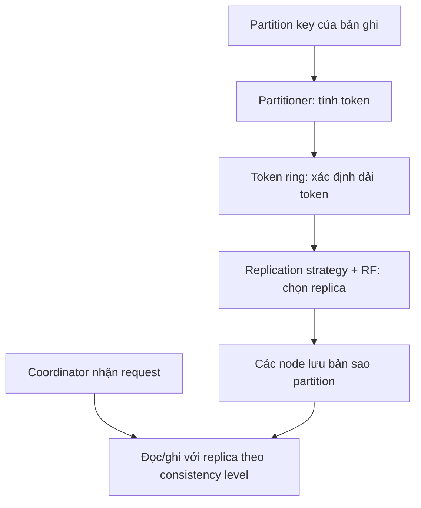

# Token, partitioner và cách phân phối dữ liệu

Apache Cassandra là cơ sở dữ liệu phân tán, trong đó dữ liệu được chia thành các **partition** và lưu trên nhiều node. Để làm việc hiệu quả với Spring Data Cassandra, cần hiểu Cassandra xác định partition nằm ở đâu, tại sao các bản sao nằm trên nhiều node và vì sao thiết kế partition key quyết định cả hiệu năng lẫn khả năng mở rộng.

Bài học thuộc chương **Kiến trúc Cassandra**, tập trung vào ba mắt xích: **partition key → partitioner/token → phân phối và sao chép dữ liệu**. Những kiến thức này là nền tảng trước khi thiết kế entity, repository, truy vấn CQL, paging hoặc chọn consistency level trong ứng dụng Spring.

## 1. Nhìn từ một truy vấn đến vị trí dữ liệu

Trong mô hình Cassandra, **partition key** thuộc về lược đồ bảng, còn **partitioner** thuộc về cấu hình phân phối của cluster:

1. Ứng dụng gửi truy vấn hoặc ghi dữ liệu, kèm các giá trị partition key.
2. Cassandra mã hóa partition key thành dạng byte và dùng partitioner tính **token**.
3. Token được đặt lên **token ring**, qua đó xác định dải token chịu trách nhiệm bởi các node.
4. **Replication strategy** và replication factor (RF) quyết định tập node giữ các bản sao của partition.
5. Node **coordinator** tiếp nhận request và liên hệ với các replica cần thiết theo consistency level.



**Phân biệt bốn khái niệm:**

| Khái niệm | Vai trò | Điều không nên nhầm |
| --- | --- | --- |
| Partition key | Xác định các hàng thuộc cùng một partition | Không đồng nghĩa với primary key đầy đủ |
| Token | Giá trị tính từ **toàn bộ** partition key bằng partitioner | Không phải ID của hàng hay của node |
| Token ring | Không gian token dùng để chia quyền sở hữu các dải token | Không phải sơ đồ kết nối mạng vật lý |
| Replica | Node lưu bản sao partition theo replication strategy | Một token không có nghĩa chỉ có một bản dữ liệu |

Trong một partition, các hàng được tổ chức theo **clustering columns**. Các cột này ảnh hưởng thứ tự và khả năng truy vấn *bên trong* partition; chúng **không tham gia tính token**.

## 2. Partition key khác clustering key như thế nào?

Xét bảng sự kiện của một tenant, nhóm dữ liệu theo tenant và ngày:

```sql
CREATE TABLE tenant_events_by_day (
    tenant_id uuid,
    event_day date,
    event_time timestamp,
    event_id timeuuid,
    event_type text,
    payload text,
    PRIMARY KEY ((tenant_id, event_day), event_time, event_id)
) WITH CLUSTERING ORDER BY (event_time DESC, event_id DESC);
```

Cấu trúc này gồm:

- **Composite partition key**: `(tenant_id, event_day)`, được khai báo trong cặp ngoặc kép `((...))` của `PRIMARY KEY`.
- **Clustering columns**: `event_time` và `event_id`. Chúng sắp xếp dữ liệu trong cùng một partition.
- **Primary key đầy đủ**: tổ hợp partition key và các clustering columns, dùng để định danh hàng.

Giả sử hai sự kiện có cùng `tenant_id` và `event_day` nhưng khác `event_time`: chúng có **cùng token** vì dùng cùng partition key, bất kể timestamp hay event ID. Thay đổi ngày hoặc tenant tạo partition key khác và thông thường sẽ dẫn đến token khác.

Mô hình thực tế này phù hợp với truy vấn: *Lấy 20 sự kiện mới nhất của tenant T trong ngày D*. Nó cũng giới hạn mức tăng kích thước của partition theo ngày. Tuy nhiên, nếu một tenant ghi quá nhiều sự kiện trong một ngày, partition đó vẫn có thể trở thành điểm nóng.

### Quy tắc quan trọng

Cassandra phân tán **theo partition**, chứ không tự tách từng hàng của cùng một partition sang nhiều node độc lập để chia tải ghi. Các bản sao của cùng partition có thể nằm ở nhiều node do replication, nhưng mỗi replica chứa dữ liệu của partition theo cùng một khóa.

## 3. Partitioner làm gì?

**Partitioner** là hàm chuyển partition key đã mã hóa thành token. Với cùng bytes của partition key và cùng thuật toán partitioner, kết quả phải ổn định để hệ thống xác định đúng dải token, bất kể request đến từ node nào.

Cassandra hiện đại thường sử dụng `Murmur3Partitioner`:

- Dùng hàm băm MurmurHash3 để tạo token trong không gian **số nguyên 64-bit có dấu** (thường diễn tả từ `-2^63` đến `2^63 - 1`).
- Mục tiêu là phân bố các partition key khác nhau tương đối đều trên không gian token nếu dữ liệu khóa đủ đa dạng.
- Token không phải giá trị tăng dần theo thời gian, thứ tự chữ cái hay thứ tự UUID.
- Hash có thể trùng về mặt lý thuyết, vì vậy token **không được dùng thay cho khóa định danh duy nhất**.

Ví dụ, các partition key `(tenant-A, 2026-11-25)` và `(tenant-A, 2026-11-26)` có thể rơi vào hai vùng token xa nhau, dù chúng liên tiếp về ngày. Cassandra không bảo đảm các partition liền kề theo khóa sẽ nằm cạnh nhau trên ring.

Các partitioner cũ như `RandomPartitioner` hoặc `ByteOrderedPartitioner` có thể xuất hiện trong hệ thống lịch sử; hành vi token của chúng khác Murmur3. Không thể giả định mọi cluster đều dùng cùng thuật toán. **Partitioner là lựa chọn kiến trúc cấp cluster**; không đổi tùy tiện trên cluster đang chứa dữ liệu vì thay đổi cách ánh xạ partition sang token và đòi hỏi kế hoạch di chuyển dữ liệu phù hợp.

## 4. Token ring và dải sở hữu

Hãy hình dung không gian token là một vòng tròn có thứ tự. Mỗi token được gán cho một node (hoặc một *virtual node*, trình bày ở phần sau). Trong ví dụ **minh họa đơn giản** dùng token từ `0` đến `99`, có bốn node:

| Node | Token đại diện | Dải token sở hữu theo chiều kim đồng hồ |
| --- | ---: | --- |
| A | 10 | `(90, 10]` — đi qua điểm nối vòng |
| B | 40 | `(10, 40]` |
| C | 70 | `(40, 70]` |
| D | 90 | `(70, 90]` |

Ký hiệu `(40, 70]` nghĩa là **lớn hơn 40 và nhỏ hơn hoặc bằng 70**. Vì là vòng tròn, sau token 90 lại quay về token 10.

Giả sử partitioner trả token **53** cho partition của tenant T trong ngày D. Token này thuộc khoảng `(40, 70]`, nên **C** là node nắm dải token tương ứng. Với ví dụ replication đơn giản RF = 2 và chọn replica tiếp theo theo vòng, hai bản sao nằm ở **C** và **D**. Nếu token là **95**, đường vòng sẽ bắt đầu tại **A** và replica tiếp theo là **B**.

Đây chỉ là ví dụ mô hình hóa ring, **không phải** các token Murmur3 thực tế. Với production, thuật toán chọn replica còn phụ thuộc replication strategy, data center, rack và cách các token được phân bổ.

### Điều gì xảy ra khi thêm hoặc mất node?

- **Thêm node / thay đổi token assignment**: một số dải token được chuyển sang node mới; Cassandra stream dữ liệu cần thiết sang các replica mới. Partition key vẫn tạo ra **cùng token** khi partitioner không thay đổi, nhưng **node giữ dữ liệu có thể thay đổi**.
- **Node tạm thời không sẵn sàng**: token của partition không thay đổi; coordinator vận hành theo tình trạng replica, consistency level và cơ chế khôi phục tương ứng.
- **Loại bỏ node**: topology và các dải sở hữu được điều chỉnh, dữ liệu được tái phân phối để đáp ứng replication factor.

Do đó, không lưu cố định suy luận kiểu “token 53 luôn ở server C” trong mã ứng dụng.

## 5. Virtual node (vnode) giúp phân phối ra sao?

Trong triển khai dùng **vnodes**, một node vật lý có thể được gán **nhiều token**, qua đó quản lý nhiều dải token không liền nhau. Khi thêm node hoặc rebalance, cluster có thể chuyển các dải nhỏ hơn, thay vì buộc mỗi máy giữ một khoảng lớn duy nhất.

Ví dụ đơn giản:

```text
Node A: token 10, 50, 90
Node B: token 20, 60, 95
Node C: token 35, 70, 99
```

Ba node vật lý xuất hiện nhiều lần trên ring. Số token mỗi node phụ thuộc phiên bản, cấu hình và cách cấp phát token; không nên tự giả định một con số mặc định áp dụng cho mọi cluster.

**Lợi ích:** phân chia quyền sở hữu thành các đoạn nhỏ, hỗ trợ cân bằng dữ liệu và mở rộng hệ thống linh hoạt hơn.

**Giới hạn:** nhiều vnode hơn không tự khắc phục hot partition, partition key có độ phân biệt thấp hay truy vấn không phù hợp. Cấu hình vnode cũng có thể ảnh hưởng đến lượng metadata, streaming và hoạt động bảo trì; cần chọn theo kích thước cluster và phiên bản Cassandra đang dùng.

## 6. Token placement và replication là hai bước khác nhau

**Partitioner quyết định token; replication strategy quyết định tập replica.** Hai lớp này liên quan nhưng không tương đương.

Ví dụ một keyspace cấu hình **NetworkTopologyStrategy** với RF = 3 tại data center `dc1`. Với mỗi partition, Cassandra chọn ba replica phù hợp với bố trí token và topo trong data center đó. Khi có thông tin rack và đủ node đáp ứng, chiến lược ưu tiên phân tán bản sao giữa các rack để giảm rủi ro sự cố cùng miền.

| Cơ chế | Trả lời câu hỏi |
| --- | --- |
| Partitioner | Partition key này nhận token nào? |
| Token ring / token map | Dải token ấy thuộc những node nào ở topology hiện tại? |
| Replication strategy + RF | Những node nào phải lưu bản sao của partition? |
| Consistency level | Cần bao nhiêu replica đáp ứng để request được coi là thành công? |
| Coordinator | Node nào nhận request và điều phối đọc/ghi? |

Ví dụ trong **một data center có RF = 3**, thao tác dùng `QUORUM` cần đa số, tức **2 replica** phản hồi theo yêu cầu consistency; với `LOCAL_QUORUM`, số replica yêu cầu được tính theo RF ở data center cục bộ. Những mức nhất quán này **không thay đổi token** của partition.

Coordinator có thể là một node khác các replica. Driver Cassandra hỗ trợ **token-aware routing** sẽ dùng metadata về topology và routing key để ưu tiên gửi request đến replica phù hợp, giảm số bước chuyển tiếp. Để tối ưu routing, driver phải xác định được **đầy đủ partition key** của thao tác; nếu truy vấn thiếu khóa hoặc metadata không đầy đủ, lợi ích này có thể giảm.

## 7. Thực hành với CQL

Chạy các lệnh sau trong keyspace đã có sẵn của môi trường học tập. Nếu bảng chưa tồn tại, tạo bảng như ở mục 2.

### 7.1. Ghi một sự kiện

```sql
INSERT INTO tenant_events_by_day (
    tenant_id, event_day, event_time, event_id, event_type, payload
) VALUES (
    8c24c965-4762-4c1f-bdcf-05e0c5e5d2ae,
    '2026-11-25',
    '2026-11-25T02:00:00Z',
    now(),
    'checkout',
    '{"source":"mobile"}'
);
```

`now()` tạo một giá trị `timeuuid` để làm phần khóa phân biệt sự kiện. Chỉ dùng ví dụ này để quan sát cách lưu và truy vấn; dữ liệu vận hành thực tế cần chính sách ID phù hợp để kiểm soát idempotency.

### 7.2. Truy vấn theo partition key đầy đủ

```sql
SELECT event_time, event_id, event_type
FROM tenant_events_by_day
WHERE tenant_id = 8c24c965-4762-4c1f-bdcf-05e0c5e5d2ae
  AND event_day = '2026-11-25'
ORDER BY event_time DESC
LIMIT 20;
```

Đây là đường truy vấn phù hợp với thiết kế bảng: đã biết **tenant và ngày**, Cassandra có thể tìm partition và đọc các hàng theo clustering order. Để xem nhiều trang dữ liệu, ứng dụng có thể dùng paging state của driver/Spring Data Cassandra thay vì giả lập phân trang bằng offset lớn.

### 7.3. Quan sát token

```sql
SELECT token(tenant_id, event_day) AS partition_token,
       tenant_id, event_day
FROM tenant_events_by_day
WHERE tenant_id = 8c24c965-4762-4c1f-bdcf-05e0c5e5d2ae
  AND event_day = '2026-11-25'
LIMIT 1;
```

Hàm `token(...)` nhận **đúng các cột partition key, theo đúng thứ tự**. Truy vấn trên chỉ trả hàng khi partition có dữ liệu; nó giúp quan sát token, không phải cách tạo định danh nghiệp vụ.

CQL cũng hỗ trợ các điều kiện theo dải token trong một số ngữ cảnh quét dữ liệu, nhưng quét nhiều partition bằng `token(...)` có thể tốn I/O và không thay thế truy vấn thiết kế theo partition key. Đừng dùng `ALLOW FILTERING` để che đi một mô hình dữ liệu không phù hợp.

### 7.4. Quan sát phân phối tại cluster

Tùy phiên bản và quyền vận hành, các lệnh `nodetool` hữu ích gồm:

```bash
nodetool status
nodetool ring <ten_keyspace>
nodetool tablestats <ten_keyspace>.<ten_bang>
```

- `status` giúp quan sát trạng thái node, lượng dữ liệu và thông tin token ở mức tổng quan.
- `ring` giúp xem ánh xạ các dải token cùng thông tin ownership.
- `tablestats` giúp đánh giá kích thước partition và các chỉ số bảng liên quan.

Các chỉ số tổng hợp này **không đủ** để kết luận dữ liệu hoặc lưu lượng thực tế đã cân bằng. Một node có thể sở hữu nhiều token nhưng vẫn chịu áp lực lớn do một ít partition được truy cập liên tục.

## 8. Thiết kế partition key để phân phối tốt

Trong Cassandra, thiết kế bảng bắt đầu từ **các truy vấn phải phục vụ**. Một partition key tốt vừa định vị được dữ liệu cần đọc, vừa giúp phân tán số partition và tải đọc/ghi.

| Thiết kế | Ưu điểm | Rủi ro |
| --- | --- | --- |
| `PRIMARY KEY (event_id)` | Khóa rất đa dạng, thường phân tán tốt với ID thích hợp | Khó lấy danh sách sự kiện theo tenant/ngày bằng truy vấn trực tiếp |
| `PRIMARY KEY ((tenant_id), event_time)` | Lấy lịch sử của một tenant trong một partition | Tenant lớn có thể tạo partition quá rộng và điểm nóng |
| `PRIMARY KEY ((tenant_id, event_day), event_time, event_id)` | Đọc theo tenant/ngày; giới hạn partition theo thời gian | Tenant có đột biến trong một ngày vẫn có thể quá tải |
| `PRIMARY KEY ((tenant_id, event_day, shard), event_time, event_id)` | Chia lưu lượng rất lớn của cùng tenant/ngày thành nhiều partition | Đọc trọn một ngày phải đọc/gộp từ nhiều shard |

Khi thêm `shard`, cần xác định số shard, quy tắc gán sự kiện và cách truy vấn tổng hợp. Ví dụ đặt `shard = hash(event_id) mod N` sẽ phân tán ghi, nhưng truy vấn lịch sử cả ngày cần đọc nhiều partition và hợp nhất kết quả theo thời gian. Đây là **đánh đổi có chủ đích**, không phải tối ưu mặc định.

**Các dấu hiệu cần xem lại mô hình:**

1. Một vài partition có tốc độ ghi hoặc đọc vượt trội so với phần còn lại (hot partition).
2. Partition tăng không giới hạn vì không có quy tắc bucket hoặc lưu trữ phù hợp.
3. Một truy vấn thường xuyên thiếu cột của composite partition key.
4. Ứng dụng phải quét token range, dựa vào `ALLOW FILTERING` hoặc truy vấn nhiều partition chỉ để trả một màn hình dữ liệu.
5. Độ trễ tăng, số lần timeout cao hoặc số bản ghi/tombstone phải duyệt quá lớn dù node vẫn còn dung lượng trống.

**Lưu ý:** token phân bố đều theo số khóa không có nghĩa lưu lượng đều. Một partition được đọc một triệu lần vẫn gây áp lực khác hẳn một triệu partition chỉ được đọc một lần. Phân bố dữ liệu và phân bố workload cần được đo riêng.

## 9. Liên hệ với Spring Data Cassandra

Trong Spring Data Cassandra, mô hình khóa trên phải được thể hiện nhất quán giữa **CQL schema**, entity mapping và repository:

- Với một khóa gồm nhiều phần, dùng `@PrimaryKeyClass` và các `@PrimaryKeyColumn`; đánh dấu `tenant_id` và `event_day` là `PrimaryKeyType.PARTITIONED`, còn `event_time` và `event_id` là `PrimaryKeyType.CLUSTERED`.
- Entity dùng `@PrimaryKey` để chứa đối tượng khóa; thứ tự `ordinal` trong mapping phải khớp thứ tự cột trong schema. Nếu dùng `timeuuid`, bảo đảm mapping kiểu dữ liệu của cột và thuộc tính Java tương thích.
- Repository hoặc `CassandraTemplate` nên truy vấn theo **đủ partition key**, sau đó dùng clustering order và giới hạn kết quả. Điều này thường quan trọng hơn việc chọn giữa hai API.
- Nếu cần truy vấn bằng chiều khác, ví dụ “tìm mọi sự kiện theo loại trên tất cả tenant”, hãy cân nhắc **bảng được thiết kế riêng theo truy vấn** và quy trình đồng bộ dữ liệu tương ứng. Đừng giả định repository có thể tự tạo index hay join để thay đổi cách phân phối dữ liệu.

Một thiết kế mapping đúng cú pháp nhưng sai partition key vẫn tạo ra vấn đề hiệu năng ở cấp cluster. Vì vậy cần kiểm tra đường truy vấn thực tế, lượng dữ liệu trong partition và sự phân bố tải trước khi chốt entity/repository.

## 10. Những nhầm lẫn thường gặp

| Nhận định | Đánh giá đúng |
| --- | --- |
| “Token là địa chỉ IP hoặc ID node.” | Sai. Token được tính từ partition key; node sở hữu **dải token** theo topology hiện tại. |
| “Mỗi hàng có một token riêng.” | Sai. Các hàng trong cùng partition có **cùng token**. |
| “Clustering column mới giúp phân tán dữ liệu sang node khác.” | Sai. Chỉ thay đổi clustering columns không thay đổi partition key hay token. |
| “Thêm node làm partition key đổi hash.” | Sai nếu partitioner và giá trị khóa không đổi. Điều thay đổi là quyền sở hữu dải token và nơi lưu replica. |
| “RF = 3 có nghĩa ba partition khác nhau.” | Sai. RF = 3 nghĩa ba bản sao của **một partition** theo chiến lược replication. |
| “Murmur3 bảo đảm hệ thống không bao giờ bị hot spot.” | Sai. Phân phối hash tương đối đều không ngăn được khóa quá nóng hoặc các partition quá lớn. |
| “Biết token là đủ xác định tất cả replica.” | Chưa đủ. Còn cần topology, keyspace replication strategy, RF và trạng thái cluster. |

## 11. Tự kiểm tra

**Câu 1.** Bảng có `PRIMARY KEY ((account_id, month_bucket), created_at, txn_id)`. Hai giao dịch cùng account/tháng nhưng khác `txn_id` có cùng token không?

<details>
<summary>Đáp án</summary>

Có. Token chỉ phụ thuộc `(account_id, month_bucket)`. `created_at` và `txn_id` chỉ phân biệt/sắp xếp hàng bên trong partition.
</details>

**Câu 2.** Token của partition P không thay đổi khi thêm node. Vì sao một request có thể đi đến replica khác so với trước?

<details>
<summary>Đáp án</summary>

Vì việc thêm node làm thay đổi token map, quyền sở hữu dải token và có thể cả tập replica theo replication strategy. Hash của partition key vẫn ổn định.
</details>

**Câu 3.** Một tenant tạo ra hàng triệu sự kiện trong một giờ, dù bảng đã bucket theo ngày. Tăng số vnode có đủ giải quyết điểm nóng không?

<details>
<summary>Đáp án</summary>

Không. Các sự kiện cùng tenant/ngày vẫn thuộc cùng partition. Cần xem lại đơn vị bucket hoặc dùng shard có kiểm soát, rồi tính cả chi phí đọc/gộp và nhất quán dữ liệu.
</details>

**Câu 4.** Với RF = 3 trong một data center, đọc ở `LOCAL_QUORUM` cần bao nhiêu replica phản hồi? Yêu cầu này có thay đổi cách partitioner tính token không?

<details>
<summary>Đáp án</summary>

Cần 2 replica trong data center cục bộ. Consistency level không đổi token; nó quyết định số phản hồi replica cần thiết cho thao tác.
</details>

## 12. Ghi nhớ khi thiết kế hệ thống

- **Partition key quyết định vị trí phân phối**; clustering columns quyết định cách tổ chức hàng trong partition.
- **Partitioner tạo token ổn định** từ toàn bộ partition key; token ring ánh xạ token vào các dải do node sở hữu.
- **Replication strategy và RF** đặt các bản sao; **consistency level** quyết định điều kiện xác nhận đọc/ghi.
- **Vnodes** hỗ trợ phân bổ nhiều dải token cho một node, nhưng không chữa được partition key gây hot spot.
- Với **Spring Data Cassandra**, hãy xây dựng CQL table và entity/repository theo truy vấn cần phục vụ; đo cả kích thước partition lẫn tần suất truy cập trước khi tối ưu.

Khi đã hiểu đường đi từ partition key đến replica, bạn có thể giải thích vì sao hai câu truy vấn trên cùng bảng có chi phí rất khác nhau, vì sao phải giới hạn kích thước partition và vì sao mô hình dữ liệu phân tán cần được thiết kế theo truy vấn ngay từ đầu.
