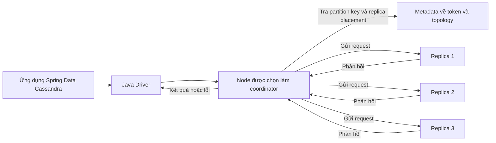
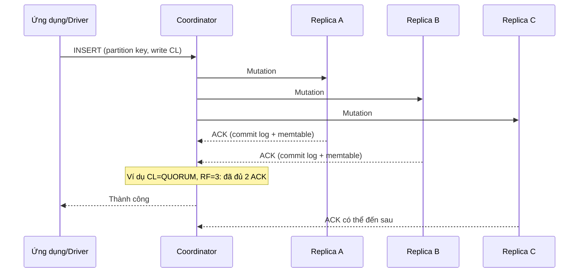
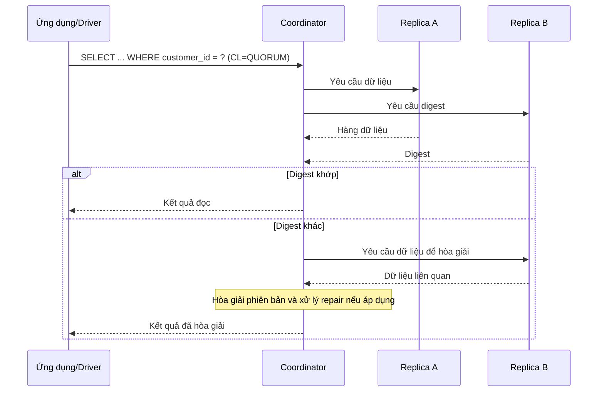

# Coordinator và đường đi của yêu cầu đọc hoặc ghi trong Cassandra

## 1. Coordinator nằm ở đâu trong kiến trúc Cassandra?

Trong Apache Cassandra, các node trong cluster có vai trò ngang hàng: ứng dụng có thể gửi một yêu cầu CQL đến bất kỳ node nào có thể phục vụ kết nối. **Node nhận yêu cầu và điều phối việc xử lý yêu cầu đó được gọi là coordinator**. Đây là vai trò *theo từng request*, không phải một máy chủ cố định hay một node lãnh đạo của toàn cluster.

Khi xây dựng ứng dụng với **Spring Data Cassandra**, một lệnh gọi từ repository, `CassandraTemplate` hoặc trực tiếp qua Java Driver cuối cùng đều đi qua đường xử lý phân tán này. Hiểu coordinator giúp giải thích vì sao một thao tác CRUD tưởng như đơn giản vẫn có thể liên quan đến nhiều node, network hop, mức nhất quán và timeout.

Đặt trong chương **Kiến trúc Cassandra**, cần phân biệt bốn khái niệm:

| Khái niệm | Vai trò | Điểm cần nhớ |
| --- | --- | --- |
| **Client/driver** | Gửi CQL, quản lý kết nối, có thể chọn node dựa vào partition key | Driver *token-aware* thường cố gắng gửi request tới replica phù hợp để giảm lượt truyền mạng. |
| **Coordinator** | Nhận request, xác định replica liên quan, gửi tác vụ và tập hợp phản hồi | Coordinator có thể đồng thời là một replica, nhưng không bắt buộc. |
| **Replica** | Node lưu bản sao dữ liệu của một partition và thực hiện đọc/ghi cục bộ | Số replica được xác định bởi chiến lược replication và replication factor (RF). |
| **Partition key/token** | Quyết định partition thuộc tập replica nào | Không được nhầm partition key với clustering column dùng để sắp xếp dữ liệu *trong cùng partition*. |

Một coordinator không tự giữ toàn bộ dữ liệu của bảng. Nó sử dụng thông tin topology và token ring để xác định những replica đang chịu trách nhiệm cho partition tương ứng. Với `NetworkTopologyStrategy`, tập replica còn phụ thuộc cách dữ liệu được phân bổ giữa các data center (DC).



Sơ đồ minh họa partition có **RF = 3**. Không phải mọi request đều cần chờ đủ ba phản hồi: số lượng cần thiết phụ thuộc **consistency level (CL)** và loại thao tác.

## 2. Từ partition key đến tập replica

Giả sử một hệ thống lưu đơn hàng theo khách hàng. Phần dữ liệu cần đọc thường là “20 đơn hàng gần nhất của khách hàng X”, nên bảng được thiết kế theo truy vấn đó:

```sql
-- Ví dụ một DC tên dc1, có đủ node để cấu hình RF = 3.
-- Thay dc1 bằng tên DC thực tế của cluster.
CREATE KEYSPACE IF NOT EXISTS shop
WITH replication = {
  'class': 'NetworkTopologyStrategy',
  'dc1': 3
};

CREATE TABLE IF NOT EXISTS shop.orders_by_customer (
  customer_id uuid,
  created_at timestamp,
  order_id uuid,
  total decimal,
  status text,
  PRIMARY KEY ((customer_id), created_at, order_id)
) WITH CLUSTERING ORDER BY (created_at DESC, order_id ASC);
```

Trong bảng này:

- `customer_id` là **partition key**. Cassandra băm giá trị đó thành token để xác định tập replica của partition.
- `created_at` và `order_id` là **clustering columns**. Chúng xác định thứ tự và tính duy nhất của hàng bên trong partition; `created_at DESC` giúp đọc đơn hàng mới trước.
- Mọi hàng có cùng `customer_id` thuộc cùng một logical partition; đây là lợi thế cho truy vấn theo khách hàng nhưng cũng tạo nguy cơ **partition quá lớn** nếu một khách hàng có lượng đơn cực cao.

Một truy vấn phù hợp với bảng là:

```sql
SELECT customer_id, created_at, order_id, total, status
FROM shop.orders_by_customer
WHERE customer_id = ?
LIMIT 20;
```

Đường đi chính của request bắt đầu khi driver xác định hoặc gửi kèm routing key từ `customer_id`. Coordinator sử dụng thông tin token và chiến lược replication để tìm replica. **Token-aware routing là một tối ưu của driver**, không làm thay đổi tính đúng đắn: nếu request tới một node khác replica, node đó vẫn có thể làm coordinator và chuyển yêu cầu tới replica phù hợp.

> **Quy tắc thiết kế:** Cassandra tổ chức dữ liệu để trả lời những truy vấn đã biết. Nếu truy vấn không cung cấp partition key, coordinator thường không thể định tuyến trực tiếp đến một partition. `ALLOW FILTERING` không phải giải pháp chung cho việc thiếu mô hình dữ liệu theo truy vấn.

## 3. Đường đi của yêu cầu ghi (write path)

Xét lệnh ghi một đơn hàng:

```sql
INSERT INTO shop.orders_by_customer
  (customer_id, created_at, order_id, total, status)
VALUES (?, ?, ?, ?, ?);
```

Với một ghi CQL thông thường, đường đi được tóm tắt như sau:

1. **Client gửi lệnh đến coordinator.** Java Driver chọn node theo chính sách load balancing; nếu nhận diện được routing key, driver có thể ưu tiên replica gần và phù hợp.
2. **Coordinator xác định partition và tập replica.** Nó suy ra partition key từ giá trị ghi, tìm token, sau đó tìm những replica chịu trách nhiệm trong topology hiện tại.
3. **Coordinator chuyển mutation tới replica.** Với RF = 3, Cassandra hướng tới việc đưa dữ liệu tới cả ba replica, dù mức nhất quán có thể chỉ yêu cầu chờ một phần trong số đó.
4. **Mỗi replica thực hiện ghi cục bộ.** Trong luồng ghi thông thường, replica ghi mutation vào **commit log** để có thể phục hồi sau sự cố và cập nhật **memtable** trong bộ nhớ. Replica gửi acknowledgement sau khi hoàn thành yêu cầu ghi theo cơ chế của nó; không cần đợi flush memtable thành SSTable.
5. **Coordinator kiểm đếm phản hồi theo write CL.** Đủ số replica xác nhận thì trả thành công cho client. Nếu không đáp ứng yêu cầu trước hạn, client có thể nhận write timeout hoặc lỗi unavailable.
6. **Hoạt động nền tiếp diễn.** Memtable về sau được flush thành SSTable; compaction hợp nhất SSTable. Khi một replica tạm thời không khả dụng, cơ chế *hinted handoff* có thể hỗ trợ gửi lại mutation theo chính sách cấu hình, nhưng không thay thế cho mức nhất quán hay cơ chế repair.



**Điểm dễ hiểu nhầm:** “Ghi thành công ở `QUORUM`” có nghĩa đã đạt số xác nhận mà CL yêu cầu; không có nghĩa mọi replica đã cập nhật đồng thời hoặc Cassandra đã thực hiện một transaction nhiều partition. Ngoài ra, một write timeout **không chứng minh ghi thất bại hoàn toàn**: một số replica có thể đã áp dụng mutation trước khi client nhận lỗi.

### Khi một replica không phản hồi

Giả sử RF = 3, replica A và B phản hồi, C không phản hồi:

| Write CL | Kết quả đối với tình huống này | Giải thích |
| --- | --- | --- |
| `ONE` | Có thể thành công | Chỉ cần một phản hồi hợp lệ. |
| `QUORUM` | Có thể thành công | Với RF = 3, quorum bằng `floor(3/2) + 1 = 2`. |
| `ALL` | Không đạt yêu cầu | Cần cả ba replica phản hồi. |

Nếu coordinator thấy không đủ replica đang sống để đạt CL, request có thể bị từ chối với lỗi **unavailable**. Nếu đủ replica khả dụng lúc đầu nhưng không thu đủ phản hồi đúng thời hạn, có thể xảy ra **write timeout**. Ứng dụng nên phân biệt hai tình huống này khi theo dõi sự cố.

## 4. Đường đi của yêu cầu đọc (read path)

Read path phức tạp hơn write path vì các replica có thể tạm thời giữ những phiên bản khác nhau của dữ liệu.

1. **Client gửi `SELECT` và read CL.** Coordinator tìm partition từ `customer_id`, sau đó xác định các replica phù hợp, ưu tiên theo locality và tình trạng kết nối.
2. **Coordinator yêu cầu dữ liệu từ replica.** Để tránh truyền nhiều bản dữ liệu đầy đủ, Cassandra có thể yêu cầu **full data response** từ một replica và **digest** (giá trị tóm lược dùng so khớp dữ liệu) từ các replica khác. Chi tiết tối ưu phụ thuộc phiên bản, consistency level và trạng thái cluster.
3. **Replica thực hiện đọc cục bộ.** Dữ liệu có thể nằm trong memtable, SSTable hoặc cache; khi cần, replica đối chiếu các phiên bản và tombstone theo quy tắc của Cassandra để tạo kết quả.
4. **Coordinator kiểm tra CL và tính khớp nhau.** Nếu đủ phản hồi hợp lệ và digest khớp, coordinator có thể trả kết quả. Nếu digest không khớp, coordinator phải lấy thêm dữ liệu cần thiết để hòa giải phiên bản theo quy tắc Cassandra trước khi hoàn tất; tùy cấu hình và phiên bản, **read repair** có thể được kích hoạt.
5. **Client nhận dữ liệu hoặc lỗi.** Khi không thể đạt CL hoặc hết hạn, client nhận lỗi thay vì giả định dữ liệu trên một replica là dữ liệu đủ tin cậy cho mức nhất quán đã chọn.



Sơ đồ mô tả trường hợp phổ biến **RF = 3, read CL = QUORUM**, nơi hai phản hồi đủ tạo quorum. Nó là mô hình giải thích, không phải cam kết Cassandra luôn dùng đúng hai loại request theo thứ tự này. Cassandra còn có những tối ưu như speculative retry và bảo vệ kết quả đọc bị thiếu do tombstone/giới hạn hàng.

### Vì sao `ONE` có thể đọc dữ liệu cũ?

Giả sử trước đó một ghi đã thành công ở `ONE` trên replica A nhưng B chưa cập nhật. Một lần đọc `ONE` kế tiếp có thể được coordinator phục vụ từ B và thấy bản cũ. Khi cần quan sát các ghi đã được xác nhận trên tập replica giao nhau, hệ thống có thể dùng cấu hình đọc/ghi quorum phù hợp, đổi lại là chi phí và yêu cầu availability cao hơn.

**Đọc từ quorum không đồng nghĩa với snapshot toàn cục.** Cassandra giải quyết xung đột ghi thông thường dựa trên timestamp và các quy tắc hòa giải; ghi đồng thời, clock skew, tombstone và nhiều partition vẫn cần được thiết kế cẩn thận. Đối với các thao tác điều kiện như `IF NOT EXISTS` hoặc compare-and-set, Cassandra dùng **lightweight transaction (LWT)** với protocol đồng thuận và yêu cầu consistency riêng; đó là đường đi khác với ghi thường được mô tả ở đây.

## 5. Replication factor và consistency level quyết định điều gì?

**RF** nói một partition có bao nhiêu bản sao theo cấu hình replication. **CL** nói yêu cầu đọc hoặc ghi cần bao nhiêu phản hồi phù hợp trước khi coordinator được phép hoàn tất. Với một DC có RF = 3:

| CL | Phản hồi tối thiểu trong DC ví dụ | Đặc điểm vận hành |
| --- | ---: | --- |
| `ONE` | 1 | Latency và tính khả dụng thường tốt hơn, nhưng dễ quan sát dữ liệu cũ khi các replica chưa đồng bộ. |
| `TWO` | 2 | Yêu cầu hai replica, áp dụng khi RF đủ lớn. |
| `QUORUM` | 2 | Hơn nửa RF của phạm vi được tính; thường dùng khi cần cân bằng nhất quán và khả dụng. |
| `LOCAL_ONE` | 1 tại local DC | Ưu tiên chỉ một replica ở DC địa phương. |
| `LOCAL_QUORUM` | 2 tại local DC | Hơn nửa RF **của local DC**; phù hợp khi ứng dụng hoạt động trong một DC của cluster đa DC. |
| `ALL` | 3 | Phải có phản hồi từ tất cả replica; rất nhạy với node chậm hoặc sự cố. |

Trong cluster nhiều DC, `QUORUM` tính theo RF tổng của những DC liên quan, còn `LOCAL_QUORUM` tính theo RF của DC địa phương. `EACH_QUORUM` có ý nghĩa riêng cho ghi nhiều DC và không nên hiểu giống `LOCAL_QUORUM`.

Đối với cùng một tập replica RF, điều kiện thường được nhắc tới là:

\[
R + W > RF
\]

Trong đó `R` là số replica xác nhận đọc, `W` là số replica xác nhận ghi. Với RF = 3, đọc quorum và ghi quorum cho `R = W = 2`, nên hai tập quorum **bắt buộc giao nhau ít nhất một replica**. Đây là nền tảng để thiết kế khả năng đọc thấy ghi đã được xác nhận, nhưng không tự động biến Cassandra thành hệ thống linearizable cho mọi thao tác. Đặc biệt, công thức chỉ có ý nghĩa khi đang xét **cùng phạm vi replica/DC**, và các trường hợp ghi đồng thời, timestamp hay lỗi mạng vẫn phải được phân tích riêng.

Ví dụ thực tế:

- **Dữ liệu danh mục ít quan trọng, chấp nhận độ trễ đồng bộ:** cân nhắc `LOCAL_ONE` cho đọc nếu SLA và yêu cầu nghiệp vụ cho phép.
- **Trang hiển thị đơn hàng sau khi cập nhật:** có thể cân nhắc đọc/ghi `LOCAL_QUORUM` trong một DC có RF địa phương phù hợp; đánh giá thêm retry và khả năng quan sát dữ liệu khi concurrent writes.
- **Thao tác đòi hỏi tính duy nhất hoặc kiểm tra điều kiện:** dùng LWT hoặc thay đổi thiết kế dữ liệu khi cần, không kỳ vọng `ALL` tự tạo transaction giữa các partition.

## 6. Vai trò của Spring Data Cassandra và Java Driver

Spring Data Cassandra cung cấp entity mapping, repository và `CassandraTemplate`; Java Driver chịu trách nhiệm kết nối và gửi CQL đến cluster. **Coordinator vẫn là một node Cassandra**, không phải một class Java trong ứng dụng.

Đường đi ở mức ứng dụng có thể hình dung như sau:

```text
Service / REST Controller
    -> Spring Data repository hoặc CassandraTemplate
    -> CqlSession / Java Driver (routing, load balancing, paging, retry policy)
    -> Cassandra coordinator
    -> Replica của partition
```

Ví dụ dưới đây dùng trực tiếp `CqlSession` được cấu hình trong ứng dụng Spring để minh họa việc đặt **read consistency** cho một statement. Cùng nguyên tắc này áp dụng khi chọn execution profile hoặc cấu hình statement được Spring Data thực thi:

```java
import java.util.UUID;

import com.datastax.oss.driver.api.core.CqlSession;
import com.datastax.oss.driver.api.core.DefaultConsistencyLevel;
import com.datastax.oss.driver.api.core.cql.ResultSet;
import com.datastax.oss.driver.api.core.cql.SimpleStatement;

public final class OrderQueryService {
    private final CqlSession session;

    public OrderQueryService(CqlSession session) {
        this.session = session;
    }

    public ResultSet latestOrders(UUID customerId) {
        SimpleStatement statement = SimpleStatement.newInstance(
                "SELECT customer_id, created_at, order_id, total, status "
                        + "FROM shop.orders_by_customer "
                        + "WHERE customer_id = ? LIMIT 20",
                customerId)
            .setConsistencyLevel(DefaultConsistencyLevel.LOCAL_QUORUM)
            .setPageSize(20);

        return session.execute(statement);
    }
}
```

Với ví dụ này, hãy chú ý:

1. `WHERE customer_id = ?` cho driver và coordinator cơ sở để định tuyến theo partition. Nếu dùng prepared statement, driver cũng có thể tận dụng metadata của partition key để chọn coordinator hiệu quả hơn.
2. `LOCAL_QUORUM` điều khiển **số phản hồi** cần có từ local DC; nó không thay đổi replication factor hay vị trí lưu dữ liệu.
3. `setPageSize(20)` là cấu hình **fetch page size** của driver. Trong truy vấn này, `LIMIT 20` còn giới hạn tổng số hàng được trả về; với truy vấn dài hơn, cần dùng paging state của driver để lấy các trang kế tiếp, không giả lập phân trang bằng `OFFSET` kiểu cơ sở dữ liệu quan hệ.
4. Một entity với partition key/clustering columns đúng vẫn quan trọng dù dùng repository: mapping chỉ đúng khi phù hợp với primary key và các query thực tế. Repository không thể xóa bỏ chi phí của truy vấn quét nhiều partition.

Trong ứng dụng thực, đọc/ghi lặp lại thường nên dùng prepared statements hoặc repository/template thay vì tạo statement mới trên mỗi thao tác. Mức CL nên được quyết định theo hành vi nghiệp vụ và áp dụng nhất quán qua cấu hình driver/execution profile hoặc từng statement khi cần.

## 7. Timeout, retry và những lỗi thường bị hiểu sai

Coordinator là nơi tổng hợp phản hồi, nên lỗi mà client quan sát có thể xuất phát từ network giữa các node, replica chậm, request quá nặng, hoặc thiếu replica khả dụng. Cần xem lỗi cùng với CL và truy vấn cụ thể.

| Hiện tượng | Có thể đang xảy ra điều gì? | Hướng xử lý |
| --- | --- | --- |
| `Unavailable` | Không đủ replica được coi là khả dụng để đạt CL. | Kiểm tra node, topology, DC và CL; không tự động hạ CL nếu nghiệp vụ yêu cầu mức nhất quán hiện tại. |
| `WriteTimeout` | Coordinator chưa nhận đủ ACK trước hạn, nhưng một phần mutation có thể đã được ghi. | Kiểm tra metric/trace; chỉ retry an toàn khi thao tác có tính idempotent và chính sách retry phù hợp. |
| `ReadTimeout` | Thiếu dữ liệu/digest hoặc phản hồi đủ điều kiện trong thời hạn. | Kiểm tra replica chậm, tombstone, partition lớn, tải và CL; tối ưu bảng theo truy vấn. |
| Đọc thấy giá trị cũ | Replica phục vụ đọc chưa thấy ghi mới hoặc có ghi concurrent. | Xác định read/write CL, thời điểm ACK, timestamp và phạm vi DC; xem lại yêu cầu nhất quán nghiệp vụ. |
| Latency tăng dù số bản ghi ít | Coordinator phải xử lý truy vấn phân tán, nhiều tombstone, hoặc dữ liệu trên partition quá rộng. | Đo tracing/metrics, đo kích thước partition và đọc theo partition key; điều chỉnh schema trước khi tăng timeout. |
| Cùng một query có latency khác nhau | Node coordinator hoặc replica được chọn khác nhau; locality và tải khác nhau. | Kiểm tra token-aware routing, DC-aware load balancing, phân bố tải và trạng thái replica. |

**Retry phải đi cùng tính idempotent.** Ví dụ ghi lại cùng một giá trị vào cùng primary key có thể idempotent nếu không kèm tác dụng phụ và các điều kiện về timestamp/TTL được kiểm soát; còn `counter update`, thao tác có side effect, hoặc ghi có timestamp biến đổi cần thận trọng. Trả về timeout không cho phép mặc định phát lại vô hạn. Với nghiệp vụ đặt hàng, nên thiết kế khóa định danh ổn định và cơ chế chống tạo trùng ở tầng ứng dụng khi cần.

Ngoài timeout, repair định kỳ và sự vận hành của tombstone cũng quan trọng: hinted handoff chỉ hỗ trợ tình huống replica tạm thời mất kết nối và có các giới hạn riêng; nó **không đảm bảo** mọi replica sẽ tự hội tụ mà không cần repair trong mọi tình huống.

## 8. Một kịch bản đầy đủ để tự kiểm tra hiểu biết

Giả sử có ba replica A, B, C trong cùng DC, RF = 3. Ứng dụng ghi đơn hàng `O-42` vào partition khách hàng X với write CL = `QUORUM`.

1. Driver gửi request đến node B. B làm **coordinator**, dù nó cũng là replica của partition X trong ví dụ này.
2. B gửi mutation tới A, B, C. A và B ghi cục bộ và phản hồi; C đang chậm.
3. B trả thành công cho ứng dụng vì đã đạt **hai ACK**. C có thể nhận mutation muộn hơn.
4. Ngay sau đó, ứng dụng đọc đơn hàng từ coordinator khác với read CL = `ONE`. Nếu replica được chọn còn giữ bản cũ, ứng dụng có thể chưa thấy đơn mới.
5. Nếu đọc với `QUORUM` trong cùng phạm vi RF, cần ít nhất hai phản hồi. Tập hai replica này giao với tập ghi thành công trước đó. Coordinator kiểm tra và hòa giải các phản hồi, qua đó có cơ sở mạnh hơn để trả kết quả hiện tại theo quy tắc Cassandra.
6. Nếu C chết hẳn, đọc/ghi quorum vẫn **có thể** hoàn tất nhờ A và B. `ALL` sẽ không đạt CL khi C vắng mặt.

Từ kịch bản này rút ra ba câu hỏi khi thiết kế hệ thống:

- **Partition key có dẫn request đến đúng nhóm replica và tránh hotspot không?** Nếu không, hãy thiết kế lại bảng theo mẫu truy vấn hoặc cân nhắc bucket cho partition tăng quá lớn.
- **Đọc và ghi đang đặt CL nào, tại DC nào?** Kiểm tra cả driver execution profile lẫn những statement có ghi đè CL.
- **Nếu coordinator trả timeout, ứng dụng có biết request đã được áp dụng một phần hay chưa?** Hãy thiết kế xử lý retry, idempotency và theo dõi request để tránh sai lệch nghiệp vụ.

## 9. Checklist khi triển khai thật

- Chọn partition key dựa trên truy vấn phải phục vụ; kiểm tra cardinality, phân bố token và kích thước partition.
- Đặt RF theo topology thực tế, dùng `NetworkTopologyStrategy` cho môi trường production phù hợp; xác định rõ DC địa phương của driver.
- Chọn read/write CL theo yêu cầu nghiệp vụ, latency và khả năng chịu lỗi; đối chiếu phạm vi DC thay vì chỉ nhìn tên CL.
- Dùng token-aware và DC-aware driver configuration; theo dõi latency của coordinator lẫn replica.
- Giới hạn dữ liệu đọc, sử dụng paging state cho các trang kế tiếp và tránh quét nhiều partition không cần thiết.
- Theo dõi timeout, dropped messages, read latency, write latency, tombstones, partition size, repair và tình trạng các node.
- Phân biệt ghi thường, LWT, batch và thao tác nhiều partition; không suy luận transaction của hệ quản trị quan hệ từ việc một coordinator trả thành công.

**Kết nối với Spring Data Cassandra:** Entity mapping và repository giúp viết mã truy cập Cassandra dễ bảo trì, còn coordinator và replica quyết định đường đi thực tế của request. Một ứng dụng hoạt động ổn định cần kết hợp **thiết kế bảng theo truy vấn**, **partition key phù hợp**, **consistency level có chủ đích**, **paging đúng cách** và **quan sát hiệu năng phân tán**.
