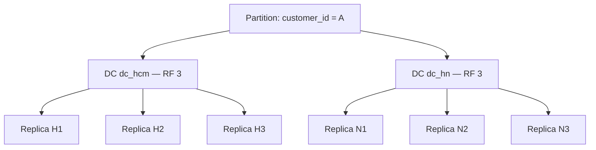
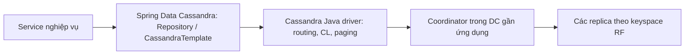

# Replication factor và chiến lược sao chép theo datacenter

Trong Apache Cassandra, dữ liệu của một partition không chỉ nằm trên một node. Cassandra sao chép partition lên nhiều node để hệ thống vẫn đọc/ghi được khi một phần hạ tầng gặp lỗi. **Replication factor (RF)** xác định số bản sao mong muốn; **replication strategy** xác định cách chọn node chứa bản sao. Khi cluster trải trên nhiều datacenter (DC), hai quyết định này ảnh hưởng trực tiếp đến tính sẵn sàng, độ trễ, mức nhất quán và chi phí vận hành.

Đây là kiến thức nền khi dùng **Spring Data Cassandra** để ánh xạ entity, truy cập qua repository hoặc `CassandraTemplate` và chạy truy vấn CQL. Ứng dụng có thể đọc/ghi qua API của Spring, nhưng việc đặt replica thuộc **schema keyspace và cấu hình cluster**, không thuộc annotation của entity. Hiểu ranh giới đó giúp thiết kế bảng theo truy vấn, chọn partition key, paging và consistency level phù hợp với dữ liệu phân tán.

## 1. Các khái niệm cần phân biệt

| Khái niệm | Vai trò | Điều thường bị nhầm |
| --- | --- | --- |
| **Partition** | Nhóm hàng có cùng partition key, được phân phối theo token. | Một partition không nhất thiết nằm trên đúng một node. |
| **Replica** | Node lưu một bản sao của partition. | Replica không phải một bản ghi mới do ứng dụng tạo. |
| **Replication factor** | Số replica *mong muốn* cho mỗi partition trong phạm vi strategy quy định. | RF không phải tổng số node của cluster. |
| **Datacenter (DC)** | Nhóm node có cùng tên DC trong topology Cassandra; có thể biểu diễn khu vực hoặc miền lỗi. | Một tên DC không tự bảo đảm cách ly địa lý nếu hạ tầng bố trí sai. |
| **Rack** | Nhóm node thuộc cùng miền lỗi nhỏ hơn DC, do cấu hình topology/snitch cung cấp. | Rack của Cassandra phải phản ánh miền lỗi thực tế thì rack awareness mới hữu ích. |
| **Coordinator** | Node nhận một yêu cầu từ client và phối hợp với các replica. | Coordinator không nhất thiết là node sở hữu dữ liệu. |
| **Consistency level (CL)** | Số/phạm vi xác nhận replica mà một thao tác phải đạt trước khi trả kết quả. | RF và CL là hai khái niệm khác nhau. |

Ví dụ, một DC có sáu node và RF = 3: mỗi partition được lưu trên **ba node phù hợp** trong sáu node đó; không phải mọi partition đều xuất hiện trên cả sáu node. Cluster cân bằng dữ liệu theo token của nhiều partition.

### Từ partition key đến vị trí replica

Quy trình khái quát:

1. Cassandra băm **partition key** để tìm token của partition.
2. Cơ chế phân phối token xác định vị trí tương ứng trên vòng token.
3. Replication strategy lựa chọn các node làm replica, xét thêm DC/rack tùy strategy.
4. Khi đọc/ghi, coordinator liên hệ những replica phù hợp với consistency level đã chọn.

`RF = 3` không đồng nghĩa với ba lần ghi của ứng dụng. Một lệnh `INSERT` vẫn là một yêu cầu logic, được Cassandra phân phối thành các bản sao vật lý. **Partition key** quyết định partition nào tập trung trên một nhóm replica; RF không tự sửa được partition quá lớn hoặc quá nóng.

## 2. Hai chiến lược replication và lý do chọn NetworkTopologyStrategy

### SimpleStrategy: chỉ nên dùng cho thử nghiệm đơn giản

Ví dụ CQL:

```sql
CREATE KEYSPACE lab_ks
WITH replication = {
  'class': 'SimpleStrategy',
  'replication_factor': 3
};
```

`SimpleStrategy` chọn replica theo vòng token, **không hiểu ranh giới DC và rack** theo cách cần thiết để đảm bảo phân bố bản sao qua các miền lỗi. Nó có ích cho môi trường lab đơn giản, nhưng không thích hợp để thiết kế cluster production, đặc biệt khi có nhiều DC.

### NetworkTopologyStrategy: chọn RF riêng cho từng DC

Ví dụ cluster có hai DC, `dc_hcm` và `dc_hn`:

```sql
CREATE KEYSPACE orders_ks
WITH replication = {
  'class': 'NetworkTopologyStrategy',
  'dc_hcm': 3,
  'dc_hn': 3
}
AND durable_writes = true;
```

Ý nghĩa của cấu hình trên:

- Mỗi partition có **ba replica mong muốn tại `dc_hcm`** và **ba replica mong muốn tại `dc_hn`**: tổng cộng sáu replica trên toàn cluster khi topology đủ node.
- Cassandra cố gắng phân tán các replica qua các rack khác nhau **trong từng DC** nếu topology cho phép.
- Mỗi DC có thể tiếp tục phục vụ các thao tác dùng `LOCAL_*` phù hợp khi DC còn lại bị tách mạng, miễn là đủ replica trong DC đang phục vụ.
- Tất cả bảng trong `orders_ks` dùng cùng cấu hình replication này. Muốn chính sách khác cho một nhóm bảng, phải cân nhắc **keyspace khác**.



*Sơ đồ minh họa một partition, không thể hiện toàn bộ node/token. Sáu replica cần thuộc sáu node khác nhau trong ví dụ hai DC.*

**Tên DC phải khớp chính xác tên mà Cassandra đang nhận diện**, kể cả chữ hoa, chữ thường. `dc_hcm` là tên minh họa; không tự suy từ tên vùng cloud hoặc biến cấu hình Spring. Kiểm tra topology trước bằng `nodetool status` hoặc dữ liệu hệ thống như `system.local`. Nếu tên DC sai, policy có thể không cấp replica ở DC mà người vận hành kỳ vọng.

### Vì sao rack awareness quan trọng?

Giả sử DC có ba rack vật lý và RF = 3. Với `NetworkTopologyStrategy` cùng topology/snitch đúng, Cassandra ưu tiên chọn các replica ở những rack khác nhau khi có thể. Khi mất một rack, các replica còn lại có thể tiếp tục đáp ứng `LOCAL_QUORUM`. Ngược lại, nếu cả ba node được gán cùng rack hoặc topology khai báo sai, kỳ vọng chịu lỗi rack sẽ không còn đáng tin.

Độ phân tán thực tế vẫn phụ thuộc số node, số rack, token placement và cấu hình snitch. **Cấu hình RF không thể thay thế việc bố trí hạ tầng đủ miền lỗi.**

## 3. Tính số replica và chọn RF hợp lý

Với `NetworkTopologyStrategy`, ký hiệu:

- `RF_HCM`: số replica mong muốn của mỗi partition ở `dc_hcm`.
- `RF_HN`: số replica mong muốn của mỗi partition ở `dc_hn`.
- `RF_total = RF_HCM + RF_HN`: tổng số bản sao mong muốn qua hai DC.

Ví dụ:

| Topology | Replication | Replica mỗi partition | Nhận xét |
| --- | --- | --- | --- |
| Một DC, ba node | `{'dc_hcm': 1}` | 1 | Không có bản sao dự phòng nếu node sở hữu partition lỗi. |
| Một DC, ba node | `{'dc_hcm': 2}` | 2 | `LOCAL_QUORUM` cần cả hai replica; không chịu mất một replica tại CL này. |
| Một DC, ít nhất ba node | `{'dc_hcm': 3}` | 3 | `LOCAL_QUORUM` cần hai; thường là điểm khởi đầu cho production một DC. |
| Hai DC, mỗi DC đủ ba node | `{'dc_hcm': 3, 'dc_hn': 3}` | 6 | Mỗi DC giữ đủ bản sao để phục vụ quorum cục bộ. |
| Hai DC, một DC chỉ có một node | `{'dc_hcm': 3, 'dc_hn': 3}` | Không thể bố trí đủ 3 replica riêng ở DC có 1 node | Cấu hình đặt mục tiêu RF cao hơn topology có thể đáp ứng; phải bổ sung node hoặc điều chỉnh thiết kế. |

Khi chọn RF cần trả lời đồng thời:

1. **Phạm vi lỗi:** hệ thống phải chịu được mất một node, một rack hay cả DC?
2. **Mức CL:** ứng dụng cần bao nhiêu replica trả lời để xác nhận đọc/ghi?
3. **Số node/rack thực:** mỗi DC có đủ node khác nhau và miền lỗi phù hợp không?
4. **Chi phí:** thêm replica làm tăng dung lượng lưu trữ, lưu lượng sao chép, streaming/repair và tải vận hành.
5. **Độ trễ và địa lý:** DC ở xa có đường truyền và ngân sách độ trễ ra sao?

Ước lượng thô: một bộ dữ liệu logic 1 TB với RF 3 tại mỗi DC trong hai DC tương ứng khoảng **6 TB dữ liệu replica trước các overhead**. Con số thực tế còn phụ thuộc nén, compaction, tombstone, index, snapshot và những cấu trúc phụ trợ. Không nên lấy 6 TB làm dung lượng đĩa cuối cùng để mua.

### RF không phải backup hoặc sharding theo nghiệp vụ

Replication giúp hệ thống có nhiều bản sao khi phần cứng hỏng; nó cũng truyền các thao tác xóa và cập nhật sai đến replica. Vì vậy, **RF không thay thế backup và quy trình khôi phục**. Đồng thời, chia partition theo token không bảo đảm mọi truy vấn nghiệp vụ đều hiệu quả: mô hình bảng vẫn phải được thiết kế từ truy vấn và partition key.

## 4. RF kết hợp với consistency level như thế nào?

Cassandra cho phép chọn CL trên từng thao tác đọc/ghi; CL không nhất thiết giống nhau cho mọi nghiệp vụ. Tại DC có RF = 3:

\[
\text{local quorum} = \left\lfloor \frac{RF_{\text{local}}}{2} \right\rfloor + 1 = 2
\]

| RF trong DC | Số xác nhận cần cho `LOCAL_QUORUM` | Số replica có thể không phản hồi mà vẫn đủ quorum |
| ---: | ---: | ---: |
| 1 | 1 | 0 |
| 2 | 2 | 0 |
| 3 | 2 | 1 |
| 5 | 3 | 2 |

Bảng giả định các replica phân bố trên đủ node riêng, và nói về khả năng đạt quorum **cho một partition**. Lỗi mạng, quá tải, coordinator và lỗi ngoài replica vẫn có thể khiến yêu cầu thất bại.

### Phân biệt những CL thường gặp trong cluster đa-DC

Xét `dc_hcm: 3` và `dc_hn: 3`:

| Consistency level | Điều kiện xác nhận tiêu biểu | Tác động |
| --- | --- | --- |
| `ONE` | Một replica trả lời, có thể trong các DC theo cách coordinator định tuyến. | Độ trễ thường thấp nhưng dễ đọc trạng thái cũ hơn khi replica chưa đồng bộ. |
| `LOCAL_ONE` | Một replica **trong DC của coordinator** trả lời. | Ưu tiên truy cập cục bộ, phù hợp tác vụ chấp nhận eventual consistency. |
| `LOCAL_QUORUM` | Ít nhất **2/3 replica trong DC của coordinator** xác nhận. | Không cần chờ quorum DC ở xa; thường cân bằng giữa độ trễ và khả năng chịu lỗi. |
| `QUORUM` | Ít nhất **4/6 replica toàn cluster** xác nhận. | Có thể cần xác nhận từ DC xa; chịu tác động của WAN và khả năng sẵn sàng liên DC. |
| `EACH_QUORUM` | Với **ghi**: đủ quorum **từng DC**, ở đây 2 tại HCM và 2 tại HN. | Bảo đảm mức xác nhận tại mỗi DC, đổi lại phụ thuộc WAN/DC xa; không dùng cho đọc thông thường. |
| `ALL` | Tất cả **6 replica** xác nhận. | Rất nhạy với replica bị lỗi hoặc phản hồi chậm. |

**Lưu ý:** `LOCAL` được xác định từ **DC của coordinator** xử lý request. Ứng dụng nên cấu hình local datacenter trong Cassandra driver đúng với DC nó định truy cập; không được hiểu `LOCAL_QUORUM` là “luôn lấy quorum ở HCM” cho mọi client trên toàn cầu.

Với một thao tác `LOCAL_QUORUM` tại HCM, Cassandra vẫn phân phối ghi tới các replica phù hợp ở HN theo cơ chế replication. Tuy nhiên, **acknowledgment từ quorum HN không phải điều kiện để request thành công tại HCM**. Trong lúc đường truyền liên DC lỗi hoặc replication đang trễ, một request đọc ở HN có thể quan sát dữ liệu khác.

### Ví dụ quan sát tính nhất quán

Đặt `RF_HCM = RF_HN = 3`:

1. Client A gửi `UPDATE` tới coordinator tại HCM với `LOCAL_QUORUM`; hai replica HCM xác nhận.
2. HCM trả thành công cho A dù HN chưa nhận đủ bản ghi.
3. Client B ngay lập tức đọc tại HN với `LOCAL_QUORUM`.
4. Nếu ghi chưa đến quorum HN, B có thể đọc giá trị cũ.

Như vậy, **quorum cục bộ tại từng DC không đồng nghĩa đọc ngay được giá trị mới ở DC khác**. Nếu bài toán yêu cầu hai DC phối hợp chặt chẽ khi chấp nhận ghi, cần đánh giá CL liên DC như `EACH_QUORUM` cho ghi và cơ chế bảo đảm phù hợp khi đọc. Đổi lại, WAN hoặc một DC gặp lỗi có thể ảnh hưởng trực tiếp đến availability.

Đối với đọc/ghi trong **cùng một DC**, cặp `LOCAL_QUORUM`/`LOCAL_QUORUM` tạo giao nhau giữa các tập replica xác nhận; đây là cơ sở để giảm khả năng đọc dữ liệu cũ. Tuy nhiên, Cassandra xử lý xung đột bằng timestamp và cơ chế eventual consistency. Quorum thông thường **không tự cung cấp transaction hoặc linearizability** cho mọi mẫu đọc/ghi đồng thời. Những thao tác có điều kiện cần đánh giá **lightweight transaction (LWT)** và `SERIAL`/`LOCAL_SERIAL` riêng.

## 5. Thiết kế cluster theo mục tiêu nghiệp vụ

### Kịch bản A: một DC, chịu lỗi một node

- Có ít nhất ba node và cấu hình `NetworkTopologyStrategy` với RF = 3.
- Dùng `LOCAL_QUORUM` cho dữ liệu cần đọc/ghi với quorum trong DC.
- Với một partition, hai replica khỏe vẫn đáp ứng đủ quorum khi một replica không phản hồi.
- Sao lưu và repair vẫn cần theo quy trình riêng; RF = 3 không bảo vệ khỏi xóa nhầm.

### Kịch bản B: hai DC active-active

- Mỗi DC đủ node/rack, keyspace khai báo RF = 3 cho **từng** DC.
- Client HCM ưu tiên coordinator ở HCM, client HN ưu tiên coordinator ở HN.
- `LOCAL_QUORUM` cho phép mỗi DC phục vụ độc lập hơn khi WAN gặp sự cố, nhưng cần chấp nhận khả năng đọc dữ liệu chưa hội tụ qua DC.
- Nếu cùng một partition được cập nhật đồng thời ở cả hai DC, phải chủ động thiết kế quy tắc xung đột/idempotency, vì timestamp resolution không phải cơ chế hòa giải nghiệp vụ.

### Kịch bản C: ưu tiên xác nhận ghi tại cả hai DC

- Khi một lần ghi chỉ được coi là hoàn thành nếu đã có quorum trong cả hai DC, cân nhắc `EACH_QUORUM` cho **write**.
- Với RF = 3 ở mỗi DC, cần hai replica trả lời tại mỗi DC.
- Đường truyền liên DC hoặc DC thứ hai không khả dụng có thể làm ghi thất bại/timeout, dù DC đầu tiên vẫn khỏe.
- Không chọn mức CL cao nhất theo cảm tính; phải gắn nó với cam kết về độ trễ và điều kiện chịu lỗi.

## 6. Triển khai CQL từng bước

### Bước 1: xem đúng topology và tên DC

Trên môi trường được phép vận hành cluster, thực hiện:

```bash
nodetool status
```

Kiểm tra tên các `Datacenter` trong kết quả, số node ở từng DC và trạng thái node. Trạng thái `UN` (Up/Normal) giúp nhận diện node đang hoạt động bình thường, nhưng không phải chứng minh duy nhất rằng hệ thống đã đồng bộ hoặc có thể chịu mọi lỗi.

Có thể xem DC/rack của node đang kết nối:

```sql
SELECT data_center, rack
FROM system.local;
```

Tên keyspace `system` trong câu lệnh trên là metadata hệ thống; không phải keyspace nghiệp vụ của ứng dụng.

### Bước 2: tạo keyspace có RF theo DC

```sql
CREATE KEYSPACE IF NOT EXISTS orders_ks
WITH replication = {
  'class': 'NetworkTopologyStrategy',
  'dc_hcm': 3,
  'dc_hn': 3
}
AND durable_writes = true;
```

Thay `dc_hcm`/`dc_hn` bằng tên thật. Ví dụ giả định mỗi DC có đủ node để giữ ba replica trên những node khác nhau. `IF NOT EXISTS` **không cập nhật** replication của keyspace đã tồn tại; với keyspace cũ cần `ALTER KEYSPACE` có kiểm soát.

### Bước 3: tạo bảng theo truy vấn

Ví dụ yêu cầu: *liệt kê các đơn hàng gần nhất của một khách hàng*. Ta chọn `customer_id` làm partition key và các trường thời gian/ID làm clustering key:

```sql
USE orders_ks;

CREATE TABLE IF NOT EXISTS orders_by_customer (
    customer_id uuid,
    created_at timestamp,
    order_id uuid,
    status text,
    total_amount decimal,
    PRIMARY KEY ((customer_id), created_at, order_id)
) WITH CLUSTERING ORDER BY (created_at DESC, order_id DESC);
```

Ví dụ truy vấn:

```sql
SELECT customer_id, created_at, order_id, status, total_amount
FROM orders_by_customer
WHERE customer_id = 123e4567-e89b-12d3-a456-426614174000
LIMIT 20;
```

Truy vấn có partition key nên Cassandra tìm đúng nhóm replica. `LIMIT 20` hạn chế số hàng trong một kết quả, nhưng **không thay thế paging qua nhiều trang** hoặc chính sách giới hạn kích thước partition. Nếu một khách hàng có hàng triệu đơn hàng, cân nhắc partition có bucket theo tháng/năm và điều chỉnh câu truy vấn tương ứng. RF không giải quyết partition quá lớn.

### Bước 4: chọn consistency cho thao tác

Trong `cqlsh`, có thể đặt CL phiên tương tác:

```text
CONSISTENCY LOCAL_QUORUM;
```

Lệnh `CONSISTENCY` ở đây là **lệnh của cqlsh**, không phải câu CQL `CREATE`/`SELECT` và không tự áp đặt CL cho ứng dụng Spring. Ứng dụng/driver cần có chính sách request consistency của chính nó.

### Bước 5: kiểm tra replication của keyspace

```sql
SELECT keyspace_name, replication
FROM system_schema.keyspaces
WHERE keyspace_name = 'orders_ks';
```

Đảm bảo strategy và giá trị RF đúng với topology. Ngoài schema, cần kiểm tra trạng thái node, lưu lượng inter-DC, pending compaction/repair và sự phân bố dữ liệu thực tế. **Schema đúng không đủ để kết luận mọi replica đã có dữ liệu lịch sử**, nhất là vừa thay đổi RF hoặc thêm DC.

## 7. Khi nào và cách nào thay đổi RF?

Giả sử ban đầu hệ thống chỉ có `dc_hcm` với RF = 3; sau khi mở rộng thêm datacenter `dc_hn` và đã chuẩn bị topology phù hợp, cần thay đổi keyspace:

```sql
ALTER KEYSPACE orders_ks
WITH replication = {
  'class': 'NetworkTopologyStrategy',
  'dc_hcm': 3,
  'dc_hn': 3
};
```

**Câu lệnh ALTER chỉ thay đổi cấu hình replication của keyspace.** Nó không chứng minh toàn bộ dữ liệu đã được truyền và đồng bộ đến các replica mới. Việc mở rộng DC thường cần một kế hoạch vận hành riêng: bổ sung node đúng topology, bootstrap/streaming hoặc rebuild theo hướng dẫn của phiên bản Cassandra đang dùng, kiểm tra repair và xác minh dữ liệu trước khi chuyển lưu lượng. Khi tăng RF trong DC hiện có, cũng phải lập kế hoạch đưa dữ liệu lịch sử đến các replica mới và kiểm tra trạng thái repair.

Một trình tự thực tế:

1. **Đánh giá:** ghi lại RF, CL hiện tại, số node/rack, tổng dữ liệu, tốc độ đường truyền, khả năng chịu lỗi và phiên bản Cassandra.
2. **Chuẩn bị topology:** bổ sung node/DC, cấu hình snitch, kiểm tra trạng thái cluster và tên DC thật.
3. **Thay đổi schema:** chạy `ALTER KEYSPACE` với RF mục tiêu đã được tính toán.
4. **Đồng bộ dữ liệu:** thực hiện các bước streaming/rebuild/repair phù hợp với cách thêm node hoặc DC và phiên bản triển khai; theo dõi tốc độ, lỗi, dung lượng và sự đồng bộ.
5. **Xác minh:** đối chiếu keyspace schema, replica placement, tình trạng node, dữ liệu mẫu và metric trước khi chuyển dần traffic hoặc tăng CL.
6. **Theo dõi sau thay đổi:** quan sát read/write timeout, unavailable, p95/p99 latency, load đĩa, pending tasks và lưu lượng giữa DC.

Nếu giảm RF hoặc loại bỏ DC, phải tính riêng rủi ro mất redundancy và cơ chế decommission/dọn replica an toàn. Không nên chạy một câu `ALTER` rồi mặc định thao tác vận hành đã hoàn tất.

## 8. Spring Data Cassandra đứng ở lớp nào?

Trong kiến trúc ứng dụng, Spring Data Cassandra ánh xạ object sang bảng và hỗ trợ repository, `CassandraTemplate`, thao tác CQL. **Replication được định nghĩa tại Cassandra keyspace**, còn driver/request quyết định coordinator và CL cho thao tác.

Ví dụ cấu hình kết nối minh họa cho **Spring Boot 3.x**:

```yaml
spring:
  cassandra:
    contact-points:
      - cassandra-hcm-1.example.internal
      - cassandra-hcm-2.example.internal
    port: 9042
    local-datacenter: dc_hcm
    keyspace-name: orders_ks
    request:
      consistency: LOCAL_QUORUM
```

Tên thuộc tính và khả năng cấu hình phụ thuộc phiên bản Spring Boot/driver cụ thể; cần đối chiếu tài liệu phiên bản dự án. Các hostname ở đây chỉ là ví dụ. Tên `local-datacenter` phải khớp topology Cassandra; property này giúp driver định tuyến host/coordinator theo DC cục bộ. Cấu hình `request.consistency` xác định CL mặc định cho request theo cơ chế hỗ trợ của phiên bản. Nếu một luồng nghiệp vụ yêu cầu CL khác, có thể cấu hình trên statement hoặc qua driver/request options được Spring Data hỗ trợ.

Luồng ứng dụng:



Các điểm cần nhớ:

- `@Table`, `@PrimaryKey` và các annotation mapping mô tả **bảng/khóa**, không cấu hình RF.
- Repository hoặc `CassandraTemplate` không thể biến một bảng thành RF = 3 nếu keyspace chỉ được cấu hình RF = 1.
- Driver dùng `local-datacenter` để chọn host thích hợp; consistency level là một quyết định request **khác** với số replica keyspace.
- Paging của driver/Spring Data giúp truy vấn qua nhiều trang, **không tăng replica và không thay đổi CL**. Hãy giữ truy vấn dựa trên partition key, tránh fan-out và quét dữ liệu không cần thiết.
- Khi request bị timeout, không nên tự suy rằng ghi chắc chắn thất bại: một số replica có thể đã nhận ghi. Hệ thống cần thiết kế retry/idempotency phù hợp với loại thao tác.

### Ví dụ phân tích một sự cố từ phía Spring

**Hiện tượng:** Service ở HCM dùng `LOCAL_QUORUM` và nhận lỗi `Unavailable` khi chỉ một node Cassandra tại HCM đang hoạt động bình thường. Keyspace khai báo `dc_hcm: 3` và `dc_hn: 3`.

**Giải thích:** HCM cần ít nhất **hai replica cục bộ** của partition để đạt `LOCAL_QUORUM`. Việc HN còn ba replica không bù được quorum **cục bộ của HCM** cho request này.

**Hướng kiểm tra:** xác định trạng thái những replica sở hữu partition, kiểm tra số node/rack thực tế ở HCM, coordinator và DC của driver, keyspace schema, sự cố mạng cùng metric timeout/unavailable. Việc đổi tạm sang `LOCAL_ONE` có thể tăng khả năng trả lời nhưng làm giảm điều kiện xác nhận; chỉ thực hiện nếu nghiệp vụ chấp nhận và có quy trình ứng phó.

## 9. Những hiểu nhầm dễ dẫn đến thiết kế sai

| Nhận định sai | Cách hiểu đúng |
| --- | --- |
| “RF = 3 nghĩa là cluster chỉ cần có ba node.” | RF = 3 yêu cầu tối đa ba replica riêng **trong phạm vi DC được chỉ định**; topology phải đủ node và miền lỗi phù hợp. |
| “Có hai DC thì Cassandra tự chia ba replica mỗi DC.” | Chỉ khi `NetworkTopologyStrategy` khai báo RF cho từng DC đúng như thế. |
| “Dùng `LOCAL_QUORUM` thì hai DC luôn nhìn thấy dữ liệu giống nhau ngay.” | Quorum chỉ cục bộ; DC khác có thể chưa nhận đủ bản sao mới. |
| “RF càng cao thì hệ thống càng nhất quán.” | RF tăng số bản sao; điều kiện xác nhận đọc/ghi còn phụ thuộc CL và xử lý xung đột. |
| “Đặt `ALL` là luôn an toàn nhất.” | `ALL` yêu cầu mọi replica trả lời, giảm availability khi node hoặc WAN lỗi và tăng độ trễ. |
| “ALTER KEYSPACE xong là dữ liệu lịch sử đã nằm đủ ở DC mới.” | Thay schema và hoàn tất streaming/rebuild/repair là các việc khác nhau. |
| “RF = 3 nghĩa là đã có backup.” | Lỗi logic/xóa nhầm có thể lan đến mọi replica; vẫn cần backup và khả năng restore. |
| “Chỉ cần repository Spring là truy vấn sẽ nhanh.” | Cần partition key/bảng thiết kế theo truy vấn, giới hạn kích thước partition và paging phù hợp. |

## 10. Bài tập áp dụng

**Bài tập 1 — tính quorum.** Cluster có `dc_a: 5` và `dc_b: 3`. Hãy tính số xác nhận cho `LOCAL_QUORUM` ở mỗi DC, `QUORUM` toàn cluster và `EACH_QUORUM` khi ghi.

<details>
<summary>Đáp án gợi ý</summary>

- DC A: `⌊5/2⌋ + 1 = 3`; DC B: `⌊3/2⌋ + 1 = 2`.
- Tổng RF = 8, nên `QUORUM = ⌊8/2⌋ + 1 = 5`.
- `EACH_QUORUM` cho ghi: cần 3 xác nhận ở A **và** 2 xác nhận ở B.

</details>

**Bài tập 2 — chọn policy.** Ứng dụng phục vụ người dùng từ hai khu vực. Mỗi DC có ít nhất ba node; yêu cầu là thao tác đặt hàng vẫn hoạt động ở DC khỏe khi liên kết WAN tạm mất. Chọn RF và CL khởi đầu, rồi nêu một rủi ro dữ liệu.

<details>
<summary>Đáp án gợi ý</summary>

- Dùng `NetworkTopologyStrategy` với RF = 3 ở **mỗi DC** và `LOCAL_QUORUM` làm điểm xuất phát nếu nghiệp vụ chấp nhận tính nhất quán cục bộ.
- Rủi ro: ghi được xác nhận ở DC A có thể chưa xuất hiện ngay ở DC B. Cần quy tắc idempotency/xử lý xung đột cho các thao tác xuyên DC; nếu yêu cầu xác nhận ghi ở cả hai DC, phải xem xét CL và SLA khác.

</details>

**Bài tập 3 — đọc cấu hình.** Một keyspace có `{'class':'NetworkTopologyStrategy', 'dc_a':3, 'dc_b':2}`. DC B có hai replica khỏe và đang sử dụng `LOCAL_QUORUM`. Nếu một replica B lỗi, request từ coordinator B có đạt CL không?

<details>
<summary>Đáp án gợi ý</summary>

Không. Với RF B = 2, `LOCAL_QUORUM` yêu cầu cả hai replica trả lời. RF = 2 không chịu được mất một replica ở CL quorum cục bộ. Đây là một lý do RF = 3 thường có lợi hơn RF = 2 về khả năng chịu lỗi khi dùng quorum.

</details>

## 11. Checklist trước khi đưa thiết kế vào sử dụng

- [ ] Xác nhận tên DC/rack thật từ Cassandra và kiểm tra cấu hình topology/snitch.
- [ ] Dùng `NetworkTopologyStrategy` cho keyspace production; RF xác định rõ ở **từng DC**.
- [ ] Bảo đảm số node, rack, dung lượng và miền lỗi đáp ứng RF mong muốn.
- [ ] Tính quorum theo **RF của DC**, không nhầm với tổng số node.
- [ ] Chọn CL theo độ trễ, điều kiện chịu lỗi, mức nhất quán và nhu cầu liên DC của nghiệp vụ.
- [ ] Thiết kế bảng và partition key theo các truy vấn thực tế; kiểm soát partition lớn/hot partition và paging.
- [ ] Kiểm tra keyspace replication trong `system_schema.keyspaces` và cấu hình local DC/CL của Spring/driver.
- [ ] Có kế hoạch streaming/repair khi thay đổi RF và có backup/restore độc lập với replication.
- [ ] Giám sát timeout, unavailable, latency, dung lượng, trạng thái node và lưu lượng replication giữa các DC.

**Ghi nhớ:** RF trả lời câu hỏi *“mỗi partition được sao chép bao nhiêu lần, ở những DC nào?”*; replication strategy trả lời *“Cassandra chọn replica ở đâu?”*; consistency level trả lời *“đọc/ghi cần bao nhiêu xác nhận trước khi trả kết quả?”*. Ba quyết định phải khớp với thiết kế partition key, yêu cầu nghiệp vụ và topology thực tế.
