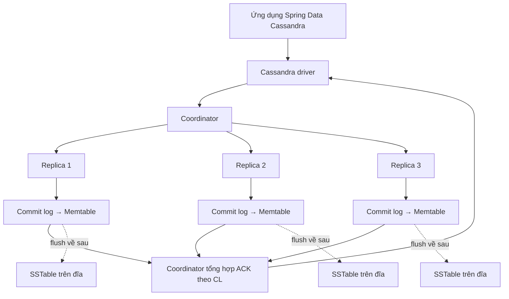
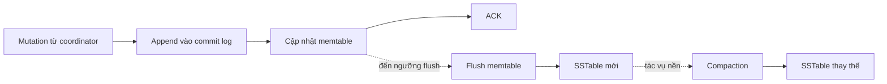

# Commit log, memtable, SSTable và các giai đoạn ghi trong Cassandra

Trong **Spring Data Cassandra**, một lệnh `repository.save(entity)` hoặc `cassandraTemplate.insert(entity)` có thể trông giống thao tác ghi dữ liệu của cơ sở dữ liệu quan hệ. Tuy nhiên, Apache Cassandra sử dụng kiến trúc lưu trữ tối ưu cho ghi phân tán: dữ liệu được chuyển đến các replica, đi qua **commit log** và **memtable**, rồi được ghi thành các tệp **SSTable** bất biến. Sau đó, quá trình **compaction** hợp nhất những SSTable theo chiến lược được cấu hình.

Hiểu đường đi này giúp phân biệt lúc yêu cầu được xác nhận với lúc dữ liệu xuất hiện trong SSTable, đánh giá khả năng khôi phục sau sự cố, đọc đúng các chỉ số hiệu năng và thiết kế bảng theo truy vấn.

## 1. Ba cấu phần cốt lõi

| Cấu phần | Vị trí và đặc điểm | Nhiệm vụ chính | Khi nào thay đổi? |
|---|---|---|---|
| **Commit log** | Nhật ký ghi nối tiếp trên đĩa, được tổ chức thành các segment | Lưu các mutation để có thể khôi phục dữ liệu chưa flush sau khi node gặp sự cố | Ghi thêm khi có mutation; segment cũ được thu hồi khi dữ liệu liên quan đã an toàn trong SSTable |
| **Memtable** | Cấu trúc dữ liệu đang ghi trong bộ nhớ của node, gắn với bảng | Giữ và sắp xếp các thay đổi gần đây để phục vụ ghi nhanh và đọc | Được cập nhật khi ghi; khi flush, memtable hiện tại được chuyển sang trạng thái không còn nhận ghi |
| **SSTable** (*Sorted String Table*) | Tập tệp dữ liệu có thứ tự trên đĩa, bất biến sau khi tạo | Lưu dữ liệu bền vững đã flush; hỗ trợ tra cứu theo partition/clustering key | Sinh ra bởi flush hoặc compaction; không chỉnh sửa trực tiếp tệp cũ |

Một mutation có thể là chèn, cập nhật, xóa hoặc ghi dữ liệu kèm TTL. Một partition có thể đồng thời có phiên bản dữ liệu ở memtable và nhiều SSTable. Khi đọc, Cassandra cần tổng hợp các nguồn liên quan, xét timestamp, tombstone và quy tắc hòa giải dữ liệu.

> **Phân biệt quan trọng:** commit log phục vụ **khôi phục**, memtable phục vụ **ghi trong bộ nhớ**, SSTable phục vụ **lưu trữ lâu dài**. Xác nhận ghi thành công không có nghĩa là Cassandra đã flush mutation đó thành SSTable.

## 2. Bối cảnh phân tán: coordinator, replica và consistency level

Ứng dụng kết nối qua Cassandra driver (được Spring Data Cassandra sử dụng). Node nhận yêu cầu đóng vai trò **coordinator**: xác định các replica phụ trách partition bằng partition key và cấu hình replication, chuyển mutation tới các replica, rồi tổng hợp phản hồi theo **consistency level** (CL) đã chọn.

Mỗi replica thực hiện đường ghi **cục bộ** riêng: ghi commit log, cập nhật memtable và gửi xác nhận sau khi hoàn tất các bước cần thiết theo cơ chế ghi của Cassandra. Coordinator có thể trả kết quả trước khi tất cả replica phản hồi, tùy CL.



Ví dụ một keyspace có **replication factor = 3** trong một datacenter:

- Với `LOCAL_ONE`, coordinator có thể trả thành công sau phản hồi phù hợp từ **một replica trong datacenter cục bộ**.
- Với `LOCAL_QUORUM`, cần đa số replica trong datacenter đó, tức **hai trên ba** trong ví dụ này.
- Với `ALL`, phải nhận đủ phản hồi của các replica được yêu cầu; mức sẵn sàng ghi sẽ thấp hơn khi có replica không phản hồi.

CL quyết định **số phản hồi cần để xác nhận yêu cầu**, không trực tiếp quyết định thời điểm memtable được flush thành SSTable. Các cơ chế như hinted handoff và repair xử lý những khía cạnh riêng của việc đồng bộ replica; không nên coi một lần ghi thành công ở CL thấp là bằng chứng mọi replica đã có cùng trạng thái.

## 3. Đường ghi cục bộ, từng giai đoạn

Giả sử ứng dụng ghi sự kiện đơn hàng vào bảng được thiết kế để truy vấn theo khách hàng và ngày:

```sql
CREATE TABLE events_by_tenant_day (
    tenant_id uuid,
    bucket_day date,
    occurred_at timestamp,
    event_id uuid,
    payload text,
    PRIMARY KEY ((tenant_id, bucket_day), occurred_at, event_id)
) WITH CLUSTERING ORDER BY (occurred_at DESC, event_id DESC);
```

Ở đây, `(tenant_id, bucket_day)` là **partition key tổng hợp**; `occurred_at` và `event_id` là **clustering columns**. Các hàng cùng tenant và ngày nằm trong một logical partition, được sắp thứ tự theo clustering key. Thiết kế này phục vụ truy vấn gần nhất theo tenant/ngày nhưng vẫn cần kiểm soát lượng dữ liệu trong mỗi partition.

Một thao tác ghi CQL tương ứng:

```sql
INSERT INTO events_by_tenant_day
    (tenant_id, bucket_day, occurred_at, event_id, payload)
VALUES (?, ?, ?, ?, ?);
```

Trên từng replica tiếp nhận mutation, luồng xử lý khái quát như sau:

1. **Nhận mutation:** replica xác định bảng và partition cần ghi. Dữ liệu được biểu diễn kèm các thông tin như timestamp và TTL nếu có.
2. **Ghi commit log:** mutation được bổ sung vào nhật ký tuần tự. Đây là cơ sở để replay nếu node khởi động lại trước khi mutation được flush.
3. **Cập nhật memtable:** thay đổi đi vào cấu trúc dữ liệu trong bộ nhớ, có thể cùng tồn tại với các phiên bản cũ đã lưu trong SSTable.
4. **Trả ACK cho coordinator:** sau khi thao tác ghi cục bộ đáp ứng điều kiện của cơ chế ghi, replica phản hồi; coordinator chờ đủ ACK theo CL.
5. **Flush bất đồng bộ:** về sau, memtable được ghi thành SSTable khi đạt điều kiện flush. Việc này không cần diễn ra cho từng lệnh `INSERT`.
6. **Compaction nền:** Cassandra có thể hợp nhất nhiều SSTable, loại bớt phiên bản đã lỗi thời và xử lý tombstone khi đủ điều kiện an toàn.



Sơ đồ thể hiện trình tự logic, không phải cam kết rằng mọi phiên bản Cassandra đều dùng chung lịch thực thi hay cấu hình đồng bộ đĩa. Cơ chế **sync commit log** ảnh hưởng trực tiếp đến bảo đảm chịu lỗi khi mất điện hoặc hỏng hệ điều hành.

## 4. Commit log: vì sao đã ACK mà vẫn cần nhật ký?

Commit log hoạt động theo nguyên tắc gần với *write-ahead logging*: giữ bản ghi thay đổi để khi mất memtable trong RAM, node vẫn có thể dựng lại các mutation chưa được flush. Ghi nối tiếp thường phù hợp với đĩa hơn so với sửa ngẫu nhiên nhiều vị trí của tập dữ liệu lớn.

Ví dụ tại một thời điểm:

| Thời điểm | Trạng thái mutation mới |
|---|---|
| T1 | Mutation đã được ghi vào commit log và memtable |
| T2 | Replica đã ACK, nhưng chưa có SSTable chứa mutation |
| T3 | Node bị dừng đột ngột, memtable trong RAM mất |
| T4 | Node khởi động lại, replay phần commit log cần thiết |
| T5 | Mutation được khôi phục vào trạng thái ghi trong bộ nhớ và tiếp tục có thể được flush |

Khả năng replay có tác dụng khi **bản ghi commit log tương ứng còn tồn tại và đã được lưu bền vững**. Không nên diễn giải ACK là lời hứa *mọi mutation đều đã được fsync xuống đĩa ngay lập tức*. Cassandra có các chế độ đồng bộ commit log, thường gặp là:

- **`periodic`:** đồng bộ commit log theo chu kỳ; tối ưu cân bằng thông lượng/độ trễ nhưng có cửa sổ rủi ro mất những mutation gần nhất nếu sự cố làm mất dữ liệu chưa được đồng bộ xuống thiết bị lưu trữ.
- **`batch`:** đồng bộ theo nhóm mutation trước khi xác nhận theo cơ chế của chế độ này; thường phải đánh đổi thêm độ trễ ghi để có ranh giới bền vững chặt hơn.

Các tham số và hành vi chi tiết phụ thuộc phiên bản, cấu hình `cassandra.yaml`, hệ thống tệp và phần cứng. **Replication và consistency level không thay thế việc hiểu cấu hình durability trên từng replica.**

Commit log được chia thành các **segment**. Một segment có thể chứa mutation của nhiều bảng/memtable. Cassandra chỉ có thể thu hồi segment khi phần dữ liệu cần giữ trong segment đó đã được flush hoặc không còn cần cho recovery; vì thế segment cũ vẫn có thể chiếm chỗ dù một số bảng đã flush xong.

Nếu commit log tăng liên tục, cần xem cả tiến độ flush, dung lượng đĩa và hoạt động của memtable, thay vì mặc định mọi segment lớn đều là lỗi.

## 5. Memtable và flush: chuyển từ RAM sang SSTable

Memtable tiếp nhận các mutation gần đây. Khi một memtable cần được flush, Cassandra tạo vùng nhận ghi mới và ghi nội dung của memtable cũ thành SSTable trên đĩa. Các điều kiện dẫn đến flush bao gồm áp lực bộ nhớ, giới hạn liên quan commit log và flush thủ công khi vận hành.

Điểm cần nắm:

- **Flush không phải commit của giao dịch.** Cassandra có thể xác nhận lệnh ghi trước khi flush; commit log giữ khả năng replay trong khoảng thời gian đó.
- **Flush tạo SSTable mới.** SSTable cũ không bị ghi đè tại chỗ, vì thế nhiều thế hệ SSTable có thể cùng chứa dữ liệu của một partition.
- **Cassandra sắp dữ liệu theo khóa trong SSTable.** Các cấu trúc phụ trợ như index, summary và Bloom filter hỗ trợ tìm vị trí hoặc bỏ qua những SSTable không phù hợp trong đường đọc.
- **Flush là công việc I/O nền.** Nếu tốc độ flush không theo kịp tốc độ ghi, áp lực memtable/commit log và độ trễ có thể tăng.

Về hiệu năng, kiến trúc này tránh việc phải cập nhật một tệp dữ liệu lớn cho mỗi thay đổi. Đổi lại, hệ thống chấp nhận **write amplification** do flush và compaction, cùng **read amplification** khi một truy vấn phải xem xét nhiều SSTable.

## 6. SSTable và compaction: vì sao UPDATE không sửa trực tiếp dữ liệu cũ?

SSTable là bất biến. Khi cập nhật cùng primary key, Cassandra ghi **phiên bản mutation mới** vào commit log/memtable và sau đó vào SSTable mới. Khi đọc, hệ thống hòa giải các phiên bản theo metadata như timestamp và tombstone để xác định kết quả hợp lệ.

Ví dụ:

```sql
UPDATE events_by_tenant_day
SET payload = 'processed'
WHERE tenant_id = ?
  AND bucket_day = ?
  AND occurred_at = ?
  AND event_id = ?;
```

Lệnh `UPDATE` không nhất thiết tìm rồi sửa byte trong SSTable cũ. Tính chất này cũng lý giải vì sao `INSERT`/ `UPDATE` trong Cassandra thường mang ngữ nghĩa **upsert** đối với cùng khóa, khác với kỳ vọng ràng buộc khóa duy nhất và cập nhật tại chỗ trong nhiều hệ CSDL quan hệ.

**Compaction** đọc một tập SSTable và tạo SSTable thay thế để giảm số tệp cần tra cứu, hợp nhất phiên bản dữ liệu, đồng thời có thể thu hồi dữ liệu đã lỗi thời. Những chiến lược thường gặp:

| Chiến lược | Cách tổ chức khái quát | Khi cân nhắc |
|---|---|---|
| **STCS** (*Size-Tiered Compaction Strategy*) | Ghép nhóm SSTable có kích thước tương tự | Workload ghi nhiều, chấp nhận khả năng read amplification cao hơn |
| **LCS** (*Leveled Compaction Strategy*) | Phân cấp SSTable nhằm kiểm soát overlap | Workload cần đọc có độ trễ ổn định hơn; đánh đổi I/O compaction |
| **TWCS** (*Time-Window Compaction Strategy*) | Gom dữ liệu theo các cửa sổ thời gian | Time-series có TTL và luồng ghi tương đối đúng thứ tự thời gian |

Không có chiến lược tối ưu cho mọi bảng. Đặc biệt, dùng **TWCS** cần xét việc cập nhật dữ liệu cũ, dữ liệu đến muộn và thời gian TTL; những yếu tố này có thể làm các cửa sổ khó được thu hồi như mong đợi.

### Tombstone và TTL

Xóa dữ liệu trong Cassandra thường tạo **tombstone** để các replica biết dữ liệu đã bị xóa, thay vì lập tức xóa sạch mọi bản sao trên đĩa. Dữ liệu hết TTL cũng có thể tạo ra thông tin xóa mà đường đọc và compaction phải xử lý.

```sql
DELETE FROM events_by_tenant_day
WHERE tenant_id = ?
  AND bucket_day = ?
  AND occurred_at = ?
  AND event_id = ?;
```

Compaction chỉ loại tombstone khi thỏa điều kiện an toàn; cấu hình thời gian như `gc_grace_seconds`, tình trạng sửa chữa dữ liệu giữa replica và khả năng còn bản sao cũ đều quan trọng. Xóa tombstone quá sớm khi replica chưa hội tụ có thể khiến dữ liệu đã xóa xuất hiện lại (*zombie data*). Vì vậy, **DELETE/TTL không tương đương giải phóng dung lượng đĩa ngay tức thì**.

## 7. Khi node gặp sự cố: điều gì được bảo toàn?

Xét các trường hợp để hiểu ranh giới của hệ thống:

| Tình huống | Kỳ vọng đúng |
|---|---|
| Node dừng trước khi ACK; ứng dụng nhận timeout | Không thể suy ra mutation chắc chắn thất bại; có thể đã được một số replica áp dụng. Khi retry, cần xét khả năng ghi trùng hoặc cập nhật cùng khóa |
| Replica ACK, mutation còn ở memtable và có commit log đã đồng bộ bền vững | Sau restart, node có thể replay mutation từ commit log nếu chưa flush |
| Replica ACK nhưng mutation chỉ ở phần commit log chưa được đồng bộ bền vững theo chế độ `periodic` | Nếu sự cố gây mất dữ liệu chưa fsync, vẫn tồn tại rủi ro mất mutation ở replica đó |
| Memtable đã flush thành SSTable và các bước lưu tệp hoàn tất | Dữ liệu có bản lưu trong SSTable, không còn cần giữ mãi bản ghi commit log cho mutation ấy |
| Một replica tạm thời không có mutation | Những cơ chế đồng bộ replica và repair mới quyết định khả năng hội tụ; ACK theo `LOCAL_QUORUM` không chứng minh cả ba replica đều đã ghi |

Nếu dùng RF=3 và cùng datacenter, một **ghi `LOCAL_QUORUM`** kết hợp **đọc `LOCAL_QUORUM`** có giao nhau giữa tập replica phản hồi trong điều kiện thông thường. Điều này giúp tăng khả năng đọc được ghi mới nhất, nhưng không nên đồng nhất với giao dịch đa hàng ACID, không bỏ qua xung đột timestamp, mất kết nối, repair hoặc cách ứng dụng quản lý concurrency.

Ngoài ra, một thao tác CQL có thể tạo mutation trên nhiều cell; **atomicity ở phạm vi được Cassandra hỗ trợ** cần phân biệt với transaction liên bảng hay nhiều partition. Nếu quy trình nghiệp vụ cần điều kiện “chỉ ghi nếu chưa tồn tại”, hãy đánh giá **lightweight transaction** như `IF NOT EXISTS` với chi phí đồng thuận riêng, thay vì cho rằng upsert kiểm tra điều kiện hộ ứng dụng.

## 8. Ảnh hưởng của thiết kế bảng tới đường ghi

Với Cassandra, bước thiết kế bắt đầu từ **truy vấn cần phục vụ**, sau đó mới chọn partition key và clustering columns. Đường ghi phía trên hoạt động hiệu quả nhất khi dữ liệu phân bổ hợp lý và số lượng SSTable/tombstone không tăng mất kiểm soát.

Ví dụ truy vấn phù hợp với bảng sự kiện:

```sql
SELECT occurred_at, event_id, payload
FROM events_by_tenant_day
WHERE tenant_id = ?
  AND bucket_day = ?
LIMIT 20;
```

Truy vấn có đầy đủ partition key, lấy 20 sự kiện đầu theo thứ tự clustering đã định. Với danh sách dài, dùng **paging state** theo cơ chế phân trang của driver/Cassandra; tránh tư duy `OFFSET` tăng dần của SQL quan hệ. Muốn xem nhiều ngày, ứng dụng cần chủ động truy vấn nhiều bucket và hợp nhất kết quả khi cần.

Các quyết định có ảnh hưởng trực tiếp:

1. **Phân bổ partition key:** khóa có phân phối kém tạo *hot partition/hot node*, làm một nhóm replica nhận tải ghi quá lớn.
2. **Kích thước partition:** nếu một tenant ghi cực nhiều sự kiện mỗi ngày, bucket theo ngày có thể vẫn quá lớn; cân nhắc bucket nhỏ hơn hoặc thêm thành phần shard, nhưng phải chấp nhận logic đọc phức tạp hơn.
3. **Clustering key:** xác định thứ tự dữ liệu *bên trong partition*, hữu ích cho truy vấn mới nhất; clustering key không thay vai trò phân phối tải của partition key.
4. **TTL và xóa hàng loạt:** có thể sinh nhiều tombstone, kéo dài đọc và gây thêm công việc compaction.
5. **Batch CQL:** `BEGIN BATCH ... APPLY BATCH` không phải công cụ tăng tốc mặc định cho các ghi độc lập qua nhiều partition. Logged batch có chi phí điều phối/batchlog; cân nhắc theo yêu cầu nguyên tử và mô hình dữ liệu.
6. **Truy vấn ngoài khóa:** `ALLOW FILTERING` không sửa được một mô hình bảng sai truy vấn; thường nên thiết kế bảng truy vấn riêng cho access pattern quan trọng.

## 9. Liên hệ Spring Data Cassandra: từ entity tới mutation

Spring Data Cassandra giúp ánh xạ object và thực hiện CQL, nhưng **không thay đổi đường ghi nội bộ** của Cassandra.

Ánh xạ sơ lược bảng ví dụ:

```java
import java.io.Serializable;
import java.time.Instant;
import java.time.LocalDate;
import java.util.UUID;

import org.springframework.data.cassandra.core.cql.Ordering;
import org.springframework.data.cassandra.core.mapping.PrimaryKey;
import org.springframework.data.cassandra.core.mapping.PrimaryKeyClass;
import org.springframework.data.cassandra.core.mapping.PrimaryKeyColumn;
import org.springframework.data.cassandra.core.mapping.PrimaryKeyType;
import org.springframework.data.cassandra.core.mapping.Table;
import org.springframework.data.cassandra.core.mapping.Column;
import org.springframework.data.cassandra.repository.CassandraRepository;

@PrimaryKeyClass
public class EventKey implements Serializable {
    @PrimaryKeyColumn(name = "tenant_id", ordinal = 0,
        type = PrimaryKeyType.PARTITIONED)
    private UUID tenantId;

    @PrimaryKeyColumn(name = "bucket_day", ordinal = 1,
        type = PrimaryKeyType.PARTITIONED)
    private LocalDate bucketDay;

    @PrimaryKeyColumn(name = "occurred_at", ordinal = 2,
        type = PrimaryKeyType.CLUSTERED, ordering = Ordering.DESCENDING)
    private Instant occurredAt;

    @PrimaryKeyColumn(name = "event_id", ordinal = 3,
        type = PrimaryKeyType.CLUSTERED, ordering = Ordering.DESCENDING)
    private UUID eventId;

    // Bổ sung constructor, getter/setter, equals/hashCode phù hợp.
}

@Table("events_by_tenant_day")
public class TenantEvent {
    @PrimaryKey
    private EventKey key;

    @Column("payload")
    private String payload;

    // Bổ sung constructor và getter/setter.
}

public interface TenantEventRepository
        extends CassandraRepository<TenantEvent, EventKey> {
}
```

Đây là minh họa các annotation mapping; trong dự án thực tế mỗi lớp/interface public thường nằm trong tệp Java riêng, và `EventKey` cần triển khai đầy đủ các thành phần khóa. Khi gọi:

```java
repository.save(event);

// Hoặc ở tầng thao tác trực tiếp hơn:
cassandraTemplate.insert(event);
```

Cả hai cách đều tạo thao tác ghi tới Cassandra theo ngữ nghĩa CQL tương ứng. Không có bước `flush()` giống kỳ vọng từ JPA để “chốt” mutation vào SSTable: Cassandra tự quản lý memtable flush và compaction.

Khi triển khai, cần chú ý:

- **Consistency level:** cấu hình ở tầng driver/session hoặc theo từng statement khi cần; `save()` tự nó không có nghĩa luôn ghi lên toàn bộ replica.
- **Timeout và retry:** nếu client timeout, chưa chắc coordinator/replica chưa thực thi. Với nghiệp vụ tạo sự kiện, dùng khóa ổn định qua các lần retry giúp tránh sinh nhiều hàng do tạo UUID mới mỗi lần.
- **Timestamp và ghi đè:** ghi nhiều lần cùng primary key chịu cơ chế hòa giải timestamp của Cassandra. Không nên kỳ vọng cơ chế khóa hàng kiểu quan hệ.
- **Paging:** ưu tiên truy vấn đúng partition key; dùng cursor/paging state khi duyệt dữ liệu lớn.
- **CassandraTemplate/CQL tùy chỉnh:** hữu ích cho thao tác cần tùy chỉnh statement, TTL hoặc truy vấn phức tạp, nhưng vẫn phải tôn trọng partition key, CL và chi phí I/O.

**Lưu ý về ví dụ:** cấu hình keyspace/replication, dependency Spring Data Cassandra, kết nối driver và code khởi tạo entity được lược bỏ để tập trung vào kiến trúc ghi. Khi chạy thực tế, cần tạo keyspace và đảm bảo schema/kiểu dữ liệu khớp mapping.

## 10. Theo dõi và xử lý vấn đề hiệu năng

Khi ứng dụng bắt đầu có độ trễ ghi tăng, nên nhìn cả **ứng dụng, coordinator, replica và tác vụ nền**. Một vài tín hiệu hữu ích:

| Triệu chứng | Kiểm tra trước | Hướng xử lý |
|---|---|---|
| P95/P99 write latency tăng, một số node bận bất thường | Phân phối token/partition, hot key, CPU, queue và network | Điều chỉnh partition/bucketing, cân bằng tải; không chỉ tăng timeout |
| Commit log dùng đĩa tăng hoặc gần giới hạn | Flush backlog, disk I/O, memtable, commit log segment còn được tham chiếu | Xác định vì sao flush chậm; cân nhắc tài nguyên I/O và cấu hình |
| Nhiều SSTable, đọc chậm dần | Số SSTable trên một truy vấn, compaction pending, chiến lược compaction | Điều chỉnh chiến lược theo access pattern; theo dõi chi phí compaction |
| Đọc trả ít hàng nhưng tốn tài nguyên | Tombstone scan, TTL/delete, partition quá rộng | Giảm thiết kế tạo tombstone không cần thiết, chọn bucket và TTL thích hợp |
| Retry tăng sau timeout | CL, số replica hoạt động, network, saturation, idempotency | Phân loại lỗi và chính sách retry; giữ khóa ổn định, tránh retry ồ ạt |

Các metric cụ thể có thể xem qua JMX/metrics, tracing, log Cassandra và telemetry của driver tùy môi trường. Đừng đánh giá đường ghi chỉ bằng thời gian `repository.save()`: **flush và compaction có thể xảy ra sau khi request đã trả về**, và có thể ảnh hưởng các request khác do cùng sử dụng CPU/đĩa.

Không nên tự động chạy `nodetool flush` sau mỗi lệnh ghi. Flush thủ công là tác vụ quản trị có mục đích cụ thể; gọi liên tục có thể tạo nhiều SSTable nhỏ và tăng gánh nặng compaction.

## 11. Đối chiếu những ngộ nhận thường gặp

| Ngộ nhận | Cách hiểu đúng |
|---|---|
| “`save()` trả về tức là dữ liệu đã nằm trong SSTable.” | Replica thường ACK sau đường ghi commit log/memtable; SSTable xuất hiện ở flush sau đó. |
| “Consistency level `ALL` thay thế kiểm soát durability.” | CL liên quan phản hồi giữa các replica; sync commit log và lưu trữ cục bộ vẫn có ý nghĩa riêng. |
| “`UPDATE` sửa trực tiếp tệp dữ liệu cũ.” | SSTable bất biến; mutation mới được ghi rồi hòa giải khi đọc/compaction. |
| “Xóa xong thì đĩa trống ngay.” | Tombstone và chính sách compaction/repair chi phối thời điểm thu hồi dữ liệu. |
| “Cassandra ghi nhanh nên bất cứ partition key nào cũng được.” | Partition key phân phối tải; hot partition có thể phá hỏng mục tiêu hiệu năng. |
| “Batch càng nhiều partition càng nhanh.” | Logged batch nhiều partition có thể tạo thêm chi phí; cần lý do nghiệp vụ rõ ràng. |

## 12. Quy trình tự kiểm khi thiết kế một luồng ghi

Trước khi đưa một repository hoặc CassandraTemplate write path lên production, tự rà soát:

1. **Truy vấn chính là gì?** Bảng có partition key/clustering columns phù hợp chưa?
2. **Tải ghi phân bổ ra sao?** Có tenant, thiết bị hoặc mốc thời gian nào gây hot partition không?
3. **Mức nhất quán mong muốn?** RF, datacenter topology, CL ghi/đọc và trường hợp node lỗi được xác định chưa?
4. **Yêu cầu chịu mất điện?** Cấu hình đồng bộ commit log và đặc tính storage có đáp ứng rủi ro được chấp nhận không?
5. **Xử lý timeout/retry?** Mutation có idempotent về khóa và hiệu ứng nghiệp vụ không? Có cần điều kiện `IF` hay cơ chế chống trùng ở tầng ứng dụng không?
6. **Dữ liệu sống bao lâu?** TTL, tombstone, partition size và chiến lược compaction đã phù hợp chưa?
7. **Quan sát được vận hành?** Đã theo dõi latency, memtable flush, commit log, SSTable, compaction và tombstone chưa?

Cần nhớ một chuỗi cốt lõi: **driver gửi mutation → coordinator chọn replica → replica ghi commit log và memtable → ACK theo consistency level → flush tạo SSTable → compaction tổ chức lại SSTable**. Chuỗi này là nền tảng để giải thích cả khả năng chịu lỗi lẫn các giới hạn hiệu năng của Spring Data Cassandra trên kiến trúc dữ liệu phân tán.
