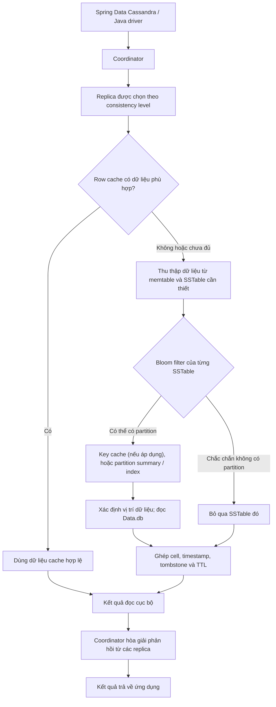

# Bloom filter, bộ nhớ đệm và các thành phần đường đọc

Trong Apache Cassandra, một truy vấn đọc theo **partition key** tưởng như chỉ cần tìm một bản ghi, nhưng dữ liệu của partition đó có thể nằm đồng thời trong **memtable** (bộ nhớ) và nhiều **SSTable** (tệp bất biến trên đĩa). Cassandra phải tìm đúng vị trí dữ liệu, ghép các phiên bản, xử lý giá trị hết hạn hoặc đã xóa, rồi mới trả kết quả. Bloom filter, bộ nhớ đệm và các chỉ mục SSTable giúp giảm số lần tìm kiếm và I/O trong quá trình này.

Với ứng dụng dùng **Spring Data Cassandra**, dù đọc qua `CassandraRepository`, `CassandraTemplate` hay CQL tự viết, việc tra cứu cuối cùng vẫn phải đi qua đường đọc của Cassandra. Hiểu các thành phần bên dưới giúp thiết kế bảng theo truy vấn, chọn partition key hợp lý và chẩn đoán độ trễ thay vì chỉ tối ưu mã Java.

## 1. Đặt đường đọc vào đúng ngữ cảnh phân tán

Một thao tác đọc có hai phạm vi khác nhau:

1. **Đường đọc giữa các nút (distributed read):** Java driver gửi CQL đến một **coordinator**. Coordinator xác định các replica sở hữu partition và gửi yêu cầu đọc đến đủ replica theo **consistency level**. Tùy mức nhất quán, coordinator có thể đối chiếu dữ liệu/digest, hòa giải khác biệt và thực hiện read repair nếu cần.
2. **Đường đọc bên trong một replica (local read):** Replica tìm dữ liệu trong memtable, bộ nhớ đệm và các SSTable cục bộ; sau đó ghép các phiên bản dữ liệu liên quan để tạo phản hồi.

**Bloom filter và key/row cache chủ yếu tối ưu đường đọc cục bộ tại replica.** Chúng không quyết định replica nào sở hữu partition và không thay thế consistency level.

Sơ đồ sau mô tả luồng khái niệm; thứ tự và các nhánh cụ thể thay đổi tùy phiên bản, định dạng SSTable, kiểu truy vấn và trạng thái cache:



Điểm quan trọng: **memtable chứa những thay đổi chưa flush, nhưng không nhất thiết chứa toàn bộ trạng thái mới nhất của partition**. Ví dụ, memtable có một cập nhật ở cột `status`, còn cột `total` vẫn nằm trong SSTable cũ. Đọc đúng có thể phải kết hợp cả hai.

## 2. Bloom filter: loại bỏ SSTable không cần đọc

### 2.1. Bloom filter trả lời câu hỏi gì?

Mỗi SSTable có cấu trúc Bloom filter ứng với tập **partition key** mà SSTable đó chứa. Khi đọc một partition, Cassandra dùng filter để quyết định liệu có cần tiếp tục tìm trong SSTable này không.

| Kết quả Bloom filter | Ý nghĩa | Cassandra làm gì? |
|---|---|---|
| **Chắc chắn không có** | Partition key không nằm trong SSTable đó | Bỏ qua bước tra chỉ mục và đọc dữ liệu của SSTable |
| **Có thể có** | Partition key có thể hiện diện, nhưng chưa được xác nhận | Tiếp tục tra vị trí partition bằng các thành phần khác |

Bloom filter có thể cho kết quả **dương tính giả (false positive)**: báo «có thể có» dù partition key thực sự không nằm trong SSTable. Khi đó Cassandra tốn thêm công tra cứu, nhưng không trả dữ liệu sai chỉ vì Bloom filter. Với filter vận hành đúng, **không có âm tính giả (false negative)**: một key thực sự có trong SSTable sẽ không bị loại bỏ.

Bloom filter **không** trả lời liệu một *CQL row* theo clustering key có tồn tại hay không, không lưu giá trị cột, không thay thế primary key và không xác nhận dữ liệu có còn hiệu lực sau tombstone/TTL. Nó sàng lọc ở mức **partition key trong từng SSTable**.

### 2.2. Ví dụ khi có nhiều SSTable

Giả sử replica có bốn SSTable, ứng dụng cần partition `customer_id = C42`:

| SSTable | Thực tế chứa C42? | Kết quả filter | Hành động |
|---|---|---|---|
| S1 | Không | Chắc chắn không | Bỏ qua S1 |
| S2 | Có | Có thể có | Tra cứu S2 |
| S3 | Không | Có thể có *(false positive)* | Tra cứu thêm, rồi xác nhận không có |
| S4 | Có | Có thể có | Tra cứu S4 |

Nếu tắt hoặc cấu hình Bloom filter kém phù hợp, Cassandra có thể phải khảo sát nhiều SSTable hơn. Khi **một partition xuất hiện trong nhiều SSTable**, Bloom filter không thể loại bỏ các SSTable thực sự chứa key đó; compaction, thiết kế partition và đặc tính cập nhật vẫn ảnh hưởng lớn đến chi phí đọc.

### 2.3. Bộ nhớ và xác suất dương tính giả

Cấu hình `bloom_filter_fp_chance` xác định mục tiêu xác suất false positive cho filter **mỗi SSTable**. Giá trị nhỏ hơn yêu cầu nhiều bộ nhớ hơn nhưng có thể tránh thêm I/O; giá trị lớn hơn tiết kiệm bộ nhớ nhưng cho phép thêm các lần tra cứu không cần thiết.

Với Bloom filter lý tưởng chứa `n` phần tử và xác suất dương tính giả mục tiêu `p`, số bit xấp xỉ:

\[
m \approx -\frac{n\ln(p)}{(\ln 2)^2}
\]

Ví dụ với một triệu partition key, `p = 0.01` tương ứng khoảng 9,6 bit/key, tức khoảng 1,2 MiB phần bit của filter. Đây chỉ là **ước lượng toán học**, không phải dự báo chính xác bộ nhớ thực tế của một bảng Cassandra; còn phụ thuộc số SSTable, cấu trúc và chi phí lưu trữ.

Theo tài liệu Cassandra 5.0, giá trị mặc định `bloom_filter_fp_chance` phụ thuộc chiến lược compaction: thường là **0,1 với LeveledCompactionStrategy** và **0,01 trong các trường hợp khác**. Hãy kiểm tra schema thực tế của bảng thay vì giả định mọi cluster có cùng mặc định. Bloom filter được lưu trong thành phần `Filter.db` của SSTable và khi dùng sẽ được đưa vào **bộ nhớ off-heap**; không nên coi phần này là chi phí Java heap thông thường.

Ví dụ thay đổi ở cấp bảng:

```sql
ALTER TABLE sales.orders_by_customer
WITH bloom_filter_fp_chance = 0.01;
```

Thay đổi trên **không tái tạo tức thì filter của SSTable cũ**. Filter mới được tạo khi SSTable mới được ghi (do flush/compaction hoặc thao tác viết lại phù hợp). Vì vậy, số liệu hiệu năng không nhất thiết thay đổi ngay sau `ALTER TABLE`. Không chủ động chạy compaction/rewrite trên production chỉ để kiểm chứng một giả thuyết mà chưa đánh giá tải I/O và vận hành.

### 2.4. Khi nào nên cân nhắc điều chỉnh?

- **Đọc key không tồn tại nhiều, số SSTable lớn, đĩa có độ trễ cao:** giảm false-positive chance *có thể* tiết kiệm I/O nếu bộ nhớ off-heap đủ.
- **Ít đọc, hoặc bộ nhớ chật và thiết bị lưu trữ nhanh:** có thể chấp nhận tỷ lệ false positive cao hơn.
- **Các truy vấn chậm do partition quá lớn, nhiều tombstone hoặc chờ replica qua mạng:** giảm `bloom_filter_fp_chance` thường không chữa đúng nguyên nhân.

Tối ưu Bloom filter phải dựa trên số liệu thực tế, không phải nguyên tắc «càng nhỏ càng tốt».

## 3. Các bộ nhớ đệm trong đường đọc

Ba khái niệm dễ bị nhầm là **memtable**, **key cache** và **row cache**:

| Thành phần | Giữ thông tin gì? | Lợi ích chính | Giới hạn |
|---|---|---|---|
| **Memtable** | Mutation chưa flush trong bộ nhớ của replica | Truy cập dữ liệu ghi gần đây không cần đọc tệp cho phần dữ liệu đó | Không bảo đảm chứa toàn bộ trạng thái partition; không phải cache có thể bỏ qua dữ liệu cũ |
| **Key cache** | Thông tin định vị partition trong SSTable, với định dạng SSTable hỗ trợ | Bỏ qua một phần tra cứu index/summary | Không chứa nội dung row; vẫn cần đọc dữ liệu, không có ích như nhau với mọi định dạng SSTable |
| **Row cache** | Dữ liệu partition hoặc phần rows được cache theo chính sách bảng | Tránh một số bước truy cập SSTable cho dữ liệu «nóng» | Tốn bộ nhớ hơn; hiệu quả phụ thuộc mẫu đọc, kích thước partition và invalidation khi ghi |

### 3.1. Key cache: biết dữ liệu nằm ở đâu

Với định dạng SSTable kiểu **BIG**, khi Bloom filter cho biết một partition *có thể* nằm trong tệp:

- **Key-cache hit:** Cassandra lấy được thông tin vị trí từ cache, tránh bước dò partition summary và partition index tương ứng.
- **Key-cache miss:** Cassandra tra partition summary và partition index để xác định vị trí dữ liệu, rồi có thể đưa thông tin định vị vào cache phục vụ lần sau.

Dù key-cache hit, Cassandra vẫn cần kiểm tra và tải dữ liệu cần thiết từ SSTable nếu chưa được đáp ứng bởi cơ chế khác. **Key cache không phải cache kết quả CQL**.

Với Cassandra mới hơn, đặc biệt **SSTable định dạng BTI (Big Trie Index)**, cơ chế chỉ mục khác BIG; không nên mặc định sơ đồ `Summary.db → Index.db` hay lợi ích của key cache áp dụng y hệt. Các cấu hình `key_cache_size` của Cassandra hiện đại cũng ghi rõ phạm vi áp dụng cho định dạng có sử dụng key cache, chẳng hạn BIG.

### 3.2. Row cache: giữ dữ liệu nóng, nhưng có điều kiện

Row cache phù hợp khi có một nhóm partition/rows thường xuyên được đọc lại và tương đối ít bị thay đổi. Một lần cache hit phù hợp có thể tránh nhiều truy cập index và SSTable; đổi lại, lưu nội dung dữ liệu tốn nhiều RAM hơn lưu vị trí partition.

Trong CQL, tùy chọn `caching` cấp bảng điều khiển hai loại cache:

```sql
ALTER TABLE sales.orders_by_customer
WITH caching = {
  'keys': 'ALL',
  'rows_per_partition': 'NONE'
};
```

- `keys = 'ALL'`: cho phép cache thông tin key đối với cơ chế/định dạng hỗ trợ.
- `rows_per_partition = 'NONE'`: không dùng row cache cho bảng này; đây là cấu hình phổ biến khi chưa có bằng chứng row cache đem lại lợi ích.
- `rows_per_partition = 'ALL'`: cho phép cache toàn bộ phần rows phù hợp theo cơ chế của phiên bản, chỉ đáng thử khi dữ liệu thực sự nóng và đủ nhỏ.

**Cấp bảng chưa phải toàn bộ cấu hình**: hạn mức cache ở cấp node trong `cassandra.yaml` cũng quyết định nó có hoạt động và chứa được bao nhiêu dữ liệu. Tên tham số, đơn vị và giá trị mặc định có thể khác giữa các bản Cassandra; hãy tra đúng phiên bản triển khai.

Nếu các partition rất lớn, dữ liệu thường thay đổi hoặc truy vấn thường đọc những phần khác nhau của partition, row cache có thể ngốn bộ nhớ mà hit rate thấp. Cập nhật dữ liệu cũng có thể làm mất hiệu lực các entry cache; không thể coi row cache là ảnh chụp bất biến của dữ liệu.

### 3.3. Cache ở đâu so với Spring Data Cassandra?

`CassandraRepository` và `CassandraTemplate` là API phía ứng dụng; chúng không tự biến truy vấn thành key-cache hit hay row-cache hit. Cần phân biệt:

- **Cache trong Cassandra node:** Bloom filter, key cache, row cache, bộ nhớ đệm của storage engine.
- **Cache/metadata của Java driver:** ví dụ prepared statement và metadata kết nối, giúp giảm chi phí phía client/protocol nhưng không thay thế local read.
- **Cache ứng dụng (nếu tự triển khai):** ví dụ Spring Cache/Redis, có quy tắc hết hạn và nhất quán riêng.

Một endpoint Spring trả về nhanh sau khi bật cache ứng dụng không chứng minh Bloom filter của Cassandra hoạt động tốt hơn.

## 4. Các thành phần SSTable cần biết

SSTable là tệp dữ liệu bất biến và các tệp metadata/index đi kèm. Tên dưới đây mô tả **kiểu BIG truyền thống**; ở **BTI**, một số thành phần chỉ mục đổi thành `Partitions.db` và `Rows.db`. Hãy kiểm tra SSTable format thực tế trước khi phân tích đường đọc chi tiết.

| Thành phần | Chức năng trong đường đọc |
|---|---|
| `Filter.db` | Bloom filter sàng lọc partition key của SSTable |
| `Summary.db` | Bản lấy mẫu từ partition index; giúp tìm vùng cần tra, không chứa mọi partition key |
| `Index.db` | Ánh xạ partition key đến vị trí trong `Data.db`; có thể có cấu trúc hỗ trợ tìm hàng trong wide partition |
| `Data.db` | Chứa dữ liệu partition và các row/cell thực tế |
| `CompressionInfo.db` | Metadata vị trí các khối nén nếu SSTable có compression |
| `Statistics.db` | Metadata về SSTable, timestamp, tombstone, clustering, compaction và các thông tin khác |

**Không nên hiểu rằng Cassandra lúc nào cũng mở và đọc tuần tự từng tệp trong bảng trên**. Nhiều cấu trúc có thể nằm sẵn trong bộ nhớ, cache có thể bỏ qua bước tìm kiếm, và định dạng SSTable ảnh hưởng trực tiếp đến đường truy cập.

Trong một lần **key-cache miss** với SSTable BIG không bị Bloom filter loại bỏ, cách hình dung hữu ích là:

1. Tìm mẫu gần partition key cần đọc trong **partition summary**.
2. Dò **partition index** từ vùng gần đó để xác định offset thực tế.
3. Dùng metadata nén nếu cần, rồi đọc đoạn thích hợp trong **`Data.db`**.
4. Chỉ lấy các row/cell phù hợp với điều kiện clustering và phạm vi truy vấn; sau đó xét timestamp, TTL và tombstone khi ghép dữ liệu từ nhiều nơi.

Bloom filter chỉ giúp quyết định **có cần thử các bước này cho một SSTable hay không**.

## 5. Tại sao vẫn phải ghép dữ liệu sau khi đã tìm được partition?

Cassandra sử dụng mô hình lưu trữ kiểu **LSM tree**: ghi thường đi vào memtable trước, sau đó flush thành SSTable; SSTable cũ không bị cập nhật trực tiếp. Một partition có thể có nhiều phiên bản của cùng một cell ở các SSTable khác nhau.

Ví dụ:

| Nguồn | Nội dung liên quan đến order `O7` |
|---|---|
| SSTable cũ | `status = 'CREATED'`, timestamp 100 |
| SSTable mới | `status = 'PAID'`, timestamp 200 |
| Memtable | `delivery_note = 'Giao giờ hành chính'`, timestamp 220 |

Kết quả đọc phải hợp nhất các mutation hợp lệ, áp dụng quy tắc timestamp và xét cả tombstone/TTL. Cassandra không thể lấy nguyên xi nội dung của một SSTable chỉ vì Bloom filter báo «có thể có».

Tombstone tạo thêm công việc: Cassandra có thể cần khảo sát nhiều nguồn để bảo đảm dữ liệu bị xóa không xuất hiện lại từ bản cũ. Truy vấn đọc nhiều partition, partition quá rộng, hoặc số lượng SSTable/tombstone lớn có thể chậm dù cache và Bloom filter hoạt động đúng.

Compaction giúp gộp SSTable và giảm dữ liệu chồng lấn theo chiến lược được cấu hình; nhờ đó có thể giảm số nguồn cần khảo sát, nhưng compaction tiêu thụ CPU, I/O và có đặc tính riêng với từng workload.

## 6. Ví dụ từ bảng Cassandra đến mã Spring Data

Giả sử hệ thống thương mại cần hiển thị **20 đơn hàng gần nhất của một khách hàng**. Một mô hình bảng theo truy vấn là:

```sql
CREATE TABLE sales.orders_by_customer (
    customer_id uuid,
    created_at timestamp,
    order_id uuid,
    status text,
    total decimal,
    PRIMARY KEY ((customer_id), created_at, order_id)
)
WITH CLUSTERING ORDER BY (created_at DESC, order_id ASC)
 AND caching = {'keys': 'ALL', 'rows_per_partition': 'NONE'}
 AND bloom_filter_fp_chance = 0.01;

SELECT customer_id, created_at, order_id, status, total
FROM sales.orders_by_customer
WHERE customer_id = 11111111-1111-1111-1111-111111111111
LIMIT 20;
```

Cấu trúc trên có các đặc điểm:

- `customer_id` là **partition key**, nên truy vấn một khách hàng đi thẳng đến các replica phụ trách partition đó; Bloom filter ở replica có thể sàng lọc SSTable theo `customer_id`.
- `created_at` và `order_id` là **clustering columns**, quyết định cách các row được sắp trong partition; Bloom filter **không** sàng lọc riêng theo `created_at`.
- `LIMIT 20` giới hạn số row kết quả, nhưng không bảo đảm tổng I/O luôn nhỏ nếu có nhiều SSTable, tombstone hoặc partition quá lớn.
- Nếu một khách hàng phát sinh cực nhiều đơn hàng trong nhiều năm, cần cân nhắc **bucketing** theo tháng/quý kết hợp `customer_id` để kiểm soát kích thước partition; khi đó client phải truy vấn theo bucket.

Ở tầng Spring Data Cassandra, một truy vấn qua template có thể trông như sau (giả sử `OrderByCustomer` đã được ánh xạ đúng với bảng và khóa chính kết hợp):

```java
import java.util.List;
import java.util.UUID;
import org.springframework.data.cassandra.core.CassandraTemplate;
import org.springframework.data.cassandra.core.query.Criteria;
import org.springframework.data.cassandra.core.query.Query;

public class OrderQueryService {
    private final CassandraTemplate cassandraTemplate;

    public OrderQueryService(CassandraTemplate cassandraTemplate) {
        this.cassandraTemplate = cassandraTemplate;
    }

    public List<OrderByCustomer> latestOrders(UUID customerId) {
        Query query = Query.query(
            Criteria.where("customer_id").is(customerId)
        ).limit(20);

        return cassandraTemplate.select(query, OrderByCustomer.class);
    }
}
```

`CassandraTemplate` tạo/truyền truy vấn thông qua driver; **Cassandra server** vẫn quyết định replica, đọc memtable/SSTable và sử dụng Bloom filter/caches. Nếu ứng dụng cần phân trang, dùng **paging state/cơ chế paging của Cassandra**, không giả định `OFFSET` giống cơ sở dữ liệu quan hệ. Phân trang không thay thế partition key và không giúp tự động sửa thiết kế bảng sai.

Ví dụ bảng chỉ dùng để minh họa đường đọc; trong hệ thống thật cần xem workload ghi/đọc, phân bố dữ liệu, TTL, chiến lược compaction và replication trước khi chọn cấu hình cache/filter.

## 7. Quan sát thực tế và chẩn đoán độ trễ

Trước khi thay đổi cấu hình, cần tìm xem độ trễ nằm ở **truy vấn/partition**, **đường đọc cục bộ**, hay **mạng/replica**.

### 7.1. Số liệu quan trọng

```bash
nodetool tablestats sales.orders_by_customer
```

Tùy phiên bản Cassandra, `tablestats` cung cấp hoặc cho phép sắp xếp theo các chỉ số như:

| Chỉ số | Cách đọc và câu hỏi cần hỏi |
|---|---|
| `SSTable count` | Có quá nhiều SSTable khiến một partition phải khảo sát nhiều tệp không? |
| `Bloom filter false positives`, `Bloom filter false ratio` | Filter có dẫn đến nhiều lần tra cứu không cần thiết không? Hãy xem cùng lưu lượng và thời gian đo |
| `Bloom filter off heap memory used` | Bộ nhớ off-heap dành cho Bloom filter có phù hợp ngân sách RAM không? |
| `Local read latency` | Độ trễ tại node có tăng không, kể cả khi ứng dụng chưa xét mạng? |
| `Average/maximum tombstones per slice` | Có đang phải quét nhiều dấu xóa hoặc dữ liệu hết hạn không? |
| `Compacted partition maximum bytes` | Có dấu hiệu partition quá lớn gây đọc chậm hay áp lực bộ nhớ không? |

Các counter tích lũy có thể bị ảnh hưởng bởi thời gian chạy node và thời điểm reset; nên so sánh **delta theo khoảng thời gian** và lượng truy vấn tương ứng. Cache hit/miss có thể quan sát thêm qua metrics/JMX hoặc hệ thống giám sát của cluster.

### 7.2. Dùng tracing cho truy vấn đại diện

Trong `cqlsh` có thể bật tracing cho một truy vấn thử nghiệm:

```sql
TRACING ON;

SELECT customer_id, created_at, order_id, status, total
FROM sales.orders_by_customer
WHERE customer_id = 11111111-1111-1111-1111-111111111111
LIMIT 20;

TRACING OFF;
```

Trace hỗ trợ nhận biết bước gửi đến replica và một số hoạt động đọc cục bộ. Chỉ nên bật có chọn lọc khi phân tích sự cố; tracing đại trà tạo thêm overhead. Đọc kết quả trong bối cảnh **consistency level**, số replica được liên hệ và workload lúc đo.

### 7.3. Quy trình điều tra gợi ý

1. **Kiểm tra truy vấn có giới hạn đúng partition key không.** Truy vấn thiếu key hoặc dùng `ALLOW FILTERING` thường cần một cách tối ưu khác, chứ không phải tinh chỉnh Bloom filter.
2. **Kiểm tra kích thước và độ nóng của partition.** Cùng partition key nhưng có quá nhiều row hoặc partition bị truy cập dồn dập có thể tạo hotspot.
3. **Xem local read latency, SSTable count, tombstone và compaction.** Nếu dữ liệu nằm rải ở nhiều SSTable, hãy điều tra chu kỳ flush/compaction và mô hình cập nhật.
4. **Xem false positives, off-heap memory và cache hit rate.** Chỉ thử đổi `bloom_filter_fp_chance` hoặc row cache khi các số liệu thực sự chỉ ra cơ hội cải thiện.
5. **Đối chiếu độ trễ phía Spring Data/driver với local read latency.** Nếu local read ổn nhưng request chậm, kiểm tra replica chậm, network, timeout, page size, consistency level và luồng xử lý ứng dụng.

Đo trên workload gần với thực tế, lưu lại mốc trước/sau và thay đổi từng yếu tố để có thể kết luận nguyên nhân.

## 8. Các hiểu nhầm thường gặp

| Nhận định sai | Cách hiểu đúng |
|---|---|
| «Bloom filter trả về dữ liệu hoặc xác nhận row tồn tại.» | Filter chỉ loại trừ hoặc giữ lại **ứng viên SSTable theo partition key**; tìm và hợp nhất dữ liệu là bước khác. |
| «False positive làm Cassandra trả kết quả sai.» | False positive chủ yếu gây **tra cứu/I/O thừa**; Cassandra còn xác minh key trong chỉ mục/dữ liệu. |
| «Có dữ liệu trong memtable thì không cần SSTable.» | Memtable có thể chỉ chứa một phần mutation; bản cũ hoặc các cột khác vẫn nằm trong SSTable. |
| «Key cache chứa các đơn hàng đã truy vấn.» | Key cache (khi áp dụng) lưu **thông tin định vị**, không phải danh sách kết quả. |
| «Bật row cache luôn nhanh hơn.» | Row cache có chi phí bộ nhớ và cập nhật; hiệu quả phụ thuộc hot partitions, kích thước và mẫu truy cập. |
| «Tất cả Cassandra 5.x đều tìm `Summary.db → Index.db`.» | Đó là cách diễn giải cho định dạng **BIG**; **BTI** có tổ chức chỉ mục khác. |
| «Sửa `bloom_filter_fp_chance` là toàn bộ SSTable đổi ngay.» | SSTable đã tồn tại chỉ có filter mới khi được viết lại. |
| «Spring Data Cassandra tự tối ưu mọi truy vấn CQL.» | Repository/template không thay thế việc **thiết kế bảng theo truy vấn** và giới hạn partition. |

## 9. Tự kiểm tra kiến thức

1. Nếu Bloom filter nói «không có» partition `P` trong SSTable `S`, Cassandra còn cần tìm `P` trong `S` không? **Không**; đây là kết quả loại trừ chắc chắn của filter hợp lệ.
2. Nếu Bloom filter nói «có thể có», có được trả row ngay không? **Không**; Cassandra phải tra chỉ mục/dữ liệu và xử lý các phiên bản liên quan.
3. Vì sao key-cache hit vẫn có I/O? Vì cache chủ yếu lưu **vị trí**, không phải nội dung của partition.
4. Vì sao giảm false-positive chance chưa chắc chữa được truy vấn chậm? Vì nút thắt có thể là **wide partition, tombstones, compaction, mạng hoặc consistency level**.
5. Một dịch vụ Spring Data đọc 20 đơn hàng gần nhất cho từng khách: nên bắt đầu tối ưu ở đâu? **Từ truy vấn và partition key**, sau đó đo các bước đọc và cân nhắc cache/filter khi có dữ liệu giám sát.

## Tài liệu tham khảo

- [Apache Cassandra — Bloom Filters](https://cassandra.apache.org/doc/stable/cassandra/managing/operating/bloom_filters.html): ý nghĩa false positive, off-heap memory, `bloom_filter_fp_chance` và hiệu lực của thay đổi.
- [Apache Cassandra — Storage Engine](https://cassandra.apache.org/doc/stable/cassandra/architecture/storage-engine.html): memtable, SSTable và thành phần dữ liệu/index, khác biệt BIG/BTI.
- [Apache Cassandra — Data Definition](https://cassandra.apache.org/doc/stable/cassandra/developing/cql/ddl.html): tùy chọn `caching`, compaction và cấu hình bảng.
- [Apache Cassandra — cassandra.yaml](https://cassandra.apache.org/doc/latest/cassandra/managing/configuration/cass_yaml_file.html): giới hạn cache ở cấp node và phạm vi áp dụng cho định dạng SSTable.
- [Apache Cassandra — nodetool tablestats](https://cassandra.apache.org/doc/latest/cassandra/managing/tools/nodetool/tablestats.html): các chỉ số theo bảng.
- [Apache Cassandra — Read Repair](https://cassandra.apache.org/doc/stable/cassandra/managing/operating/read_repair.html): cách coordinator xử lý khác biệt giữa replica trong đường đọc phân tán.
