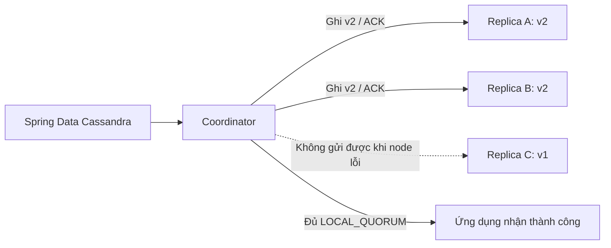
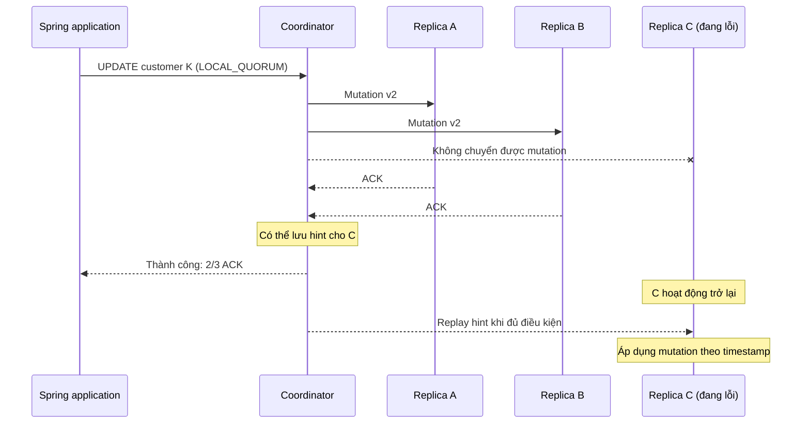
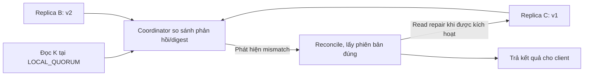
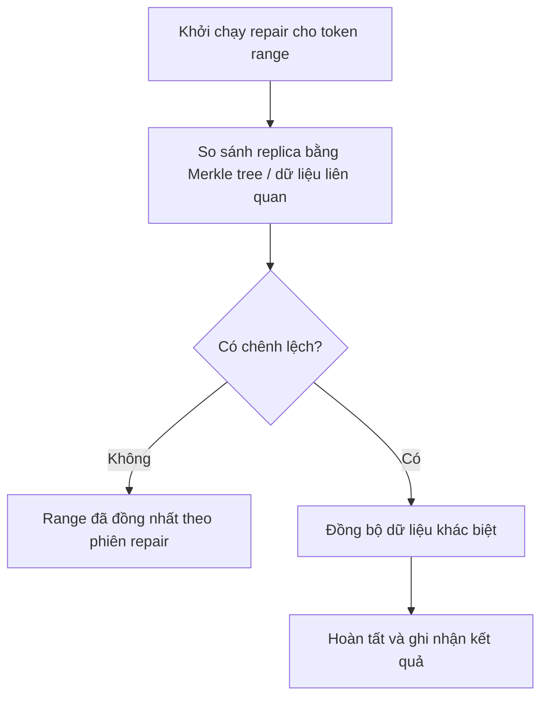

# Hint, read repair và anti-entropy repair trong Apache Cassandra

Apache Cassandra lưu nhiều bản sao (**replica**) của mỗi partition trên các node khác nhau. Nhân bản giúp ứng dụng vẫn đọc/ghi khi một node gặp sự cố, nhưng cũng làm xuất hiện bài toán: **làm thế nào để các replica trở lại đồng nhất sau khi bỏ lỡ một thao tác ghi?**

Bài học thuộc chương **Kiến trúc Cassandra** của **Spring Data Cassandra** tập trung vào ba cơ chế bổ trợ: **hinted handoff (hint)**, **read repair**, và **anti-entropy repair**. Hiểu đúng các cơ chế này giúp bạn chọn consistency level, thiết kế partition key, đánh giá dữ liệu đọc qua `CassandraRepository`/`CassandraTemplate`, và vận hành cluster mà không nhầm “ghi thành công” với “mọi replica đã đồng bộ”.

## 1. Vì sao các replica có thể khác nhau?

Xét một cluster gồm một datacenter `dc1` với ba node `A`, `B`, `C`; keyspace đặt **replication factor (RF) = 3**. Một partition `customer_id = K` có ba bản sao trên cả ba node. Ứng dụng Spring gửi thao tác cập nhật trạng thái khách hàng từ `basic` thành `premium` ở consistency `LOCAL_QUORUM`.

Trong một DC có RF = 3, `LOCAL_QUORUM` yêu cầu **2 phản hồi thành công** từ các replica trong DC đó. Nếu `C` tạm thời mất kết nối, coordinator vẫn có thể nhận ACK từ `A` và `B`, rồi báo ghi thành công cho ứng dụng. Sau đó, dữ liệu có thể đang ở trạng thái:

| Replica | Giá trị đã biết | Trạng thái |
| --- | --- | --- |
| `A` | `premium` | Đã nhận ghi |
| `B` | `premium` | Đã nhận ghi |
| `C` | `basic` | Mất kết nối, chưa nhận cập nhật |

Đây là độ lệch tạm thời của replica (**replica divergence**), không nhất thiết là lỗi của Spring Data Cassandra. Cassandra có các cơ chế giải quyết độ lệch này theo nhiều thời điểm khác nhau.



**Phân biệt hai câu hỏi:**

- **Consistency level:** cần bao nhiêu replica phản hồi để *một yêu cầu* đọc/ghi được chấp nhận?
- **Replica repair:** sau khi có khác biệt giữa các replica, hệ thống *phát hiện và khắc phục* nó như thế nào?

Consistency level quyết định điều kiện phản hồi cho request; nó không thay thế công việc đồng bộ dữ liệu lâu dài.

## 2. Hinted handoff: lưu lại ghi bị bỏ lỡ

### Hint là gì?

**Hint** là một bản ghi tạm mô tả một mutation dành cho replica đang không nhận được thao tác ghi. Khi coordinator không thể chuyển mutation tới replica đó, Cassandra **có thể** lưu hint (nếu cơ chế được bật và đáp ứng điều kiện cấu hình). Khi replica quay lại, các hint còn tồn tại có thể được **replay** để chuyển mutation đã bỏ lỡ.

Luồng điển hình:

1. Client gửi ghi cho partition `K`; coordinator xác định `A`, `B`, `C` là các replica.
2. `A` và `B` ghi thành công, `C` mất liên lạc.
3. Cassandra có thể tạo hint gắn với đích `C`; request trả thành công nếu đã đủ consistency level, ở ví dụ là `LOCAL_QUORUM`.
4. Khi `C` hoạt động trở lại và có thể nhận lưu lượng, hệ thống phát lại các hint đủ điều kiện.
5. `C` áp dụng mutation theo quy tắc dữ liệu/timestamp của Cassandra, rồi tiến gần trạng thái của những replica còn lại.



**Điểm quan trọng:** Hinted handoff là cơ chế hỗ trợ khôi phục sau **lỗi ngắn hạn**, không phải một nhật ký ghi đáng tin cậy vô thời hạn. Không phải mọi lần ghi lỗi hoặc timeout đều chắc chắn sinh hint, lưu hint thành công hoặc phát lại được.

### Giới hạn cần hiểu khi vận hành

- Hint được lưu với một **cửa sổ thời gian cấu hình**, thường được kiểm soát qua `max_hint_window` trong `cassandra.yaml`. Nếu replica không khả dụng quá lâu, Cassandra có thể ngừng sinh hint mới cho replica đó; những mutation bị bỏ lỡ sẽ cần cơ chế repair khác.
- Hệ thống có thể giới hạn/tắt hinted handoff, bỏ qua một số DC, hoặc không đủ tài nguyên lưu hint; hành vi chính xác phụ thuộc phiên bản và cấu hình cluster.
- Hint không thay thế **replication factor**, **backup** hay **anti-entropy repair**; hint cũng không chứng minh replica đích đã bắt kịp tại thời điểm client nhận ACK.
- Khi replay, hệ thống vẫn dùng quy tắc đối chiếu giá trị/timestamp và tombstone; hint không đơn giản là “ghi đè bằng dữ liệu cũ”.
- Hints và consistency level là hai khái niệm độc lập. Ví dụ `LOCAL_QUORUM` vẫn **thất bại** nếu không đủ hai replica xác nhận, dù coordinator có thể đã lưu hint. Mức `ANY` có trường hợp chấp nhận ghi nhờ hint, nhưng đổi lại cam kết đọc thấy dữ liệu rất yếu; `ANY` không áp dụng cho thao tác đọc.

### Khi nào hinted handoff hữu ích?

Một replica khởi động lại vài phút sau bảo trì hoặc gián đoạn mạng ngắn thường có cơ hội nhận lại các mutation đã bỏ lỡ qua hints. Ngược lại, node vắng mặt nhiều ngày, mất dữ liệu trên ổ đĩa hoặc đã bị xóa/thay thế cần quy trình khôi phục/repair riêng. **Không xây quy trình phục hồi chỉ dựa vào khả năng replay hint.**

## 3. Read repair: phát hiện sai lệch khi đọc

**Read repair** là cơ chế khắc phục khác biệt replica trong quá trình phục vụ **truy vấn đọc**. Trong một lần đọc liên hệ nhiều replica, Cassandra có thể so sánh phần dữ liệu hoặc **digest** (dấu kiểm tra nội dung) của các phản hồi. Nếu phát hiện không khớp, coordinator lấy thông tin cần thiết để hòa giải kết quả và gửi mutation sửa đến replica cũ khi phù hợp.

Một ví dụ tiếp nối tình huống trên:

1. `C` đã online nhưng vẫn giữ giá trị `basic` (v1).
2. Ứng dụng đọc partition `K` ở `LOCAL_QUORUM`, coordinator có thể liên hệ `B` (v2) và `C` (v1).
3. So sánh phản hồi phát hiện bất đồng; Cassandra chọn dữ liệu hợp lệ theo quy tắc reconciliation (bao gồm timestamp/tombstone).
4. Client nhận giá trị phù hợp với consistency đã yêu cầu; với chế độ read repair có chờ xác nhận, việc cập nhật replica sai lệch là một phần của điều kiện hoàn thành lần đọc.



### Đọc ở `ONE` và `QUORUM` khác nhau thế nào?

- Với `ONE` hoặc `LOCAL_ONE`, truy vấn thông thường có thể chỉ cần một replica phản hồi. Nếu replica đó đang cũ, ứng dụng có thể đọc dữ liệu cũ; **không được giả định** mọi truy vấn `ONE` đều so sánh các replica để sửa lệch.
- Với `QUORUM` hoặc `LOCAL_QUORUM`, nhiều phản hồi replica được xem xét; khả năng phát hiện không nhất quán trong tập replica được đọc cao hơn. Khi RF = 3 trong một DC, ghi `LOCAL_QUORUM` và đọc `LOCAL_QUORUM` đều yêu cầu hai replica, nên hai tập phản hồi có phần giao nhau (`2 + 2 > 3`).
- Việc tập hợp quorum giúp ích cho tính nhất quán của read/write trong phạm vi được bảo đảm; **không đồng nghĩa linearizability tổng quát**, không tự loại bỏ các vấn đề về ghi đồng thời, timestamp hoặc failover giữa những DC khác nhau.

### `read_repair = 'BLOCKING'` và `'NONE'`

Trong **Apache Cassandra 4.x trở lên**, tùy chọn bảng `read_repair` điều khiển hành vi của read repair:

```sql
-- Ví dụ cho Cassandra 4.x+; tên keyspace chỉ mang tính minh họa.
CREATE TABLE commerce.customer_status (
    customer_id uuid PRIMARY KEY,
    membership text,
    updated_at timestamp
) WITH read_repair = 'BLOCKING';
```

| Giá trị | Ý nghĩa chính | Hệ quả cần cân nhắc |
| --- | --- | --- |
| `BLOCKING` | Khi read repair được kích hoạt, coordinator chờ đủ xác nhận sửa chữa cần thiết trước khi hoàn tất đọc. | Hỗ trợ **monotonic quorum reads**, nhưng có thể tăng độ trễ đọc lúc replica lệch. |
| `NONE` | Không thực hiện blocking read repair trong đường đọc. | Có thể giữ tính nguyên tử ở cấp partition cho một số mẫu batch write, nhưng không có bảo đảm monotonic quorum reads do blocking read repair. |

Ở Cassandra 4.x, `BLOCKING` là giá trị mặc định. Các phiên bản Cassandra cũ hơn có cơ chế/tùy chọn điều khiển read repair khác; không nên áp dụng máy móc thuộc tính này cho mọi phiên bản.

**Đánh đổi nâng cao:** Nếu một batch cập nhật nhiều hàng trong *cùng partition*, một truy vấn chỉ đọc một phần hàng có thể khiến `BLOCKING` sửa đúng phần được đọc trước, trong khi phần khác của partition vẫn chưa bắt kịp; đây là lý do Cassandra cho phép ưu tiên **partition-level write atomicity** thông qua `NONE` trong một số bài toán. Lựa chọn này cần dựa vào đặc tính dữ liệu và yêu cầu ứng dụng, không mặc định chuyển sang `NONE` chỉ để tránh độ trễ.

**Giới hạn của read repair:** cơ chế này chỉ tác động đến phần dữ liệu mà những lần đọc thực sự đụng tới và phát hiện chênh lệch. Một partition ít được truy cập có thể không bao giờ được sửa chỉ nhờ lưu lượng đọc. Vì vậy, **read repair không thay thế anti-entropy repair**.

## 4. Anti-entropy repair: chủ động hòa giải dữ liệu trên các replica

**Anti-entropy repair** là quy trình đối soát dữ liệu **chủ động** giữa những replica cùng sở hữu các token range. Thay vì chờ ứng dụng đọc đúng partition, tác vụ repair làm việc trên phạm vi dữ liệu đã chọn, phát hiện chỗ khác biệt và đồng bộ chúng.

Về mặt khái niệm:

1. Xác định keyspace, bảng và các token range cần repair.
2. Các node liên quan tham gia quá trình kiểm tra dữ liệu của cùng range, thường sử dụng cấu trúc so sánh như **Merkle tree** để phát hiện những phần khác biệt.
3. Các phiên bản dữ liệu/tombstone được đối chiếu theo quy tắc reconciliation của Cassandra.
4. Những dữ liệu còn thiếu hoặc khác nhau được đồng bộ qua truyền dữ liệu giữa replica (**streaming** trong quy trình repair).
5. Quá trình được ghi nhận; người vận hành theo dõi kết quả, lỗi và bảo đảm mọi range cần thiết đã được xử lý.



Repair có chi phí **CPU, I/O đĩa, mạng và thời gian** đáng kể, nhất là khi dữ liệu lớn hoặc nhiều replica cùng tham gia. Trên cluster có nhiều DC, cần cân nhắc băng thông và phạm vi repair để tránh tác động quá mạnh đến dịch vụ đang chạy.

### Full repair và incremental repair

| Hình thức | Phạm vi khái niệm | Khi cân nhắc |
| --- | --- | --- |
| **Full repair** | Đối soát cả dữ liệu thuộc phạm vi được chọn, không giới hạn chỉ phần chưa được đánh dấu repaired. | Khi cần quy trình toàn diện hoặc xử lý sai lệch nghiêm trọng; thường tốn nhiều tài nguyên hơn. |
| **Incremental repair** | Dựa trên trạng thái repaired/unrepaired của SSTable và cơ chế quản lý phiên repair để tránh kiểm tra lại toàn bộ dữ liệu đã repair ở các lần sau. | Có thể giảm công việc lặp nhưng phải vận hành nhất quán, theo dõi phiên lỗi và hiểu cơ chế của phiên bản Cassandra. |

Cách triển khai incremental repair đã thay đổi giữa các phiên bản Cassandra. Không nên kết hợp tùy tiện full/incremental, xóa trạng thái sửa chữa hoặc thay đổi lịch repair mà chưa kiểm tra hướng dẫn đúng với phiên bản cluster.

### Ví dụ lệnh vận hành

```bash
# Xem node/rack/DC đang khỏe mạnh trước khi chạy repair.
nodetool status

# Ví dụ một lần full repair của bảng customer_status trong keyspace commerce.
# Chỉ chạy theo kế hoạch vận hành, có giám sát tải và phạm vi token range.
nodetool repair --full commerce customer_status
```

Lệnh trên **không có nghĩa** chạy một lần trên node bất kỳ là đã repair toàn bộ mọi range của cluster. Phạm vi thực tế phụ thuộc node thực thi, token ranges, DC và các tham số của lệnh. Để bao phủ cluster cần một **kế hoạch chạy repair cho đủ range/node**, cùng cách tránh công việc trùng lặp và kiểm chứng phiên repair thành công. Với cluster sản xuất, dùng công cụ lập lịch/giám sát và tài liệu vận hành tương ứng phiên bản đang sử dụng.

## 5. Tombstone và `gc_grace_seconds`: vì sao repair có hạn chót?

Trong Cassandra, thao tác `DELETE` hoặc ghi giá trị hết hạn không nhất thiết xóa ngay bản ghi khỏi mọi file SSTable. Cassandra có thể ghi một **tombstone** để biểu thị dữ liệu đã bị xóa. Tombstone được giữ trong một khoảng thời gian nhằm giúp những replica từng offline biết rằng dữ liệu cũ **không còn hợp lệ**.

Mỗi bảng có thiết lập `gc_grace_seconds` (thường mặc định **864000 giây = 10 ngày** trong nhiều phiên bản). Sau thời gian grace và khi thỏa điều kiện dọn dẹp, tombstone có thể bị loại bỏ trong quá trình compaction.

**Kịch bản nguy hiểm:**

1. `A` và `B` nhận tombstone xóa `customer_id = K`; `C` bị lỗi nên còn bản ghi cũ.
2. `C` vắng mặt lâu, bỏ lỡ hints và chưa được đồng bộ qua repair.
3. Trên các replica còn lại, tombstone đủ điều kiện bị dọn sau grace period.
4. `C` quay lại với giá trị cũ; nếu không còn tombstone để đối chiếu, dữ liệu đã xóa có thể **xuất hiện trở lại** (*zombie data*).

Để giảm rủi ro, cần bảo đảm **mọi replica/token range liên quan được repair đủ thường xuyên**, phù hợp với `gc_grace_seconds` và trạng thái node. Nếu một replica mất kết nối dài hơn grace period, không mặc định chỉ cho nó tham gia lại rồi chờ hints; có thể cần rebuild/replace theo quy trình khôi phục của phiên bản Cassandra đang chạy.

Không nên tùy tiện hạ `gc_grace_seconds` để giảm lưu trữ: đây là tham số gắn trực tiếp với tính đúng đắn của xóa dữ liệu. Ngược lại, tăng giá trị này cũng tăng thời gian lưu tombstone và có thể ảnh hưởng đọc/compaction. Việc điều chỉnh đòi hỏi đánh giá khối lượng dữ liệu, TTL, lịch repair và khả năng ngừng node.

## 6. So sánh ba cơ chế

| Góc nhìn | Hinted handoff | Read repair | Anti-entropy repair |
| --- | --- | --- | --- |
| **Kích hoạt** | Trong/ sau ghi khi một replica không nhận được mutation và hint được chấp nhận. | Trong quá trình đọc có đủ thông tin để phát hiện replica không khớp. | Theo tác vụ repair được vận hành/lập lịch. |
| **Phạm vi** | Những mutation đã lưu hint cho replica đích. | Dữ liệu liên quan đến yêu cầu đọc. | Dữ liệu trong các token range/bảng đã chọn. |
| **Có cần ứng dụng đọc?** | Không. | Có. | Không. |
| **Đối phó lỗi nào?** | Mất kết nối ngắn hạn, bỏ lỡ một số ghi. | Sai lệch được phát hiện trên đường đọc. | Sai lệch còn tồn tại, bao gồm dữ liệu ít được đọc hoặc bỏ lỡ hint. |
| **Giới hạn** | Cửa sổ hint, tài nguyên và tình trạng gửi lại. | Không quét toàn bộ cluster; có thể tăng latency. | Tốn tài nguyên, cần bao phủ range và hoàn tất đúng lịch. |
| **Có thay backup không?** | Không. | Không. | Không. |

Ba cơ chế **bổ sung nhau**, không có cơ chế nào đủ để đảm bảo mọi bản sao luôn đồng nhất ngay lập tức. Một request vẫn phải chọn consistency level phù hợp; quá trình bảo trì vẫn cần repair và giám sát.

## 7. Liên hệ Spring Data Cassandra và thiết kế ứng dụng

Spring Data Cassandra thực hiện entity mapping, repository và `CassandraTemplate` trên nền **Java driver**. Cơ chế hints/repair chạy ở **cluster Cassandra**, ứng dụng Spring không cần (và cũng không nên) tự xây vòng lặp sửa replica bằng cách đọc/ghi cùng một hàng nhiều lần.

Tuy vậy, quyết định phía ứng dụng ảnh hưởng đến cách nó quan sát độ lệch:

- **Mức nhất quán đọc/ghi:** `LOCAL_ONE` có thể giảm độ trễ nhưng dễ đọc replica chưa bắt kịp hơn; `LOCAL_QUORUM` thường phù hợp khi cần sự giao nhau giữa tập replica đọc và ghi trong cùng DC.
- **Local datacenter:** driver nên cấu hình đúng DC ưu tiên để tránh các đường truy vấn liên DC không cần thiết.
- **Thiết kế bảng theo truy vấn:** cần partition key rõ ràng; read repair chỉ xử lý dữ liệu được đọc, nên truy vấn thiếu partition key không phải cách “quét để chữa” toàn bộ bảng.
- **Paging:** khi phân trang tập dữ liệu, trạng thái các replica có thể thay đổi giữa các trang; paging state không tạo snapshot xuyên nhiều request.
- **Timeout/retry:** timeout không chứng minh một ghi chắc chắn thất bại; coordinator hoặc một số replica có thể đã nhận dữ liệu. Với thao tác không idempotent, retry phải được thiết kế cẩn thận để tránh hiệu ứng nghiệp vụ lặp lại.

Ví dụ Spring Boot 3.x kết nối về DC cục bộ:

```yaml
spring:
  cassandra:
    contact-points: 10.1.0.11:9042,10.1.0.12:9042
    local-datacenter: dc1
    keyspace-name: commerce
```

Ví dụ một thao tác CQL ở driver đặt consistency cho từng request (tùy chính sách dự án, có thể cấu hình mặc định qua driver profile):

```java
import com.datastax.oss.driver.api.core.CqlSession;
import com.datastax.oss.driver.api.core.DefaultConsistencyLevel;
import com.datastax.oss.driver.api.core.cql.SimpleStatement;
import java.util.UUID;

public void loadStatus(CqlSession session, UUID customerId) {
    SimpleStatement query = SimpleStatement.builder(
            "SELECT membership FROM commerce.customer_status WHERE customer_id = ?")
        .addPositionalValue(customerId)
        .setConsistencyLevel(DefaultConsistencyLevel.LOCAL_QUORUM)
        .build();

    session.execute(query);
}
```

Đây là ví dụ của **Java driver** bên dưới Spring Data, nhằm minh họa consistency theo request. Trong mã ứng dụng thực tế, `CassandraRepository` hoặc `CassandraTemplate` vẫn có thể là API chính; consistency cần được thiết lập bằng cấu hình driver hoặc cơ chế truy vấn phù hợp với phiên bản Spring Data đang sử dụng.

### Checklist vận hành khi có triệu chứng dữ liệu “lúc mới, lúc cũ”

1. **Xác minh RF/CL:** keyspace nhân bản bao nhiêu replica ở mỗi DC, request thực sự đang dùng consistency nào?
2. **Kiểm tra topology:** các node cần đọc/ghi có `Up/Normal` không, có node mới lên hoặc vừa mất kết nối lâu không?
3. **Đánh giá hint:** replica có bỏ lỡ ghi và thời gian offline đã vượt cửa sổ hints hay chưa?
4. **Đánh giá read repair:** request có liên hệ đủ replica để phát hiện mismatch không, bảng đang ở `BLOCKING` hay `NONE` (nếu phiên bản hỗ trợ)?
5. **Đánh giá anti-entropy repair:** có lịch sửa đủ mọi range, phiên repair gần nhất hoàn tất hay lỗi, khoảng cách với `gc_grace_seconds` là bao nhiêu?
6. **Xem lại ứng dụng:** partition key, timestamp, TTL, retry và độ trễ có thể tạo cảm giác dữ liệu thay đổi bất thường ngay cả khi replica đang vận hành đúng thiết kế.

Nên quan sát các chỉ số liên quan đến thời gian đọc/ghi, hint backlog/replay, trạng thái node, lỗi repair và I/O. Tên metric và cú pháp lệnh cụ thể thay đổi theo phiên bản Cassandra và hệ giám sát, vì vậy phải đối chiếu tài liệu của cluster đang chạy.

## 8. Bài tập tình huống

**Bối cảnh:** Cluster `dc1` có RF = 3. Lúc 10:00, node `C` mất mạng. Lúc 10:02, client ghi trạng thái `premium` ở `LOCAL_QUORUM`, `A` và `B` ACK. Lúc 10:05, `C` kết nối lại nhưng chưa nhận hết mutation. Lúc 10:06, một client khác đọc trạng thái khách hàng. Hai ngày sau, hệ thống còn hàng triệu partition ít khi được đọc.

**Câu hỏi:**

1. Vì sao thao tác ghi 10:02 có thể thành công dù `C` chưa cập nhật?
2. Nếu đọc 10:06 ở `LOCAL_ONE` trúng `C`, điều gì có thể xảy ra?
3. Nếu đọc ở `LOCAL_QUORUM` qua `B` và `C`, read repair có vai trò gì?
4. Hints có đủ để xác nhận mọi partition ít đọc đều đồng nhất sau hai ngày không?
5. Nếu trong các partition ấy có dữ liệu bị xóa, cần chú ý đặc biệt đến cấu hình gì?

**Gợi ý trả lời:** (1) Vì RF = 3 và `LOCAL_QUORUM` cần hai ACK trong DC. (2) Có thể thấy `basic` nếu `C` còn dữ liệu cũ. (3) Có thể phát hiện mismatch, đối chiếu timestamp/tombstone và sửa `C` theo cấu hình read repair. (4) Không; cần kiểm soát lịch anti-entropy repair cho đủ range. (5) `gc_grace_seconds`, lịch repair và cách khôi phục replica offline kéo dài.

Khi làm việc với Cassandra qua Spring Data, hãy nhớ **hint ưu tiên phục hồi các ghi bị bỏ lỡ ngắn hạn; read repair xử lý khác biệt gặp lúc đọc; anti-entropy repair chủ động đối soát dữ liệu trên replica**. Kết hợp ba cơ chế với partition key đúng, consistency phù hợp và lịch bảo trì là nền tảng để xây hệ thống dữ liệu phân tán ổn định.
