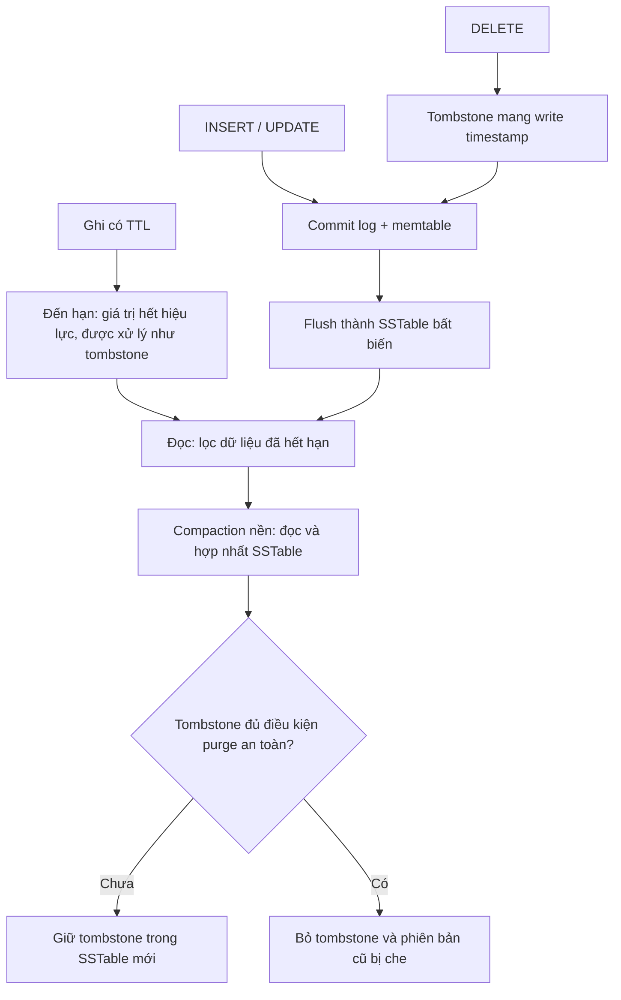

# Compaction, tombstone và vòng đời dữ liệu đã xóa

Trong Apache Cassandra, câu lệnh `DELETE` không xóa ngay các byte dữ liệu trên đĩa. Nó tạo một **tombstone** (dấu đánh dấu đã xóa) để các bản sao trong hệ thống phân tán cùng hiểu rằng phiên bản cũ không còn hợp lệ. Cassandra chỉ có thể thu hồi không gian lưu trữ khi cơ chế **compaction** hợp nhất các SSTable và xác nhận rằng việc bỏ dấu xóa là an toàn.

Bài học thuộc chương **Kiến trúc Cassandra** của **Spring Data Cassandra**. Hiểu vòng đời này giúp bạn giải thích vì sao repository đã xóa bản ghi nhưng dung lượng đĩa chưa giảm, vì sao TTL quá dày có thể làm truy vấn chậm, và vì sao thay đổi `gc_grace_seconds` thiếu kiểm soát có nguy cơ khiến dữ liệu đã xóa xuất hiện trở lại.

**Sau bài này, bạn có thể:**

- Mô tả đường đi của một thay đổi từ memtable đến SSTable, tombstone và compaction.
- Phân biệt xóa logic, TTL hết hạn, điều kiện được purge và giải phóng dung lượng vật lý.
- Chọn hướng compaction phù hợp với dữ liệu cập nhật thường xuyên hoặc dữ liệu theo thời gian.
- Tổ chức xóa, TTL và theo dõi hiệu năng qua CQL, repository và `CassandraTemplate` mà vẫn tôn trọng partition key, replica và consistency level.

## 1. Vì sao Cassandra không xóa trực tiếp tại chỗ?

Cassandra dùng kiến trúc lưu trữ gần với **Log-Structured Merge Tree (LSM-tree)**. Thao tác ghi thường đi qua commit log và memtable; khi flush, memtable tạo ra **SSTable bất biến** trên đĩa. Một lần `UPDATE` không sửa trực tiếp ô cũ trong SSTable: phiên bản mới có thể nằm trong memtable hoặc một SSTable khác.

Ví dụ cùng một cột `status` có thể được ghi qua ba thời điểm:

| Thời điểm | Dữ liệu được ghi | Trạng thái quan sát khi đọc |
| --- | --- | --- |
| `t1` | `status = 'NEW'` | `NEW` |
| `t2 > t1` | `status = 'PAID'` | `PAID` |
| `t3 > t2` | `DELETE status` | Không còn giá trị `status` khả kiến |

Những phiên bản cũ chưa nhất thiết biến mất khỏi đĩa. Cassandra hòa giải các phiên bản theo **write timestamp** và quy tắc xử lý xung đột; tombstone có timestamp mới hơn sẽ che những phiên bản cũ thuộc phạm vi bị xóa.



**Compaction** là công việc nền đọc các SSTable được chọn, hợp nhất những phiên bản trùng khóa, giữ giá trị còn hiệu lực và tạo SSTable đầu ra mới. Sau khi đầu ra đã sẵn sàng, các SSTable đầu vào mới có thể được loại bỏ. Nhờ vậy, compaction giảm số SSTable cần xét khi đọc và có thể thu hồi dung lượng. Đổi lại, nó tiêu tốn CPU, I/O và dung lượng tạm cho các tệp đang được viết lại.

Không nên đồng nhất ba sự kiện:

1. **Không còn trả về trong truy vấn**: tombstone hoặc TTL khiến dữ liệu không còn khả kiến.
2. **Đủ tuổi để xét thu hồi**: đã qua khoảng `gc_grace_seconds`, cùng những điều kiện an toàn khác.
3. **Được xóa vật lý**: compaction thực tế đã xử lý các SSTable liên quan và loại bỏ dữ liệu cũ.

## 2. Tombstone hình thành như thế nào?

**Tombstone** là dấu xóa có thông tin thời gian và phạm vi áp dụng. Cassandra phải lan truyền dấu này giữa các replica vì các replica có thể nhận cập nhật ở thời điểm khác nhau hoặc từng bị mất kết nối.

Các nguồn tạo tombstone thường gặp:

| Hành động | Hệ quả | Lưu ý |
| --- | --- | --- |
| `DELETE column` | Tombstone cho giá trị cột | Hàng có thể vẫn tồn tại nhờ các cột khác |
| `DELETE` một hàng | Tombstone cho hàng/những giá trị thuộc phạm vi xóa | Các phiên bản cũ ở SSTable khác vẫn có thể tồn tại vật lý |
| `DELETE` một partition hoặc dải clustering | Dấu xóa cho partition hoặc phạm vi hàng | Một dấu có thể che rất nhiều hàng; đọc dải này vẫn tốn chi phí |
| `INSERT/UPDATE ... USING TTL` | Giá trị được ghi kèm thời điểm hết hạn; sau đó được xem là đã xóa | TTL không bảo đảm tệp SSTable được thu hồi đúng giờ |
| Ghi `null` trong một số đường cập nhật | Có thể được diễn giải thành xóa cột | Hành vi còn phụ thuộc câu lệnh và cách framework chuyển đổi; không nên dùng `null` như một hợp đồng xóa mơ hồ |

Một tombstone có thể che dữ liệu ở nhiều SSTable, không nhất thiết nằm trong cùng tệp với giá trị cũ. Khi đọc, hệ thống phải kết hợp kết quả từ memtable và những SSTable có liên quan để xác định giá trị nào còn hợp lệ.

### Thí dụ CQL: bảng đơn hàng theo khách hàng và ngày

Giả sử ứng dụng Spring Data Cassandra cần lấy danh sách đơn hàng của một khách hàng trong một ngày. Khóa phân vùng được thiết kế theo đúng đường truy vấn:

```sql
CREATE TABLE orders_by_customer_day (
    customer_id uuid,
    order_day date,
    created_at timestamp,
    order_id uuid,
    status text,
    note text,
    PRIMARY KEY ((customer_id, order_day), created_at, order_id)
) WITH CLUSTERING ORDER BY (created_at DESC, order_id DESC)
  AND gc_grace_seconds = 864000;
```

Giá trị `864000` giây tương đương **10 ngày**, là mặc định thường gặp của Cassandra. Cấu hình thực tế phải xét SLA sửa chữa replica, thời gian node có thể ngừng hoạt động và phiên bản Cassandra đang vận hành.

Ghi dữ liệu mẫu:

```sql
INSERT INTO orders_by_customer_day (
    customer_id, order_day, created_at, order_id, status, note
) VALUES (
    8c24c965-4762-4c1f-bdcf-05e0c5e5d2ae,
    '2026-11-25',
    '2026-11-25T02:00:00Z',
    4d769737-9dc3-44aa-bfd1-4d0d06e05b45,
    'NEW',
    'Giao buổi sáng'
);
```

Xóa riêng ghi chú:

```sql
DELETE note FROM orders_by_customer_day
WHERE customer_id = 8c24c965-4762-4c1f-bdcf-05e0c5e5d2ae
  AND order_day = '2026-11-25'
  AND created_at = '2026-11-25T02:00:00Z'
  AND order_id = 4d769737-9dc3-44aa-bfd1-4d0d06e05b45;
```

Lệnh này nhằm xóa `note`; `status` vẫn có thể được đọc. Nếu xóa cả hàng, bỏ tên cột ở sau `DELETE` nhưng vẫn cung cấp **đầy đủ primary key** để định vị đúng hàng:

```sql
DELETE FROM orders_by_customer_day
WHERE customer_id = 8c24c965-4762-4c1f-bdcf-05e0c5e5d2ae
  AND order_day = '2026-11-25'
  AND created_at = '2026-11-25T02:00:00Z'
  AND order_id = 4d769737-9dc3-44aa-bfd1-4d0d06e05b45;
```

Trong cả hai trường hợp, thao tác được phân phối theo `(customer_id, order_day)` và giải quyết trên tập replica của partition. Clustering columns giúp chỉ rõ hàng bên trong partition; chúng không đổi token hay cách phân phối partition.

## 3. TTL: hết hạn tự động nhưng không được xóa vật lý tức thì

**TTL (Time To Live)** cho phép quy định thời gian sống của dữ liệu khi ghi. TTL được tính bằng giây và có thể chỉ định trên thao tác ghi hoặc bằng `default_time_to_live` của bảng. Với Cassandra, TTL gắn với dữ liệu được ghi, không phải một lịch chạy `DELETE` ở tầng Spring.

Ví dụ lưu đơn hàng thử nghiệm trong bảy ngày:

```sql
INSERT INTO orders_by_customer_day (
    customer_id, order_day, created_at, order_id, status, note
) VALUES (
    8c24c965-4762-4c1f-bdcf-05e0c5e5d2ae,
    '2026-11-25',
    '2026-11-25T03:00:00Z',
    e8c8e705-f7f2-4d5d-812e-342d11de5027,
    'TEMP',
    'Đơn thử nghiệm'
) USING TTL 604800;
```

Kiểm tra TTL còn lại của một cột khi dữ liệu vẫn khả kiến:

```sql
SELECT status, TTL(status), WRITETIME(status)
FROM orders_by_customer_day
WHERE customer_id = 8c24c965-4762-4c1f-bdcf-05e0c5e5d2ae
  AND order_day = '2026-11-25'
  AND created_at = '2026-11-25T03:00:00Z'
  AND order_id = e8c8e705-f7f2-4d5d-812e-342d11de5027;
```

`TTL(status)` trả về số giây còn lại khi cột có TTL và đang tồn tại; `WRITETIME(status)` phản ánh write timestamp của giá trị cột. Khi giá trị đã hết hạn, việc không thấy nó trong kết quả chỉ xác nhận **hết hiệu lực logic**, chưa cho biết nó đã được purge khỏi SSTable.

**Hai thời hạn có mục đích khác nhau:**

- **TTL** trả lời: “Bao lâu thì dữ liệu không còn được ứng dụng nhìn thấy?”
- **`gc_grace_seconds`** trả lời: “Sau khi đã bị xóa/hết hạn, cần giữ dấu xóa ít nhất bao lâu để giảm rủi ro replica cũ làm dữ liệu sống lại?”

TTL khác nhau trên các cột của cùng một hàng có thể khiến một số cột biến mất trước các cột khác. Khi ứng dụng cập nhật lại một cột, TTL của **giá trị được ghi mới** chịu tác động bởi tùy chọn TTL của thao tác mới hoặc TTL mặc định của bảng; không nên giả định mọi lần cập nhật đều tự bảo toàn TTL cũ.

Đặc biệt, **trộn dữ liệu có TTL và không TTL, hoặc TTL chênh lệch lớn trong cùng partition** có thể khiến các SSTable không thể được bỏ trọn vẹn khi hết hạn. Điều này ảnh hưởng trực tiếp đến lựa chọn compaction strategy.

## 4. Replica mất kết nối, tombstone và “zombie data”

Hãy xét một partition có **replication factor RF = 3** trên ba replica `R1`, `R2` và `R3`:

1. Ban đầu, cả ba replica giữ phiên bản `X = A`.
2. `R3` mất kết nối trước khi khách hàng gửi `DELETE X`.
3. `R1` và `R2` nhận tombstone mới, còn `R3` giữ phiên bản `A` cũ.
4. Nếu tombstone vẫn được giữ, quá trình đồng bộ/repair có thể mang dấu xóa đến `R3` để che `A`.
5. Nếu dấu xóa bị purge trên các replica khỏe **trước khi** `R3` được đồng bộ, phiên bản `A` còn sót lại ở `R3` có thể được xem là dữ liệu cần sao chép và xuất hiện trở lại. Đây là **zombie data**.

```text
Ban đầu:          R1 [A]         R2 [A]         R3 [A]
R3 mất kết nối:   R1 [A,T]       R2 [A,T]       R3 [A]
Repair kịp thời:  R1 [T]         R2 [T]         R3 [T]
Rủi ro:           R1 [rỗng]     R2 [rỗng]     R3 [A]
                   ^ Tombstone đã bị purge, phiên bản cũ có thể sống lại
```

`T` ở đây là tombstone có timestamp mới hơn `A`; sơ đồ chỉ mô tả trạng thái logic, không biểu diễn chính xác toàn bộ SSTable ở mỗi node.

### Vai trò của `gc_grace_seconds`

`gc_grace_seconds` là khoảng bảo vệ **tính từ thời điểm đánh dấu xóa** trước khi tombstone đủ điều kiện được xét bỏ. Khi hết khoảng này, Cassandra **có thể** purge trong compaction nếu thỏa điều kiện an toàn; không có nghĩa purge bắt buộc xảy ra ngay lập tức.

Ví dụ với `gc_grace_seconds = 864000`, một tombstone tạo ngày 01/12 chưa nên được purge trước khi qua 10 ngày. Nếu replica ngừng quá lâu, vẫn tồn tại rủi ro vì hệ thống không thể mặc định rằng nó đã nhận mọi thay đổi khi đang offline.

**Nguyên tắc vận hành:** tổ chức repair thường xuyên để các replica nhận được những lần xóa trong khoảng grace, đồng thời theo dõi thời gian node ngừng hoạt động. Hinted handoff và đọc ở consistency level cao có thể hỗ trợ đồng bộ trong một số tình huống, nhưng **không thay thế kế hoạch repair** khi có replica bị tách mạng lâu ngày.

Đặt `gc_grace_seconds = 0` hoặc giảm mạnh thông số này chỉ phù hợp khi đã chứng minh được cơ chế bảo đảm không có dữ liệu cũ tái xuất hiện và hiểu rõ hệ quả của topology/repair. Không dùng đây như mẹo “xóa nhanh để lấy lại đĩa” trong hệ thống nhiều replica.

### Consistency level không thay cho xử lý tombstone

`LOCAL_QUORUM` hoặc `QUORUM` quy định số replica phải đáp ứng cho từng thao tác; chúng không đổi `gc_grace_seconds`, không ép compaction chạy và không chứng minh mọi replica từng offline đã được sửa chữa. Để đọc/ghi an toàn hơn, cần kết hợp consistency level, chính sách repair và xử lý node vắng mặt.

## 5. Khi nào compaction thực sự được phép loại tombstone?

Giả sử `SSTable-A` có `status = 'NEW'` từ ngày trước, còn `SSTable-B` có tombstone xóa `status` được ghi sau đó. Nếu compaction chỉ nhìn thấy `B` và xóa tombstone trong khi `A` vẫn tồn tại, lần đọc tiếp theo có thể nhìn thấy dữ liệu cũ. Vì thế **tuổi tombstone là điều kiện cần nhưng chưa đủ**.

Các yếu tố chính ảnh hưởng việc purge:

1. Tombstone đã qua thời gian grace của bảng.
2. Cassandra xác định được rằng các dữ liệu cũ bị tombstone che sẽ không còn tồn tại ở SSTable khác mà lần compaction không xử lý; quy tắc về SSTable chồng lấn và timestamp rất quan trọng.
3. Cơ chế sửa chữa/bảo vệ dữ liệu phải phù hợp. Nếu cấu hình `only_purge_repaired_tombstones` được bật, chỉ dữ liệu đáp ứng điều kiện repaired mới đủ điều kiện bỏ tombstone.
4. Phải có một hoạt động compaction/loại SSTable thực tế. Tombstone hết hạn có thể tiếp tục nằm trên đĩa nếu chưa có compaction phù hợp.

Ví dụ:

| Trạng thái | Có thể kết luận gì? |
| --- | --- |
| `DELETE` thành công | Dấu xóa đã được ghi theo điều kiện nhất quán của request, dữ liệu không còn khả kiến theo quy tắc hòa giải |
| Đã qua 10 ngày với grace 10 ngày | Dấu xóa đã đủ tuổi để *xét* purge |
| Compaction chưa bao phủ dữ liệu cũ | Có thể phải giữ dấu xóa để không làm lộ phiên bản cũ |
| Compaction an toàn đã thay thế SSTable liên quan | Có thể thu hồi phần dữ liệu cũ và tombstone tương ứng |
| Dung lượng đĩa chưa giảm | Không nhất thiết là lỗi xóa; cần xem SSTable chồng lấn, chiến lược compaction và tiến độ xử lý |

Với workload có TTL, một **SSTable đã hết hạn toàn bộ** có thể được loại bỏ nguyên tệp nếu Cassandra xác nhận tệp đó không cần thiết để che dữ liệu cũ ở tệp khác. Công cụ `sstableexpiredblockers` giúp điều tra những SSTable đang ngăn việc thu hồi. Không bật tùy chọn nguy hiểm `unsafe_aggressive_sstable_expiration` chỉ để đẩy nhanh thu hồi: nó có thể bỏ qua kiểm tra bảo vệ và gây mất dữ liệu hoặc làm dữ liệu đã xóa tái xuất hiện.

## 6. Các chiến lược compaction và đánh đổi

Compaction strategy xác định **nhóm SSTable nào được trộn, khi nào trộn và bao nhiêu lần dữ liệu được ghi lại**. Chọn chiến lược theo đặc điểm truy vấn, tỷ lệ ghi/đọc, cập nhật/xóa, TTL và phiên bản Cassandra.

| Chiến lược | Phù hợp thường gặp | Điểm cần theo dõi |
| --- | --- | --- |
| **STCS – SizeTieredCompactionStrategy** | Tệp mới được gom theo kích thước; có thể phù hợp workload ghi nhiều, nhiều phiên bản SSTable và hệ thống cũ | SSTable lớn có thể nằm lâu chưa được hợp nhất; tombstone khó được purge đều; major compaction có thể tốn đĩa |
| **LCS – LeveledCompactionStrategy** | Workload đọc nhiều, thường cập nhật/xóa, cần giảm SSTable chồng lấn khi đọc | Write amplification và I/O compaction có thể cao hơn |
| **TWCS – TimeWindowCompactionStrategy** | Dữ liệu chuỗi thời gian, ghi gần như bất biến, TTL tương đối đồng nhất | Ghi trễ/backfill, ghi timestamp cũ hoặc trộn TTL có thể khiến SSTable của nhiều thời điểm lẫn nhau và khó drop |
| **UCS – UnifiedCompactionStrategy** | Lựa chọn được Cassandra 5.x khuyến nghị cho phần lớn workload mới; điều chỉnh để cân bằng nhu cầu đọc/ghi | Cần Cassandra hỗ trợ, cấu hình/tuning và theo dõi I/O, kích thước dữ liệu, độ trễ |

**Chú ý phiên bản:** Cassandra 5.0 giới thiệu UCS và tài liệu chính thức khuyến nghị UCS cho phần lớn bảng mới. Với Cassandra 3.x/4.x, tập chiến lược hỗ trợ và lựa chọn mặc định có thể khác. Không sao chép nguyên cấu hình từ phiên bản mới vào cluster cũ.

Ví dụ cấu hình TWCS cho bảng sự kiện gần như chỉ ghi mới và TTL đồng nhất, dùng cửa sổ một ngày:

```sql
ALTER TABLE orders_by_customer_day
WITH compaction = {
    'class': 'TimeWindowCompactionStrategy',
    'compaction_window_unit': 'DAYS',
    'compaction_window_size': '1'
};
```

Đoạn lệnh chỉ **minh họa cú pháp**. Bảng đơn hàng thực tế thường được cập nhật trạng thái hoặc xóa có chọn lọc, nên TWCS có thể không phù hợp. Trước khi thay đổi strategy trên hệ thống có dữ liệu, cần đánh giá pattern ghi/TTL, mức đĩa trống, I/O và tác động của việc tổ chức lại SSTable; đây không phải thay đổi có thể đánh giá đúng chỉ bằng việc nhìn lệnh `ALTER TABLE`.

### Ba khái niệm hiệu năng

- **Read amplification:** một lần đọc phải kiểm tra nhiều SSTable, phiên bản hoặc dấu xóa.
- **Write amplification:** một giá trị được viết lại nhiều lần trong các đợt compaction; tăng tiêu thụ CPU/đĩa.
- **Space amplification:** cần duy trì thêm dung lượng cho SSTable cũ, SSTable mới và dữ liệu đang chờ thu hồi.

Giảm một loại chi phí có thể tăng loại khác. Ví dụ LCS giúp giới hạn số tệp chồng lấn trên đường đọc nhưng có thể phát sinh I/O ghi lại nhiều hơn.

## 7. Tombstone nhiều ảnh hưởng truy vấn như thế nào?

Giả sử màn hình lấy **20 đơn hàng mới nhất** của một khách/ngày. Nếu partition có hàng chục nghìn đơn hàng đã xóa hoặc đã hết TTL trước các hàng còn sống, Cassandra có thể phải quét rất nhiều tombstone mới tìm đủ 20 kết quả.

```sql
SELECT created_at, order_id, status
FROM orders_by_customer_day
WHERE customer_id = 8c24c965-4762-4c1f-bdcf-05e0c5e5d2ae
  AND order_day = '2026-11-25'
LIMIT 20;
```

**`LIMIT 20` không bảo đảm Cassandra chỉ đọc 20 mục vật lý.** Các tombstone vẫn phải được xử lý để loại trừ dữ liệu không còn hợp lệ. Tăng fetch size hoặc dùng paging state trong driver/Spring Data Cassandra cũng không tự làm biến mất công việc quét các dấu xóa.

Hệ quả có thể gồm độ trễ đọc tăng, GC/CPU/I/O tăng, cảnh báo tombstone trên log và query timeout khi một lần đọc quét quá nhiều dấu xóa. Các ngưỡng cảnh báo/lỗi tombstone tùy phiên bản và cấu hình cluster; cần đọc số liệu thực tế thay vì mặc định một ngưỡng chung cho mọi hệ thống.

### Theo dõi và chẩn đoán

Trong môi trường có quyền vận hành, những lệnh thường dùng:

```bash
nodetool compactionstats
nodetool tablestats <keyspace>.orders_by_customer_day
nodetool tablehistograms <keyspace> orders_by_customer_day
```

| Công cụ/chỉ số | Trả lời câu hỏi |
| --- | --- |
| `compactionstats` | Compaction nào đang chạy/chờ, backlog có tích tụ không? |
| `tablestats` | SSTable, droppable tombstone ratio, dấu xóa quét mỗi lần đọc và dung lượng đang ở mức nào? |
| `tablehistograms` | Độ trễ đọc/ghi, kích thước partition và số cell phân bố ra sao? |
| Tracing/log/metrics | Truy vấn nào đụng quá nhiều tombstone hoặc phải đọc nhiều SSTable? |
| `sstableexpiredblockers` | Vì sao một SSTable đã hết hạn vẫn chưa được drop? |

Một tỷ lệ “droppable tombstones” cao là **tín hiệu để điều tra**, không phải lời cam kết rằng compaction kế tiếp chắc chắn thu hồi đúng tỷ lệ dung lượng đó. Cũng cần phân biệt biểu đồ CPU/đĩa của compaction với nguyên nhân thực ở thiết kế partition và truy vấn.

### Điều chỉnh từ gốc vấn đề

1. Thiết kế **partition key theo truy vấn** và giới hạn kích thước partition (ví dụ bucket theo ngày/giờ nếu lưu lượng đòi hỏi).
2. Hạn chế mô hình “ghi rất nhiều rồi xóa từng hàng” trong một partition nóng. Cân nhắc lưu retention bằng bảng/partition theo thời gian, với TTL đồng nhất khi phù hợp.
3. Tránh trộn dữ liệu sống lâu và sống ngắn trong cùng bảng/partition nếu yêu cầu thu hồi khác hẳn nhau; đôi khi cần bảng riêng cho từng nhu cầu đọc.
4. Chọn STCS/LCS/TWCS/UCS theo workload thực tế, đo trước và sau khi thay đổi.
5. Duy trì repair, theo dõi node offline và đủ không gian đĩa cho compaction; không dùng thay đổi grace period như giải pháp đầu tiên.

## 8. Liên hệ với Spring Data Cassandra: entity, repository và template

Spring Data Cassandra giúp ánh xạ CQL table thành entity và tổ chức thao tác qua repository hoặc `CassandraTemplate`. Tuy vậy, **nó không thay đổi cơ chế tombstone và compaction ở cấp Cassandra**. Khi gọi xóa qua Java, hệ thống vẫn tạo mutation xóa theo khóa và các replica vẫn phải xử lý sự kiện đó.

Với bảng ví dụ, khóa cần biểu diễn cả hai cột partition key và hai cột clustering:

```java
@PrimaryKeyClass
public class OrderKey implements Serializable {
    @PrimaryKeyColumn(name = "customer_id", ordinal = 0,
                      type = PrimaryKeyType.PARTITIONED)
    private UUID customerId;

    @PrimaryKeyColumn(name = "order_day", ordinal = 1,
                      type = PrimaryKeyType.PARTITIONED)
    private LocalDate orderDay;

    @PrimaryKeyColumn(name = "created_at", ordinal = 2,
                      type = PrimaryKeyType.CLUSTERED,
                      ordering = Ordering.DESCENDING)
    private Instant createdAt;

    @PrimaryKeyColumn(name = "order_id", ordinal = 3,
                      type = PrimaryKeyType.CLUSTERED,
                      ordering = Ordering.DESCENDING)
    private UUID orderId;

    // Bổ sung constructor, getter/setter, equals và hashCode.
}

@Table("orders_by_customer_day")
public class CustomerOrder {
    @PrimaryKey
    private OrderKey key;
    private String status;
    private String note;

    // Bổ sung constructor và getter/setter.
}

public interface CustomerOrderRepository
        extends CassandraRepository<CustomerOrder, OrderKey> {
}
```

Các class trên là **phần mapping minh họa**; khi đưa vào dự án cần bổ sung import, hàm tạo, truy cập thuộc tính, `equals`/`hashCode` cho key và cấu hình Spring. Thứ tự `ordinal` phải trùng CQL schema; hai `PARTITIONED` tạo composite partition key, hai `CLUSTERED` xác định hàng. Chú thích `ordering` cần khớp `CLUSTERING ORDER BY` của bảng.

Gọi repository hoặc template:

```java
// key chứa đầy đủ customerId, orderDay, createdAt và orderId.
repository.deleteById(key);

// Cùng mục đích bằng CassandraTemplate:
cassandraTemplate.deleteById(key, CustomerOrder.class);

// TTL áp dụng cho các giá trị được ghi bởi thao tác insert này.
InsertOptions opts = InsertOptions.builder()
        .ttl(Duration.ofDays(7))
        .build();
cassandraTemplate.insert(order, opts);
```

Các API trên là API đồng bộ (imperative). `CassandraRepository.deleteById` và `CassandraTemplate.deleteById` không đồng nghĩa “byte đã biến mất khỏi SSTable”; chúng gửi thao tác xóa theo CQL và cơ chế lưu trữ của cluster. Nếu chỉ muốn xóa `note`, nên dùng câu CQL `DELETE note ... WHERE ...` hoặc thao tác cập nhật được định nghĩa rõ ràng, tránh suy diễn rằng đặt thuộc tính Java thành `null` chắc chắn có cùng ý nghĩa với mọi kiểu `save`/`insert`/`update`.

**Về hiệu năng ứng dụng:** một lệnh repository trả về nhanh không chứng minh chi phí compaction thấp. Theo dõi cả query latency, read tombstone count, partition size, compaction backlog và mức tiêu thụ đĩa. Khi dùng paging, nên lấy từng trang theo đúng partition key và giữ paging state của driver theo luồng truy vấn, không dựa vào phân trang offset tùy ý.

## 9. Tình huống thực tế: giữ lịch sử giao dịch 30 ngày

Một hệ thống nhận vài triệu event mỗi ngày và chỉ cần tra cứu trong 30 ngày. Cách thiết kế cần bắt đầu từ các câu hỏi sau:

- Truy vấn lấy event theo `tenant_id` và ngày, hay thường xuyên cần lọc nhiều ngày/toàn bộ tenant?
- Event có được cập nhật hoặc backfill vào ngày cũ không?
- Tất cả event có cùng thời hạn lưu hay có một nhóm bắt buộc giữ lâu hơn?
- Cluster có thể mất replica bao lâu; repair có hoàn thành trong khoảng grace không?

Nếu event **chủ yếu bất biến, TTL đồng nhất**, bucket theo tenant/ngày và compaction theo time window có thể tạo điều kiện drop các SSTable hết hạn thuận lợi. Với Cassandra 5.x, UCS cũng là phương án nên đánh giá vì được thiết kế cho nhiều workload; cần so sánh bằng phép đo trước khi chọn.

Nếu event **liên tục sửa trạng thái** hoặc ghi backfill, nhiều SSTable trong các cửa sổ khác nhau có thể chứa phiên bản của cùng partition. TWCS lúc này kém phù hợp hơn dự kiến; LCS/UCS hoặc thiết kế bảng phụ cho từng chiều truy vấn có thể là lựa chọn đáng thử. Không nên thay strategy hay giảm `gc_grace_seconds` chỉ vì ổ đĩa tăng trong một đợt cập nhật.

Một quy trình kiểm chứng ngắn:

1. Ghi event có TTL bằng CQL hoặc `CassandraTemplate.insert(..., InsertOptions)`.
2. Xem `TTL(column)` và đọc lại khi hết hạn để xác nhận không còn khả kiến.
3. Quan sát `tablestats`, `compactionstats` và trạng thái SSTable; đừng kỳ vọng dung lượng giảm đúng giây TTL vừa hết.
4. Kiểm tra repair, thời gian offline tối đa, kế hoạch retention và an toàn trước khi chỉnh compaction/grace trên hệ thống thực.

## 10. Những ngộ nhận cần tránh

| Ngộ nhận | Hiểu đúng |
| --- | --- |
| “`DELETE` xóa ngay khỏi đĩa.” | `DELETE` tạo dấu xóa; thu hồi vật lý phụ thuộc compaction và an toàn replica. |
| “TTL là `gc_grace_seconds`.” | TTL đặt thời gian hiển thị dữ liệu; grace bảo vệ tombstone sau khi đã xóa/hết hạn. |
| “Tombstone đủ 10 ngày chắc chắn bị xóa.” | Phải có compaction và không còn dữ liệu cũ liên quan cần được che ở SSTable khác. |
| “Có ba replica nên không cần repair.” | Replica offline có thể bỏ lỡ dấu xóa; repair cần hoàn thành theo chính sách vận hành. |
| “`LIMIT 20` chỉ quét 20 bản ghi.” | Cassandra có thể phải đọc nhiều tombstone trước khi trả đủ 20 bản ghi còn sống. |
| “Tăng page size giúp xóa tombstone.” | Paging chỉ thay đổi cách chuyển kết quả, không thay đổi lưu trữ hoặc điều kiện purge. |
| “TWCS luôn tốt nhất khi bảng có timestamp.” | TWCS cần workload thời gian phù hợp; backfill/updates/TTL trộn có thể phá lợi ích. |
| “Repository đã xóa thành công là kết thúc vòng đời xóa.” | Vẫn còn đồng bộ replica, grace period, compaction và theo dõi hiệu năng. |

## 11. Câu hỏi tự kiểm tra

**Câu 1.** Một cột có TTL bảy ngày. Ngày thứ tám, truy vấn không trả về cột này nhưng dung lượng SSTable không giảm. Có phải Cassandra không thực hiện TTL?

<details>
<summary>Gợi ý trả lời</summary>

Không. TTL khiến dữ liệu hết hiệu lực logic; SSTable có thể vẫn giữ dữ liệu hết hạn/tombstone. Phải chờ đủ điều kiện an toàn và compaction phù hợp để thu hồi vật lý.
</details>

**Câu 2.** Vì sao không nên đặt `gc_grace_seconds = 0` để giải phóng dung lượng nhanh trong cluster RF = 3 có thể mất node nhiều ngày?

<details>
<summary>Gợi ý trả lời</summary>

Replica offline có thể giữ dữ liệu cũ mà chưa nhận tombstone. Nếu tombstone trên các replica khác bị bỏ sớm, việc đồng bộ về sau có thể làm dữ liệu đã xóa xuất hiện trở lại.
</details>

**Câu 3.** Một truy vấn `LIMIT 10` thường quét hàng nghìn tombstone. Bạn xem điều gì trước?

<details>
<summary>Gợi ý trả lời</summary>

Kiểm tra partition key và truy vấn, số lượng xóa/TTL trong partition, kích thước partition, SSTable chồng lấn, `tablestats`, compaction backlog và lựa chọn strategy. Không giả định chỉ cần tăng `LIMIT`, fetch size hoặc hạ grace.
</details>

**Câu 4.** Khi nào TWCS có lợi hơn mô hình trộn mọi event vào cùng một bảng thường xuyên cập nhật?

<details>
<summary>Gợi ý trả lời</summary>

Khi event phần lớn ghi một lần, đi theo thứ tự thời gian và có TTL tương đối đồng nhất, TWCS có thể gom dữ liệu hết hạn vào SSTable có thể drop trọn tệp. Nếu thường xuyên backfill/sửa event cũ, lợi ích có thể giảm đáng kể.
</details>

## 12. Ghi nhớ khi thiết kế Spring Data Cassandra

- Tombstone là **thông tin xóa có timestamp**, cần thiết để các replica hiểu cùng một trạng thái trong hệ thống phân tán.
- Compaction giúp hợp nhất SSTable và bỏ dữ liệu lỗi thời, nhưng **hết grace không đồng nghĩa xóa đĩa ngay**.
- TTL, `gc_grace_seconds`, consistency level và repair giải quyết **những vấn đề khác nhau**; phải thiết kế phối hợp.
- Partition quá lớn, xóa nhiều và TTL lẫn lộn có thể biến một truy vấn nhỏ thành phép quét tombstone lớn.
- Repository và `CassandraTemplate` là API thao tác dữ liệu; hành vi compaction/tombstone vẫn phụ thuộc Cassandra và topology.

### Tài liệu tham khảo

- [Apache Cassandra – Compaction overview](https://cassandra.apache.org/doc/stable/cassandra/managing/operating/compaction/overview.html)
- [Apache Cassandra – Tombstones](https://cassandra.apache.org/doc/latest/cassandra/managing/operating/compaction/tombstones.html)
- [Apache Cassandra – Time Window Compaction Strategy](https://cassandra.apache.org/doc/latest/cassandra/managing/operating/compaction/twcs.html)
- [Apache Cassandra – Unified Compaction Strategy](https://cassandra.apache.org/doc/latest/cassandra/managing/operating/compaction/ucs.html)
- [Spring Data for Apache Cassandra – Mapping](https://docs.spring.io/spring-data/cassandra/reference/object-mapping.html)
- [Spring Data for Apache Cassandra – Persisting entities](https://docs.spring.io/spring-data/cassandra/reference/cassandra/template.html)
