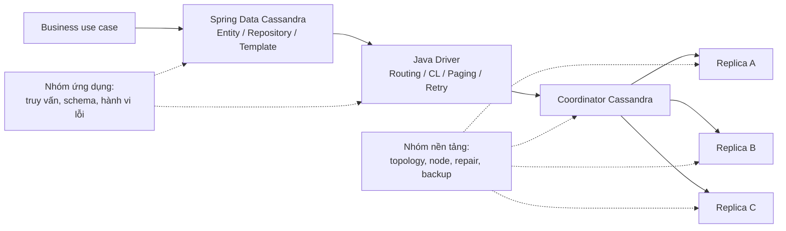
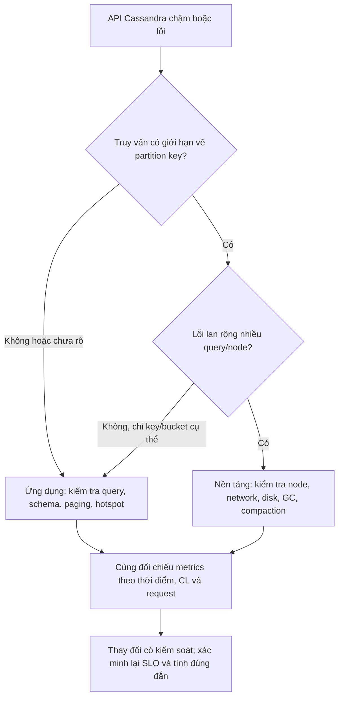

# Ranh giới kiến thức ứng dụng cần nắm và quản trị cụm chuyên sâu

## 1. Vì sao cần xác định ranh giới?

Khi dùng **Spring Data Cassandra** để truy cập **Apache Cassandra**, lập trình viên thường làm việc với entity mapping, repository, `CassandraTemplate` và truy vấn CQL. Tuy nhiên, phía sau một lệnh `save()` hoặc `SELECT` là hệ thống lưu trữ phân tán: dữ liệu được chia theo partition key, nhân bản trên các node và trả kết quả theo mức nhất quán được chọn. Vì vậy, chỉ biết cách gọi API của Spring là chưa đủ để xây dựng chức năng đúng, nhanh và chịu lỗi.

Ở chiều ngược lại, một lập trình viên ứng dụng không cần tự vận hành toàn bộ cụm Cassandra: thiết kế topology, bảo dưỡng node, sửa chữa dữ liệu giữa các replica, backup/restore và nâng cấp cluster là công việc chuyên sâu của người vận hành cơ sở dữ liệu hoặc nhóm nền tảng.

**Ranh giới hợp lý** là:

- **Nhóm ứng dụng phải hiểu những đặc tính của Cassandra có thể làm thay đổi tính đúng đắn, thiết kế dữ liệu hoặc trải nghiệm người dùng.** Nhóm này sở hữu mẫu truy vấn, mô hình dữ liệu hướng truy vấn, hợp đồng nhất quán, paging, timeout/retry và cách dùng Spring Data.
- **Nhóm quản trị cụm phải hiểu cách duy trì sức khỏe, dung lượng, độ an toàn và sự sẵn sàng của hạ tầng Cassandra.** Nhóm này sở hữu topology, cấu hình node, vận hành replica, repair, backup, bảo mật và nâng cấp.
- **Hai bên cùng chịu trách nhiệm ở các điểm giao nhau** như replication factor (RF), consistency level (CL), kế hoạch thay đổi schema, tăng trưởng dữ liệu, ngưỡng hiệu năng và ứng phó sự cố.

Đây là cách phân chia trách nhiệm theo chức năng, không phải quy định cứng cho mọi công ty. Trong nhóm nhỏ, một người có thể làm nhiều vai trò; những kiến thức tối thiểu dưới đây vẫn cần được nắm vững.



Điểm cần nhớ: driver có thể chọn một node làm **coordinator** cho từng request, nhưng node đó không phải “máy chủ chính” cố định. Coordinator chuyển tiếp hoặc xử lý request với các **replica** phù hợp. Kiến thức về đường đi này là cần thiết để lập trình viên hiểu timeout và CL; tối ưu gossip, memtable hay compaction là cấp độ vận hành sâu hơn.

## 2. Những gì lập trình viên ứng dụng bắt buộc phải nắm

### 2.1. Thiết kế bảng theo truy vấn, không suy từ bảng quan hệ

Trong cơ sở dữ liệu quan hệ, ta thường chuẩn hóa dữ liệu rồi dùng join, index và truy vấn linh hoạt. Cassandra ưu tiên **mô hình theo truy vấn đã biết**: mỗi bảng nên phục vụ một hoặc một nhóm truy vấn cụ thể; dữ liệu có thể được lưu lặp có chủ đích ở nhiều bảng để tối ưu đường đọc.

Lập trình viên cần trả lời được:

1. Người dùng sẽ truy vấn theo khóa nào? Ví dụ: “lấy 50 đơn mới nhất của khách hàng X trong tháng Y”.
2. **Partition key** là gì, và một partition có thể lớn tới mức nào khi dữ liệu tăng?
3. **Clustering columns** sắp xếp các hàng bên trong partition như thế nào?
4. Truy vấn nào không đi đúng partition key hoặc cần đọc nhiều partition? Đã có bảng phục vụ truy vấn đó chưa?
5. Có yêu cầu phân trang, giữ lịch sử dài hạn hoặc tìm kiếm theo nhiều tiêu chí hay không?

Ví dụ, bảng dùng `customer_id` làm partition key sẽ tập trung dữ liệu theo khách hàng; nếu một khách hàng có hàng triệu sự kiện, partition có thể quá lớn. **Bucketing theo tháng hoặc theo giới hạn kích thước** là một cách chia partition, nhưng đổi lại truy vấn qua nhiều bucket phải tổng hợp nhiều lần đọc. Không có partition key “đúng nhất” cho mọi nghiệp vụ.

**Entity mapping không sửa được một mô hình bảng sai.** `@Table`, `@PrimaryKey`, `@PrimaryKeyColumn`, `CassandraRepository` hay `CassandraTemplate` chỉ ánh xạ và thực thi thao tác trên schema đã chọn; chúng không biến Cassandra thành hệ thống có join tổng quát và transaction đa bảng kiểu RDBMS.

### 2.2. Partition, token, replica và coordinator ở mức đủ dùng

| Khái niệm | Lập trình viên cần biết tới mức nào? | Không nhất thiết phải tự vận hành |
| --- | --- | --- |
| **Partition key** | Giá trị partition key được băm thành token; truy vấn có partition key giúp xác định tập replica và giới hạn dữ liệu cần đọc. | Cách phân phối token cụ thể khi thêm hoặc thay node. |
| **Replica và RF** | Một partition có nhiều bản sao; RF cho biết số bản sao được cấu hình theo phạm vi DC. RF ảnh hưởng mức chịu lỗi và CL có thể dùng. | Đặt node trên rack, thay đổi replication, bootstrap và decommission node. |
| **Coordinator** | Node nhận request, định tuyến đến replica, đợi đủ phản hồi theo CL và trả kết quả/lỗi. | Gỡ lỗi protocol nội bộ giữa các node khi sự cố phức tạp. |
| **Data center (DC)** | Hiểu `LOCAL_ONE`, `LOCAL_QUORUM` chỉ tính phản hồi trong DC địa phương; client phải cấu hình local DC đúng. | Thiết kế topology nhiều DC, kết nối WAN và chiến lược khôi phục thảm họa. |
| **Dữ liệu trên đĩa** | Hiểu dữ liệu ghi vào commit log/memtable, về sau thành SSTable; TTL/xóa có thể phát sinh tombstone làm đọc chậm. | Chỉnh compaction throughput, cấu hình ổ đĩa, lịch scrub/repair chuyên sâu. |

Đủ hiểu để thiết kế và chẩn đoán khác với thuộc mọi thuật toán vận hành. Khi thấy truy vấn chậm vì partition quá lớn, trách nhiệm đầu tiên là **đánh giá lại schema hoặc query pattern**, không mặc định yêu cầu nhóm vận hành tăng CPU.

### 2.3. Replication factor và consistency level

**RF** xác định số bản sao logic của partition theo cấu hình keyspace. **CL** xác định số phản hồi cần thiết để coordinator hoàn tất một thao tác đọc hoặc ghi. Với một DC được cấu hình RF = 3:

| CL | Số phản hồi thông thường cần có | Điều ứng dụng phải đánh đổi |
| --- | ---: | --- |
| `ONE` | 1 | Thường giảm độ trễ và chịu được nhiều replica chậm hơn, nhưng việc đọc có thể thấy dữ liệu chưa cập nhật. |
| `LOCAL_ONE` | 1 replica ở local DC | Phù hợp khi chấp nhận mức nhất quán tương ứng trong một DC được ưu tiên. |
| `QUORUM` | 2 trong trường hợp RF tổng = 3 | Cần quá nửa số bản sao trong phạm vi tính quorum. |
| `LOCAL_QUORUM` | 2 ở local DC có RF = 3 | Cần quorum của DC địa phương; tránh yêu cầu đọc/ghi đi vòng qua WAN để đạt quorum toàn cụm. |
| `ALL` | 3 trong trường hợp có ba replica | Cần mọi replica phản hồi, làm availability nhạy với replica lỗi hoặc chậm. |

Với một tập replica cố định và không xét những tình huống đồng thời/phức tạp khác, quan hệ thường được dùng để suy luận về sự giao nhau giữa tập đọc và ghi là:

\[
R + W > RF
\]

Ví dụ RF = 3, đọc `QUORUM` và ghi `QUORUM` có `R = W = 2`: hai tập replica phải giao nhau ít nhất tại một node. Điều này giúp hình dung bảo đảm nhất quán của một lượt ghi đã được xác nhận. **Đừng suy ra mọi thao tác đều có linearizability**: ghi đồng thời, timestamp, clock skew, nhiều partition, tombstone, retry và lightweight transaction (LWT) là những vấn đề khác. Với cluster nhiều DC, phải xét đúng phạm vi mà CL áp dụng, đặc biệt giữa `QUORUM` và `LOCAL_QUORUM`.

Ứng dụng chọn CL dựa trên hành vi nghiệp vụ, kiểm thử latency và yêu cầu lỗi; nhóm vận hành xác nhận topology/RF đủ đáp ứng. Không hạ CL chỉ để làm timeout “biến mất” nếu tính đúng đắn nghiệp vụ phụ thuộc vào CL ban đầu.

### 2.4. CQL và các giới hạn truy vấn

Lập trình viên phải hiểu ít nhất các giới hạn sau:

- Truy vấn nên chỉ ra partition key khi cần truy cập theo partition; không mặc định dựa vào `ALLOW FILTERING` để xử lý truy vấn tùy ý.
- Không có join tổng quát theo cách của RDBMS; có thể thiết kế thêm bảng theo chiều truy vấn hoặc dùng giải pháp tìm kiếm/phân tích riêng khi yêu cầu phù hợp.
- Thứ tự kết quả được quy định bởi clustering columns **trong một partition**; không thể coi việc đọc nhiều partition là phép sắp xếp toàn cục miễn phí.
- `BATCH` không phải công cụ tăng tốc nhập nhiều dữ liệu bất kỳ và không thay thế transaction ACID đa partition. Logged batch có chi phí điều phối riêng; dùng đúng trường hợp cần đảm bảo cùng ghi một nhóm mutation theo semantics Cassandra.
- `TTL` và thao tác xóa sinh tombstone. TTL hàng loạt hoặc xóa liên tục có thể làm đọc tốn kém; cần thống nhất chính sách giữ dữ liệu và vận hành repair/compaction.
- Secondary index, materialized view hoặc SAI (nếu phiên bản và mô hình triển khai hỗ trợ) đều có giới hạn và đánh đổi; không mặc định dùng index thay cho thiết kế bảng theo truy vấn.

### 2.5. Paging và giới hạn dữ liệu

Một trang UI 20 bản ghi không đồng nghĩa driver chỉ đọc 20 bản ghi trên toàn hệ thống, và `LIMIT` không thay thế hoàn toàn cho cơ chế phân trang.

- Dùng **page size** và **paging state** của Java Driver/Spring Data phù hợp khi cần tải tiếp kết quả; paging state là token mờ gắn với truy vấn/biến ràng buộc và phải được quản lý cẩn thận.
- Với API phân trang, không tự thay `OFFSET` từ SQL quan hệ vào CQL để bỏ qua hàng nghìn bản ghi. Cân nhắc phân trang theo khóa thứ tự hoặc cursor nghiệp vụ khi phải nhảy trang/tiếp tục lâu dài.
- `LIMIT` giới hạn số hàng trả về của một query; page size quyết định lượng hàng driver lấy theo mỗi lần fetch. Dù đặt page size thấp, truy vấn trên partition lớn hoặc nhiều tombstone vẫn có thể tốn tài nguyên.
- Khi chia partition theo tháng/ngày, ứng dụng phải biết lúc nào cần đọc bucket tiếp theo và hợp nhất kết quả nếu chức năng trải qua nhiều bucket.

### 2.6. Timeout, retry và idempotency

Một **write timeout không chứng minh dữ liệu chưa ghi**: một phần replica có thể đã nhận mutation trước khi coordinator hết thời gian chờ. Retry thiếu kiểm soát có thể làm sai nghiệp vụ, đặc biệt với counter, thao tác có side effect hoặc ghi có timestamp thay đổi.

Lập trình viên cần biết cách phân biệt:

| Lỗi/triệu chứng | Hàm ý với ứng dụng | Cần phối hợp gì? |
| --- | --- | --- |
| `Unavailable` | Không đủ replica khả dụng để đạt CL trước khi thực thi theo yêu cầu. | Kiểm tra sức khỏe node, DC, RF và CL với nhóm nền tảng. |
| `ReadTimeout` | Không nhận đủ phản hồi đọc hợp lệ trong thời hạn; query có thể quá nặng hoặc replica chậm. | Cung cấp query, partition key, CL, thời điểm và metric; đối chiếu query plan/mẫu dữ liệu. |
| `WriteTimeout` | Không nhận đủ ACK ghi đúng hạn; trạng thái ghi có thể không xác định với client. | Chỉ retry khi thao tác an toàn; phối hợp xem trạng thái replica và request. |
| Đọc thấy dữ liệu cũ | Replica được chọn có thể chưa cập nhật hoặc có ghi cạnh tranh. | Kiểm tra read/write CL, timestamps, thời điểm và phạm vi DC. |
| Latency cao chỉ trên một số key | Có thể hotspot, partition quá lớn hoặc nhiều tombstone. | Nhóm ứng dụng kiểm tra distribution và schema; nhóm nền tảng xác thực số liệu ở cluster. |

Trong ứng dụng đặt hàng, hãy dùng **mã yêu cầu/đơn hàng ổn định** và thiết kế để retry không tạo thêm đơn hoặc phát sinh side effect lặp. Nếu nghiệp vụ cần thao tác điều kiện kiểu “chỉ tạo khi chưa tồn tại”, nghiên cứu **LWT** (`IF NOT EXISTS`) và chi phí đồng thuận, thay vì giả định `INSERT` thường bảo đảm tính duy nhất theo nghiệp vụ.

### 2.7. Quan sát hiệu năng từ góc ứng dụng

Tối thiểu phải đo **latency theo thao tác**, tỷ lệ lỗi/timeouts, tốc độ yêu cầu, số lần retry, page size và partition key gây tải lệch; log tên truy vấn, CL, execution profile và request ID/trace ID khi có thể. Không log dữ liệu cá nhân hoặc CQL binding nhạy cảm vào log công khai.

Hiểu thêm một ít về read/write path giúp khoanh vùng: coordinator xử lý phân tán; replica phải đọc memtable/SSTable, tombstone và cache. Nhưng xác định GC pause, compaction backlog, disk saturation hay network partition là bước chẩn đoán sâu của nhóm vận hành, dựa trên metric và tracing thực tế.

## 3. Phần kiến thức thuộc quản trị Cassandra chuyên sâu

Nhóm vận hành cần biết cơ chế nội bộ và quy trình phục hồi ở mức đủ để **giữ cluster an toàn khi có sự cố hoặc thay đổi topology**. Lập trình viên cần hiểu ảnh hưởng của các hoạt động dưới đây, nhưng không cần tự thực hiện thao tác trên production.

| Mảng quản trị | Công việc chuyên sâu của nhóm vận hành | Điều ứng dụng cần phối hợp |
| --- | --- | --- |
| **Thiết kế cluster** | Chọn số node, cấu hình DC/rack, network topology, seed nodes, capacity, chiến lược phân phối replica và fault domain. | Cung cấp nhu cầu latency, RPO/RTO, traffic theo DC, tốc độ tăng dữ liệu, partition size. |
| **Vòng đời node** | Bootstrap, replace, decommission, rebuild, xử lý node down và chuyển token/range an toàn. | Biết cửa sổ bảo trì, quan sát thay đổi latency và timeout. |
| **Replication và consistency topology** | Cấu hình keyspace replication, RF theo DC, mở rộng DC, kiểm tra dữ liệu được nhân bản đúng phạm vi. | Nêu nhu cầu mức nhất quán và thử nghiệm với số replica có thể mất. |
| **Repair và dữ liệu phân kỳ** | Lập lịch, giám sát và xử lý anti-entropy repair; kiểm soát cửa sổ repair và các tình huống tombstone/GC grace. | Định nghĩa TTL/xóa, thời gian lưu giữ dữ liệu, báo dấu hiệu đọc dữ liệu không đồng nhất. |
| **Commit log, SSTable và compaction** | Tuning disk, compaction strategy/throughput, flush, disk usage, I/O saturation, cleanup và phục hồi dữ liệu cục bộ. | Tránh schema có partition quá lớn, ghi/xóa gây tombstone bất thường; cung cấp tải và vòng đời dữ liệu. |
| **Bảo vệ dữ liệu** | Backup/snapshot, kiểm tra khôi phục, DR, mã hóa khi truyền/lưu, chứng chỉ, phân quyền, quản lý bí mật. | Xác định phân loại dữ liệu, chính sách giữ/xóa, SLA/RPO/RTO và quyền truy cập cần thiết. |
| **Giám sát và vận hành** | Theo dõi trạng thái node, dropped messages, disk, CPU/GC, read/write latency, tombstone warning, repair và compaction. | Đối chiếu lỗi theo API, query fingerprint, request ID và workload thực tế. |
| **Nâng cấp và thay đổi cấu hình** | Compatibility matrix, rolling upgrade, backup trước thay đổi, xử lý protocol/driver compatibility, phương án rollback. | Test ứng dụng với driver/Spring Data tương ứng, chuẩn bị smoke test và giám sát sau thay đổi. |

Những công việc như chạy lệnh quản trị trên node, đổi RF của keyspace, thay chiến lược compaction hoặc sửa `gc_grace_seconds` cần kế hoạch, dữ liệu đo và quy trình của nhóm vận hành. Chúng có thể làm gián đoạn request hoặc ảnh hưởng tính đúng đắn của dữ liệu; không nên dùng như “mẹo” để chữa một query viết sai.

### 3.1. Đi sâu tới mức nào là đủ?

Một lập trình viên **nên giải thích được** rằng:

- Hinted handoff có thể hỗ trợ chuyển mutation đến replica tạm thời không sẵn sàng, nhưng không thay thế repair và không phải bảo đảm hội tụ vô điều kiện.
- Tombstone cần thiết để xóa dữ liệu trong mô hình phân tán; xóa dữ liệu không nhất thiết làm giảm dung lượng đĩa ngay lập tức.
- Compaction và repair tiêu tốn I/O và mạng; một thay đổi tải đọc/ghi có thể làm chúng mất cân bằng.
- Thêm node có thể tăng năng lực theo thời gian nhưng không tự sửa partition key gây hotspot hoặc một query phải quét nhiều dữ liệu.
- `LOCAL_QUORUM` phụ thuộc cấu hình RF **trong local DC**, chứ không phải hằng số hai replica trên mọi cụm.

Một lập trình viên **không bắt buộc tự thao tác thành thạo** seed discovery, tuning gossip, repair scheduling, điều chỉnh `concurrent_compactors`, vận chuyển SSTable, khôi phục snapshot hoặc thay đổi topology production. Kiến thức đó trở thành yêu cầu khi người đó thực sự nhận trách nhiệm vận hành.

## 4. Bảng phân công trách nhiệm tại các điểm giao nhau

Trách nhiệm không tách tuyệt đối theo “Java” và “database”: nhiều quyết định cần người hiểu nghiệp vụ và người hiểu hạ tầng cùng phê duyệt.

| Quyết định/tác vụ | Chủ trì | Bên còn lại cần xác nhận gì? |
| --- | --- | --- |
| Xác định truy vấn, entity, partition key và clustering key | **Ứng dụng** | Nền tảng đánh giá partition size, hotspot, tính khả thi trên cluster. |
| Thêm bảng mới hoặc đổi schema | **Ứng dụng**, phối hợp triển khai | Nền tảng kiểm tra migration, schema agreement, kích thước và lịch thực hiện. |
| Chọn RF và bố trí replica theo DC | **Nền tảng/DBA** | Ứng dụng xác nhận mục tiêu chịu lỗi và consistency cần hỗ trợ. |
| Chọn read/write CL cho API cụ thể | **Ứng dụng** | Nền tảng xác nhận RF/topology/latency để đạt CL thực tế. |
| Cấu hình `CqlSession`, local DC, driver timeout/retry | **Ứng dụng** | Nền tảng cung cấp endpoint, DC, chứng chỉ, chính sách kết nối và SLA. |
| Thiết kế paging, giới hạn bản ghi, backpressure ở API | **Ứng dụng** | Nền tảng cung cấp ngưỡng tài nguyên, metric/tải và giới hạn cụm. |
| TTL, retention, tombstone, chính sách xóa | **Chung** | Ứng dụng định nghĩa nhu cầu nghiệp vụ; nền tảng đánh giá repair, GC grace và compaction. |
| Repair, backup/restore, disk và node lifecycle | **Nền tảng/DBA** | Ứng dụng cung cấp RPO/RTO, xác thực dữ liệu và chạy kiểm thử sau phục hồi. |
| Điều tra sự cố xuyên tầng | **Chung** | Ứng dụng cung cấp ngữ cảnh request; nền tảng cung cấp trạng thái node, network và metrics. |

Với ứng dụng mới, nên thống nhất ít nhất một **hợp đồng vận hành**: keyspace và local DC sử dụng, RF theo DC, CL mặc định/ngoại lệ, timeout/retry, giới hạn page size và partition size, chỉ số theo dõi, quy trình thay đổi schema, cảnh báo lỗi và kênh phản hồi khi có sự cố.

## 5. Ví dụ xuyên suốt: màn hình đơn hàng mới nhất

Yêu cầu nghiệp vụ: người dùng mở màn hình và thấy **50 đơn hàng gần nhất của chính họ theo tháng**. Hệ thống đang chạy Spring Data Cassandra trên cluster nhiều node. Nhóm ứng dụng cần xác định query pattern, schema và hành vi API; nhóm nền tảng cung cấp keyspace, replication, kết nối và giới hạn hệ thống.

### Bước 1 — Nhóm ứng dụng thiết kế theo truy vấn

Một thiết kế khởi điểm là:

```sql
-- Keyspace shop được quản trị và cấu hình replication riêng.
CREATE TABLE shop.orders_by_customer_month (
    customer_id uuid,
    bucket_yyyymm int,
    created_at timestamp,
    order_id uuid,
    status text,
    total decimal,
    PRIMARY KEY ((customer_id, bucket_yyyymm), created_at, order_id)
) WITH CLUSTERING ORDER BY (created_at DESC, order_id ASC);

-- Đọc một partition, lấy tối đa 50 hàng mới nhất trong tháng đã chọn.
SELECT customer_id, bucket_yyyymm, created_at, order_id, status, total
FROM shop.orders_by_customer_month
WHERE customer_id = ? AND bucket_yyyymm = ?
LIMIT 50;
```

`customer_id` và `bucket_yyyymm` **cùng tạo composite partition key**; `created_at` và `order_id` là clustering columns. Phân bucket theo tháng giới hạn dữ liệu mỗi partition tốt hơn so với dồn toàn bộ lịch sử một khách hàng vào một partition, nhưng **không có bảo đảm partition luôn nhỏ**: nếu khách hàng phát sinh quá nhiều đơn trong một tháng thì phải đánh giá thêm bucket theo tải hoặc kích thước. Việc đọc nhiều tháng sẽ cần truy vấn nhiều partition, xét kết quả tháng hiện tại trước rồi mới đến tháng cũ; không có sort toàn cục tự động giữa các partition.

Việc tìm đơn theo `status` trên **toàn bộ khách hàng** là một truy vấn khác. Nhóm ứng dụng không nên thêm `ALLOW FILTERING` vào bảng này như lời giải mặc định; cần xem lại mẫu truy vấn và thiết kế thêm bảng theo nhu cầu, hay dùng dịch vụ chỉ mục/tìm kiếm phù hợp.

### Bước 2 — Ánh xạ khóa với Spring Data Cassandra

Ví dụ dưới đây minh họa ánh xạ khóa của bảng. Phần constructor, accessor và `equals`/`hashCode` được lược bỏ để tập trung vào cấu trúc khóa; khi dùng trong dự án thật cần bổ sung theo yêu cầu của Java/Spring Data.

```java
import java.io.Serializable;
import java.math.BigDecimal;
import java.time.Instant;
import java.util.UUID;

import org.springframework.data.cassandra.core.cql.Ordering;
import org.springframework.data.cassandra.core.mapping.PrimaryKey;
import org.springframework.data.cassandra.core.mapping.PrimaryKeyClass;
import org.springframework.data.cassandra.core.mapping.PrimaryKeyColumn;
import org.springframework.data.cassandra.core.mapping.PrimaryKeyType;
import org.springframework.data.cassandra.core.mapping.Table;

@PrimaryKeyClass
class OrderKey implements Serializable {
    @PrimaryKeyColumn(name = "customer_id", ordinal = 0,
        type = PrimaryKeyType.PARTITIONED)
    UUID customerId;

    @PrimaryKeyColumn(name = "bucket_yyyymm", ordinal = 1,
        type = PrimaryKeyType.PARTITIONED)
    int bucketYyyymm;

    @PrimaryKeyColumn(name = "created_at", ordinal = 0,
        type = PrimaryKeyType.CLUSTERED, ordering = Ordering.DESCENDING)
    Instant createdAt;

    @PrimaryKeyColumn(name = "order_id", ordinal = 1,
        type = PrimaryKeyType.CLUSTERED)
    UUID orderId;
}

@Table("orders_by_customer_month")
class OrderByCustomerMonth {
    @PrimaryKey
    OrderKey key;

    String status;
    BigDecimal total;
}
```

Nếu `CqlSession` cấu hình keyspace `shop`, repository có thể dùng CQL để giới hạn truy vấn về đúng một partition:

```java
import java.util.List;
import java.util.UUID;

import org.springframework.data.cassandra.repository.CassandraRepository;
import org.springframework.data.cassandra.repository.Query;

interface OrderRepository
        extends CassandraRepository<OrderByCustomerMonth, OrderKey> {

    @Query("SELECT * FROM orders_by_customer_month "
         + "WHERE customer_id = ?0 AND bucket_yyyymm = ?1 LIMIT 50")
    List<OrderByCustomerMonth> findRecentInMonth(UUID customerId, int bucketYyyymm);
}
```

Đoạn mã có `LIMIT 50` để giữ kết quả gọn. Trong ứng dụng lớn hơn, dùng paging do driver/Spring Data hỗ trợ khi cần đọc nhiều trang; không dùng trả về `List` không giới hạn cho truy vấn có thể sinh hàng triệu hàng. `CassandraTemplate` là lựa chọn phù hợp khi cần logic truy vấn động, còn `CqlSession`/prepared statement có thể hữu ích khi cần điều khiển statement hoặc execution profile cụ thể.

### Bước 3 — Thống nhất CL, retry và topology

Giả sử nhóm nền tảng xác nhận `shop` có RF = 3 **tại DC mà ứng dụng kết nối**. API yêu cầu người dùng nhìn thấy kết quả hợp lý ngay sau thao tác cập nhật và chấp nhận chi phí quorum, nên nhóm ứng dụng đề xuất đọc và ghi `LOCAL_QUORUM`. Trong trường hợp RF local = 3, một request cần hai phản hồi hợp lệ ở local DC.

```text
Ứng dụng: "Trang đơn hàng ưu tiên đọc sau ghi đã xác nhận."
        | đề xuất LOCAL_QUORUM + timeout/retry có kiểm soát
        v
Nền tảng: "Local DC có RF=3; có thể đạt local quorum
            khi một replica bị lỗi nếu hai replica còn lại sẵn sàng."
        | kiểm chứng bằng workload và fault test
        v
Hai bên:    Chốt SLO latency, retry policy và kịch bản failover
```

**Không có bảo đảm tuyệt đối về tính nhất quán của mọi ghi đồng thời** chỉ từ lựa chọn `LOCAL_QUORUM`. Nếu sản phẩm cần trạng thái duy nhất khi tạo đơn, lập trình viên phải quyết định riêng về khóa nghiệp vụ, tính idempotent và LWT khi thích hợp. Nếu cần ghi nhiều bảng theo những mẫu truy vấn khác nhau, phải thiết kế cách đối soát và phục hồi sự không đồng bộ theo hợp đồng nghiệp vụ.

### Bước 4 — Khi phát sinh chậm, xác định đúng phía xử lý

Tình huống: p95 của API tăng từ 35 ms lên 800 ms, một số request lỗi `ReadTimeout`.

- Nhóm ứng dụng kiểm tra các truy vấn thực tế có `WHERE customer_id` và `bucket_yyyymm` hay không; bucket nào quá lớn, page size/`LIMIT` thế nào, có đọc liên tiếp quá nhiều tháng hoặc retry dồn dập không.
- Nhóm nền tảng kiểm tra node và network tại thời điểm đó, read latency phía replica, dropped messages, disk I/O, GC, compaction backlog, tombstone warnings và trạng thái repair.
- Nếu chỉ một vài customer/bucket chậm trong khi cluster nhìn chung ổn, ưu tiên đánh giá **hot partition hoặc mô hình dữ liệu**. Nếu mọi query đồng loạt chậm, nhất là trùng sự kiện node/đĩa/network, ưu tiên điều tra **hạ tầng**. Hai hiện tượng có thể cùng tồn tại.

Đầu ra tốt nhất sau điều tra là một nguyên nhân và hành động xác minh được, ví dụ “bucket của nhóm khách hàng lớn vượt mục tiêu kích thước, cần chia theo tuần” hoặc “một node bị disk saturation trong quá trình compaction, cần điều chỉnh tải và vận hành”. Không thể chỉ dựa vào một mã timeout để kết luận nguyên nhân thuộc phía nào.

## 6. Quy trình phối hợp khi thay đổi hoặc gặp sự cố

### 6.1. Trước khi đưa tính năng vào production

Nhóm ứng dụng cung cấp cho nhóm vận hành:

1. **Danh sách các query quan trọng** kèm partition key, clustering order, số hàng tối đa/page và tỷ lệ đọc/ghi dự kiến.
2. **Ước lượng dữ liệu**: số partition, kích thước trung bình và lớn nhất, tăng trưởng, TTL, tần suất xóa, các khách hàng có tải bất thường.
3. **Hợp đồng nhất quán**: CL đọc/ghi, yêu cầu đọc sau ghi, thao tác điều kiện, giới hạn retry và cách xử lý kết quả không xác định sau timeout.
4. **Yêu cầu về SLO và độ bền dữ liệu**: p95/p99 latency, throughput, availability, RPO/RTO, hành vi khi mất node/DC.
5. **Kịch bản kiểm thử**: dữ liệu lớn, hot partition, node bị lỗi, timeout, replay/retry và phân trang nhiều bucket.

Nhóm vận hành phản hồi bằng capacity, giới hạn theo workload, topology, RF thực tế theo DC, endpoint và chứng chỉ, phương án backup/repair, dashboard và ngưỡng cảnh báo. Nếu không phù hợp, hai bên điều chỉnh thiết kế **trước** khi tăng tải thật.

### 6.2. Khi có incident



Quy trình này để phân luồng chẩn đoán, không thay thế quan sát thực tế. Một query thiếu partition key có thể tác động toàn cluster; một node chậm có thể khiến chỉ vài partition bị ảnh hưởng vì chúng nằm trên replica đó.

Mỗi bản ghi incident nên nêu **thời điểm, DC, keyspace/table, query fingerprint, CL, page size, số retry, tỷ lệ lỗi, request ID/trace ID và ảnh hưởng người dùng**. Những trường này giúp ghép log ứng dụng với metric cluster mà không cần tiết lộ dữ liệu cá nhân.

### 6.3. Khi thay đổi schema hoặc topology

Ví dụ đội ứng dụng cần thêm bảng `orders_by_status` để phục vụ trang quản trị. Đội ứng dụng định nghĩa query pattern và khóa; đội nền tảng đánh giá write amplification (một sự kiện có thể phải ghi nhiều bảng), dung lượng, thời điểm triển khai và kế hoạch lấp dữ liệu lịch sử. Với việc đổi RF, thêm DC hoặc thay node, đội nền tảng chủ trì, còn đội ứng dụng chạy smoke test, giám sát consistency/latency và kiểm tra tương thích driver.

Không nên đồng nhất **schema migration** với **data backfill**. Cassandra có thể chấp nhận thay đổi schema trước khi dữ liệu ở bảng mới được lấp đủ, khiến ứng dụng đọc thấy khoảng trống nếu chuyển traffic quá sớm. Hãy chia các bước triển khai và có tiêu chí xác minh dữ liệu rõ ràng.

## 7. Các ngộ nhận khiến vượt sai ranh giới

| Ngộ nhận | Cách hiểu chính xác | Hệ quả nếu hiểu sai |
| --- | --- | --- |
| “Đã dùng Spring Data thì database là chi tiết triển khai.” | Spring Data đơn giản hóa mapping và API, nhưng partition key, CL, paging và mô hình phân tán vẫn quyết định hành vi hệ thống. | Query nặng, hotspot, dữ liệu đọc không đúng kỳ vọng. |
| “Thêm node sẽ chữa mọi truy vấn chậm.” | Scale out giúp tăng năng lực tổng thể khi phân phối tải tốt; hot partition và quét dữ liệu lớn vẫn cần chỉnh mô hình. | Chi phí hạ tầng tăng mà p99 không cải thiện đáng kể. |
| “Ghi thành công ở QUORUM tức tất cả replica đã ghi.” | Coordinator chỉ cần đạt số ACK theo CL; replica khác có thể cập nhật sau. | Thiết kế sai kiểm tra hậu ghi hoặc đối soát. |
| “Timeout tức thao tác chưa xảy ra; cứ retry.” | Write timeout có thể xảy ra sau khi một số replica đã ghi; retry cần idempotency và policy phù hợp. | Tạo trùng, counter sai hoặc side effect lặp. |
| “`ALLOW FILTERING` giống thêm `WHERE` trong SQL.” | Cassandra có thể phải đọc/lọc lượng dữ liệu rất lớn nếu không định tuyến theo schema. | Tải tăng đột biến và timeout khi dữ liệu lớn. |
| “BATCH luôn nhanh hơn nhiều ghi đơn.” | Cassandra batch có mục đích và chi phí riêng; batch xuyên partition không là công cụ bulk loading chung. | Tăng áp lực coordinator và latency. |
| “DBA sửa hết vì lỗi phát ra từ Cassandra.” | Nguyên nhân có thể là partition key, paging hoặc truy vấn của ứng dụng. | Chậm tìm nguyên nhân và tái phát. |
| “Lập trình viên phải hiểu mọi lệnh `nodetool` mới dùng Cassandra đúng.” | Lập trình viên cần hiểu tác động của replication, node failure, repair và các SLO; vận hành lệnh chuyên sâu thuộc chủ sở hữu hạ tầng. | Mất tập trung vào thiết kế API và dễ thao tác production ngoài quy trình. |

## 8. Mức độ năng lực cần đạt theo vai trò

Có thể dùng ba mức độ sau để định hướng đào tạo và phỏng vấn:

| Năng lực | Lập trình viên Spring Data Cassandra | Người quản trị chuyên sâu |
| --- | --- | --- |
| Thiết kế bảng | Tự thiết kế table/query dựa trên partition key, clustering key, TTL và paging; giải thích vì sao một query phù hợp hoặc không phù hợp. | Đánh giá ảnh hưởng đến phân phối tải, compaction, disk và capacity toàn cụm. |
| Nhất quán | Nêu được RF/CL, read/write quorum, giới hạn của timeout/retry và khi nào cần LWT. | Điều chỉnh topology/RF, xử lý replica mất kết nối, đánh giá repair và cân bằng availability. |
| Thư viện client | Dùng entity, repository, `CassandraTemplate`, `CqlSession`, prepared statement và execution profile đúng tình huống. | Hỗ trợ cấu hình kết nối, driver compatibility và hệ thống xác thực/mã hóa. |
| Hiệu năng | Phát hiện partition lớn, query không đúng partition key, paging sai, retry storm qua log và metrics. | Tìm bottleneck I/O, GC, compaction, network, repair và tuning node. |
| Khả năng phục hồi | Thiết kế idempotent, fallback, fail-fast và ứng xử khi CL không thể đạt. | Thực hiện node recovery, backup/restore, DR và rolling upgrade. |
| Phối hợp incident | Cung cấp query/CL/request samples, tái hiện và kiểm chứng chức năng sau khắc phục. | Cung cấp metrics/tracing/node health, thực hiện thao tác cluster có kiểm soát. |

Một người làm ứng dụng đạt mức tốt **không cần biết sửa SSTable bằng tay**, nhưng phải đủ hiểu để biết khi nào một vấn đề xuất phát từ mô hình dữ liệu và khi nào cần chuyển vấn đề tới nhóm vận hành với bằng chứng phù hợp.

## 9. Bài tập tình huống để tự đánh giá ranh giới

**Tình huống A — Query theo trạng thái đơn hàng**

Ứng dụng đang có bảng với partition key `customer_id`, nhưng sản phẩm yêu cầu “xem tất cả đơn ở trạng thái `PENDING` trong 24 giờ qua”. Ai chủ trì thiết kế giải pháp?

**Gợi ý:** Nhóm ứng dụng phải làm rõ phạm vi truy vấn và cân nhắc thêm bảng theo truy vấn, phân bucket hoặc pipeline tìm kiếm. Nhóm nền tảng xác nhận dung lượng, throughput, tác động của việc ghi nhiều bảng và chỉ mục (nếu dùng). DBA không thể chỉ “tăng RF” để biến một query thiếu partition key thành query hiệu quả.

**Tình huống B — Một replica down, RF local = 3**

API đọc/ghi `LOCAL_QUORUM` có bắt buộc ngừng hoạt động khi mất một replica không?

**Gợi ý:** Không bắt buộc. Nếu hai replica còn lại trong local DC sẵn sàng và đáp ứng kịp thời, quorum hai phản hồi vẫn có thể đạt. Tuy nhiên, latency, độ ổn định coordinator, network và các replica còn lại vẫn quyết định kết quả thực tế; nền tảng chịu trách nhiệm phục hồi node và điều tra sức khỏe cluster.

**Tình huống C — `WriteTimeout` sau khi tạo đơn**

Controller nên trả lỗi rồi tự tạo một `order_id` mới và retry không giới hạn không?

**Gợi ý:** Không. Trạng thái ghi có thể không xác định đối với client; làm vậy có nguy cơ tạo đơn trùng. Ứng dụng dùng idempotency key/định danh ổn định, chính sách retry phù hợp và cơ chế đối soát nghiệp vụ. Nhóm nền tảng hỗ trợ truy vết timeout, replica health và nguyên nhân tải.

**Tình huống D — Dung lượng đĩa tăng sau khi xóa nhiều dữ liệu TTL**

Ứng dụng có nên tự chạy compaction và sửa `gc_grace_seconds` trên production không?

**Gợi ý:** Không. Ứng dụng cần báo pattern TTL/xóa, số lượng dữ liệu và mục tiêu retention. Nhóm vận hành đánh giá tombstone, compaction, repair, disk và chính sách dữ liệu trước khi thay đổi cấu hình; hai bên phối hợp thử tải và xác thực kết quả.

## 10. Checklist đưa kiến thức vào dự án

Trước khi xem một chức năng truy cập Cassandra là sẵn sàng triển khai, hãy kiểm tra:

- [ ] Mỗi API có mẫu query rõ ràng, schema hỗ trợ partition key và clustering order cần thiết.
- [ ] Đã ước lượng partition size, bucket, write amplification, TTL và số hàng tối đa mỗi lần đọc.
- [ ] Đã biết keyspace, RF theo DC, local DC và read/write CL thực tế của ứng dụng.
- [ ] Entity, repository, `CassandraTemplate` hoặc CQL sử dụng đúng primary key và tránh quét dữ liệu không cần thiết.
- [ ] Đã chọn cơ chế paging/cursor phù hợp, không dựa vào offset của SQL quan hệ.
- [ ] Đã thiết kế idempotency, timeout và retry theo hậu quả nghiệp vụ khi ghi có trạng thái không xác định.
- [ ] Có dashboard/log để nối latency và lỗi của API với query, CL và trạng thái cluster.
- [ ] Đã thống nhất ai phê duyệt schema, RF/topology, retention, repair, backup và thay đổi production.
- [ ] Có test khi dữ liệu lớn, node lỗi, local quorum không đạt, read/write timeout và retry.

**Thông điệp chính:** Để dùng Spring Data Cassandra đúng, lập trình viên phải hiểu phần kiến trúc phân tán làm thay đổi *kết quả, độ trễ và thiết kế truy vấn*. Quản trị viên phải hiểu phần kiến trúc giúp *vận hành và phục hồi cluster an toàn*. Hai vai trò gặp nhau tại RF/CL, mô hình dữ liệu, hiệu năng và quy trình triển khai; phối hợp tại các điểm này giúp hệ thống đúng hơn mà không đòi hỏi mỗi bên làm thay toàn bộ công việc của bên kia.
