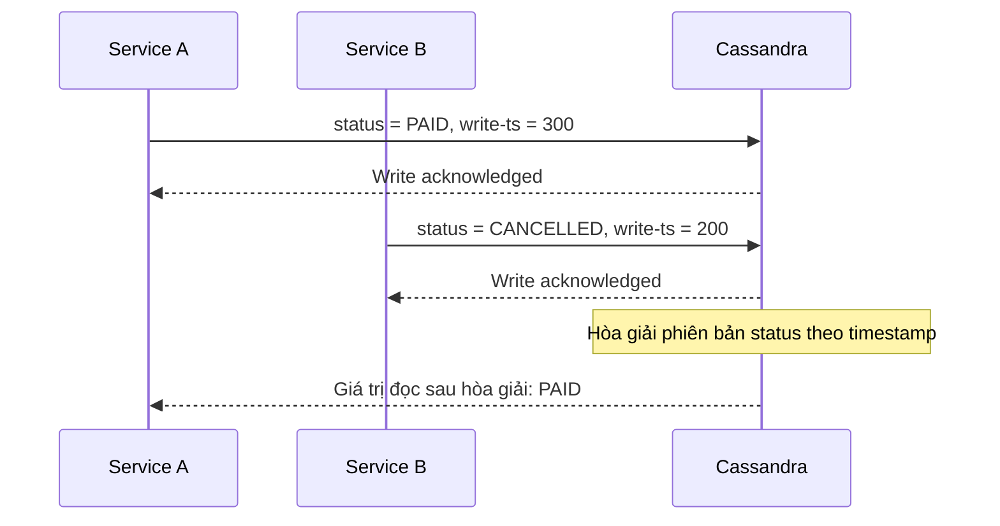
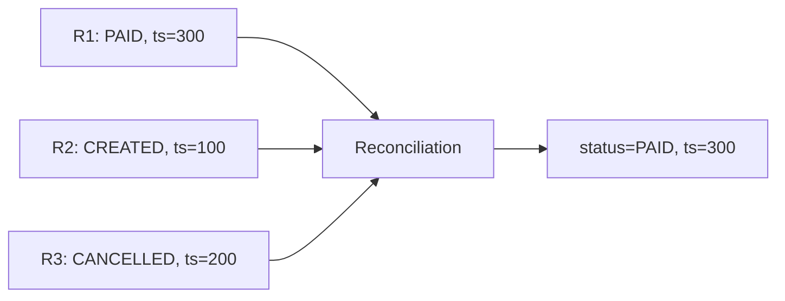

# Write timestamp và cơ chế chọn giá trị khi có cập nhật cạnh tranh

Trong ứng dụng **Spring Data Cassandra**, hai request có thể cập nhật cùng một đơn hàng gần như đồng thời. Một request đổi trạng thái sang `PAID`, request khác đổi sang `CANCELLED`; cả hai đều gửi câu lệnh `UPDATE` hợp lệ và có thể nhận phản hồi thành công. Vậy dữ liệu cuối cùng là gì?

Apache Cassandra không lựa chọn dựa vào “request nào đến coordinator cuối cùng”, cũng không bắt buộc khóa row như một giao dịch SQL truyền thống. Với các giá trị thông thường, Cassandra gắn **write timestamp** vào mutation/cell và hòa giải các phiên bản theo quy tắc **last-write-wins (LWW)**: phiên bản có **timestamp lớn hơn** được ưu tiên. Nếu timestamp bằng nhau, có quy tắc phân xử phụ. Đây là cơ chế cần hiểu khi dùng entity mapping, repository, `CassandraTemplate`, prepared CQL, consistency level và các cập nhật có cạnh tranh.

**Cảnh báo quan trọng:** “Last” trong “last-write-wins” nghĩa là **timestamp lớn nhất**, **không nhất thiết là lần cập nhật được gửi cuối, hoàn thành cuối hoặc xảy ra cuối theo thời gian nghiệp vụ**. Đồng hồ bị lệch hoặc timestamp do ứng dụng tự đặt có thể khiến một write cũ “chiến thắng” write mới, ngay cả khi tất cả request báo thành công.

Bài thuộc chương **Timestamp và xung đột** của module **SPRING_DATA_CASSANDRA**. Các ví dụ áp dụng cho Apache Cassandra CQL và Java driver 4.x, với cú pháp Spring Data Cassandra 4.5.x. Nội dung tập trung vào **timestamp của mutation**, không phải thao tác ngày giờ nói chung; cuối bài sẽ so sánh với conditional update và cơ chế bảo vệ thay đổi đồng thời ở tầng nghiệp vụ.

## 1. Mục tiêu học tập

Sau bài này, bạn có thể:

1. Phân biệt **write timestamp tính bằng microsecond** với cột CQL kiểu **`timestamp` lưu thời gian theo millisecond**.
2. Giải thích cách Cassandra giải quyết cập nhật cạnh tranh theo timestamp của **từng cell** và vì sao một row có thể kết hợp giá trị từ nhiều mutation.
3. Dự đoán giá trị chiến thắng khi hai mutation đến không theo thứ tự timestamp; nhận biết quy tắc khi **timestamp bằng nhau**.
4. Hiểu **tombstone**, xóa với `USING TIMESTAMP` và nguy cơ hồi sinh dữ liệu khi quản lý deletion sai.
5. Dùng `WRITETIME(column)` và `TTL(column)` trong CQL để kiểm chứng dữ liệu còn sống.
6. Thiết lập timestamp bằng CQL `USING TIMESTAMP`, Java driver `Statement.setQueryTimestamp(...)` hoặc Spring Data `InsertOptions`/`UpdateOptions`.
7. Biết sự khác nhau giữa **timestamp client, timestamp server, clock skew** và monotonic timestamp generator.
8. Nhận diện trường hợp cần **LWT / compare-and-set** thay vì chỉ phụ thuộc LWW và timestamp.
9. Thiết kế thử nghiệm nhỏ, phân tích kết quả và tránh những sai lầm khi chạy production.

## 2. Ba khái niệm “timestamp” không được nhầm lẫn

Trong cùng một ứng dụng có thể xuất hiện cả ba loại thời gian:

| Khái niệm | Ví dụ | Đơn vị/ý nghĩa |
|---|---|---|
| **Write timestamp (mutation timestamp)** | `1700000000000300` | **Microsecond** tính từ Unix epoch; dùng để hòa giải phiên bản dữ liệu Cassandra |
| **Cột CQL kiểu `timestamp`** | `event_time = '2026-11-25T10:00:00Z'` | Giá trị thời điểm nghiệp vụ, biểu diễn nội bộ ở độ phân giải **millisecond** từ epoch |
| **Thời điểm app gửi hoặc nhận response** | Log HTTP lúc 10:00:01 | Wall-clock time trong log; có thể khác write timestamp và không quyết định LWW |

**Một cột tên `updated_at timestamp` không phải write timestamp của Cassandra.** Nó chỉ là một giá trị dữ liệu do ứng dụng ghi vào row. Có thể `updated_at` hiển thị 10:00 nhưng cell `status` lại có write timestamp tương ứng 09:59, hoặc ngược lại nếu hai field được ghi riêng.

### 2.1. Độ phân giải và định dạng

- Write timestamp là số nguyên 64-bit tính bằng **microsecond** từ 1970-01-01T00:00:00Z.
- CQL `USING TIMESTAMP 1700000000000300` truyền một write timestamp; không dùng chuỗi ISO 8601 thay vào vị trí số nguyên này.
- Cột `created_at timestamp`, `updated_at timestamp` lại nhận CQL timestamp literal như `'2026-11-25T10:00:00Z'` hoặc Java `Instant`.
- Trong Java, `Instant.toEpochMilli()` trả **millisecond**, **không** thể truyền trực tiếp làm write timestamp mà không đổi đơn vị.
- Độ phân giải microsecond không có nghĩa mọi client thực sự có đồng hồ chính xác đến microsecond. Java driver có thể tăng bộ đếm để tạo timestamp tuần tự trong một session.

Ví dụ: thời điểm `2023-11-14T22:13:20Z` có epoch millisecond khoảng `1700000000000` và epoch microsecond khoảng `1700000000000000`. Khác nhau **1.000 lần**.

**Quy tắc thực hành:** đặt biến rõ đơn vị, ví dụ `writeTimestampMicros`, không dùng tên chung chung `timestamp` để truyền qua nhiều API.

## 3. Last-write-wins hoạt động ra sao?

### 3.1. Một cell có thể có nhiều phiên bản

Cassandra dùng mô hình ghi vào memtable rồi flush thành SSTable bất biến. Một lần `UPDATE` không nhất thiết ghi đè trực tiếp bytes của phiên bản cũ; các phiên bản khác nhau có thể cùng tồn tại trong memtable/SSTable và trên các replica trước khi được hòa giải trong quá trình đọc/compaction.

Ví dụ với cùng row, cùng cột `status`:

| Mutation | Giá trị `status` | Write timestamp | Thứ tự request đến |
|---|---|---:|---|
| A | `CREATED` | 100 | 1 |
| B | `PAID` | **300** | 2 |
| C | `CANCELLED` | 200 | **3** |

Mặc dù C đến **sau** B, kết quả thắng theo quy tắc LWW là **`PAID` (timestamp 300)**, không phải `CANCELLED` (timestamp 200).



Các timestamp 100/200/300 ở bảng chỉ để hiểu thứ tự. CQL thực tế dùng số microsecond lớn hơn nhiều; bài thực hành mục 6 dùng số hợp lệ tương ứng.

**Phản hồi ghi thành công không đồng nghĩa giá trị đó sẽ thắng các phiên bản có timestamp cao hơn.** Coordinator/replica có thể chấp nhận mutation có timestamp cũ, nhưng khi hòa giải nó bị phiên bản mới hơn che khuất.

### 3.2. “Last” không dựa trên đồng hồ của nơi nhận cuối

Một ứng dụng có thể gọi:

```text
tại Service A: gửi status='PAID', timestamp=300
tại Service B: gửi status='CANCELLED', timestamp=200
tại Service B: nhận HTTP 200 / write success
sau đó đọc lại: status='PAID'
```

Đây **không nhất thiết là lỗi mất dữ liệu**, mà có thể là kết quả đúng theo LWW. Để biết có lỗi gì thật, phải xem **write timestamp**, thời điểm các request thực hiện, consistency level, retry và quy tắc cập nhật của ứng dụng.

### 3.3. Timestamp được so sánh theo cell, không phải “phiên bản row” duy nhất

Cassandra gắn timestamp cho **các giá trị cột** (và tombstone). Nếu hai thao tác thay đổi **các cột khác nhau**, chúng có thể cùng được giữ lại trong một row:

| Thao tác | Cột | Giá trị | Write timestamp |
|---|---|---|---:|
| A | `status` | `PAID` | 300 |
| B | `note` | `Customer confirmed` | 250 |
| C | `status` | `SHIPPED` | 350 |

Sau hòa giải, row có thể là:

```text
status = SHIPPED  (write timestamp 350)
note   = Customer confirmed  (write timestamp 250)
```

Đó là **row tổng hợp từ các cell có thời điểm ghi khác nhau**. Không suy ra tất cả field cùng có một “version của row”. Với các collection đa cell hoặc tombstone xóa cả row/range, việc hòa giải chi tiết hơn; nguyên lý timestamp vẫn đóng vai trò trung tâm.

### 3.4. Hai write cùng timestamp thì sao?

Để các replica hội tụ ngay cả khi timestamp bằng nhau, Cassandra có quy tắc phân xử mang tính quyết định:

1. So timestamp; **timestamp lớn hơn thắng**.
2. Nếu cùng timestamp, **tombstone/xóa** được ưu tiên trước một giá trị sống thông thường.
3. Nếu hai giá trị sống thông thường của **cùng cell** có timestamp bằng nhau, giá trị có **bytes lớn hơn theo so sánh từ điển (lexicographical byte order)** được ưu tiên.

Ví dụ hai giá trị text ASCII `'alpha'` và `'zulu'` có cùng write timestamp trên một cell: `'zulu'` thường thắng theo thứ tự bytes. Đây là **cơ chế giải quyết hòa**, **không phải quy tắc nghiệp vụ** rằng chữ “z” tốt hơn “a”.

Với cell có TTL/expiring hoặc các kiểu dữ liệu đặc biệt, thuật toán còn xét metadata liên quan; **không cố thiết kế ứng dụng dựa trên tie-break byte order**. Tốt nhất là tránh tạo timestamp bằng nhau cho các mutation cạnh tranh nếu muốn thứ tự rõ ràng.

## 4. Tại sao Cassandra có thể dùng LWW khi phân tán?

### 4.1. Replica có thể nhận mutation ở thời điểm khác nhau

Giả sử partition có ba replica R1, R2, R3:

- R1 nhận `status=PAID` với timestamp 300.
- R2 tạm thời chỉ biết `status=CREATED` timestamp 100.
- R3 nhận `status=CANCELLED` timestamp 200.

Khi dữ liệu được trao đổi qua read repair/repair và các cơ chế đồng bộ tương ứng với phiên bản, Cassandra có thể hòa giải các phiên bản theo timestamp để đi tới giá trị `PAID` mà không cần một “global sequence number” trong mỗi request ghi thường.



**Eventual consistency** không có nghĩa tất cả lần đọc ngay lập tức luôn trả cùng kết quả. Trước khi replica hội tụ, dữ liệu và consistency level của read có thể khiến client nhìn thấy kết quả chưa mới nhất; conflict resolution chỉ giải thích **giá trị cuối khi các phiên bản liên quan được so sánh**.

### 4.2. Consistency level không thay LWW thành transactional locking

Ví dụ `LOCAL_QUORUM`/`QUORUM` làm thay đổi điều kiện số replica phải phản hồi, nhưng **không đổi luật so sánh timestamp**. Một write ở `QUORUM` với timestamp thấp hơn vẫn có thể bị write timestamp cao hơn che khuất.

Không sửa các yêu cầu “không được mất cập nhật” bằng cách chỉ nâng consistency level. Có thể cần conditional update/LWT, versioning, idempotency và cách thiết kế ghi phù hợp.

### 4.3. Không phải mọi mutation đều dùng chung semantics như cell thường

- **Counters** là kiểu dữ liệu đặc biệt với mutation semantics riêng, không được coi là một `int` thường có LWW và không đặt client timestamp tùy ý cho increment.
- **Collections** như set/map có thể có nhiều phần tử/cell riêng và tombstone liên quan; thao tác thay toàn bộ collection khác với thêm một phần tử.
- **Xóa cả row/range/partition** tạo tombstone ở mức rộng hơn một cell và có thể che khuất nhiều giá trị cũ.

Khi phân tích sự cố, hãy xác định cụ thể **kiểu cột và loại mutation**, không chỉ nhìn một field Java.

## 5. Timestamp được tạo ở đâu?

### 5.1. Thứ tự ưu tiên giữa các nguồn timestamp

Với Java driver 4.x, tài liệu **Query Timestamps** nêu thứ tự ưu tiên:

1. **CQL `USING TIMESTAMP`** nếu có trong câu lệnh.
2. **`Statement.setQueryTimestamp(long)`** khi được set trực tiếp cho statement.
3. **Timestamp generator** do Java driver cấu hình.
4. **Coordinator server timestamp** khi client không gửi timestamp.

Do đó, đừng khẳng định “Cassandra luôn tự dùng giờ của server”. Với **Java driver 4.x mặc định**, driver đã có thể tạo write timestamp **phía client**.

### 5.2. Java driver 4.x mặc định: AtomicTimestampGenerator

Driver 4.x mặc định dùng `AtomicTimestampGenerator` (monotonic trong một `CqlSession`):

```hocon
datastax-java-driver {
  advanced.timestamp-generator {
    class = AtomicTimestampGenerator
  }
}
```

Generator dựa vào thời gian hệ thống và điều chỉnh để các timestamp được sinh liên tiếp **tăng đơn điệu** giữa các luồng của cùng session. Khi clock có độ phân giải thô hơn microsecond hoặc khi tốc độ ghi cao, generator có thể **tăng thêm đơn vị nhỏ** so với clock thực tế để tránh trùng timestamp.

Hệ quả:

- Trong **một session**, thứ tự timestamp được sinh có thể rõ ràng hơn dùng trực tiếp `System.currentTimeMillis()`.
- Monotonic trong **một session** **không bảo đảm thứ tự giữa hai JVM, hai service, hai datacenter** hay một session mới sau restart.
- Generator có thể phát cảnh báo **clock skew** khi timestamp phải trôi tới tương lai để giữ monotonic.
- Không nên tạo `CqlSession` mới cho mỗi request để “đặt lại timestamp”. Điều đó gây mất lợi ích connection pool/cache và khiến thứ tự giữa các session khó kiểm soát.

### 5.3. Nếu muốn coordinator gán timestamp

Java driver có `ServerSideTimestampGenerator`:

```hocon
datastax-java-driver {
  advanced.timestamp-generator {
    class = ServerSideTimestampGenerator
  }
}
```

Khi driver không gửi timestamp, coordinator của Cassandra dùng đồng hồ server để gán timestamp cho mutation. Điều này **không loại bỏ rủi ro clock skew**: coordinator khác nhau có thể lệch giờ.

Nếu ứng dụng có nhiều instance và muốn quy tắc quản lý timestamp đồng nhất, cần quyết định **một chính sách có chủ đích** ở mức toàn hệ thống và bảo đảm đồng bộ clock. Đừng trộn timestamp tự tạo từ business event với timestamp giờ coordinator mà không xem xét thứ tự xung đột.

### 5.4. ThreadLocalTimestampGenerator và custom generator

Driver còn cung cấp `ThreadLocalTimestampGenerator`, bảo đảm monotonic **trong từng thread**, không nhất thiết giữa các thread. Có thể viết generator riêng, nhưng đó là quyết định có rủi ro lớn vì timestamp ảnh hưởng tới kết quả hòa giải.

Thông thường:

- Bắt đầu từ **generator mặc định** và đồng bộ clock tốt.
- Chỉ đổi generator nếu đã hiểu đặc tính concurrency và thiết kế ghi.
- Không dùng timestamp generator như cơ chế phân phối thứ tự nghiệp vụ toàn cluster.
- Theo dõi log `clock skew detected`, tần suất retry và các value bị timestamp cao che khuất.

## 6. Thực hành CQL: ghi đến sau nhưng timestamp cũ bị bỏ qua

Bài thực hành tạo một keyspace và bảng riêng. **Chỉ chạy trên cluster lab** và dùng UUID mới nếu đã chạy thử trước đó.

### 6.1. Tạo schema tối giản

```sql
CREATE KEYSPACE IF NOT EXISTS sdc_timestamp_lab
WITH replication = {
    'class': 'SimpleStrategy',
    'replication_factor': 1
};

CREATE TABLE IF NOT EXISTS sdc_timestamp_lab.order_state_by_id (
    order_id uuid PRIMARY KEY,
    status text,
    note text,
    business_updated_at timestamp
);
```

`SimpleStrategy` với RF=1 chỉ phục vụ bài lab một node; không sử dụng mặc định trên production nhiều datacenter.

- `order_id` là **partition key**, không có write timestamp riêng để query bằng `WRITETIME(order_id)`.
- `status` và `note` là regular columns có write timestamp.
- `business_updated_at` là **cột dữ liệu CQL kiểu timestamp**, được ứng dụng tự ghi, không thay thế write timestamp của các cột khác.

### 6.2. Seed bằng timestamp cố định

Chúng ta cố ý chọn các write timestamp lịch sử quanh `1700000000000000` (năm 2023), **không phải thời gian hiện tại** để tránh tạo timestamp tương lai có thể che khuất write sau. Thay UUID nếu đã từng chạy các lệnh tương tự trên cùng row.

```sql
INSERT INTO sdc_timestamp_lab.order_state_by_id
(order_id, status, note, business_updated_at)
VALUES (
    11111111-1111-1111-1111-111111111111,
    'CREATED',
    'Order received',
    '2026-11-25T09:00:00Z'
)
USING TIMESTAMP 1700000000000100;
```

Dù `business_updated_at` chứa thời gian năm 2026, **write timestamp** gắn cho các cell là khoảng năm 2023. Đây là chủ ý để phân biệt hai khái niệm.

Xác minh:

```sql
SELECT order_id, status, note, business_updated_at,
       WRITETIME(status) AS status_write_ts,
       WRITETIME(note) AS note_write_ts,
       WRITETIME(business_updated_at) AS business_time_write_ts
FROM sdc_timestamp_lab.order_state_by_id
WHERE order_id = 11111111-1111-1111-1111-111111111111;
```

Kỳ vọng các `WRITETIME(...)` có giá trị **1700000000000100** cho ba regular column nếu không có mutation cạnh tranh.

### 6.3. Ghi mới hơn về timestamp

```sql
UPDATE sdc_timestamp_lab.order_state_by_id
USING TIMESTAMP 1700000000000300
SET status = 'PAID'
WHERE order_id = 11111111-1111-1111-1111-111111111111;
```

Sau câu này, `status` là `PAID` với write timestamp **1700000000000300**.

### 6.4. Cố ghi trạng thái với timestamp nhỏ hơn

```sql
UPDATE sdc_timestamp_lab.order_state_by_id
USING TIMESTAMP 1700000000000200
SET status = 'CANCELLED'
WHERE order_id = 11111111-1111-1111-1111-111111111111;
```

Câu `UPDATE` có thể hoàn tất bình thường, nhưng giá trị `CANCELLED` có timestamp **200** (theo ba chữ số cuối) nhỏ hơn `PAID` timestamp **300** nên **không thắng**.

Kiểm tra:

```sql
SELECT status, WRITETIME(status) AS status_write_ts
FROM sdc_timestamp_lab.order_state_by_id
WHERE order_id = 11111111-1111-1111-1111-111111111111;
```

**Kỳ vọng:** `status = 'PAID'`; `status_write_ts = 1700000000000300`.

### 6.5. Một cột khác vẫn cập nhật riêng

```sql
UPDATE sdc_timestamp_lab.order_state_by_id
USING TIMESTAMP 1700000000000250
SET note = 'Customer confirmed'
WHERE order_id = 11111111-1111-1111-1111-111111111111;
```

`note` ban đầu chỉ có timestamp `100`, nên giá trị mới timestamp `250` được chấp nhận, mặc dù `status` đã có timestamp `300`.

```sql
SELECT status, note,
       WRITETIME(status) AS status_write_ts,
       WRITETIME(note) AS note_write_ts
FROM sdc_timestamp_lab.order_state_by_id
WHERE order_id = 11111111-1111-1111-1111-111111111111;
```

Kỳ vọng:

| Cột | Giá trị | Write timestamp |
|---|---|---:|
| `status` | `PAID` | `1700000000000300` |
| `note` | `Customer confirmed` | `1700000000000250` |

Đây là bằng chứng trực tiếp rằng Cassandra không lưu một write timestamp chung duy nhất cho cả row.

### 6.6. Thử tie-break khi timestamp bằng nhau

Dùng **một row khác** để không bị ảnh hưởng bởi các timestamp trước:

```sql
INSERT INTO sdc_timestamp_lab.order_state_by_id
(order_id, status)
VALUES (
    22222222-2222-2222-2222-222222222222,
    'alpha'
)
USING TIMESTAMP 1700000000000400;

UPDATE sdc_timestamp_lab.order_state_by_id
USING TIMESTAMP 1700000000000400
SET status = 'zulu'
WHERE order_id = 22222222-2222-2222-2222-222222222222;

SELECT status, WRITETIME(status)
FROM sdc_timestamp_lab.order_state_by_id
WHERE order_id = 22222222-2222-2222-2222-222222222222;
```

Trong tình huống hai **giá trị text sống** cùng cell/cùng timestamp, `zulu` có bytes ASCII lớn hơn `alpha` nên thường là kết quả. Không dùng quy tắc này để xác định “trạng thái nào ưu tiên hơn” trong workflow đơn hàng.

Nếu chạy lại với cùng UUID sau khi từng có ghi timestamp lớn hơn, kết quả có thể khác; hãy dùng UUID mới và một keyspace lab cô lập.

## 7. Tombstone: xóa là một mutation có timestamp

### 7.1. Cassandra không “gỡ vật lý” dữ liệu ngay lập tức

Khi xóa một giá trị, Cassandra ghi **tombstone** (dấu xóa) có timestamp. Trong quá trình đọc/hòa giải, tombstone có thể **che khuất** giá trị cũ có timestamp nhỏ hơn hoặc bằng theo quy tắc tương ứng. SSTable cũ chưa chắc được xóa vật lý ngay; compaction/repair và `gc_grace_seconds` ảnh hưởng vòng đời tombstone.

Điều này cần thiết cho dữ liệu có replica: nếu xóa chỉ là xóa bytes ngay ở một node mà replica khác đang offline vẫn giữ dữ liệu cũ, lần đồng bộ sau có thể khiến dữ liệu cũ **xuất hiện lại**.

### 7.2. Thử xóa một cell và cập nhật với timestamp cũ

Dùng row mới:

```sql
INSERT INTO sdc_timestamp_lab.order_state_by_id
(order_id, status, note)
VALUES (
    33333333-3333-3333-3333-333333333333,
    'CREATED',
    'Temporary note'
)
USING TIMESTAMP 1700000000000600;

DELETE note
FROM sdc_timestamp_lab.order_state_by_id
USING TIMESTAMP 1700000000000600
WHERE order_id = 33333333-3333-3333-3333-333333333333;
```

Vì `DELETE note` có **cùng timestamp** với giá trị sống `Temporary note`, tombstone ưu tiên trong tie-break, nên sau hòa giải `note` không còn được trả về.

Thử ghi lại **cùng cột** nhưng timestamp thấp hơn:

```sql
UPDATE sdc_timestamp_lab.order_state_by_id
USING TIMESTAMP 1700000000000599
SET note = 'Older value'
WHERE order_id = 33333333-3333-3333-3333-333333333333;
```

Giá trị `Older value` timestamp `599` **không vượt qua** tombstone `600`.

Muốn tạo giá trị mới sau xóa, cần mutation có timestamp **cao hơn tombstone**, ví dụ:

```sql
UPDATE sdc_timestamp_lab.order_state_by_id
USING TIMESTAMP 1700000000000601
SET note = 'New approved note'
WHERE order_id = 33333333-3333-3333-3333-333333333333;
```

Đọc lại:

```sql
SELECT status, note, WRITETIME(note)
FROM sdc_timestamp_lab.order_state_by_id
WHERE order_id = 33333333-3333-3333-3333-333333333333;
```

Kỳ vọng `note = 'New approved note'`, timestamp `601` (theo ba chữ số cuối).

### 7.3. WRITETIME không hiển thị lịch sử tombstone

Khi một cell bị xóa, `WRITETIME(note)` **không cung cấp một bản ghi lịch sử đầy đủ** về mọi version và tombstone. Nó phản ánh metadata của giá trị hiện được đọc, nếu có giá trị sống phù hợp. Đừng dùng `SELECT WRITETIME(note)` như công cụ audit “ai đã xóa và xóa lúc nào”.

Cần audit ở cấp nghiệp vụ? Hãy thiết kế **event log** hoặc bảng lịch sử với khóa/time phù hợp, retention, bảo mật và nguồn thời gian tin cậy.

### 7.4. gc_grace_seconds và nguy cơ zombie

Tombstone có thời gian grace để giúp các replica còn lưu dữ liệu cũ kịp nhận biết thao tác xóa. Nếu tombstone bị dọn trước khi một replica offline được repair/sync, dữ liệu cũ có thể xuất hiện lại — còn gọi là **zombie data**.

Đừng tùy tiện giảm `gc_grace_seconds` hoặc tắt repair chỉ để làm query nhanh hơn. Quyết định này cần kế hoạch vận hành, lịch repair, thời gian replica có thể offline và đặc tính TTL/delete của bảng.

## 8. TTL cũng tương tác với timestamp

### 8.1. TTL áp dụng cho giá trị được ghi

CQL hỗ trợ `USING TTL` trên `INSERT`/`UPDATE`:

```sql
INSERT INTO sdc_timestamp_lab.order_state_by_id
(order_id, status, note)
VALUES (
    44444444-4444-4444-4444-444444444444,
    'CREATED',
    'Expires soon'
)
USING TTL 120 AND TIMESTAMP 1700000000000700;
```

Câu ví dụ cố ý minh họa **kết hợp TTL và explicit write timestamp**. Cần lưu ý: **TTL tính thời gian hết hạn theo cơ chế TTL của Cassandra ở thời điểm ghi**, không phải “lấy năm 2023 của write timestamp rồi cộng 120 giây” theo cách trực giác. Khi thực hành, dùng `SELECT TTL(note)` ngay sau ghi để xem thời gian còn lại trong điều kiện server cho phép.

```sql
SELECT status, note,
       WRITETIME(note) AS note_write_ts,
       TTL(note) AS note_ttl_seconds
FROM sdc_timestamp_lab.order_state_by_id
WHERE order_id = 44444444-4444-4444-4444-444444444444;
```

`TTL(note)` trả số giây còn lại nếu giá trị có TTL; khi không có TTL thì thường là null. TTL không phải số timestamp microsecond.

### 8.2. Ghi lại cột có thể thay TTL

Nếu cùng cột được `UPDATE` bằng mutation thắng theo timestamp, giá trị mới có thể có TTL khác hoặc không có TTL tùy `USING TTL` và `default_time_to_live`. Không xem TTL của một lần ghi cũ là “thuộc tính vĩnh viễn” của cột.

Sau khi hết TTL, giá trị sẽ bị đánh dấu xóa/tombstone trong storage; không nên kỳ vọng một mutation **có timestamp cũ** sẽ “hồi sinh” giá trị đã hết hạn.

### 8.3. Tại sao đồng hồ chính xác vẫn quan trọng với TTL?

TTL thường có độ phân giải **giây** và tính theo đồng hồ ở hệ thống thực thi. Trong cluster lệch clock, thời điểm hết hạn và sự hội tụ có thể gây kết quả khó đoán. NTP/chrony và giám sát drift quan trọng cho **cả LWW lẫn TTL**, không chỉ cho log.

**Lưu ý:** `counter` không có TTL theo cách dùng của regular column; tránh áp dụng các ví dụ TTL/cell mutation cho counters.

## 9. Java driver: đặt timestamp cho một statement

Khi muốn chủ động gán write timestamp qua Java mà không đưa literal vào chuỗi CQL, Java driver 4.x hỗ trợ `Statement.setQueryTimestamp(long)`.

### 9.1. PreparedStatement + BoundStatement

```java
import java.util.UUID;

import com.datastax.oss.driver.api.core.CqlSession;
import com.datastax.oss.driver.api.core.cql.BoundStatement;
import com.datastax.oss.driver.api.core.cql.PreparedStatement;

public class OrderStatusWriter {

    private final CqlSession session;
    private final PreparedStatement updateStatus;

    public OrderStatusWriter(CqlSession session) {
        this.session = session;
        this.updateStatus = session.prepare("""
            UPDATE sdc_timestamp_lab.order_state_by_id
            SET status = ?
            WHERE order_id = ?
            """);
    }

    public void update(
        UUID orderId, String status, long writeTimestampMicros
    ) {
        BoundStatement statement =
            updateStatus.bind(status, orderId)
                .setQueryTimestamp(writeTimestampMicros);

        session.execute(statement);
    }
}
```

Các điểm quan trọng:

- `writeTimestampMicros` là **microsecond từ epoch**, không phải `System.currentTimeMillis()` đưa thẳng vào.
- `BoundStatement` trong driver 4.x immutable; `setQueryTimestamp(...)` trả về statement mới, vì vậy phải **gán hoặc chain kết quả**.
- Giá trị timestamp của statement áp dụng cho mutation theo quy tắc CQL/server; nó **không** đại diện “thứ tự business event” nếu ứng dụng không thiết kế như vậy.
- Gửi timestamp nhỏ hơn phiên bản hiện tại có thể nhận write success nhưng **không thay đổi giá trị đọc được**.

### 9.2. Dùng CQL USING TIMESTAMP có marker

Có thể truyền timestamp như một giá trị bind trong câu CQL:

```java
PreparedStatement withTimestamp = session.prepare("""
    UPDATE sdc_timestamp_lab.order_state_by_id
    USING TIMESTAMP ?
    SET status = ?
    WHERE order_id = ?
    """);

session.execute(
    withTimestamp.bind(
        1700000000000800L,
        "PAID",
        UUID.fromString("55555555-5555-5555-5555-555555555555")
    )
);
```

Cách này tạo timestamp qua `USING TIMESTAMP` tường minh trong CQL. Không cần đồng thời gọi `setQueryTimestamp(...)` cho cùng statement nếu không có lý do rõ ràng; **CQL `USING TIMESTAMP` có độ ưu tiên cao hơn** theo tài liệu driver.

### 9.3. Chọn phương án nào?

| Phương án | Ưu điểm | Cảnh báo |
|---|---|---|
| Không đặt timestamp, dùng generator mặc định | Đơn giản, monotonic trong session | Không bảo đảm thứ tự toàn hệ thống nếu nhiều JVM |
| `setQueryTimestamp(micros)` | Tách timestamp khỏi CQL, dễ bind/options | Cần quản lý đơn vị và nguồn timestamp |
| CQL `USING TIMESTAMP ?` | Rõ ràng ngay ở query, tiện debug | Không kết hợp tùy ý với LWT và một số statement đặc biệt |
| ServerSideTimestampGenerator | Coordinator quyết định timestamp | Clock skew giữa coordinator vẫn là rủi ro |
| Custom TimestampGenerator | Kiểm soát thứ tự theo quy tắc riêng | Dễ tạo timestamps tương lai/cũ gây mất cập nhật |

**Không giải quyết conflict nghiệp vụ bằng cách luôn set timestamp rất lớn.** Một timestamp tương lai sẽ che khuất các mutation bình thường trong thời gian dài, khiến ứng dụng trông như “không lưu được dữ liệu mới” dù write thành công.

## 10. Spring Data Cassandra: WriteOptions và entity mapping

### 10.1. Khai báo entity

Ví dụ `OrderState.java` tương ứng bảng `order_state_by_id`:

```java
import java.time.Instant;
import java.util.UUID;

import org.springframework.data.cassandra.core.mapping.Column;
import org.springframework.data.cassandra.core.mapping.PrimaryKey;
import org.springframework.data.cassandra.core.mapping.Table;

@Table("order_state_by_id")
public class OrderState {

    @PrimaryKey("order_id")
    private UUID orderId;

    @Column("status")
    private String status;

    @Column("note")
    private String note;

    @Column("business_updated_at")
    private Instant businessUpdatedAt;

    public OrderState() {
    }

    public OrderState(
        UUID orderId, String status,
        String note, Instant businessUpdatedAt
    ) {
        this.orderId = orderId;
        this.status = status;
        this.note = note;
        this.businessUpdatedAt = businessUpdatedAt;
    }

    public UUID getOrderId() { return orderId; }
    public void setOrderId(UUID value) { orderId = value; }

    public String getStatus() { return status; }
    public void setStatus(String value) { status = value; }

    public String getNote() { return note; }
    public void setNote(String value) { note = value; }

    public Instant getBusinessUpdatedAt() { return businessUpdatedAt; }
    public void setBusinessUpdatedAt(Instant value) {
        businessUpdatedAt = value;
    }
}
```

Giả sử `CqlSession` của Spring Boot đã kết nối tới keyspace mặc định `sdc_timestamp_lab`. Tên `order_state_by_id` chỉ ánh xạ tên bảng, không tự sinh keyspace/migration.

### 10.2. InsertOptions.timestamp(long)

Trong Spring Data Cassandra 4.5, `InsertOptions.builder()` có phương thức `timestamp(long)`, kế thừa từ `WriteOptions.WriteOptionsBuilder`:

```java
import java.time.Instant;
import java.util.UUID;

import org.springframework.data.cassandra.core.CassandraTemplate;
import org.springframework.data.cassandra.core.EntityWriteResult;
import org.springframework.data.cassandra.core.InsertOptions;

public class OrderStateInsertService {

    private final CassandraTemplate template;

    public OrderStateInsertService(CassandraTemplate template) {
        this.template = template;
    }

    public boolean saveWithWriteTimestamp(
        UUID orderId, String status, long writeTimestampMicros
    ) {
        OrderState entity = new OrderState(
            orderId, status, "example", Instant.now()
        );

        InsertOptions options = InsertOptions.builder()
            .timestamp(writeTimestampMicros)
            .build();

        EntityWriteResult<OrderState> result =
            template.insert(entity, options);

        return result.wasApplied();
    }
}
```

**Không hiểu `result.wasApplied() == true` là “giá trị `status` vừa thắng LWW”.** Với một mutation **không có `IF`**, `wasApplied()` của driver thường là `true` theo semantics câu lệnh không điều kiện. Nó **không kiểm tra** row có tồn tại trước đó hay write timestamp này có cao nhất trên mọi phiên bản của cell không.

Muốn biết giá trị hiện đang đọc được, hãy thực hiện một `SELECT` có consistency phù hợp và kiểm tra `WRITETIME(status)` nếu cần chẩn đoán. Ngay cả sau SELECT, write cạnh tranh khác vẫn có thể đến.

### 10.3. UpdateOptions.timestamp và DeleteOptions.timestamp

Các builder tương ứng có cùng khả năng:

```java
import org.springframework.data.cassandra.core.UpdateOptions;
import org.springframework.data.cassandra.core.DeleteOptions;

UpdateOptions updateOptions = UpdateOptions.builder()
    .timestamp(1700000000000900L)
    .build();

DeleteOptions deleteOptions = DeleteOptions.builder()
    .timestamp(1700000000001000L)
    .build();
```

Chúng có thể được truyền vào các overload như `template.update(entity, updateOptions)` hoặc `template.delete(entity, deleteOptions)`. Tuy nhiên:

- Entity update có thể sinh mutation trên **nhiều field** tùy mapping và null handling; cùng timestamp có thể được gán cho các cell liên quan.
- Không dùng một entity chỉ nạp một phần (partial projection) rồi update toàn bộ nếu điều đó có thể gây ghi/xóa các field không mong muốn.
- Nếu chỉ cần cập nhật **một cột**, prepared CQL như mục 9 giúp biết chính xác field nào được mutate.
- Việc đặt timestamp thủ công cần thống nhất với mọi đường ghi khác; nếu repository `save` vẫn dùng generator mặc định thì dễ phát sinh xung đột khó kiểm soát.

`WriteOptions.timestamp(Instant)` cũng được cung cấp ở Spring Data 4.5; API nhận thời điểm và chuyển thành timestamp write theo quy ước. Khi yêu cầu quan sát rõ đơn vị ở code liên quan tranh chấp, `timestamp(long)` kèm hậu tố biến `Micros` giúp tránh nhầm.

### 10.4. CassandraRepository.save không có khái niệm “phiên bản mới nhất” mặc định

`CassandraRepository.save(entity)` có thể ghi entity theo mapping mặc định. Nó **không tự chặn** ghi khi entity ở bộ nhớ được tải từ phiên bản cũ, trừ khi bạn cấu hình cơ chế optimistic locking/conditional mutation thích hợp.

Ví dụ hai service:

1. Cùng đọc `status = CREATED`.
2. Service A lưu `PAID`.
3. Service B (vẫn giữ object cũ) lưu `CANCELLED`.
4. Cassandra dùng timestamp của các mutation liên quan để quyết định giá trị thắng.

Nếu nghiệp vụ không cho phép B ghi đè trạng thái đã thanh toán, **LWW không phải biện pháp bảo vệ đủ**. Bạn cần so sánh phiên bản hoặc điều kiện trạng thái tại lúc cập nhật.

## 11. LWT: khi nào phải kiểm tra điều kiện thay vì chỉ nhìn timestamp?

### 11.1. Ví dụ lost update do đọc rồi ghi không điều kiện

Một chuỗi `SELECT` rồi `UPDATE` không có `IF` không tự là transaction:

```text
A đọc status = CREATED
B đọc status = CREATED
A UPDATE status = PAID (ts = 300)
B UPDATE status = CANCELLED (ts = 400)
Kết quả LWW: CANCELLED
```

Nếu business rule cấm hủy sau khi đã thanh toán, kết quả này **sai nghiệp vụ** mặc dù đúng quy tắc LWW.

### 11.2. Conditional update bằng IF status = ...

Dùng CQL LWT:

```sql
UPDATE sdc_timestamp_lab.order_state_by_id
SET status = 'PAID'
WHERE order_id = 11111111-1111-1111-1111-111111111111
IF status = 'CREATED';
```

Trên bảng thực tế, nếu `status` không còn `CREATED`, statement có thể trả `[applied] = false`, và mutation điều kiện **không được áp dụng**.

Một lệnh CAS theo version có thể rõ hơn:

```sql
-- Cần cột version int trong schema nếu muốn áp dụng ví dụ này.
ALTER TABLE sdc_timestamp_lab.order_state_by_id
ADD version int;

UPDATE sdc_timestamp_lab.order_state_by_id
SET status = 'PAID', version = 2
WHERE order_id = 11111111-1111-1111-1111-111111111111
IF version = 1;
```

**Lưu ý thực hành:** Nếu thêm `version` vào bảng đang có row, giá trị version cũ thường **null**. Muốn chạy `IF version = 1`, phải khởi tạo version hợp lệ và thống nhất tất cả đường ghi; không chạy `ALTER`/backfill mù trên production.

LWT kiểm tra điều kiện gần thời điểm ghi và trả applied flag. Nó có chi phí phối hợp (Paxos/serial consistency) lớn hơn ghi thường; dùng cho **invariant cần bảo vệ**, không phải mọi mutation bất kể nhu cầu.

### 11.3. Không dùng USING TIMESTAMP tự đặt cùng LWT

Cassandra **không cho phép custom timestamp** trong conditional mutation. Ví dụ sau **không hợp lệ**:

```sql
-- Sai: không được đặt USING TIMESTAMP cho conditional update.
UPDATE sdc_timestamp_lab.order_state_by_id
USING TIMESTAMP 1700000000000999
SET status = 'PAID'
WHERE order_id = 11111111-1111-1111-1111-111111111111
IF status = 'CREATED';
```

Với Java driver, khi conditional statement có LWT, client-generated timestamp bị **bỏ qua** và server gán timestamp phù hợp cho giao thức. Không nên viết cơ chế LWT cùng `setQueryTimestamp(...)` rồi giả định giá trị custom sẽ quyết định kết quả.

Đây là khác biệt lớn giữa:

- **Ghi thường:** dùng LWW theo write timestamp; chấp nhận cập nhật cạnh tranh theo quy tắc hòa giải.
- **Ghi có điều kiện:** kiểm tra `IF` theo giao thức LWT; đòi hỏi xử lý `wasApplied()` và chính sách retry khác.

### 11.4. Read/write consistency khác serial consistency

LWT liên quan cả **regular consistency level** và **serial consistency** (`SERIAL`/`LOCAL_SERIAL`) theo cấu hình driver và replication. Đừng tự tăng `LOCAL_QUORUM` mà coi như đã bật LWT. Chỉ câu CQL có `IF` (hoặc API Spring Data sinh ra `IF`) mới thực hiện conditional update.

## 12. Đồng hồ lệch: nguyên nhân khó phát hiện của các “lost update”

### 12.1. Một client đặt timestamp tương lai

Giả sử Service A có clock chạy **nhanh hơn thực tế 10 phút** và ghi:

```text
status = PAID, write timestamp ứng với 10:10
```

Service B có clock chính xác, 30 giây sau ghi:

```text
status = SHIPPED, write timestamp ứng với 10:00:30
```

Theo LWW, `PAID` vẫn thắng vì timestamp của A **lớn hơn**, mặc dù B thực sự gửi sau. Những lần ghi bình thường của B có thể tiếp tục bị che khuất trong một khoảng thời gian cho tới khi clock thực bắt kịp.

**Hậu quả:** ứng dụng có thể nhận ack cho write mới nhưng sau khi đọc vẫn thấy giá trị cũ. Đây là dấu hiệu cần kiểm tra clock, nguồn timestamp và `WRITETIME`.

### 12.2. Monotonic trong một session chưa đủ cho toàn cluster

`AtomicTimestampGenerator` bảo đảm tăng dần trong một session, nhưng:

- Session của Service A và Service B **không cùng một bộ đếm**.
- Đồng hồ hệ điều hành có thể nhảy sau NTP correction, VM pause, snapshot hoặc lỗi time sync.
- Một instance restart có thể reset bộ đếm nội bộ.
- Một số tác vụ ETL/import đặt `USING TIMESTAMP` theo sự kiện quá khứ có thể bị các giá trị mới che khuất.

Do đó, cần **NTP/chrony**, cảnh báo drift, cấu hình clock đồng nhất và chính sách timestamp xuyên các service.

### 12.3. Timestamp tương lai trong import/backfill

Một job import có thể vô tình chuyển millisecond/microsecond sai hoặc chọn timestamp tương lai cực lớn. Một lần ghi lỗi có thể **mask các write bình thường** rất lâu.

Ví dụ:

```text
import dùng 2_000_000_000_000_000 microsecond (tương lai)
ứng dụng bình thường dùng ~1_7xx_... microsecond
=> import có thể tiếp tục thắng các update cùng cell
```

Giải pháp cần xác minh cột/khóa bị ảnh hưởng và lên kế hoạch **sửa bằng mutation có timestamp hợp lệ, cao hơn phiên bản đang thắng**, rồi khắc phục nguồn sinh timestamp. Không phát timestamp lớn hơn vô hạn như một “vá lỗi” tự động; phải tránh tạo vòng lặp timestamp tương lai ngày càng cao.

## 13. Retry, timeout, idempotence và batch

### 13.1. Timeout không nói chắc mutation đã hay chưa được áp dụng

Trong Cassandra, một write có thể đạt coordinator/replica nhưng client timeout trước khi nhận phản hồi. Khi retry:

- Nếu gửi **cùng giá trị và cùng write timestamp**, mutation thường có tính chất idempotent đối với regular cell.
- Nếu driver gán **timestamp mới** cho mỗi lần retry, thứ tự LWW có thể thay đổi, đặc biệt khi có write khác xen giữa.
- Với conditional write/LWT, retry có thể thấy `[applied] = false` dù lần đầu đã thực sự hoàn thành — cần idempotency key/operation ID và đối soát.
- Counter increment không idempotent theo cách này; không áp dụng quy tắc ghi regular cell cho counter.

Không gọi `wasApplied()` của **ghi không điều kiện** để kết luận “row đã đổi trạng thái đúng như mong muốn”. Hãy đọc/đối soát khi nghiệp vụ cần và tránh retry vô hạn.

### 13.2. Batch không phải thứ tự thực thi logic tuần tự

Trong một `BEGIN BATCH ... APPLY BATCH` không có per-statement timestamp, nhiều mutation có thể nhận **cùng write timestamp**. Nếu các statement cạnh tranh trên cùng cell, quy tắc tie-break có thể khiến kết quả **khác thứ tự câu lệnh viết trong batch**.

Ví dụ minh họa cần thận trọng:

```sql
BEGIN BATCH
    UPDATE sdc_timestamp_lab.order_state_by_id
    SET status = 'alpha'
    WHERE order_id = 22222222-2222-2222-2222-222222222222;

    UPDATE sdc_timestamp_lab.order_state_by_id
    SET status = 'zulu'
    WHERE order_id = 22222222-2222-2222-2222-222222222222;
APPLY BATCH;
```

Đừng biến batch thành công cụ “thực thi UPDATE đầu rồi UPDATE sau theo business order”. Nếu cần định thứ tự/điều kiện, thiết kế timestamp riêng hoặc phương thức CAS phù hợp, đồng thời lưu ý batch **không phải giao dịch SQL đa bảng/đa partition**.

### 13.3. Idempotency và event ordering

Một event pipeline có thể nhận:

```text
event#102: status = PAID
event#101: status = CREATED  (đến sau do retry)
```

Nếu chỉ dùng wall-clock timestamp ở lúc consumer xử lý, event#101 đến sau có thể thắng dù logic event#102 mới hơn. Muốn giữ **thứ tự business event**, cần version/sequence có nguồn tin cậy hoặc CAS, không đơn giản dựa vào thời điểm consumer nhận message.

Một phương án thường dùng là:

1. Lưu `version`/`event_sequence` đáng tin cậy theo aggregate.
2. Chỉ chấp nhận cập nhật khi **expected version** khớp.
3. Ghi trạng thái mới và version mới trong **cùng conditional mutation**.
4. Xử lý retry/idempotency theo event ID và đối soát những trạng thái thất bại.

## 14. Quan sát write timestamp qua CQL, driver và log

### 14.1. WRITETIME trên cột sống

```sql
SELECT status, note,
       WRITETIME(status) AS status_write_ts,
       WRITETIME(note) AS note_write_ts,
       TTL(status) AS status_ttl
FROM sdc_timestamp_lab.order_state_by_id
WHERE order_id = 11111111-1111-1111-1111-111111111111;
```

Hãy phân biệt:

- `WRITETIME(status)`: thời gian ghi **giá trị đang được đọc** của cột `status`, đơn vị microsecond.
- `TTL(status)`: số giây còn lại đến khi cột hết hạn nếu có TTL.
- `business_updated_at`: dữ liệu nghiệp vụ trong cột, không phải metadata của `status`.

`WRITETIME` không sử dụng trên **primary key column** như `order_id` và không hỗ trợ mọi kiểu/selector đặc biệt theo cùng cách. Với collection/UDT đa cell, phiên bản Cassandra có thể cung cấp `WRITETIME`/`MAXWRITETIME` theo phần tử; bài này minh họa regular scalar column để tránh nhầm.

### 14.2. Đừng dùng WRITETIME như audit log

`WRITETIME` cho biết metadata của giá trị sống hiện tại. Nó **không** ghi lại:

- Mọi mutation đã bị LWW loại.
- Người dùng hoặc service đã gửi mutation.
- Thứ tự response/timeout thực tế.
- Lịch sử tombstone đã bị compaction.
- Business rule đã hoặc chưa được thỏa.

Muốn audit, thiết kế event log/bảng lịch sử riêng có key đủ thông tin, timestamp nghiệp vụ và nguồn phát sinh đáng tin cậy.

### 14.3. Checklist khi một UPDATE “thành công nhưng không đổi dữ liệu”

1. Xác nhận **partition key** và row đã cập nhật đúng bằng `SELECT ... WHERE order_id = ...`.
2. Kiểm tra câu CQL có `USING TIMESTAMP` hay driver/Spring Data có set timestamp thủ công không.
3. Đọc `WRITETIME(column)` của giá trị đang thắng.
4. So sánh đơn vị microsecond/millisecond, clock đồng bộ và cấu hình timestamp generator.
5. Xem có **tombstone** với timestamp cao hơn đang che giá trị không; nhớ `WRITETIME` không tiết lộ tombstone đã xóa.
6. Xem có update từ service khác hoặc job backfill tranh chấp trên cùng cell không.
7. Đối chiếu consistency level, replica lag, timeout/retry; không mặc định mọi read lập tức hội tụ.
8. Với invariant quan trọng, xem có cần LWT/version check thay vì timestamp do nhiều service tự gán không.

Không bật tracing toàn cluster hoặc log nguyên dữ liệu khách hàng chỉ để điều tra timestamp. Dùng key/operation ID đã che phù hợp, latency và một bộ UUID test trong môi trường riêng.

## 15. Các hiểu nhầm phổ biến

| Nhận định | Thực tế |
|---|---|
| “Last-write-wins là request đến server cuối cùng.” | Là **timestamp lớn nhất** thắng, không nhất thiết request đến cuối. |
| “Write timestamp cũng là cột `updated_at timestamp`.” | Hai khái niệm khác nhau; write timestamp là metadata cell, `updated_at` là giá trị nghiệp vụ. |
| “`USING TIMESTAMP` nhận millisecond.” | Không: nhận **microsecond** từ Unix epoch. |
| “Java driver 4.x luôn để server gán timestamp.” | Mặc định driver dùng `AtomicTimestampGenerator` phía client; có thể cấu hình server-side. |
| “Monotonic timestamp generator bảo đảm thứ tự giữa mọi microservice.” | Nó bảo đảm trong scope generator/session; không là global clock/sequence. |
| “Một row có đúng một timestamp.” | Các cột có thể có timestamp khác nhau. |
| “Ghi với timestamp thấp vẫn là update mới vì response thành công.” | Mutation có thể được ack nhưng **không thắng phiên bản hiện tại**. |
| “Cùng timestamp sẽ ưu tiên câu lệnh chạy sau.” | Có tie-break deterministic, không dựa vào thứ tự request. |
| “DELETE xóa vĩnh viễn bytes ngay lập tức.” | DELETE tạo **tombstone**; compaction/repair xử lý vòng đời lưu trữ. |
| “`WRITETIME` cho lịch sử mọi lần UPDATE.” | Nó cho metadata của giá trị hiện còn sống, không phải audit log. |
| “Tăng consistency level sẽ chống lost update.” | Consistency không tự cung cấp CAS hay business version check. |
| “Đặt timestamp thủ công trên LWT là hợp lệ.” | Conditional mutation **không cho custom timestamp**. |
| “Retry một câu CAS nhận false nghĩa request đầu thất bại.” | Request đầu có thể đã thành công trước timeout. |
| “`updated_at` mới nhất bảo đảm mọi field mới nhất.” | Các field có thể được ghi riêng với timestamp khác nhau. |
| “Timestamp tương lai càng lớn càng an toàn.” | Có thể che mọi write bình thường về sau trong thời gian dài. |

## 16. Bài tập thực hành

### Bài 1 — Dự đoán giá trị thắng

Cùng cột `status`, hai mutation:

```text
A: 'PAID', write timestamp = 1700000000000500
B: 'CANCELLED', write timestamp = 1700000000000400
```

B đến coordinator sau A và cả hai được ack.

**Câu hỏi:** Trạng thái đọc sau hòa giải là gì?

**Đáp án:** `PAID`, vì `...0500` lớn hơn `...0400`. Thứ tự đến không phải quy tắc chọn.

### Bài 2 — Phân biệt write timestamp và business timestamp

Một row có:

```text
business_updated_at = 2026-11-25T10:00:00Z
WRITETIME(status)    = 1700000000000100
```

**Câu hỏi:** Vì sao không mâu thuẫn?

**Đáp án:** Cột business chứa giá trị thời điểm nghiệp vụ do ứng dụng cung cấp; `WRITETIME` chứa metadata thời gian mutation, đơn vị microsecond. Hai trường độc lập.

### Bài 3 — Hai cell, hai timestamp

```text
status='PAID', timestamp=300
note='Confirmed', timestamp=250
status='SHIPPED', timestamp=350
```

**Câu hỏi:** Row cuối chứa giá trị nào?

**Đáp án:** `status='SHIPPED'` và `note='Confirmed'`. Hai cell được hòa giải riêng.

### Bài 4 — Tie-break

Hai mutation ghi vào cùng cell `status` với cùng timestamp, một giá trị `'alpha'` và một giá trị `'zulu'`.

**Câu hỏi:** Với hai giá trị text ASCII sống thông thường, giá trị nào được ưu tiên? Có nên dùng quy tắc này để đặt mức ưu tiên trạng thái nghiệp vụ?

**Đáp án:** `'zulu'` thường có bytes lớn hơn nên thắng. Không dùng tie-break này để biểu diễn workflow nghiệp vụ.

### Bài 5 — Tombstone

Một `note` được ghi với timestamp `500`. Sau đó `DELETE note` với timestamp `600` và `UPDATE note='old'` với timestamp `550`.

**Câu hỏi:** `old` có xuất hiện không?

**Đáp án:** Không, tombstone timestamp `600` che giá trị timestamp `550`. Muốn ghi dữ liệu mới cần mutation có timestamp cao hơn tombstone (và đúng yêu cầu nghiệp vụ).

### Bài 6 — Phát hiện sai đơn vị

Code:

```java
long writeTimestamp = System.currentTimeMillis();

BoundStatement statement =
    prepared.bind(status, orderId)
        .setQueryTimestamp(writeTimestamp);
```

**Câu hỏi:** Lỗi gì?

**Đáp án:** `System.currentTimeMillis()` trả millisecond, trong khi `setQueryTimestamp(long)` nhận microsecond. Cần nguồn timestamp phù hợp/đổi đơn vị có chủ đích; trong đa số trường hợp nên để generator của driver thực hiện mặc định thay vì tự tạo.

### Bài 7 — CQL thực hành

Tạo bảng `order_state_by_id`, chạy các lệnh ở mục 6 theo đúng thứ tự. Sau mỗi `UPDATE`, ghi lại `status`, `note` và `WRITETIME(...)`. Giải thích vì sao câu `CANCELLED` timestamp nhỏ hơn không thắng `PAID`.

### Bài 8 — Hai service lệch clock

Service A nhanh hơn 5 phút, Service B dùng thời gian chuẩn. B ghi sau A 10 giây nhưng timestamp của B nhỏ hơn.

**Yêu cầu:** Đề xuất ba biện pháp phòng tránh.

**Gợi ý:** Đồng bộ NTP/chrony và giám sát drift; không trộn chính sách client/server timestamp tùy tiện; dùng CAS/versioning cho invariant quan trọng thay vì chỉ LWW.

### Bài 9 — So sánh consistency và LWT

Hai request cùng đọc trạng thái `CREATED` rồi muốn đổi sang hai trạng thái khác nhau. Có nên chỉ tăng write consistency từ `ONE` lên `QUORUM` để ngăn lost update?

**Đáp án:** Không. Write consistency không kiểm tra phiên bản hiện tại. Nếu một request phải bị từ chối sau khi request kia thay đổi trạng thái, dùng `IF status = 'CREATED'` hoặc `IF version = expectedVersion` (LWT) và kiểm tra `[applied]`.

### Bài 10 — Batch và timestamp bằng nhau

Trong một batch có hai `UPDATE` trên cùng cột, không có timestamp riêng.

**Câu hỏi:** Có thể dựa vào thứ tự xuất hiện trong batch để dự đoán giá trị sau cùng không?

**Đáp án:** Không an toàn. Các mutation có thể dùng cùng timestamp và được phân xử theo tie-break thay vì thứ tự statement. Thiết kế thứ tự/CAS có chủ đích nếu business cần.

### Bài 11 — Incident review

Một job import dùng timestamp tương lai; các UPDATE sau đều nhận success nhưng giá trị không đổi.

**Yêu cầu:** Lập kế hoạch điều tra:

1. Chọn một primary key mẫu và so `WRITETIME`.
2. Kiểm tra timestamp generator và code `USING TIMESTAMP`.
3. Xem clock skew, job import và retry.
4. Đề xuất migration/sửa có kiểm soát, không đặt timestamp lớn hơn vô hạn.
5. Viết regression test phòng sai đơn vị micro/milli.

## 17. Câu hỏi tự kiểm tra

1. **LWW chọn theo yếu tố nào?** Write timestamp lớn nhất trên cùng cell/mutation liên quan.
2. **Đơn vị của `USING TIMESTAMP` là gì?** Microsecond từ Unix epoch.
3. **Đơn vị nội bộ phổ biến của CQL `timestamp` column là gì?** Millisecond từ epoch.
4. **Write timestamp có phải thời điểm HTTP request đến cuối không?** Không.
5. **Một row có thể chứa các cell với timestamp khác nhau không?** Có.
6. **Hai write cùng timestamp, cùng cell và một bên là tombstone thì sao?** Tombstone ưu tiên trước giá trị sống thông thường.
7. **`WRITETIME(status)` có trả lịch sử tất cả lần ghi không?** Không, chỉ metadata của giá trị hiện được đọc.
8. **Có thể gọi `WRITETIME(order_id)` nếu `order_id` là primary key không?** Không.
9. **Driver 4.x mặc định dùng timestamp từ đâu?** `AtomicTimestampGenerator` phía client, trừ khi cấu hình khác.
10. **Monotonic timestamp generator có đảm bảo toàn cluster không?** Không; phạm vi generator/session, không phải toàn bộ JVM/cluster.
11. **Vì sao một write có thể thành công nhưng không thay giá trị đọc?** Timestamp thấp hơn cell/tombstone đang thắng.
12. **Consistency level có thay quy tắc LWW không?** Không.
13. **LWT với `IF` có dùng `USING TIMESTAMP` tự đặt không?** Không.
14. **Tại sao phải đồng bộ clock?** Clock skew có thể khiến write cũ chiếm timestamp cao hơn và che write mới.
15. **TTL còn sống có thể xem bằng hàm gì?** `TTL(column)`, đơn vị giây.
16. **Khi nào nên dùng CAS/version?** Khi cần bảo vệ business invariant, tránh stale write/lost update.
17. **Timestamp tương lai có nguy hiểm không?** Có, nó có thể che các mutation bình thường đến sau.
18. **Counter increment có giống regular-cell LWW không?** Không; counter có semantics riêng.
19. **Có nên dùng `CassandraRepository.save` như một CAS mặc định không?** Không nếu chưa có optimistic locking/conditional update phù hợp.
20. **Điểm đầu tiên cần kiểm tra khi UPDATE thành công nhưng giá trị không đổi?** Primary key, nguồn write timestamp, `WRITETIME` và cạnh tranh/clock skew.

## 18. Tổng kết

- **Write timestamp** là metadata có độ phân giải **microsecond** gắn vào mutation/cell, khác với cột CQL `timestamp` có giá trị thời điểm nghiệp vụ.
- Với regular cell, Cassandra dùng **last-write-wins theo timestamp lớn nhất**, không theo request gửi hoặc hoàn thành cuối; các cột trong cùng row có thể có timestamp khác nhau.
- **Timestamp bằng nhau** có tie-break: tombstone có ưu tiên trước giá trị sống, các giá trị sống thông thường có so sánh bytes để các replica hội tụ.
- `DELETE` tạo **tombstone**; TTL cũng đưa giá trị vào trạng thái hết hạn/xóa theo cơ chế storage. `WRITETIME` hữu ích cho giá trị đang sống nhưng không phải audit log.
- Timestamp có thể do **CQL `USING TIMESTAMP`**, **Statement.setQueryTimestamp**, **driver generator** hoặc **coordinator** cung cấp. Driver 4.x mặc định có monotonic generator trong session, không bảo đảm thứ tự toàn bộ microservice.
- `InsertOptions`, `UpdateOptions`, `DeleteOptions` của Spring Data Cassandra hỗ trợ timestamp khi ghi; kết quả `wasApplied()` của mutation không điều kiện **không chứng minh giá trị đã thắng**.
- **Clock synchronization**, consistent timestamp policy, idempotency và xử lý retry là yêu cầu vận hành quan trọng.
- Khi nghiệp vụ cần **không cho ghi đè trạng thái đã thay đổi**, dùng **LWT/conditional write theo version/state**; custom timestamp không được phép trên conditional mutation.
- Đo và kiểm chứng bằng CQL có primary key cụ thể, `WRITETIME`, log clock drift, metrics và integration test, tránh giải quyết sự cố bằng timestamp tương lai tùy tiện.

## Tài liệu tham khảo

1. [Apache Cassandra — Dynamo Architecture / Data Versioning](https://cassandra.apache.org/doc/stable/cassandra/architecture/dynamo.html): mutation timestamps, LWW theo cell, đồng hồ và hội tụ giữa replica.
2. [Apache Cassandra — CQL Data Manipulation](https://cassandra.apache.org/doc/stable/cassandra/developing/cql/dml.html): `USING TIMESTAMP`, `USING TTL`, `DELETE`, `BATCH`, `WRITETIME` và `TTL`.
3. [Apache Cassandra — CQL Data Types](https://cassandra.apache.org/doc/stable/cassandra/developing/cql/types.html): biểu diễn cột kiểu `timestamp` và khác biệt millisecond/microsecond.
4. [Apache Cassandra — Tombstones](https://cassandra.apache.org/doc/stable/cassandra/managing/operating/compaction/tombstones.html): tombstone, `gc_grace_seconds` và zombie data.
5. [Apache Cassandra — Compaction Overview](https://cassandra.apache.org/doc/stable/cassandra/managing/operating/compaction/overview.html): nhiều phiên bản cell trong SSTable và cách hòa giải.
6. [Apache Cassandra Java Driver 4.19 — Query Timestamps](https://apache.github.io/cassandra-java-driver/4.19.0/core/query_timestamps/): nguồn timestamp ưu tiên, `AtomicTimestampGenerator`, `setQueryTimestamp`, server-side generator và cấm custom timestamp trên LWT.
7. [Apache Cassandra Java Driver 4.19 — Prepared Statements](https://apache.github.io/cassandra-java-driver/4.19.0/core/statements/prepared/): prepared CQL và bind parameters.
8. [Spring Data Cassandra 4.5 — InsertOptions Builder API](https://docs.spring.io/spring-data/cassandra/docs/4.5.x/api/org/springframework/data/cassandra/core/InsertOptions.InsertOptionsBuilder.html): `timestamp(long)` và `timestamp(Instant)`.
9. [Spring Data Cassandra 4.5 — UpdateOptions Builder API](https://docs.spring.io/spring-data/cassandra/docs/4.5.x/api/org/springframework/data/cassandra/core/UpdateOptions.UpdateOptionsBuilder.html): timestamp và `ifCondition`.
10. [Spring Data Cassandra 4.5 — DeleteOptions Builder API](https://docs.spring.io/spring-data/cassandra/docs/4.5.x/api/org/springframework/data/cassandra/core/DeleteOptions.DeleteOptionsBuilder.html): timestamp trên thao tác delete.
11. [Spring Data Cassandra — CassandraTemplate](https://docs.spring.io/spring-data/cassandra/reference/cassandra/template.html): thao tác ghi entity và write options.
12. [DataStax — Query timestamps in Cassandra drivers](https://docs.datastax.com/en/dse/6.9/drivers/timestamps.html): quy tắc hòa timestamp/tombstone và tie-break giá trị.
