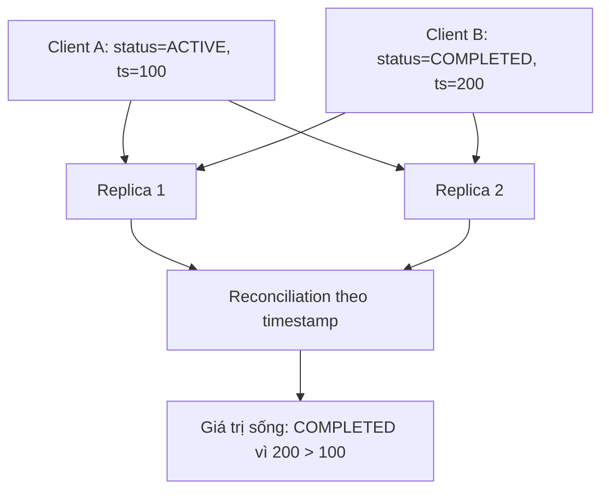
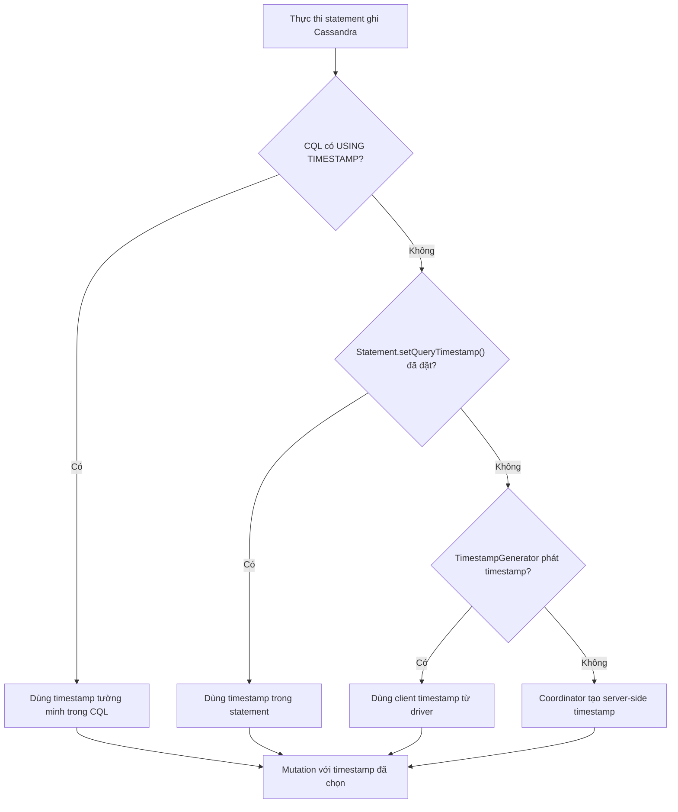

# Nguồn tạo timestamp từ Driver hoặc coordinator

Trong **Apache Cassandra**, một thao tác ghi không chỉ mang theo giá trị và khóa mà còn gắn với **write timestamp** để giải quyết xung đột khi nhiều phiên bản dữ liệu đến các replica theo những thứ tự khác nhau. Khi hai thao tác cùng sửa một ô dữ liệu, Cassandra thường chọn phiên bản có timestamp lớn hơn theo nguyên tắc **last-write-wins (LWW)**. “Last” ở đây **không nhất thiết là request đến cuối cùng**, cũng không mặc nhiên là nghiệp vụ mới nhất: nó là thứ tự theo **timestamp của mutation**.

Trong ứng dụng dùng **Spring Data Cassandra**, nguồn của timestamp có thể nằm ở **Apache Cassandra Java Driver trên client** hoặc **coordinator node phía server**. Ngoài hai nguồn tự động đó, lập trình viên còn có thể chỉ định timestamp tường minh qua CQL `USING TIMESTAMP` hoặc API `Statement.setQueryTimestamp(...)`. Hiểu được nguồn nào đang có hiệu lực là điều kiện cần để giải thích các lỗi như “đã cập nhật thành công nhưng đọc vẫn thấy giá trị cũ”, “ghi sau lại thua ghi trước” hoặc “xóa rồi dữ liệu không biến mất như mong đợi”.

Bài học thuộc chương **Timestamp và xung đột** của module **SPRING_DATA_CASSANDRA**, liên kết trực tiếp với entity mapping, repository, `CassandraTemplate`, CQL, consistency, paging và khả năng vận hành mô hình dữ liệu phân tán. Trọng tâm là **nguồn tạo timestamp từ Driver hoặc coordinator**, thứ tự ưu tiên, sự khác biệt về clock, giới hạn của cơ chế monotonic và cách kiểm chứng dữ liệu thật.

## 1. Mục tiêu học tập

Sau bài này, bạn có thể:

1. Phân biệt **write timestamp**, giá trị CQL kiểu `timestamp`, event time và thời điểm request đến server.
2. Giải thích khi nào **Driver** gắn timestamp và khi nào **coordinator** phải tự tạo timestamp.
3. Nêu thứ tự ưu tiên giữa **CQL `USING TIMESTAMP`**, **`setQueryTimestamp(...)`**, **TimestampGenerator** và **server-side generation**.
4. Cấu hình `AtomicTimestampGenerator`, `ThreadLocalTimestampGenerator` hoặc `ServerSideTimestampGenerator` trên Java Driver 4.x.
5. Hiểu vì sao timestamp **microsecond** và cơ chế tăng đơn điệu trong một process không tạo thứ tự toàn cục giữa nhiều service.
6. Quan sát timestamp thực tế với `WRITETIME(...)` và tái hiện trường hợp write timestamp lớn hơn thắng dù request đến trước.
7. Nhận biết rủi ro **clock skew**, timestamp tương lai, tombstone, TTL và dữ liệu lịch sử được backfill.
8. Giải thích vì sao **LWT/conditional statements** có quy tắc khác và không chấp nhận custom write timestamp thông thường.
9. Thiết kế retry, consistency, logging và integration test phù hợp với Cassandra nhiều replica.
10. Chọn cách quản lý timestamp an toàn cho repository, `CassandraTemplate` và đường gọi `CqlSession` trực tiếp.

## 2. Ba khái niệm thời gian không nên đánh đồng

Giả sử ứng dụng đăng ký khóa học có bảng:

```sql
CREATE TABLE IF NOT EXISTS learning.enrollments_by_student (
    tenant_id uuid,
    student_id uuid,
    enrolled_at timestamp,
    enrollment_id uuid,
    course_id uuid,
    enrollment_status text,
    PRIMARY KEY ((tenant_id, student_id), enrolled_at, enrollment_id)
) WITH CLUSTERING ORDER BY (enrolled_at DESC, enrollment_id ASC);
```

Ta dễ gặp ít nhất ba loại thời gian:

| Khái niệm | Ví dụ | Mục đích |
| --- | --- | --- |
| **Event time** | `enrolled_at` trong primary key | Thời điểm nghiệp vụ xảy ra, cũng tham gia clustering/order |
| **Write timestamp** | `WRITETIME(enrollment_status)` | Phiên bản mutation dùng để phân xử xung đột LWW |
| **Wall-clock/processing time** | Đồng hồ máy client hoặc coordinator | Có thể được dùng để *tạo* write timestamp nếu không có giá trị tường minh |

Một giá trị CQL có kiểu `timestamp` thường dùng để biểu diễn **mốc thời gian nghiệp vụ** (độ chính xác CQL timestamp ở mức millisecond), trong khi **write timestamp** của mutation được biểu diễn bằng số nguyên **microsecond từ Unix epoch**.

Ví dụ:

```text
enrolled_at:
  2026-11-25T09:30:00Z
  Là thời gian học viên đăng ký; được lưu như dữ liệu trong bảng.

write timestamp của enrollment_status:
  1795599000000000
  Là số microsecond minh họa dùng để quyết định version của giá trị.

Ngày giờ request đến coordinator:
  Có thể trước hoặc sau event time.
  Không mặc nhiên bằng write timestamp khi client đã gửi timestamp.
```

Số microsecond ở ví dụ là **giá trị minh họa**, không phải timestamp được đọc từ cluster thực tế.

**Không dùng `enrolled_at` để suy ra `WRITETIME(enrollment_status)`.** Một hàng có thể được tạo lúc 09:30 nhưng trạng thái chuyển từ ACTIVE sang COMPLETED nhiều giờ sau; hai khái niệm sẽ có giá trị và mục đích khác nhau.

### 2.1. Đơn vị là một nguồn gây lỗi nghiêm trọng

| Giá trị | Đơn vị / ý nghĩa |
| --- | --- |
| `Instant.toEpochMilli()` | Millisecond kể từ Unix epoch |
| `System.currentTimeMillis()` | Millisecond, phụ thuộc đồng hồ hệ điều hành |
| `Statement.setQueryTimestamp(long)` | **Microsecond** kể từ Unix epoch |
| `USING TIMESTAMP 123...` | **Microsecond** kể từ Unix epoch |
| `WRITETIME(column)` | **Microsecond** của giá trị cột đang lưu |
| CQL `timestamp` | Kiểu dữ liệu mốc thời gian, không phải mutation timestamp |

Nhầm `millisecond` thành `microsecond` có thể đặt dữ liệu vào một mốc gần năm 1970 hoặc tương lai khác thường, khiến kết quả LWW khó hiểu.

Nếu cần chuyển một `Instant` thành microsecond:

```java
import java.time.Instant;

public static long toEpochMicros(Instant instant) {
    return Math.addExact(
        Math.multiplyExact(instant.getEpochSecond(), 1_000_000L),
        instant.getNano() / 1_000L
    );
}
```

Method trên **cắt phần nano nhỏ hơn một microsecond**. Việc tự lấy `Instant.now()` rồi dùng làm timestamp ghi phải có chủ đích; khi không cần chính sách timestamp riêng, hãy để driver generator đã được cấu hình thực hiện nhiệm vụ đó.

## 3. Cassandra dùng timestamp để phân xử xung đột như thế nào?

Cassandra phân phối cùng logical partition tới các replica theo replication factor của keyspace. Replica có thể nhận mutation ở những thời điểm khác nhau vì network latency, retry, hàng đợi, node tạm lỗi hoặc những lần ghi đến coordinator khác nhau.

Cassandra dùng timestamp của dữ liệu để hòa giải các phiên bản. Với những ghi thông thường, **giá trị có timestamp lớn hơn thắng giá trị có timestamp nhỏ hơn ở mức ô/cột liên quan**.



Đây là minh họa **hai mutation tới cùng một cột của cùng một primary key**. Không phải mọi trường hợp đồng thời trong Cassandra đều biến cả hàng thành một version duy nhất; các regular columns có thể được cập nhật độc lập.

### 3.1. Ghi sau có thể thua ghi trước

Giả sử:

```text
09:00:00.000  Writer A gửi status=COMPLETED với ts=500.
09:00:00.100  Writer B gửi status=ACTIVE    với ts=400.
09:00:00.200  Cả hai thao tác đã được replica xử lý.

Kết quả của cùng cột:
  COMPLETED (ts=500) vẫn thắng.
```

Vì vậy, “request B đến sau” không phải nguyên tắc thắng. Chỉ timestamp **có hiệu lực** mới quyết định phiên bản ưu tiên, trừ những quy tắc hòa giải đặc thù ở tình huống timestamp bằng nhau.

### 3.2. Hai cột có thể thắng theo hai nguồn khác nhau

Giả sử cùng enrollment:

```text
Writer A: status = COMPLETED, ts=500.
Writer B: teacher_note = "Good progress", ts=450.
```

Nếu mỗi mutation sửa một regular column khác nhau, cả hai thay đổi có thể cùng xuất hiện trong kết quả đọc. **LWW không có nghĩa cả row bị thay thế bởi lần ghi có timestamp cao nhất**.

Điều này quan trọng khi dùng `repository.save(...)` trên một entity mà một số property có `null`: kiểu statement được tạo, các cột thực sự ghi và write timestamp trên từng cột có thể ảnh hưởng đến dữ liệu còn lại.

### 3.3. Timestamp bằng nhau không phải trường hợp muốn chủ động tạo

Nếu cùng cột nhận hai giá trị có **cùng write timestamp**, Cassandra cần quy tắc hòa giải tất định. Theo tài liệu Cassandra, tombstone/deletion thắng giá trị sống trong một số tie tương ứng, còn giữa hai live values có quy tắc so sánh giá trị để quyết định winner.

**Không coi quy tắc tie-break là “lần ghi sau thắng” hoặc quy tắc ưu tiên nghiệp vụ.** Nếu thứ tự cập nhật thực sự quan trọng, cần có ID/version nghiệp vụ, kiểm soát đồng thời hoặc LWT phù hợp thay vì dựa vào việc hai timestamps tình cờ bằng nhau.

## 4. Bốn nguồn timestamp và thứ tự ưu tiên

Java Driver 4.x định nghĩa rõ thứ tự nguồn timestamp cho mutation thông thường:



Bảng ưu tiên:

| Ưu tiên | Nguồn | Do ai quyết định? | Khi nào dùng? |
| --- | --- | --- | --- |
| **1 – cao nhất** | CQL `USING TIMESTAMP` | Câu CQL do ứng dụng tạo | Ghi cần timestamp tường minh tại mức CQL |
| **2** | `Statement.setQueryTimestamp(long)` | Java application/Driver statement | Ghi với timestamp cụ thể nhưng không thay CQL text |
| **3** | `TimestampGenerator` | Java Driver cấu hình trong session/profile | Đường ghi thông thường khi không override |
| **4 – fallback** | Coordinator/server-side timestamp | Node điều phối request phía Cassandra | Driver không gửi timestamp |

**Điểm dễ nhầm:** coordinator **không mặc nhiên** tạo timestamp cho mọi mutation. Khi client đã cung cấp timestamp hợp lệ, server dùng timestamp đó theo các quy tắc của statement/operation.

Quy tắc này áp dụng cho những mutation thông thường có cho phép timestamp client; **conditional write/LWT là ngoại lệ quan trọng**, sẽ xét ở phần 11.

### 4.1. Vì sao cần biết chính xác nguồn?

Khi có hai instance Spring Boot ghi cùng khóa, vấn đề có thể đến từ:

- instance A sử dụng driver timestamp từ đồng hồ chạy nhanh hơn;
- instance B sử dụng coordinator timestamp với clock khác;
- một câu `@Query` có `USING TIMESTAMP` do code đặt cố định;
- một service tự `setQueryTimestamp` theo event time, service khác để driver tự sinh;
- một luồng backfill ghi timestamp lịch sử, bị mutation mới có timestamp cao hơn che mất.

Điều tra mà không kiểm tra nguồn timestamp sẽ dẫn tới kết luận sai rằng Cassandra “ghi không đúng thứ tự”.

## 5. Khi Driver tạo timestamp phía client

Trong Apache Cassandra Java Driver 4.x, **`AtomicTimestampGenerator`** là lựa chọn mặc định theo tài liệu driver. Nó tạo timestamp phía client và bảo đảm **tăng đơn điệu trong một instance generator được chia sẻ**, bao gồm nhiều application threads.

Ví dụ HOCON tương ứng của Java Driver:

```hocon
datastax-java-driver {
  advanced.timestamp-generator {
    class = AtomicTimestampGenerator
  }
}
```

Đây là cấu hình **Java Driver**, không phải property có tên y hệt trong `application.yml` của Spring Boot. File và cách tải cấu hình driver phụ thuộc Boot/application wiring, profile và cách `CqlSession` được tạo. Hãy xác minh cấu hình thực sự được session sử dụng.

### 5.1. AtomicTimestampGenerator hoạt động ra sao?

Ý tưởng:

1. Đọc thời gian từ clock hệ điều hành hoặc nguồn thời gian được driver sử dụng.
2. Chuyển về đơn vị **microsecond**.
3. Nếu thời gian mới chưa lớn hơn lần phát gần nhất, tăng giá trị để giữ tính đơn điệu.
4. Trả timestamp cho request mới.

```text
Ứng dụng A, một CqlSession/AtomicTimestampGenerator:

Request 1  ->  1_800_000_000_000_000
Request 2  ->  1_800_000_000_000_001
Request 3  ->  1_800_000_000_000_002

Những giá trị trên minh họa trình tự tăng,
không phải dữ liệu từ đồng hồ thật.
```

**Giới hạn:** tăng đơn điệu trong generator không đồng nghĩa với thứ tự nghiệp vụ toàn cục. Một instance ứng dụng khác có generator riêng và clock riêng; nó có thể phát timestamp thấp hoặc cao hơn không theo thứ tự business event.

### 5.2. Monotonicity có thể làm timestamp trôi vào tương lai

Nếu ứng dụng phát nhiều mutation hơn số microsecond mà clock có thể phân biệt, hoặc **đồng hồ hệ điều hành bị lùi**, generator có thể tăng timestamp nhân tạo để giữ tính đơn điệu.

Hệ quả:

- Timestamp được tạo có thể **đi trước wall clock** một khoảng.
- Driver có cảnh báo **clock skew/drift** khi vượt ngưỡng cấu hình.
- Một writer khác với clock bình thường có thể ghi các mutation mang timestamp thấp hơn và thua xung đột trên cùng cột.
- Việc tăng đơn điệu không sửa clock skew giữa **hai host**.

Đừng xử lý cảnh báo bằng cách chỉ tắt log. Kiểm tra đồng bộ thời gian bằng NTP/chrony, trạng thái host/VM, tốc độ phát request và cấu hình generator trước.

### 5.3. ThreadLocalTimestampGenerator

Java Driver cũng cung cấp `ThreadLocalTimestampGenerator`, bảo đảm timestamp tăng theo **từng thread**, nhưng không bảo đảm tăng/không trùng giữa mọi thread như generator atomic dùng chung.

```hocon
datastax-java-driver {
  advanced.timestamp-generator {
    class = ThreadLocalTimestampGenerator
  }
}
```

Nó có thể giảm contention trong một số workload, nhưng **không nên đổi chỉ vì muốn tối ưu sớm** khi nhiều thread cùng sửa một cell hoặc khi application cần thứ tự ghi dễ dự đoán hơn trong cùng process.

Cả hai kiểu generator đều **không tạo global consensus clock** giữa các application instances, các JVM hay nhiều datacenter.

## 6. Khi coordinator tạo timestamp phía server

Khi **không có timestamp phía client**, coordinator của Cassandra dùng clock của node để tạo timestamp cho mutation mà nó điều phối.

Trong Java Driver 4.x, có thể yêu cầu cơ chế này bằng:

```hocon
datastax-java-driver {
  advanced.timestamp-generator {
    class = ServerSideTimestampGenerator
  }
}
```

`ServerSideTimestampGenerator` **không phát timestamp client**, để Cassandra gán giá trị server-side. Một cách nhìn tương đương: Driver quyết định **không cung cấp** timestamp mặc định, và coordinator quyết định timestamp thực tế.

### 6.1. Lợi ích và giới hạn

Ưu điểm trong một số môi trường:

- Tránh phụ thuộc vào độ lệch clock giữa nhiều host chạy client ứng dụng.
- Phù hợp khi khó kiểm soát clock của các client hoặc muốn tập trung việc phát timestamp ở Cassandra.
- Không cần tự viết logic tạo timestamp ở service.

Giới hạn:

- **Các request có thể đi qua các coordinator khác nhau.** Clock giữa coordinator nodes cũng có thể lệch.
- Network delay và thứ tự xử lý request có thể khiến hai lần gọi liên tiếp nhận timestamp không theo thứ tự client mong đợi.
- Không có bảo đảm timestamp toàn cục tăng theo business event giữa mọi coordinator.
- Cluster vẫn cần đồng bộ thời gian; server-side không miễn trừ yêu cầu NTP/chrony.

**Server-side generation không phải một giải pháp “strong consistency” cho thứ tự sự kiện.** Nó chỉ đổi nơi tạo timestamp, không thay đổi thuật toán LWW và không bổ sung transaction.

### 6.2. Cùng JVM gửi hai write liên tiếp chưa đủ đảm bảo thứ tự

Giả sử:

```text
Client:
    write 1 -> coordinator A, trạng thái PENDING
    write 2 -> coordinator B, trạng thái PAID

Nếu clock(B) chậm hơn clock(A):
    write 2 có thể nhận timestamp thấp hơn write 1.

Kết quả:
    PENDING có thể vẫn là version thắng theo LWW,
    dù ứng dụng đã gửi PAID sau.
```

Đó là một tình huống minh họa rủi ro, không phải khẳng định mọi cluster sẽ gặp lỗi. Cơ chế monotonic phía client có thể giảm vấn đề này cho request phát từ **cùng generator**, nhưng không loại bỏ cạnh tranh giữa các instance.

## 7. So sánh hai nguồn timestamp

| Tiêu chí | Driver/client-side | Coordinator/server-side |
| --- | --- | --- |
| Clock được dùng | Client host/nguồn thời gian driver | Clock của coordinator node |
| Lựa chọn Java Driver 4.x | `AtomicTimestampGenerator` mặc định | `ServerSideTimestampGenerator` |
| Thứ tự trong cùng generator | Atomic bảo đảm đơn điệu trong instance | Không có generator client để bảo đảm |
| Thứ tự giữa nhiều client | **Không bảo đảm** | **Không bảo đảm** |
| Ảnh hưởng clock skew client | Có | Ít trực tiếp hơn |
| Ảnh hưởng clock skew coordinator | Có thể ảnh hưởng các cơ chế khác; TS đã do client đặt | Có, trực tiếp tới timestamp gán |
| Ghi conditional/LWT | Timestamp client không dùng như ghi thường | Server quản lý theo quy tắc LWT |
| Phù hợp | Ứng dụng kiểm soát clock và muốn monotonic per-session | Môi trường client clocks khó đồng bộ |
| Rủi ro cần theo dõi | Client drift vào tương lai, nhiều JVM | Nhiều coordinator clocks, request reorder |

### 7.1. Cần thống nhất policy giữa các writer

Trong một nền tảng có nhiều service, có thể có:

- API Spring Boot dùng `AtomicTimestampGenerator` mặc định.
- Batch ETL dùng `USING TIMESTAMP` từ file lịch sử.
- Công cụ admin dùng `ServerSideTimestampGenerator`.
- Một service cũ dùng driver/phiên bản khác.

Nếu tất cả ghi **cùng primary key và cột**, chúng đang cạnh tranh bằng timestamp theo các nguồn khác nhau. Do đó cần **tài liệu hóa policy timestamp theo nguồn ghi và loại dữ liệu**, không chỉ chọn một config rồi mặc định hệ thống đã nhất quán.

Một lựa chọn có chủ đích có thể là:

- Các mutation thông thường dùng client generator mặc định, với NTP và giám sát clock drift.
- ETL/backfill dùng timestamp tường minh khi thật sự muốn bảo tồn version lịch sử, sau khi xác minh semantics.
- Conditional writes dùng LWT và để server điều phối timestamp.
- Các writer có quyền ghi dữ liệu production phải tuân theo cùng hợp đồng thời gian, version và retry.

Không có một policy duy nhất luôn đúng. Điều quan trọng là **nhất quán và kiểm chứng các đường ghi thực tế**.

## 8. CQL USING TIMESTAMP: override cao nhất

Cassandra hỗ trợ chỉ định timestamp khi thực hiện những mutation phù hợp.

Ví dụ:

```sql
-- INSERT với timestamp microsecond tường minh.
INSERT INTO learning.enrollments_by_student (
    tenant_id, student_id, enrolled_at, enrollment_id,
    course_id, enrollment_status
) VALUES (?, ?, ?, ?, ?, ?)
USING TIMESTAMP ?;
```

```sql
-- UPDATE với timestamp do ứng dụng chọn.
UPDATE learning.enrollments_by_student
USING TIMESTAMP ?
SET enrollment_status = ?
WHERE tenant_id = ?
  AND student_id = ?
  AND enrolled_at = ?
  AND enrollment_id = ?;
```

```sql
-- DELETE dùng timestamp tường minh.
DELETE FROM learning.enrollments_by_student
USING TIMESTAMP ?
WHERE tenant_id = ?
  AND student_id = ?
  AND enrolled_at = ?
  AND enrollment_id = ?;
```

**Lưu ý cú pháp:** `USING TIMESTAMP` nằm ở vị trí do CQL quy định cho từng loại statement. Query với `IF`/LWT có giới hạn khác; không copy `USING TIMESTAMP` sang conditional update.

### 8.1. Có thể bind giá trị timestamp không?

Có thể dùng bind variable `?` cho timestamp trong những statement CQL hỗ trợ, thay vì nối trực tiếp một giá trị từ request.

Ví dụ khi dùng Java Driver:

```java
import java.time.Instant;
import java.util.UUID;
import com.datastax.oss.driver.api.core.CqlSession;
import com.datastax.oss.driver.api.core.cql.SimpleStatement;

public void updateWithExplicitTimestamp(
        CqlSession session,
        UUID tenantId,
        UUID studentId,
        Instant enrolledAt,
        UUID enrollmentId,
        String nextStatus,
        long timestampMicros) {

    session.execute(SimpleStatement.newInstance(
        """
        UPDATE learning.enrollments_by_student
        USING TIMESTAMP ?
        SET enrollment_status = ?
        WHERE tenant_id = ?
          AND student_id = ?
          AND enrolled_at = ?
          AND enrollment_id = ?
        """,
        timestampMicros,
        nextStatus,
        tenantId,
        studentId,
        enrolledAt,
        enrollmentId
    ));
}
```

Đây là đoạn phương thức trong class DAO/service; phải có kết nối Cassandra được cấu hình riêng và authorization của người dùng/tenant ở tầng phù hợp.

**Không nhận `timestampMicros` tùy ý từ HTTP client** để cho phép người dùng đặt timestamp rất xa tương lai. Một giá trị quá cao có thể áp đảo các cập nhật hợp lệ tiếp theo trên cùng cột, gây lỗi dữ liệu kéo dài.

### 8.2. Khi nào nên dùng USING TIMESTAMP?

Tình huống có thể hợp lý:

- Migrate/backfill dữ liệu mà policy yêu cầu bảo toàn thời điểm/version mutation.
- Ghi lại sự kiện ở một thứ tự đã được xác nhận bởi một nguồn có thẩm quyền.
- Test LWW và tie-breaking trên môi trường cô lập.
- Xây một workflow cần điều khiển timestamp ghi mà các tầng abstract không cung cấp trực tiếp.

Không nên dùng khi chỉ muốn “đảm bảo ghi mới thắng” bằng cách cộng một số rất lớn vào đồng hồ. Timestamp tương lai có thể khiến những cập nhật sau mất tác dụng cho đến khi clock bắt kịp hoặc dữ liệu được sửa có kiểm soát.

## 9. Statement.setQueryTimestamp(...) trong Java Driver 4.x

Java Driver 4.x cho phép đặt timestamp ngay trên `Statement` mà không phải chèn `USING TIMESTAMP` vào CQL string.

Ví dụ:

```java
import java.time.Instant;
import java.util.UUID;

import com.datastax.oss.driver.api.core.CqlSession;
import com.datastax.oss.driver.api.core.cql.SimpleStatement;

public void updateWithStatementTimestamp(
        CqlSession session,
        UUID tenantId,
        UUID studentId,
        Instant enrolledAt,
        UUID enrollmentId,
        String status,
        long timestampMicros) {

    SimpleStatement statement = SimpleStatement.newInstance(
        """
        UPDATE learning.enrollments_by_student
        SET enrollment_status = ?
        WHERE tenant_id = ?
          AND student_id = ?
          AND enrolled_at = ?
          AND enrollment_id = ?
        """,
        status,
        tenantId,
        studentId,
        enrolledAt,
        enrollmentId
    ).setQueryTimestamp(timestampMicros);

    session.execute(statement);
}
```

Các điểm cần nhớ:

- `setQueryTimestamp` nhận **microsecond Unix epoch**.
- Với statement có giá trị này, driver **không cần gọi generator để quyết định timestamp hiệu lực** cho mutation thông thường.
- Nếu chính câu CQL cũng có `USING TIMESTAMP`, **CQL override** theo thứ tự ưu tiên.
- Trong driver 4.x, statement có API **immutable-style**; lời gọi setter trả một statement mới hoặc thay thế dạng phù hợp API, nên phải giữ giá trị trả về.
- Không nhầm timestamp statement với TTL, page size, consistency level hay thời gian của clustering key.

### 9.1. PreparedStatement và BoundStatement

Với câu CQL lặp lại nhiều lần, dùng `PreparedStatement` giúp tránh prepare lặp:

```java
import java.time.Instant;
import java.util.UUID;

import com.datastax.oss.driver.api.core.cql.PreparedStatement;
import com.datastax.oss.driver.api.core.cql.BoundStatement;

PreparedStatement prepared = session.prepare("""
    UPDATE learning.enrollments_by_student
    SET enrollment_status = ?
    WHERE tenant_id = ?
      AND student_id = ?
      AND enrolled_at = ?
      AND enrollment_id = ?
    """);

BoundStatement bound = prepared.bind(
    "COMPLETED", tenantId, studentId, enrolledAt, enrollmentId
).setQueryTimestamp(timestampMicros);

session.execute(bound);
```

Đây là **trích đoạn trong class đã có session và các biến đầu vào**. Prepared statement chỉ mô tả query template; mỗi lần bind có thể nhận timestamp riêng. Không chia sẻ một mutable builder giữa nhiều thread nếu đang tự tùy biến statement.

**Lợi ích của `setQueryTimestamp`:** không cần thay CQL text theo từng timestamp, phù hợp reuse prepared statement. Nhưng ứng dụng vẫn phải chịu trách nhiệm lựa chọn timestamp đúng policy.

## 10. Spring Data Cassandra: timestamp đến từ đâu?

Một ứng dụng Spring Boot có thể sử dụng:

```java
public interface EnrollmentRepository
        extends CassandraRepository<EnrollmentByStudent, StudentEnrollmentKey> {
}
```

hoặc:

```java
EnrollmentByStudent saved = repository.save(enrollment);
```

`repository.save(...)` làm việc với entity mapping của Spring Data. Nhưng mutation cuối cùng vẫn được gửi qua Java Driver/Cassandra. Khi không có timestamp tường minh ở tầng Spring Data/CQL/statement, **timestamp được quyết định theo configuration của driver hoặc coordinator**.

Điều này đúng về mặt cơ chế cả khi gọi từ:

- `CassandraRepository`.
- `CassandraTemplate`/`CassandraOperations`.
- `CqlTemplate`/`CqlOperations`.
- `CqlSession` trực tiếp.

Khác biệt là **mỗi tầng cung cấp những cách khác nhau để xây statement và override timestamp**.

### 10.1. Đừng giả định @Table hoặc @PrimaryKey tự đặt write timestamp

Ví dụ entity có:

```java
@Table("enrollments_by_student")
public class EnrollmentByStudent {

    @PrimaryKey
    private StudentEnrollmentKey key;

    @Column("enrollment_status")
    private String enrollmentStatus;

    // Constructor và accessor.
}
```

Các annotation mapping mô tả **bảng, khóa và cột**, không tự định nghĩa một timestamp LWW theo event time. Nếu developer thêm field `updatedAt` có kiểu `Instant`, field đó cũng chỉ là **một giá trị dữ liệu**, không tự trở thành mutation timestamp.

Nếu ứng dụng cần set timestamp cụ thể, phải dùng một API write options/statement phù hợp với **phiên bản Spring Data Cassandra** hoặc dùng CQL/Java Driver trực tiếp ở nơi cần kiểm soát.

### 10.2. Thận trọng với @Query và write timestamp

`@Query` có thể khai báo CQL tường minh cho repository. Nếu sử dụng CQL `USING TIMESTAMP` trong method ghi, phải xác minh:

1. Cú pháp CQL của thao tác đó hỗ trợ timestamp.
2. Method được khai báo/đánh dấu phù hợp cho write query trong phiên bản Spring Data đang dùng.
3. Tham số timestamp là **long microsecond**, không phải `Instant`/millisecond đưa vào mà chưa chuyển.
4. Method được gọi qua Spring Data repository proxy thật sự chạy CQL dự kiến.
5. Không dùng `USING TIMESTAMP` với LWT/conditional update.

Đừng giả định Spring Data tự phát timestamp dựa vào một annotation `@UpdatedDate` hoặc cơ chế auditing: **auditing field khác write timestamp nội bộ của Cassandra**.

### 10.3. Một bean CqlSession dùng nhiều đường ghi

Nếu `CassandraRepository` và một custom DAO đều dùng **cùng `CqlSession`/driver profile**, chúng thường chia sẻ cấu hình timestamp generator tương ứng. Nhưng trong ứng dụng có nhiều session, cluster hoặc execution profiles, **cấu hình có thể khác nhau**.

Ví dụ một DAO chỉ định execution profile `server-side` còn repository dùng default profile `atomic`. Khi hai bên ghi cùng cell, chính sách timestamp khác nhau sẽ có tác động. Cần kiểm tra bean graph, profile và driver configuration thực tế; không kết luận chỉ dựa trên `application.yml`.

## 11. LWT: conditional update là ngoại lệ quan trọng

**Lightweight transactions (LWT)** dùng conditional statements như:

```sql
UPDATE learning.enrollments_by_student
SET enrollment_status = 'COMPLETED'
WHERE tenant_id = ?
  AND student_id = ?
  AND enrolled_at = ?
  AND enrollment_id = ?
IF enrollment_status = 'ACTIVE';
```

Với conditional writes, Cassandra sử dụng cơ chế phối hợp để xác định điều kiện được áp dụng hay không. Tài liệu Java Driver nêu rõ:

- **Không được dùng CQL `USING TIMESTAMP` tường minh cho LWT**; server sẽ từ chối câu CQL.
- Nếu client driver có generator phát timestamp cho request LWT, **timestamp client được bỏ qua và server quyết định timestamp** theo cơ chế conditional statement.

Điều này có nghĩa một hệ thống dùng `AtomicTimestampGenerator` mặc định **không tự áp dụng thứ tự client timestamp cho LWT như với UPDATE thường**.

### 11.1. Không dùng LWT chỉ để “timestamp tăng đúng”

LWT thích hợp khi nghiệp vụ cần điều kiện đồng thời, ví dụ chuyển ACTIVE → COMPLETED chỉ khi hiện tại là ACTIVE. Nó có chi phí và semantics khác ghi thường.

Đừng bật LWT cho mọi thao tác chỉ vì muốn tránh suy nghĩ về đồng hồ. Hãy xác định rõ yêu cầu:

- Có cần compare-and-set/không ghi đè trạng thái ngoài ý muốn không?
- Có giá trị version nghiệp vụ để so sánh không?
- Có thể chấp nhận chi phí latency/throughput của LWT không?
- Điều kiện đã được giới hạn bởi primary key và đường truy vấn hợp lệ chưa?

Một LWT trên một bảng cũng **không tự tạo transaction ACID giữa hai bảng projection** mà hệ thống phi chuẩn hóa cần cập nhật.

## 12. Clock skew: tình huống gây mất cập nhật tưởng như vô lý

Clock skew là sự lệch nhau giữa đồng hồ các máy. Trong một hệ thống có nhiều application instances và coordinator nodes, lệch vài giây hoặc vài phút có thể ảnh hưởng trực tiếp đến LWW.

### 12.1. Một client chạy nhanh hơn 5 phút

Giả sử:

```text
App A (clock nhanh +5 phút):
  Ghi status = ACTIVE
  ts = 1_800_000_300_000_000

App B (clock gần đúng):
  Sau đó ghi status = COMPLETED
  ts = 1_800_000_000_500_000

Cassandra:
  ACTIVE có ts lớn hơn, nên thắng.
```

Dù người dùng thấy B đã cập nhật thành công, đọc lại có thể vẫn là ACTIVE. **Write acknowledgement không có nghĩa giá trị vừa ghi là winner khi có mutation timestamp lớn hơn đang tồn tại**.

Đổi consistency từ `LOCAL_ONE` sang `LOCAL_QUORUM` có thể ảnh hưởng số replica tham gia và khả năng quan sát dữ liệu, nhưng **không đảo ngược quy tắc timestamp thắng**.

### 12.2. Đồng hồ lùi trong khi AtomicTimestampGenerator đang chạy

Khi đồng hồ host lùi, generator có thể tiếp tục phát giá trị tăng từ timestamp cuối để bảo vệ monotonicity trong process. Nếu chênh lệch lớn, timestamp có thể **trôi về tương lai** so với clock mới; driver có thể log cảnh báo.

Các việc vận hành:

1. Cấu hình NTP/chrony và theo dõi đồng bộ thời gian cả client lẫn Cassandra nodes.
2. Theo dõi clock skew/drift warnings từ driver.
3. Kiểm tra virtual machine/container host clock và các sự kiện suspend/resume.
4. Không reset/chuyển generator tùy tiện để “xóa cảnh báo” khi dữ liệu đã có timestamp tương lai.
5. Kiểm tra các writer khác và việc sử dụng `USING TIMESTAMP` thủ công.

### 12.3. Không phải mọi thứ tự sự kiện đều là thứ tự thời gian vật lý

Hai service có thể xử lý event out-of-order:

```text
Event #20: status = COMPLETED, xử lý trước.
Event #19: status = ACTIVE, xử lý trễ.

Nếu cả hai dùng "bây giờ" ở mỗi service để tạo timestamp:
  event #19 được xử lý sau có thể có ts lớn hơn event #20.
```

Đó là lỗi **thứ tự nghiệp vụ**, không chỉ clock skew. Dùng client hay server timestamp tự động không giải quyết được. Cần version/sequence theo aggregate, xử lý event có thứ tự hoặc conditional update phù hợp nếu trạng thái phải đi theo một state machine.

## 13. TTL, NULL và tombstone liên quan thế nào?

Timestamp của mutation không chỉ ảnh hưởng hai live values, mà còn liên quan xóa dữ liệu và hòa giải giữa các replica.

### 13.1. DELETE và tombstone

Cassandra ghi **tombstone** cho deletion để replica có thể biết dữ liệu cũ đã bị xóa. Một tombstone có timestamp cao hơn một live value có thể che giá trị cũ đó khi đọc.

Ví dụ:

```text
T1: status = ACTIVE, write ts=100.
T2: DELETE status, write ts=200.
T3: Một request lỗi thời ghi status = ACTIVE, write ts=150.

Khi hòa giải:
  Tombstone ts=200 thắng live value ts=150.
  Cột vẫn được xem là đã xóa.
```

Điều này giải thích vì sao một lần ghi “thành công” chưa chắc làm cột xuất hiện trở lại nếu có tombstone mới hơn.

**Không dùng timestamp cố định quá thấp để “khôi phục” dữ liệu** nếu tombstone có timestamp cao hơn. Cần xử lý theo cơ chế migration hoặc quy tắc nghiệp vụ đúng.

### 13.2. Ghi NULL có thể là xóa

Trong Cassandra, `UPDATE table SET column = null ...` có ngữ nghĩa xóa regular column chứ không chỉ lưu một đối tượng Java null như database hỗ trợ null theo cách quan hệ.

Nếu API PATCH không có field `status`, đừng tự map thành CQL NULL khi mục tiêu là giữ nguyên trạng thái. Cần phân biệt:

| Ý nghĩa request | Mutation mong muốn |
| --- | --- |
| Không gửi field | Không sửa cột đó / dùng UNSET khi phù hợp |
| Gửi status hợp lệ | Ghi giá trị với write timestamp có hiệu lực |
| Gửi null để xóa (nếu được phép) | Mutation xóa/tombstone theo contract |
| Muốn kiểm tra trạng thái trước khi ghi | Conditional statement/LWT hoặc quy tắc version |

Converter và repository mapping có thể làm mờ sự khác biệt giữa “chưa được gửi” và “được gửi null” nếu entity dựng một phần. Kiểm tra CQL thực tế trước khi dùng `save(...)` cho partial update.

### 13.3. TTL là vòng đời dữ liệu, không phải thứ tự nghiệp vụ

TTL cho phép dữ liệu hết hạn và cuối cùng được xử lý như giá trị đã xóa. TTL/expiration chịu ảnh hưởng thời gian wall clock và logic của Cassandra; nó không tự giải quyết xung đột giữa hai mutation có timestamp khác nhau theo business event.

Đừng dùng TTL như cách “chờ timestamp tương lai hết hiệu lực”. Một giá trị có timestamp sai cần được chẩn đoán và sửa theo chính sách dữ liệu rõ ràng, không chờ ngẫu nhiên.

## 14. Kiểm chứng với WRITETIME(...) và CQL

Cassandra cung cấp hàm `WRITETIME(column)` để đọc write timestamp của một cột phù hợp. Với bảng ví dụ:

```sql
SELECT enrollment_status,
       WRITETIME(enrollment_status) AS status_write_ts
FROM learning.enrollments_by_student
WHERE tenant_id = ?
  AND student_id = ?
  AND enrolled_at = ?
  AND enrollment_id = ?;
```

`status_write_ts` là timestamp microsecond đang gắn với giá trị cột, **không phải** `enrolled_at` của sự kiện. Với một cột đã bị xóa/không còn giá trị sống, kết quả không nên được diễn giải như timestamp của tombstone bằng cách chỉ nhìn vào giá trị `WRITETIME`; có thể cần công cụ phân tích chuyên biệt tùy mục tiêu điều tra.

Một số giới hạn:

- `WRITETIME` áp dụng cho **regular/static column được hỗ trợ**, không dùng như phép quan sát write timestamp trực tiếp cho các thành phần **primary key**.
- Cần chú ý các kiểu collection, counter và khả năng hỗ trợ theo phiên bản.
- Timestamp có thể thay đổi sau khi một mutation mới thắng xung đột; nó không phải lịch sử audit đầy đủ.
- `WRITETIME` chỉ phản ánh **winner đang đọc được**, không liệt kê mọi mutation từng gửi.

### 14.1. Ví dụ thử xung đột có timestamp tường minh

Tạo một hàng test với khóa đầy đủ, sau đó ghi hai giá trị cho cùng cột:

```sql
-- Các khóa UUID/timestamp là fixture trong test.
UPDATE learning.enrollments_by_student
USING TIMESTAMP 1700000000000200
SET enrollment_status = 'COMPLETED'
WHERE tenant_id = 11111111-1111-1111-1111-111111111111
  AND student_id = 22222222-2222-2222-2222-222222222222
  AND enrolled_at = '2026-11-25T09:00:00Z'
  AND enrollment_id = 33333333-3333-3333-3333-333333333333;

-- Statement đến sau nhưng timestamp nhỏ hơn.
UPDATE learning.enrollments_by_student
USING TIMESTAMP 1700000000000100
SET enrollment_status = 'ACTIVE'
WHERE tenant_id = 11111111-1111-1111-1111-111111111111
  AND student_id = 22222222-2222-2222-2222-222222222222
  AND enrolled_at = '2026-11-25T09:00:00Z'
  AND enrollment_id = 33333333-3333-3333-3333-333333333333;
```

Đọc:

```sql
SELECT enrollment_status,
       WRITETIME(enrollment_status) AS write_ts
FROM learning.enrollments_by_student
WHERE tenant_id = 11111111-1111-1111-1111-111111111111
  AND student_id = 22222222-2222-2222-2222-222222222222
  AND enrolled_at = '2026-11-25T09:00:00Z'
  AND enrollment_id = 33333333-3333-3333-3333-333333333333;
```

Kết quả mong đợi khi không có mutation nào khác cạnh tranh:

```text
enrollment_status = COMPLETED
write_ts          = 1700000000000200
```

Đây là ví dụ **CQL test có chủ đích**, không dùng một UUID/khóa chung trên production. Chọn timestamp test trong môi trường cô lập và dọn dữ liệu fixture sau khi chạy.

### 14.2. Khi xem timestamp phải nhìn cả nguồn ghi

Nếu `WRITETIME` trả một giá trị rất lớn hoặc bất thường, hãy kiểm tra:

1. Có câu `USING TIMESTAMP` tường minh không?
2. Có `setQueryTimestamp` ở custom DAO hoặc event replay không?
3. Driver dùng `AtomicTimestampGenerator` hay `ServerSideTimestampGenerator`?
4. Có nhiều `CqlSession` hoặc execution profiles khác nhau không?
5. NTP/chrony và đồng hồ host có lệch không?
6. Có backfill/restore với timestamp cũ hoặc tương lai không?
7. Có dữ liệu bị xóa/tombstone và request ghi cũ chạy lại không?

**Không kết luận dựa trên thứ tự log của HTTP requests** khi chưa xem timestamp thực của mutation.

## 15. Đơn vị và timestamp policy trong Java

### 15.1. Tránh chuyển đổi thiếu chính xác

Đoạn sau không sai về đơn vị nếu nhân `1_000`, nhưng chỉ giữ được độ chính xác millisecond:

```java
long micros = System.currentTimeMillis() * 1_000L;
```

Nếu nhiều mutation xảy ra trong cùng một millisecond, có thể sinh timestamp trùng nhau. Vì vậy Java Driver có generator được thiết kế cho mục đích này; **đừng thay nó bằng một dòng `System.currentTimeMillis() * 1000` cho mọi request**.

Cũng đừng dùng `Instant.toEpochMilli()` trực tiếp làm `setQueryTimestamp` vì API này mong **microsecond**, không phải millisecond.

### 15.2. Không đồng nhất event time với write timestamp

Có thể có yêu cầu lưu event từ năm 2020 vào Cassandra năm 2026. Nếu ETL dùng **event time năm 2020 như write timestamp**, trong khi dữ liệu đã có cột cùng khóa được cập nhật năm 2026, mutation lịch sử có thể thua và không xuất hiện.

Trong nhiều trường hợp, chiến lược phù hợp là:

- Lưu `event_occurred_at`/`enrolled_at` như **dữ liệu nghiệp vụ**.
- Dùng driver/coordinator timestamp hiện tại cho **thời điểm cập nhật dữ liệu**.
- Nếu cần version theo event sequence, dùng một trường version/luồng xử lý có kiểm soát.
- Chỉ dùng explicit write timestamp để replay lịch sử nếu mô hình hòa giải đã được thiết kế cho nó.

### 15.3. Timestamp càng lớn không phải “càng đúng”

LWW so sánh số timestamp, không biết giá trị nghiệp vụ nào mới nhất. Ghi timestamp rất lớn để “force update” có thể khiến những mutation tương lai hợp lệ không thể thắng.

Nếu cần sửa một record đang có timestamp bất thường, phải xác định đúng:

- Giá trị/tombstone đang thắng và timestamp của nó.
- Các writer còn đang hoạt động.
- Hậu quả của việc tạo mutation sửa chữa ở timestamp mới.
- Tác động lên TTL, backup, replica và những bảng projection khác.

Không khuyến khích vận hành ad hoc bằng timestamp cực lớn mà không có kế hoạch.

## 16. Retry, idempotency và consistency

### 16.1. Timeout không có nghĩa mutation chưa xảy ra

Cassandra có thể đã ghi vào một số replica nhưng client nhận timeout vì không đủ xác nhận kịp thời. Retry sau đó có thể tạo **một mutation mới**.

Với cùng primary key, nếu retry dùng timestamp mới, giá trị có thể thắng phiên bản trước. Điều này thường tương thích với upsert idempotent đơn giản, nhưng không tự đảm bảo đúng đối với:

- Nhiều sự kiện thay đổi trạng thái bị xử lý out-of-order.
- Counter hoặc thao tác không có tính idempotent.
- Lệnh cập nhật có side effects bên ngoài Cassandra.
- Ghi vào nhiều bảng denormalized projections.
- Retry sinh một UUID/timestamp clustering mới.

Đặc biệt, **timestamp được tạo cho lần thực thi mới** không nên được coi là version nghiệp vụ của sự kiện gốc.

### 16.2. Cố định primary key cho cùng một sự kiện

Một enrollment có `enrollment_id` ổn định và `enrolled_at` không đổi sẽ có cùng primary key khi retry. Nếu mỗi retry tạo ID mới, Cassandra sẽ lưu nhiều hàng nghiệp vụ giống nhau, và LWW trên **cùng một cell** không thể hợp nhất các hàng ở những khóa khác nhau.

Thiết kế an toàn:

1. Tạo event/enrollment ID một lần.
2. Định nghĩa version hoặc trạng thái hợp lệ trong domain.
3. Đảm bảo handler có idempotency với cùng event ID.
4. Chọn write timestamp policy nhất quán giữa các writer.
5. Dùng reconciliation cho những bảng projection có thể ghi không đồng bộ.

### 16.3. Consistency không quyết định winner

`LOCAL_ONE`, `LOCAL_QUORUM` hoặc các mức khác thay đổi yêu cầu xác nhận replica đối với đọc/ghi. Chúng **không** làm Cassandra chọn giá trị có timestamp thấp hơn nếu đã có mutation hợp lệ với timestamp cao hơn.

Một hệ thống có consistency mạnh hơn có thể giảm một số trường hợp đọc thấy trạng thái cũ do replication lag, nhưng **không thay thế logic đồng thời/ordering nghiệp vụ**.

### 16.4. Hai bảng phi chuẩn hóa vẫn phải đồng bộ riêng

Giả sử hệ thống có:

```text
enrollments_by_student
students_by_course
```

Khi một event đổi trạng thái, hai bảng có thể được ghi ở các thời điểm khác nhau. Dùng cùng write timestamp cho cả hai bảng **không biến chúng thành transaction ACID**; sự cố giữa hai lệnh vẫn có thể khiến một bảng chưa được cập nhật.

Cần retry có giới hạn, event log hoặc outbox/workflow bền vững, đối soát và chính sách dữ liệu nguồn rõ ràng.

## 17. Đồng hồ hệ thống và vận hành production

### 17.1. Những gì phải giám sát

| Tín hiệu | Rủi ro nếu bỏ qua | Hành động phù hợp |
| --- | --- | --- |
| NTP/chrony không đồng bộ ở app hosts | Client timestamps không so sánh đúng với các writer khác | Kiểm tra clock offset và health |
| Coordinator clock lệch | Server-side timestamp không có thứ tự dự kiến | Sửa đồng bộ thời gian ở Cassandra nodes |
| Driver `MonotonicTimestampGenerator` drift warning | Generator có thể phát timestamp tương lai | Điều tra clock rollback/tải |
| `WRITETIME` vượt xa thời gian hiện tại | Mutation tương lai có thể che updates hợp lệ | Xác định nguồn ghi và sửa theo policy |
| Update thành công nhưng giá trị không đổi | Ghi thua timestamp cao hơn hoặc bị tombstone che | Đọc `WRITETIME`, kiểm tra delete/conflict |
| Timeout/retry tăng | Mutation trùng và out-of-order | Kiểm tra policy retry và idempotency |
| Projection lag | Hai bảng đọc không đồng bộ | Monitoring, reconciliation và retry |
| Tăng tombstone warnings | Delete/TTL nhiều gây đọc chậm | Kiểm tra retention, compaction, partition |
| Driver version/config thay đổi | Timestamp source khác đi sau deploy | Regression test và kiểm tra config effective |

Đừng chỉ quan sát timestamp trên JVM. Khi đang dùng server-side generation, **coordinator clock** là nguồn trực tiếp của mutation timestamp, nên điều tra cần theo cả Cassandra nodes.

### 17.2. Configuration drift giữa môi trường

Dev có thể dùng `AtomicTimestampGenerator` mặc định, staging cấu hình `ServerSideTimestampGenerator` và production có nhiều execution profiles. Một test chức năng đơn giản có thể vẫn pass ở cả ba nhưng behavior xung đột khác nhau dưới tải.

Checklist trước deploy:

- Ghi nhận timestamp generator class hiệu lực cho từng session/profile.
- Kiểm tra phiên bản Java Driver và Spring Data Cassandra.
- Kiểm tra các method dùng `setQueryTimestamp` hoặc CQL `USING TIMESTAMP`.
- Kiểm tra điều kiện LWT và ràng buộc timestamp.
- Kiểm tra NTP/clock drift ở client/coordinator.
- Kiểm tra test suite có case xung đột timestamp và retry.

### 17.3. Query tracing và logging có giới hạn

Khi debug, có thể log một **request ID**, entity key đã được che/hashed phù hợp, query type, timestamp source, execution profile, latency và exception class.

**Không log raw sensitive data** hoặc câu CQL đã nội suy với tenant/user PII chỉ để xác minh timestamp. Không bật tracing nặng trên toàn production khi đang có sự cố tải cao; dùng sampling/công cụ thích hợp.

## 18. Test sự khác nhau giữa Driver và coordinator

Unit test chỉ gọi một Java method chuyển `Instant` thành microsecond không chứng minh Cassandra nhận timestamp từ nguồn nào. Cần **integration test** với Cassandra thật, ví dụ Testcontainers hoặc một cluster kiểm thử cô lập.

### 18.1. Test timestamp tường minh và LWW

Chuẩn bị:

1. Tạo bảng `enrollments_by_student`.
2. Chọn UUID/test primary key riêng.
3. Ghi `status=COMPLETED` tại `ts=200` (dùng một timestamp microsecond hợp lệ trong môi trường test).
4. Ghi `status=ACTIVE` tại `ts=100`.
5. Đọc `enrollment_status` và `WRITETIME(enrollment_status)`.
6. Xác minh `COMPLETED` và `ts=200` là winner.
7. Ghi tại `ts=300`, xác minh giá trị mới thắng.
8. Dọn dữ liệu fixture và không dùng timestamp quá xa tương lai trên cluster thật.

Giá trị 100/200/300 ở mô tả là **thứ tự tương đối**, không dùng chúng làm Unix epoch timestamps production; code test nên dùng giá trị microsecond thực tế có kiểm soát.

### 18.2. Test ghi bằng Statement.setQueryTimestamp

Khung test (giả định đã có `session` và các giá trị key):

```java
long base = 1_700_000_000_000_000L;
long newer = base + 200L;
long older = base + 100L;

session.execute(
    SimpleStatement.newInstance(
        """
        UPDATE learning.enrollments_by_student
        SET enrollment_status = ?
        WHERE tenant_id = ? AND student_id = ?
          AND enrolled_at = ? AND enrollment_id = ?
        """,
        "COMPLETED", tenantId, studentId, enrolledAt, enrollmentId
    ).setQueryTimestamp(newer)
);

session.execute(
    SimpleStatement.newInstance(
        """
        UPDATE learning.enrollments_by_student
        SET enrollment_status = ?
        WHERE tenant_id = ? AND student_id = ?
          AND enrolled_at = ? AND enrollment_id = ?
        """,
        "ACTIVE", tenantId, studentId, enrolledAt, enrollmentId
    ).setQueryTimestamp(older)
);

Row row = session.execute(
    SimpleStatement.newInstance(
        """
        SELECT enrollment_status,
               WRITETIME(enrollment_status) AS ts
        FROM learning.enrollments_by_student
        WHERE tenant_id = ? AND student_id = ?
          AND enrolled_at = ? AND enrollment_id = ?
        """,
        tenantId, studentId, enrolledAt, enrollmentId
    )
).one();

assertThat(row).isNotNull();
assertThat(row.getString("enrollment_status"))
    .isEqualTo("COMPLETED");
assertThat(row.getLong("ts")).isEqualTo(newer);
```

Đây là **đoạn thân integration test**: cần import `SimpleStatement`, `Row`, `assertThat`, thiết lập `session` và fixture, cùng chuẩn bị keyspace/table. Test sử dụng timestamp tường minh **cao hơn** để thắng và một thao tác đến sau **thấp hơn** để xác minh LWW; không phụ thuộc vào đồng hồ hiện tại.

### 18.3. Test server-side generator

Để kiểm chứng server-side timestamp thực tế:

1. Tạo một `CqlSession` dành riêng cho test có cấu hình `ServerSideTimestampGenerator`.
2. Ghi một regular column không có `USING TIMESTAMP` và không `setQueryTimestamp`.
3. Dùng `WRITETIME(...)` đọc timestamp được tạo.
4. Kiểm tra giá trị hợp lý so với clock cluster trong dung sai test đã chọn.
5. Đảm bảo test không có một writer khác ghi cùng khóa cạnh tranh.

**Không thể chứng minh nguồn timestamp chỉ bằng cách thấy số microsecond gần hiện tại**: driver client timestamp cũng thường gần wall clock. Test phải **kiểm soát và xác minh cấu hình generator/session** trước.

### 18.4. Test client-side generator

Tương tự, dùng `AtomicTimestampGenerator` trong session test và không override statement/CQL. Có thể kiểm tra khả năng phát timestamp đơn điệu của generator ở **unit-level** (với chính generator được cấu hình) và kiểm chứng query lưu giá trị có `WRITETIME` ở **integration-level**.

Không nên dựa vào một test chạy nhanh với hai service để kết luận thứ tự toàn cục. Hai JVM hoặc hai coordinator có thể có clocks và latency khác; tính đơn điệu ở mỗi generator là thuộc tính **local**.

### 18.5. Ma trận kiểm thử tối thiểu

| Kịch bản | Kết quả cần xác minh |
| --- | --- |
| Driver mặc định | `AtomicTimestampGenerator` được dùng khi không có override |
| Coordinator/server-side | Không có client timestamp; server gán mutation timestamp |
| `USING TIMESTAMP` | Override timestamp statement/generator đúng precedence |
| `setQueryTimestamp` | Override generator khi CQL không có `USING TIMESTAMP` |
| Giá trị lớn ghi trước, nhỏ ghi sau | Giá trị với timestamp lớn vẫn thắng |
| Hai cột cập nhật độc lập | Mỗi cột giữ winner theo timestamp của chính nó |
| Cùng timestamp | Không dựa vào arrival order; đánh giá tie behavior rõ |
| LWT + `USING TIMESTAMP` | CQL bị từ chối theo giới hạn conditional write |
| LWT + generator client | Server quản lý timestamp, không coi generator là quyền override |
| DELETE và ghi cũ | Tombstone có thể che live value cũ |
| Retry với cùng primary key | Không sinh thêm hàng chỉ vì retry |
| Clock skew giữa writers | Nhận diện nguy cơ timestamp tương lai |
| Backfill dữ liệu cũ | Không vô tình ghi đè dữ liệu mới hoặc thua âm thầm |
| `WRITETIME` trên regular column | Đọc đúng đơn vị microsecond |
| Multi-replica consistency | Test riêng trên topology đại diện, không kết luận từ một node |

## 19. Những lỗi thường gặp

| Triệu chứng | Nguyên nhân khả dĩ | Cách xử lý |
| --- | --- | --- |
| Ghi UPDATE thành công nhưng status vẫn cũ | Mutation mới có timestamp thấp hơn version đang thắng | Đọc `WRITETIME`, kiểm tra nguồn timestamp |
| Timestamp trên cột cách hiện tại nhiều phút | Client clock skew, generator drift hoặc explicit timestamp | Kiểm tra NTP, driver warning, CQL/statement |
| Driver đổi config nhưng dữ liệu vẫn bị ghi với ts khác | `USING TIMESTAMP` hoặc `setQueryTimestamp` override | Xác minh precedence của từng statement |
| Dùng `Instant.toEpochMilli` cho `setQueryTimestamp` | Sai đơn vị milli/micro | Chuyển sang microsecond chính xác |
| Chọn server-side nhưng vẫn có reorder | Nhiều coordinator clocks/network | Đồng bộ clocks, version nghiệp vụ hoặc LWT |
| Chọn Atomic nhưng hai service tranh chấp | Monotonic chỉ trong một generator instance | Dùng policy toàn hệ thống, business ordering |
| Thêm `USING TIMESTAMP` vào LWT bị lỗi | Conditional write cấm explicit timestamp | Bỏ custom timestamp, dùng LWT đúng quy tắc |
| Delete xong ghi lại không xuất hiện | Tombstone timestamp mới hơn live mutation | Kiểm tra delete/WRITETIME và chính sách phục hồi |
| Retry sinh nhiều enrollment | Primary key mới mỗi lần | Tạo ID/time ổn định theo sự kiện |
| `@Table` có field `updatedAt` nhưng LWW khác | Field ngày giờ không phải write timestamp | Kiểm tra write path và query timestamp |
| Hai bảng denormalized trả dữ liệu khác | Một projection chưa được ghi/đối soát | Event/retry/reconciliation |
| Đổi consistency vẫn không thắng xung đột | Consistency không thay thuật toán LWW | Sửa timestamp policy/business version |
| Testcontainers một node pass nhưng production khác | Multi-writer/multi-coordinator clocks khác | Test topology, quan sát clock skew |
| Lỗi sau backfill | ETL dùng timestamp lịch sử/future override | Lập kế hoạch replay và migration |
| Timestamp trùng gây winner lạ | Tie-breaking không dựa vào arrival order | Tránh tự tạo timestamp trùng, dùng business version |

### Quy trình điều tra

1. Xác định **primary key và cột cụ thể** có kết quả sai.
2. Kiểm tra `WRITETIME(column)` nếu cột còn live value.
3. Đọc CQL/statement thực tế có `USING TIMESTAMP` hay `setQueryTimestamp` không.
4. Kiểm tra **generator** và execution profile của từng `CqlSession`.
5. Kiểm tra đồng hồ **client hosts và coordinators**.
6. Xác định có writer khác/backfill/delete/TTL đang tác động không.
7. Tái hiện bằng **hai mutation timestamp tường minh** trong cluster test.
8. Sửa **nguồn gốc** (clock, policy, version, retry), không chỉ tăng timeout hoặc consistency.
9. Bổ sung regression test và giám sát sau deploy.

## 20. Bài tập tự thực hành

Cho bảng:

```sql
CREATE TABLE learning.progress_by_student (
    tenant_id uuid,
    student_id uuid,
    course_id uuid,
    completed_lessons int,
    updated_at timestamp,
    PRIMARY KEY ((tenant_id, student_id), course_id)
);
```

Hệ thống có hai Spring Boot instances và một job import lịch sử. Các writer có thể dùng `CassandraRepository`, `CassandraTemplate` hoặc gọi `CqlSession` trực tiếp.

Hãy trả lời:

1. Write timestamp của `completed_lessons` có nhất thiết bằng giá trị `updated_at` không? Vì sao?
2. Nếu Driver 4.x dùng `AtomicTimestampGenerator` mặc định, nguồn clock ở đâu?
3. Nếu đổi sang `ServerSideTimestampGenerator`, node nào sẽ tạo timestamp?
4. Viết thứ tự ưu tiên giữa `USING TIMESTAMP`, `setQueryTimestamp`, generator và coordinator.
5. `setQueryTimestamp(1700000000000000L)` nhận đơn vị gì? Nó khác `Instant.toEpochMilli()` thế nào?
6. Monotonicity của một Atomic generator có bảo đảm writer B trên JVM khác luôn phát timestamp lớn hơn writer A không?
7. Nếu coordinator A chạy nhanh hơn coordinator B 2 phút, hai request server-side gửi theo thứ tự có chắc thắng theo thứ tự đó không?
8. Tại sao ghi `completed_lessons=10` với ts=200 rồi ghi `completed_lessons=5` với ts=100 lại có thể vẫn đọc được 10?
9. Nếu `completed_lessons` có `WRITETIME=300` và code gửi một mutation mới ts=250, kết quả có thể thế nào?
10. `WRITETIME(updated_at)` và giá trị `updated_at` nói về hai thời gian khác nhau ra sao?
11. Vì sao không được gửi `USING TIMESTAMP` tùy ý trong LWT `UPDATE ... IF ...`?
12. Nếu muốn kiểm tra tiến độ chỉ tăng, timestamp LWW có phải giải pháp đầy đủ không? Cần cơ chế miền/conditional update gì?
13. Khi API PATCH không gửi `completed_lessons`, vì sao không được tự ghi NULL vào cột?
14. Nếu một DELETE có timestamp lớn hơn các INSERT, tại sao việc ghi lại với timestamp cũ có thể không thấy dữ liệu?
15. Vì sao đổi `LOCAL_ONE` sang `LOCAL_QUORUM` không tự giải quyết timestamp clock skew?
16. Khi replay một event lịch sử từ năm 2020 vào năm 2026, nên cân nhắc tách event time và write timestamp như thế nào?
17. Test nào chứng minh Driver 4.x không dùng coordinator khi generator đang phát timestamp?
18. Những metrics/logs nào giúp phát hiện timestamp tương lai?
19. Khi hai bảng đọc có dữ liệu lặp, cùng một write timestamp có đủ bảo đảm atomicity giữa chúng không?
20. Nếu nghiệp vụ đòi thứ tự trạng thái chính xác giữa nhiều writer, vì sao cần version hoặc LWT thay vì chỉ dựa vào timestamp vật lý?

**Gợi ý:** Timestamp mutation có đơn vị microsecond và dùng để hòa giải dữ liệu ở mức ô/cột. Driver 4.x mặc định có `AtomicTimestampGenerator` đơn điệu trong một generator, không toàn cluster. Nếu không có client timestamp, coordinator phát timestamp. CQL `USING TIMESTAMP` có ưu tiên cao hơn `setQueryTimestamp`, rồi tới generator, cuối cùng server. LWT có cơ chế timestamp riêng. `WRITETIME` giúp quan sát version live column; consistency không thay quy tắc LWW.

## 21. Checklist trước khi triển khai

- [ ] Đã phân biệt **event time**, **CQL timestamp type** và **write timestamp**.
- [ ] Đã xác định rõ nguồn timestamp cho mỗi đường ghi.
- [ ] Đã kiểm tra default `AtomicTimestampGenerator` hoặc config override.
- [ ] Đã biết khi nào coordinator phát timestamp.
- [ ] Không nhầm milli/nano với **microsecond** trong CQL/Driver.
- [ ] Không cho client HTTP tùy ý chọn timestamp tương lai.
- [ ] Có đồng bộ thời gian NTP/chrony cho application hosts và Cassandra nodes.
- [ ] Theo dõi clock skew/driver drift warnings.
- [ ] Không dựa vào monotonicity local để đảm bảo business ordering toàn hệ thống.
- [ ] Có policy rõ khi dùng `USING TIMESTAMP` và `setQueryTimestamp`.
- [ ] Không gắn timestamp tùy ý vào LWT/conditional writes.
- [ ] Có handling cho tombstone, NULL, TTL và partial update.
- [ ] Retry dùng khóa nghiệp vụ ổn định, có idempotency phù hợp.
- [ ] Đã xác định nguồn sự thật và đối soát các bảng denormalized.
- [ ] Kiểm chứng `WRITETIME(...)` trên regular column bằng Cassandra thật.
- [ ] Có test xung đột timestamp cao/thấp và nhiều writer.
- [ ] Không coi consistency level là một cơ chế sửa write timestamp sai.
- [ ] Có kế hoạch migration/backfill tránh phiên bản lịch sử che hoặc bị che ngoài ý muốn.
- [ ] Đã ghi nhận driver/Spring Data/cluster version và execution profile hiệu lực.

## 22. Ghi nhớ

**Nguồn tạo timestamp trong Cassandra phụ thuộc đường ghi.** Với Java Driver 4.x, `AtomicTimestampGenerator` mặc định phát client-side microsecond timestamp; nếu driver không gửi timestamp, coordinator tạo giá trị server-side. Timestamp tường minh trong **CQL `USING TIMESTAMP`** có ưu tiên cao nhất, tiếp theo là **`Statement.setQueryTimestamp()`**, rồi **driver generator**, cuối cùng mới là **coordinator**.

**Last-write-wins không có nghĩa request đến sau luôn thắng.** Winner của một cột phụ thuộc write timestamp và quy tắc hòa giải khi timestamp bằng nhau. Clock skew, timestamp tương lai và nhiều writer có policy khác nhau có thể khiến một cập nhật mới thua phiên bản cũ. Monotonicity của một JVM không phải thứ tự toàn cầu.

**Spring Data mapping, consistency và paging không tự sửa được xung đột timestamp.** Khi nghiệp vụ cần thứ tự hoặc kiểm tra điều kiện, cần thiết kế version/sequence, LWT phù hợp, idempotency và reconciliation. Đo timestamp bằng `WRITETIME`, theo dõi đồng hồ ở cả client/coordinator và kiểm chứng trên Cassandra thật.

### Tài liệu tham khảo chính thức

- [Apache Cassandra Java Driver 4.19 — Query Timestamps](https://apache.github.io/cassandra-java-driver/4.19.0/core/query_timestamps/)
- [Apache Cassandra Java Driver — Reference Configuration](https://apache.github.io/cassandra-java-driver/4.19.0/core/configuration/reference/)
- [Apache Cassandra Java Driver — TimestampGenerator API](https://apache.github.io/cassandra-java-driver/4.18.1/api/com/datastax/oss/driver/api/core/time/TimestampGenerator.html)
- [Apache Cassandra — Dynamo Architecture and Data Versioning](https://cassandra.apache.org/doc/stable/cassandra/architecture/dynamo.html)
- [Apache Cassandra — CQL Data Manipulation](https://cassandra.apache.org/doc/stable/cassandra/developing/cql/dml.html)
- [Apache Cassandra — Tombstones](https://cassandra.apache.org/doc/stable/cassandra/managing/operating/compaction/tombstones.html)
- [Spring Data Cassandra — CassandraTemplate](https://docs.spring.io/spring-data/cassandra/reference/cassandra/template.html)
- [Spring Data Cassandra — Repositories](https://docs.spring.io/spring-data/cassandra/reference/repositories.html)
