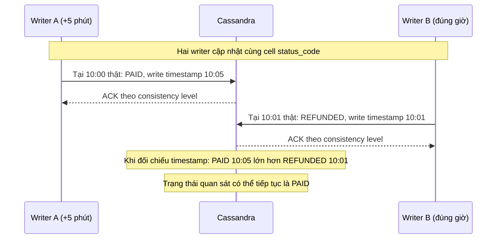

# Ảnh hưởng của lệch đồng hồ giữa các nơi ghi dữ liệu

Trong **Spring Data Cassandra**, một lời gọi `repository.save(...)`, `CassandraTemplate.update(...)` hay câu `UPDATE` qua `CqlTemplate` có thể được thực hiện đồng thời bởi nhiều instance ứng dụng, nhiều job hoặc các dịch vụ chạy tại các datacenter khác nhau. Khi chúng ghi lên **cùng một cell**, Apache Cassandra cần một quy tắc xác định phiên bản nào có hiệu lực. Một phần quan trọng của quy tắc đó là **write timestamp**.

Điểm dễ gây nhầm lẫn: Cassandra thường sử dụng cơ chế đối chiếu **last-write-wins dựa trên timestamp của mutation**, chứ không đơn giản chọn request nào được server nhận sau cùng. Nếu đồng hồ giữa các nơi ghi bị lệch, một bản ghi đến **muộn hơn ngoài đời thực** có thể mang timestamp **nhỏ hơn**, vì vậy bị dữ liệu cũ che khuất dù thao tác ghi đã trả thành công.

Bài học thuộc chương **Timestamp và xung đột**, tập trung vào ảnh hưởng của *clock skew* lên dữ liệu Cassandra: cách phân biệt timestamp của cell với cột `timestamp`, nguồn tạo write timestamp, trường hợp một writer chạy nhanh/chậm đồng hồ, tác động tới `UPDATE`, `DELETE` và TTL, cũng như cách thiết kế Spring Data Cassandra để giảm rủi ro trong hệ phân tán.

## 1. Trước hết: hai khái niệm “timestamp” khác nhau

Trong Cassandra, cùng chữ `timestamp` có thể chỉ **hai loại dữ liệu hoàn toàn khác**:

| Khái niệm | Nó biểu diễn gì? | Đơn vị/đặc điểm | Có quyết định xung đột ghi không? |
| --- | --- | --- | --- |
| Cột CQL `timestamp` | Một thời điểm nghiệp vụ, ví dụ `occurred_at`, `updated_at` | Mốc thời gian epoch ở độ chính xác **millisecond**; Java thường là `Instant` | **Không tự động**, trừ khi ứng dụng còn dùng thời điểm ấy để gán write timestamp |
| **Write timestamp** của mutation/cell | Metadata Cassandra dùng để đối chiếu các bản ghi cạnh tranh | Giá trị số theo **microsecond** kể từ Unix epoch trong giao diện CQL | **Có**, ảnh hưởng lựa chọn giá trị tồn tại |

Ví dụ cột `updated_at timestamp` có thể lưu `2026-11-25T10:00:00Z`, trong khi metadata `WRITETIME(status_code)` của cell có thể mang một timestamp khác do driver hoặc coordinator cung cấp.

**Không nên hiểu `ORDER BY updated_at DESC` là cơ chế giải quyết xung đột Cassandra.** Nó chỉ là yêu cầu sắp xếp kết quả khi schema/truy vấn cho phép. Cassandra đối chiếu bản sao của một cell theo write timestamp và các quy tắc giải quyết giá trị bằng nhau, bất kể cột nghiệp vụ `updated_at` được đặt tên gì.

## 2. Cùng một khóa, nhiều writer: chuyện gì xảy ra?

Giả sử ứng dụng quản lý trạng thái đơn hàng theo tenant/ngày:

```sql
CREATE TABLE orders_by_tenant_day (
    tenant_id    text,
    order_day    date,
    order_id     uuid,
    status_code  text,
    updated_at   timestamp,
    updated_by   text,
    PRIMARY KEY ((tenant_id, order_day), order_id)
);
```

`(tenant_id, order_day)` là **partition key ghép**, `order_id` là clustering column. Toàn bộ ví dụ dưới đây thao tác cùng một hàng, tức cùng ba thành phần khóa.

Hãy tưởng tượng hai instance ứng dụng:

- **Writer A:** đồng hồ hệ điều hành chạy **nhanh 5 phút**.
- **Writer B:** đồng hồ tương đối chính xác.
- A cập nhật `status_code = 'PAID'` lúc 10:00 theo thời gian thực; vì lệch đồng hồ, mutation của A mang thời gian tương đương 10:05.
- B cập nhật `status_code = 'REFUNDED'` lúc 10:01 theo thời gian thực; mutation của B mang thời gian tương đương 10:01.



Trực giác nghiệp vụ cho rằng `REFUNDED` là hành động mới hơn. Nhưng cơ chế hòa giải timestamp của Cassandra **không có thông tin về thứ tự nghiệp vụ thực tế**; nó so sánh timestamp. Vì vậy một ghi A từ “tương lai” có thể chiếm ưu thế trong nhiều phút, cho tới khi một mutation khác của cùng cell có write timestamp lớn hơn.

**Quan trọng:** Cassandra có thể ACK cho cả hai thao tác ghi. ACK nghĩa là mutation đáp ứng điều kiện của **consistency level** và cơ chế ghi; nó **không cam kết** mutation đó trở thành giá trị thắng cuộc sau đối chiếu nếu đã có phiên bản với timestamp cao hơn.

## 3. Last-write-wins thực tế là “timestamp lớn hơn thắng”

Cassandra không dùng đồng hồ toàn cục đáng tin cậy hoặc một tổng thứ tự giao dịch trên mọi node để quyết định bản nào là “cuối cùng”. Đối với các giá trị cell thông thường, những mutation có cùng khóa/cột được hòa giải dựa trên **write timestamp**; một mutation mang timestamp lớn hơn thường được ưu tiên hơn mutation có timestamp nhỏ hơn.

Khi timestamps **bằng nhau**, Cassandra còn có các quy tắc quyết định kết quả (bao gồm xử lý deletion và so sánh giá trị theo quy tắc nội bộ), vì vậy **không được coi hai write cùng timestamp là hai phiên bản được lưu giữ theo thứ tự đến**. Với `UPDATE` không có điều kiện, cũng không có nghĩa một giá trị được bảo vệ bởi compare-and-swap.

### 3.1. Ví dụ CQL chỉ định timestamp để thấy rõ quy tắc

Trong CQL, có thể ghi write timestamp theo đơn vị **microsecond** bằng `USING TIMESTAMP` cho các câu lệnh hỗ trợ. Hai câu sau minh họa cùng hàng:

```sql
-- Writer A: timestamp cao, tương đương đồng hồ nhanh.
UPDATE orders_by_tenant_day
USING TIMESTAMP 1800000300000000
SET status_code = 'PAID'
WHERE tenant_id = 'tenant-a'
  AND order_day = '2026-11-25'
  AND order_id = 550e8400-e29b-41d4-a716-446655440000;

-- Writer B được thực thi SAU nhưng mang timestamp thấp hơn.
UPDATE orders_by_tenant_day
USING TIMESTAMP 1800000060000000
SET status_code = 'REFUNDED'
WHERE tenant_id = 'tenant-a'
  AND order_day = '2026-11-25'
  AND order_id = 550e8400-e29b-41d4-a716-446655440000;
```

Nếu không có mutation khác, giá trị `status_code` được hòa giải theo timestamp lớn hơn sẽ là `PAID`, dù câu B chạy sau. Các con số là **timestamp minh họa**, không phải dữ liệu sản xuất; không nên sao chép số timestamp cố định vào ứng dụng thật.

Kiểm tra cell:

```sql
SELECT status_code, WRITETIME(status_code) AS status_write_us
FROM orders_by_tenant_day
WHERE tenant_id = 'tenant-a'
  AND order_day = '2026-11-25'
  AND order_id = 550e8400-e29b-41d4-a716-446655440000;
```

`WRITETIME(status_code)` hiển thị write timestamp của cell `status_code` theo **microsecond** đối với kiểu cell mà hàm hỗ trợ. Không sử dụng `WRITETIME` trên primary key; với collection, counter hoặc dữ liệu đã xóa, khả năng quan sát và cú pháp có những giới hạn riêng. Hàm này là công cụ **chẩn đoán**, không phải cách định nghĩa thứ tự nghiệp vụ.

### 3.2. Timestamp là metadata theo cell, không nhất thiết theo row

Một row Cassandra có thể gồm nhiều cell được ghi ở các thời điểm khác nhau. Ví dụ:

```sql
UPDATE orders_by_tenant_day
SET updated_by = 'billing-service'
WHERE tenant_id = 'tenant-a'
  AND order_day = '2026-11-25'
  AND order_id = 550e8400-e29b-41d4-a716-446655440000;
```

Nếu mutation này có write timestamp lớn hơn, `updated_by` có thể hiển thị tác giả của lần ghi mới, trong khi `status_code` vẫn giữ `PAID` từ writer A. Một hàng có thể tạm thời chứa **tổ hợp thuộc tính không khớp ý nghĩa nghiệp vụ**, dù mỗi cell tuân thủ cơ chế đối chiếu riêng.

Đừng xem một trường `updated_at` là “phiên bản của cả hàng” nếu các thuộc tính có thể được ghi độc lập. Nếu nghiệp vụ cần chuyển trạng thái đồng thời với thông tin phiên bản một cách có điều kiện, phải thiết kế cơ chế nhất quán ở tầng nghiệp vụ.

## 4. Write timestamp do ai tạo ra?

Có nhiều nguồn có thể cung cấp write timestamp, tùy câu CQL, cấu hình Java Driver và tầng truy cập:

| Nguồn timestamp | Trường hợp điển hình | Điểm dễ bị ảnh hưởng bởi clock skew |
| --- | --- | --- |
| `USING TIMESTAMP <microseconds>` | Ứng dụng chỉ định timestamp CQL tường minh | Đồng hồ/logic tạo giá trị bên ứng dụng |
| Timestamp trên statement từ Java Driver | `setQueryTimestamp(...)`, timestamp generator của driver | Đồng hồ máy chạy driver hoặc quy tắc generator |
| Coordinator tự cấp timestamp | Khi request không mang client timestamp và server cần tạo timestamp | Đồng hồ node coordinator xử lý mutation |
| Pipeline đồng bộ/CDC/replay có timestamp gốc | Phục hồi hoặc phát lại thay đổi từ nguồn khác | Timestamp gốc có thể cũ/quá mới so với dữ liệu hiện tại |

**Không mặc định Cassandra luôn lấy đồng hồ của node server.** Tùy cấu hình, Java Driver 4 có thể sử dụng **client-side timestamp generator**. Khi đó việc các node Cassandra đồng bộ NTP tốt không giải quyết hết vấn đề nếu clock của các pod/host ứng dụng lệch.

Ngược lại, nếu timestamp do server tạo, việc các coordinator ở những vùng khác nhau có đồng hồ lệch cũng có thể tạo xung đột tương tự. Cần xác minh **nguồn timestamp thực tế** trên đường ghi cụ thể, không chỉ tên phương thức `save` hay `insert`.

### 4.1. Timestamp generator “monotonic” không phải đồng hồ toàn cluster

Driver có thể cung cấp timestamp generator cố gắng phát giá trị tăng dần ngay cả khi nhiều thao tác xảy ra rất sát nhau trên **một instance**. Điều đó giúp giảm rủi ro cùng timestamp trong phạm vi generator, nhưng **không tạo tổng thứ tự giữa các host/pod/service**.

`System.nanoTime()` của Java là đồng hồ đo khoảng thời gian, **không phải timestamp Unix epoch**, nên không được dùng trực tiếp làm CQL write timestamp. `Instant.now()`/đồng hồ hệ thống có thể tạo mốc epoch, nhưng độ chính xác và độ lệch đồng hồ phải được kiểm soát; tự nhân `System.currentTimeMillis()` với 1000 không làm tăng độ chính xác thực tế lên microsecond.

## 5. Lệch đồng hồ gây những loại lỗi nào?

### 5.1. Ghi mới bị che bởi một ghi cũ có timestamp tương lai

Đây là tình huống chính của bài. Một writer A bị lệch +5 phút viết cell với timestamp ở tương lai. Năm thao tác cập nhật sau đó từ writer khác đều có timestamp thấp hơn, nên có thể **không thay đổi giá trị đọc ra**.

Nếu chỉ nhìn HTTP response hoặc ACK Cassandra, ứng dụng có thể tưởng mọi cập nhật đã được áp dụng. Do đó với trường quan trọng, cần quan sát **giá trị sau ghi**, metadata write timestamp khi điều tra và đối soát luồng sự kiện.

### 5.2. Ghi cũ từ pipeline bị phát lại với timestamp quá lớn

Một job replay/backfill không chỉ có nguy cơ ghi “dữ liệu cũ”, mà còn có thể cấp **write timestamp không tương ứng thứ tự nghiệp vụ**. Nếu replay dùng đồng hồ bị lệch hoặc giữ lại timestamp lỗi từ nguồn, nó có thể ghi đè dữ liệu mới từ hệ thống chính.

Ngược lại, replay với timestamp cũ hơn cell hiện tại có thể hoàn tất thành công nhưng **không tạo thay đổi quan sát được**. Quy trình backfill phải xác định cách chọn timestamp và chính sách ưu tiên giữa dữ liệu lịch sử, dữ liệu mới.

### 5.3. Ghi đồng thời từ hai vùng và hai service

Đồng hồ NTP chính xác hơn không loại bỏ hoàn toàn tranh chấp logic: hai dịch vụ có thể cập nhật cùng cell gần như cùng thời điểm. Với mạng phân tán, thứ tự nhận request ở coordinator không nhất thiết khớp thứ tự hành động nghiệp vụ. Clock skew chỉ **làm rủi ro lớn hơn và khó dự đoán hơn**.

Ví dụ `payment-service` chuyển đơn sang `PAID`, còn `refund-service` chuyển sang `REFUNDED`. Nếu việc hoàn tiền chỉ hợp lệ sau thanh toán, nên có **quy tắc chuyển trạng thái có điều kiện** thay vì dựa hoàn toàn vào timestamp lớn nhất.

### 5.4. Trộn write timestamp của nhiều cột

Ngay cả khi hai cột được cập nhật “gần cùng lúc”, nếu có các mutation cạnh tranh hoặc chỉ cập nhật một phần field, `status_code`, `updated_at` và `updated_by` có thể không cùng thế hệ dữ liệu. Dùng một cột `updated_at timestamp` để suy ra mọi cell thuộc cùng lần ghi là giả định không an toàn.

## 6. DELETE và tombstone: clock skew có thể còn nguy hiểm hơn

Trong Cassandra, `DELETE` không chỉ xóa vật lý tức thời. Nó ghi thông tin xóa (*tombstone*) để các replica có thể hội tụ và tránh phục hồi dữ liệu đã xóa từ bản sao chưa kịp nhận deletion.

Ví dụ xóa trạng thái của một đơn:

```sql
DELETE status_code
FROM orders_by_tenant_day
USING TIMESTAMP 1800000060000000
WHERE tenant_id = 'tenant-a'
  AND order_day = '2026-11-25'
  AND order_id = 550e8400-e29b-41d4-a716-446655440000;
```

Nếu cell `status_code` đã được ghi với timestamp `1800000300000000` của writer A, deletion có timestamp thấp hơn **không thắng** cell đó trong quá trình hòa giải. API có thể tưởng đã xóa nhưng giá trị vẫn được đọc thấy.

Ngược lại, một tombstone mang timestamp **quá xa trong tương lai** có thể tiếp tục thắng nhiều lần ghi hợp lệ đến sau theo thời gian thực. Vì vậy lệch đồng hồ không chỉ làm “cập nhật cũ thắng”, mà còn có thể làm **dữ liệu bị che giấu bởi deletion**.

**Không tự ý sửa bằng cách cấp timestamp cực lớn cho mọi DELETE.** Điều đó có thể tạo tombstone tương lai, khiến dữ liệu hợp lệ sau này khó được ghi trở lại và tăng rủi ro đối soát. Cần sửa nguồn clock skew hoặc quy trình dữ liệu, không dùng timestamp giả để “đè mọi thứ”.

### 6.1. Không nhầm tombstone với null/UNSET

- Ghi `null` cho một cột thường trong CQL thường mang **ngữ nghĩa xóa cell**, có tombstone.
- **UNSET** ở tham số statement là bỏ qua việc cập nhật cell đó trong thao tác, không tự tạo deletion tương đương.
- `DELETE` có timestamp cạnh tranh với các write khác; nếu thấp hơn một live cell đang thắng thì có thể không làm giá trị biến mất.

Nếu API PATCH không phân biệt “không gửi field” với “chủ động xóa field”, lỗi clock skew có thể bị cộng thêm rủi ro tạo tombstone không mong muốn. Cần thiết kế update có mục tiêu và kiểm chứng statement thực tế.

## 7. TTL và thời điểm hết hạn

Cassandra hỗ trợ TTL (time to live) để dữ liệu hết hạn sau một số giây. Một mutation có TTL cũng mang write timestamp để giải quyết xung đột; giá trị sống/hết hạn còn phụ thuộc metadata TTL và quy tắc thời gian của Cassandra.

```sql
UPDATE orders_by_tenant_day
USING TTL 86400
SET updated_by = 'retention-job'
WHERE tenant_id = 'tenant-a'
  AND order_day = '2026-11-25'
  AND order_id = 550e8400-e29b-41d4-a716-446655440000;
```

**`86400` giây là 24 giờ**, không phải “đến cuối ngày theo múi giờ người dùng”. Không đồng nhất TTL với `timestamp` của event hoặc với một `duration` mang ngữ nghĩa tháng/ngày lịch.

Clock skew có thể ảnh hưởng cách các node tính/quan sát thời điểm của dữ liệu hết hạn và cách mutation với TTL cạnh tranh với các mutation khác. Vì chi tiết phụ thuộc phiên bản và đường ghi, **không được suy ra đơn giản rằng một write timestamp trong tương lai làm TTL kéo dài đúng bấy nhiêu phút**. Hãy kiểm tra `TTL(column)`, `WRITETIME(column)`, timestamp nguồn ghi và phiên bản Cassandra khi điều tra.

```sql
SELECT updated_by,
       TTL(updated_by) AS remaining_ttl_seconds,
       WRITETIME(updated_by) AS updated_by_write_us
FROM orders_by_tenant_day
WHERE tenant_id = 'tenant-a'
  AND order_day = '2026-11-25'
  AND order_id = 550e8400-e29b-41d4-a716-446655440000;
```

`TTL(column)` trả số giây TTL còn lại của cell phù hợp khi có TTL, còn `WRITETIME` giúp xem timestamp metadata. Với dữ liệu đã hết hạn/xóa hoặc cell không có TTL, kết quả có thể `null` hoặc không còn hàng/giá trị để quan sát. Không dùng các hàm này làm API nghiệp vụ thông thường nếu không thật sự cần.

## 8. Read/write consistency có giải quyết được lệch đồng hồ không?

Không. Consistency level như `LOCAL_ONE`, `LOCAL_QUORUM` quyết định số replica cần phản hồi cho thao tác đọc/ghi theo topology của Cassandra. Nó **không so sánh trạng thái theo thứ tự nghiệp vụ** hay sửa một mutation có timestamp sai.

Giả sử cùng DC có RF=3:

| Write CL | Read CL | Giao replica theo lý thuyết | Có sửa được clock skew? |
| --- | --- | --- | --- |
| `LOCAL_ONE` | `LOCAL_ONE` | Không bảo đảm giao | **Không** |
| `LOCAL_QUORUM` | `LOCAL_QUORUM` | Với RF=3: `2+2>3`, có giao | **Không** |
| `LOCAL_ONE` | `LOCAL_QUORUM` | `1+2=3`, không có bảo đảm giao | **Không** |

Với write `LOCAL_QUORUM` và read `LOCAL_QUORUM`, ứng dụng có cơ sở mạnh hơn để thấy **giá trị thắng theo quy tắc Cassandra** sau khi ghi thành công trong cùng DC. Nhưng nếu một cell mang timestamp tương lai đang thắng, giá trị được đọc nhất quán có thể **vẫn là giá trị sai theo nghiệp vụ**.

Đây là phân biệt giữa:

1. **Replica consistency:** các replica phục vụ thao tác có đủ phản hồi và đang hòa giải theo quy tắc Cassandra.
2. **Business ordering:** một chuyển trạng thái `REFUNDED` phải đứng sau `PAID` bất kể đồng hồ nào nhanh hơn.

Có thể đạt mục tiêu thứ nhất mà **không đạt** mục tiêu thứ hai. Đừng hạ/tăng CL để chữa một lỗi mô hình hóa chuyển trạng thái.

### Cross-datacenter không giúp “chọn đồng hồ đúng”

Giả sử writer A ở `dc_east` và writer B ở `dc_west`, cùng cập nhật một partition. Các replica có thể nhận mutation theo thứ tự khác nhau, nhưng khi hòa giải chúng vẫn xem write timestamp và quy tắc xung đột. `LOCAL_QUORUM` ở một DC không tạo thứ tự tổng thể giữa các thao tác ở hai DC, cũng không biến timestamp sai của một writer thành đúng.

## 9. CQL và Java Driver 4: kiểm soát write timestamp có chủ đích

Trong Java Driver 4, một số statement có thể nhận **query timestamp** theo microsecond thông qua API statement. Đây là quyền điều khiển mức thấp, cần dùng rất thận trọng.

Ví dụ khi ứng dụng đã có một timestamp được **kiểm soát từ nguồn đáng tin**:

```java
import java.time.LocalDate;
import java.util.UUID;
import com.datastax.oss.driver.api.core.CqlSession;
import com.datastax.oss.driver.api.core.cql.BoundStatement;
import com.datastax.oss.driver.api.core.cql.PreparedStatement;

public final class OrderStatusWriter {
    private final CqlSession session;
    private final PreparedStatement updateStatus;

    public OrderStatusWriter(CqlSession session) {
        this.session = session;
        this.updateStatus = session.prepare(
                "UPDATE orders_by_tenant_day " +
                "SET status_code = ? " +
                "WHERE tenant_id = ? AND order_day = ? AND order_id = ?");
    }

    public void setStatus(
            String statusCode, String tenantId, LocalDate orderDay,
            UUID orderId, long controlledWriteMicros) {

        if (statusCode == null || statusCode.isBlank()
                || tenantId == null || tenantId.isBlank()
                || orderDay == null || orderId == null) {
            throw new IllegalArgumentException("Thiếu dữ liệu/khóa");
        }

        BoundStatement bound = updateStatus.bind(
                statusCode, tenantId, orderDay, orderId)
                .setQueryTimestamp(controlledWriteMicros);

        session.execute(bound);
    }
}
```

**Đây là minh họa kỹ thuật, không phải khuyến nghị đặt custom timestamp cho mọi thao tác.** Nếu nguồn `controlledWriteMicros` lấy từ một đồng hồ bị lệch hoặc một event cũ không có thứ tự được xác minh, bạn chỉ đang đưa vấn đề clock skew vào CQL một cách tường minh hơn.

Ưu tiên quản lý `CqlSession` dùng chung và tái sử dụng `PreparedStatement` cho query shape cố định. Nếu ứng dụng hiện dùng `CassandraRepository` hoặc `CassandraTemplate`, hãy kiểm tra đường ghi nào sinh timestamp; đừng giả định có thể kiểm soát tất cả write timestamps bằng một annotation ở entity.

### 9.1. Chỉ định CQL `USING TIMESTAMP`

Một lựa chọn mức CQL:

```sql
UPDATE orders_by_tenant_day
USING TIMESTAMP ?
SET status_code = ?
WHERE tenant_id = ? AND order_day = ? AND order_id = ?;
```

Tham số đầu phải là **số microsecond** hợp lệ, các tham số tiếp theo là giá trị và **đầy đủ primary key**. Không truyền epoch millisecond vào vị trí microsecond: sai đơn vị có thể làm timestamp rơi xa quá khứ, khiến ghi hiện tại liên tục bị các cell mới hơn lấn át.

**Không gán timestamp bằng clock của UI/client không đáng tin.** Trong bài toán có người dùng cuối hoặc nhiều hệ thống gửi event, metadata event-time có thể khác write-time; nếu thứ tự nghiệp vụ là dữ kiện quan trọng, cần mô hình hóa riêng.

### 9.2. Spring Data Cassandra và đường ghi được tạo tự động

Một lệnh như:

```java
// record là entity OrderRecord đã có đầy đủ khóa và dữ liệu hợp lệ.
repository.save(record);
```

... không cung cấp một hợp đồng rõ ràng rằng `record.getUpdatedAt()` tự được dùng làm **Cassandra write timestamp**. Thực tế phụ thuộc repository/template, Java Driver và options đã cấu hình. `@Column("updated_at")` chỉ ánh xạ **cột dữ liệu**, không phải một cơ chế đồng bộ timestamp ghi của mọi cell.

Khi cần điều tra, hãy đọc `WRITETIME(status_code)` thay vì chỉ kiểm tra `updated_at`; từ đó xác định producer, phiên bản ứng dụng và đường thực thi sinh timestamp.

## 10. Khi cần thứ tự nghiệp vụ: không dựa hoàn toàn vào đồng hồ

Đối với sự kiện chỉ mang tính log/telemetry, kiến trúc có thể chấp nhận **eventual consistency** và cho phép nhiều writer ghi. Nhưng đối với trạng thái quan trọng — thanh toán, đơn thuê, quyền truy cập, tồn kho — câu hỏi không phải chỉ “cell nào có timestamp lớn hơn?” mà là “chuyển trạng thái nào được phép và ai quyết định?”.

### 10.1. Bản ghi trạng thái có version kiểm soát bằng LWT

Một cách tiếp cận là dùng **lightweight transaction (LWT)** với so sánh version trên một partition/hàng được thiết kế phù hợp:

```sql
CREATE TABLE order_state_by_id (
    order_id      uuid PRIMARY KEY,
    status_code   text,
    version       bigint
);
```

Ví dụ chỉ cập nhật khi version hiện tại là 7:

```sql
UPDATE order_state_by_id
SET status_code = 'REFUNDED',
    version = 8
WHERE order_id = 550e8400-e29b-41d4-a716-446655440000
IF version = 7;
```

Cassandra trả kết quả có điều kiện, bao gồm chỉ báo `[applied]` để ứng dụng biết cập nhật có được chấp nhận hay không. Nếu writer khác đã thay version, lệnh không áp dụng và service cần xử lý conflict bằng quy tắc nghiệp vụ.

**LWT không phải giải pháp miễn phí.** Nó có chi phí round-trip/đồng thuận cao hơn ghi thường, nên dùng có mục tiêu cho nơi cần bất biến nghiệp vụ. Một `UPDATE IF version = ...` cũng không tự kiểm tra “PAID mới được REFUNDED”; service vẫn phải kiểm tra máy trạng thái và dữ liệu hiện hành trong giao thức an toàn.

Đặc biệt, **không trộn custom `USING TIMESTAMP` với conditional update/LWT** rồi giả định đó là cách đặt thứ tự ghi. Conditional statements có quy tắc và hạn chế riêng về timestamp; hãy dùng cơ chế điều kiện, không chế timestamp cao để giành quyền thắng.

### 10.2. Single writer, event log và idempotency

Những lựa chọn khác có thể phù hợp hơn tùy tải:

- **Single-writer theo khóa nghiệp vụ:** cùng một `order_id` được xử lý tuần tự tại một chủ thể/partition xử lý, tránh nhiều producer cạnh tranh trực tiếp trên `status_code`.
- **Event log có thứ tự:** giữ event ID, sequence/version hoặc thứ tự được nguồn phát hành bảo đảm; dùng consumer đã có chính sách replay để cập nhật read model Cassandra.
- **Idempotent updates:** một event hoặc request có ID ổn định; retry không được tạo bước nghiệp vụ mới khi event đã áp dụng.
- **Reconciliation:** đọc lại các event hợp lệ và tái dựng trạng thái theo luật nghiệp vụ nếu bảng read model bị xung đột hoặc mất đồng bộ.
- **Phân biệt event-time và processing-time:** `occurred_at` của sự kiện có thể đến muộn; `processed_at` là thời điểm xử lý, không nên lấy một trong hai làm thứ tự tuyệt đối nếu nguồn clock không tin cậy.

Không một chiến lược nào thay thế toàn bộ cơ chế bảo vệ nghiệp vụ; cần chọn theo SLA, số writer, tần suất tranh chấp và chi phí vận hành.

## 11. Thiết kế bảng theo truy vấn vẫn quan trọng

Clock skew là vấn đề **giải quyết xung đột ghi**; nó không làm mất yêu cầu Cassandra phải được thiết kế **theo truy vấn**.

Bảng `orders_by_tenant_day` trên hỗ trợ đọc theo:

```sql
SELECT order_id, status_code, updated_at
FROM orders_by_tenant_day
WHERE tenant_id = ?
  AND order_day = ?
LIMIT 50;
```

Câu CQL có đủ partition key và đọc nhiều hàng trong ngày. Nhưng nếu service muốn tìm một đơn bằng `order_id` mà không biết tenant/ngày, một index/lookup table hoặc access pattern riêng có thể cần thiết. `WRITETIME`, `LOCAL_QUORUM` hay timestamp generator **không tạo được đường tìm kiếm bằng khóa còn thiếu**.

Với dữ liệu được phân bucket theo ngày UTC, writer và reader phải dùng cùng quy tắc `order_day`; nếu máy client lệch ngày ở sát nửa đêm, nó còn có thể **ghi nhầm partition ngày**, không chỉ tạo write timestamp sai. Hãy tính bucket ngày từ nguồn thời gian được xác định rõ và kiểm tra ở biên hệ thống.

### Hai tác động độc lập của clock skew

| Dùng đồng hồ để... | Lỗi khi lệch | Cách giảm thiểu |
| --- | --- | --- |
| Tạo Cassandra write timestamp | Mutation cũ thắng mutation đến sau | Đồng bộ nguồn timestamp, tránh nhiều writer tranh chấp, LWT/version khi cần |
| Tính `order_day`/bucket ngày | Ghi/đọc nhầm partition | Quy tắc UTC rõ ràng, nguồn event-time đáng tin, validation |
| Lưu `updated_at` để hiển thị | UI hiện thời gian vô lý hoặc ngược thứ tự | Gắn nguồn timestamp, phân biệt event-time/processing-time |
| Tạo TTL/expiration | Hạn hết hạn khác kỳ vọng | Kiểm thử với clock drift, quan sát TTL và dữ liệu lịch sử |
| Cấp sequence/ID dựa trên thời gian | Thứ tự ID không phản ánh nghiệp vụ | Dùng sequence/ID có bảo đảm rõ ràng theo domain |

## 12. Quan sát và xử lý sự cố clock skew ở production

Một quy trình xử lý hiệu quả phải phân biệt **lỗi đồng hồ** với **độ trễ replication** và **tranh chấp nghiệp vụ**.

### 12.1. Tín hiệu nên giám sát

1. **Clock offset** của tất cả host phát mutation: node ứng dụng, worker, producer của CDC/backfill và node Cassandra có thể đóng vai coordinator.
2. Trạng thái NTP/chrony hoặc cơ chế đồng bộ thời gian tương đương; cảnh báo khi offset vượt ngưỡng được vận hành quy định.
3. `WRITETIME` của các cell nghi vấn so với thời điểm yêu cầu, thời gian hệ thống và trace của writer.
4. Tỷ lệ ACK thành công nhưng **giá trị đọc sau ghi khác mong đợi** trên những luồng cho phép đối soát.
5. Mutation cùng key từ nhiều producer, retry/replay bất thường và các thay đổi trạng thái vi phạm máy trạng thái.
6. Read/write timeout, unavailable, latency p95/p99, trạng thái replica, repair backlog và khối lượng tombstone.

Không cần ghi toàn bộ payload nhạy cảm vào log. Nên ghi request ID, khóa đã được phép, producer ID, source timestamp, write timestamp (khi có), version và kết quả áp dụng theo chính sách bảo mật.

### 12.2. Thao tác điều tra một hàng có vấn đề

1. Xác nhận **full primary key** của hàng nghi vấn và keyspace/bảng thực.
2. Đọc `status_code`, `updated_at` cùng `WRITETIME(status_code)`; đối chiếu timeline của các producer.
3. Xác định timestamp đang do **driver** hay **coordinator** tạo, có sử dụng `USING TIMESTAMP` hoặc pipeline replay không.
4. Kiểm tra offset đồng hồ trên **đúng host** đã phát mutation. Một node Cassandra khỏe không đủ nếu producer ứng dụng lệch giờ.
5. Kiểm tra thao tác `DELETE`/TTL liên quan và các mutation có timestamp tương lai.
6. Nếu có xung đột nghiệp vụ, quyết định trạng thái hợp lệ bằng nguồn sự thật/event log thay vì đơn giản chọn timestamp lớn nhất.
7. Áp dụng phương án sửa có kiểm soát, thử trên dữ liệu đại diện và theo dõi write/read sau sửa.

**Không giải quyết bằng `USING TIMESTAMP 9999999999999999` đại trà.** Một timestamp quá lớn hoặc không hợp lệ có thể làm việc ghi bình thường về sau khó có hiệu lực; nếu số nằm ngoài giới hạn hợp lệ còn có thể bị từ chối. Cần quy trình repair/reconciliation có đánh giá timestamp và tombstone.

### 12.3. Chặn rủi ro trước khi xảy ra

- Thiết lập và giám sát đồng bộ thời gian trên **cả ứng dụng lẫn Cassandra**; có ngưỡng cảnh báo và quy trình cô lập producer lệch nhiều.
- Dùng timestamp generator được cấu hình/kiểm chứng; tránh nhiều cách sinh timestamp tùy tiện giữa các dịch vụ.
- Không tin đồng hồ phía client/mobile cho write timestamp Cassandra.
- Tách pipeline backfill khỏi traffic nóng, giới hạn tải, ghi checkpoint và có chính sách ghi đè được phê duyệt.
- Với trường trạng thái nhạy cảm, dùng version/LWT hoặc single-writer để bảo vệ bất biến thay vì chỉ dựa vào LWW.
- Kiểm thử case **lệch đồng hồ ±5 phút, mất kết nối, retry, replay và đổi ngày UTC** trước khi triển khai quy trình quan trọng.

## 13. Bài tập tình huống

**Tình huống A — Writer chạy nhanh.** A ghi `status_code='PAID'` lúc 10:00 thật nhưng đồng hồ nhanh 5 phút; B ghi `'REFUNDED'` lúc 10:01 với đồng hồ đúng. Cả hai được ACK. Giá trị nào có thể được nhìn thấy sau khi replica hội tụ?

**Đáp án gợi ý:** `PAID` có thể thắng vì mutation A mang write timestamp 10:05, cao hơn B 10:01. ACK không có nghĩa B là bản ghi thắng theo thứ tự nghiệp vụ.

**Tình huống B — Quorum có cứu được không?** Cả A và B ghi `LOCAL_QUORUM`, sau đó service đọc `LOCAL_QUORUM` tại cùng DC với RF=3. Có thể khẳng định `REFUNDED` thắng không?

**Đáp án gợi ý:** Không. Quorum intersection giúp quan sát giá trị đã hòa giải theo cơ chế Cassandra, **không xác định thứ tự nghiệp vụ**. Timestamp tương lai của A vẫn có thể thắng.

**Tình huống C — Xóa không hiệu lực.** Một cell có write timestamp 2000 (đơn vị ở đây chỉ là giá trị so sánh). Một `DELETE` mới về thời gian thực được ghi với timestamp 1900. Có chắc cell biến mất?

**Đáp án gợi ý:** Không. Tombstone có timestamp thấp hơn không thắng live cell mới hơn theo metadata. Cần tìm nguyên nhân tạo timestamp lệch trước khi quyết định sửa.

**Tình huống D — Đọc `updated_at`.** API hiển thị `updated_at='10:01'`, nhưng `WRITETIME(status_code)` tương ứng 10:05. Có mâu thuẫn ở Cassandra không?

**Đáp án gợi ý:** Không nhất thiết. `updated_at` là dữ liệu nghiệp vụ dạng CQL `timestamp` (millisecond), `WRITETIME` là metadata ghi của riêng cell `status_code` (microsecond). Chúng có thể đến từ nguồn khác nhau hoặc các mutation khác nhau.

**Tình huống E — Chuyển trạng thái quan trọng.** Hai service cùng thay đổi trạng thái đơn; nếu yêu cầu `REFUNDED` chỉ xảy ra khi đã `PAID`, nên thiết kế thế nào?

**Đáp án gợi ý:** Dùng state machine và cơ chế bảo vệ concurrency thích hợp, chẳng hạn LWT với version/expected state hoặc single-writer theo `order_id`. Chỉ tăng timestamp hay CL không đủ bảo vệ bất biến.

**Tình huống F — Sai bucket.** Worker dùng `LocalDate.now()` theo múi giờ host để đặt `order_day`; service đọc tính ngày UTC từ `Instant`. Điều gì có thể xảy ra gần nửa đêm?

**Đáp án gợi ý:** Writer và reader tính khác partition key, nên dữ liệu có thể được ghi vào ngày khác với ngày reader truy vấn. Cần hợp đồng bucket theo UTC hoặc theo zone nghiệp vụ được định nghĩa rõ, không dựa vào timezone mặc định của host.

## Kết luận

Trong Apache Cassandra, **lệch đồng hồ giữa các nơi ghi dữ liệu** có thể khiến mutation cũ mang **write timestamp lớn hơn** và thắng mutation đến sau, gây trạng thái “ghi thành công nhưng không thấy cập nhật”, `DELETE` không hiệu lực như kỳ vọng, dữ liệu bị che bởi tombstone, hoặc các cột cùng hàng phản ánh các lần ghi khác nhau. **Write timestamp microsecond** là metadata giải quyết xung đột, không đồng nhất với cột CQL `timestamp` thường biểu diễn thời điểm nghiệp vụ theo millisecond.

Với Spring Data Cassandra, cần **xác định ai sinh timestamp → đồng bộ và quan sát đồng hồ ở mọi writer/coordinator → phân biệt thời điểm nghiệp vụ với thứ tự ghi → tránh tranh chấp cùng cell không kiểm soát → dùng version/LWT hoặc single-writer khi có bất biến nghiệp vụ → kiểm thử retry, backfill, TTL và consistency**. `LOCAL_QUORUM`, repository hay template không tự khắc phục clock skew: tính đúng đắn phụ thuộc cả mô hình dữ liệu, nguồn thời gian và quy tắc cập nhật trong hệ phân tán.
