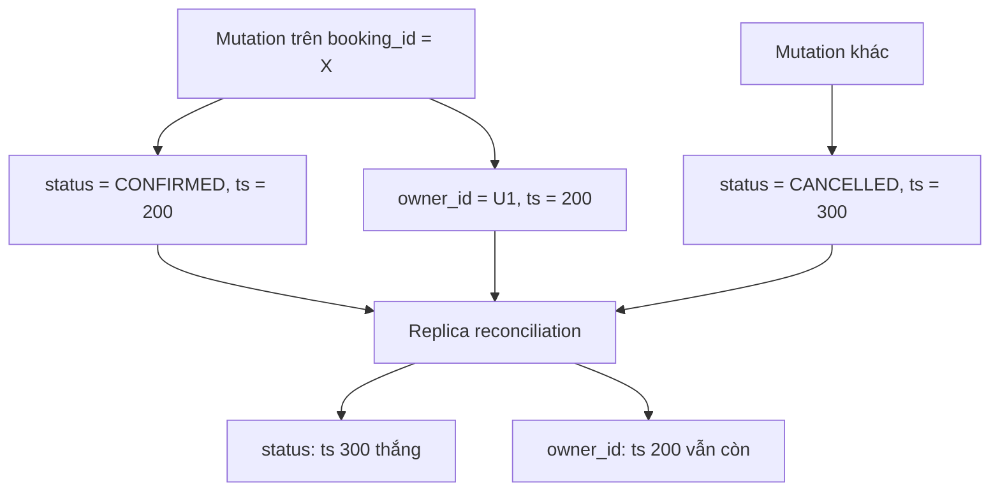
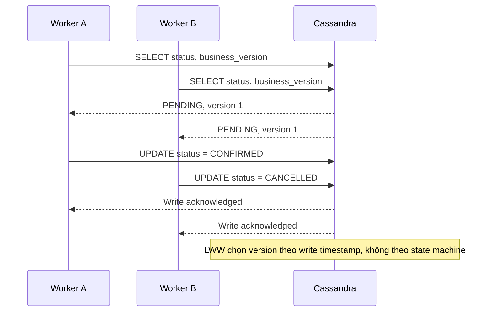
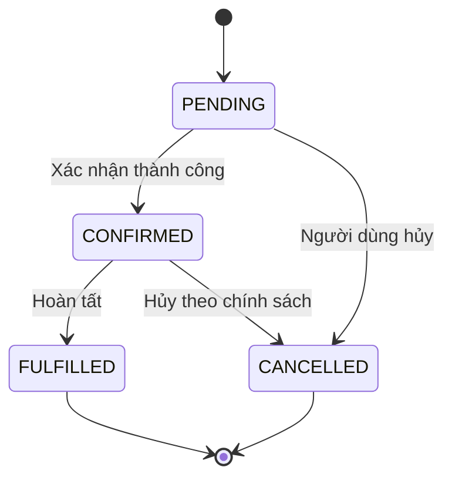

# Last-write-wins và giới hạn khi diễn giải thứ tự nghiệp vụ

Apache Cassandra sử dụng **timestamp của từng mutation/cell** để giải quyết các phiên bản dữ liệu xung đột trên các replica. Cơ chế này thường được gọi là **last-write-wins (LWW)**, nhưng chữ *last* rất dễ gây hiểu lầm: Cassandra ưu tiên giá trị có **write timestamp lớn hơn**, chứ không nhất thiết ưu tiên câu lệnh **đến server cuối cùng**, được **client gửi sau cùng**, hay sự kiện **xảy ra muộn nhất trong nghiệp vụ**.

Bài học thuộc chương **Timestamp và xung đột** của module **`SPRING_DATA_CASSANDRA`**. Module tập trung vào truy cập Cassandra qua entity mapping, Repository, `CassandraTemplate` và CQL; đồng thời học thiết kế bảng theo truy vấn, partition key, mức nhất quán, paging và hiệu năng trong hệ dữ liệu phân tán. Ở đây, chúng ta sẽ phân biệt cơ chế hòa giải phiên bản dữ liệu của Cassandra với **thứ tự trạng thái nghiệp vụ** như “đã giữ chỗ → đã xác nhận → đã hủy”.

**Sau bài học, bạn có thể:**

1. Giải thích vì sao LWW so sánh **write timestamp theo microsecond**, không dựa trên thứ tự request đến.
2. Phân biệt **write timestamp**, cột thời gian nghiệp vụ, event time, processing time và commit/acknowledgement time.
3. Quan sát `WRITETIME`, kiểm soát `USING TIMESTAMP` và `BoundStatement.setQueryTimestamp` khi thực sự cần.
4. Nhận biết ảnh hưởng của lệch đồng hồ, timestamp bằng nhau, ghi theo từng cột, tombstone và TTL.
5. Hiểu vì sao tăng consistency level hoặc dùng prepared statement **không biến last-write-wins thành kiểm tra thứ tự nghiệp vụ**.
6. Thiết kế **state machine**, LWT (`IF`), idempotency và version check khi cần bảo vệ invariant.
7. Viết các bài kiểm tra và quy trình quan sát xung đột trên bảng Cassandra mà không phá dữ liệu thật.

## 1. “Last” trong last-write-wins nghĩa là gì?

Trong một hệ thống chỉ có một tiến trình tuần tự, ta dễ nghĩ: request A chạy trước, request B chạy sau, vậy B thắng. Cassandra là **hệ dữ liệu phân tán**: các replica nhận mutation qua mạng, request có thể đến không đồng đều, bị retry và xuất phát từ nhiều client có đồng hồ không hoàn toàn đồng bộ.

Đối với các ô dữ liệu thông thường, Cassandra lưu **write timestamp** cùng giá trị để hòa giải các phiên bản:

```text
Cell status trên replica R1:
    value = "CONFIRMED"
    write timestamp = 500

Cell status trên replica R2:
    value = "CANCELLED"
    write timestamp = 700

Khi reconcile cùng cell:
    700 > 500 → "CANCELLED" được ưu tiên
```

Các số `500`, `700` ở đây chỉ để minh họa thứ tự; timestamp CQL thực tế dùng **số nguyên microsecond tính từ Unix epoch**. Một mutation đến muộn với timestamp thấp hơn vẫn có thể bị che khuất bởi mutation đến trước với timestamp cao hơn.

### Điều Cassandra không làm trong quá trình LWW

- Không đọc một cột `updated_at` rồi lấy giá trị đó để xếp thứ tự ghi, trừ khi **ứng dụng chủ động dùng giá trị ấy làm CQL write timestamp**.
- Không biết sự kiện “đã thanh toán” có phải xảy ra hợp lệ sau sự kiện “đã hủy” hay không.
- Không biến `status = 'CONFIRMED'` thành một trạng thái có thứ tự ưu tiên lớn hơn `status = 'PENDING'`.
- Không đảm bảo cả hàng luôn được chọn như một object phiên bản thống nhất nếu các lần ghi thay đổi **những cột khác nhau**.
- Không dùng thứ tự replica nhận gói tin làm quy tắc thắng/thua chính khi hòa giải.

**Kết luận:** LWW là **quy tắc kỹ thuật chọn phiên bản dữ liệu**, không phải bộ máy hiểu luật chuyển trạng thái của ứng dụng.

## 2. Chuẩn bị bảng CQL cho ví dụ

Giả sử một hệ thống quản lý booking cần tra cứu nhanh trạng thái hiện tại theo mã booking:

```sql
CREATE TABLE IF NOT EXISTS booking_state_by_id (
    booking_id uuid PRIMARY KEY,
    status text,
    owner_id uuid,
    business_version bigint,
    last_event_id uuid,
    updated_at timestamp
);
```

**Đọc schema:**

| Cột | Vai trò | Lưu ý |
| --- | --- | --- |
| `booking_id` | Partition key duy nhất | Định vị các replica của một booking |
| `status` | Trạng thái hiển thị | Một cell chịu quy tắc hòa giải theo write timestamp |
| `owner_id` | Thực thể liên quan | Có thể được ghi ở thời điểm khác `status` |
| `business_version` | Phiên bản do nghiệp vụ quản lý | **Không tự được Cassandra dùng cho LWW** |
| `last_event_id` | ID sự kiện nghiệp vụ cuối đã áp dụng | Phục vụ idempotency/audit theo thiết kế |
| `updated_at` | Thời điểm được ứng dụng ghi thành một **cột dữ liệu** | Không phải metadata `WRITETIME(status)` |

Ví dụ này cố ý có cả `business_version` và `updated_at` để cho thấy **thông tin nghiệp vụ không tự điều khiển quy tắc conflict resolution**. Nếu writer chỉ thay `status` mà quên cập nhật `business_version`, Cassandra không phát hiện đây là một chuyển trạng thái sai luật.

### Truy vấn theo đúng partition key

```sql
SELECT booking_id, status, owner_id,
       business_version, last_event_id, updated_at
FROM booking_state_by_id
WHERE booking_id = 761714ad-9fe5-4288-a766-f7c18335a83d;
```

Vì đã có đầy đủ `booking_id`, truy vấn có đường đọc hợp lý. Tuy nhiên, một truy vấn hiệu quả **không đồng nghĩa** với cập nhật đúng thứ tự nghiệp vụ: partition key giải quyết **nơi lưu/đọc**, còn LWW giải quyết **phiên bản dữ liệu nào thắng**.

## 3. Write timestamp được lưu ở cấp cell

Một cách đơn giản để hình dung:



Các cột thông thường được lưu với metadata timestamp riêng. Vì thế khi nhiều writer cập nhật **những tập cột khác nhau**, một hàng có thể chứa dữ liệu từ nhiều mutation:

| Cell | Giá trị còn hiệu lực | Write timestamp minh họa |
| --- | --- | ---: |
| `status` | `CANCELLED` | 300 |
| `owner_id` | `U1` | 200 |
| `business_version` | `1` | 200 |
| `updated_at` | Thời điểm do ứng dụng lưu | 200 |

Đây là một lý do **không dùng `updated_at` như bằng chứng chắc chắn rằng tất cả các cột cùng được ghi ở thời điểm ấy**. Nó chỉ là một cell độc lập trừ khi mọi đường ghi áp dụng chính sách đồng bộ được kiểm soát.

### Có phải Cassandra hoàn toàn không có atomicity?

Không nên suy ngược rằng **mỗi câu lệnh ghi đơn lẻ** nhất thiết lộ trạng thái nửa chừng. Cassandra có các bảo đảm atomicity cho mutation theo phạm vi partition và loại thao tác được hỗ trợ. Điểm đang nói ở đây là **hòa giải nhiều mutation cạnh tranh hoặc cập nhật các tập cột khác nhau được thực hiện ở cấp cell**. Một thao tác thành công trên từng cột **không tạo ra transaction đọc-sửa-ghi có điều kiện giữa các writer**.

### Ngoại lệ và cấu trúc lồng nhau

- **Counter columns** có ngữ nghĩa cộng dồn riêng, không nên dùng công thức LWW scalar cho counters.
- **Frozen collection/UDT/tuple** thường được xử lý như một giá trị tổng hợp khi ghi; cần chú ý thay toàn bộ giá trị.
- Với collection **không frozen**, các phần tử có thể có metadata/tombstone riêng; không coi cả collection luôn là một scalar duy nhất khi phân tích xung đột.

## 4. Timestamp thắng có thể không phải request đến sau

Giả sử hai request tác động lên cùng cell:

```text
Thời gian wall-clock mà hệ thống quan sát:

10:00:00  Request A được gửi:
          status = CONFIRMED, write timestamp = 2_000_000

10:00:01  Request B được gửi sau:
          status = CANCELLED, write timestamp = 1_000_000

Kết quả reconcile:
          CONFIRMED thắng vì 2_000_000 > 1_000_000
          Dù request B được gửi/nhận sau.
```

<text color="secondary">Các giá trị microsecond nhỏ trong sơ đồ chỉ là số mẫu để minh họa thứ tự; không phải timestamp thời gian thực của năm 2026.</text>

Lý do có thể xảy ra ngoài đời:

1. **Đồng hồ lệch (clock skew)** giữa hai client hoặc hai coordinator.
2. Writer B chủ động sử dụng timestamp cũ (ví dụ backfill dữ liệu lịch sử).
3. Một mutation được retry/gửi lại với timestamp đã tạo từ trước.
4. Các thao tác đến server theo thứ tự khác lúc ứng dụng phát lệnh.
5. Một writer vô tình dùng timestamp **trong tương lai**, che khuất các mutation hợp lệ phát sinh sau.

**Ghi nhớ:** Cassandra so sánh **timestamp đã gắn cho cell**, không lấy “lệnh nào có kết quả HTTP sau cùng” làm dữ liệu hòa giải.

## 5. Phân biệt năm loại thời gian

Trong ứng dụng đặt chỗ, một từ “timestamp” có thể được dùng cho nhiều ý nghĩa:

| Loại thời gian | Ví dụ | Có tự quyết định LWW không? |
| --- | --- | --- |
| **Cassandra write timestamp** | Microsecond gắn với cell status | **Có** đối với hòa giải phiên bản của cell đó |
| **Event time** | Thời điểm khách nhấn xác nhận booking | **Không** nếu chỉ là payload/cột Java |
| **Processing time** | Thời điểm worker bắt đầu xử lý event | Không |
| **`updated_at`** | Cột CQL `timestamp` trong bảng | Không; đây là giá trị dữ liệu |
| **Acknowledgement time** | Thời điểm client nhận response thành công | Không |

Ví dụ ứng dụng ghi:

```sql
UPDATE booking_state_by_id
SET status = 'CONFIRMED',
    updated_at = '2026-11-25T03:00:00Z'
WHERE booking_id = 761714ad-9fe5-4288-a766-f7c18335a83d;
```

Giá trị `updated_at` ở đây là **một thời điểm được lưu trong cột**, không phải `USING TIMESTAMP`. Nếu driver/server phát write timestamp khác, LWW dùng write timestamp đó. Không nên nhầm `updated_at` với metadata `WRITETIME(updated_at)`.

### Vì sao điều này quan trọng?

Một event có `eventTime = 10:03` được xử lý trước event có `eventTime = 10:01`. Nếu hai mutation được gắn write timestamps theo **processing time**, event xử lý sau có thể thắng dù là event nghiệp vụ cũ. Ngược lại, nếu gắn write timestamp trực tiếp bằng event time, bạn phải xử lý **timestamp trùng nhau, clock sai, backfill và các bước trạng thái không tương đương thứ tự thời gian**.

**Không chọn nguồn timestamp theo cảm tính.** Hãy định nghĩa thứ tự nào mới thực sự là nguồn sự thật cho nghiệp vụ.

## 6. Write timestamp do ai tạo?

CQL cho phép xác định timestamp tường minh bằng `USING TIMESTAMP`; nếu không, đường driver/server được cấu hình sẽ xác định timestamp thích hợp.

Trong **Java Driver 4.x**, một **timestamp generator** phía client thường được sử dụng theo cấu hình mặc định của driver. Một generator có thể giúp tạo giá trị tăng dần **trong phạm vi tiến trình/instance**, nhưng **không** giải quyết sự đồng bộ giữa tất cả ứng dụng, worker, datacenter hay các công cụ ghi CQL khác. Nếu client không cung cấp timestamp, server cũng có khả năng gán timestamp dựa trên đường xử lý tương ứng.

| Nguồn | Rủi ro cần nhớ |
| --- | --- |
| Driver timestamp generator | Monotonic cục bộ không có nghĩa monotonic giữa các client |
| Server-side timestamp | Phụ thuộc clock/coordinator, không phải business sequence |
| `USING TIMESTAMP` | Caller phải chịu trách nhiệm về đơn vị, độ lớn và tính tương thích |
| Java Driver `setQueryTimestamp(...)` | Override theo statement; có thể làm dữ liệu bị che khuất nếu dùng sai |
| Job nhập dữ liệu lịch sử | Dễ tạo phiên bản cũ hoặc timestamp tương lai nếu quy ước sai |

### Đồng hồ phải được quản trị

Việc đồng bộ clock bằng hệ thống như NTP/chrony là một yêu cầu vận hành quan trọng của Cassandra. Tuy vậy **đồng hồ tốt không tự tạo transaction nghiệp vụ**: ngay cả khi mọi clock đồng bộ tương đối chính xác, hai thao tác đọc-sửa-ghi cạnh tranh vẫn có thể vi phạm invariant nếu không có điều kiện nguyên tử.

Đừng tự chuyển sang timestamp “rất lớn” để bảo đảm một cập nhật thắng. Một write có timestamp sai trong tương lai có thể **che khuất những write sau trong thời gian dài**, cho đến khi timestamp thực tế bắt kịp hoặc dữ liệu được sửa theo quy trình có kiểm soát.

## 7. Quan sát write timestamp bằng WRITETIME

Cassandra có hàm CQL `WRITETIME(column)` để kiểm tra write timestamp của một **cột không phải primary key** thuộc các kiểu được hỗ trợ.

```sql
SELECT booking_id,
       status,
       WRITETIME(status) AS status_write_time,
       updated_at,
       WRITETIME(updated_at) AS updated_at_write_time
FROM booking_state_by_id
WHERE booking_id = 761714ad-9fe5-4288-a766-f7c18335a83d;
```

`WRITETIME(...)` trả **microseconds từ Unix epoch** của cell đang khả kiến; không phải chuỗi ISO 8601 và không phải thời điểm client nhận acknowledgement.

### Vì sao hai WRITETIME có thể khác nhau?

Giả sử ứng dụng ban đầu ghi `status` và `updated_at`, sau đó một thao tác chỉ cập nhật `status`. Hai cột có thể có write timestamps khác nhau. Điều đó không nhất thiết là lỗi Cassandra: **mỗi cell có lịch sử cập nhật riêng**.

**Hạn chế của WRITETIME:**

- Không dùng cho primary key như `booking_id` để suy ra “ngày tạo partition”.
- Không xem `WRITETIME` là log đầy đủ của mọi lần sửa; nó chỉ cho biết metadata của phiên bản đang thắng/được trả về.
- Counter và collection có những giới hạn/semantics riêng; cần kiểm tra hàm được phép áp dụng lên đúng kiểu cột ở phiên bản server.
- Khi cột đã bị xóa/không còn giá trị khả kiến, đừng trông chờ `SELECT WRITETIME(...)` liệt kê toàn bộ tombstone bị che khuất.

Nếu cần **lịch sử trạng thái**, hãy thiết kế bảng event/audit riêng; `WRITETIME` không phải history API.

## 8. Thử nghiệm USING TIMESTAMP để thấy LWW

Trong CQL, `USING TIMESTAMP` cho phép ứng dụng chỉ định timestamp microsecond cho mutation được hỗ trợ. Hãy sử dụng **một booking ID thử nghiệm chưa từng được ghi trước đó** và không trộn dữ liệu có timestamps mặc định lớn hơn.

**Bước 1 — Ghi timestamp 2.000.000:**

```sql
INSERT INTO booking_state_by_id (booking_id, status)
VALUES (
    9c064c7b-9d82-4253-ae5c-8ddc67d13de1,
    'CONFIRMED'
) USING TIMESTAMP 2000000;
```

**Bước 2 — Gửi cập nhật mới hơn về thời điểm thực thi nhưng timestamp thấp hơn:**

```sql
UPDATE booking_state_by_id USING TIMESTAMP 1000000
SET status = 'CANCELLED'
WHERE booking_id = 9c064c7b-9d82-4253-ae5c-8ddc67d13de1;
```

**Bước 3 — Đọc lại:**

```sql
SELECT status, WRITETIME(status)
FROM booking_state_by_id
WHERE booking_id = 9c064c7b-9d82-4253-ae5c-8ddc67d13de1;
```

Kỳ vọng khi schema/trạng thái hoàn toàn sạch: `CONFIRMED` với timestamp `2000000` vẫn thắng. Lệnh `UPDATE` ở bước 2 **không tự thắng** chỉ vì thực thi sau.

**Bước 4 — Ghi timestamp cao hơn:**

```sql
UPDATE booking_state_by_id USING TIMESTAMP 3000000
SET status = 'CANCELLED'
WHERE booking_id = 9c064c7b-9d82-4253-ae5c-8ddc67d13de1;
```

Đọc lại sẽ thấy `CANCELLED` với timestamp `3000000`, nếu không có mutation cạnh tranh khác.

### Vì sao ví dụ dùng timestamp nhỏ?

Các timestamp nhỏ giúp thấy quan hệ so sánh. Chúng tương ứng thời điểm sát Unix epoch, **không phù hợp để trộn với những bản ghi đang được ghi bằng timestamp của năm 2026**. Nếu một cell đã từng có timestamp khoảng 1,7 triệu tỷ microsecond, mutation `3000000` có thể bị che khuất hoàn toàn. Chỉ thực hiện thử nghiệm trên **key mới / môi trường test**, không chép những giá trị này vào production.

## 9. Timestamp bằng nhau: đừng coi là “hòa thì ai đến sau thắng”

Nếu hai mutation cùng tác động một cell với **write timestamp bằng nhau**, Cassandra có những **quy tắc hòa giải mang tính xác định ở mức lưu trữ**, bao gồm so sánh giá trị và ưu tiên tombstone theo trường hợp. Đây không phải cơ chế lấy thứ tự arrival làm tie-breaker.

Giả sử:

```text
Write A: status = "HELD"      timestamp = T
Write B: status = "CANCELLED" timestamp = T
```

**Không được kết luận** rằng B thắng chỉ vì gửi sau. Quy tắc so sánh giá trị trên byte/kiểu dữ liệu có thể tạo ra kết quả ổn định nhưng **không mang ý nghĩa thứ tự nghiệp vụ**.

### Thiết kế để tránh dựa vào tie-breaker

- Không cố tạo các write timestamps trùng nhau để “để Cassandra chọn”.
- Nếu version nghiệp vụ bằng nhau nhưng payload khác, **phát hiện conflict** thay vì coi một giá trị lexicographically lớn hơn là hợp lệ.
- Đừng encode mức độ ưu tiên trạng thái bằng tên chuỗi rồi dựa vào tie-breaker của Cassandra.
- Khi có invariant như “không thể chuyển từ CANCELLED ngược về CONFIRMED”, dùng state machine/LWT, không dựa vào timestamp tie.

**Tombstone** cũng có quy tắc hòa giải riêng tại timestamp bằng nhau. Điều quan trọng đối với thiết kế là **không dùng timestamp bằng nhau như một API ordering đáng tin cậy**.

## 10. DELETE và tombstone có timestamp

Xóa một giá trị trong Cassandra không đơn thuần là “bỏ byte khỏi ổ đĩa ngay”. Mutation xóa thường tạo **tombstone**, mang thông tin thời gian để replica có thể hòa giải với các phiên bản cũ.

Ví dụ tiếp tục trên **booking test**:

```sql
DELETE status FROM booking_state_by_id
USING TIMESTAMP 4000000
WHERE booking_id = 9c064c7b-9d82-4253-ae5c-8ddc67d13de1;
```

Với một tombstone có timestamp cao hơn giá trị trước, một mutation có timestamp **cũ hơn** không thể đơn giản làm giá trị sống lại:

```sql
-- Giá trị này có write timestamp thấp hơn tombstone của status.
UPDATE booking_state_by_id USING TIMESTAMP 3500000
SET status = 'CONFIRMED'
WHERE booking_id = 9c064c7b-9d82-4253-ae5c-8ddc67d13de1;
```

Trong phạm vi hòa giải bình thường, tombstone mới hơn tiếp tục che phiên bản cũ. Việc tombstone được thu gom vật lý qua compaction là một câu chuyện khác, phụ thuộc chính sách giữ tombstone, repair và trạng thái replica.

### Vì sao tombstone liên quan đến xung đột?

Nếu replica A đã nhận xóa nhưng replica B từng bỏ lỡ xóa, hệ thống cần đủ thông tin tombstone/repair để tránh B đưa lại dữ liệu cũ. Khi các điều kiện vận hành về repair và dọn tombstone không được duy trì, có thể xuất hiện **zombie data** trong một số tình huống. Vì vậy conflict resolution không tách rời khỏi **vận hành anti-entropy repair, compaction và retention**.

**Đừng tăng/giảm `gc_grace_seconds` một cách tùy tiện để “sửa” lost update**; thông số đó liên quan vòng đời tombstone và các yêu cầu sửa chữa replica, không làm ứng dụng có business ordering.

## 11. TTL cũng tương tác với LWW

TTL (time-to-live) cho một cell xác định khoảng thời gian sống logic trước khi giá trị hết hạn và được xử lý như dữ liệu đã xóa. Nó không phải cách gắn **business version**.

```sql
INSERT INTO booking_state_by_id (
    booking_id, status
) VALUES (
    27205c6e-ae7e-44b6-93f1-66b3856733da,
    'TEMPORARY'
) USING TTL 3600;
```

Với cột có TTL, bạn có thể quan sát:

```sql
SELECT status,
       TTL(status) AS remaining_seconds,
       WRITETIME(status) AS write_timestamp
FROM booking_state_by_id
WHERE booking_id = 27205c6e-ae7e-44b6-93f1-66b3856733da;
```

Ba thứ cần phân biệt:

- `TTL(status)`: số giây còn lại của giá trị nếu đang có TTL và còn khả kiến.
- `WRITETIME(status)`: write timestamp của phiên bản đang thắng.
- `updated_at`: một **cột nghiệp vụ** độc lập nếu được ghi.

### Hai rủi ro thực tế

1. Một giá trị với TTL hết hạn có thể để lại tombstone, ảnh hưởng các giá trị có timestamp thấp hơn.
2. Retry/upsert một cell với timestamp và TTL mới có thể thay đổi thời điểm hết hạn theo ngữ nghĩa CQL/driver; không giả định một request viết lại luôn giữ nguyên expiration ban đầu.

Trong hệ thống booking, TTL có thể phù hợp với dữ liệu tạm, nhưng **không nên sử dụng TTL đơn độc để bảo đảm một slot được giải phóng đúng trạng thái nghiệp vụ** nếu còn tác vụ thanh toán, hoàn tiền hoặc side effect cần đối soát.

## 12. Java Driver 4.x: gắn timestamp cho một statement

Khi thật sự cần quyền kiểm soát, Java Driver 4.x cho phép đặt query timestamp trên statement.

```java
package example.booking.data;

import java.time.Instant;
import java.util.UUID;
import com.datastax.oss.driver.api.core.CqlSession;
import com.datastax.oss.driver.api.core.cql.BoundStatement;
import com.datastax.oss.driver.api.core.cql.PreparedStatement;

public class TimestampedBookingWriter {
    private final CqlSession session;
    private final PreparedStatement updateStatus;

    public TimestampedBookingWriter(CqlSession session) {
        this.session = session;
        this.updateStatus = session.prepare("""
            UPDATE booking_state_by_id
            SET status = ?
            WHERE booking_id = ?
            """);
    }

    public void writeStatus(
            UUID bookingId, String status, Instant sourceTime) {

        long micros = Math.addExact(
                Math.multiplyExact(sourceTime.getEpochSecond(), 1_000_000L),
                sourceTime.getNano() / 1_000L);

        BoundStatement statement = updateStatus.bind(status, bookingId)
                .setQueryTimestamp(micros);

        session.execute(statement);
    }
}
```

**Giải thích:**

- `sourceTime` là nguồn timestamp do **caller quyết định**. Đoạn code không chứng minh đây là nguồn phù hợp với thứ tự nghiệp vụ.
- `setQueryTimestamp(long)` nhận microseconds tính từ Unix epoch, không phải milliseconds của `System.currentTimeMillis()`.
- `Math.multiplyExact`/`addExact` bảo vệ khỏi tràn `long` đối với thời điểm bất thường. Với thời điểm bình thường, việc chuyển nanoseconds sang microseconds làm tròn xuống dưới microsecond.
- `PreparedStatement` được tái sử dụng; `BoundStatement` mang values/options cho một lần thực thi.
- `CqlSession` là bean dùng chung của ứng dụng Spring, không tạo/đóng mỗi request.

### Khi nào không nên dùng setQueryTimestamp?

Đối với luồng booking thông thường, **không cần tự đặt write timestamp chỉ để “chắc chắn cập nhật mới nhất”**. Driver/cluster đã có chính sách timestamp phù hợp theo cấu hình; việc override tùy tiện có thể làm tăng xung đột khó dự báo.

**Quan trọng:** không gắn explicit timestamp vào một conditional LWT theo kiểu này. CQL/driver có quy tắc riêng về timestamp khi dùng conditional statements/Paxos; ví dụ này dành cho **UPDATE thông thường không có `IF`**.

## 13. Spring Data Cassandra: entity mapping không đổi quy tắc LWW

Với entity:

```java
package example.booking.data;

import java.time.Instant;
import java.util.UUID;
import org.springframework.data.cassandra.core.mapping.Column;
import org.springframework.data.cassandra.core.mapping.PrimaryKey;
import org.springframework.data.cassandra.core.mapping.Table;

@Table("booking_state_by_id")
public class BookingState {
    @PrimaryKey("booking_id")
    private UUID bookingId;

    @Column("status")
    private String status;

    @Column("owner_id")
    private UUID ownerId;

    @Column("business_version")
    private Long businessVersion;

    @Column("last_event_id")
    private UUID lastEventId;

    @Column("updated_at")
    private Instant updatedAt;

    public BookingState() {}

    // Bổ sung constructor, getters, setters theo mô hình Spring Data.
}
```

Repository:

```java
import java.util.UUID;
import org.springframework.data.cassandra.repository.CassandraRepository;

public interface BookingStateRepository
        extends CassandraRepository<BookingState, UUID> {
}
```

Khi gọi `repository.save(state)`, Spring Data Cassandra giúp ánh xạ entity thành mutation dựa trên mapping/phiên bản framework. **Nhưng tên `save` không có nghĩa “chỉ ghi nếu version nghiệp vụ tăng một”** và cũng không mặc nhiên biểu diễn compare-and-swap.

Một mẫu dùng `CassandraTemplate` để cập nhật có chọn lọc:

```java
import org.springframework.data.cassandra.core.CassandraTemplate;
import org.springframework.data.cassandra.core.query.Criteria;
import org.springframework.data.cassandra.core.query.Query;
import org.springframework.data.cassandra.core.query.Update;

Query key = Query.query(
        Criteria.where("booking_id").is(bookingId));

Update mutation = Update.update("status", "CANCELLED");

cassandraTemplate.update(key, mutation, BookingState.class);
```

**Cập nhật đúng một cột** giúp thể hiện rõ phạm vi mutation, nhưng **vẫn dùng LWW thông thường** nếu không có điều kiện CAS. Nếu một writer khác cập nhật `status` cùng lúc, giá trị cuối phụ thuộc timestamps/conflict resolution.

### Cột updatedAt không tự quyết định thứ tự

Giả sử `BookingState.updatedAt = Instant.now()`. Spring Data serialize giá trị vào cột `updated_at`, nhưng Cassandra **không lấy giá trị đó làm write timestamp cho `status`** một cách tự động. Nếu muốn dùng một thứ tự nghiệp vụ, cần một cơ chế kiểm tra **version/state transition** riêng.

## 14. Tình huống lost update từ hai worker

Trạng thái ban đầu:

```text
booking_id = X
status = PENDING
business_version = 1
```

Hai worker đọc gần như cùng lúc:



Nếu cả hai câu UPDATE **không có điều kiện**, cả hai writer có thể được xác nhận ghi thành công. Cassandra sau đó hòa giải cell theo timestamp; bên thua có thể đã gửi thông báo “xác nhận thành công” hoặc một side effect không thể thu hồi.

**Vấn đề nghiệp vụ:** từ `PENDING`, ứng dụng có thể yêu cầu một quyết định duy nhất: `CONFIRMED` **hoặc** `CANCELLED`. LWW chỉ chọn dữ liệu thắng, **không ngăn cả hai worker tin rằng mình đã hoàn tất chuyển trạng thái**.

### Tăng regular consistency có sửa không?

Không tự sửa. `LOCAL_QUORUM` hoặc `QUORUM` tăng yêu cầu phản hồi replica, nhưng **không thêm điều kiện “status vẫn là PENDING”** vào một UPDATE thông thường. LWW và read-modify-write vẫn không thành CAS.

## 15. Business version không tự làm được optimistic locking

Một cách phổ biến trong domain model là thêm `business_version`:

```text
version 1: PENDING
version 2: CONFIRMED
version 3: FULFILLED
```

Nhưng nếu writer thực hiện:

```sql
UPDATE booking_state_by_id
SET status = 'CONFIRMED',
    business_version = 2
WHERE booking_id = ?;
```

thì đây vẫn là **upsert không có điều kiện**. Writer khác có thể ghi `business_version = 2` cùng lúc với trạng thái khác hoặc ghi version cũ với timestamp cao hơn; Cassandra không tự phát hiện version sai.

**Muốn kiểm soát version phải kiểm tra nó trong thao tác ghi nguyên tử**, ví dụ qua CQL `IF`/LWT khi phù hợp.

### Phân biệt hai nghĩa của version

- **Business version** là số được ứng dụng định nghĩa theo logic, có thể tăng 1 sau mỗi trạng thái hợp lệ.
- **Write timestamp** là metadata gắn vào cell để Cassandra hòa giải phiên bản.

Một version lớn hơn **không được Cassandra ưu tiên** nếu cell chứa nó có write timestamp thấp hơn. Ngược lại, một ghi `business_version = 1` với timestamp cao có thể che `business_version = 2` ở timestamp thấp nếu không có CAS bảo vệ.

## 16. Khi cần thứ tự nghiệp vụ: dùng conditional update/LWT

Nếu yêu cầu là: “Chỉ được chuyển `PENDING` thành `CONFIRMED` **khi trạng thái và version chưa thay đổi**”, hãy đưa điều kiện vào một mutation Cassandra:

```sql
UPDATE booking_state_by_id
SET status = 'CONFIRMED',
    business_version = 2,
    updated_at = '2026-11-25T03:00:00Z'
WHERE booking_id = 761714ad-9fe5-4288-a766-f7c18335a83d
IF status = 'PENDING' AND business_version = 1;
```

Câu `UPDATE ... IF` dùng **lightweight transaction (LWT)/Paxos** để đánh giá điều kiện theo phạm vi đồng thuận, không chỉ ghi rồi hòa giải bằng last-write-wins như UPDATE thường.

### Điều kiện tạo hàng lần đầu

```sql
INSERT INTO booking_state_by_id (
    booking_id, status, business_version, updated_at
) VALUES (
    761714ad-9fe5-4288-a766-f7c18335a83d,
    'PENDING', 1, '2026-11-25T02:50:00Z'
) IF NOT EXISTS;
```

`IF NOT EXISTS` giúp ngăn hai writer **đều coi là đã tạo mới thành công cùng một booking ID** khi chúng cạnh tranh trên đối tượng cùng khóa và cùng chính sách LWT.

**Không dùng `USING TIMESTAMP` tự đặt timestamp cho conditional LWT**: đây là hai cơ chế với ràng buộc khác nhau; Cassandra quản lý timestamp của thao tác điều kiện qua giao thức đồng thuận.

## 17. Java Driver: đọc đúng kết quả [applied]

Ở tầng Java Driver 4.x, kết quả LWT chứa cột `[applied]`. Ví dụ:

```java
import java.time.Instant;
import java.util.UUID;
import com.datastax.oss.driver.api.core.CqlSession;
import com.datastax.oss.driver.api.core.DefaultConsistencyLevel;
import com.datastax.oss.driver.api.core.cql.PreparedStatement;
import com.datastax.oss.driver.api.core.cql.BoundStatement;
import com.datastax.oss.driver.api.core.cql.ResultSet;
import com.datastax.oss.driver.api.core.cql.Row;

PreparedStatement transition = session.prepare("""
    UPDATE booking_state_by_id
    SET status = ?, business_version = ?, updated_at = ?
    WHERE booking_id = ?
    IF status = ? AND business_version = ?
    """);

BoundStatement bound = transition.bind(
        "CONFIRMED", 2L, Instant.parse("2026-11-25T03:00:00Z"),
        bookingId, "PENDING", 1L)
    .setConsistencyLevel(DefaultConsistencyLevel.LOCAL_QUORUM)
    .setSerialConsistencyLevel(DefaultConsistencyLevel.LOCAL_SERIAL);

ResultSet outcome = session.execute(bound);
Row response = outcome.one();

if (response == null) {
    throw new IllegalStateException("Missing conditional result");
}
boolean applied = response.getBoolean("[applied]");
```

**Vì sao có hai consistency levels?** `LOCAL_QUORUM` là regular consistency của thao tác; `LOCAL_SERIAL` xác định phạm vi pha Paxos trong DC cục bộ. Với nhiều datacenter và writer cùng cạnh tranh trên một key, việc dùng `LOCAL_SERIAL` phải được xem xét kỹ theo invariant, topology và chính sách ownership. Có thể cần `SERIAL` hoặc điều phối writer về một phạm vi an toàn.

### Ba loại kết quả phải phân biệt

| Outcome | Ý nghĩa | Nên làm |
| --- | --- | --- |
| `[applied] = true` | Điều kiện đạt và mutation được xác nhận | Tiến hành side effect kế tiếp theo quy tắc idempotency |
| `[applied] = false` | Điều kiện không đạt | Đọc trạng thái mới, trả conflict hoặc xử lý như đã hoàn tất nếu cùng event |
| Timeout/unknown outcome | Client **không biết chắc** mutation đã được áp dụng chưa | Reconcile theo ID/version, không retry mù quáng |

**Không bắt exception rồi coi là `[applied] = false`**. Một request có thể đã commit nhưng client chưa nhận response. Việc này đặc biệt quan trọng khi bước sau là thu tiền, gửi email hoặc cấp quyền truy cập.

## 18. State machine: thứ tự nghiệp vụ không chỉ là số tăng

Giả sử domain quy định:



Đây là **quy tắc nghiệp vụ** do ứng dụng xác định:

- `FULFILLED` thường không được quay về `PENDING`.
- `CANCELLED` có thể là trạng thái cuối, dù có event cũ `CONFIRMED` đến sau.
- Quyền chuyển trạng thái có thể phụ thuộc thời hạn, thanh toán, actor và version.

LWW không biết bất kỳ quy tắc nào trên. Nếu một event `CONFIRMED` được xử lý muộn với timestamp kỹ thuật cao hơn event `CANCELLED`, nó có thể che trạng thái cancel dù **là event cũ về mặt nghiệp vụ**.

**Thiết kế tốt hơn:** xác định **các transition được phép** và thực hiện condition check trên đúng key. Với workflow phức tạp, hãy phối hợp state machine, version, event ID và reconciliation; đừng chỉ dựa vào so sánh tên trạng thái hay timestamp.

## 19. Event time và late-arriving events

Trong hệ thống event-driven, các sự kiện không nhất thiết đến theo thứ tự sinh ra:

```text
Event E1: booking CREATED    eventTime 10:00
Event E2: booking CONFIRMED  eventTime 10:01
Event E3: booking CANCELLED  eventTime 10:03

Thứ tự worker nhận được:
E1 → E3 → E2
```

Nếu worker ghi `status` theo **processing time**, E2 đến cuối có thể thắng và làm trạng thái trở về `CONFIRMED`. Nếu đặt write timestamp = eventTime, E3 có thể thắng về mặt thời gian, nhưng giải pháp này chỉ đúng khi **event time thực sự biểu diễn quan hệ thứ tự nghiệp vụ được bảo đảm**, và còn phải xử lý timestamp trùng, sửa dữ liệu cũ, clock skew hoặc event phụ thuộc logic khác.

### Những trường hợp event time không đủ

- Hai nguồn phát event có clock không đồng bộ.
- Một event mang timestamp cũ nhưng có quyền **bù trừ/sửa sai** sau này.
- Cùng millisecond có nhiều event trong khi Cassandra so sánh microsecond.
- Quy tắc state transition không tương ứng với thứ tự tuyệt đối theo thời gian.
- Một sự kiện thanh toán đến muộn nhưng vẫn phải tạo side effect riêng thay vì chỉ cập nhật trạng thái hiển thị.

**Khuyến nghị:** khi cần thứ tự xử lý có thể kiểm chứng, dùng **event sequence/version hoặc một hàng state có LWT**, không coi event time là giải pháp tổng quát cho mọi xung đột.

## 20. Thiết kế event log bất biến thay cho viết đè lịch sử

Một mô hình thường hữu ích là tách **trạng thái hiện tại** và **lịch sử sự kiện**:

```text
booking_state_by_id
    partition key: booking_id
    -> status hiện tại, business_version, last_event_id

booking_events_by_id
    partition key: booking_id
    clustering: event_sequence / event_id
    -> lịch sử sự kiện (append-oriented)
```

Ví dụ bảng lịch sử:

```sql
CREATE TABLE IF NOT EXISTS booking_events_by_id (
    booking_id uuid,
    event_sequence bigint,
    event_id uuid,
    event_type text,
    occurred_at timestamp,
    payload text,
    PRIMARY KEY (booking_id, event_sequence)
);
```

**Lưu ý:** ở schema này `event_sequence` là clustering key; `event_id` được lưu để đối soát và deduplicate. Nó không tự được Cassandra cấp số thứ tự toàn cục. **Ứng dụng phải bảo đảm cách phát sequence hợp lệ** khi có nhiều writer, ví dụ qua một authority hoặc workflow có điều kiện.

Lợi ích:

- Không làm mất lịch sử vì các mutation ghi đè một cell `status`.
- Có thể phát hiện event trùng, late arrival và xử lý lại (replay) trong phạm vi được thiết kế.
- Bảng state phục vụ truy vấn nhanh theo ID; bảng event phục vụ audit/reconciliation.

Đánh đổi:

- Ghi state và event ở **hai bảng** không tự là một transaction ACID đa bảng.
- Cần outbox/event delivery, idempotent consumer, retry và reconciliation để xử lý lỗi giữa các bước.
- Partition lịch sử của một booking có thể lớn; cần giới hạn retention/bucket nếu workload yêu cầu.

## 21. Idempotency: cùng yêu cầu được gửi lại không phải một “event mới”

Một request có thể bị retry vì timeout mạng dù mutation trước đã được áp dụng. Nếu mỗi retry tạo `event_id` hoàn toàn mới, hệ thống khó phân biệt thao tác lặp với nghiệp vụ mới.

Một chiến lược:

1. Phát **event/request ID ổn định** tại biên nghiệp vụ.
2. Lưu `last_event_id` hoặc dùng bảng idempotency theo yêu cầu lưu nhiều ID, tùy khả năng.
3. Khi thực thi LWT, kiểm tra state/version và xác định liệu cùng event đã được áp dụng hay chưa.
4. Nếu cùng event đã hoàn tất, trả kết quả **idempotent** thay vì tăng version lần nữa.
5. Side effects như thông báo/thu tiền phải có cơ chế idempotency riêng ở hệ đích.

`Last-write-wins` chỉ chọn một phiên bản cell. Nó **không tự khử bản sao của request**, không kiểm soát một charge được thực hiện hai lần và không hứa trả cùng response cho cùng một request ID.

### Ví dụ đọc xác minh sau timeout

```sql
SELECT status, business_version, last_event_id
FROM booking_state_by_id
WHERE booking_id = ?;
```

Nếu `last_event_id` trùng ID đang retry và version/state phù hợp, ứng dụng có cơ sở quyết định request đã hoàn thành; nếu không, cần state machine/reconciliation theo nghiệp vụ. Việc đọc xác minh cũng phải chọn consistency phù hợp và xử lý trường hợp replica chưa đồng thuận tại thời điểm đọc.

## 22. Consistency level, LWW và khả năng đọc thấy dữ liệu

Khi chọn `ONE`, `LOCAL_QUORUM`, `QUORUM` hay mức khác, bạn đang đặt điều kiện số replica tham gia phản hồi, **không đổi quy tắc chọn phiên bản dữ liệu khi timestamps xung đột**.

| Cơ chế | Giải quyết vấn đề nào? | Không tự giải quyết |
| --- | --- | --- |
| Regular consistency | Điều kiện replica phản hồi cho read/write | Thứ tự business events, CAS |
| LWW | Chọn phiên bản cell theo write timestamp | Kiểm tra state transition |
| `USING TIMESTAMP` | Chủ động chỉ định metadata timestamp cho ghi thường | Giao dịch/concurrency control |
| LWT/Paxos `IF` | Kiểm tra điều kiện và cập nhật có đồng thuận theo key/phạm vi | ACID đa bảng, side effects ngoài Cassandra |
| Event sequence | Biểu diễn thứ tự do domain định nghĩa | Không tự atomic nếu writer không bảo vệ sequence |
| Idempotency | Chống xử lý lặp cùng ý định | Không thay thế partition key và query design |

### Read-your-writes không phải “business order”

Việc một client đọc lại giá trị vừa ghi còn liên quan **replication, regular CL, khả năng replica phản hồi và đường đọc**. Ngay cả khi client đọc đúng phiên bản mới nhất theo timestamp, một business transition **không hợp lệ** vẫn có thể đã được ghi và được xem là phiên bản thắng.

Trong multi-DC, nếu người dùng ở hai vùng cùng viết trạng thái một booking, các vấn đề clock skew, đường truyền, replication lag và writer ownership càng đáng quan tâm. **Tăng mức nhất quán không biến một cột status thành state machine**.

## 23. Multi-datacenter và đồng hồ lệch

Giả sử hai service ở hai datacenter:

```text
DC A: đồng hồ đi trước thực tế 5 phút
DC B: đồng hồ chuẩn

DC A ghi status = CONFIRMED, writeTs = 10:05
DC B ghi status = CANCELLED, writeTs = 10:01

DC B đã ghi sau theo thời gian thực.
Nhưng nếu cả hai là write thường trên cùng cell, timestamp 10:05 vẫn có thể thắng.
```

Một khi timestamp “tương lai” đã được ghi vào cell, các mutation có timestamp thấp hơn có thể bị che khuất trong những lần ghi kế tiếp. Đây là lý do việc vận hành **time synchronization/clock monitoring** có ý nghĩa đối với Cassandra.

**Các biện pháp nên áp dụng:**

- Theo dõi clock skew trên mọi node ứng dụng và Cassandra.
- Tránh tự chỉ định timestamp từ thiết bị người dùng không đáng tin cậy.
- Không để các vùng viết cùng stateful invariant mà không có ownership/quy tắc đồng thuận.
- Với CAS quan trọng ở nhiều DC, xác định chính sách `SERIAL`/`LOCAL_SERIAL` và routing writer phù hợp.
- Đưa yêu cầu độ trễ liên DC, retry và failover vào thiết kế trước khi triển khai.

**Không coi `LOCAL_QUORUM` ở mỗi DC là một trình tự nghiệp vụ toàn cục**. Nó là phạm vi phản hồi regular consistency; nếu cần điều kiện cạnh tranh toàn cầu, phải có chiến lược bảo vệ invariant tương ứng.

## 24. Backfill và migration: đừng vô tình áp đảo dữ liệu mới

Một job migration có thể cần nạp lại trạng thái cũ vào bảng đang nhận dữ liệu trực tuyến. Nếu job dùng **timestamp mặc định tại thời điểm backfill**, các giá trị lịch sử có thể có write timestamp **mới hơn** và che khuất trạng thái hiện tại.

Ví dụ:

```text
Trạng thái hiện tại: CONFIRMED (writeTs = 1000)
Dữ liệu lịch sử:    PENDING   (eventTime = trước đó)

Job backfill lúc này ghi PENDING với writeTs = 2000
→ PENDING thắng theo LWW, dù đây là dữ liệu cũ.
```

### Những phương án phải cân nhắc

1. **Không ghi đè state hiện tại**: đưa dữ liệu lịch sử vào bảng event/audit riêng.
2. Nếu dùng explicit timestamp để giữ thứ tự nguồn, **xác minh nguồn timestamp đáng tin**, đơn vị microseconds, quy tắc tie và mọi writer liên quan.
3. Nếu cần state transition hợp lệ, dùng **conditional logic/version check** thay vì chỉ so sánh timestamp.
4. Có dry-run, snapshot/backup thích hợp, số lượng mẫu đối chiếu và rollback/reconciliation plan.
5. Đo tombstone/compaction/partition size khi cập nhật hàng loạt.

**Không dùng một timestamp rất lớn để “ép migration thắng”** trên production; việc đó có thể làm những cập nhật hợp lệ sau này bị che khuất.

## 25. Khi nào có thể chủ động sử dụng write timestamp?

Không phải việc đặt timestamp thủ công lúc nào cũng sai. Có các trường hợp cần điều khiển thời gian lưu trữ, ví dụ:

- Nhập dữ liệu từ một nguồn có **version/timestamp đáng tin cậy và được chuẩn hóa**.
- Backfill một cột riêng, với quy tắc rõ về dữ liệu nguồn và những writer đã/đang tác động.
- Tương thích với một pipeline ingestion đã thống nhất metadata timestamp và thứ tự ưu tiên.

Nhưng trước khi chọn, trả lời:

| Câu hỏi | Tại sao phải trả lời? |
| --- | --- |
| Timestamp có theo **microseconds** không? | Tránh dùng milliseconds/seconds sai đơn vị |
| Có đến từ **một nguồn có clock được kiểm soát** không? | Tránh client tự tạo future timestamp |
| Có hai event khác nhau cùng timestamp không? | Tie-breaker của Cassandra không phải business order |
| Tất cả writers cùng một chính sách không? | Tránh trộn timestamp server/client/manual bất ngờ |
| Có delete/TTL/tombstone nào mới hơn không? | Write cũ có thể bị che khuất |
| Cần giữ **history** hay chỉ **current state**? | LWW không lưu đầy đủ event history |
| Có invariant chuyển trạng thái không? | Timestamp không thay thế CAS/state machine |
| Có kiểm thử multi-DC/repair/failover không? | Tránh sai khác dưới tải và sự cố |

**Nguyên tắc:** write timestamp là **metadata hòa giải**. Không biến nó thành một “đồng hồ nghiệp vụ vạn năng” trừ khi đã chứng minh quy tắc này đáp ứng toàn bộ yêu cầu dữ liệu.

## 26. Hiệu năng: giải pháp chính xác cũng cần chi phí hợp lý

Một số cách ngăn ghi sai (LWT, event log, reconciliation) có chi phí:

| Giải pháp | Chi phí/đánh đổi cần đo |
| --- | --- |
| Regular UPDATE + LWW | Nhanh và đơn giản hơn trong nhiều trường hợp nhưng không có CAS |
| LWT `IF` | Phối hợp Paxos, contention và latency lớn hơn |
| Event log bất biến | Thêm bảng/ghi và chi phí lưu trữ, cần thiết kế bucket/retention |
| Reconciliation job | CPU, I/O, consistency read, độ trễ khôi phục trạng thái |
| Single-writer ownership | Điểm điều phối/khả năng sẵn sàng, failover phức tạp |
| Business sequence | Quản lý phát version/sequence và idempotency |

**Hãy đo:**

- p50/p95/p99 latency của cập nhật state.
- Tỷ lệ business conflict và LWT `[applied] = false`.
- Timeout và số request có outcome chưa xác định.
- QPS/hot partition, CPU/heap, retry và network qua DC.
- Tombstone scanned, compaction backlog và số bytes mỗi partition.
- Số sự kiện cần reconciliation, thời gian để dữ liệu state/event khớp lại.

Không đánh đổi tính đúng của nghiệp vụ chỉ dựa trên phép đo **write throughput** khi so sánh regular UPDATE với LWT: hai cách có **semantics khác nhau**.

### Truy vấn theo partition key vẫn là nền tảng

Trong ví dụ, mọi update/read state đều có `WHERE booking_id = ?`. Nếu muốn tìm mọi booking có `status = 'CANCELLED'`, không phải đổi mức consistency/LWW, mà cần **bảng/index thiết kế theo query**. Đặc biệt tránh `ALLOW FILTERING` như giải pháp mặc định cho tìm kiếm trên bảng lớn.

## 27. Các lỗi phổ biến và cách chẩn đoán

| Dấu hiệu | Nguyên nhân có thể | Cách xác minh/sửa |
| --- | --- | --- |
| UPDATE báo thành công nhưng status không đổi | Mutation có write timestamp thấp hơn cell hiện tại | Đọc `WRITETIME(status)`, kiểm tra timestamp generator/manual |
| Dữ liệu cũ từ backfill ghi đè trạng thái mới | Backfill dùng timestamp hiện tại quá cao | Tách historical import hoặc dùng CAS/version phù hợp |
| `updated_at` mới hơn nhưng status có vẻ cũ | Hai cột có write timestamps và đường cập nhật khác nhau | So `WRITETIME` từng cell và kiểm tra write paths |
| Hai worker đều báo cập nhật thành công | Regular UPDATE không có điều kiện | Dùng LWT/state machine cho invariant |
| Một số update “không bao giờ thắng” | Client ghi future timestamp hoặc clock skew | Monitor đồng hồ, kiểm tra metadata và xử lý sửa dữ liệu có kiểm soát |
| Đã DELETE nhưng dữ liệu cũ xuất hiện lại | Tombstone/repair/retention sai hoặc write mới có timestamp cao hơn | Điều tra write timestamps, repair, gc_grace_seconds, compaction |
| LWT trả `[applied] = false` | Điều kiện không còn thỏa | Đọc version/state hiện tại, trả conflict phù hợp |
| LWT timeout và business state không rõ | Outcome uncertain, không phải chắc chắn thất bại | Read/reconcile bằng event ID và idempotency |
| Trạng thái có version 1 sau khi từng là version 2 | Write không điều kiện, timestamp/order hoặc concurrent writers | Áp dụng CAS bảo vệ version |
| Hàng có các cột “không cùng phiên bản” | Updates chạm những tập cell khác nhau | Thiết kế mutation/state model, kiểm thử concurrency |
| Sắp xếp timeline sai sau backfill | Event time không phải write timestamp, query sort theo clustering | Thiết kế clustering key cho timeline, không suy từ `WRITETIME` |
| CPU/timeout tăng khi dùng CAS | Contention, nhiều Paxos rounds, hot partition | Đo conflict và concurrency, cân nhắc ownership/batching hợp lý |

**Quy trình chẩn đoán theo tầng:**

1. Xác định **partition key, CQL và các cột** đang được cập nhật.
2. Đọc giá trị hiện tại cùng `WRITETIME` của những cột phù hợp.
3. Kiểm tra nguồn timestamp: driver generator, server hay explicit timestamp.
4. So sánh wall-clock, event time, business version và ID thao tác; **không gộp chúng thành một**.
5. Xác nhận có writer nào dùng unconditional update, TTL, delete hay backfill.
6. Nếu có CAS, phân biệt applied/not applied/timeout và regular/serial consistency.
7. Tái hiện trên môi trường test với timestamp, data và concurrency có kiểm soát.
8. Thiết kế lại write path/invariant nếu lỗi thuộc business ordering, không chỉ thay thời gian chờ query.

## 28. Bài thực hành: kiểm chứng last-write-wins

**Mục tiêu:** quan sát trực tiếp trường hợp “ghi sau nhưng timestamp thấp hơn” và hiểu vì sao cần CAS cho state.

### Bước 1 — Tạo bảng test

```sql
CREATE TABLE IF NOT EXISTS booking_state_by_id (
    booking_id uuid PRIMARY KEY,
    status text,
    owner_id uuid,
    business_version bigint,
    last_event_id uuid,
    updated_at timestamp
);
```

Chỉ chạy trên keyspace thực hành đã được cấp quyền, không chạm dữ liệu production.

### Bước 2 — Ghi các timestamps được kiểm soát

Sử dụng **booking ID mới** `9c064c7b-9d82-4253-ae5c-8ddc67d13de1` theo ví dụ mục 8. Thực hiện:

```sql
INSERT INTO booking_state_by_id (booking_id, status)
VALUES (
    9c064c7b-9d82-4253-ae5c-8ddc67d13de1,
    'CONFIRMED'
) USING TIMESTAMP 2000000;

UPDATE booking_state_by_id USING TIMESTAMP 1000000
SET status = 'CANCELLED'
WHERE booking_id = 9c064c7b-9d82-4253-ae5c-8ddc67d13de1;

SELECT status, WRITETIME(status)
FROM booking_state_by_id
WHERE booking_id = 9c064c7b-9d82-4253-ae5c-8ddc67d13de1;
```

**Kỳ vọng:** `CONFIRMED` vẫn thắng vì `2000000 > 1000000`.

### Bước 3 — Ghi timestamp lớn hơn

```sql
UPDATE booking_state_by_id USING TIMESTAMP 3000000
SET status = 'CANCELLED'
WHERE booking_id = 9c064c7b-9d82-4253-ae5c-8ddc67d13de1;

SELECT status, WRITETIME(status)
FROM booking_state_by_id
WHERE booking_id = 9c064c7b-9d82-4253-ae5c-8ddc67d13de1;
```

**Kỳ vọng:** `CANCELLED` với `WRITETIME(status) = 3000000`.

### Bước 4 — Chứng minh metadata và updated_at khác nhau

Với **key test mới khác** để tránh trộn timestamps:

```sql
INSERT INTO booking_state_by_id (booking_id, status, updated_at)
VALUES (
    31d30bec-6d32-42d7-b5bb-8f32d091315b,
    'PENDING',
    '2026-11-25T02:00:00Z'
) USING TIMESTAMP 4000000;

UPDATE booking_state_by_id USING TIMESTAMP 5000000
SET status = 'CONFIRMED'
WHERE booking_id = 31d30bec-6d32-42d7-b5bb-8f32d091315b;

SELECT status, WRITETIME(status),
       updated_at, WRITETIME(updated_at)
FROM booking_state_by_id
WHERE booking_id = 31d30bec-6d32-42d7-b5bb-8f32d091315b;
```

**Kỳ vọng:** `WRITETIME(status)` = 5000000 nhưng `WRITETIME(updated_at)` = 4000000. Cột `updated_at` vẫn chứa giá trị timestamp nghiệp vụ `2026-11-25T02:00:00Z`.

### Bước 5 — Thực hành tombstone

Trên **key test chỉ dành cho xóa**, thực hiện `DELETE status ... USING TIMESTAMP 6000000`, sau đó thử `UPDATE status ... USING TIMESTAMP 5500000`. Quan sát trạng thái khả kiến. Không dùng cùng khóa test bị cập nhật bằng timestamp mặc định của hiện tại, vì timestamp thực có thể đã lớn hơn rất nhiều.

### Bước 6 — Thử hai worker ghi không điều kiện

Tạo hai tác vụ Java cùng chạy `UPDATE status = ... WHERE booking_id = ?` và ghi nhận:

- Hai lần gọi có thể cùng được xác nhận ghi thành công.
- Giá trị cuối được quyết định bởi timestamp/conflict resolution.
- Không thể suy ra quy tắc state transition chỉ từ việc ai nhận response trước.

### Bước 7 — Chuyển sang LWT

Khởi tạo booking mới bằng `INSERT ... IF NOT EXISTS`, sau đó cho hai worker cạnh tranh:

```sql
UPDATE booking_state_by_id
SET status = 'CONFIRMED', business_version = 2
WHERE booking_id = ?
IF status = 'PENDING' AND business_version = 1;
```

Một worker khác thử chuyển sang `CANCELLED` cùng version cũ. Khi các request thực thi thành công qua cùng chính sách Paxos, chỉ một transition từ version 1 được áp dụng; worker còn lại nhận not applied và phải xử lý conflict.

### Bước 8 — Viết bản kiểm thử bằng Java Driver

Sử dụng `PreparedStatement`, `BoundStatement.setQueryTimestamp(...)` cho **UPDATE thường** và `setSerialConsistencyLevel(...)` cho **LWT**; không trộn explicit timestamp vào conditional query. Đọc `[applied]` và phân biệt lỗi timeout.

### Bước 9 — Ghi lại kết luận

Lập bảng gồm **thứ tự thực thi**, **write timestamp**, **business version**, **giá trị cuối**, **LWT applied**. Giải thích vì sao **“ghi cuối” theo thời gian thực** khác **“thắng” theo write timestamp**, và vì sao **một transition hợp lệ** cần thêm cơ chế nghiệp vụ.

## 29. Câu hỏi tự kiểm tra

**Câu 1.** Tại sao một `UPDATE` gửi lúc 10:05 có thể không thắng `UPDATE` được gửi lúc 10:04?

<details>
<summary>Gợi ý trả lời</summary>

Vì Cassandra hòa giải cell theo **write timestamp**, không theo thời điểm request được gửi/nhận. Nếu update lúc 10:05 có write timestamp thấp hơn, nó có thể bị che khuất.
</details>

**Câu 2.** Giá trị `updated_at = '2026-11-25T03:00:00Z'` có nhất thiết bằng `WRITETIME(status)` không?

<details>
<summary>Gợi ý trả lời</summary>

Không. `updated_at` là **giá trị của một cột timestamp**; `WRITETIME(status)` là metadata microsecond của cell `status`. Chúng khác kiểu ý nghĩa và có thể khác nhau.
</details>

**Câu 3.** Vì sao Cassandra có thể trả một hàng có `status` và `owner_id` từ hai mutation khác nhau?

<details>
<summary>Gợi ý trả lời</summary>

Vì các cột thông thường có metadata hòa giải riêng. Khi nhiều mutation thay đổi các tập cell khác nhau, phiên bản thắng của từng cell không nhất thiết đến từ cùng một lần cập nhật.
</details>

**Câu 4.** Nếu hai write timestamps bằng nhau, Cassandra có dùng thứ tự arrival để chọn trạng thái nghiệp vụ cuối cùng không?

<details>
<summary>Gợi ý trả lời</summary>

Không nên kỳ vọng như vậy. Có quy tắc hòa giải ở mức storage cho trường hợp tie; chúng không phải business sequence. Cần tránh phụ thuộc vào tie-breaker để bảo vệ chuyển trạng thái.
</details>

**Câu 5.** `repository.save(entity)` và `cassandraTemplate.update(...)` có tự bảo đảm optimistic locking theo `business_version` không?

<details>
<summary>Gợi ý trả lời</summary>

Không tự động chỉ vì entity có field version do nghiệp vụ đặt tên. Cần dùng cơ chế optimistic locking được hỗ trợ/cấu hình đúng hoặc CQL `UPDATE ... IF business_version = ?`, rồi kiểm tra kết quả conditional.
</details>

**Câu 6.** Khi LWT trả `[applied] = false`, đó có phải write timeout không?

<details>
<summary>Gợi ý trả lời</summary>

Không. `false` là điều kiện không đạt. Timeout có thể để lại outcome chưa xác định, cần reconciliation/idempotency.
</details>

**Câu 7.** Tăng regular consistency lên `ALL` có khiến Cassandra từ chối một transition `CANCELLED → PENDING` bất hợp lệ không?

<details>
<summary>Gợi ý trả lời</summary>

Không. Consistency level quyết định điều kiện replica phản hồi, không tự kiểm tra state machine. Cần condition write/LWT hoặc cơ chế nghiệp vụ phù hợp.
</details>

**Câu 8.** Vì sao một job backfill với timestamp hiện tại có thể nguy hiểm?

<details>
<summary>Gợi ý trả lời</summary>

Vì dữ liệu lịch sử được ghi sau với write timestamp lớn hơn có thể che khuất dữ liệu online mới về nghiệp vụ. Phải có chiến lược import/ordering/version rõ ràng.
</details>

**Câu 9.** `USING TIMESTAMP` có thể thay thế bảng event history không?

<details>
<summary>Gợi ý trả lời</summary>

Không. LWW chỉ giữ giá trị thắng của cell theo các quy tắc lưu trữ; nó không lưu toàn bộ sự kiện hoặc side effects. Muốn audit/history cần thiết kế event table/log riêng.
</details>

**Câu 10.** Một write có timestamp trong tương lai gây ra vấn đề gì?

<details>
<summary>Gợi ý trả lời</summary>

Nó có thể tiếp tục thắng các write hợp lệ được thực hiện sau nhưng có timestamp thực tế thấp hơn. Cần monitoring clock skew và quy trình sửa có kiểm soát, không tự đẩy timestamp lên mãi.
</details>

## 30. Checklist khi review đường cập nhật booking

Trước khi đưa một write path vào production:

1. **Partition key** có đại diện đúng đối tượng cần bảo vệ invariant không?
2. Đã xác định **business state machine** và các transition hợp lệ chưa?
3. Có writer nào dùng `save`/unconditional `UPDATE` bỏ qua version check không?
4. Timestamp nguồn từ driver/server hay được `USING TIMESTAMP`/`setQueryTimestamp` chỉ định?
5. Mọi client và node có đồng bộ clock và monitoring clock skew không?
6. Có lẫn **seconds, milliseconds và microseconds** ở bất kỳ nơi nào không?
7. Có quy định ứng xử khi **write timestamps bằng nhau** hoặc clock nhảy lùi không?
8. Có dùng `WRITETIME` để chẩn đoán trên **đúng cell** thay vì nhầm `updated_at` không?
9. Có TTL/delete/tombstone hoặc backfill ảnh hưởng state không?
10. Nếu cần CAS, có **`IF`/LWT** phù hợp và đọc `[applied]` không?
11. Có tách **not applied**, **unknown timeout** và **transport/schema error** không?
12. Business event có **event ID/idempotency key** ổn định để retry/reconcile không?
13. Các đường ghi ở nhiều DC có chung **serial consistency/writer ownership** không?
14. Có test cạnh tranh nhiều worker, retry và out-of-order events không?
15. Có quan sát p95/p99, conflict, hot partition, tombstone và latency liên DC không?
16. Nếu cần history, có bảng event/audit và cơ chế đồng bộ riêng không?

## 31. Ghi nhớ

- **Last-write-wins trong Cassandra ưu tiên write timestamp lớn nhất của cell**, không phải request đến cuối theo đồng hồ nghiệp vụ.
- **Write timestamp dùng microseconds từ Unix epoch**; `WRITETIME(column)` giúp xem metadata đang khả kiến. `updated_at` là cột dữ liệu độc lập, không tự là write timestamp.
- **Mỗi cell có thể có phiên bản/timestamp khác nhau**; các mutation tác động lên nhiều tập cột có thể tạo ra hàng chứa dữ liệu từ nhiều lần ghi.
- **Timestamp bằng nhau không được dùng để điều khiển business order**; các quy tắc tie-breaker/tombstone là quy tắc lưu trữ, không phải state machine.
- **Clock skew và future timestamps** có thể khiến dữ liệu mới về nghiệp vụ bị che khuất trong thời gian dài.
- **DELETE/TTL tạo tương tác với tombstone**; repair, compaction và retention ảnh hưởng khả năng loại bỏ phiên bản cũ.
- **Repository, CassandraTemplate và CqlSession đều tuân quy tắc LWW** nếu thực thi mutation thông thường không có điều kiện.
- **Tăng consistency level không biến UPDATE thành CAS**. Với invariant và state transition, cần `IF`/LWT, version check, idempotency và xử lý `[applied]`.
- **Không trộn ghi điều kiện và ghi không điều kiện** trên cùng invariant; backfill, admin jobs và failover cũng phải tuân quy tắc.
- **Timestamp không thay thế event log, business sequence hay reconciliation** khi cần lịch sử và thứ tự nghiệp vụ có thể kiểm chứng.

### Tài liệu tham khảo

- [Apache Cassandra – Storage engine](https://cassandra.apache.org/doc/stable/cassandra/architecture/storage-engine.html)
- [Apache Cassandra – CQL data manipulation](https://cassandra.apache.org/doc/stable/cassandra/developing/cql/dml.html)
- [Apache Cassandra – CQL query functions](https://cassandra.apache.org/doc/stable/cassandra/developing/cql/functions.html)
- [Apache Cassandra – Tombstones](https://cassandra.apache.org/doc/stable/cassandra/managing/operating/compaction/tombstones.html)
- [Apache Cassandra Java Driver – Query timestamps](https://apache.github.io/cassandra-java-driver/4.18.0/core/query_timestamps/)
- [Apache Cassandra Java Driver – Statements](https://apache.github.io/cassandra-java-driver/4.18.0/core/statements/)
- [Spring Data for Apache Cassandra – Object mapping](https://docs.spring.io/spring-data/cassandra/reference/object-mapping.html)
- [Spring Data for Apache Cassandra – CassandraTemplate](https://docs.spring.io/spring-data/cassandra/reference/cassandra/template.html)
- [Spring Data for Apache Cassandra – Repository query methods](https://docs.spring.io/spring-data/cassandra/reference/cassandra/repositories/query-methods.html)
