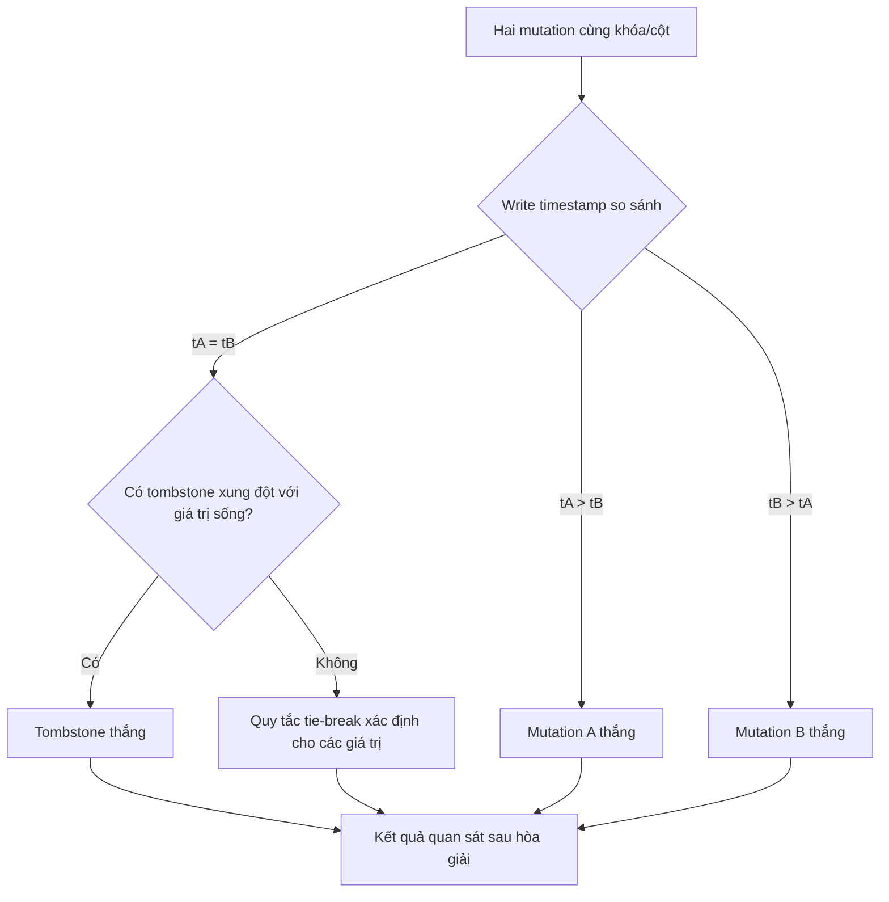
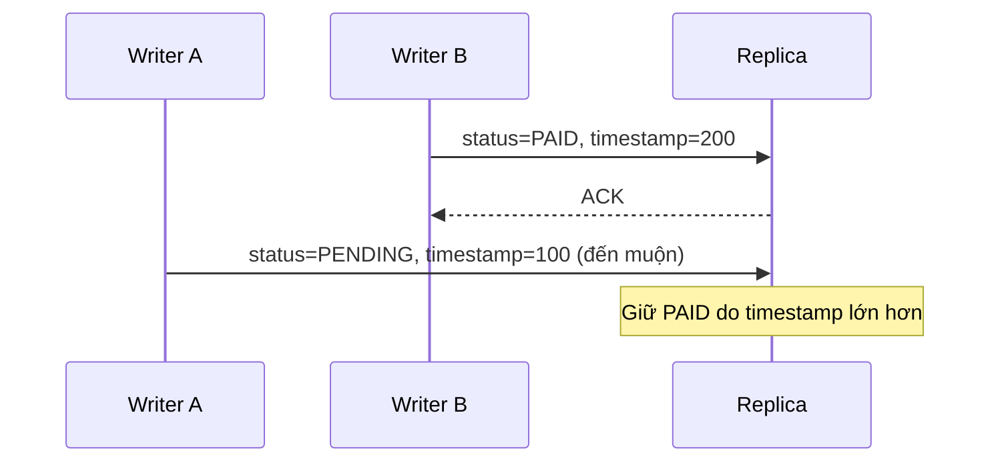

# Ghi cùng timestamp, xóa dữ liệu và trường hợp xung đột

## 1. Vì sao ghi sau vẫn có thể không thắng?

Trong **Spring Data Cassandra**, ứng dụng thường ghi dữ liệu qua `CassandraRepository`, `CassandraTemplate`, `CqlTemplate` hoặc `CqlSession`. Các API này giúp ánh xạ entity, bind tham số và thực thi CQL, nhưng chúng **không thay đổi cơ chế phân xử xung đột của Apache Cassandra**.

Cassandra phân tán một partition trên các replica. Các replica có thể nhận mutation theo **thứ tự khác nhau**, do độ trễ mạng, lỗi tạm thời hoặc retry. Để cùng đi đến một trạng thái cuối khi hòa giải, Cassandra dùng cơ chế thường gọi là **last-write-wins (LWW)** dựa trên **write timestamp** của dữ liệu; đây không nhất thiết là thời điểm HTTP request hoàn tất hay thứ tự người dùng nhìn thấy thao tác.

Ba tình huống trọng tâm:

1. Hai lần cập nhật **cùng một cell** mang timestamp khác nhau: giá trị có timestamp lớn hơn thường thắng.
2. Hai lần cập nhật **cùng một cell** mang **cùng timestamp**: Cassandra dùng quy tắc phân xử xác định, **không dựa vào thứ tự đến**.
3. Có một thao tác **xóa**: Cassandra ghi tombstone có timestamp; tombstone có thể che những giá trị cũ, kể cả trường hợp bằng timestamp khi xung đột với giá trị sống.



Đây là mô hình cơ bản cho **các giá trị/cell cùng vị trí**. Xóa toàn row, xóa partition, range tombstone và collection có phạm vi áp dụng riêng; không nên suy diễn mọi loại mutation chỉ là một lần so sánh chuỗi đơn giản.

**Mục tiêu bài học:** phân biệt thời gian sự kiện với write timestamp, hiểu phân xử khi timestamp bằng nhau, lý giải DELETE/TTL/tombstone, viết CQL/Java Driver đúng và thiết kế retry, consistency, đối soát dữ liệu có kiểm soát.

## 2. Hai khái niệm “timestamp” không giống nhau

Giả sử bảng:

```sql
-- Chỉ dùng SimpleStrategy và RF=1 cho Cassandra local một node.
CREATE KEYSPACE IF NOT EXISTS orders_lab
WITH replication = {
    'class': 'SimpleStrategy',
    'replication_factor': 1
};

CREATE TABLE IF NOT EXISTS orders_lab.orders_by_id (
    order_id uuid PRIMARY KEY,
    customer_id uuid,
    status text,
    total_amount decimal,
    note text,
    updated_at timestamp
);
```

Trong bảng này, `updated_at timestamp` là **một cột dữ liệu CQL**. Nó lưu mốc thời gian do ứng dụng quyết định và thường được ánh xạ với `java.time.Instant`. Mặt khác, mỗi giá trị được ghi trong Cassandra mang **write timestamp** dùng để phân xử xung đột.

| Khái niệm | Bản chất | Độ chính xác/đơn vị thường gặp | Dùng để làm gì? |
| --- | --- | --- | --- |
| `updated_at timestamp` | Giá trị của **một cột CQL** | CQL `timestamp` biểu diễn **millisecond** từ Unix epoch | Hiển thị/sắp xếp nghiệp vụ nếu khóa và truy vấn hỗ trợ |
| Write timestamp của mutation | Metadata dùng khi hòa giải các giá trị | **Microsecond** từ Unix epoch | Chọn thay đổi thắng trong LWW |
| `WRITETIME(status)` | Hàm CQL trả metadata ghi của cell sống tương ứng | **Microsecond** | Chẩn đoán dữ liệu nào đang thắng |
| `USING TIMESTAMP 123...` | Chỉ định write timestamp trong DML hỗ trợ | **Microsecond** | Chủ động đặt phiên bản ghi ở mức mutation |
| `timeuuid` | Kiểu UUID v1 có thành phần thời gian | Không phải write timestamp của cell | Làm clustering key/định danh có thứ tự thời gian |

Một câu lệnh có thể lưu `updated_at = '2026-11-25T10:00:00Z'` nhưng được ghi với write timestamp khác. **Cassandra không dùng giá trị cột `updated_at` để tự chọn mutation thắng**. Cũng không thể giả định timestamp của `timeuuid` sẽ tự điều khiển hòa giải trên các cột thường.

### 2.1. Kiểm tra timestamp bằng `WRITETIME`

```sql
INSERT INTO orders_lab.orders_by_id
    (order_id, status, updated_at)
VALUES (
    11111111-1111-4111-8111-111111111111,
    'PENDING',
    '2026-11-25T10:00:00Z'
);

SELECT order_id, status, updated_at,
       WRITETIME(status) AS status_write_us,
       WRITETIME(updated_at) AS updated_at_write_us
FROM orders_lab.orders_by_id
WHERE order_id = 11111111-1111-4111-8111-111111111111;
```

`status_write_us` và `updated_at_write_us` là metadata ghi của **hai cell**, không phải hai giá trị thời gian nghiệp vụ. Chúng có thể giống nhau nếu được ghi trong cùng mutation; sau các cập nhật riêng rẽ có thể khác nhau.

`WRITETIME` không phải cách đọc timestamp của **primary key** hoặc **counter**. Không dùng `WRITETIME(order_id)` để đo “thời gian tạo đơn”. Khi một cột chưa có giá trị sống, đã bị xóa hoặc hết TTL, kết quả `WRITETIME` của cell có thể là `null`; nó không tiết lộ lịch sử đầy đủ mọi mutation đã từng tồn tại.

### 2.2. Nguồn tạo write timestamp mặc định

Tùy **Java Driver, timestamp generator, cách cấu hình session và phiên bản Cassandra**, timestamp có thể được cấp ở phía client/driver hoặc coordinator. Trong Java Driver 4.x, một timestamp generator có thể tạo timestamp cho statement nếu ứng dụng không ghi đè riêng; không nên khẳng định **mọi** thao tác mặc định luôn lấy clock tại server.

Điều đáng quan tâm không phải đoán một nguồn chung, mà là kiểm tra thực tế:

- Application đang dùng **driver timestamp generator** nào?
- Có `USING TIMESTAMP` trong CQL hay `.setQueryTimestamp(...)` trên statement không?
- Những writer khác nhau có đồng bộ thời gian (NTP/chrony) và sử dụng cùng chính sách không?
- Có writer nào cố đặt timestamp dựa trên thời gian sự kiện cũ hoặc đặt sai đơn vị không?

## 3. Quy tắc LWW khi timestamp khác nhau

Với một cột thường, một ví dụ đơn giản:

```text
Cùng (order_id, status)

Writer A: status = PENDING, write timestamp = 100
Writer B: status = PAID,    write timestamp = 200

Kết quả hòa giải: PAID (timestamp 200 thắng)
```

Nếu mutation A được mạng chuyển đến một replica **sau** mutation B, nó vẫn không mặc nhiên ghi đè được B, vì timestamp 100 thấp hơn timestamp 200.



**LWW không có nghĩa “method repository nào gọi cuối cùng thì thắng”.** Với timeout, network delay, client clock lệch hoặc timestamp đặt bằng tay, thứ tự gọi Java có thể khác thứ tự phiên bản dữ liệu.

### 3.1. Cassandra hòa giải theo cell, không khóa toàn entity

Giả sử cùng một hàng có:

| Cell | Mutation A | Mutation B | Giá trị thắng |
| --- | --- | --- | --- |
| `status` | `PENDING @ 100` | `PAID @ 200` | `PAID` |
| `note` | `ghi chú A @ 300` | `ghi chú B @ 250` | `ghi chú A` |
| `total_amount` | `100000 @ 120` | Không ghi cell này | `100000` |

Kết quả một hàng có thể **kết hợp các cell từ những mutation khác nhau**. Đừng coi một lần `repository.save(entity)` là một bản snapshot/version toàn hàng có tính giao dịch giống JPA với MVCC. Cassandra áp dụng các timestamp và marker ghi ở cấp chi tiết hơn; các mutation có nhiều cell và các loại collection/tombstone có quy tắc cụ thể.

Điều này đặc biệt quan trọng khi một service chuyển trạng thái đơn và ghi `updated_at` ở hai nơi khác nhau: một lần đọc có thể quan sát tổ hợp không mong muốn nếu các writer cạnh tranh hoặc bị đặt timestamp sai.

## 4. Ghi cùng timestamp: xóa thắng, còn hai giá trị sống được tie-break

**Timestamp bằng nhau không mang nghĩa “giữ nguyên giá trị cũ”.** Cassandra cần các replica hội tụ dù chúng nhận mutation theo thứ tự khác nhau. Theo quy tắc công bố trong FAQ của Apache Cassandra:

1. **Nếu một mutation là delete/tombstone, delete được ưu tiên hơn insert/update có cùng timestamp** trong phạm vi xung đột.
2. **Nếu là hai giá trị sống khác nhau**, hệ thống dùng quy tắc xác định để chọn một giá trị; tài liệu Apache mô tả giá trị có thứ tự từ vựng lớn hơn thắng. Thứ tự này gắn với cách biểu diễn/so sánh nội bộ của kiểu dữ liệu, **không phải** thứ tự request HTTP, thời điểm ACK hay ưu tiên nghiệp vụ.

| Hai thay đổi trên cùng cell | Timestamp | Kết quả cơ bản |
| --- | --- | --- |
| `status='PENDING'` và `status='PAID'` | 100, 200 | `PAID` thắng vì timestamp lớn hơn |
| `status='PAID'` và `status='PENDING'` | 200, 100 | `PAID` thắng dù `PENDING` có thể đến sau |
| `status='ALPHA'` và `status='BETA'` | 200, 200 | Có tie-break xác định cho hai giá trị sống; **không dựa thứ tự đến** |
| `status='PAID'` và tombstone xóa `status` | 200, 200 | **Tombstone thắng** |
| Tombstone `status @ 200` và ghi `status='PAID' @ 201` | 200, 201 | Ghi mới có timestamp cao hơn có thể đưa cell sống trở lại |
| Tombstone `status @ 200` và ghi `status='PAID' @ 199` | 200, 199 | Ghi cũ bị tombstone che |

**Đừng biến tie-break từ vựng thành quy tắc nghiệp vụ.** Không thể đảm bảo “PAID thắng CANCELLED” bằng cách đặt tên status sao cho chuỗi được so sánh lớn hơn. Bản phân phối, kiểu dữ liệu, xóa/TTL và cách lưu trữ có thể khiến dự đoán kiểu đó vừa mong manh vừa khó bảo trì. Nếu trạng thái cần thứ tự chuyển đổi chặt chẽ, dùng điều kiện nghiệp vụ và LWT thích hợp.

### 4.1. Vì sao có thể xảy ra timestamp bằng nhau?

- Hai writer dùng cùng một timestamp lấy từ một sự kiện.
- Hai request cố định timestamp để retry idempotent nhưng lại mang **giá trị khác nhau**.
- Hai tiến trình tạo timestamp với độ phân giải không đủ hoặc logic tạo timestamp sai.
- Hệ thống nhập dữ liệu cũ/backfill, đặt timestamp từ một nguồn đã làm tròn.
- Ứng dụng tự đặt timestamp trên nhiều câu lệnh để “đồng bộ” các read model.

Các driver có thể có cơ chế giảm va chạm timestamp trong phạm vi session, nhưng **không thể** mặc định bảo đảm tính duy nhất hoặc thứ tự toàn cục giữa mọi tiến trình và mọi datacenter.

## 5. Thực hành CQL: quan sát cùng timestamp và tombstone

Các thí nghiệm này dùng **một ID mới**, chỉ thực hiện trên môi trường lab và không dùng timestamp tương lai. Trong ví dụ, số timestamp là **microsecond từ Unix epoch**. Không cần sao chép số này vào production.

### 5.1. Hai ghi cùng timestamp nhưng khác giá trị

```sql
-- Dùng order_id chưa từng được ghi trong keyspace lab.
UPDATE orders_lab.orders_by_id
USING TIMESTAMP 1770000000000000
SET status = 'ALPHA'
WHERE order_id = 55555555-5555-4555-8555-555555555555;

UPDATE orders_lab.orders_by_id
USING TIMESTAMP 1770000000000000
SET status = 'BETA'
WHERE order_id = 55555555-5555-4555-8555-555555555555;

SELECT status, WRITETIME(status) AS status_write_us
FROM orders_lab.orders_by_id
WHERE order_id = 55555555-5555-4555-8555-555555555555;
```

Kết quả của hai giá trị sống là một giá trị được chọn bằng quy tắc tie-break, **không phải lời hứa rằng câu chạy thứ hai sẽ thắng**. Thử đảo thứ tự hai lệnh trên **một ID mới khác**, thay vì ghi lại bằng timestamp cũ lên hàng đã có các timestamp cao hơn rồi kết luận sai.

### 5.2. Ghi và xóa đúng cùng timestamp

```sql
-- Khóa mới, tách khỏi thí nghiệm trước để dễ quan sát.
UPDATE orders_lab.orders_by_id
USING TIMESTAMP 1770000000000100
SET status = 'READY'
WHERE order_id = 66666666-6666-4666-8666-666666666666;

DELETE status
FROM orders_lab.orders_by_id
USING TIMESTAMP 1770000000000100
WHERE order_id = 66666666-6666-4666-8666-666666666666;

SELECT status, WRITETIME(status) AS status_write_us
FROM orders_lab.orders_by_id
WHERE order_id = 66666666-6666-4666-8666-666666666666;
```

Tombstone xóa `status` có cùng timestamp với giá trị sống `READY`, nên **giá trị `READY` không còn được đọc như một cell sống**. Nếu hàng không còn bất kỳ dữ liệu sống nào khác, câu `SELECT` có thể trả **không hàng nào**, chứ không bắt buộc trả một hàng chứa `status = null`. `WRITETIME` của giá trị đã bị xóa không phải một lịch sử thời điểm xóa đáng tin cậy cho mục đích audit.

Đọc lại sau khi ghi một timestamp **cao hơn**:

```sql
UPDATE orders_lab.orders_by_id
USING TIMESTAMP 1770000000000101
SET status = 'PAID'
WHERE order_id = 66666666-6666-4666-8666-666666666666;

SELECT status, WRITETIME(status) AS status_write_us
FROM orders_lab.orders_by_id
WHERE order_id = 66666666-6666-4666-8666-666666666666;
```

Giá trị `PAID` có thể được đọc vì write timestamp mới **lớn hơn timestamp tombstone**. Điều này không đồng nghĩa xóa vật lý tombstone ngay tức thì; Cassandra còn có quy trình compaction và garbage collection.

### 5.3. Thử một ghi có timestamp cũ hơn tombstone

Ở một key mới:

```sql
UPDATE orders_lab.orders_by_id
USING TIMESTAMP 1770000000000200
SET status = 'ORIGINAL'
WHERE order_id = 77777777-7777-4777-8777-777777777777;

DELETE status FROM orders_lab.orders_by_id
USING TIMESTAMP 1770000000000300
WHERE order_id = 77777777-7777-4777-8777-777777777777;

-- Đến sau về thời gian thực thi, nhưng timestamp thấp hơn delete.
UPDATE orders_lab.orders_by_id
USING TIMESTAMP 1770000000000250
SET status = 'LATE_ARRIVAL'
WHERE order_id = 77777777-7777-4777-8777-777777777777;
```

Ghi `LATE_ARRIVAL` đến sau không thể thắng tombstone timestamp `1770000000000300`. Điều kiện để một giá trị mới trở thành trạng thái sống phải xét **timestamp**, không phải thời điểm gọi `execute`.

## 6. `DELETE` không phải xóa vật lý tức thì

Thao tác delete trong Cassandra ghi một **tombstone** biểu diễn phạm vi dữ liệu bị xóa. Tombstone được nhân bản và tham gia cơ chế reconciliation để tránh việc replica còn giữ giá trị cũ “hồi sinh” giá trị đó sau lỗi mạng.

Các loại xóa thường gặp:

| CQL | Phạm vi logic | Điều cần chú ý |
| --- | --- | --- |
| `DELETE note FROM orders_by_id WHERE order_id = ?` | Xóa riêng cột `note` | Các cột khác có thể vẫn tồn tại |
| `DELETE FROM orders_by_id WHERE order_id = ?` | Xóa cả hàng theo key | Có tombstone cho phạm vi hàng |
| `DELETE FROM events_by_device_day WHERE device_id = ? AND day_bucket = ?` | Xóa **partition** của thiết bị/ngày nếu khóa partition như ví dụ | Phạm vi rộng hơn xóa một event |
| `DELETE ... WHERE partition_key = ? AND clustering_key >= ?` | Có thể tạo marker xóa một phạm vi clustering nếu CQL/schema hỗ trợ | Rủi ro xóa nhiều hàng và range tombstone |
| `UPDATE ... SET note = null WHERE ...` | Có thể tạo xóa logic cell | Không giống bỏ qua `note` khỏi câu `UPDATE` |
| Cột hết `TTL` | Giá trị được coi là hết hạn/không còn sống | Có thể phát sinh tombstone và chi phí compaction |

**Tombstone không phải một hàng dữ liệu bình thường.** Một câu `SELECT` chỉ đọc giá trị sống sau reconciliation; Cassandra không trả trực tiếp toàn bộ lịch sử xóa dưới dạng các hàng trong query nghiệp vụ.

### 6.1. Xóa hàng và xóa partition theo đúng primary key

Ví dụ bảng sự kiện:

```sql
CREATE TABLE IF NOT EXISTS orders_lab.events_by_device_day (
    device_id uuid,
    day_bucket date,
    occurred_at timestamp,
    event_id uuid,
    payload text,
    PRIMARY KEY ((device_id, day_bucket), occurred_at, event_id)
) WITH CLUSTERING ORDER BY (occurred_at DESC, event_id ASC);
```

```sql
-- Xóa một event có đầy đủ khóa của hàng.
DELETE FROM orders_lab.events_by_device_day
WHERE device_id = 88888888-8888-4888-8888-888888888888
  AND day_bucket = '2026-11-25'
  AND occurred_at = '2026-11-25T08:00:00Z'
  AND event_id = 99999999-9999-4999-8999-999999999999;

-- Xóa toàn bộ partition của thiết bị trong ngày.
DELETE FROM orders_lab.events_by_device_day
WHERE device_id = 88888888-8888-4888-8888-888888888888
  AND day_bucket = '2026-11-25';
```

Hai lệnh khác nhau rất lớn về phạm vi: lệnh sau có thể xóa **mọi event trong ngày** của thiết bị. Trong service, nên đặt tên method thể hiện rõ `deleteEvent` và `deleteDeviceDayPartition`, kèm quyền truy cập/validation tương ứng.

### 6.2. Tombstone cùng timestamp với bản ghi mới

Giả sử đã xóa cả partition với timestamp `T`. Một insert sau đó có write timestamp **nhỏ hơn hoặc bằng `T`** có thể không làm các giá trị bị che xuất hiện trở lại trong phạm vi tombstone. Điều này rất dễ xảy ra khi import dữ liệu lịch sử hoặc khi một writer bị **clock skew**.

Không kết luận “Cassandra mất dữ liệu” chỉ từ việc `INSERT` trả thành công nhưng `SELECT` không thấy giá trị mới. Khi chẩn đoán, hãy kiểm tra timestamp, tombstone, quyền truy cập và consistency trước khi retry liên tục.

## 7. `gc_grace_seconds`, compaction và dữ liệu hồi sinh (*zombie*)

Cassandra cần giữ tombstone đủ lâu để replica từng bị mất kết nối có cơ hội biết rằng dữ liệu đã bị xóa. Một khái niệm vận hành quan trọng là **`gc_grace_seconds`** trên bảng.

```text
Replica A       Replica B       Replica C (offline)
    X               X                X
    |               |
  DELETE          DELETE             (không nhận xóa)
    T               T                X
    |               |                |
    +---- repair/reconcile ----------+
                 T có thể được truyền sang C
```

Nếu replica C ngoại tuyến quá lâu trong khi tombstone ở A/B đã được purge, khi C quay lại với dữ liệu cũ, hệ thống có thể không còn marker để biết dữ liệu đó từng bị xóa. Kết quả có thể là **zombie data**: dữ liệu đã xóa xuất hiện lại.

### 7.1. Cơ chế vòng đời

1. `DELETE` ghi tombstone có timestamp.
2. Read/reconciliation dùng tombstone để che những giá trị cũ thuộc phạm vi của nó.
3. Repair, hinted handoff và các cơ chế đồng bộ khác giúp replica nhận biết mutation, tùy trạng thái cluster.
4. Sau điều kiện grace/repair cần thiết, **compaction** mới có thể dọn tombstone và những dữ liệu bị che phù hợp.
5. Việc **hết `gc_grace_seconds` không có nghĩa xóa vật lý ngay**; điều kiện compaction và an toàn dữ liệu vẫn áp dụng.

**Không hạ `gc_grace_seconds` xuống 0 chỉ để giảm số tombstone** khi chưa có kế hoạch repair, thời gian node có thể offline, replication topology và chính sách vận hành phù hợp với phiên bản Cassandra. Một số phiên bản/chiến lược có cơ chế tối ưu riêng cho dữ liệu chỉ-ghi-theo-thời-gian, nhưng phải đánh giá chính xác, không sao chép cấu hình trên mạng.

### 7.2. Chi phí tombstone khi đọc

Một partition có hàng triệu cell đã xóa/hết TTL có thể làm read path tiêu tốn CPU/I/O để loại bỏ dữ liệu không còn sống. Kết quả API chỉ trả **20 hàng** không chứng minh Cassandra chỉ kiểm tra đúng 20 cell.

Hướng kiểm soát:

- Tránh collection tăng/xóa liên tục và partition không giới hạn.
- Thiết kế **time bucket** theo truy vấn; giới hạn khoảng thời gian mỗi API.
- Chọn TTL/retention theo lifecycle của dữ liệu, không bật TTL tùy tiện cho mọi cell.
- Theo dõi tombstone warnings, p95/p99, compaction, partition size và số hàng/byte đọc.
- Phối hợp lịch repair và kiểm tra lỗi node dài ngày.

## 8. TTL và ghi đè: thời gian hết hạn khác write timestamp

`USING TTL` là thời gian sống của giá trị được ghi, không phải timestamp để phân xử:

```sql
UPDATE orders_lab.orders_by_id
USING TTL 3600
SET note = 'Dữ liệu tạm thời'
WHERE order_id = 11111111-1111-4111-8111-111111111111;
```

Giá trị `note` được đặt thời gian sống khoảng một giờ. Khi hết hạn, nó không còn là giá trị sống và được xử lý theo cơ chế expiry/tombstone. **TTL không có nghĩa cả hàng lập tức biến mất** nếu các cột khác vẫn còn sống.

Có thể xem TTL còn lại:

```sql
SELECT note, TTL(note) AS remaining_seconds,
       WRITETIME(note) AS note_write_us
FROM orders_lab.orders_by_id
WHERE order_id = 11111111-1111-4111-8111-111111111111;
```

Lưu ý các quy tắc:

- Ghi lại cùng cell với timestamp lớn hơn và TTL mới có thể thay đổi giá trị và vòng đời hết hạn.
- Một cell hết TTL cần được coi như dữ liệu đã bị xóa khi reconciliation; không nên giả định ghi cũ sẽ tự hiện lại.
- TTL của từng cột có thể khác; một lần đọc hàng có thể kết hợp các cell còn sống và cell đã hết hạn.
- Với **counter**, Cassandra không hỗ trợ `USING TTL` hoặc `USING TIMESTAMP` như cột thường.
- Với collection và UDT nhiều cell, chi tiết TTL/tombstone phụ thuộc cách lưu; đừng suy toàn collection luôn có một timestamp hoặc TTL thống nhất.

Nếu một client dùng timestamp từ quá khứ để ghi lại `note` sau khi note đã hết TTL, mutation mới có thể bị marker hết hạn/tombstone che. Đọc `WRITETIME` của giá trị không sống không thể tự phục dựng toàn bộ các thay đổi đã diễn ra.

## 9. Ghi timestamp tường minh: CQL và Java Driver

### 9.1. `USING TIMESTAMP` trong CQL

Các thao tác DML được hỗ trợ cho phép ghi timestamp tường minh:

```sql
UPDATE orders_lab.orders_by_id
USING TIMESTAMP 1770000000000400
SET status = 'PAID'
WHERE order_id = 44444444-4444-4444-8444-444444444444;

INSERT INTO orders_lab.orders_by_id (order_id, status)
VALUES (44444444-4444-4444-8444-444444444444, 'SHIPPED')
USING TIMESTAMP 1770000000000401;

DELETE status FROM orders_lab.orders_by_id
USING TIMESTAMP 1770000000000402
WHERE order_id = 44444444-4444-4444-8444-444444444444;
```

Các số `1770000000000400` là **microseconds**, không phải milliseconds. Nếu gõ nhầm milliseconds, timestamp thấp hơn khoảng **1.000 lần về độ lớn số** và thường rơi vào thời kỳ rất xa quá khứ, dẫn đến hành vi ghi không như kỳ vọng.

Không tự suy rằng **mọi** loại statement đều nhận `USING TIMESTAMP`: counter update và conditional DML/LWT có hạn chế riêng. Khi một thao tác cần compare-and-set, **không pha trộn timestamp thủ công với LWT** mà không kiểm tra API/CQL được Cassandra chấp nhận.

### 9.2. `BoundStatement.setQueryTimestamp(...)`

Java Driver 4.x hỗ trợ đặt query timestamp bằng option trên statement, để **giữ CQL template cố định**:

```java
import java.util.UUID;

import com.datastax.oss.driver.api.core.CqlSession;
import com.datastax.oss.driver.api.core.cql.BoundStatement;
import com.datastax.oss.driver.api.core.cql.PreparedStatement;
import org.springframework.stereotype.Repository;

@Repository
public class OrderTimestampWriter {

    private final CqlSession session;
    private final PreparedStatement updateStatus;

    public OrderTimestampWriter(CqlSession session) {
        this.session = session;
        this.updateStatus = session.prepare("""
            UPDATE orders_lab.orders_by_id
            SET status = ?
            WHERE order_id = ?
            """);
    }

    public void writeStatusWithTimestamp(
            UUID orderId, String status, long timestampMicros) {
        BoundStatement statement = updateStatus.bind(status, orderId)
            .setQueryTimestamp(timestampMicros);
        session.execute(statement);
    }
}
```

`timestampMicros` được truyền **theo microseconds từ Unix epoch**; tên biến nên nêu đơn vị để người dùng API không truyền nhầm milliseconds. Không tự tạo một `CqlSession` mới cho mỗi lần ghi; inject session do Spring Boot/Spring Data Cassandra quản lý.

**Thứ tự ưu tiên cần nhớ:** nếu CQL đã chứa `USING TIMESTAMP` và statement đồng thời gọi `.setQueryTimestamp(...)`, **`USING TIMESTAMP` trong CQL có ưu tiên**. Tránh cấu hình hai nơi cho cùng request vì dễ gây hiểu lầm khi debug.

### 9.3. Đổi `Instant` sang microseconds có kiểm soát

Java `Instant` có độ phân giải đến nanoseconds; giá trị `CQL timestamp` chỉ giữ mốc milliseconds, còn query timestamp được biểu diễn bằng microseconds. Một cách chuyển đổi số học:

```java
import java.time.Instant;

static long toEpochMicros(Instant instant) {
    return Math.addExact(
        Math.multiplyExact(instant.getEpochSecond(), 1_000_000L),
        instant.getNano() / 1_000L
    );
}
```

Đoạn code này **chỉ giải thích đơn vị và cách chuyển đổi**, không có nghĩa luôn nên dùng thời gian sự kiện để đặt write timestamp. Hai sự kiện có cùng `Instant`, dữ liệu nhập muộn hoặc clock của thiết bị lệch có thể tạo xung đột không mong muốn. `created_at`/`occurred_at` nên là **domain time**; write timestamp nên được quản lý theo chính sách persistence đã có lý do rõ ràng.

## 10. Spring Data Cassandra: `save`, partial update và xung đột

Một entity đơn giản:

```java
import java.math.BigDecimal;
import java.time.Instant;
import java.util.UUID;

import org.springframework.data.cassandra.core.mapping.Column;
import org.springframework.data.cassandra.core.mapping.PrimaryKey;
import org.springframework.data.cassandra.core.mapping.Table;

@Table("orders_by_id")
public class OrderById {

    @PrimaryKey("order_id")
    private UUID orderId;

    @Column("status")
    private String status;

    @Column("note")
    private String note;

    @Column("updated_at")
    private Instant updatedAt;

    protected OrderById() {
    }

    // Constructor, accessors và phương thức nghiệp vụ tùy dự án.
}
```

Repository:

```java
import java.util.UUID;

import org.springframework.data.cassandra.repository.CassandraRepository;
import org.springframework.data.cassandra.repository.Modifying;
import org.springframework.data.cassandra.repository.Query;

public interface OrderByIdRepository
        extends CassandraRepository<OrderById, UUID> {

    @Modifying
    @Query("UPDATE orders_by_id SET status = ?1 WHERE order_id = ?0")
    void setStatus(UUID orderId, String status);

    @Modifying
    @Query("DELETE note FROM orders_by_id WHERE order_id = ?0")
    void removeNote(UUID orderId);
}
```

Những phương thức này dùng query CQL theo primary key. Chúng **không** tự triển khai optimistic locking, không kiểm tra phiên bản cũ của trạng thái và không đảm bảo điều kiện `PENDING -> PAID` nếu hai writer cạnh tranh.

| Cách ghi | Được lợi gì? | Rủi ro cần nhận biết |
| --- | --- | --- |
| `repository.save(entity)` | Thuận tiện khi thực sự có entity cần lưu | Có thể ghi nhiều cell theo mapping; không phải transaction có version tự động |
| `@Modifying @Query("UPDATE ... SET status...")` | Chỉ định rõ cell cần sửa | Vẫn là upsert nếu không có điều kiện; LWW vẫn áp dụng |
| `CassandraTemplate.update(Query, Update, Entity.class)` | Partial update có mapping entity | Cần query đúng key và kiểm tra API theo version |
| `CqlSession + BoundStatement` | Kiểm soát `USING TIMESTAMP`, request options và kết quả | Tự chịu trách nhiệm CQL/bind và không tạo CL/transaction ngoài ý muốn |
| CQL `IF status = ?` (LWT) | Kiểm tra điều kiện cập nhật cạnh tranh trong phạm vi được hỗ trợ | Có thêm chi phí và cần xử lý `[applied]`/timeout |

**Không đọc một entity chỉ có vài cột rồi `save` trở lại** để sửa một field. Giá trị mặc định/null của những field chưa tải có thể làm phát sinh thay đổi không mong muốn, và write timestamp của các cell liên quan sẽ có tác động độc lập. Hãy dùng **partial update** theo khóa khi chỉ muốn sửa một vài cột.

### 10.1. Một lần `save` không bảo đảm thứ tự business state

Ví dụ:

```text
Request A: chuyển PENDING -> PAID
Request B: chuyển PENDING -> CANCELLED
```

Nếu service chỉ gọi `repository.save(...)` ở cả hai request, trạng thái cuối có thể do timestamp/tie-break quyết định chứ không phải theo quy tắc:

```text
PENDING -> PAID      được phép
PENDING -> CANCELLED được phép
PAID    -> CANCELLED cần bị từ chối
```

Nếu bất biến này bắt buộc, phải kiểm tra và thực thi điều kiện trong cơ sở dữ liệu ở phạm vi phù hợp thay vì tự suy từ thứ tự gọi service.

## 11. LWT khi cần điều kiện nghiệp vụ, không dùng tie-break

CQL có **lightweight transaction (LWT)** cho thao tác có điều kiện:

```sql
UPDATE orders_lab.orders_by_id
SET status = 'PAID'
WHERE order_id = 11111111-1111-4111-8111-111111111111
IF status = 'PENDING';
```

Kết quả hợp lệ chứa `[applied]` để biết điều kiện có đúng tại lúc áp dụng hay không. Trường hợp `[applied] = false` không phải lỗi mạng; nó có thể có nghĩa một writer khác đã thay trạng thái trước.

Ví dụ Java Driver:

```java
import java.util.UUID;
import com.datastax.oss.driver.api.core.CqlSession;
import com.datastax.oss.driver.api.core.cql.PreparedStatement;

public class ConditionalOrderStatusWriter {

    private final CqlSession session;
    private final PreparedStatement markPaid;

    public ConditionalOrderStatusWriter(CqlSession session) {
        this.session = session;
        this.markPaid = session.prepare("""
            UPDATE orders_lab.orders_by_id
            SET status = ?
            WHERE order_id = ?
            IF status = ?
            """);
    }

    public boolean markPaidIfPending(UUID orderId) {
        return session.execute(
            markPaid.bind("PAID", orderId, "PENDING")
        ).wasApplied();
    }
}
```

LWT dùng **serial consistency** cho pha điều kiện theo phạm vi hỗ trợ và normal consistency cho phần ghi liên quan. Không cố kết hợp `USING TIMESTAMP` hay `.setQueryTimestamp(...)` với một phép LWT vì cần kiểm soát thứ tự phiên bản: các thao tác conditional không hỗ trợ việc tùy đặt timestamp giống DML thường.

**LWT không tự biến nhiều bảng denormalized thành một transaction ACID giống RDBMS.** Nếu trạng thái đơn còn nằm trong `orders_by_customer_day`, application service vẫn cần đồng bộ và đối soát read model đó.

## 12. Retry, timestamp tương lai và clock skew

### 12.1. Timeout không chứng minh mutation chưa được ghi

```text
Client                   Coordinator / replica
   |  UPDATE status=PAID    |
   |----------------------->|
   |      Một số replica đã ghi
   X  response timeout/mất  |
   |                        |
   |  Retry                 |
   |----------------------->|
```

Khi timeout, client không luôn biết request đã được áp dụng hay chưa. Quy tắc retry phải dựa trên **tính idempotent** và mục tiêu nghiệp vụ:

- `UPDATE status='PAID' WHERE order_id=?` với ID cố định có thể idempotent về **giá trị mong muốn** nếu không có writer cạnh tranh, nhưng không phải bảo đảm trong mọi hoàn cảnh timestamp/TTL.
- `INSERT` sinh UUID khác cho mỗi retry có thể tạo **hai đơn** nghiệp vụ.
- `counter = counter + 1` **không idempotent**; retry có thể tăng hai lần.
- Append vào `list` không mặc nhiên idempotent.
- `DELETE` cùng khóa có thể lặp lại về mục tiêu xóa, nhưng timestamp mới và các ghi cạnh tranh cần được xét.
- LWT timeout có kết quả **không rõ applied**, không thể tự coi là `false`.

Không gắn `.setIdempotent(true)` cho mọi statement để driver retry mạnh hơn: flag đó là **tuyên bố** của ứng dụng, không tự chứng minh thao tác an toàn.

### 12.2. Timestamp đặt trong tương lai

Nếu một writer đặt write timestamp **quá xa tương lai**, những ghi bình thường sau đó với timestamp nhỏ hơn có thể liên tục **thua**. Cơ sở dữ liệu không “chờ đến thời gian ấy rồi áp dụng ghi”; nó vẫn phân xử theo số timestamp ngay khi reconciliation.

Triệu chứng điển hình:

- `UPDATE` báo thành công, nhưng `SELECT` vẫn trả trạng thái cũ.
- `WRITETIME(status)` cho thấy giá trị hiện tại có write timestamp bất thường.
- Chỉ một vài cột “không chịu cập nhật”, trong khi cột khác vẫn thay đổi.
- Có một job import/backfill hoặc client cấu hình sai milliseconds/microseconds trước khi lỗi xuất hiện.

**Không chữa bằng cách cộng thêm một khoảng timestamp lớn hơn nữa.** Điều đó tạo thêm dữ liệu có timestamp bất thường. Thay vào đó, xác định writer, sửa cấu hình thời gian, phân loại phạm vi dữ liệu bị ảnh hưởng và lập kế hoạch remediation có kiểm soát.

### 12.3. Đồng bộ đồng hồ vẫn quan trọng

Khi client/server khác nhau tạo timestamp, clock skew có thể khiến mutation đến sau bị xem là **cũ hơn**. Đồng bộ thời gian hệ thống (ví dụ NTP/chrony), dùng timestamp generator có hành vi rõ ràng, quan sát write timestamp và tránh tự áp dụng domain event time làm mutation timestamp là những biện pháp quan trọng.

Không dùng một con số `WRITETIME` để suy ra chính xác HTTP latency hoặc thời gian commit tuyệt đối ở mọi replica. Nó là metadata thứ tự ghi, không phải trace của request.

## 13. Consistency level có thay đổi quy tắc thắng/thua không?

**Không.** `LOCAL_ONE`, `LOCAL_QUORUM` hoặc các mức khác xác định **điều kiện replica đáp ứng**, không thay đổi thứ tự hòa giải theo write timestamp và tombstone.

Với RF=3 trong một datacenter, `LOCAL_QUORUM` đòi hỏi phản hồi đa số replica local. Một ghi thành công tại quorum và đọc cùng key tại quorum có giao nhau các replica cần tham gia, giúp giảm nguy cơ stale read trong điều kiện phù hợp. Nhưng:

1. Một write có timestamp thấp hơn tombstone **không thắng** chỉ vì nó được ghi với `LOCAL_QUORUM`.
2. Hai writer dùng cùng timestamp vẫn áp dụng tie-break tương ứng, dù cả hai ghi được ACK.
3. Quorum **không** bảo vệ trạng thái khỏi writer gửi timestamp tương lai hoặc các chuyển trạng thái nghiệp vụ không hợp lệ.
4. Một bảng phi chuẩn hóa khác có thể chưa được cập nhật, dù cả hai bảng đều được đọc ở quorum.
5. `LOCAL_ONE` có thể quan sát dữ liệu replica chưa đồng bộ; cần phân biệt **stale replica** với **mutation thua do timestamp**.

Vì vậy, khi một giá trị “không thay đổi”, đừng vội tăng CL. Hãy kiểm tra đủ ba nhóm: **key/query**, **timestamp/tombstone** và **replica/consistency**.

## 14. Đồng bộ nhiều bảng theo truy vấn và xóa dữ liệu

Giả sử đơn hàng xuất hiện trong hai read model:

```sql
-- Tra cứu chi tiết bằng order_id
-- orders_lab.orders_by_id(order_id PRIMARY KEY, ...)

-- Liệt kê đơn theo khách và ngày
CREATE TABLE IF NOT EXISTS orders_lab.orders_by_customer_day (
    customer_id uuid,
    day_bucket date,
    created_at timestamp,
    order_id uuid,
    status text,
    PRIMARY KEY ((customer_id, day_bucket), created_at, order_id)
) WITH CLUSTERING ORDER BY (created_at DESC, order_id ASC);
```

Khi hủy hoặc xóa một đơn, application service phải xử lý:

1. Đúng **nguồn sự thật** về trạng thái/xóa theo yêu cầu nghiệp vụ.
2. Đầy đủ primary key để xóa hàng ở **mỗi** bảng.
3. Stable ID/idempotency key để retry không sinh bản ghi nghiệp vụ mới.
4. Thất bại một phần: đã xóa ở bảng lookup nhưng chưa xóa ở danh sách khách, hoặc ngược lại.
5. Thời gian giữ tombstone, lịch repair/retention và các replica có thể bị offline.
6. Kiểm soát dữ liệu trong backup, cache, search index hoặc hệ thống downstream nếu yêu cầu xóa/tuân thủ.

```text
OrderDeletionService
    ├── authorize + determine required keys
    ├── mark deletion / business state in source of truth
    ├── remove from orders_by_customer_day
    ├── remove or tombstone orders_by_id
    ├── retry and reconcile partial failures
    └── audit outcome / expose suitable API status
```

Không nên cố tạo một write timestamp chung tùy ý cho tất cả bảng rồi coi như **transaction nguyên tử**. Những read models độc lập có thể thất bại ở các thời điểm khác nhau. `@Transactional` của Spring không tự tạo giao dịch ACID xuyên mọi bảng Cassandra; batch và LWT có phạm vi/hạn chế riêng, không thay thế thiết kế đồng bộ nghiệp vụ.

Nếu sử dụng event-driven workflow, cần làm rõ việc phát lại một sự kiện cũ: replay phải **idempotent và có kiểm tra trạng thái**, không ghi đè các trạng thái mới bằng timestamp cũ hoặc tạo lại dữ liệu đã bị xóa.

## 15. Kiểm thử để tái hiện xung đột

### 15.1. Lab một node: kiểm tra timestamp và tie-break

Một node đủ để kiểm tra những quy tắc logic ở phần 5:

1. Tạo keyspace/bảng `orders_lab.orders_by_id`.
2. Ghi hai giá trị khác nhau cùng timestamp, sau đó đọc `WRITETIME`.
3. Với ID mới, ghi `status` và xóa `status` cùng timestamp.
4. Ghi lại status bằng timestamp cao hơn tombstone, rồi bằng timestamp thấp hơn trên một ID thí nghiệm khác.
5. Thử hai field có write timestamp độc lập để quan sát kết quả hỗn hợp.
6. Kiểm thử một cột có `TTL 2` giây, đọc trước/sau khi hết hạn; không coi thời điểm expiry là thời điểm compaction.

Kết quả được dùng để học **semantics**, không thể suy ra toàn bộ hành vi timeout, repair, quorum hoặc zombie trên một cluster nhiều replica từ lab RF=1.

### 15.2. Test tích hợp Java Driver và Spring Data

Một bài test có thể:

```java
UUID id = UUID.randomUUID();
long t = 1770000000000500L;

writer.writeStatusWithTimestamp(id, "DRAFT", t);
writer.writeStatusWithTimestamp(id, "PAID", t + 1);

var row = session.execute(
    session.prepare("""
        SELECT status, WRITETIME(status) AS wt
        FROM orders_lab.orders_by_id
        WHERE order_id = ?
        """).bind(id)
).one();

assert row != null;
assert "PAID".equals(row.getString("status"));
assert row.getLong("wt") == t + 1;
```

Đoạn trên **minh họa phần thân test** với `writer` và `session` được cung cấp từ test fixture. Trong dự án thực, nên dùng JUnit/AssertJ, seed data riêng từng test, assert dữ liệu null rõ ràng, và tránh phụ thuộc những timestamp đã có trên cùng ID từ test trước.

Test thêm:

- Update qua `@Modifying @Query` theo primary key, rồi đọc lại bằng `CqlSession`/`WRITETIME`.
- Partial update chỉ một cột không vô tình sửa các cột khác.
- `DELETE` cột so với `DELETE` hàng/partition.
- LWT `IF status = ...` với `wasApplied() == true/false` và trường hợp timeout riêng.
- Thử retry sau timeout với ID ổn định, không sinh UUID mới cho cùng yêu cầu.
- Đọc ở nhiều consistency levels khi thực sự có cluster RF phù hợp.

### 15.3. Test nhiều replica: xóa và repair

Để kiểm tra replica bất đồng hoặc rủi ro zombie, cần môi trường **nhiều node/replica**:

1. Dùng replication phù hợp và xác nhận các replica của partition.
2. Ghi một hàng, kiểm tra ở trạng thái cluster khỏe.
3. Chủ động cô lập một replica **trong môi trường thử**, thực hiện delete ở mức consistency phù hợp.
4. Khôi phục replica; theo dõi hinted handoff/repair và kết quả đọc sau hội tụ.
5. Kiểm tra lịch repair và sự kiện node offline **mà không** cố rút ngắn grace hoặc cố tạo zombie trên production.
6. Đo latency khi có nhiều tombstone, compaction và truy vấn phân trang theo khóa.

Một integration test một container RF=1 không chứng minh khả năng phục hồi xóa trên RF=3 hoặc tính chất quorum.

### 15.4. Bảng kết quả cần kiểm tra

| Kịch bản | Cần quan sát | Không được suy đoán |
| --- | --- | --- |
| `status=A @ t1`, `status=B @ t2` với `t2 > t1` | `B`, `WRITETIME=t2` khi không bị mutation khác che | `B` thắng vì request gọi sau |
| Hai giá trị sống cùng timestamp | Kết quả hội tụ theo tie-break | Giá trị chạy sau luôn thắng |
| Ghi sống và xóa cùng timestamp | Dữ liệu sống bị tombstone che | `SELECT` chắc chắn trả một hàng null |
| Ghi với timestamp thấp hơn delete | Không làm cell sống lại | `UPDATE` phải báo lỗi vì thua timestamp |
| Ghi với timestamp lớn hơn delete | Có thể tạo giá trị sống mới | Tombstone cũ đã bị xóa vật lý ngay |
| TTL hết hạn | Cell không còn sống; có thể có tombstone | Toàn row hoặc toàn partition đã biến mất |
| Một replica bỏ lỡ delete | Kết quả sau repair/reconciliation | Dữ liệu luôn tự hội tụ nếu tombstone đã bị purge |
| LWT trả `[applied]=false` | Điều kiện không thỏa | Timeout cũng đồng nghĩa `false` |

## 16. Lỗi thường gặp khi vận hành

| Hiện tượng | Giả thuyết cần kiểm tra | Hướng điều tra |
| --- | --- | --- |
| UPDATE thành công nhưng SELECT vẫn ra giá trị cũ | Timestamp update thấp hơn bản đang thắng/tombstone | `WRITETIME`, kiểm tra timestamp generator và log writer |
| Ghi thứ hai cùng timestamp không thắng | Tie-break, không phải last-arrival-wins | Kiểm tra timestamp và giá trị cùng cell |
| DELETE rồi insert lại không thấy dữ liệu | Insert dùng timestamp cũ/hay bằng tombstone | Kiểm tra `USING TIMESTAMP`, driver query timestamp |
| Một vài cell vẫn thay đổi, vài cell không | Timestamp phân xử theo cell | Đọc `WRITETIME` từng cột sống, kiểm tra `save`/partial update |
| Dữ liệu đã xóa quay lại sau sự cố node | Replica bỏ lỡ delete, tombstone bị purge trước khi repair | Điều tra grace, thời gian offline, repair/compaction |
| Latency đọc cao dù `LIMIT 20` | Nhiều tombstone trong partition | Đo tombstone scan, partition size, compaction |
| TTL hết hạn nhưng một cột khác vẫn sống | TTL chỉ trên giá trị được ghi | Kiểm tra TTL từng cột và row liveness |
| Có `updated_at` mới nhưng status cũ | Domain timestamp khác write timestamp | So sánh hai cột/metadata và trình tự ghi |
| Ghi conflict sau backfill lịch sử | Job dùng timestamps ngoài chính sách | Audit nguồn thời gian, tránh ghi đè bất thường |
| LWT bị xử lý như ghi thường | Không kiểm tra `[applied]` hoặc timeout | Dùng API conditional và retry có kiểm soát |
| Ghi hai read models không đồng bộ | Một bảng cập nhật thành công, bảng kia lỗi | Service retry, đối soát và đo divergence |
| Team muốn sửa bằng `ALL` cho mọi request | CL không sửa tie-break/tombstone | Xem lại invariant, LWT, data model và clocks |

**Quy trình chẩn đoán ngắn:**

1. Xác nhận **đúng keyspace, bảng, partition key và clustering key**.
2. Dùng CQL hẹp theo khóa để xem **giá trị sống** và `WRITETIME` các cột liên quan.
3. Đối chiếu **write timestamp**, nguồn phát sinh timestamp, TTL và phạm vi delete.
4. Xem có **cạnh tranh ghi**, import/replay và những writer dùng clock khác nhau không.
5. Kiểm tra replica, consistency, timeout, repair và compaction nếu nghi bất đồng.
6. Sửa nguyên nhân ở **application policy** trước khi cố ép timestamp hoặc retry.

## 17. Bài tập thực hành

**Bài 1 — Timestamp không phải thời gian sự kiện.** Một hàng có `updated_at = '2026-11-25T10:00:00Z'`, nhưng `WRITETIME(status)` có giá trị microsecond khác. Giải thích hai trường biểu diễn điều gì; vì sao sửa `updated_at` không tự làm `status` thắng xung đột?

**Bài 2 — Hai ghi timestamp khác nhau.** Với `status='PENDING' @ 1000` và `status='PAID' @ 2000`, một replica nhận `PAID` trước, `PENDING` sau. Hãy dự đoán kết quả và giải thích vì sao không phụ thuộc thứ tự đến.

**Bài 3 — Tie-break.** Hai writer đặt cùng timestamp cho `status='ALPHA'` và `'BETA'`. Cassandra cần quy tắc gì để các replica hội tụ? Vì sao không nên chọn tên status theo thứ tự từ vựng để kiểm soát nghiệp vụ?

**Bài 4 — Delete cùng timestamp.** Ghi một cell với timestamp `T`, rồi `DELETE` cell ở timestamp `T`. Dự đoán kết quả đọc. Điều gì xảy ra nếu một mutation ghi lại cell có timestamp `T-1` hoặc `T+1`?

**Bài 5 — Độ rộng phạm vi xóa.** Thiết kế bảng `events_by_device_day` có khóa `((device_id, day_bucket), occurred_at, event_id)`. Viết CQL xóa một event và xóa toàn partition. Giải thích nguy cơ của method repository có tên không thể hiện rõ phạm vi.

**Bài 6 — Clock skew và đơn vị.** Một client dùng `.setQueryTimestamp(1770000000000L)` trong khi hệ thống đang dùng microseconds. Nêu lỗi đơn vị và hệ quả. Đề xuất cách validate, log và chuyển đổi `Instant` sang microseconds.

**Bài 7 — Zombie.** Trên cluster RF=3, một replica bỏ lỡ delete và offline lâu hơn chính sách grace/repair. Mô tả vì sao dữ liệu đã xóa có thể hồi sinh, và cách vận hành tránh rủi ro mà không giảm grace bừa bãi.

**Bài 8 — State machine.** Hai request cạnh tranh chuyển đơn từ `PENDING` sang `PAID` hoặc `CANCELLED`. Viết CQL `IF status='PENDING'`, kiểm tra kết quả `[applied]` và phân loại tình huống timeout không rõ kết quả.

**Bài 9 — Retry an toàn.** Một client timeout khi ghi trạng thái, một client khác dùng counter để tính số lần xử lý. So sánh rủi ro retry của phép gán giá trị cố định và phép tăng counter. Thiết kế idempotency key để tránh xử lý lặp.

**Bài 10 — Hai read models.** Xóa đơn ở `orders_by_id` nhưng việc xóa ở `orders_by_customer_day` thất bại. Đề xuất quy trình đối soát, đủ khóa để delete, khả năng stale read và cách cung cấp trạng thái API cho người dùng.

### Câu hỏi tự kiểm tra

1. Cassandra dùng thứ tự request hay write timestamp để phân xử thay đổi cùng cell?
2. `updated_at timestamp`, `timeuuid` và `WRITETIME(status)` khác nhau như thế nào?
3. Khi hai giá trị sống có cùng timestamp, tại sao cần một quy tắc tie-break xác định?
4. Giữa tombstone và giá trị sống có cùng timestamp, bên nào thắng?
5. Vì sao `UPDATE` có thể thành công nhưng dữ liệu đọc không thay đổi?
6. Vì sao `SELECT` sau khi DELETE không phải lúc nào cũng trả một hàng có cột null?
7. `gc_grace_seconds` và compaction liên quan gì đến zombie data?
8. TTL khác write timestamp ở điểm nào?
9. `setQueryTimestamp(...)` dùng đơn vị gì, và khi trùng với `USING TIMESTAMP` thì giá trị nào có ưu tiên?
10. Vì sao không nên dùng timestamp thủ công để thay cho LWT khi cần kiểm soát chuyển trạng thái?
11. Consistency level `LOCAL_QUORUM` có thay đổi quy tắc tombstone/timestamp không?
12. Những test nào cần cluster nhiều replica thay vì chỉ một container local?

## Kết luận

Trong **Spring Data Cassandra**, việc một mutation được gửi **sau** không bảo đảm nó sẽ thắng: Cassandra hòa giải các giá trị dựa trên **write timestamp**; khi cùng timestamp, **tombstone ưu tiên trước giá trị sống**, còn hai giá trị sống được phân xử xác định thay vì theo thứ tự request. Timestamp của mutation là **microsecond** và không đồng nghĩa với cột CQL `timestamp`, `timeuuid` hay đồng hồ nghiệp vụ. `DELETE` tạo tombstone để ngăn dữ liệu cũ trở lại, nhưng phải quản lý **TTL, `gc_grace_seconds`, repair, compaction và các replica bỏ lỡ xóa**. Repository, `CassandraTemplate` và Java Driver đều tuân thủ quy tắc này; khi dùng `USING TIMESTAMP`/`setQueryTimestamp` phải kiểm soát đơn vị, nguồn clock và xung đột. Với trạng thái quan trọng, ưu tiên **điều kiện LWT, khóa ổn định, idempotency và đối soát nhiều read model**, không dựa vào tie-break hoặc cố đẩy timestamp lên cao. Tính đúng, consistency, paging và hiệu năng chỉ bền vững khi thiết kế bảng và luồng ghi phù hợp với Cassandra phân tán.

### Tài liệu tra cứu

- [Apache Cassandra FAQ — What happens if two updates are made with the same timestamp?](https://cassandra.apache.org/doc/latest/cassandra/overview/faq/index.html)
- [Apache Cassandra — Tombstones](https://cassandra.apache.org/doc/stable/cassandra/managing/operating/compaction/tombstones.html)
- [Apache Cassandra — CQL Data Manipulation](https://cassandra.apache.org/doc/stable/cassandra/developing/cql/dml.html)
- [Apache Cassandra Java Driver 4.x — Statement API](https://apache.github.io/cassandra-java-driver/4.19.0/api/com/datastax/oss/driver/api/core/cql/Statement.html)
