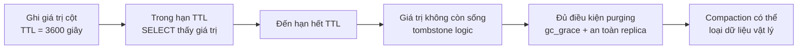
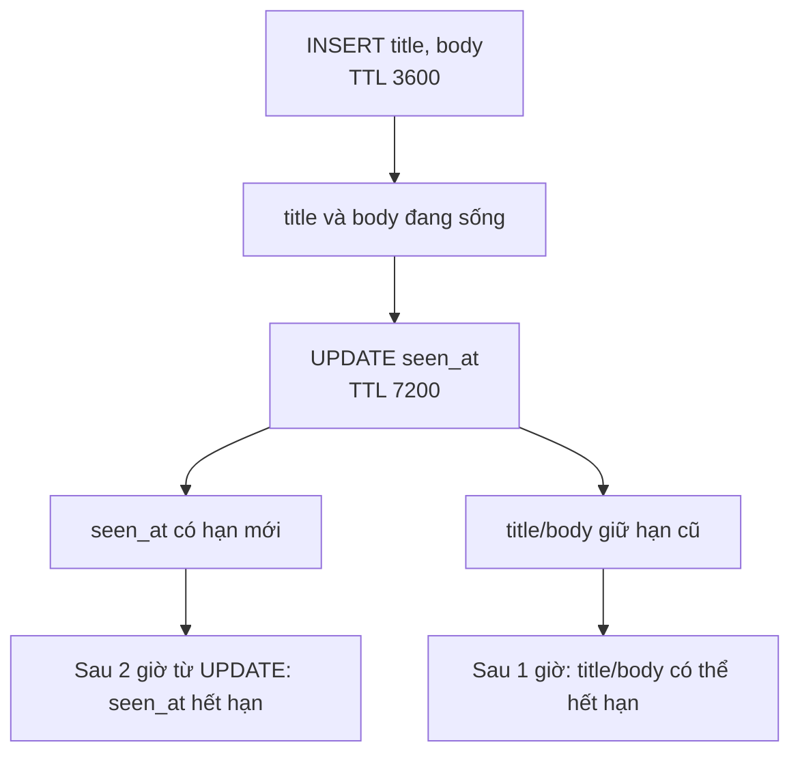
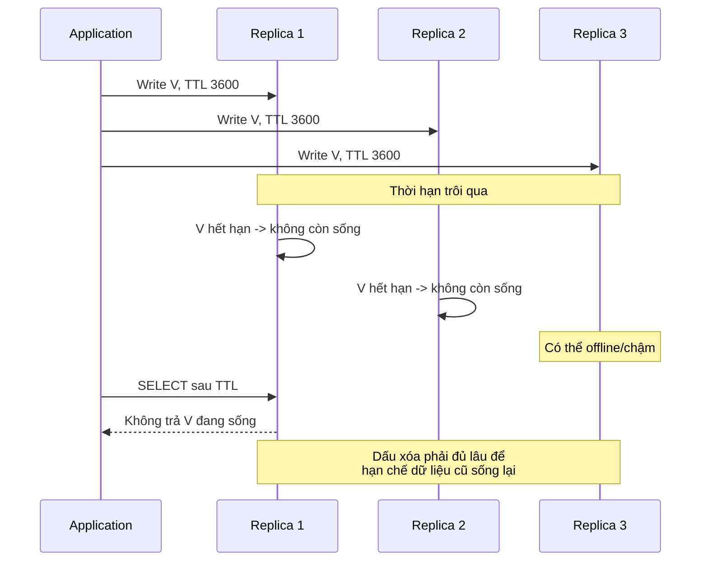
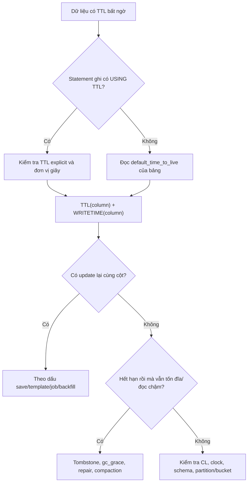

# TTL của giá trị cột và default_time_to_live của bảng

## 1. TTL giải quyết vấn đề gì trong Spring Data Cassandra?

Apache Cassandra thường được dùng cho sự kiện, thông báo, session, telemetry hoặc dữ liệu có thời hạn sử dụng. Ví dụ:

- Thông báo trong ứng dụng chỉ cần giữ **7 ngày**.
- Một kết quả tạm để xử lý yêu cầu chỉ nên tồn tại **15 phút**.
- Bảng lưu sự kiện có chính sách giữ dữ liệu **30 ngày**, sau đó không cho ứng dụng đọc lại như dữ liệu còn hiệu lực.
- Một thuộc tính nhạy cảm cần hết hạn sớm hơn các thuộc tính khác của cùng hàng.

Trong **Spring Data Cassandra**, có thể ghi TTL qua CQL, Java Driver hoặc các API ghi của Spring Data. Tuy nhiên, điều quan trọng không nằm ở cách gọi một hàm `ttl(...)`, mà ở **đối tượng nào thực sự có thời hạn**, **thao tác nào làm gia hạn thời hạn**, và **điều gì xảy ra bên trong Cassandra khi thời hạn kết thúc**.

TTL (*time to live*) là thời gian sống tính bằng **giây**, được gắn với dữ liệu được ghi. Khi TTL hết, giá trị tương ứng được Cassandra xem như đã bị xóa về mặt logic. Hết TTL **không đồng nghĩa với xóa vật lý khỏi SSTable ngay lập tức**.

Bài thuộc chương **TTL và tombstone** của module `SPRING_DATA_CASSANDRA`. Sau bài học, bạn cần làm được:

1. Phân biệt TTL áp dụng lên **giá trị cột/cell** với `default_time_to_live` của **bảng**.
2. Viết và đọc các lệnh CQL `INSERT ... USING TTL`, `UPDATE ... USING TTL`, `ALTER TABLE ... WITH default_time_to_live` và `TTL(column)`.
3. Dự đoán chính xác thời hạn của **những cột được ghi lại** so với **những cột không được đụng tới**.
4. Hiểu vì sao một hàng có thể chỉ còn một phần giá trị, và vì sao TTL tạo tombstone ảnh hưởng đến hiệu năng đọc.
5. Đặt TTL từ Spring Data Cassandra hoặc Java Driver mà không nhầm nó với consistency level, paging hoặc chính sách dọn dữ liệu.
6. Xây dựng kiểm thử và quy trình vận hành phù hợp với replication, read repair/repair, compaction và yêu cầu lưu giữ dữ liệu.

**Giới hạn cần nhớ:** Cassandra là hệ cơ sở dữ liệu phân tán. TTL không cung cấp transaction đa hàng, không bảo đảm xóa sạch ngay mọi bản sao/snapshot và không thay thế thiết kế bảng theo truy vấn.

## 2. Nắm đúng ba khái niệm: cell TTL, table default TTL và tombstone

### 2.1. TTL thực chất gắn với giá trị được ghi

Hãy xem một hàng có primary key và hai cột dữ liệu:

```text
PRIMARY KEY = (account_id, notification_id)

title       = "Đơn hàng đã giao"   (TTL còn 1 giờ)
seen_at     = 2026-11-25 10:00Z    (TTL còn 2 giờ)
```

Mặc dù hai cột cùng một hàng, chúng có thể có **thời điểm hết hạn khác nhau** nếu được ghi ở những thời điểm hoặc statement khác nhau.

| Thành phần | Có TTL theo cách ghi thông thường? | Ý nghĩa |
| --- | --- | --- |
| Partition key | Không được đặt TTL như một cell dữ liệu thường. | Định danh partition/đường routing. |
| Clustering columns | Không được đặt TTL như một cell dữ liệu thường. | Định danh và sắp thứ tự hàng trong partition. |
| Cột thường (`title`, `body`, `seen_at`) | Có. | Mỗi giá trị được ghi có thể hết hạn theo TTL hiệu lực. |
| Cột không được đưa vào câu ghi | Không bị statement đó tự động thay đổi TTL. | Vẫn giữ TTL và dữ liệu trước đó, trừ khi có mutation khác. |
| Giá trị đã bị xóa bằng `DELETE` hoặc `SET column = null` | Được đánh dấu xóa theo cơ chế tombstone. | Không đồng nghĩa với “đặt TTL bằng 0”. |

Nói “TTL của hàng” đôi khi tiện trong giao tiếp, nhưng để debug chính xác cần hiểu TTL được gắn vào **các giá trị được ghi**. Khi tất cả dữ liệu còn có ý nghĩa sống của hàng đã hết hạn, hàng có thể không còn xuất hiện trong kết quả `SELECT`, dù primary key là thành phần định danh của dữ liệu đã từng tồn tại.

### 2.2. default_time_to_live là mặc định tại thời điểm ghi

Thuộc tính bảng `default_time_to_live` quy định TTL mặc định, tính bằng **giây**, cho các giá trị mới được ghi khi không có TTL tường minh phù hợp trong statement.

Ví dụ:

```sql
CREATE TABLE learning.notifications_by_account_day (
    account_id uuid,
    notification_day date,
    sent_at timestamp,
    notification_id uuid,
    title text,
    body text,
    seen_at timestamp,
    PRIMARY KEY (
        (account_id, notification_day),
        sent_at,
        notification_id
    )
) WITH CLUSTERING ORDER BY (
    sent_at DESC,
    notification_id ASC
)
AND default_time_to_live = 604800;
```

`604800` giây tương đương **7 ngày**. Nếu thực hiện `INSERT` không có `USING TTL`, các cột dữ liệu được ghi sẽ nhận TTL mặc định 7 ngày.

Điều này **không** có nghĩa database cứ đúng nửa đêm là xóa cả partition, hay khi sửa thuộc tính bảng thì mọi giá trị lịch sử tự động được thiết lập lại TTL.

### 2.3. Tombstone là dấu hiệu xóa logic, không phải hàng rác vô nghĩa

Khi dữ liệu hết TTL, Cassandra phải bảo đảm replica còn giữ bản cũ không khiến dữ liệu xuất hiện trở lại sau một lần đồng bộ. Vì vậy, dữ liệu hết hạn đi vào vòng đời **tombstone/xóa logic** và chỉ được dọn vật lý khi đủ điều kiện.



**Cột hết hạn không còn được trả về như dữ liệu còn sống**, nhưng bytes trên đĩa, tombstone và bản sao/backup có thể còn tồn tại sau đó. Không nên dùng TTL như lời hứa “xóa vật lý hoàn toàn đúng giây”.

## 3. Chuẩn bị bảng CQL theo truy vấn

Để thực hành, dùng mô hình **đọc thông báo của một account theo ngày**, không quét toàn bộ thông báo trong cluster.

### 3.1. Keyspace cho môi trường học một node

```sql
-- Ví dụ một node tại data center dc1; RF=1 chỉ dành cho lab.
CREATE KEYSPACE IF NOT EXISTS learning
WITH replication = {
    'class': 'NetworkTopologyStrategy',
    'dc1': 1
};
```

Với cluster production RF=3 hoặc nhiều DC, cần cấu hình replication theo topology thực tế. Chỉ thay TTL không tăng RF, không tự chọn consistency level và không làm một keyspace RF=1 chịu được lỗi mất node.

### 3.2. Bảng có default TTL 7 ngày

```sql
CREATE TABLE IF NOT EXISTS learning.notifications_by_account_day (
    account_id uuid,
    notification_day date,
    sent_at timestamp,
    notification_id uuid,
    title text,
    body text,
    seen_at timestamp,
    PRIMARY KEY (
        (account_id, notification_day),
        sent_at,
        notification_id
    )
) WITH CLUSTERING ORDER BY (
    sent_at DESC,
    notification_id ASC
)
AND default_time_to_live = 604800;
```

Mô hình khóa:

| Cột | Vai trò | Vì sao cần? |
| --- | --- | --- |
| `account_id` | Thành phần partition key | Chỉ đọc dữ liệu của account đã xác định. |
| `notification_day` | Thành phần partition key | Chia dữ liệu theo bucket ngày, tránh một partition lịch sử vô hạn. |
| `sent_at` | Clustering column thứ nhất, giảm dần | Hiển thị thông báo mới trước, phục vụ range theo thời gian. |
| `notification_id` | Clustering column thứ hai | Phân biệt thông báo có cùng timestamp mili giây. |
| `title`, `body` | Cột thường | Có TTL theo từng lần ghi. |
| `seen_at` | Cột thường, nullable | Có thể được ghi và hết hạn ở thời điểm riêng. |

**Điểm then chốt:** TTL không làm thay đổi primary key. Sau khi hết hạn, truy vấn theo `(account_id, notification_day)` vẫn đi đến partition tương ứng và có thể phải xử lý tombstones.

### 3.3. Dữ liệu mẫu

```sql
INSERT INTO learning.notifications_by_account_day (
    account_id, notification_day, sent_at, notification_id,
    title, body
) VALUES (
    aaaaaaaa-aaaa-aaaa-aaaa-aaaaaaaaaaaa,
    '2026-11-25',
    '2026-11-25T09:00:00.000Z',
    bbbbbbbb-bbbb-bbbb-bbbb-bbbbbbbbbbbb,
    'Đơn hàng đã giao',
    'Đơn hàng 123 đã hoàn tất'
);
```

Không có `USING TTL` trong câu này, vì vậy `title` và `body` sử dụng **default TTL 604800 giây** tại thời điểm ghi. `seen_at` không được ghi nên giá trị của nó chưa có; đừng gán nhầm rằng một giá trị `null` chưa tồn tại có TTL 7 ngày.

Câu đọc:

```sql
SELECT sent_at, notification_id, title, body, seen_at
FROM learning.notifications_by_account_day
WHERE account_id = aaaaaaaa-aaaa-aaaa-aaaa-aaaaaaaaaaaa
  AND notification_day = '2026-11-25'
LIMIT 50;
```

Lưu ý `notification_day` là ngày được ứng dụng tính theo quy tắc nghiệp vụ; nó không tự động quyết định hạn hết TTL của các cột.

## 4. TTL cấp statement với INSERT USING TTL

### 4.1. Chỉ định thời hạn cho giá trị đang ghi

Thêm một thông báo chỉ cần tồn tại **1 giờ**:

```sql
INSERT INTO learning.notifications_by_account_day (
    account_id, notification_day, sent_at, notification_id,
    title, body
) VALUES (
    aaaaaaaa-aaaa-aaaa-aaaa-aaaaaaaaaaaa,
    '2026-11-25',
    '2026-11-25T10:00:00.000Z',
    cccccccc-cccc-cccc-cccc-cccccccccccc,
    'Mã giảm giá',
    'Ưu đãi sắp hết hạn'
) USING TTL 3600;
```

`USING TTL 3600` gắn TTL **3600 giây** với các giá trị cột được ghi trong statement, thay vì dùng mặc định 7 ngày của bảng. Nó không biến partition key thành một cột có TTL tùy ý.

Giá trị `3600` là **thời gian sống tương đối**, không phải Unix timestamp hay số mili giây. Không truyền `Duration.toMillis()` vào CQL `TTL` nếu yêu cầu là giây.

### 4.2. So sánh hai hàng của cùng partition

| Hàng | Cách ghi | TTL hiệu lực lúc ghi |
| --- | --- | --- |
| Thông báo lúc 09:00 | `INSERT` không ghi `USING TTL` | Bảng mặc định 604800 giây. |
| Thông báo lúc 10:00 | `INSERT ... USING TTL 3600` | 3600 giây cho các giá trị được ghi. |

Hai hàng cùng partition nhưng **không nhất thiết hết hạn cùng lúc**.

Nếu nghiệp vụ nói “giữ mọi thông báo đến hết ngày thứ bảy theo múi giờ Việt Nam”, chỉ đặt `604800` cho từng lần ghi **chưa thực hiện đúng** ý đó: thông báo ghi lúc 08:00 và 22:00 sẽ hết hạn ở hai mốc khác nhau. Bạn phải tính chính sách hạn từ mốc lịch mong muốn rồi xác định TTL còn lại hoặc thiết kế quy trình giữ dữ liệu phù hợp.

### 4.3. TTL của một câu ghi không phải TTL toàn partition

Ngay cả khi `INSERT` có nhiều cột, TTL tác động lên **những giá trị được ghi trong statement ấy**. Nó không:

- Áp dụng tự động lên mọi hàng khác trong cùng partition.
- Gia hạn các cột không được ghi lại của một hàng đã có.
- Đổi thời hạn của dữ liệu nằm trong bảng khác.
- Xóa vật lý ngay khi ứng dụng kiểm tra hết hạn.

Nếu phần nội dung có giá trị lưu giữ khác nhau, hãy cân nhắc tách sang bảng khác thay vì liên tục ghi đè TTL từng cột trong cùng entity.

## 5. UPDATE USING TTL: chỉ những cột được cập nhật nhận TTL mới

Giả sử thông báo lúc 10:00 có `title` và `body` với TTL 1 giờ. Người dùng mở thông báo và ứng dụng muốn ghi `seen_at` với thời hạn **2 giờ**:

```sql
UPDATE learning.notifications_by_account_day
USING TTL 7200
SET seen_at = '2026-11-25T10:15:00.000Z'
WHERE account_id = aaaaaaaa-aaaa-aaaa-aaaa-aaaaaaaaaaaa
  AND notification_day = '2026-11-25'
  AND sent_at = '2026-11-25T10:00:00.000Z'
  AND notification_id = cccccccc-cccc-cccc-cccc-cccccccccccc;
```

**Kết quả kỳ vọng về ngữ nghĩa:**

- `seen_at` nhận TTL **7200 giây** từ lần ghi mới.
- `title` vẫn giữ TTL **3600 giây tính từ lần ghi title gần nhất**.
- `body` vẫn giữ TTL **3600 giây tính từ lần ghi body gần nhất**.
- Các thành phần primary key vẫn xác định cùng một hàng.



Vì vậy, **một row có thể tạm thời chỉ còn `seen_at` mà không còn `title`/`body`**. Nếu UI mặc định mọi notification đang tồn tại đều phải có `title`, đây là hành vi sai với hợp đồng nghiệp vụ dù CQL hoàn toàn hợp lệ.

### 5.1. Ghi lại cùng cột làm thay đổi TTL của cột đó

Ví dụ viết lại `title`:

```sql
UPDATE learning.notifications_by_account_day
USING TTL 1800
SET title = 'Ưu đãi được gia hạn'
WHERE account_id = aaaaaaaa-aaaa-aaaa-aaaa-aaaaaaaaaaaa
  AND notification_day = '2026-11-25'
  AND sent_at = '2026-11-25T10:00:00.000Z'
  AND notification_id = cccccccc-cccc-cccc-cccc-cccccccccccc;
```

Ở đây, giá trị `title` mới sẽ có TTL 1800 giây (nếu mutation được chọn là giá trị thắng theo quy tắc Cassandra). `body` và `seen_at` **không được gia hạn**.

Nếu business muốn một notification được gia hạn **toàn bộ** mỗi khi người dùng xem, phải thiết kế một thao tác ghi có chủ đích cho các giá trị cần gia hạn, hoặc đổi mô hình dữ liệu. Ghi lại từng cột trong nhiều request có thể gây trạng thái TTL không đồng nhất và tăng số mutation/tombstone.

### 5.2. Ghi không có USING TTL khi bảng có default TTL

Với bảng có `default_time_to_live = 604800`, câu:

```sql
UPDATE learning.notifications_by_account_day
SET body = 'Nội dung cập nhật'
WHERE account_id = aaaaaaaa-aaaa-aaaa-aaaa-aaaaaaaaaaaa
  AND notification_day = '2026-11-25'
  AND sent_at = '2026-11-25T10:00:00.000Z'
  AND notification_id = cccccccc-cccc-cccc-cccc-cccccccccccc;
```

sử dụng **TTL mặc định 7 ngày cho giá trị `body` vừa ghi**, vì statement này không đặt TTL tường minh. Nó **không tự kéo dài** TTL của `title` hay `seen_at`.

Một lần ghi mới có thể làm một cột sống lâu hơn cả các cột khác trong cùng hàng. Đó là lý do khi dữ liệu có vòng đời chung, cần review **mọi write path**, gồm repository, template, job backfill và CQL trực tiếp.

## 6. default_time_to_live: mặc định của bảng, không phải hạn xóa toàn bộ một lần

### 6.1. Tạo bảng có hoặc không có default TTL

Hai thiết lập thường gặp:

```sql
-- Mặc định có thời hạn: 7 ngày.
CREATE TABLE IF NOT EXISTS learning.retained_messages (
    message_id uuid PRIMARY KEY,
    content text
) WITH default_time_to_live = 604800;

-- Mặc định KHÔNG đặt TTL.
CREATE TABLE IF NOT EXISTS learning.permanent_messages (
    message_id uuid PRIMARY KEY,
    content text
) WITH default_time_to_live = 0;
```

`default_time_to_live = 0` nghĩa là **không có TTL mặc định**. Nó không cấm application dùng `INSERT ... USING TTL` cho những giá trị cần hết hạn.

Giá trị mặc định của thuộc tính khi không khai báo thường là `0`; đặt rõ trong bài học giúp dễ phân biệt với ví dụ bảng thời hạn 7 ngày.

### 6.2. Thay đổi default TTL bằng ALTER TABLE

Giả sử chính sách mới đổi từ 7 ngày xuống 3 ngày:

```sql
ALTER TABLE learning.notifications_by_account_day
WITH default_time_to_live = 259200;
```

`259200` giây là **3 ngày**. Đây là thay đổi **chính sách mặc định cho các lần ghi tiếp theo**; không nên giả định mọi cell đã ghi trước đó đều được backfill TTL mới hoặc được gia hạn/xóa lại đồng loạt.

| Tình huống | TTL kỳ vọng |
| --- | --- |
| Cell ghi trước khi đổi bảng, đã có TTL 7 ngày | Giữ thời hạn gắn với giá trị cũ cho tới khi bị cập nhật/ghi đè hoặc hết hạn. |
| Cell mới ghi sau khi đổi bảng, statement không có `USING TTL` | Dùng mặc định 3 ngày. |
| Cell mới ghi sau khi đổi bảng, statement có `USING TTL 600` | Dùng TTL tường minh 600 giây. |
| Cell không được ghi trong lần UPDATE mới | Không đổi TTL chỉ vì UPDATE của một cột khác. |

**Đổi `default_time_to_live` không phải một migration retention trên dữ liệu lịch sử.** Nếu có yêu cầu xóa/hết hạn dữ liệu cũ theo chính sách mới, cần kế hoạch riêng, đo tải ghi/tombstone, kiểm tra replica/repair và phương án rollback.

### 6.3. Cách kiểm tra thuộc tính bảng

Trong `cqlsh`:

```text
DESCRIBE TABLE learning.notifications_by_account_day;
```

Tìm thuộc tính `default_time_to_live` trong DDL được in ra. Khi dùng một công cụ khác, có thể tra metadata schema của cluster qua driver. Không suy luận default TTL từ Java annotation nếu bảng đang được quản lý ngoài ứng dụng.

## 7. TTL tường minh so với table default: quy tắc ưu tiên

Có ba trường hợp cần nhớ:

| Thiết lập bảng | Statement ghi | TTL hiệu lực thông thường |
| --- | --- | --- |
| `default_time_to_live = 0` | Không `USING TTL` | Không có TTL; giá trị có thể tồn tại cho đến khi mutation khác thay thế/xóa. |
| `default_time_to_live = 604800` | Không `USING TTL` | Mặc định 604800 giây trên giá trị mới được ghi. |
| `default_time_to_live = 604800` | `USING TTL 3600` | TTL tường minh 3600 giây cho các giá trị trong statement. |
| `default_time_to_live = 0` | `USING TTL 3600` | TTL tường minh 3600 giây. |
| `default_time_to_live = 604800` | `USING TTL 0` | Ghi không có hạn hết TTL theo cách diễn giải TTL=0 của CQL; cần xác minh trên phiên bản đang chạy. |

`USING TTL 0` là cách thể hiện **không áp dụng TTL** cho những giá trị được viết trong statement trên các phiên bản CQL hỗ trợ semantics này, khác với việc **không ghi `USING TTL`** khi bảng có default TTL.

Ví dụ cần kiểm chứng trong lab:

```sql
INSERT INTO learning.retained_messages
(message_id, content)
VALUES (
    11111111-1111-1111-1111-111111111111,
    'Giữ theo ngoại lệ'
) USING TTL 0;
```

Dùng `TTL(content)` để đối chiếu, **không đoán** từ tên option. Một số tổ hợp phiên bản, giới hạn cấu hình và cách triển khai hệ thống có thể cần kiểm tra đặc biệt; hãy xác nhận hành vi trên bản Cassandra/driver của dự án trước khi dùng TTL=0 làm cơ chế lưu giữ lâu dài trong một bảng mặc định có hạn.

**Khuyến nghị mô hình:** Nếu nhiều giá trị phải sống vĩnh viễn trong khi phần lớn còn lại có TTL, một bảng riêng với `default_time_to_live = 0` thường rõ ràng và dễ kiểm soát hơn nhiều ngoại lệ TTL=0 trong cùng bảng.

## 8. Đọc TTL còn lại với TTL(column) và WRITETIME(column)

Cassandra cho phép truy vấn thông tin gắn với giá trị cột:

- `TTL(column)`: thời gian sống **còn lại**, tính bằng giây, đối với giá trị có TTL đang có hiệu lực.
- `WRITETIME(column)`: write timestamp của giá trị cột, thường tính bằng **microseconds** ở mức CQL write time.

Ví dụ:

```sql
SELECT
    notification_id,
    title,
    TTL(title) AS ttl_title_seconds,
    WRITETIME(title) AS title_write_timestamp,
    body,
    TTL(body) AS ttl_body_seconds,
    seen_at,
    TTL(seen_at) AS ttl_seen_seconds
FROM learning.notifications_by_account_day
WHERE account_id = aaaaaaaa-aaaa-aaaa-aaaa-aaaaaaaaaaaa
  AND notification_day = '2026-11-25'
LIMIT 20;
```

### Kết quả phải được diễn giải thế nào?

- TTL hiển thị **giảm theo thời gian**; nó không phải số giây ban đầu đã cấu hình.
- Với cột có giá trị nhưng **không có TTL**, `TTL(column)` thường trả `null`, không phải một số vô hạn.
- Với cột **chưa có giá trị** hoặc đã hết hạn, phép đọc cũng có thể trả `null`/không có hàng. Vì vậy không dùng riêng `TTL(column) IS NULL` để phân biệt ba tình huống “vắng mặt”, “không hết hạn” và “đã hết hạn”.
- `WRITETIME` giúp debug mutation timestamp nhưng **không phải** thời gian hết hạn tuyệt đối; khi cần hợp đồng retention, phải biết cả TTL và thời gian ghi.
- Không dùng `TTL()` hay `WRITETIME()` trên các cột primary key để coi chúng là cell thường.
- Không dùng các hàm này như query predicate trên mọi cột để quét dữ liệu; chúng chủ yếu là công cụ quan sát/debug giá trị được đọc.

### Minh họa timeline

Giả sử không có mutation khác, tại các mốc tương đối:

| Thời điểm | title | body | seen_at |
| --- | --- | --- | --- |
| `t0`: INSERT 1h | TTL ~3600 | TTL ~3600 | Chưa có giá trị |
| `t0 + 15 phút`: UPDATE seen_at 2h | TTL ~2700 | TTL ~2700 | TTL ~7200 |
| `t0 + 60 phút` | Có thể đã hết hạn | Có thể đã hết hạn | Còn ~4500 giây |
| `t0 + 135 phút` | Đã hết hạn | Đã hết hạn | Đến gần hạn |
| Sau khi tất cả dữ liệu sống đã hết hạn | Không thấy giá trị | Không thấy giá trị | Không thấy giá trị |

Đây là **mô hình tính toán tương đối**: kết quả thực tế phụ thuộc thời điểm ghi, granularity giây, đồng hồ node, độ trễ và các mutation khác. Dùng lab với TTL ngắn để quan sát, không dùng một bảng chụp ví dụ như tiêu chuẩn thời gian tuyệt đối.

## 9. TTL không giống “ngày hết hạn” của nghiệp vụ

### 9.1. TTL tương đối, expiresAt là tuyệt đối

Hai chính sách này khác nhau:

- **“Mỗi thông báo sống 7 ngày kể từ lúc được ghi”**: dùng TTL 604800 trên lần ghi.
- **“Mọi thông báo của chiến dịch hết hạn đúng 00:00 ngày 01/12 theo giờ Việt Nam”**: phải tính thời gian còn lại cho từng lần ghi hoặc có chính sách khác để chặn đọc từ một `expiresAt` tuyệt đối.

Ví dụ Java:

```java
import java.time.Duration;
import java.time.Instant;
import java.time.LocalDate;
import java.time.ZoneId;

Instant now = Instant.parse("2026-11-25T10:00:00Z");
ZoneId zone = ZoneId.of("Asia/Ho_Chi_Minh");

Instant expiresAt = LocalDate.of(2026, 12, 1)
    .atStartOfDay(zone)
    .toInstant();

long remainingSeconds = Duration.between(now, expiresAt).getSeconds();

if (remainingSeconds <= 0) {
    throw new IllegalStateException("Không ghi giá trị đã hết hạn");
}

int ttlSeconds = Math.toIntExact(remainingSeconds);
```

Trong hệ thống thật, code nên lấy thời gian từ clock được inject để test và **không mặc định ép tròn** nếu có yêu cầu thời điểm hết hạn rất chính xác. TTL CQL tính bằng giây; khi chuyển từ hạn tuyệt đối sang giây phải quy định xử lý phần lẻ.

### 9.2. Backfill có thể làm sai hạn nếu dùng TTL cố định

Giả sử job ngày 01/12 nhập lại một sự kiện vốn xảy ra ngày 01/11 với chính sách “giữ 30 ngày kể từ **thời điểm sự kiện**”. Nếu job chỉ `INSERT USING TTL 2592000`, dữ liệu có thể sống thêm 30 ngày từ **lần ghi backfill**, sai ý nghĩa nghiệp vụ.

Một quy trình đúng phải:

1. Xác định nguồn chân lý của mốc hết hạn (`event_at`, `created_at` hay `retention_deadline`).
2. Tính TTL còn lại tại lúc backfill.
3. Bỏ qua hoặc xử lý riêng dữ liệu đã hết hạn.
4. Kiểm tra giới hạn TTL/độ phân giải giây.
5. Đối soát các dòng đã ghi với `TTL(column)` hoặc cột deadline nghiệp vụ.

Không dùng `USING TIMESTAMP` tùy tiện để mô phỏng hạn cũ: write timestamp còn ảnh hưởng **hòa giải dữ liệu** theo last-write-wins, có thể gây xung đột ngoài mong muốn.

### 9.3. TTL không phải công cụ xóa dữ liệu theo SLA pháp lý

Với dữ liệu phải xóa vĩnh viễn theo yêu cầu pháp lý/quyền riêng tư, TTL đơn thuần không bảo đảm:

- Dữ liệu đã biến mất ngay khỏi mọi SSTable.
- Không còn trong snapshot, backup, archive hoặc log/stream ngoài Cassandra.
- Mọi replica đã được đồng bộ nếu node từng offline.
- Không có dịch vụ downstream giữ bản sao của dữ liệu.

Cần chính sách backup/snapshot retention, repair, xóa chủ động, kiểm toán và xác nhận xóa theo hệ thống tổng thể.

## 10. Tombstone sau TTL hết hạn và ảnh hưởng đến truy vấn

### 10.1. Tại sao không thể chỉ “quên” giá trị đã hết hạn?

Cassandra có nhiều replica. Giả sử một replica đã thấy TTL hết hạn, trong khi replica khác offline và còn giữ giá trị cũ. Nếu xóa vật lý ngay mọi dấu vết về việc hết hạn, một bản sao cũ có thể được đồng bộ trở lại như dữ liệu hợp lệ.

Tombstone giúp hệ thống có thông tin **giá trị từng tồn tại nhưng không còn sống**. Việc dọn dữ liệu vật lý cần xem xét sự an toàn của replica cùng cấu hình retention/repair và điều kiện compaction.



Sơ đồ giản lược, không ngụ ý mỗi lần `SELECT` chỉ liên lạc một replica hoặc tất cả node xử lý TTL đồng thời đến từng mili giây.

### 10.2. Hết TTL là hết hiệu lực logic, chưa chắc giải phóng dung lượng

Cần phân biệt ba mốc:

| Mốc | Dữ liệu có thể đọc như còn sống? | Dữ liệu còn trên đĩa? |
| --- | --- | --- |
| Trước hạn TTL | Có, nếu replica/query/CL không có lỗi và cell tồn tại. | Có. |
| Vừa hết TTL | Không còn được coi là giá trị sống. | **Có thể còn**, dưới dạng dữ liệu hết hạn/tombstone. |
| Sau khi đủ điều kiện xóa và compaction thích hợp | Không. | Có thể được dọn, nhưng không hứa thời điểm cố định. |

**TTL không phải lệnh shrink file ngay lập tức.** Việc giảm dung lượng đĩa phụ thuộc cơ chế compaction và khả năng purge của Cassandra, không chỉ số giây TTL.

### 10.3. Tombstone-heavy read và read amplification

Một partition đã ghi hàng trăm nghìn giá trị ngắn hạn có thể tích lũy nhiều tombstone. Nếu một query:

```sql
SELECT sent_at, notification_id, title
FROM learning.notifications_by_account_day
WHERE account_id = ?
  AND notification_day = ?
LIMIT 50;
```

phải quét qua nhiều giá trị đã hết hạn để tìm **50 hàng sống**, lượng dữ liệu xử lý ở storage engine có thể lớn hơn nhiều so với số hàng API nhận. Hậu quả có thể là:

- Read latency tăng; tail latency p95/p99 xấu.
- Tốn I/O và CPU để xét tombstones.
- Cảnh báo về số tombstone được quét hoặc read timeout.
- `LIMIT 50` không bảo đảm engine chỉ cần chạm đúng 50 cell/hàng vật lý.
- CL cao hơn đòi hỏi phối hợp nhiều replica hơn nhưng **không sửa tình trạng tombstone quá nhiều**.

Vì vậy, thiết kế retention/partition/compaction phải đi cùng nhau.

## 11. gc_grace_seconds, repair và compaction

### 11.1. gc_grace_seconds có vai trò gì?

Thuộc tính `gc_grace_seconds` của bảng là khoảng thời gian hỗ trợ giữ dấu xóa đủ lâu để bảo vệ quá trình đồng bộ replica trong các tình huống phù hợp. Một cấu hình thường gặp là **864000 giây (10 ngày)**, nhưng giá trị hiệu lực phải đọc từ **schema thực tế**.

Không nhầm:

```text
TTL = 3600 giây      -> thời gian dữ liệu được xem là còn sống
gc_grace = 864000 giây -> một phần điều kiện an toàn khi purge tombstone
compaction           -> công việc storage có thể dọn dữ liệu đủ điều kiện
```

**Không lấy TTL = 1 giờ làm lý do tự đặt gc_grace_seconds = 0.** Trong một số mô hình, thay đổi gc grace và các điều kiện repair sai có thể tăng rủi ro dữ liệu cũ xuất hiện lại (*zombie data*) sau khi replica offline lâu quay trở lại.

### 11.2. Anti-entropy repair và trạng thái replica

Đối với cluster phân tán, cần quy trình repair đã được lên lịch và giám sát. Hinted handoff không bảo đảm bù toàn bộ dữ liệu cho mọi khoảng offline; repair là phần quan trọng của việc duy trì replica nhất quán.

Một nguyên tắc vận hành:

- Thiết kế vòng repair phù hợp với `gc_grace_seconds`, đặc điểm workloads và yêu cầu của Cassandra/version triển khai.
- Theo dõi node lâu ngày offline, compaction backlog, disk pressure và tombstone metrics.
- Kiểm tra backup/snapshot retention để không nhầm “không đọc được sau TTL” với “đã xóa sạch khỏi mọi bản sao”.
- Khi muốn thay đổi `gc_grace_seconds`, cần runbook/phê duyệt của người vận hành và test trong môi trường phù hợp; không tối ưu bằng cách đoán.

### 11.3. Compaction strategy và TTL-heavy workload

Với workload dạng **time-series** có TTL tương đối đồng nhất và ghi theo thời gian, `TimeWindowCompactionStrategy` (TWCS) có thể phù hợp vì tổ chức SSTable theo khoảng thời gian. Nhưng đây không phải lựa chọn tự động cho mọi bảng có TTL:

- TTL quá khác nhau giữa các cell/hàng có thể làm việc dọn dữ liệu khó dự đoán.
- Ghi dữ liệu cũ muộn (*out-of-order writes*, backfill) có thể đưa dữ liệu các khoảng thời gian khác nhau vào cùng vùng compaction.
- Update liên tục vào hàng cũ có thể làm SSTable có lifecycle không đồng nhất.
- Cần cân nhắc kích thước partition, query pattern, tombstone ratio, dung lượng đĩa và thời gian compaction.

**Không đổi compaction strategy trong bài lab rồi mặc định phù hợp production**. Tối ưu phải dựa trên metrics thực tế và hướng dẫn vận hành của phiên bản Cassandra.

## 12. Spring Data Cassandra: entity mapping không tự quản lý TTL

Spring Data Cassandra ánh xạ CQL columns sang các field Java. Ví dụ:

```java
package com.example.notifications.domain;

import java.time.Instant;
import java.time.LocalDate;
import java.util.UUID;

import org.springframework.data.cassandra.core.cql.Ordering;
import org.springframework.data.cassandra.core.mapping.Column;
import org.springframework.data.cassandra.core.mapping.PrimaryKeyColumn;
import org.springframework.data.cassandra.core.mapping.PrimaryKeyType;
import org.springframework.data.cassandra.core.mapping.Table;

@Table("notifications_by_account_day")
public class NotificationEntity {

    @PrimaryKeyColumn(
        name = "account_id", ordinal = 0,
        type = PrimaryKeyType.PARTITIONED)
    private UUID accountId;

    @PrimaryKeyColumn(
        name = "notification_day", ordinal = 1,
        type = PrimaryKeyType.PARTITIONED)
    private LocalDate notificationDay;

    @PrimaryKeyColumn(
        name = "sent_at", ordinal = 0,
        type = PrimaryKeyType.CLUSTERED,
        ordering = Ordering.DESCENDING)
    private Instant sentAt;

    @PrimaryKeyColumn(
        name = "notification_id", ordinal = 1,
        type = PrimaryKeyType.CLUSTERED,
        ordering = Ordering.ASCENDING)
    private UUID notificationId;

    private String title;

    private String body;

    @Column("seen_at")
    private Instant seenAt;

    protected NotificationEntity() {
    }

    public UUID getAccountId() { return accountId; }
    public LocalDate getNotificationDay() { return notificationDay; }
    public Instant getSentAt() { return sentAt; }
    public UUID getNotificationId() { return notificationId; }
    public String getTitle() { return title; }
    public String getBody() { return body; }
    public Instant getSeenAt() { return seenAt; }

    // Thêm factory/constructor/setter khi cần lưu entity bằng template.
}
```

Các annotation trên mô tả **tên bảng, khóa và kiểu dữ liệu**, không tự xác định TTL cụ thể. Nếu không truyền TTL trong write operation và bảng có `default_time_to_live`, các giá trị được ghi nhận TTL theo mặc định của bảng.

Bảng keyspace nên được tạo ngoài ứng dụng trong ví dụ, thay vì để mỗi instance tự điều khiển schema:

```yaml
spring:
  cassandra:
    contact-points: 127.0.0.1
    port: 9042
    local-datacenter: dc1
    keyspace-name: learning
    schema-action: NONE
```

Trong Docker network, dùng hostname của service Cassandra thay vì `127.0.0.1` của chính container ứng dụng. `local-datacenter` phải đúng topology mà cluster công bố.

### 12.1. @TimeToLive và TTL ở tầng entity

Một số phiên bản Spring Data Cassandra hỗ trợ annotation `@TimeToLive` để biểu đạt TTL liên quan tới entity/property. Khi dùng cơ chế này, cần kiểm tra cách framework áp dụng TTL vào **statement ghi thực tế**, thứ tự ưu tiên nếu còn có write options và hành vi khi entity được cập nhật một phần.

**Đừng suy luận rằng chỉ có một field Java được đặt `@TimeToLive` thì Cassandra chỉ hết hạn field ấy.** Annotation ở tầng mapping có thể dùng giá trị thuộc tính đó làm **TTL cho thao tác ghi**, khác với việc chọn riêng một cột CQL để hết hạn. Với bài toán “cột A sống 1 giờ, cột B sống 1 tuần” trong cùng hàng, các câu CQL UPDATE từng cột với TTL tường minh thường cho semantics dễ kiểm chứng hơn.

Tương tự, `QueryOptions` của truy vấn đọc (page size, CL, timeout) **không phải nơi thiết lập TTL ghi**. TTL phải nằm ở statement hoặc write options/API được hỗ trợ.

## 13. Spring Data Cassandra: ghi với InsertOptions và CassandraTemplate

Tùy phiên bản Spring Data, `CassandraTemplate` có API ghi nhận `InsertOptions` để đặt TTL cho statement insert.

Ví dụ tập trung vào ý nghĩa TTL:

```java
import java.time.Duration;

import org.springframework.data.cassandra.core.CassandraTemplate;
import org.springframework.data.cassandra.core.InsertOptions;

public class NotificationWriter {

    private final CassandraTemplate template;

    public NotificationWriter(CassandraTemplate template) {
        this.template = template;
    }

    public void saveForOneHour(NotificationEntity entity) {
        InsertOptions options = InsertOptions.builder()
            .ttl(Duration.ofHours(1))
            .build();

        template.insert(entity, options);
    }
}
```

Khi áp dụng vào dự án:

1. Kiểm tra **constructor/property mapping** của `NotificationEntity` hoàn chỉnh; ví dụ entity ở phần 12 chỉ minh họa mapping.
2. Xác nhận API `InsertOptions.builder().ttl(...)` được hỗ trợ đúng phiên bản Spring Data Cassandra đang dùng.
3. Xác nhận **giá trị cột nào được statement insert phát sinh**, đặc biệt các field nullable hoặc bị omit.
4. TTL 1 giờ của insert này phải được phân biệt với `default_time_to_live = 7 ngày` trên bảng.
5. Dùng `TTL(title)`/`TTL(body)` đọc lại trong integration test, không dựa vào tên method `saveForOneHour` để kết luận.

**Điểm quan trọng:** `CassandraTemplate.insert(...)` ở tầng Spring Data không tự biến TTL thành một cơ chế “xóa toàn bộ hàng ngay đúng một giây”. Khi cập nhật cùng hàng qua repository, template hoặc driver, những cột được ghi lại có thể có TTL mới khác nhau theo write path tương ứng.

### 13.1. Cẩn trọng với repository.save()

Một lệnh `repository.save(entity)` có thể phát sinh mutation theo mapping và trạng thái entity. Với một bảng có TTL mặc định, các cột được ghi lại bởi operation đó có thể nhận TTL mặc định **mới**; đây có thể là hành vi **gia hạn retention ngoài ý muốn** nếu code service thường xuyên lưu lại full entity.

Ví dụ:

```text
t0: Ghi title/body bằng TTL 7 ngày.
t0+1 ngày: Read entity, đổi seenAt, gọi save(entity).

Nếu save ghi lại title/body không kèm TTL tường minh,
những cột đó có thể nhận TTL 7 ngày mới từ lần save.
```

Không kết luận `save` “chỉ cập nhật field đã thay đổi” nếu chưa xem statement thực tế của phiên bản Spring Data và cấu hình mapping. Nếu cần tránh gia hạn TTL cũ, dùng update chuyên biệt chỉ ghi các cột cần đổi, rồi kiểm thử TTL readback.

## 14. Java Driver: prepared statement có TTL tường minh

Khi cần kiểm soát chính xác statement CQL, dùng `CqlSession` của Java Driver 4.x:

```java
package com.example.notifications.gateway;

import java.time.Instant;
import java.time.LocalDate;
import java.util.UUID;

import com.datastax.oss.driver.api.core.CqlSession;
import com.datastax.oss.driver.api.core.cql.PreparedStatement;

public final class NotificationCqlGateway {

    private final CqlSession session;
    private final PreparedStatement insertWithTtl;

    public NotificationCqlGateway(CqlSession session) {
        this.session = session;
        this.insertWithTtl = session.prepare(
            "INSERT INTO learning.notifications_by_account_day " +
            "(account_id, notification_day, sent_at, notification_id, " +
            "title, body) VALUES (?, ?, ?, ?, ?, ?) USING TTL ?"
        );
    }

    public void insert(
            UUID accountId,
            LocalDate notificationDay,
            Instant sentAt,
            UUID notificationId,
            String title,
            String body,
            int ttlSeconds) {

        if (ttlSeconds <= 0) {
            throw new IllegalArgumentException(
                "TTL phai la so giay duong trong gateway nay");
        }

        session.execute(insertWithTtl.bind(
            accountId, notificationDay, sentAt, notificationId,
            title, body, ttlSeconds
        ));
    }
}
```

Cần hiểu:

- `USING TTL ?` là bind marker cho **số giây TTL**, không phải một trường của primary key.
- `UUID`, `LocalDate`, `Instant` được bind theo CQL `uuid`, `date`, `timestamp`.
- Gateway trên cố ý chỉ nhận `ttlSeconds > 0`; nếu nghiệp vụ cần **không có TTL**, hãy tạo API riêng rõ nghĩa, không lạm dụng số 0 trong cùng method.
- CQL `timestamp` có độ chính xác mili giây. `notificationDay` phải được tính theo cùng ZoneId khi ghi và đọc.
- Production nên đặt write CL/timeout/retry bằng policy đã review, không tùy tiện để caller HTTP tự chọn TTL hoặc CL ngoài giới hạn.
- Prepared statement nên tái sử dụng; không prepare lại cho mỗi hàng.

### 14.1. Đặt CL riêng với TTL

Ví dụ có thể cấu hình statement:

```java
import com.datastax.oss.driver.api.core.DefaultConsistencyLevel;

session.execute(
    insertWithTtl.bind(
        accountId, notificationDay, sentAt, notificationId,
        title, body, ttlSeconds
    ).setConsistencyLevel(DefaultConsistencyLevel.LOCAL_QUORUM)
);
```

**Consistency level và TTL là hai cơ chế khác nhau**: CL quy định số replica phải phản hồi; TTL quy định thời hạn của giá trị. Ghi với `LOCAL_QUORUM` không làm TTL lâu hơn, và hết TTL không làm CL giảm xuống.

Trong lab một node RF=1, `LOCAL_QUORUM` chỉ cần một replica tại DC, không mô phỏng quorum 2/3.

## 15. Các trường hợp biên dễ gây lỗi dữ liệu

### 15.1. TTL không được đặt trên primary key

Một partition/clustering key không phải giá trị cell thường có thể gia hạn bằng TTL riêng. Nếu định nghĩa retention phụ thuộc vào cả hàng, hãy thiết kế rõ **tất cả cột sống** cùng policy, hoặc dùng bucket/time-window phù hợp.

### 15.2. Ghi null khác bỏ qua cột

Ví dụ:

```sql
-- Xóa nội dung body (tạo semantics xóa/tombstone):
UPDATE learning.notifications_by_account_day
SET body = null
WHERE account_id = aaaaaaaa-aaaa-aaaa-aaaa-aaaaaaaaaaaa
  AND notification_day = '2026-11-25'
  AND sent_at = '2026-11-25T10:00:00.000Z'
  AND notification_id = cccccccc-cccc-cccc-cccc-cccccccccccc;
```

Điều này khác **không đề cập tới `body`** trong một UPDATE khác. Trong mapping Spring Data, cần kiểm tra null-value policy/insert-update strategy để biết field null được skip hay trở thành xóa.

### 15.3. Counter không dùng TTL như giá trị thường

Cassandra **counter** có quy tắc cập nhật riêng; không dùng `USING TTL` cho counter như cột `bigint` bình thường, và bảng counter có những hạn chế với default TTL. Nếu nghiệp vụ yêu cầu số đếm theo ngày có retention, cần thiết kế mô hình time-bucket/counter hoặc aggregation thích hợp, không chỉ gắn TTL cho một counter cell.

### 15.4. Collection và UDT có semantics cần kiểm tra riêng

Với map/set/list/UDT, Cassandra có cơ chế lưu trữ nhiều cell hoặc một giá trị frozen tùy schema. TTL khi cập nhật phần tử collection có thể có hệ quả khác so với ghi thay toàn bộ cột primitive. Trước khi áp dụng TTL nhiều mức lên collection lớn, hãy kiểm tra cách write statement thực sự hoạt động, tombstone phát sinh khi ghi lại/xóa phần tử và rủi ro read amplification.

Không mặc định “TTL của cả object Java” luôn tương đương “mọi phần tử của collection hết hạn đồng thời”.

### 15.5. TTL rất lớn hoặc không hợp lệ

TTL phải là số giây hợp lệ theo Cassandra/version. Có giới hạn về miền giá trị và thời điểm hết hạn có thể biểu diễn. Tránh tự dùng một số cực lớn như đại diện “vĩnh viễn”; dùng TTL=0/no default TTL nếu semantics phù hợp, hoặc tách bảng.

Kiểm tra `Duration` trước khi chuyển sang `int` để tránh tràn:

```java
import java.time.Duration;

Duration retention = Duration.ofDays(30);
int seconds = Math.toIntExact(retention.getSeconds());
```

Nếu retention đến từ người dùng, đặt min/max theo policy sản phẩm; không cho input tùy ý quyết định hàng sống bao lâu.

### 15.6. TTL và write timestamp cạnh tranh

Cassandra hòa giải mutation theo write timestamp và các quy tắc liên quan. Nếu một writer đến sau nhưng dùng timestamp thấp hơn, giá trị mới có thể **không thắng** giá trị cũ, dù statement có TTL khác.

Đừng dùng `USING TIMESTAMP` tùy tiện để backfill hoặc “cứu” một giá trị hết TTL; thao tác ấy có thể tác động đến thứ tự hòa giải. Khi cần điều kiện phiên bản, xem xét `@Version`/LWT theo API được hỗ trợ.

### 15.7. Độ chính xác đồng hồ và thời gian tuyệt đối

TTL được tính theo thời gian thực hiện ghi và thông tin thời gian của Cassandra. Đồng hồ cluster không đồng bộ có thể gây hiện tượng hết hạn lệch kỳ vọng. Vận hành NTP/clock sync là một phần điều kiện cần cho hệ thống có TTL, bên cạnh việc khai báo đúng ZoneId cho ngày bucket.

## 16. Tác động tới consistency level, paging và query pattern

### 16.1. Nhất quán cuối cùng không có nghĩa TTL được bỏ qua

Khi TTL hết, các giá trị hết hạn không còn được xem là sống trong ngữ nghĩa đọc của Cassandra. Nhưng các replica có thể trải qua trạng thái/độ trễ đồng bộ khác nhau, nhất là khi có write/delete cạnh tranh, clock skew hoặc node offline.

Không suy luận:

- “Đọc `LOCAL_ONE` thấy null” ⇒ dữ liệu đã được purge khỏi mọi replica/SSTable.
- “Đọc `LOCAL_QUORUM` thấy null” ⇒ mọi snapshot/backup đã xóa.
- “Tăng CL” ⇒ giảm tombstones hoặc giải phóng đĩa sớm.
- “Thêm TTL” ⇒ khắc phục query thiếu partition key.

Nếu cùng một khóa có ghi cạnh tranh hoặc TTL khác nhau, phải xét write timestamp, write/read CL và trạng thái replica, không chỉ TTL còn lại.

### 16.2. Truy vấn theo partition và clustering vẫn là nền tảng

Ví dụ đọc thông báo một account/ngày:

```sql
SELECT sent_at, notification_id, title
FROM learning.notifications_by_account_day
WHERE account_id = aaaaaaaa-aaaa-aaaa-aaaa-aaaaaaaaaaaa
  AND notification_day = '2026-11-25'
  AND sent_at >= '2026-11-25T00:00:00Z'
  AND sent_at < '2026-11-26T00:00:00Z'
LIMIT 50;
```

Nếu `notification_day` được tính theo **Asia/Ho_Chi_Minh**, hai ranh giới UTC trong ví dụ chỉ phù hợp khi đó cũng chính là khoảng thời gian nghiệp vụ muốn đọc. Nếu mục tiêu là **ngày Việt Nam**, phải tính start/end UTC từ ZoneId Việt Nam chứ không dùng cứng `00:00Z`. Sai ngày/bucket là lỗi định tuyến tới partition, không sửa được bằng TTL hay CL.

### 16.3. Paging khi dữ liệu hết hạn trong lúc đọc

Với `Slice`/`CassandraPageRequest` hoặc Java Driver paging state, một lượt đọc có thể trải qua nhiều request. Trong lúc client xem trang một, một số hàng có thể hết TTL trước khi lấy trang hai.

Vì vậy:

- **Paging state** tiếp tục một truy vấn, không tạo snapshot bất biến.
- **Keyset cursor** theo đủ clustering key giúp đọc tiếp theo vị trí nghiệp vụ, nhưng không ngăn giá trị hết TTL giữa các trang.
- `LIMIT 50` giới hạn số hàng trả, không giới hạn số tombstone mà storage engine có thể phải quét để tìm 50 hàng còn sống.
- Nếu cần export hoàn chỉnh/tái lập, phải thiết kế watermark/snapshot hoặc pipeline riêng, không chỉ điều chỉnh page size.

### 16.4. Tách bảng retention khác nhau nếu cần

Nếu `title` phải sống 7 ngày nhưng `seen_at` cần tồn tại 1 năm để làm báo cáo, cùng một bảng có default TTL 7 ngày có thể gây lỗi dữ liệu do write path không nhất quán.

Một mô hình rõ hơn:

```text
notifications_by_account_day
  -> title/body, TTL 7 ngày, query theo account/day

notification_receipts_by_account
  -> seen_at/acknowledgement, retention riêng, query theo account
```

Chấp nhận nhân bản dữ liệu có kiểm soát và reconciliation theo nhu cầu Cassandra; đây là mô hình **theo truy vấn**, không chuẩn hóa 3NF như RDBMS. Mỗi bảng có key/TTL phù hợp từng trách nhiệm.

## 17. Ma trận kiểm thử và lab từng bước

### 17.1. Lab ngắn với TTL 10–30 giây

Để không đợi 1 giờ, tạo bảng riêng:

```sql
CREATE TABLE IF NOT EXISTS learning.ttl_lab (
    id uuid PRIMARY KEY,
    col_a text,
    col_b text
) WITH default_time_to_live = 30;

INSERT INTO learning.ttl_lab (id, col_a, col_b)
VALUES (
    11111111-1111-1111-1111-111111111111,
    'A mặc định 30s',
    'B mặc định 30s'
);

SELECT col_a, TTL(col_a) AS ttl_a,
       col_b, TTL(col_b) AS ttl_b
FROM learning.ttl_lab
WHERE id = 11111111-1111-1111-1111-111111111111;
```

Ngay sau insert, `TTL(col_a)` và `TTL(col_b)` thường gần 30, không nhất thiết chính xác 30 do thời gian thực thi.

Sau đó cập nhật riêng `col_b` với TTL 60 giây:

```sql
UPDATE learning.ttl_lab USING TTL 60
SET col_b = 'B mới 60s'
WHERE id = 11111111-1111-1111-1111-111111111111;

SELECT col_a, TTL(col_a) AS ttl_a,
       col_b, TTL(col_b) AS ttl_b
FROM learning.ttl_lab
WHERE id = 11111111-1111-1111-1111-111111111111;
```

Kỳ vọng: `col_a` **không được gia hạn**, còn `col_b` có TTL xấp xỉ 60s. Sau khoảng 30s từ insert, `col_a` có thể biến mất trong khi `col_b` vẫn còn.

**Lưu ý thực hành:** Nếu chạy lại lab nhiều lần với cùng ID, kết quả chịu ảnh hưởng mutation trước; có thể dùng ID mới mỗi lần chạy, hoặc dọn lab theo quy trình được phép. Không dùng TTL test quá ngắn nếu môi trường chậm làm hết hạn trước khi quan sát.

### 17.2. Kiểm tra table default và TTL tường minh

```sql
-- Override default 30s bằng TTL tường minh 10s cho col_a.
INSERT INTO learning.ttl_lab (id, col_a)
VALUES (
    22222222-2222-2222-2222-222222222222,
    'A 10s'
) USING TTL 10;

SELECT TTL(col_a) AS ttl_a
FROM learning.ttl_lab
WHERE id = 22222222-2222-2222-2222-222222222222;
```

Kiểm tra ở thời điểm ngay sau ghi, TTL còn lại phải xấp xỉ **10 giây**, không phải 30.

Thử trong lab với `USING TTL 0` để hiểu chính xác phiên bản Cassandra đang chạy xử lý ngoại lệ không có TTL, rồi đối chiếu `TTL(col_a)` và thời gian tồn tại của giá trị. Không dùng một ngoại lệ chưa được kiểm thử để lưu dữ liệu quan trọng.

### 17.3. Kiểm tra ALTER TABLE không backfill giá trị cũ

1. Chèn một hàng vào `ttl_lab` khi default TTL là **30s**.
2. Đổi bảng:

```sql
ALTER TABLE learning.ttl_lab
WITH default_time_to_live = 120;
```

3. Chèn một hàng mới bằng ID khác, không đặt `USING TTL`.
4. Đối chiếu `TTL(col_a)` của hai hàng ngay sau bước 3: hàng cũ giữ hạn gắn với lần ghi cũ, hàng mới xấp xỉ **120s**.
5. Đổi lại default phù hợp với lab, không dùng bảng thử như schema production.

### 17.4. Ma trận kiểm thử bắt buộc

| Ca kiểm thử | Thao tác | Kỳ vọng |
| --- | --- | --- |
| Không có default TTL | Bảng `default_time_to_live=0`, insert không TTL | Giá trị không có hạn TTL mặc định; `TTL(col)` thường null. |
| Bảng default 30s | Insert không `USING TTL` | Cell mới có TTL gần 30s. |
| Override bằng statement 10s | `INSERT ... USING TTL 10` | Cell mới gần 10s, không theo default 30s. |
| Update một cột | `UPDATE col_b USING TTL 60` | Không gia hạn `col_a`. |
| Update không TTL trong bảng có default | Ghi lại `col_b`, không ghi TTL | `col_b` được gắn default TTL mới. |
| Ghi `USING TTL 0` | Ghi một cột trong bảng default TTL dương | Kiểm chứng semantics không TTL của bản CQL/driver thực tế. |
| Null vs absent | `SET col_a = null` so với không ghi `col_a` | Khác semantics, đặc biệt tombstone và TTL. |
| Hết TTL | Đợi qua hạn trong lab | Giá trị không còn được đọc như cell sống. |
| Purge vật lý | Quan sát file/tombstone/compaction | Không kỳ vọng đĩa giảm ngay khi hết hạn. |
| Nhiều CL | Đọc `LOCAL_ONE`/`LOCAL_QUORUM` trong lab | Không dùng RF=1 chứng minh behavior quorum RF=3. |
| Paging khi giá trị hết hạn | Lấy hai trang có khoảng nghỉ | Kết quả có thể thay đổi; không có snapshot tự động. |
| Ghi đè với TTL khác | Cùng khóa/cột, TTL 10 rồi TTL 60 | Mutation thắng theo timestamp có hạn mới; test race conditions. |
| Backfill lịch sử | Dữ liệu event_at cũ, ghi hiện tại | TTL phải phản ánh retention deadline nghiệp vụ, không máy móc 30 ngày từ backfill. |
| Đọc partition nhiều tombstone | Tạo workload TTL dày trong lab được phép | Quan sát latency và chỉ số tombstone, không kết luận từ `LIMIT`. |

### 17.5. Bài tập thiết kế

**Bài A — Chính sách thông báo:** Viết một bảng giữ nội dung thông báo 7 ngày và một bảng giữ trạng thái đã xem 90 ngày. Giải thích vì sao nên tách các dữ liệu có retention khác nhau thay vì cứ lưu `seen_at` lâu hơn trong cùng row TTL 7 ngày.

**Bài B — Thời điểm hết hạn tuyệt đối:** API nhận `expiresAt` theo múi giờ người dùng. Thiết kế hàm chuyển sang `Instant`, lấy số giây còn lại, xử lý giá trị đã quá hạn, rounding và giới hạn TTL.

**Bài C — Bản ghi bị thiếu một cột:** Một row còn `seen_at` nhưng `title` đã hết TTL. Hãy mô tả chuỗi mutation có thể tạo tình huống đó và cách thiết kế lại nếu UI yêu cầu cả hai luôn tồn tại cùng nhau.

**Bài D — Vận hành:** Lập checklist cho bảng TTL-heavy: kích thước partition, tombstone scans, compaction backlog, GC grace, repair cadence, snapshot/backup retention, read timeout và chính sách khi node offline lâu.

## 18. Lỗi thường gặp và cách chẩn đoán

| Hiện tượng | Nguyên nhân có thể | Cách xử lý |
| --- | --- | --- |
| Giá trị biến mất sớm hơn dự kiến | `USING TTL` ngắn hơn table default; tính sai đơn vị giây/mili giây; clock skew. | Kiểm tra CQL ghi, `TTL(column)` ngay sau ghi, thời gian cluster và conversion `Duration`. |
| Giá trị sống lâu hơn dự kiến | UPDATE/`save` ghi lại cột làm reset TTL; backfill đặt TTL tính từ lúc chạy; `USING TTL 0`. | Rà mọi write path, `WRITETIME` và TTL readback; quy định retention deadline rõ ràng. |
| Chỉ còn seen_at, title/body biến mất | Các cột được ghi với TTL khác nhau. | Xem timeline từng cột; giữ chung policy hoặc tách bảng theo retention. |
| Đổi `default_time_to_live` nhưng dữ liệu cũ chưa hết hạn | Thay schema không tự backfill TTL đã gắn với cell cũ. | Lập migration/backfill/delete có kiểm soát nếu policy đòi hồi tố. |
| `TTL(title)` trả null | Giá trị không TTL, chưa có giá trị hoặc đã hết hạn. | Đọc thêm giá trị/WRITETIME, xem trạng thái row, không dựa riêng null. |
| `SELECT` trả ít hàng hơn `LIMIT 50` | Nhiều giá trị đã hết hạn hoặc partition không có đủ hàng sống. | Kiểm tra TTL, paging, partition key và read CL; không coi LIMIT bảo đảm đủ 50 hàng. |
| Đọc chậm dù dữ liệu sống ít | Tombstone-heavy partition, nhiều SSTables, compaction/replica chậm. | Xem tombstone metrics và storage, chọn bucket/TWCS khi phù hợp, giới hạn query. |
| Dung lượng đĩa không giảm ngay sau TTL | Tombstone và dữ liệu hết hạn chưa đủ điều kiện dọn/compaction. | Đánh giá gc_grace, repair, compaction, snapshot; không ép xóa thủ công tùy tiện. |
| Dữ liệu cũ xuất hiện lại | Repair/grace/sự cố replica lâu dài hoặc timestamp cạnh tranh không được quản lý. | Điều tra replica, write timestamp, repair và tombstone policy; không sửa bằng CL đơn thuần. |
| Spring Data ghi không theo TTL mong muốn | API insert/update khác, field không được ghi, options bị quên, entity được save lại. | Đối chiếu statement thực tế và TTL từng cột bằng integration test. |
| `InvalidQueryException` khi gắn TTL | Đặt TTL vào cột khóa/counter hoặc sai cú pháp/giới hạn CQL. | Kiểm tra loại bảng/cột, cú pháp `USING TTL` và version Cassandra. |
| TTL hết mà dữ liệu còn trong backup | Backup/snapshot có lifecycle tách biệt với SSTable live. | Áp dụng chính sách retention và xóa dữ liệu xuyên hệ thống. |

### Quy trình kiểm tra theo thứ tự



Khi debug, ghi log query fingerprint, loại statement, TTL yêu cầu, bảng/keyspace, CL, timestamp và mã lỗi; tránh ghi nguyên raw notification/body hoặc dữ liệu cá nhân vào log.

## 19. Checklist trước khi đưa TTL vào production

- [ ] Đã định nghĩa retention theo **thời điểm ghi** hay **deadline nghiệp vụ tuyệt đối**, không chỉ ghi “7 ngày” mơ hồ.
- [ ] Các cột cùng hàng có cần hết hạn đồng thời hay không; nếu không, đã mô tả trạng thái hàng chỉ còn một phần dữ liệu.
- [ ] `default_time_to_live` đã được cấu hình ở bảng đúng trách nhiệm và kiểm tra bằng schema thực tế.
- [ ] Mọi `INSERT/UPDATE USING TTL` dùng đơn vị **giây** và kiểm tra giới hạn.
- [ ] Hiểu TTL tường minh so với default TTL; đã test `USING TTL 0` nếu dùng.
- [ ] Không nhầm TTL của cột thường với partition/clustering key hoặc counter.
- [ ] Không giả định cập nhật một field làm gia hạn mọi cột khác.
- [ ] Rà các đường ghi `repository.save`, `CassandraTemplate`, Java Driver và batch job để tránh reset TTL ngoài ý muốn.
- [ ] Đã dùng `TTL(column)`/`WRITETIME(column)` trong integration test để xác nhận TTL hiệu lực.
- [ ] Nếu thay table default TTL, có kế hoạch với **dữ liệu đã ghi trước đó** và không giả định tự backfill.
- [ ] Hiểu expiry là xóa logic, tombstone có thể còn và compaction chỉ purge khi đủ điều kiện.
- [ ] Không tự giảm `gc_grace_seconds` nếu chưa xem xét repair/replica offline/zombie data.
- [ ] Có kế hoạch compaction, repair, snapshot/backup retention và theo dõi tombstone-heavy reads.
- [ ] Bảng theo partition/bucket và clustering order phù hợp query, có `LIMIT`/paging để kiểm soát kích thước kết quả.
- [ ] Biết CL, RF, local DC và đồng hồ cluster ảnh hưởng đến behavior phân tán; TTL không thay thế consistency.
- [ ] Đã kiểm thử với bản ghi có TTL khác nhau, update một cột, giá trị null, dữ liệu hết hạn và concurrency.
- [ ] Với dữ liệu cần xóa bắt buộc, có quy trình erasure xuyên replica, snapshot, backup, log và hệ thống downstream.

## 20. Tài liệu và chủ đề học tiếp

Khi áp dụng vào dự án thật, hãy đọc đúng phiên bản của:

- **Apache Cassandra CQL DML**: `INSERT/UPDATE USING TTL`, `TTL()`, `WRITETIME()` và các quy tắc về mutation.
- **Apache Cassandra CQL DDL**: thuộc tính bảng `default_time_to_live` và `gc_grace_seconds`.
- **Apache Cassandra compaction / repair**: tombstone lifecycle, điều kiện purge và các compaction strategy.
- **Spring Data Cassandra**: `CassandraTemplate`, `InsertOptions`, entity mapping, `@TimeToLive` và phần API ghi có điều kiện.
- **Java Driver 4.x**: prepared/bound statements, consistency level, request timeout và cách quan sát tracing.

Những chủ đề nên kết nối với bài này gồm **partition key, clustering range, paging state, consistency level, last-write-wins, hinted handoff/repair** và thiết kế bảng cho dữ liệu theo thời gian.

**Kết luận:** TTL trong Cassandra là **thời hạn của giá trị được ghi**, không phải đồng hồ xóa nguyên hàng ngay tức thì. `default_time_to_live` cung cấp mặc định cho những giá trị mới được ghi vào bảng, còn `USING TTL` chỉ định ngoại lệ ở từng statement; mỗi lần UPDATE có thể thay đổi thời hạn **của các cột thực sự được ghi lại**, không gia hạn tất cả cột một cách tự động. Sau khi hết TTL, tombstone và dữ liệu vật lý còn liên quan đến compaction, repair và sự an toàn của replica. Kết hợp đúng CQL, Spring Data Cassandra, thiết kế partition/bucket, consistency và quan sát hiệu năng mới tạo được chính sách retention đáng tin cậy.
