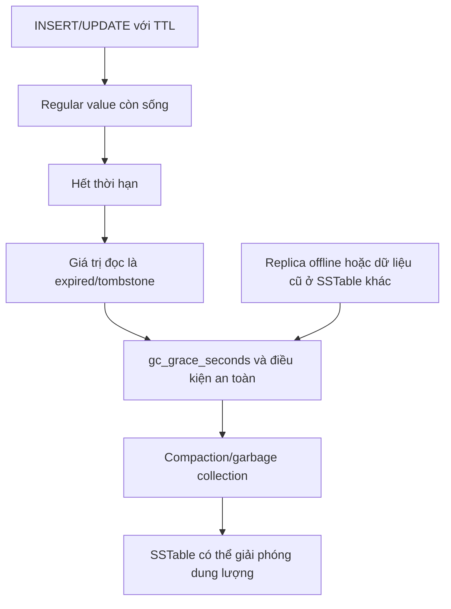

# Cấu hình thời hạn bằng InsertOptions, UpdateOptions hoặc CQL

Trong hệ thống dùng **Spring Data Cassandra**, không phải dữ liệu nào cũng cần tồn tại mãi. Ví dụ: trạng thái thiết bị đang trực tuyến chỉ hữu ích trong vài chục giây; một thông báo tạm có thể hết hạn sau vài phút; dữ liệu telemetry có thể được giữ theo chính sách 30 ngày. Apache Cassandra hỗ trợ **Time To Live (TTL)** để tự làm các giá trị đã ghi **không còn hiển thị** sau một khoảng thời gian.

Ba con đường cấu hình TTL thường gặp trong module **SPRING_DATA_CASSANDRA** là:

1. **CQL `USING TTL`** trên câu `INSERT` hoặc `UPDATE`.
2. **`InsertOptions`** khi gọi `CassandraTemplate.insert(entity, options)`.
3. **`UpdateOptions`** khi gọi `CassandraTemplate.update(entity, options)`.

Ngoài ra, Cassandra có thuộc tính bảng **`default_time_to_live`** để áp dụng chính sách lưu giữ mặc định. Nhưng TTL không phải một tác vụ `DELETE` chạy ngay khi đồng hồ hết giờ: Cassandra đánh dấu các giá trị hết hạn và xử lý chúng thông qua **tombstone, compaction và cơ chế đồng bộ replica**. Vì vậy, TTL là cả câu chuyện về **ngữ nghĩa dữ liệu** lẫn **hiệu năng hệ phân tán**.

> **Phạm vi:** Các đoạn Java dùng phong cách **Spring Data Cassandra 4.5.x**, Apache Cassandra Java driver 4.x và CQL Apache Cassandra. Ví dụ chạy trên keyspace lab riêng. Các giá trị TTL chỉ là minh họa, không phải đề xuất retention production. Không có ràng buộc bổ sung ngoài phạm vi bài học.

## 1. Mục tiêu học tập

Sau bài này, bạn có thể:

1. Phân biệt **TTL tính bằng giây** với kiểu cột CQL `timestamp` và **write timestamp tính bằng microsecond**.
2. Giải thích TTL áp dụng cho **các giá trị được ghi**, không phải một bộ đếm tự chạy trên Java entity.
3. Viết `INSERT ... USING TTL 120` và `UPDATE ... USING TTL 45` đúng cú pháp, nhận biết các cột chịu ảnh hưởng.
4. Đọc TTL còn lại bằng `SELECT TTL(column)` và hiểu tại sao `TTL(column)` có thể trả `null`.
5. Dùng `InsertOptions.builder().ttl(int/Duration)` và `UpdateOptions.builder().ttl(int/Duration)` ở `CassandraTemplate`.
6. Dùng prepared statement với bind marker cho cả giá trị TTL và dữ liệu nghiệp vụ.
7. Phân biệt TTL đặt trên mutation với thuộc tính bảng `default_time_to_live`, kể cả trường hợp `USING TTL 0`.
8. Hiểu TTL hết hạn tạo tombstone và tại sao xóa logic khác giải phóng dung lượng vật lý.
9. Phòng các lỗi retention, ghi đè TTL, clock skew, retry và đọc rộng gây nhiều tombstone.
10. Chọn thiết kế lưu trữ, thời hạn và chiến lược compaction dựa trên access pattern, tải và yêu cầu vận hành.

## 2. TTL thực sự điều khiển điều gì?

### 2.1. Định nghĩa

**TTL** là số giây tính từ lúc một giá trị được ghi theo quy tắc lưu trữ Cassandra cho tới khi giá trị đó không còn được xem là đang sống.

Ví dụ:

```sql
INSERT INTO sdc_ttl_lab.notices_by_id
(notice_id, message, created_at)
VALUES (
    11111111-1111-1111-1111-111111111111,
    'Thong bao tam thoi',
    '2026-11-25T09:00:00Z'
)
USING TTL 120;
```

Với thời hạn **120 giây**, dữ liệu tạm được đọc trong khoảng hai phút sau khi ghi, trừ khi bị cập nhật/xóa trước hoặc có write cạnh tranh khác. Cassandra có thể làm tròn theo giây, nên đừng xây dựng kiểm thử dựa trên việc `TTL(...)` phải trả **đúng 120** ngay sau request.

### 2.2. TTL gắn với value/cell chứ không gắn tùy ý với primary key

Cassandra lưu các cột thường như những giá trị có metadata gồm write timestamp và, khi có TTL, thời gian hết hạn. Với một hàng có:

```text
notice_id  = UUID primary key
message    = "Thông báo"
created_at = 2026-11-25T09:00:00Z
```

Một `INSERT ... USING TTL 120` thường đặt TTL lên **các giá trị regular column được ghi** như `message` và `created_at`. Primary key xác định vị trí dữ liệu và **không có TTL riêng để truy vấn bằng `TTL(notice_id)`**.

Nếu tất cả giá trị sống của một row đã hết hạn, row có thể **không còn xuất hiện** trong các lần `SELECT`, dù dấu vết dữ liệu/tombstone vẫn còn trên disk cho tới khi Cassandra dọn an toàn.

Với non-frozen collection/UDT, dữ liệu có thể chứa nhiều cell thành phần với TTL khác nhau. Trong bài này, các ví dụ đầu sử dụng **regular scalar columns** để học chính xác hành vi cơ bản.

### 2.3. TTL khác cột timestamp và write timestamp

| Thuộc tính | Đơn vị | Công dụng |
|---|---|---|
| `USING TTL 120` | **Giây** | Giá trị được xem là hết hạn sau khoảng thời gian được thiết lập |
| CQL `created_at timestamp` | Thời điểm, thường biểu diễn **millisecond** từ epoch | Dữ liệu nghiệp vụ, ví dụ thời gian tạo sự kiện |
| CQL `USING TIMESTAMP 1700000000000000` | **Microsecond** từ epoch | Metadata dùng so sánh phiên bản trong LWW |
| `TTL(message)` | **Giây còn lại** | Quan sát phần thời hạn còn lại của giá trị đang sống |
| `WRITETIME(message)` | **Microsecond** từ epoch | Timestamp của giá trị hiện đang thắng và còn sống |

**Không dùng `System.currentTimeMillis()` làm giá trị `ttl(...)`.** TTL 120 là thời lượng, còn epoch millisecond là một mốc thời gian tuyệt đối hoàn toàn khác.

### 2.4. Một biểu đồ thời gian


Khoảng từ C đến F **không cố định bằng TTL**. Nó phụ thuộc `gc_grace_seconds`, repair, compaction, SSTable overlap và các điều kiện an toàn xóa.

## 3. Thực hành CQL: tạo bảng và INSERT với TTL

### 3.1. Tạo keyspace và bảng tạm

```sql
-- Môi trường lab một node. Không dùng RF=1 + SimpleStrategy
-- làm mặc định cho production nhiều datacenter.
CREATE KEYSPACE IF NOT EXISTS sdc_ttl_lab
WITH replication = {
    'class': 'SimpleStrategy',
    'replication_factor': 1
};

CREATE TABLE IF NOT EXISTS sdc_ttl_lab.notices_by_id (
    notice_id uuid PRIMARY KEY,
    message text,
    category text,
    created_at timestamp
);
```

Đường truy vấn chính của bảng là **đọc theo `notice_id`**. TTL không thay đổi partition key, không tạo index và không cho phép tìm thông báo theo `category` một cách hiệu quả nếu schema chưa hỗ trợ truy vấn đó.

### 3.2. INSERT với thời hạn hai phút

```sql
INSERT INTO sdc_ttl_lab.notices_by_id
(notice_id, message, category, created_at)
VALUES (
    11111111-1111-1111-1111-111111111111,
    'Thong bao se het han',
    'INFO',
    '2026-11-25T09:00:00Z'
)
USING TTL 120;
```

Cú pháp `USING TTL` đặt **sau `VALUES(...)`** của `INSERT`. Giá trị TTL là **số giây nguyên không âm**, nằm trong giới hạn mà Cassandra version/config chấp nhận. Trong production, hãy giới hạn ở miền giá trị được nghiệp vụ cho phép, ví dụ 60–3.600 giây.

### 3.3. Quan sát TTL

```sql
SELECT notice_id, message, category, created_at,
       TTL(message) AS message_ttl_seconds,
       TTL(category) AS category_ttl_seconds,
       TTL(created_at) AS created_at_ttl_seconds
FROM sdc_ttl_lab.notices_by_id
WHERE notice_id = 11111111-1111-1111-1111-111111111111;
```

Ngay sau khi ghi, các giá trị TTL thường **xấp xỉ 120**, giảm dần theo thời gian. Vì chúng cùng được ghi bằng một `INSERT` với TTL 120, ba cột sẽ có cùng chính sách hết hạn ban đầu.

**Không gọi `TTL(notice_id)`**: `notice_id` là primary key, không có metadata TTL như một regular scalar column. Nếu dữ liệu đã hết hạn, query có thể không còn row để kiểm tra hoặc cột không còn giá trị sống.

### 3.4. Điều gì xảy ra khi hết hai phút?

Khi các giá trị `message`, `category` và `created_at` đều hết hạn, row có thể không còn hiển thị qua `SELECT ... WHERE notice_id = ...`. Nhưng điều đó **không khẳng định toàn bộ bytes đã được xóa khỏi SSTable**. Các giá trị hết hạn được xử lý như tombstone cho đến khi có thể dọn an toàn.

Nếu phải kiểm thử, dùng UUID mới cho mỗi lượt hoặc tạo bảng lab mới. Chạy lại `INSERT` cùng khóa sau khi đã hết hạn sẽ tạo một mutation mới; nhưng nếu write timestamp của nó không thắng dữ liệu/tombstone trước đó, kết quả có thể khác kỳ vọng.

### 3.5. Một lời gọi CQL hợp lệ khác: đặt TTL và write timestamp

```sql
INSERT INTO sdc_ttl_lab.notices_by_id
(notice_id, message, category)
VALUES (
    22222222-2222-2222-2222-222222222222,
    'Thong bao co timestamp tuy chon',
    'INFO'
)
USING TTL 90 AND TIMESTAMP 1700000000000000;
```

Ở đây **`TTL 90` là 90 giây**, còn `TIMESTAMP 1700000000000000` là **write timestamp microsecond**. Đừng suy ra vì write timestamp ứng với một ngày trong năm 2023 nên TTL đã hết từ năm 2023: TTL là metadata hết hạn của mutation được tạo khi ghi, không phải phép cộng đơn giản giữa giá trị thời điểm nghiệp vụ và TTL.

**Chỉ dùng timestamp tự đặt trong lab**. Trong hệ thống nhiều writer, timestamp cũ có thể thua các giá trị mới; timestamp tương lai có thể che khuất các update hợp lệ.

## 4. UPDATE USING TTL: chỉ các giá trị được ghi mới nhận thời hạn mới

### 4.1. Bảng chứa dữ liệu bền vững và tạm thời

Giả sử hệ thống IoT lưu tên thiết bị lâu dài, nhưng trạng thái ONLINE và thời điểm nhìn thấy gần nhất chỉ có ý nghĩa trong 60 giây:

```sql
CREATE TABLE IF NOT EXISTS sdc_ttl_lab.heartbeats_by_device (
    device_id uuid PRIMARY KEY,
    device_name text,
    online_status text,
    last_seen_at timestamp
);
```

Tạo thông tin thiết bị **không TTL**:

```sql
INSERT INTO sdc_ttl_lab.heartbeats_by_device
(device_id, device_name)
VALUES (
    33333333-3333-3333-3333-333333333333,
    'Sensor A'
);
```

Bây giờ ghi trạng thái tạm:

```sql
UPDATE sdc_ttl_lab.heartbeats_by_device
USING TTL 60
SET online_status = 'ONLINE',
    last_seen_at = '2026-11-25T09:30:00Z'
WHERE device_id = 33333333-3333-3333-3333-333333333333;
```

**Chỉ những giá trị được ghi trong mutation này** (`online_status` và `last_seen_at`) nhận TTL 60. Cột `device_name` đã có từ trước **không tự hết hạn** vì câu UPDATE không viết lại nó.

### 4.2. SELECT để thấy thời hạn khác nhau

```sql
SELECT device_id, device_name, online_status, last_seen_at,
       TTL(device_name) AS name_ttl,
       TTL(online_status) AS status_ttl,
       TTL(last_seen_at) AS last_seen_ttl
FROM sdc_ttl_lab.heartbeats_by_device
WHERE device_id = 33333333-3333-3333-3333-333333333333;
```

Kỳ vọng gần thời điểm ghi:

| Cột | Giá trị | `TTL(column)` |
|---|---|---|
| `device_name` | `Sensor A` | `null` (không có thời hạn) |
| `online_status` | `ONLINE` | Khoảng 60 giây, giảm dần |
| `last_seen_at` | Giá trị timestamp đã ghi | Khoảng 60 giây, giảm dần |

Sau khi hết TTL, cột `online_status` và `last_seen_at` không còn giá trị sống, nhưng `device_name` vẫn còn. Vì vậy **hàng không biến mất hoàn toàn**.

### 4.3. Cập nhật lại một cột làm tính TTL mới cho cột đó

Giả sử status đang có TTL còn 20 giây. Bạn ghi lại:

```sql
UPDATE sdc_ttl_lab.heartbeats_by_device
USING TTL 120
SET online_status = 'ONLINE'
WHERE device_id = 33333333-3333-3333-3333-333333333333;
```

Nếu mutation mới thắng theo **write timestamp**, `online_status` được ghi lại với **TTL 120 giây mới**, còn `last_seen_at` **không được viết lại** và vẫn theo thời hạn cũ. Đừng nghĩ TTL là một bộ đếm duy nhất cho cả entity.

**Lưu ý:** nếu hai service cùng cập nhật status với timestamp không đồng bộ, một write có thể được ack nhưng không thắng cell cũ có timestamp cao hơn. TTL và cơ chế **last-write-wins** phải được xem cùng nhau.

### 4.4. UPDATE không kèm TTL sẽ thế nào?

Trong bảng có `default_time_to_live = 0`, một mutation mới **không khai báo TTL** thường ghi giá trị không hết hạn:

```sql
UPDATE sdc_ttl_lab.heartbeats_by_device
SET online_status = 'MAINTENANCE'
WHERE device_id = 33333333-3333-3333-3333-333333333333;
```

Nếu mutation mới thắng, `online_status` sẽ không còn TTL; `TTL(online_status)` thường trả `null`. Lệnh này **không tự thay TTL của `last_seen_at`** vì nó không cập nhật cột đó.

Do đó, một đường code mới quên `USING TTL` có thể vô tình khiến trạng thái tạm **tồn tại mãi**. Với dữ liệu retention-critical, mọi đường ghi liên quan phải tuân thủ cùng chính sách.

## 5. TTL bằng 0 và ý nghĩa của “không có TTL”

CQL có một trường hợp đặc biệt:

```sql
UPDATE sdc_ttl_lab.heartbeats_by_device
USING TTL 0
SET online_status = 'MAINTENANCE'
WHERE device_id = 33333333-3333-3333-3333-333333333333;
```

**`TTL 0` nghĩa là không gắn thời hạn cho những giá trị đang ghi**. Nếu table có `default_time_to_live` khác 0, TTL 0 tường minh còn **ghi đè chính sách TTL mặc định của bảng** đối với những giá trị này, theo CQL hiện đại.

Nhưng cần phân biệt:

- **Ghi mới với TTL 0:** cột trong mutation mới không có hạn, nếu write thắng.
- **Giữ nguyên một cột không được ghi:** TTL cũ của cột đó vẫn chạy, không được “xóa TTL” chỉ vì statement cập nhật cột khác.
- **Cột đã hết hạn và tombstone đã được tạo:** TTL 0 không tự hồi sinh lịch sử; cần mutation giá trị mới có timestamp phù hợp.
- **Giá trị NULL trong CQL:** không có cùng mục đích với `TTL 0`. Ghi `NULL` vào một regular column có thể tạo tombstone, không phải cách “giữ nguyên giá trị nhưng xóa TTL”.

Nếu muốn bỏ hạn cho một cột nhưng giữ nguyên nội dung, ứng dụng phải **ghi lại giá trị cần giữ** bằng một mutation mới có TTL 0 và timestamp thắng. Cần xử lý ghi cạnh tranh trong khoảng đọc–ghi; đừng tự động `SELECT` rồi `UPDATE` không điều kiện nếu điều đó có thể ghi đè một giá trị mới hơn.

## 6. TTL mặc định ở cấp bảng: default_time_to_live

### 6.1. Tạo một bảng có retention mặc định

Nếu hầu như mọi sự kiện trong bảng đều phải tồn tại đúng một ngày, thiết lập TTL mặc định khi tạo bảng có thể đơn giản và giảm nguy cơ quên TTL trong client:

```sql
CREATE TABLE IF NOT EXISTS sdc_ttl_lab.retained_events_by_id (
    event_id uuid PRIMARY KEY,
    device_id uuid,
    event_type text,
    captured_at timestamp
) WITH default_time_to_live = 86400;
```

`86400` giây = 24 giờ. Khi `INSERT`/`UPDATE` ghi giá trị **không có TTL tường minh**, Cassandra sẽ sử dụng `default_time_to_live` của bảng theo quy tắc CQL/version tương ứng.

### 6.2. CQL mặc định và CQL override

**Không truyền `USING TTL`:**

```sql
INSERT INTO sdc_ttl_lab.retained_events_by_id
(event_id, device_id, event_type, captured_at)
VALUES (
    44444444-4444-4444-4444-444444444444,
    33333333-3333-3333-3333-333333333333,
    'HEARTBEAT',
    '2026-11-25T09:30:00Z'
);
```

Với bảng hiện tại, giá trị mới nhận default TTL khoảng **86400 giây**.

**Chọn một TTL ngắn hơn cho mutation cụ thể:**

```sql
INSERT INTO sdc_ttl_lab.retained_events_by_id
(event_id, device_id, event_type, captured_at)
VALUES (
    55555555-5555-5555-5555-555555555555,
    33333333-3333-3333-3333-333333333333,
    'TEMP',
    '2026-11-25T09:31:00Z'
)
USING TTL 300;
```

Với các giá trị trong mutation này, TTL **300 giây** ghi đè mức mặc định 86400.

**Bỏ TTL cho một mutation cụ thể:**

```sql
INSERT INTO sdc_ttl_lab.retained_events_by_id
(event_id, device_id, event_type, captured_at)
VALUES (
    66666666-6666-6666-6666-666666666666,
    33333333-3333-3333-3333-333333333333,
    'ARCHIVED',
    '2026-11-25T09:32:00Z'
)
USING TTL 0;
```

Với CQL hiện đại, `USING TTL 0` tường minh **loại bỏ TTL của những giá trị mới ghi**, ngay cả khi bảng đã có default TTL.

### 6.3. Kiểm tra bằng TTL(column)

```sql
SELECT event_id, event_type,
       TTL(event_type) AS remaining_seconds
FROM sdc_ttl_lab.retained_events_by_id
WHERE event_id = 44444444-4444-4444-4444-444444444444;
```

Tương tự, truy vấn cho `event_id = 5555...` sẽ thấy TTL gần 300; `event_id = 6666...` có thể thấy `remaining_seconds = null` vì mutation đã override bằng TTL 0.

Không coi `TTL(column) IS NULL` là bằng chứng chắc chắn giá trị tồn tại vĩnh viễn. `TTL` cũng có thể null khi **cột không có giá trị sống**; hãy đọc **cùng giá trị cột và khóa** để phân biệt.

### 6.4. ALTER TABLE và thay đổi chính sách

Có thể thay TTL mặc định:

```sql
ALTER TABLE sdc_ttl_lab.retained_events_by_id
WITH default_time_to_live = 3600;
```

Điều này thay **chính sách mặc định cho những giá trị được ghi sau đó**, không phải một thao tác tự động đọc lại toàn bộ SSTable và đặt đồng hồ mới cho tất cả dữ liệu trước đó. Các giá trị cũ giữ metadata TTL đã có theo write trước; giá trị mới tuân thủ cấu hình/override mới.

Nếu muốn không còn default TTL cho **các giá trị mới**, có thể:

```sql
ALTER TABLE sdc_ttl_lab.retained_events_by_id
WITH default_time_to_live = 0;
```

Chú ý: thay default TTL **không hồi sinh dữ liệu đã hết hạn**, cũng không tự xóa TTL đã gán vào những giá trị trước đó.

### 6.5. Giới hạn TTL dài và năm 2038

Tài liệu Apache Cassandra mô tả ngưỡng cấu hình `default_time_to_live` tối đa **630720000 giây (20 năm)** và cảnh báo liên quan **Year 2038**, vì dạng lưu trữ expiration timestamp có giới hạn. Tùy phiên bản và `ttl_date_overflow_policy`, Cassandra có thể từ chối một TTL làm thời điểm hết hạn vượt giới hạn lưu trữ, hoặc áp dụng chính sách xử lý khác.

Vì thế, **không coi TTL là giải pháp lưu trữ dữ liệu bắt buộc nhiều thập kỷ**. Hãy dùng retention policy, archive/export và migration phù hợp với quy định dữ liệu.

## 7. Spring Data Cassandra: cấu hình TTL bằng InsertOptions

### 7.1. Tạo entity khớp bảng

Ví dụ Java entity cho `notices_by_id`:

```java
import java.time.Instant;
import java.util.UUID;

import org.springframework.data.cassandra.core.mapping.Column;
import org.springframework.data.cassandra.core.mapping.PrimaryKey;
import org.springframework.data.cassandra.core.mapping.Table;

@Table("notices_by_id")
public class NoticeById {

    @PrimaryKey("notice_id")
    private UUID noticeId;

    @Column("message")
    private String message;

    @Column("category")
    private String category;

    @Column("created_at")
    private Instant createdAt;

    public NoticeById() {}

    public NoticeById(
        UUID noticeId, String message,
        String category, Instant createdAt
    ) {
        this.noticeId = noticeId;
        this.message = message;
        this.category = category;
        this.createdAt = createdAt;
    }

    public UUID getNoticeId() { return noticeId; }
    public void setNoticeId(UUID value) { noticeId = value; }

    public String getMessage() { return message; }
    public void setMessage(String value) { message = value; }

    public String getCategory() { return category; }
    public void setCategory(String value) { category = value; }

    public Instant getCreatedAt() { return createdAt; }
    public void setCreatedAt(Instant value) { createdAt = value; }
}
```

Giả sử Spring Boot/`CqlSession` đã kết nối tới keyspace mặc định **`sdc_ttl_lab`**. Chỉ có `@Table("notices_by_id")` không tự tạo keyspace hay migration.

### 7.2. InsertOptions.builder().ttl(int)

Spring Data Cassandra **4.5** cung cấp:

```java
InsertOptions options = InsertOptions.builder()
    .ttl(120)
    .build();
```

`ttl(int)` nhận **số giây**, không phải millisecond. Ví dụ service hoàn chỉnh:

```java
import java.time.Instant;
import java.util.UUID;

import org.springframework.data.cassandra.core.CassandraTemplate;
import org.springframework.data.cassandra.core.EntityWriteResult;
import org.springframework.data.cassandra.core.InsertOptions;
import org.springframework.stereotype.Service;

@Service
public class NoticeWriteService {

    private final CassandraTemplate template;

    public NoticeWriteService(CassandraTemplate template) {
        this.template = template;
    }

    public UUID createTemporary(
        String message, String category, int ttlSeconds
    ) {
        if (ttlSeconds < 1 || ttlSeconds > 3600) {
            throw new IllegalArgumentException(
                "TTL phai nam trong khoang 1..3600 giay"
            );
        }

        UUID id = UUID.randomUUID();
        NoticeById notice = new NoticeById(
            id, message, category, Instant.now()
        );

        InsertOptions options = InsertOptions.builder()
            .ttl(ttlSeconds)
            .build();

        EntityWriteResult<NoticeById> result =
            template.insert(notice, options);

        // Đây là INSERT thông thường, không IF NOT EXISTS:
        // wasApplied() không chứng minh row chưa có trước đó.
        if (!result.wasApplied()) {
            throw new IllegalStateException(
                "Insert khong duoc ap dung"
            );
        }

        return id;
    }
}
```

**Chú ý:** `EntityWriteResult.wasApplied()` của lệnh ghi **không điều kiện** thường là `true` khi statement hoàn tất, không có nghĩa TTL đã hết, row mới được tạo duy nhất hoặc mutation đã thắng mọi write cạnh tranh. Với nhu cầu tạo-đúng-một-lần, cân nhắc `IF NOT EXISTS` và idempotency riêng.

### 7.3. InsertOptions.builder().ttl(Duration)

Builder cũng nhận `java.time.Duration`:

```java
import java.time.Duration;
import org.springframework.data.cassandra.core.InsertOptions;

InsertOptions options = InsertOptions.builder()
    .ttl(Duration.ofMinutes(5))
    .build();
```

Cách này dễ đọc hơn số `300` trong business code. Tuy nhiên, CQL TTL vẫn có độ phân giải **giây**, không có TTL theo nanosecond. Tránh truyền Duration âm, zero không chủ đích hoặc duration rất lớn. Kiểm tra conversion/validation của thư viện trên phiên bản thực tế, nhất là khi duration không chia hết cho giây.

### 7.4. Repository.save() có tự nhận InsertOptions không?

`CassandraRepository.save(entity)` là API CRUD tiện dụng nhưng **không có cùng signature nhận `InsertOptions`** như `CassandraTemplate.insert(entity, options)`. Nếu request cần TTL khác nhau theo nghiệp vụ, một cách rõ ràng là đặt tác vụ ghi đó ở **service dùng CassandraTemplate**.

Một phương án khác là đặt `default_time_to_live` ở bảng nếu mọi giá trị đều cùng retention policy. Không cần sửa toàn bộ repository chỉ để thêm TTL khi database policy đã thể hiện đúng ở schema.

**Không ghép số TTL từ request trực tiếp vào chuỗi CQL**. `InsertOptions` và prepared statement cho phép truyền số đã validate theo kiểu dữ liệu phù hợp.

## 8. Spring Data Cassandra: UpdateOptions và việc gia hạn TTL

### 8.1. UpdateOptions.builder().ttl(int)

Với entity `NoticeById`, giả sử muốn **ghi lại toàn bộ dữ liệu đang quản lý** với TTL 180 giây mới:

```java
import org.springframework.data.cassandra.core.CassandraTemplate;
import org.springframework.data.cassandra.core.EntityWriteResult;
import org.springframework.data.cassandra.core.UpdateOptions;

public class NoticeRefreshService {

    private final CassandraTemplate template;

    public NoticeRefreshService(CassandraTemplate template) {
        this.template = template;
    }

    public void rewriteWithNewTtl(NoticeById notice) {
        UpdateOptions options = UpdateOptions.builder()
            .ttl(180)
            .build();

        EntityWriteResult<NoticeById> result =
            template.update(notice, options);

        if (!result.wasApplied()) {
            throw new IllegalStateException(
                "Mutation khong duoc ap dung"
            );
        }
    }
}
```

**Hiểu đúng hành vi:** `UpdateOptions.ttl(180)` áp TTL lên những giá trị mà `CassandraTemplate.update(entity, options)` thực sự ghi. Nó **không phải lệnh “đổi đồng hồ hết hạn cho cả row mà không ghi lại dữ liệu”**. Dựa vào mapper và null handling, entity update có thể tác động nhiều field, kể cả những field ứng dụng chỉ định giữ nguyên.

Nếu chỉ muốn gia hạn **một cột** mà không thay thời hạn của cột khác, hãy viết mutation **nhắm đúng cột đó** bằng CQL/prepared statement (mục 9), hoặc xây query/update có lựa chọn cột rõ ràng theo API đã kiểm chứng.

### 8.2. UpdateOptions.builder().ttl(Duration)

```java
import java.time.Duration;
import org.springframework.data.cassandra.core.UpdateOptions;

UpdateOptions options = UpdateOptions.builder()
    .ttl(Duration.ofSeconds(45))
    .build();
```

Khi mutation thắng với timestamp mới, những giá trị được update sẽ có **thời gian sống mới 45 giây**. Đây thường được gọi là **refresh TTL**, nhưng đừng quên:

- Refresh đồng nghĩa có một **write mới**, phát sinh công việc ở commit log, memtable/SSTable và replica.
- Ghi một subset cột thì chỉ subset đó nhận TTL mới.
- Rewriting những field khác của entity có thể làm chúng nhận cùng TTL, ngay cả khi bạn không định cho chúng hết hạn.
- Thời gian sống của lần ghi cũ không được “cộng dồn” vào TTL mới. Ví dụ còn 15 giây, ghi thắng với TTL 45 sẽ cho hạn mới khoảng 45 giây sau mutation.
- Một write có timestamp **thấp hơn** phiên bản hiện tại có thể không thay giá trị/TTL như mong đợi dù không báo lỗi cú pháp.

### 8.3. UpdateOptions không bảo đảm optimistic locking

Với hai request cùng update `NoticeById`, timestamp và LWW vẫn quyết định giá trị sống; TTL không ngăn một request cũ ghi đè request mới.

Nếu điều kiện như “chỉ gia hạn khi notice còn ACTIVE” là bắt buộc, cần conditional CQL/LWT (`IF ...`) hoặc versioning với API hỗ trợ. LWT có chi phí và ngữ nghĩa timestamp riêng. **Không đặt TTL rồi coi đó là distributed lock an toàn**.

## 9. Dùng Java driver prepared CQL để cập nhật đúng một nhóm cột

Đối với bảng `heartbeats_by_device`, ta chỉ muốn đặt TTL cho `online_status` và `last_seen_at`, không muốn ảnh hưởng `device_name`. Java driver trực tiếp diễn đạt điều này rõ ràng.

### 9.1. Prepared UPDATE USING TTL ?

```java
import java.time.Instant;
import java.util.UUID;

import com.datastax.oss.driver.api.core.CqlSession;
import com.datastax.oss.driver.api.core.cql.BoundStatement;
import com.datastax.oss.driver.api.core.cql.PreparedStatement;

public class HeartbeatWriter {

    private final CqlSession session;
    private final PreparedStatement heartbeat;

    public HeartbeatWriter(CqlSession session) {
        this.session = session;
        this.heartbeat = session.prepare("""
            UPDATE sdc_ttl_lab.heartbeats_by_device
            USING TTL ?
            SET online_status = ?,
                last_seen_at = ?
            WHERE device_id = ?
            """);
    }

    public void markOnline(UUID deviceId, int ttlSeconds) {
        if (ttlSeconds < 1 || ttlSeconds > 300) {
            throw new IllegalArgumentException("TTL khong hop le");
        }

        BoundStatement bound = heartbeat.bind(
            ttlSeconds,
            "ONLINE",
            Instant.now(),
            deviceId
        );

        session.execute(bound);
    }
}
```

Ở đây, giá trị `ttlSeconds` được **bind như số nguyên**, không nối trực tiếp vào raw CQL. Java driver tự mã hóa đúng loại giá trị theo metadata prepared statement.

Khi update, `online_status` và `last_seen_at` nhận TTL, còn `device_name` không nằm trong `SET` nên không bị đổi TTL.

### 9.2. SELECT TTL bằng prepared statement

```java
import java.util.UUID;

import com.datastax.oss.driver.api.core.cql.PreparedStatement;
import com.datastax.oss.driver.api.core.cql.Row;

PreparedStatement select = session.prepare("""
    SELECT device_name, online_status,
           TTL(online_status) AS remaining_seconds
    FROM sdc_ttl_lab.heartbeats_by_device
    WHERE device_id = ?
    """);

Row row = session.execute(select.bind(deviceId)).one();

if (row != null) {
    String name = row.getString("device_name");
    String status = row.getString("online_status");

    Integer remainingSeconds = row.isNull("remaining_seconds")
        ? null
        : row.getInt("remaining_seconds");

    // null có thể có nghĩa giá trị không TTL hoặc đã vắng mặt.
    // Cần xem đồng thời status và chính sách dữ liệu.
}
```

Đây là fragment đặt trong một method có `session` và `deviceId` sẵn. Nếu dữ liệu chỉ có cột `device_name` sống, `online_status` có thể là null vì đã hết hạn. Đừng gọi `getInt` rồi suy ra số 0 khi cột `remaining_seconds` là null.

### 9.3. CqlTemplate cũng hỗ trợ bind arguments

Nếu ứng dụng đã dùng `CqlTemplate`, một câu CQL dạng:

```sql
UPDATE sdc_ttl_lab.heartbeats_by_device
USING TTL ?
SET online_status = ?
WHERE device_id = ?;
```

có thể được gửi qua các overload có arguments, thay vì tự tạo chuỗi chứa TTL và `deviceId`. `CqlTemplate` là abstraction của Spring; điều quyết định phạm vi TTL vẫn là **CQL gửi đến server**.

### 9.4. Không có USING TTL trong SELECT hoặc DELETE

`USING TTL` là tùy chọn của `INSERT` và `UPDATE`, **không phải** của `SELECT` hay `DELETE`:

```sql
-- Không hợp lệ: SELECT không có USING TTL.
SELECT * FROM sdc_ttl_lab.notices_by_id USING TTL 60;

-- Không hợp lệ: DELETE không nhận USING TTL.
DELETE FROM sdc_ttl_lab.notices_by_id
USING TTL 60
WHERE notice_id = 11111111-1111-1111-1111-111111111111;
```

Muốn dữ liệu tự hết hạn, **ghi với TTL**. Muốn xóa ngay về mặt logic, dùng `DELETE` đúng khóa (có thể có `USING TIMESTAMP` trong trường hợp cho phép và có chủ đích).

## 10. TTL và write timestamp: ảnh hưởng khi ghi cạnh tranh

TTL và **last-write-wins** là hai cơ chế riêng nhưng tương tác chặt chẽ:

- **Write timestamp** (microsecond) giúp Cassandra chọn phiên bản thắng của mỗi cell.
- **TTL** (giây) quyết định khi nào phiên bản đang sống trở thành hết hạn.
- **Đến sau về thời gian mạng** không có nghĩa mutation có timestamp lớn hơn.
- **TTL mới không thắng chỉ vì dài hơn**; một mutation có TTL 3600 nhưng timestamp thấp hơn phiên bản hiện tại có thể không thay giá trị đang đọc được.

Ví dụ logic:

| Mutation | Value | Write timestamp | TTL |
|---|---|---:|---:|
| A | `ONLINE` | 300 | 60 giây |
| B | `OFFLINE` | 250 | Không có TTL |
| C | `BUSY` | 350 | 30 giây |

Nếu các giá trị này được hòa giải trước khi C hết hạn, **C** có timestamp cao nhất và thắng. Khi C hết hạn, giá trị cũ B **không tự xuất hiện lại** như một fallback, bởi giá trị hết hạn cần được che bởi deletion metadata/tombstone theo semantics Cassandra.

### 10.1. TTL không phải thời gian của sự kiện

Giả sử event `captured_at` có thời điểm 10:00 nhưng được nhập vào Cassandra lúc 11:00 với TTL 60 giây. Mặc định TTL tính theo **thời điểm mutation được ghi**, không phải “captured_at + 60” vì Cassandra không tự đọc cột nghiệp vụ để tính hạn.

Nếu nghiệp vụ yêu cầu “expire at absolute time 10:01”, đến 11:00 dữ liệu đã quá hạn và **không nên được nhập rồi còn sống thêm 60 giây**. Ứng dụng phải so sánh event time với deadline trước khi ghi, hoặc chọn retention/batch xử lý khác.

### 10.2. Retry có thể gia hạn thời gian sống ngoài dự kiến

Một request gửi mutation TTL 120 nhưng bị timeout; ứng dụng retry sau 30 giây. Nếu lần retry được chấp nhận như một write mới với timestamp mới, TTL có thể được tính lại, khiến deadline muộn hơn so với request ban đầu.

Vì vậy, trong bài toán token/lease/notification:

- Xác định TTL là **thời lượng kể từ lần ghi thành công** hay hạn tuyệt đối kể từ event.
- Gắn **operation ID** và xử lý idempotency nếu retry phải giữ nguyên deadline nghiệp vụ.
- Không cho client tự tăng/giảm TTL vô hạn.
- Không xem TTL đơn lẻ là cơ chế khóa phân tán với bảo đảm mạnh khi có cạnh tranh, mất mạng hoặc clock skew.

### 10.3. Clock skew và TTL

TTL gắn với cơ chế thời gian của Cassandra; đồng hồ node bị lệch có thể làm khó dự đoán lúc dữ liệu được xem là hết hạn, đặc biệt khi nhiều replica tham gia. Cần đồng bộ **NTP/chrony** và theo dõi clock drift.

Sử dụng custom write timestamp **không giải quyết** vấn đề clock skew hay deadline nghiệp vụ. Ngược lại, timestamp quá xa tương lai có thể ngăn các update thông thường thắng sau này.

## 11. TTL hết hạn tạo tombstone — dữ liệu biến mất khỏi SELECT nhưng chưa chắc được giải phóng

### 11.1. Dòng đời dữ liệu có TTL



Tại C, **các lần SELECT thông thường không còn trả giá trị hết hạn**. Nhưng SSTable là tệp bất biến; Cassandra chỉ có thể bỏ dữ liệu vật lý khi quá trình compaction cho phép mà không làm phiên bản cũ/tombstone gây sai.

### 11.2. gc_grace_seconds không phải “TTL thêm 10 ngày”

`gc_grace_seconds` là khoảng thời gian để **tombstone** có thể được giữ nhằm giúp các replica và repair tránh hồi sinh dữ liệu cũ. Mặc định truyền thống trong Cassandra là **864000 giây (10 ngày)** cho bảng.

Điều đó **không** có nghĩa thông báo TTL 120 giây vẫn đọc được thêm 10 ngày. Sau TTL, nó **hết hạn về mặt logic**; `gc_grace_seconds` chỉ liên quan vòng đời deletion metadata và an toàn dọn dữ liệu.

Đừng giảm `gc_grace_seconds` một cách tùy tiện để “thu hồi dung lượng nhanh”. Nếu replica offline quá lâu và tombstone biến mất trước khi repair/sync, dữ liệu cũ có thể **hồi sinh (zombie data)**.

### 11.3. Expired SSTable không phải lúc nào cũng được xóa ngay

Ngay cả khi thời hạn TTL và grace đã qua, một SSTable vẫn có thể chứa dữ liệu cũ cần được che bởi tombstone hoặc bị overlap với SSTable khác. Cassandra phải kiểm tra điều kiện an toàn trước khi loại bỏ.

Vì vậy, nếu bảng 30 ngày TTL vẫn dùng nhiều disk hơn dự tính, cần đo:

- Dung lượng các SSTable và phân bố timestamp.
- Compaction strategy, trạng thái compaction và disk headroom.
- Tỷ lệ tombstone, expired SSTable và overlap.
- Độ dài TTL và việc có những cột **không TTL** nằm chung partition/SSTable.
- Tình trạng repair/hints và những replica từng offline.

**Không kết luận ngay “TTL không hoạt động” chỉ vì disk chưa giảm.** Đầu tiên hãy kiểm tra `TTL(column)` và khả năng `SELECT` thấy giá trị sống; sau đó mới xem compaction và reclaim.

## 12. Thiết kế TTL ở quy mô lớn và chiến lược compaction

### 12.1. Không trộn dữ liệu tạm và bền vững tùy tiện

Bảng `heartbeats_by_device` minh họa kết hợp cột bền vững `device_name` với cột tạm `online_status`. Điều này hợp logic cho dữ liệu nhỏ theo thiết bị; nhưng ở workload rất lớn, trộn các thời hạn khác nhau trong cùng partition/SSTable có thể khiến tombstone khó được dọn.

Một cách cân nhắc là tách:

- Bảng thông tin thiết bị bền vững, ít đổi.
- Bảng trạng thái online tạm, có TTL ngắn và đường đọc phù hợp.
- Bảng sự kiện lịch sử theo ngày/bucket với retention rõ ràng.

Đổi lại, ứng dụng có nhiều read model và cần xác định consistency giữa chúng. Không áp dụng tách bảng một cách máy móc; đo write/read load và nhu cầu truy vấn.

### 12.2. TimeWindowCompactionStrategy (TWCS)

**TWCS** là lựa chọn thường dùng cho **time-series/TTL** khi dữ liệu được ghi gần theo thứ tự thời gian và có retention tương đối đồng nhất. Nó nhóm SSTable theo time window, để khi toàn bộ dữ liệu trong một window hết hạn, Cassandra có thể dọn SSTable hiệu quả hơn.

Ví dụ minh họa bảng mới có TTL một ngày:

```sql
CREATE TABLE IF NOT EXISTS sdc_ttl_lab.metrics_by_device_day (
    device_id uuid,
    metric_day date,
    sample_at timestamp,
    metric_name text,
    metric_value double,
    PRIMARY KEY ((device_id, metric_day), sample_at, metric_name)
) WITH CLUSTERING ORDER BY (sample_at DESC, metric_name ASC)
  AND default_time_to_live = 86400
  AND compaction = {
      'class': 'TimeWindowCompactionStrategy',
      'compaction_window_unit': 'DAYS',
      'compaction_window_size': '1'
  };
```

**Chỉ là cấu hình để thảo luận**, không phải khuyến nghị production cho mọi bảng Cassandra 5.0. Lựa chọn TWCS/UCS/chiến lược khác phải dựa trên phiên bản server, mô hình ghi, TTL, kích thước dữ liệu và benchmark.

Các trường hợp khiến TWCS khó thu hồi SSTable:

- Ghi dữ liệu rất cũ vào window đang mở (out-of-order backfill).
- Update lặp lại các row cũ sau nhiều ngày.
- Trộn TTL quá dài, quá ngắn và dữ liệu không TTL.
- SSTable overlap làm block drop.
- Thiếu repair hoặc tăng tombstone do xóa/thay thế nhiều lần.

### 12.3. Pagination và query access pattern vẫn cần đúng

Một bảng telemetry theo `device_id` và `metric_day` có thể đọc theo partition/bucket. Nhưng `TTL 86400` **không giúp** câu `SELECT * FROM metrics_by_device_day` không có `WHERE` trở thành rẻ. Câu đó có thể quét nhiều partition, SSTable và tombstone.

`LIMIT 20` chỉ giới hạn số row kết quả; `pageSize(20)` chỉ giới hạn số row mục tiêu trong một lượt mạng. Cả hai không thay thế **thiết kế partition key** và khả năng quản lý tombstone.

## 13. Quan sát TTL và tombstone trên môi trường thật

### 13.1. Từ cqlsh

Những lệnh kiểm tra có thể chạy trên keyspace lab:

```sql
DESCRIBE TABLE sdc_ttl_lab.notices_by_id;
DESCRIBE TABLE sdc_ttl_lab.retained_events_by_id;

SELECT notice_id, message,
       TTL(message) AS remaining,
       WRITETIME(message) AS write_ts
FROM sdc_ttl_lab.notices_by_id
WHERE notice_id = 11111111-1111-1111-1111-111111111111;
```

Đọc cột `remaining`:

- **Số dương:** giá trị còn sống và có TTL.
- **`null` cùng giá trị sống:** cột không có TTL.
- **`null` cùng giá trị null/không có row:** cột có thể vắng mặt hoặc đã hết hạn.
- **Không tìm thấy row:** dữ liệu có thể hết hạn/xóa, hoặc key không tồn tại; không kết luận chỉ từ một SELECT.

`WRITETIME(message)` giúp kiểm tra write timestamp của giá trị sống; không phải bản ghi lịch sử mọi TTL và mọi lần xóa.

### 13.2. Từ Cassandra node và metrics

Có thể khảo sát:

```bash
nodetool tablestats sdc_ttl_lab.notices_by_id
nodetool tablestats sdc_ttl_lab.metrics_by_device_day
```

Khi có quyền vận hành, xem các thống kê như:

| Nhóm | Dấu hiệu cần phân tích |
|---|---|
| **Tombstone per read** | Read phải bỏ qua nhiều giá trị hết hạn/xóa |
| **Tombstone warnings/failures** | Query có quá nhiều tombstone, cần xem TTL/delete/partition |
| **SSTable count / disk usage** | Dữ liệu expired còn nằm trong SSTable vì compaction/overlap |
| **Compaction pending / throughput** | Hệ thống chưa xử lý kịp dữ liệu cần compact |
| **Read latency p95/p99** | Chi phí bỏ qua tombstone trong các query theo partition/range |
| **Write/update rate** | Tần suất refresh TTL có thể tạo nhiều version/tombstone |
| **Repair/replica health** | Tính an toàn khi dọn tombstone, đặc biệt node từng offline |

`nodetool tablestats` là **thống kê theo node**, không phải một hàm `COUNT(*)` toàn cluster. Những metric có tên cụ thể có thể khác giữa các bản Cassandra và hệ thống giám sát.

### 13.3. Tracing có kiểm soát

Ở môi trường test, có thể dùng:

```sql
TRACING ON;

SELECT notice_id, message, TTL(message)
FROM sdc_ttl_lab.notices_by_id
WHERE notice_id = 11111111-1111-1111-1111-111111111111;

TRACING OFF;
```

Tracing gây overhead, nên không bật tràn lan trên production. Khi xử lý lỗi “TTL không hết hạn”, hãy kiểm tra CQL/`InsertOptions`/`UpdateOptions` trước khi thay compaction settings.

## 14. Những nhầm lẫn thường gặp

| Nhầm lẫn | Cách hiểu đúng |
|---|---|
| “`USING TTL 60` nghĩa là 60 millisecond.” | TTL tính bằng **giây**. |
| “Cột CQL `timestamp` là TTL.” | `timestamp` lưu thời điểm nghiệp vụ; TTL là metadata hết hạn của value. |
| “TTL nằm trên primary key.” | Primary key xác định row/partition; không gọi `TTL(primary_key)`. |
| “Ghi TTL cho một cột sẽ xóa cả entity sau khi cột đó hết hạn.” | Các cột khác có thể vẫn còn sống. |
| “`UPDATE ... USING TTL 60` đổi TTL cho mọi cột của row.” | TTL áp dụng cho những giá trị được ghi trong mutation đó. |
| “`ttl(Duration.ofMinutes(2))` được truyền thành 2.” | Spring Data quy đổi Duration sang **giây** theo API. |
| “`CassandraTemplate.update(entity, options)` chỉ cập nhật field Java vừa thay đổi.” | Không được giả định; cần hiểu field nào mapper thực sự ghi. |
| “`USING TTL 0` xóa luôn giá trị.” | Nó **bỏ TTL** cho giá trị mới ghi, không phải `DELETE`. |
| “Không có `USING TTL` thì mặc định vĩnh viễn.” | Nếu bảng đặt `default_time_to_live`, chính sách mặc định vẫn áp dụng. |
| “Đổi default TTL làm mọi dữ liệu cũ đổi deadline.” | Không phải retroactive rewrite toàn bảng. |
| “TTL vừa hết thì SSTable biến mất.” | Giá trị hết hạn về logic; tombstone/compaction quyết định thu hồi disk. |
| “`gc_grace_seconds` là số giây cộng vào TTL hiển thị.” | Không. Đây là điều kiện lưu giữ tombstone, không kéo dài thời gian giá trị còn sống. |
| “Giảm `gc_grace_seconds` về 0 luôn là tối ưu.” | Có thể tạo zombie data khi repair/replica không theo kịp; phải đánh giá vận hành. |
| “Retry một write TTL không đổi deadline.” | Retry có timestamp mới có thể reset TTL. |
| “Set TTL tự biến câu SELECT không WHERE thành nhanh.” | Truy vấn vẫn phải tuân thủ partition key, clustering và chi phí tombstone. |

## 15. Bài tập thực hành

### Bài 1 — Kiểm tra đơn vị

Một endpoint nhận `ttlMillis = 120000` nhưng code gọi:

```java
InsertOptions options = InsertOptions.builder()
    .ttl(ttlMillis)
    .build();
```

**Câu hỏi:** Giá trị được giữ trong bao lâu?

**Đáp án:** Method `ttl(int)` nhận **giây**, nên 120000 nghĩa khoảng 33 giờ 20 phút, không phải hai phút. Cần đổi sang giây chính xác hoặc dùng `ttl(Duration.ofMinutes(2))`, kết hợp validate.

### Bài 2 — Hai cột, hai chính sách

Trong `heartbeats_by_device`:

```text
device_name  = Sensor A, không có TTL
online_status = ONLINE, TTL 60 giây
last_seen_at = thời gian hiện tại, TTL 60 giây
```

Sau 70 giây không có mutation nào khác, kết quả `SELECT` còn gì?

**Đáp án:** `device_name` vẫn còn; `online_status` và `last_seen_at` hết hạn về logic.

### Bài 3 — TTL mới có cộng dồn không?

Cột `online_status` còn 10 giây rồi nhận một `UPDATE ... USING TTL 45` mới với timestamp thắng.

**Câu hỏi:** TTL mới là 10+45 hay khoảng 45?

**Đáp án:** Khoảng **45 giây từ mutation mới**, không cộng thời gian cũ.

### Bài 4 — Sửa code Spring Data

Hãy viết một service có:

```java
InsertOptions.builder().ttl(Duration.ofMinutes(5)).build()
```

và gọi `CassandraTemplate.insert(entity, options)`. Kiểm tra trả về có kiểu `EntityWriteResult<T>`. Vì sao `wasApplied() == true` của một INSERT không điều kiện không chứng minh row được tạo mới duy nhất?

### Bài 5 — UpdateOptions hay CQL có mục tiêu?

Một entity có `device_name`, `online_status` và `last_seen_at`. Chỉ `online_status`/`last_seen_at` được phép hết hạn.

**Yêu cầu:** So sánh:

- `template.update(entity, UpdateOptions.builder().ttl(60).build())`.
- `UPDATE ... USING TTL 60 SET online_status = ?, last_seen_at = ? WHERE device_id = ?`.

**Đáp án định hướng:** CQL có mục tiêu xác định rõ hai cột được ghi. Entity update có thể ghi thêm field theo mapper, không nên mặc định dùng để đặt TTL chọn lọc nếu chưa kiểm tra.

### Bài 6 — default_time_to_live

Bảng có `default_time_to_live = 3600`. Một INSERT không khai báo TTL; INSERT khác có `USING TTL 120`; INSERT thứ ba có `USING TTL 0`.

**Câu hỏi:** Thời hạn của ba mutation mới?

**Đáp án:** Lần lượt **3600 giây**, **120 giây**, và **không có TTL** cho giá trị được ghi, nếu chúng được chấp nhận theo quy tắc CQL và không có mutation khác.

### Bài 7 — Khi hết TTL

Sau TTL 120, `SELECT` không thấy notice nữa nhưng `nodetool tablestats` vẫn báo disk/SSTable size lớn.

**Câu hỏi:** Có chắc TTL thất bại không?

**Đáp án:** Không. Giá trị có thể đã hết hạn về logic, còn tombstone/SSTable chưa được compact và giải phóng vật lý.

### Bài 8 — Refresh và retry

Một service ghi trạng thái online TTL 60; do timeout, nó retry sau 40 giây. Hãy nêu hai rủi ro khi yêu cầu nghiệp vụ có **deadline tuyệt đối** thay vì “60 giây kể từ lần ghi cuối”.

**Gợi ý:** Lần retry có thể làm deadline trôi; nhiều writer/timestamp cạnh tranh làm kết quả không theo thứ tự mong muốn. Có thể cần lưu expiry deadline nghiệp vụ và xử lý idempotency.

### Bài 9 — Bài toán dữ liệu telemetry

Một bảng có hàng triệu sample/ngày, TTL 30 ngày, đôi khi cập nhật sample cũ sau nhiều tuần. Chọn bucketing, compaction strategy và kế hoạch giám sát tombstone. Giải thích tại sao **TWCS không tự động tối ưu** nếu thường xuyên ghi trễ hoặc trộn thời hạn.

### Bài 10 — Tự viết bài test

Viết integration test trên Cassandra test cluster:

1. Ghi notice với `TTL 5`.
2. Ngay sau đó đọc `TTL(message)`; chấp nhận một giá trị **xấp xỉ 5**, không cứng đúng 5.
3. Dùng polling có giới hạn để đợi khi `SELECT` không còn giá trị sống.
4. Kiểm tra một cột bền vững khác của bảng riêng vẫn còn.
5. Không chạy test TTL ngắn trên production và không dựa vào thời gian sleep chính xác từng millisecond.

## 16. Câu hỏi tự kiểm tra

1. **TTL của CQL dùng đơn vị nào?** Giây.
2. **`InsertOptions.builder().ttl(int)` nhận gì?** Số giây tồn tại của các giá trị được ghi.
3. **`ttl(Duration)` có trong Spring Data Cassandra 4.5 không?** Có; builder quy đổi thời lượng theo giây.
4. **`UpdateOptions.ttl(60)` có đổi toàn bộ row mà không ghi value không?** Không; nó áp dụng cho mutation mà mapper thực hiện.
5. **`USING TTL` đặt được trên loại câu lệnh nào?** `INSERT` và `UPDATE`.
6. **Có thể gọi `TTL(primary_key_column)` không?** Không.
7. **`TTL(column)` là gì?** Giây còn lại của giá trị sống có TTL.
8. **`TTL(column) = null` có luôn nghĩa dữ liệu vĩnh viễn không?** Không; cột có thể vắng mặt hoặc đã hết hạn.
9. **`default_time_to_live` nằm ở đâu?** Thuộc tính CQL của bảng.
10. **TTL tường minh có ghi đè default TTL không?** Có, trên các giá trị mới ghi.
11. **`USING TTL 0` có tác dụng gì?** Bỏ thời hạn trên những giá trị vừa được ghi, kể cả default TTL trong CQL hiện đại.
12. **Đổi default TTL có viết lại TTL của toàn bộ dữ liệu cũ không?** Không.
13. **TTL hết hạn có xóa bytes khỏi disk ngay không?** Không; còn tombstone và compaction.
14. **`gc_grace_seconds` có kéo dài thời gian giá trị còn sống không?** Không.
15. **TTL có sửa được query scan toàn bảng không?** Không.
16. **Làm sao chỉ gắn TTL cho `online_status` mà giữ nguyên `device_name`?** Dùng mutation chỉ ghi `online_status`, ví dụ CQL `UPDATE ... USING TTL ... SET online_status = ...`.
17. **Write timestamp thấp hơn có thể khiến refresh TTL không có tác dụng không?** Có; cần thắng LWW.
18. **Retry một write TTL có thể thay deadline không?** Có, tùy mutation/timestamp và việc được áp dụng.
19. **Khi nào cân nhắc TWCS?** Workload time-series/TTL phù hợp, được đánh giá với kiểu ghi và compaction thực.
20. **Điều gì cần xác minh trước khi giảm `gc_grace_seconds`?** Replica health, repair, time offline, tombstone lifecycle và nguy cơ zombie data.

## 17. Tổng kết

- **TTL** là thời hạn tính bằng **giây** cho các giá trị CQL được ghi, khác với write timestamp tính bằng **microsecond**.
- Dùng **`INSERT ... USING TTL n`** và **`UPDATE ... USING TTL n`** để gắn TTL có mục tiêu; `TTL(column)` giúp quan sát thời gian còn lại của giá trị sống.
- Trong **Spring Data Cassandra 4.5**, **`InsertOptions.builder().ttl(int/Duration)`** và **`UpdateOptions.builder().ttl(int/Duration)`** truyền chính sách TTL vào **CassandraTemplate**. Entity update có thể ghi nhiều cột: phải hiểu mapper trước khi gắn TTL chọn lọc.
- **`default_time_to_live`** là chính sách bảng; `USING TTL n` override cho mutation, còn **`USING TTL 0`** bỏ TTL cho những giá trị mới được ghi.
- **TTL 0 không phải DELETE**; cột không được ghi vẫn theo TTL cũ, còn tombstone của dữ liệu hết hạn không tự bị xóa.
- Sau khi TTL hết, dữ liệu không còn đọc được nhưng **tombstone, gc_grace_seconds và compaction** quyết định khi nào dung lượng vật lý được thu hồi an toàn.
- Cần chú ý **clock skew, retry, LWW, per-column TTL**, partition key, TWCS/workload và tombstone metrics; TTL không thay thế mô hình dữ liệu theo truy vấn hoặc cơ chế bảo vệ cạnh tranh.
- Kiểm chứng bằng **cqlsh, `TTL(column)`, `WRITETIME(column)`, integration test và metrics**, tránh chỉ dựa trên thời gian tuyệt đối từ log hoặc kích thước disk.

## Tài liệu tham khảo

1. [Apache Cassandra — CQL Data Manipulation](https://cassandra.apache.org/doc/stable/cassandra/developing/cql/dml.html): `INSERT`/`UPDATE USING TTL`, TTL=0, `TTL(column)`, `WRITETIME(column)` và ngữ nghĩa mutation.
2. [Apache Cassandra — CQL Changes](https://cassandra.apache.org/doc/stable/cassandra/developing/cql/changes.html): mốc CQL 3.4.2 xử lý explicit TTL 0 khi bảng có `default_time_to_live`.
3. [Apache Cassandra — CREATE TABLE](https://cassandra.apache.org/doc/stable/cassandra/reference/cql-commands/create-table.html): `default_time_to_live`, giới hạn TTL, `gc_grace_seconds` và cảnh báo thời gian hết hạn.
4. [Apache Cassandra — ALTER TABLE](https://cassandra.apache.org/doc/stable/cassandra/reference/cql-commands/alter-table.html): thay đổi chính sách mặc định ở bảng.
5. [Apache Cassandra — Tombstones](https://cassandra.apache.org/doc/stable/cassandra/managing/operating/compaction/tombstones.html): expiration, tombstone và lý do cần lưu dấu xóa trong cluster phân tán.
6. [Apache Cassandra — Compaction Overview](https://cassandra.apache.org/doc/stable/cassandra/managing/operating/compaction/overview.html): TTL/tombstone, SSTable và điều kiện xóa an toàn.
7. [Apache Cassandra — TimeWindowCompactionStrategy](https://cassandra.apache.org/doc/stable/cassandra/managing/operating/compaction/twcs.html): hiệu năng với dữ liệu time-series và TTL.
8. [Spring Data Cassandra 4.5 — InsertOptions.Builder](https://docs.spring.io/spring-data/cassandra/docs/4.5.x/api/org/springframework/data/cassandra/core/InsertOptions.InsertOptionsBuilder.html): `ttl(int)` và `ttl(Duration)`.
9. [Spring Data Cassandra 4.5 — UpdateOptions.Builder](https://docs.spring.io/spring-data/cassandra/docs/4.5.x/api/org/springframework/data/cassandra/core/UpdateOptions.UpdateOptionsBuilder.html): `ttl(int)`, `ttl(Duration)`, write options.
10. [Spring Data Cassandra 4.5 — CassandraTemplate](https://docs.spring.io/spring-data/cassandra/docs/4.5.x/api/org/springframework/data/cassandra/core/CassandraTemplate.html): `insert(entity, options)`, `update(entity, options)` và mapping.
11. [Spring Data Cassandra — Template / Persisting Entities](https://docs.spring.io/spring-data/cassandra/reference/cassandra/template.html): entity operations và write options.
12. [Apache Cassandra Java Driver 4.19 — Prepared Statements](https://apache.github.io/cassandra-java-driver/4.19.0/core/statements/prepared/): bind markers, typed values và statement reuse.
