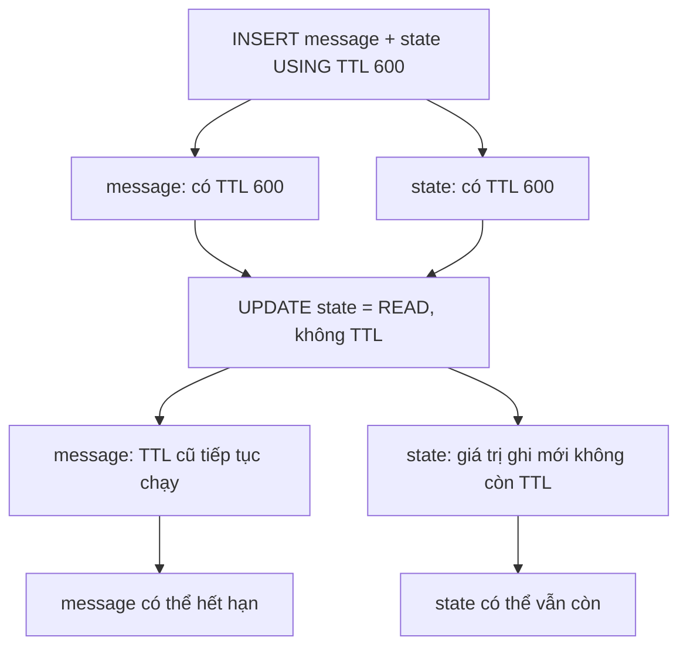

# Thay đổi TTL khi ghi lại một phần dữ liệu trong Spring Data Cassandra

**Time to live (TTL)** trong Apache Cassandra không phải một bộ đếm thời gian duy nhất gắn với toàn bộ entity Java. TTL được áp dụng cho **những giá trị dữ liệu được ghi**, và mỗi lần ghi lại một cột có thể tạo ra **thời điểm hết hạn mới** hoặc **bỏ thời hạn hết hạn** của riêng cột đó. Vì vậy, việc cập nhật một phần hàng (*partial update*) có thể khiến một số cột biến mất sau TTL, trong khi các cột khác vẫn tồn tại.

Bài thuộc chương **TTL và tombstone** của module **SPRING_DATA_CASSANDRA**. Chúng ta sẽ thực hành CQL `INSERT`/`UPDATE ... USING TTL`, `TTL(column)`, `default_time_to_live`, so sánh `CqlTemplate` với `CassandraTemplate`, và thiết kế kiểm thử để tránh những sai lầm về vòng đời dữ liệu, tombstone, consistency và hiệu năng.

Các ví dụ dùng Apache Cassandra với keyspace `commerce` giả định đã tồn tại, Spring Data Cassandra và Java driver 4.x. Tên API có thể khác giữa các phiên bản Spring Data; cần xác minh dependency của dự án trước khi đưa vào production.

## 1. Mô hình đúng: TTL gắn với giá trị được ghi

Xét bảng lưu thông báo:

```sql
CREATE TABLE commerce.notifications_by_id (
    notification_id uuid PRIMARY KEY,
    recipient_id uuid,
    message text,
    state text,
    updated_at timestamp
);
```

`notification_id` là **partition key** và cũng là toàn bộ primary key. Cassandra định tuyến thao tác theo giá trị khóa này. Những cột `message`, `state` và `updated_at` chứa dữ liệu có thể được ghi với TTL khác nhau theo từng mutation.

Ví dụ ghi một thông báo với TTL 600 giây:

```sql
INSERT INTO commerce.notifications_by_id (
    notification_id, recipient_id, message, state
) VALUES (
    11111111-1111-1111-1111-111111111111,
    22222222-2222-2222-2222-222222222222,
    'Đơn hàng đã được giao',
    'NEW'
) USING TTL 600;
```

Ở lần ghi này, các giá trị cột được cung cấp trong câu `INSERT` nhận TTL 600 giây, theo ngữ nghĩa dữ liệu CQL. Không diễn giải rằng **một đồng hồ duy nhất thuộc tính Java `NotificationRow`** đã được tạo.

### 1.1. Ba khái niệm cần tách biệt

| Khái niệm | Cách hiểu đúng | Ví dụ |
| --- | --- | --- |
| **TTL của giá trị ô** | Thời gian sống được gán khi giá trị cụ thể được ghi. | `message` có TTL còn 420 giây. |
| **Thời điểm ghi / write timestamp** | Metadata phục vụ hòa giải phiên bản giá trị trên các replica. | `WRITETIME(state)` trả timestamp theo microsecond. |
| **Default TTL của bảng** | Quy tắc TTL mặc định cho các giá trị ghi không override TTL một cách tường minh. | `default_time_to_live = 600`. |

Một cột **không có TTL** không có nghĩa nó sẽ được lưu mãi mãi bất chấp câu lệnh `DELETE`, ghi đè hoặc thay đổi bảng. Chỉ có nghĩa lần ghi hiện tại không có thời hạn tự hết hạn riêng cho giá trị ấy.

**Primary key không được gắn TTL như một cột dữ liệu thông thường.** Khi không còn dữ liệu sống và marker sống của hàng phù hợp đã hết hạn, hàng có thể không còn xuất hiện trong kết quả; tuy nhiên không nên hình dung “primary key hết TTL” như một thao tác đặt TTL trực tiếp trên `notification_id`.

### 1.2. Sơ đồ vòng đời của một hàng



Ở đây, `UPDATE` **chỉ ghi `state`**. Cassandra không tự “làm mới TTL” của `message` chỉ vì cả hai cột cùng nằm trong một hàng.

## 2. Thí nghiệm cốt lõi: ghi lại một cột mà không ghi TTL

Đây là trường hợp nhiều ứng dụng mắc lỗi nhất.

### 2.1. Bước 1 — Ghi ban đầu có TTL

```sql
INSERT INTO commerce.notifications_by_id (
    notification_id, message, state
) VALUES (
    33333333-3333-3333-3333-333333333333,
    'Bạn có một thông báo mới',
    'NEW'
) USING TTL 600;
```

Ngay sau đó, quan sát thời gian sống còn lại:

```sql
SELECT
    notification_id,
    message,
    TTL(message) AS message_ttl,
    state,
    TTL(state) AS state_ttl
FROM commerce.notifications_by_id
WHERE notification_id = 33333333-3333-3333-3333-333333333333;
```

Các giá trị `message_ttl` và `state_ttl` ban đầu thường là những số dương gần 600, nhưng **không nhất thiết bằng chính xác 600** do thời gian đã trôi qua, độ trễ xử lý và cách làm tròn/biểu diễn.

### 2.2. Bước 2 — Chỉ cập nhật state, không chỉ định TTL

```sql
UPDATE commerce.notifications_by_id
SET state = 'READ'
WHERE notification_id = 33333333-3333-3333-3333-333333333333;
```

Vì bảng minh họa **không thiết lập default TTL**, kết quả logic sau update là:

| Cột | Trước UPDATE | Sau UPDATE |
| --- | --- | --- |
| `message` | Giá trị cũ, TTL vẫn đang giảm. | **Không được ghi lại**; TTL cũ tiếp tục giảm. |
| `state` | `NEW`, có TTL đang giảm. | `READ`, giá trị **ghi mới không có TTL**. |
| `notification_id` | Primary key. | Không phải một cột được “gia hạn TTL”. |

Quan sát lại:

```sql
SELECT
    message,
    TTL(message) AS message_ttl,
    state,
    TTL(state) AS state_ttl
FROM commerce.notifications_by_id
WHERE notification_id = 33333333-3333-3333-3333-333333333333;
```

Khi `state = 'READ'` đã được ghi không TTL:

- `TTL(state)` trả **`null`** vì giá trị hiện tại không có TTL.
- `TTL(message)` vẫn là số giây dương còn lại của giá trị cũ, chừng nào nó chưa hết hạn.
- Khi `message` hết hạn, cột ấy có thể trở thành `null`/vắng mặt trong kết quả nhưng `state` vẫn tồn tại.

**Không có cơ chế tự động sao chép TTL từ giá trị cũ của `state` sang giá trị mới.** Nếu muốn `state` cũng hết hạn sau một khoảng nhất định, câu lệnh ghi mới phải chủ động chỉ định TTL tương ứng hoặc dựa trên default TTL của bảng.

### 2.3. Một dòng thời gian minh họa

Giả sử hoàn toàn không có write cạnh tranh, table default TTL = 0 và đồng hồ cluster hoạt động bình thường:

| Thời điểm tương đối | `message` | `state` | Nguyên nhân |
| --- | --- | --- | --- |
| `t = 0` | `"Bạn có một thông báo mới"`, TTL 600 s | `NEW`, TTL 600 s | INSERT có TTL. |
| `t = 180 s` | TTL còn khoảng 420 s | `READ`, không TTL | UPDATE chỉ ghi lại `state` không TTL. |
| `t = 420 s` | TTL còn khoảng 180 s | `READ`, không TTL | Không có write khác. |
| Sau `t ≈ 600 s` | Giá trị cũ đã hết hạn | `READ` có thể còn | Hai cột có vòng đời khác nhau. |

Đây là **mô hình logic**, không phải cam kết thời điểm hiển thị chính xác đến mili giây ở mọi replica. TTL expiration và việc dọn dữ liệu vật lý là hai giai đoạn khác nhau.

## 3. Ghi một phần với TTL mới: chỉ những cột được viết chịu tác động

Nếu muốn thay `state` bằng một giá trị chỉ tồn tại thêm **5 phút**, dùng `USING TTL 300`:

```sql
UPDATE commerce.notifications_by_id USING TTL 300
SET state = 'READ'
WHERE notification_id = 33333333-3333-3333-3333-333333333333;
```

TTL 300 giây áp dụng cho **giá trị `state` được ghi trong câu UPDATE này**, không tự động đặt lại TTL cho `message`.

Nếu cập nhật hai cột trong cùng mutation:

```sql
UPDATE commerce.notifications_by_id USING TTL 300
SET state = 'READ',
    updated_at = '2026-11-25T10:00:00Z'
WHERE notification_id = 33333333-3333-3333-3333-333333333333;
```

Cả hai giá trị **`state` và `updated_at`** được ghi trong mutation có TTL 300. `message` vẫn không bị đụng tới.

| CQL | Các cột được ghi lại | TTL mới của cột được ghi |
| --- | --- | --- |
| `UPDATE ... SET state = 'READ'` | Chỉ `state` | Không TTL nếu table default là 0. |
| `UPDATE ... USING TTL 300 SET state = 'READ'` | Chỉ `state` | 300 giây. |
| `UPDATE ... USING TTL 300 SET state = ..., updated_at = ...` | `state` và `updated_at` | 300 giây cho từng giá trị vừa ghi. |
| `UPDATE ... USING TTL 900 SET message = ...` | Chỉ `message` | 900 giây; `state` không bị thay đổi. |

Không coi TTL 300 là “cộng thêm 300 giây vào TTL cũ”. **Việc ghi mới tạo một giá trị có TTL mới**, và thời hạn được tính theo quy tắc Cassandra của lần ghi đó. Nếu muốn giữ cùng **hạn hết hiệu lực nghiệp vụ** cho nhiều cột, phải tính TTL còn lại và tổ chức các mutation có chủ đích.

### 3.1. Có thể chọn TTL khác nhau cho hai cột không?

Có, nhưng không phải bằng cách viết hai TTL khác nhau trong một `UPDATE ... USING TTL` đơn lẻ cho hai giá trị. Chẳng hạn:

```sql
-- message sống thêm 30 phút tính từ lần ghi này.
UPDATE commerce.notifications_by_id USING TTL 1800
SET message = 'Thông báo quan trọng'
WHERE notification_id = 33333333-3333-3333-3333-333333333333;

-- state sống thêm 10 phút tính từ lần ghi này.
UPDATE commerce.notifications_by_id USING TTL 600
SET state = 'NEW'
WHERE notification_id = 33333333-3333-3333-3333-333333333333;
```

**Đánh đổi:** Đây là hai mutation riêng. Nếu thao tác thứ hai lỗi, hàng có thể ở trạng thái TTL không như dự định. Nếu cần tính nguyên tử nghiệp vụ trong điều kiện cạnh tranh, hãy xét lại mô hình dữ liệu và cơ chế cập nhật thay vì giả định hai lần `UPDATE` là một transaction ACID.

### 3.2. UPDATE không điều kiện có thể upsert

CQL `UPDATE` trong Cassandra không yêu cầu hàng tồn tại trước đó. Một câu `UPDATE ... USING TTL 300 SET state = ... WHERE notification_id = ...` có thể tạo dữ liệu mới theo khóa nếu chưa có hàng tương ứng.

Vì vậy, **“gia hạn TTL một cột” không tự có nghĩa “chỉ sửa nếu thông báo đã tồn tại”**. Nếu thật sự cần điều kiện tồn tại hoặc trạng thái kỳ vọng, xem xét `IF EXISTS` hoặc `IF state = ...` (LWT) và đọc kết quả `[applied]`. LWT có chi phí và quy tắc consistency riêng.

## 4. Dùng TTL 0 để bỏ thời hạn cho giá trị được ghi

CQL hỗ trợ `USING TTL 0` để ghi giá trị **không có thời hạn TTL**, thay vì có nghĩa “hết hạn ngay”.

Ví dụ một thông báo cần được giữ lại:

```sql
UPDATE commerce.notifications_by_id USING TTL 0
SET message = 'Thông báo đã được lưu trữ',
    state = 'ARCHIVED'
WHERE notification_id = 33333333-3333-3333-3333-333333333333;
```

Ý nghĩa:

- `message` được ghi lại không TTL.
- `state` cũng được ghi lại không TTL.
- Một cột khác **không xuất hiện trong SET** sẽ không tự được viết lại hoặc xóa TTL chỉ vì câu lệnh chứa `USING TTL 0`.
- Đối với bảng có `default_time_to_live` khác 0, TTL 0 tường minh dùng để **override default TTL** cho các giá trị được ghi, theo ngữ nghĩa Cassandra của phiên bản được sử dụng.

**TTL 0 không phải là DELETE**. Nếu muốn xóa dữ liệu ngay về mặt logic, dùng `DELETE` hoặc ghi `null` theo ngữ nghĩa CQL phù hợp; điều đó tạo một kiểu mutation khác và có thể phát sinh tombstone.

### 4.1. Giá trị đã hết hạn có “phục hồi” khi TTL 0 không?

Không. Nếu `message` đã hết hạn và không còn giá trị để ứng dụng đọc, gửi `USING TTL 0` **không thể khôi phục nội dung cũ** chỉ bằng việc đổi TTL. Câu `UPDATE` phải cung cấp **giá trị mới** hoặc ứng dụng phải lấy dữ liệu từ một nguồn đáng tin cậy khác.

Đừng áp dụng một thao tác “đặt TTL 0” như metadata patch tách khỏi giá trị, vì TTL là một phần của bản ghi giá trị mới; CQL `UPDATE` vẫn cần một `SET` hợp lệ.

## 5. Default TTL cấp bảng thay đổi cách hiểu UPDATE không ghi TTL

Cassandra cho phép đặt **TTL mặc định cho bảng**:

```sql
CREATE TABLE commerce.notifications_with_default_ttl (
    notification_id uuid PRIMARY KEY,
    message text,
    state text
) WITH default_time_to_live = 900;
```

Bây giờ thao tác ghi không chỉ định `USING TTL`:

```sql
INSERT INTO commerce.notifications_with_default_ttl
(notification_id, message, state)
VALUES (
    44444444-4444-4444-4444-444444444444,
    'Nội dung có TTL mặc định',
    'NEW'
);

UPDATE commerce.notifications_with_default_ttl
SET state = 'READ'
WHERE notification_id = 44444444-4444-4444-4444-444444444444;
```

Đối với **các giá trị vừa ghi**, Cassandra sẽ dùng `default_time_to_live = 900` nếu statement không chỉ định TTL khác. Do đó:

- `message` tiếp tục giảm thời gian sống theo lần INSERT.
- `state` được ghi lại và **nhận TTL mặc định mới 900 giây**, không trở thành vĩnh viễn như ví dụ ở bảng không có default TTL.
- Lần UPDATE **không gia hạn `message`** nếu không có `message` trong `SET`.

Bảng so sánh:

| Cấu hình bảng | UPDATE `state` không ghi TTL | UPDATE `state` với `USING TTL 300` | UPDATE `state` với `USING TTL 0` |
| --- | --- | --- | --- |
| `default_time_to_live = 0` | `state` mới không TTL. | `state` mới có TTL 300. | `state` mới không TTL. |
| `default_time_to_live = 900` | `state` mới có TTL mặc định 900. | `state` mới có TTL 300, override mặc định. | `state` mới không TTL, override mặc định. |

**Đừng kết luận “UPDATE không có `USING TTL` luôn xóa TTL” khi chưa xem schema bảng.** Cần kiểm tra `default_time_to_live` của đúng bảng và phiên bản Cassandra.

### 5.1. Đổi default TTL không phải gia hạn mọi ô dữ liệu cũ

Khi chỉnh `default_time_to_live` bằng `ALTER TABLE`, mục đích là thay đổi quy tắc cho những giá trị được ghi theo mặc định về sau, không phải một lệnh quét và cập nhật TTL của mọi giá trị đang lưu.

```sql
-- Ví dụ DDL chỉ dành cho bảng thử nghiệm.
ALTER TABLE commerce.notifications_with_default_ttl
WITH default_time_to_live = 1200;
```

Những giá trị đã ghi từ trước vẫn có metadata TTL/thời điểm hết hạn của chính chúng. Muốn thay thời gian sống của một giá trị cũ, cần một lần ghi lại giá trị đó hoặc quy trình migration thích hợp.

### 5.2. TTL có giới hạn kỹ thuật

Giá trị TTL biểu diễn số giây và bị giới hạn bởi kiểu/phiên bản Cassandra cũng như các quy tắc về thời điểm hết hạn tối đa. Không đặt TTL “100 năm” theo thói quen rồi giả định mọi cluster chấp nhận. Với chính sách lưu trữ dài hạn, hãy xác minh giới hạn phiên bản hoặc dùng chiến lược retention khác.

Không đặt TTL âm hay dùng số 0 để diễn đạt “xóa ngay”; cả hai đều là sai mô hình.

## 6. Quan sát chính xác bằng TTL() và WRITETIME()

Để kiểm thử hành vi, Cassandra cung cấp hàm CQL:

- `TTL(column)`: số giây TTL còn lại của giá trị cột hiện hành, nếu cột đó có TTL và giá trị còn sống.
- `WRITETIME(column)`: write timestamp của giá trị cột, thường biểu diễn theo **microseconds kể từ Unix epoch**, không phải thời gian thực hiện `SELECT`.

Ví dụ:

```sql
SELECT
    notification_id,
    message,
    TTL(message) AS message_ttl,
    WRITETIME(message) AS message_write_time,
    state,
    TTL(state) AS state_ttl,
    WRITETIME(state) AS state_write_time
FROM commerce.notifications_by_id
WHERE notification_id = 33333333-3333-3333-3333-333333333333;
```

Cách diễn giải:

| Quan sát | Có thể kết luận | Không thể kết luận |
| --- | --- | --- |
| `TTL(message) = 210` | Giá trị `message` hiện còn thời hạn khoảng 210 giây ở phép đọc đó. | Giá trị sẽ được dọn vật lý khỏi SSTable đúng sau 210 giây. |
| `TTL(state) = null` và `state = 'READ'` | Giá trị hiện tại của `state` không có TTL. | Cả hàng hoặc cột `message` cũng không có TTL. |
| `message = null` và `TTL(message) = null` | Không thấy giá trị `message` còn sống ở phép đọc đó. | Chắc chắn chưa từng ghi `message`; giá trị có thể đã hết TTL/xóa. |
| `WRITETIME(state)` thay đổi sau UPDATE | `state` có write timestamp mới đang hiển thị. | Mọi cột trong hàng đều được ghi lại cùng lúc. |

`TTL(column)` là một phép quan sát **tại thời điểm đọc**. Không so sánh chính xác bằng `assertEquals(600, ttl)` trong test có mạng/cluster, vì vài giây có thể đã trôi qua. Nên dùng các điều kiện như `ttl > 0` và `ttl <= expectedSeconds` (với khoảng dung sai phù hợp cho môi trường) và xác minh thêm việc cột khác không bị refresh.

**Lưu ý phân biệt `null`:**

- `TTL(column) = null` khi một giá trị **đang tồn tại nhưng không có TTL**.
- `TTL(column) = null` cũng có thể xảy ra khi **cột không có giá trị sống**.
- Vì vậy phải đọc cả `column` lẫn `TTL(column)` để giải thích hiện tượng.

Hàm `TTL` và `WRITETIME` nên dùng với những cột/kiểu dữ liệu CQL được hỗ trợ; không mặc định có thể dùng trên partition key, counter hay mọi thành phần collection như một scalar bình thường.

## 7. Spring Data Cassandra: hai kiểu cập nhật có phạm vi khác nhau

Khi dùng Spring Data Cassandra, phải phân biệt **ghi một thuộc tính được chỉ rõ** với **ghi lại entity**.

### 7.1. CqlTemplate: chỉ cập nhật đúng một cột

`CqlTemplate` cho phép kiểm soát câu CQL trong repository/service Spring:

```java
import java.util.UUID;
import org.springframework.data.cassandra.core.cql.CqlTemplate;
import org.springframework.stereotype.Service;

@Service
public class NotificationStateWriter {

    private final CqlTemplate cqlTemplate;

    public NotificationStateWriter(CqlTemplate cqlTemplate) {
        this.cqlTemplate = cqlTemplate;
    }

    public void markReadWithoutTtl(UUID notificationId) {
        // Không đặt TTL: nếu table default TTL = 0,
        // state mới sẽ không còn TTL.
        cqlTemplate.execute(
            "UPDATE commerce.notifications_by_id " +
            "SET state = ? WHERE notification_id = ?",
            "READ", notificationId
        );
    }

    public void markReadForFiveMinutes(UUID notificationId) {
        // Chỉ state được ghi với TTL 300.
        cqlTemplate.execute(
            "UPDATE commerce.notifications_by_id USING TTL 300 " +
            "SET state = ? WHERE notification_id = ?",
            "READ", notificationId
        );
    }

    public void archiveStateWithoutExpiry(UUID notificationId) {
        cqlTemplate.execute(
            "UPDATE commerce.notifications_by_id USING TTL 0 " +
            "SET state = ? WHERE notification_id = ?",
            "ARCHIVED", notificationId
        );
    }
}
```

Với cả ba phương thức, `message` không nằm trong `SET`, nên **không bị ghi lại**. Kiểu bind `UUID` của `notification_id` khớp cột CQL `uuid`.

Lệnh `CqlTemplate.execute(...)` của một `UPDATE` không điều kiện **không phải số hàng được cập nhật**. Một câu UPDATE có thể upsert hàng theo key; chỉ dựa vào giá trị boolean trả về để kết luận “đã sửa đúng một thông báo tồn tại” là sai.

### 7.2. CqlTemplate với TTL động

Khi TTL được chọn theo chính sách nghiệp vụ:

```java
import java.time.Duration;
import java.util.UUID;

public void updateStateWithTtl(UUID id, String state, Duration ttl) {
    if (id == null || state == null || ttl == null) {
        throw new IllegalArgumentException("Missing update arguments");
    }

    long seconds = ttl.getSeconds();
    if (seconds <= 0 || seconds > Integer.MAX_VALUE) {
        throw new IllegalArgumentException("TTL seconds out of supported range");
    }

    cqlTemplate.execute(
        "UPDATE commerce.notifications_by_id USING TTL ? " +
        "SET state = ? WHERE notification_id = ?",
        (int) seconds, state, id
    );
}
```

Code trên minh họa phương thức nằm trong service có field `cqlTemplate`; quy tắc TTL thực tế còn bị giới hạn bởi phiên bản Cassandra, nên `Integer.MAX_VALUE` **không phải bảo đảm mọi giá trị đến ngưỡng ấy đều được server chấp nhận**. Để tránh rủi ro vòng đời bất thường, ứng dụng nên giới hạn TTL theo policy nhỏ hơn, ví dụ tối đa 30 ngày.

Không chấp nhận một TTL tùy ý từ API public mà không kiểm tra quyền/quy định retention.

### 7.3. CassandraTemplate: chú ý update cả entity

`CassandraTemplate` làm việc với metadata của entity:

```java
import java.time.Duration;
import org.springframework.data.cassandra.core.CassandraTemplate;
import org.springframework.data.cassandra.core.UpdateOptions;

// notificationRow là entity đã được ánh xạ với đầy đủ primary key.
UpdateOptions options = UpdateOptions.builder()
    .ttl(Duration.ofMinutes(5))
    .build();

template.update(notificationRow, options);
```

**Không suy ra rằng lời gọi trên chỉ cập nhật `state`.** Tùy version, cách lưu entity, conversion settings và những thuộc tính hiện diện, mapper có thể tạo mutation cho **nhiều cột**. Nếu nhiều giá trị được ghi trong cùng mutation với TTL 5 phút, TTL của những giá trị ấy cũng có thể thay đổi.

Ví dụ:

- Tầng service đọc entity gồm `message` và `state`.
- Chỉ thay `state` trong object Java.
- Sau đó gọi API update nhận **toàn entity** với `UpdateOptions.ttl(300s)`.
- Nếu mapper gửi cả `message` lẫn `state` trong lệnh ghi, `message` có thể bị **làm mới TTL ngoài ý muốn**.

Khi yêu cầu nghiệp vụ là **chỉ update một cột** và giữ nguyên TTL của mọi cột khác, hãy ưu tiên API update nhắm đúng cột hoặc CQL `SET state = ...` tường minh. Kiểm tra câu CQL thực được framework sinh ra trên phiên bản dự án.

### 7.4. Khi nào dùng Repository?

`CassandraRepository` phù hợp để tìm và lưu entity theo khóa. Tuy nhiên, `save(entity)` thông thường **không đồng nghĩa PATCH một thuộc tính**.

Nếu route `PATCH /notifications/{id}/state` phải bảo toàn TTL của `message`, đừng mặc định làm:

```java
// Ví dụ cần đánh giá kỹ, KHÔNG phải cách bảo đảm giữ TTL cột khác.
NotificationRow row = repository.findById(id).orElseThrow();
row.setState("READ");
repository.save(row);
```

Việc ghi lại entity có thể thay đổi TTL của những cột được mapper gửi đi, gây rủi ro với hợp đồng dữ liệu. Nên đặt một phương thức chuyên dụng cho partial update và kiểm thử `TTL(message)` trước/sau.

## 8. Phân biệt cột bỏ qua, null và UNSET

Một lỗi khó thấy là nhầm **“không ghi cột”** với **“ghi giá trị null vào cột”**.

Trong CQL/driver:

- **Bỏ cột khỏi `SET`**: cột không tham gia mutation; TTL hiện tại của nó không tự đổi.
- **Ghi `null`** theo ngữ nghĩa CQL: thường là thao tác xóa giá trị, phát sinh tombstone — **không phải** “giữ nguyên TTL”.
- **UNSET** qua driver/bind marker (ở những statement/API hỗ trợ): diễn đạt không cập nhật giá trị tương ứng; cần phân biệt với `null`.
- **Ghi lại cùng giá trị**: dù business value không đổi, đây vẫn là một lần ghi mới có thể tạo write timestamp/TTL mới.

So sánh:

```sql
-- Chỉ state thay đổi, không viết message.
UPDATE commerce.notifications_by_id
SET state = 'READ'
WHERE notification_id = 33333333-3333-3333-3333-333333333333;

-- message bị xóa về mặt logic, không phải giữ nguyên.
UPDATE commerce.notifications_by_id
SET message = null
WHERE notification_id = 33333333-3333-3333-3333-333333333333;

-- Ghi lại message cũ với TTL mới; không giữ TTL cũ.
UPDATE commerce.notifications_by_id USING TTL 300
SET message = 'Bạn có một thông báo mới'
WHERE notification_id = 33333333-3333-3333-3333-333333333333;
```

**Không viết `UNSET` như một literal CQL tương đương `null`.** `UNSET` là khái niệm giá trị parameter của driver trong những đường thực thi hỗ trợ; cách dùng và hành vi phải kiểm tra theo API cụ thể.

### 8.1. JSON PATCH và cập nhật partial entity

Trong REST API, người dùng có thể gửi:

```json
{
  "state": "READ"
}
```

Tầng API cần bảo đảm payload này trở thành mutation `SET state = 'READ'` **duy nhất**, không biến trường `message` vắng mặt thành Java `null` rồi gửi xuống Cassandra như lệnh xóa.

Một thiết kế rõ ràng là dùng command riêng:

```java
public record ChangeNotificationState(
    java.util.UUID notificationId,
    String nextState
) {}
```

Sau đó service viết CQL chỉ cho `state`. Cách này giúp phân biệt **absent** (không đổi) với **null** (nếu API cho phép xóa) và tránh vô tình đổi TTL của các cột khác.

## 9. Ghi lại một phần dữ liệu và timestamp: không chỉ TTL

Cassandra dùng write timestamp của từng giá trị để hòa giải các mutation cạnh tranh. Mỗi lần cập nhật một cột không chỉ có thể đổi TTL mà còn tạo **phiên bản giá trị mới** theo timestamp.

Ví dụ:

```sql
UPDATE commerce.notifications_by_id
USING TTL 300
SET state = 'READ'
WHERE notification_id = 33333333-3333-3333-3333-333333333333;
```

Nếu một writer khác ghi `state='NEW'` với timestamp cao hơn hoặc thấp hơn, kết quả quan sát có thể khác trực giác “câu lệnh nào chạy sau thắng”. Không được trộn tùy tiện timestamp thủ công và timestamp server/driver mặc định.

### 9.1. TTL và USING TIMESTAMP không phải cùng một khái niệm

```sql
UPDATE commerce.notifications_by_id
USING TTL 300 AND TIMESTAMP 1795597200000000
SET state = 'READ'
WHERE notification_id = 33333333-3333-3333-3333-333333333333;
```

- `USING TTL 300` mô tả thời gian sống của giá trị được viết.
- `USING TIMESTAMP ...` đặt write timestamp của mutation cho cơ chế hòa giải, tính bằng **microseconds**.
- `updated_at` là một **cột dữ liệu ứng dụng**; đặt `updated_at` không tự thay đổi TTL của các ô khác.

Không dùng timestamp trong tương lai để “bảo đảm” ghi thắng; nó có thể khiến những mutation hợp lệ sau đó bị che bởi phiên bản timestamp cao. Đặc biệt, **không nhầm timestamp write với thời gian bắt đầu TTL ở tầng business**; muốn dữ liệu hết hạn tại thời điểm nghiệp vụ cụ thể phải tính và đặt TTL phù hợp tại lần ghi.

### 9.2. TTL hết hạn không làm giá trị cũ tự sống lại

Khi `state='READ'` được ghi đè lên `state='NEW'` với timestamp mới hơn, rồi `READ` hết TTL, không có chuyện Cassandra tự trả lại `NEW` như phiên bản “fallback” hợp lệ. TTL expiration có semantics xóa/tombstone để giá trị trước đó không tự hồi sinh trong điều kiện vận hành đúng.

Một exception vận hành cần hiểu là **zombie data** khi tombstone bị dọn quá sớm trước khi các replica cũ được đối soát; đó là vấn đề repair/`gc_grace_seconds`, không phải cách hợp lệ để phục hồi giá trị cũ.

## 10. Tombstone: chi phí của hết hạn và ghi null

TTL giúp dữ liệu tự hết hiệu lực, nhưng không miễn phí.

Khi một giá trị có TTL hết hạn:

1. Tại thời điểm hết hạn, Cassandra **coi giá trị đã bị xóa về mặt logic**.
2. Metadata tombstone/hết hạn cần bảo đảm bản ghi cũ từ replica chậm hoặc chưa cập nhật không tự ghi đè trạng thái xóa.
3. Dữ liệu vật lý nằm trong SSTable được thu hồi về sau khi compaction và các điều kiện an toàn được thỏa.
4. Đọc dữ liệu có nhiều tombstone có thể tốn tài nguyên hơn, đặc biệt nếu partition rất lớn hoặc truy vấn quét nhiều range.


**Không diễn giải “TTL hết hạn” thành “disk giảm ngay”.** Quá trình thu hồi chịu ảnh hưởng của compaction strategy, cấu trúc SSTable, tình trạng repair, timestamp và grace period.

### 10.1. `gc_grace_seconds` liên quan gì?

`gc_grace_seconds` là tham số bảng tham gia quyết định thời gian giữ tombstone để giảm rủi ro dữ liệu cũ ở replica chưa sửa chữa quay lại sau khi tombstone đã bị thu hồi.

- Không phải độ dài TTL của mọi cột.
- Không phải lịch chạy compaction.
- Không phải “thời điểm chắc chắn xóa tombstone khỏi disk”.
- Không phải cách để “làm TTL nhanh hơn”.
- Cần phối hợp với chính sách anti-entropy repair và phiên bản Cassandra.

**Không tự giảm `gc_grace_seconds` xuống 0** để chữa vấn đề tombstone/đầy disk trên production. Nếu replica nằm ngoài hệ thống đủ lâu và chưa repair, việc dọn tombstone sai thời điểm có thể tạo rủi ro zombie data. Bất kỳ thay đổi nào phải có runbook vận hành và kiến thức về đặc tính dữ liệu của bảng.

### 10.2. Khối lượng TTL lớn và chiến lược compaction

Một bảng sự kiện có hàng triệu giá trị TTL ngắn có thể tạo lượng tombstone lớn. Khi workload thiên về time-series hoặc dữ liệu hết hạn theo khoảng thời gian, cần cân nhắc:

- **Partition theo thời gian** để giới hạn kích thước partition và truy vấn theo khóa.
- Chọn TTL phù hợp với retention thực tế, tránh cập nhật lại cùng cell quá thường xuyên không có lý do.
- Đánh giá **TimeWindowCompactionStrategy (TWCS)** khi dữ liệu theo time window, mostly immutable và TTL tương đối đồng nhất.
- Tránh trộn tùy tiện dữ liệu không TTL, TTL cực ngắn và TTL cực dài trong cùng bảng/window nếu mục tiêu là dọn SSTable hiệu quả.
- Theo dõi tombstone scans, p95/p99 latency, disk usage, compaction backlog và repair.

TWCS không tự bảo đảm mọi tombstone được dọn đúng hạn. Những update ngoài trật tự thời gian, ghi đè dữ liệu cũ hoặc sự pha trộn TTL có thể làm giảm hiệu quả thu hồi.

## 11. Consistency và TTL: đọc gì khi replica chưa hội tụ?

Cassandra là hệ thống phân tán. Với RF = 3 tại một datacenter, một ghi ở `LOCAL_QUORUM` cần đa số replica trong local DC phản hồi. Điều đó **không có nghĩa mọi replica lập tức có cùng trạng thái**.

Ở bài thử TTL:

- Ghi `state='READ'` với TTL mới tại `LOCAL_QUORUM`.
- Đọc ngay `state` bằng `LOCAL_ONE` có thể thấy replica chưa bắt kịp mutation trong một số tình huống.
- Một kết quả `TTL(state)` từ một replica/CL không tự phản ánh đồng bộ tuyệt đối trên cả cluster.
- Thay đổi TTL không thể sửa vấn đề partition key nóng, write timeout hoặc thiếu repair.

Để kiểm chứng riêng **ngữ nghĩa partial update**, nên bắt đầu bằng key mới, không có write cạnh tranh, schema TTL rõ ràng, rồi ghi/đọc bằng CL phù hợp (ví dụ `LOCAL_QUORUM` khi RF/topology cho phép). Sau đó mới thử network fault và khôi phục replica.

Không lấy một lần `SELECT TTL(...)` ở `LOCAL_ONE` làm bằng chứng mọi replica đã thực hiện đúng mutation mới. Đồng thời không mặc định một giá trị hết TTL sẽ trở lại vĩnh viễn vì một replica chậm: Cassandra dùng metadata version/tombstone để hòa giải theo quy tắc của nó.

## 12. Thiết kế kiểm thử tích hợp cho partial update TTL

Một bài test nên kiểm tra **điều thay đổi** và **điều phải giữ nguyên**. Với bảng `notifications_by_id` không có default TTL, kịch bản tối thiểu:

1. Ghi `message` và `state` với TTL 600 giây.
2. Đọc `TTL(message)` và `TTL(state)`, xác minh đều có TTL dương.
3. Chỉ `UPDATE state='READ'` **không ghi TTL**.
4. Đọc lại, xác minh `state='READ'` và `TTL(state)=null`.
5. Xác minh `message` vẫn còn giá trị, `TTL(message)>0` và **không được làm mới** về 600.
6. Tiếp tục `UPDATE state='ACK' USING TTL 120`.
7. Xác minh `TTL(state)>0` và không vượt quá giá trị TTL mới.
8. Với test riêng, thử `USING TTL 0` và `default_time_to_live`.

Để tránh test phụ thuộc thời gian quá nhiều, sử dụng TTL đủ dài cho những assertion tức thời, không cố đợi 600 giây trong toàn bộ CI. Các test về **hết hạn thực tế** nên dùng TTL ngắn, polling có timeout và điều kiện đọc dữ liệu phù hợp.

### 12.1. Ví dụ JUnit 5 với CqlSession

```java
import static org.junit.jupiter.api.Assertions.*;

import java.util.UUID;

import com.datastax.oss.driver.api.core.CqlSession;
import com.datastax.oss.driver.api.core.cql.Row;
import com.datastax.oss.driver.api.core.cql.SimpleStatement;
import org.junit.jupiter.api.Test;
import org.springframework.beans.factory.annotation.Autowired;
import org.springframework.boot.test.context.SpringBootTest;

@SpringBootTest
class PartialTtlUpdateIntegrationTest {

    @Autowired
    CqlSession session;

    @Test
    void rewritingOneColumnDoesNotRefreshOtherColumnTtl() {
        UUID id = UUID.randomUUID();

        session.execute(SimpleStatement.builder(
                "INSERT INTO commerce.notifications_by_id " +
                "(notification_id, message, state) " +
                "VALUES (?, ?, ?) USING TTL 600")
            .addPositionalValues(id, "Nội dung có TTL", "NEW")
            .build());

        Row first = loadTtlRow(id);
        assertNotNull(first);
        assertEquals("NEW", first.getString("state"));
        assertTrue(first.getInt("message_ttl") > 0);
        assertTrue(first.getInt("state_ttl") > 0);

        // Chỉ state được ghi; không đặt TTL, giả sử table default = 0.
        session.execute(SimpleStatement.builder(
                "UPDATE commerce.notifications_by_id " +
                "SET state = ? WHERE notification_id = ?")
            .addPositionalValues("READ", id)
            .build());

        Row afterUpdate = loadTtlRow(id);
        assertNotNull(afterUpdate);
        assertEquals("READ", afterUpdate.getString("state"));
        assertTrue(afterUpdate.isNull("state_ttl"));
        assertEquals("Nội dung có TTL",
                     afterUpdate.getString("message"));
        assertTrue(afterUpdate.getInt("message_ttl") > 0);

        // Ghi state mới với TTL 120 giây.
        session.execute(SimpleStatement.builder(
                "UPDATE commerce.notifications_by_id USING TTL 120 " +
                "SET state = ? WHERE notification_id = ?")
            .addPositionalValues("ACK", id)
            .build());

        Row afterTtlUpdate = loadTtlRow(id);
        assertEquals("ACK", afterTtlUpdate.getString("state"));
        int ttl = afterTtlUpdate.getInt("state_ttl");
        assertTrue(ttl > 0 && ttl <= 120);
        assertTrue(afterTtlUpdate.getInt("message_ttl") > 0);
    }

    private Row loadTtlRow(UUID id) {
        return session.execute(SimpleStatement.builder(
                "SELECT message, TTL(message) AS message_ttl, " +
                "state, TTL(state) AS state_ttl " +
                "FROM commerce.notifications_by_id " +
                "WHERE notification_id = ?")
            .addPositionalValue(id)
            .build()).one();
    }
}
```

**Giới hạn của ví dụ test:**

- Schema phải tồn tại, table default TTL = 0; Spring test cần cấu hình keyspace/contact points hợp lệ.
- Test sử dụng một ID riêng và không có writer cạnh tranh.
- TTL 600/120 giúp giảm tính nhạy thời gian của phép assert, nhưng môi trường quá chậm hoặc bị treo lâu vẫn có thể làm test không ổn định.
- Nếu cluster có nhiều replica, cần chọn CL và topology phù hợp với yêu cầu test; ví dụ dùng driver default để tập trung vào semantics TTL.
- Bài test xác minh **partial CQL update**, chưa tự chứng minh phương thức `CassandraTemplate.update(entity, options)` có cùng phạm vi ghi. Cần thêm test riêng kiểm tra CQL/mapping nếu application dùng template.

### 12.2. Kiểm thử TTL 0 và default TTL

Với bảng `notifications_with_default_ttl`:

```sql
INSERT INTO commerce.notifications_with_default_ttl
(notification_id, message, state)
VALUES (
    55555555-5555-5555-5555-555555555555,
    'Nội dung mới', 'NEW'
);

-- Ghi lại state với TTL 0 để bỏ TTL mặc định.
UPDATE commerce.notifications_with_default_ttl USING TTL 0
SET state = 'PINNED'
WHERE notification_id = 55555555-5555-5555-5555-555555555555;

SELECT
    message, TTL(message) AS message_ttl,
    state, TTL(state) AS state_ttl
FROM commerce.notifications_with_default_ttl
WHERE notification_id = 55555555-5555-5555-5555-555555555555;
```

Kỳ vọng: `message_ttl` vẫn dương (nếu chưa hết hạn), `state = 'PINNED'` và `state_ttl = null`. Với trường hợp override được hỗ trợ đúng như mô tả, giá trị `state` mới không có TTL dù bảng có default TTL.

### 12.3. Kiểm thử hết hạn thực tế

Muốn chứng minh một cột hết TTL mà cột kia còn sống:

- Tạo dữ liệu test mới với `message` TTL ngắn (ví dụ 6 giây).
- Ghi `state` không TTL sau đó.
- Poll `SELECT message, state` đến khi `message` không còn hiện diện, trong một khoảng thời gian chờ có giới hạn.
- Xác minh `state` vẫn còn; không dựa vào `Thread.sleep(6000)` cố định như một bảo đảm thời gian mạng/cluster.
- Chỉ dùng bảng thử nghiệm, tránh chờ TTL dài trong pipeline CI.

Nếu TTL không được xử lý đúng do schema có default TTL khác dự kiến, test cần phát hiện ở bước precondition, không gán nhầm lỗi cho Cassandra.

## 13. Nguy cơ khi đồng bộ cùng dữ liệu sang nhiều bảng truy cập

Một ứng dụng thường có các bảng truy cập khác nhau, ví dụ:

- `notifications_by_id` để tìm bằng notification ID.
- `notifications_by_recipient_day` để liệt kê thông báo theo người nhận và ngày.

Đó là **hai bảng dữ liệu Cassandra độc lập**, dù cùng biểu diễn một thông báo. TTL ghi cho một bảng không tự truyền sang bảng kia, trừ khi ứng dụng hoặc cơ chế đồng bộ có chủ đích thực hiện điều đó.

Một lỗi thực tế:

1. API tạo thông báo, ghi cả hai bảng với TTL 7 ngày.
2. Endpoint đánh dấu `READ` chỉ cập nhật `state` trong bảng `notifications_by_id` nhưng không cập nhật bảng đọc.
3. Người dùng mở chi tiết thấy `READ`, trong khi danh sách vẫn hiển thị `NEW`.
4. Một worker sau đó ghi lại toàn entity vào bảng đọc **không có TTL**, làm bản ghi danh sách tồn tại lâu hơn dự kiến.

Cần định nghĩa retention như một phần của hợp đồng dữ liệu:

- Trường nào được phép tồn tại lâu hơn trường khác?
- Khi cập nhật trạng thái, có refresh TTL hay chỉ đổi nội dung?
- Nếu một bảng có `default_time_to_live` còn bảng khác không có, kết quả có chấp nhận được không?
- Ai quản lý việc xóa và đối soát dữ liệu hết hạn ở từng bảng?
- Event replay có được phép “hồi sinh” thông báo đã hết hạn không?
- Có cần lưu `expires_at` như một **giá trị nghiệp vụ** để quyết định TTL còn lại khi backfill/retry không?

**TTL và `expires_at` không phải cùng một thứ.** TTL là cơ chế lưu trữ; `expires_at` có thể biểu diễn chính sách nghiệp vụ. Khi cần “hết hạn đúng thời điểm T” trên nhiều bảng, tính TTL còn lại trên từng lần ghi và tổ chức retry/backfill sao cho không vô ý kéo dài retention.

## 14. Các lỗi thường gặp và cách xử lý

| Triệu chứng | Nguyên nhân khả dĩ | Cách kiểm tra/sửa |
| --- | --- | --- |
| `state` còn nhưng `message` biến mất | `state` được ghi lại không TTL; `message` giữ TTL cũ và hết hạn. | Đọc `TTL(state)`, `TTL(message)`; đối chiếu câu UPDATE. |
| Cả `state` lẫn `message` được gia hạn ngoài ý muốn | API update cả entity gửi nhiều cột với TTL mới. | Kiểm tra CQL mapper sinh ra; dùng partial update có `SET` rõ ràng. |
| UPDATE không TTL nhưng `state` vẫn có TTL | Bảng có `default_time_to_live` khác 0. | Kiểm tra schema; dùng TTL 0 tường minh nếu yêu cầu bỏ TTL. |
| `TTL(state) = null` | Có thể không TTL **hoặc** giá trị đã vắng mặt. | Đọc cả `state` và `TTL(state)`. |
| `USING TTL 0` bị hiểu thành “xóa ngay” | Nhầm zero TTL với DELETE. | Xác nhận CQL semantics; dùng DELETE nếu cần xóa. |
| Viết `message = null` vì field không có trong PATCH | Mapping/DTO biến absent thành null. | Phân biệt absent với null, chỉ update những field thực sự thay đổi. |
| Giá trị đã hết hạn nhưng disk chưa giảm | Tombstone/SSTable chưa được compaction thu hồi. | Đo compaction và điều kiện tombstone GC; không ép `gc_grace_seconds=0`. |
| Cột cũ xuất hiện trở lại sau sự cố | Zombie data do replica thiếu tombstone/repair hoặc quy trình xử lý sai. | Kiểm tra repair, downtime, grace, timestamp và version. |
| TTL rất dài bị CQL từ chối hoặc bất thường | Giá trị vượt giới hạn version/expiration date. | Đặt giới hạn nghiệp vụ, tham khảo docs Cassandra đang chạy. |
| Retry khiến giá trị sống lâu hơn dự kiến | Ghi lại cùng giá trị đặt TTL mới tính từ lần retry. | Lưu hạn nghiệp vụ cố định, tính TTL còn lại trước khi retry. |
| Kết quả TTL khác nhau khi nhiều node | CL, replica chưa hội tụ hoặc ghi cạnh tranh. | Test với CL phù hợp, kiểm tra topology và timestamp. |
| Truy vấn chậm dù đã TTL | Nhiều tombstone/hot partition; TTL không thay schema. | Giảm phạm vi đọc, bucket/compaction phù hợp, theo dõi tombstone. |

### Checklist trước khi cập nhật một phần dữ liệu

1. **Bảng có `default_time_to_live` không?** Giá trị hiện tại là bao nhiêu?
2. **Chính xác cột nào được ghi lại?** API đang cập nhật một field hay toàn entity?
3. **TTL áp dụng cho những cột nào?** Đã có `USING TTL` tường minh chưa?
4. **TTL 0 có nghĩa gì trong phiên bản Cassandra đang dùng?**
5. **Giá trị `null` và field không xuất hiện trong request** có được phân biệt không?
6. **Write timestamp và các writer cạnh tranh** có làm kết quả khó dự đoán không?
7. **Có cần giữ chung một deadline nghiệp vụ** cho nhiều cột/bảng không?
8. **Query lấy đủ partition key** và không vô tình scan dữ liệu có tombstone dày đặc chứ?
9. **Đã kiểm tra `TTL(column)` trước/sau update** bằng test tích hợp chưa?
10. **Đã đo tombstone/compaction và khôi phục sau replica downtime** nếu retention lớn chưa?

## 15. Bài tập thực hành

**Bài 1 — TTL cũ và giá trị mới.** Một hàng có `message` và `state` đều còn TTL 400 giây. Chạy `UPDATE ... SET state='READ' WHERE notification_id=?` trên bảng có `default_time_to_live=0`. TTL của mỗi cột sau update là gì?

**Bài 2 — Bảng có TTL mặc định.** Bảng đặt `default_time_to_live=900`. Ghi `state='ACK'` mà không chỉ định TTL. Vì sao `TTL(state)` có thể gần 900 thay vì `null`?

**Bài 3 — TTL 0.** Viết CQL để `state` không còn TTL nhưng không đổi `message`. Tại sao không thể dùng `DELETE state` thay cho thao tác này?

**Bài 4 — Ghi lại cả entity.** Service gọi `CassandraTemplate.update(entity, UpdateOptions.ttl(300s))` chỉ vì người dùng muốn đổi trạng thái. Vì sao phải kiểm tra CQL do mapper sinh ra?

**Bài 5 — Thời điểm hết hạn.** Một thông báo phải hết hiệu lực đúng tại thời điểm T. Client retry sau 2 phút với cùng `TTL 600`; hậu quả là gì? Thiết kế lại theo hướng nào?

**Bài 6 — Null.** API nhận `{"state":"READ"}` nhưng DTO có `message=null`. Vì sao gửi cả `message=null` xuống Cassandra không phải “giữ message cũ”?

**Bài 7 — Tombstone.** Vì sao dữ liệu đã hết TTL nhưng disk chưa giảm? Có nên sửa ngay `gc_grace_seconds=0` để giảm dung lượng không?

**Bài 8 — Quan sát.** `TTL(message) = null` có đủ để khẳng định `message` là vĩnh viễn không? Cần đọc thêm thông tin gì?

**Bài 9 — Bảng đọc.** Hai bảng cùng chứa thông báo; bản chi tiết hết TTL sau 7 ngày nhưng bản danh sách được replay và ghi mới không TTL. Cần sửa ở đâu?

### Gợi ý đáp án

1. `message` giữ TTL đang giảm (khoảng 400 giây, trừ thời gian trôi qua); `state` được ghi lại không TTL.
2. Vì UPDATE không có `USING TTL` dùng TTL mặc định của bảng cho giá trị mới được ghi.
3. `UPDATE ... USING TTL 0 SET state='READ' WHERE notification_id=?`. DELETE xóa giá trị chứ không giữ `READ` không TTL.
4. Vì mapper có thể ghi nhiều cột; TTL 300 sẽ áp dụng cho những giá trị được ghi, không chỉ field người dùng tưởng đã đổi.
5. Retry với TTL cố định có thể kéo dài hạn đến gần 10 phút kể từ lần retry. Dùng deadline `expires_at` cố định và tính TTL còn lại.
6. Null có thể tạo tombstone/xóa nội dung. Cần giữ phân biệt absent và null trong request/mapping.
7. TTL expiration tạo metadata xóa và việc dọn vật lý phụ thuộc compaction/repair/grace. Không giảm grace thiếu runbook vì có thể tạo zombie.
8. Không. `message` có thể đã hết hạn hoặc chưa từng tồn tại; cần xem cả giá trị cột và schema/default TTL.
9. Thiết kế đồng bộ TTL giữa các bảng, quản lý retry/backfill theo cùng deadline và có cơ chế reconciliation.

**Ghi nhớ:** Với Cassandra, **mỗi lần ghi lại một giá trị có thể thay đổi TTL của giá trị đó**. `UPDATE` chỉ một cột không tự refresh những cột khác; `USING TTL 300` đặt thời hạn mới cho các giá trị được ghi; `USING TTL 0` bỏ thời hạn; còn khi bảng có `default_time_to_live`, update không ghi TTL vẫn có thể tạo TTL mới. Trong Spring Data Cassandra, phải phân biệt **partial CQL update** với **ghi lại toàn entity** để không vô tình thay đổi vòng đời dữ liệu. Luôn kiểm chứng bằng `TTL(column)`, theo dõi tombstone/repair và gắn retention với hợp đồng nghiệp vụ.

### Tài liệu tham khảo để kiểm tra theo phiên bản

- [Apache Cassandra — Time-to-live và dữ liệu hết hạn](https://cassandra.apache.org/doc/stable/cassandra/managing/operating/compaction/overview.html)
- [Apache Cassandra — CQL UPDATE](https://cassandra.apache.org/doc/stable/cassandra/developing/cql/dml.html)
- [Apache Cassandra — CQL functions TTL và WRITETIME](https://cassandra.apache.org/doc/stable/cassandra/developing/cql/functions.html)
- [Spring Data Cassandra — CassandraTemplate](https://docs.spring.io/spring-data/cassandra/reference/cassandra/template.html)
- [Spring Data Cassandra — CQL template](https://docs.spring.io/spring-data/cassandra/reference/cassandra/cql-template.html)
