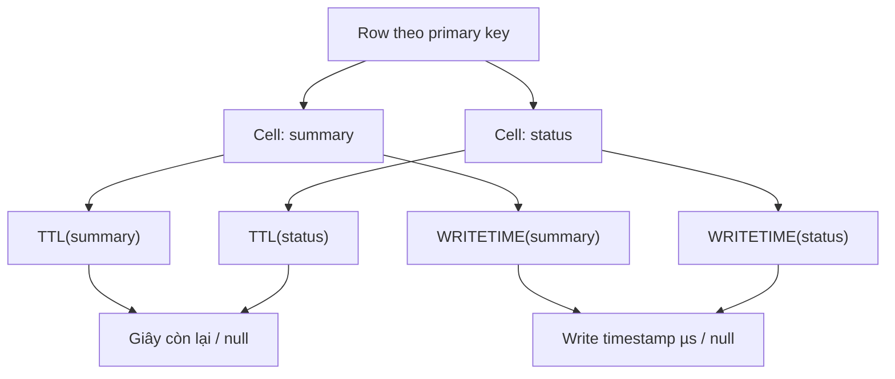
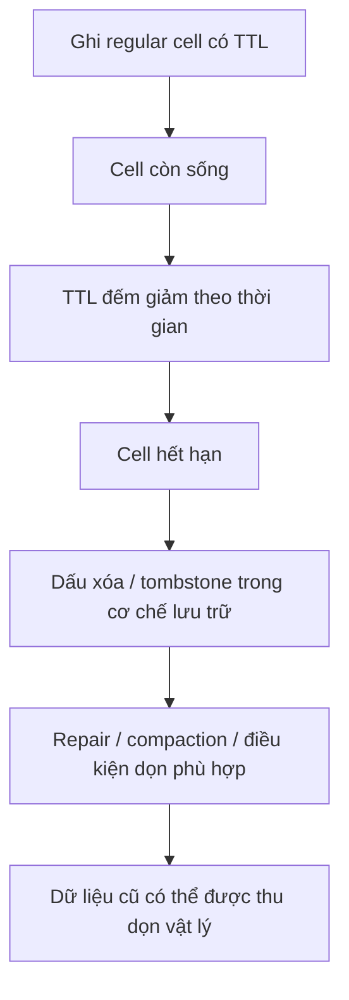

# Đọc TTL và WRITETIME để kiểm tra metadata

## Mục tiêu học tập

Trong **Apache Cassandra**, một hàng không chỉ gồm các giá trị nghiệp vụ. Mỗi giá trị được ghi còn gắn với thông tin về **thời điểm ghi ở mức microsecond** và, khi có chính sách hết hạn, **time-to-live (TTL)**. Hai hàm CQL `TTL(column)` và `WRITETIME(column)` giúp quan sát một phần metadata ấy ngay khi đọc dữ liệu.

Đối với **Spring Data Cassandra**, việc hiểu những hàm này đặc biệt hữu ích khi kiểm tra vì sao một trường biến mất sau khi ghi, vì sao các cột trong cùng hàng hết hạn vào thời điểm khác nhau, hoặc vì sao một thao tác ghi tưởng là mới nhưng không thắng dữ liệu cũ. Tuy nhiên, metadata đọc được **không phải nhật ký kiểm toán đầy đủ**, không cho biết ai đã ghi, không chứng minh dữ liệu đã được xóa vật lý và không thay thế việc theo dõi consistency, tombstone hay compaction.

Bài học thuộc chương **TTL và tombstone** của module `SPRING_DATA_CASSANDRA` — truy cập Cassandra qua entity mapping, repository, `CassandraTemplate` và CQL, đồng thời thiết kế bảng theo truy vấn, partition key, consistency, paging và kiểm soát hiệu năng của hệ phân tán.

Sau bài học, bạn có thể:

- Giải thích ý nghĩa và đơn vị của `TTL(column)` và `WRITETIME(column)`.
- Phân biệt **metadata của từng cell** với TTL hoặc “thời gian cập nhật” của toàn row/partition.
- Viết `SELECT` có alias, điều kiện khóa đúng schema và xử lý các trường hợp giá trị trả về `null`.
- Thực hành `INSERT ... USING TTL`, `UPDATE ... USING TTL` và quan sát TTL của những cột khác nhau.
- Diễn giải timestamp ghi theo microsecond mà **không mặc định nó phản ánh chính xác thứ tự request ngoài đời thực**.
- Đọc metadata bằng Java Driver/`CqlSession` và tổ chức mapping rõ ràng khi dùng Spring Data Cassandra.
- Phân biệt **hết TTL, tombstone, gc_grace_seconds, repair và compaction**.
- Thiết kế kiểm thử, câu truy vấn chẩn đoán và cơ chế lưu dấu nghiệp vụ an toàn.

## 1. TTL và WRITETIME không phải hai cột thông thường

Giả sử bảng lưu một sự kiện:

```text
event_id     : E-101
summary      : "Cảnh báo nhiệt độ"
status       : "NEW"
```

Trong Cassandra, một giá trị ở cột thường như `status` có thể đi kèm:

```text
status = "NEW"
  write timestamp : 1795595400000000 (microsecond; minh họa)
  TTL lúc ghi     : 3600 giây
  TTL còn lại     : giảm dần theo thời gian
```

Bạn không cần thêm cột `status_ttl` hay `status_written_at` vào schema chỉ để đọc metadata hệ thống của cell. CQL cung cấp hai selector:

```sql
TTL(status)
WRITETIME(status)
```

| Hàm | Kết quả thường gặp | Đơn vị | Dùng để hiểu điều gì? |
| --- | --- | --- | --- |
| `TTL(column)` | Số nguyên hoặc `null` | **Giây** | Thời gian sống **còn lại** của giá trị có TTL. |
| `WRITETIME(column)` | Số nguyên 64-bit hoặc `null` | **Microsecond (µs)** | Write timestamp gắn với giá trị được lưu. |

**Điểm cốt lõi:** hai hàm đọc metadata của **giá trị cột được chỉ định**, không trực tiếp trả một trường “TTL của cả hàng” hoặc một “updated_at của transaction”.

### Sơ đồ tư duy



Hai cột `summary` và `status` có thể được ghi vào những thời điểm khác nhau, với thời hạn sống khác nhau. Kết quả từ `TTL(summary)` và `TTL(status)` không bắt buộc bằng nhau.

## 2. Ví dụ xuyên suốt: sự kiện theo tenant, người dùng và ngày

Một ứng dụng cần lưu các sự kiện ngắn hạn, phục vụ API “xem sự kiện của người dùng trong một ngày”. Mỗi sự kiện có nội dung tóm tắt và trạng thái xử lý, hai trường có thể được cập nhật độc lập.

Schema CQL minh họa:

```sql
CREATE TABLE user_events_by_day (
    tenant_id uuid,
    user_id uuid,
    event_day date,
    event_at timestamp,
    event_id uuid,
    summary text,
    status text,
    PRIMARY KEY ((tenant_id, user_id, event_day), event_at, event_id)
) WITH CLUSTERING ORDER BY (event_at DESC, event_id ASC);
```

Trong schema:

- **Partition key:** `(tenant_id, user_id, event_day)`. Ba thành phần phải cùng được xác định để định tuyến truy vấn theo một partition.
- **Clustering columns:** `event_at DESC` và `event_id ASC`. Hai thành phần phân biệt các hàng trong partition.
- **Regular columns:** `summary` và `status`. Ta sẽ đọc metadata của hai cột này.

Việc bucket theo ngày có thể giảm độ lớn partition so với lưu toàn bộ sự kiện của một người dùng vào một partition vĩnh viễn. Nhưng nếu một người dùng phát sinh hàng triệu sự kiện mỗi ngày, vẫn cần đánh giá bucket theo giờ hoặc chia shard; thiết kế này chỉ là ví dụ có thể mở rộng theo workload.

### Vì sao không đọc bằng event_id đơn lẻ?

Trong schema trên, `event_id` chỉ là clustering column thứ hai. Để định vị **một hàng cụ thể**, query cung cấp toàn bộ khóa:

```sql
SELECT summary, status
FROM user_events_by_day
WHERE tenant_id = 11111111-1111-4111-8111-111111111111
  AND user_id = 22222222-2222-4222-8222-222222222222
  AND event_day = '2026-11-25'
  AND event_at = '2026-11-25T09:30:00Z'
  AND event_id = 33333333-3333-4333-8333-333333333333;
```

`TTL()` và `WRITETIME()` **không khắc phục điều kiện truy vấn thiếu partition key**. Chúng chỉ là các biểu thức trong danh sách kết quả của một câu `SELECT` vốn phải hợp lệ với Cassandra.

## 3. Ghi dữ liệu với TTL để quan sát metadata

Giả sử cần giữ một sự kiện trong khoảng một giờ. CQL:

```sql
INSERT INTO user_events_by_day (
    tenant_id, user_id, event_day,
    event_at, event_id, summary, status
) VALUES (
    11111111-1111-4111-8111-111111111111,
    22222222-2222-4222-8222-222222222222,
    '2026-11-25',
    '2026-11-25T09:30:00Z',
    33333333-3333-4333-8333-333333333333,
    'Cảnh báo nhiệt độ',
    'NEW'
) USING TTL 3600;
```

`USING TTL 3600` chỉ định một TTL **3.600 giây** cho dữ liệu có thể hết hạn được ghi bởi thao tác. Các thành phần primary key không được xem là những regular cells có TTL riêng để đọc qua `TTL(primary_key_column)`.

Tại một thời điểm ngay sau khi ghi, `summary` và `status` đều có thể còn gần 3.600 giây. Nhưng con số chính xác tùy lúc thực thi/read, cách tính thời gian và độ phân giải giây.

### Đọc TTL và WRITETIME

```sql
SELECT
    event_at,
    event_id,
    summary,
    status,
    TTL(summary) AS summary_ttl_seconds,
    WRITETIME(summary) AS summary_written_us,
    TTL(status) AS status_ttl_seconds,
    WRITETIME(status) AS status_written_us
FROM user_events_by_day
WHERE tenant_id = 11111111-1111-4111-8111-111111111111
  AND user_id = 22222222-2222-4222-8222-222222222222
  AND event_day = '2026-11-25'
  AND event_at = '2026-11-25T09:30:00Z'
  AND event_id = 33333333-3333-4333-8333-333333333333;
```

Tên sau `AS` là **alias của cột trong kết quả truy vấn**:

- `summary_ttl_seconds`: số giây còn lại của `summary`.
- `summary_written_us`: write timestamp của `summary`, tính bằng µs.
- `status_ttl_seconds` và `status_written_us`: metadata tương tự của `status`.

Một kết quả có thể mang ý nghĩa như sau:

| Cột kết quả | Giá trị minh họa |
| --- | --- |
| `summary` | `Cảnh báo nhiệt độ` |
| `summary_ttl_seconds` | `3578` |
| `summary_written_us` | Một số 64-bit tính bằng µs. |
| `status` | `NEW` |
| `status_ttl_seconds` | `3578` |
| `status_written_us` | Một số 64-bit tính bằng µs. |

**Đây không phải output được đo từ một cluster đang chạy.** Sau vài giây, TTL trả về thường giảm. Kiểm thử không nên so khớp chính xác một giá trị như `3600` vào thời điểm đọc.

### Câu SELECT có thể trả không có hàng

Nếu toàn bộ giá trị hữu ích của hàng đã hết hạn và không còn dữ liệu sống tạo thành hàng logic có thể đọc, câu `SELECT` có thể không trả hàng. Khi đó không có metadata để đọc tiếp.

Không thể suy ra rằng “không thấy hàng” đồng nghĩa “hàng chưa từng được ghi”. Nó cũng có thể đã được ghi rồi hết TTL hoặc bị xóa.

## 4. TTL là thời gian **còn lại**, không phải TTL ban đầu

Nếu lúc ghi dùng `TTL 3600`, rồi sau khoảng 10 phút đọc:

```text
TTL lúc ghi           : 3600 giây
Thời gian đã trôi qua : khoảng 600 giây
TTL(column) khi đọc   : khoảng 3000 giây
```

Hàm `TTL(column)` không trả con số “3600” vĩnh viễn. Nó phản ánh thời gian sống còn lại tại lúc đọc theo cách Cassandra xử lý TTL.

### Phân biệt ba đại lượng thời gian

| Đại lượng | Mục đích | Cách có được |
| --- | --- | --- |
| **Original TTL** | Chính sách giữ dữ liệu khi ghi: giữ 1 giờ, 7 ngày... | Cấu hình nghiệp vụ, tham số ghi hoặc default TTL của bảng. |
| **Remaining TTL** | Còn bao nhiêu giây trước khi giá trị hết hạn. | `TTL(column)` tại thời điểm query. |
| **Write timestamp** | Timestamp được dùng để phân giải cập nhật của giá trị. | `WRITETIME(column)`, tính bằng microsecond. |

Không được viết nghiệp vụ như sau:

```java
// Sai cách suy luận:
// originalTtlSeconds = row.getInt("summary_ttl_seconds");
```

vì giá trị trả về đã giảm theo thời gian. Nếu cần biết “chính sách lưu 7 ngày” để hiển thị hoặc đối soát, hãy lưu policy trong cấu hình nghiệp vụ hoặc một trường metadata riêng do ứng dụng kiểm soát.

### TTL có độ phân giải giây

`TTL(column)` trả về số giây, không phải đồng hồ đếm ngược với độ chính xác microsecond. Vì thế:

- Hai lần query cách nhau một khoảng rất ngắn có thể trả cùng số.
- Giá trị có thể nhỏ hơn TTL ban đầu chỉ vài giây ngay sau khi ghi.
- Không dùng nó như đồng hồ chính xác để lập lịch gọi API “đúng microsecond cuối cùng”.
- Kiểm thử nên dùng khoảng giá trị và điều kiện hết hạn, không dùng giá trị tuyệt đối dễ gây flaky test.

## 5. Cùng một row, các cột có TTL khác nhau

Một nhầm lẫn phổ biến: **“Đã đặt TTL cho row rồi thì mọi lần update đều giữ cùng ngày hết hạn.”**

Trong Cassandra, dữ liệu regular column được cập nhật theo từng cell. Ví dụ sau khi insert sự kiện có `TTL 3600`, application chỉ đổi trạng thái và muốn trạng thái mới sống 10 phút:

```sql
UPDATE user_events_by_day
USING TTL 600
SET status = 'ACKNOWLEDGED'
WHERE tenant_id = 11111111-1111-4111-8111-111111111111
  AND user_id = 22222222-2222-4222-8222-222222222222
  AND event_day = '2026-11-25'
  AND event_at = '2026-11-25T09:30:00Z'
  AND event_id = 33333333-3333-4333-8333-333333333333;
```

Khi đó:

```text
summary:
  Được viết bởi INSERT ban đầu
  TTL còn lại: khoảng 3600 giây trừ thời gian đã trôi
  WRITETIME: timestamp của lần INSERT

status:
  Được viết lại bởi UPDATE sau
  TTL còn lại: khoảng 600 giây trừ thời gian đã trôi từ UPDATE
  WRITETIME: timestamp của lần UPDATE (theo quy tắc timestamp)
```

Nếu gọi lại câu `SELECT` có bốn metadata selector:

| Biểu thức | Kết quả mong đợi về ý nghĩa |
| --- | --- |
| `TTL(summary)` | Còn thời gian của cell `summary` từ lần ghi cũ. |
| `TTL(status)` | Còn thời gian của cell `status` từ lần ghi mới. |
| `WRITETIME(summary)` | Timestamp của phiên bản `summary` đang có hiệu lực. |
| `WRITETIME(status)` | Timestamp của phiên bản `status` được cập nhật. |

Kết quả hai TTL khác nhau **không nhất thiết là lỗi**. Có thể đó chính là hệ quả của việc ghi riêng từng cột.

### Sau khi status hết TTL

Khi 10 phút trôi qua và `status` hết hạn:

- `status` không còn được trả như một giá trị sống.
- `summary` vẫn có thể còn tồn tại.
- `TTL(status)` và `WRITETIME(status)` không còn là cách đọc lại lịch sử của giá trị đã hết hạn.
- Hàng có thể tiếp tục hiện diện logic vì các cell khác còn sống.

Hãy kiểm tra **các cột được chọn**, không suy ra “TTL của cả sự kiện = TTL(status)”.

## 6. Điều gì xảy ra khi ghi mới đè lên một cell?

Một thao tác UPDATE/INSERT dạng upsert trong Cassandra có thể tạo phiên bản giá trị mới cho cell. TTL và write timestamp quan sát được là của **phiên bản giá trị thắng theo quy tắc Cassandra**, không phải một danh sách các lần ghi trước đó.

Ví dụ:

```sql
UPDATE user_events_by_day
USING TTL 1200
SET summary = 'Cảnh báo đã xử lý'
WHERE tenant_id = 11111111-1111-4111-8111-111111111111
  AND user_id = 22222222-2222-4222-8222-222222222222
  AND event_day = '2026-11-25'
  AND event_at = '2026-11-25T09:30:00Z'
  AND event_id = 33333333-3333-4333-8333-333333333333;
```

Sau ghi thành công và khi ghi này là phiên bản thắng, `TTL(summary)` có thể gần 1.200 giây, còn `WRITETIME(summary)` phản ánh timestamp tương ứng với phiên bản mới.

**Một cột không có cả “TTL cũ” và “TTL mới” để SELECT cùng lúc** như một bảng lịch sử. Muốn biết các lần chỉnh sửa trước, cần audit/event log riêng.

### Update không kèm USING TTL

Nếu cột được ghi lại mà không có TTL tường minh, cách áp dụng TTL mới còn phụ thuộc cấu hình `default_time_to_live` của bảng và ngữ nghĩa của thao tác. Không nên mặc định cell tự kế thừa số giây còn lại từ phiên bản trước.

Đặc biệt, khi sử dụng ORM/repository:

- Một câu `save(entity)` có thể ghi nhiều regular columns.
- Câu `UPDATE` chỉ đổi một field có phạm vi ảnh hưởng khác.
- Một số mapping/option của Spring Data có thể đặt TTL khi ghi.
- Trạng thái `null` trên một field có thể dẫn đến thao tác xóa cell/tombstone tùy cách tạo CQL.

Vì vậy hãy đối chiếu **CQL được phát ra thực tế**, không chỉ dựa vào tên phương thức `save()` hoặc `update()`.

## 7. Khi nào TTL(column) trả về null?

`TTL(column)` không phải lúc nào cũng là một số nguyên. Các trường hợp quan trọng:

| Trạng thái của cột | Giá trị/metadata quan sát |
| --- | --- |
| Cell đang sống và có TTL | `TTL(column)` là số giây còn lại. |
| Cell đang sống nhưng **không có TTL** | `TTL(column)` thường là `null`. |
| Regular column chưa từng có giá trị trong hàng này | Giá trị cột là `null`; metadata cũng không có giá trị sống để trả. |
| Cell đã hết hạn TTL | Cell không còn được quan sát như giá trị sống; metadata đọc thường là `null` hoặc hàng không còn xuất hiện. |
| Cell bị DELETE | Không thể dùng `TTL(column)` để xem lại lịch sử tombstone như một record bình thường. |

**`TTL(column) = null` không có nghĩa chắc chắn “dữ liệu sống vĩnh viễn”.**

Muốn kết luận không có TTL, tối thiểu phải xác định rằng **cột đang có giá trị sống** và kết quả thật sự đến từ cột ấy. Nếu giá trị cột là `null`, bạn không thể từ metadata phân biệt chắc chắn “chưa từng ghi”, “đã xóa” hay “đã hết TTL”.

### Phản ví dụ về kiểm tra sai

```java
// Sai nếu dùng làm quyết định:
// if (ttl == null) {
//     return "Giá trị này không bao giờ hết hạn";
// }
```

Cách diễn giải an toàn hơn:

```text
value != null && ttl == null
  -> Giá trị đang sống không thể hiện TTL trong lần đọc này.

value != null && ttl != null
  -> Giá trị đang sống với remaining TTL được báo.

value == null
  -> Không đủ metadata SELECT để chứng minh nguyên nhân vắng mặt.
```

### TTL 0 và không có TTL

Trong ngữ cảnh cấu hình/ghi, `TTL 0` có ngữ nghĩa đặc biệt liên quan việc không áp dụng thời hạn sống cho giá trị được ghi, và tương tác với table default TTL theo phiên bản. **Đừng đánh đồng “USING TTL 0” trong statement với kết quả “TTL(column) = 0” khi đọc.**

Để xác nhận tác động chính xác của `TTL 0` trong dự án, thử trên Cassandra phiên bản thực tế và kiểm tra cả cấu hình `default_time_to_live`. Khi giá trị đang sống không có thời gian hết hạn, `TTL(column)` có thể là `null`; đó không phải một lời hứa ghi metadata TTL = 0 vào cell.

## 8. WRITETIME(column) trả về microsecond và ý nghĩa của nó

`WRITETIME(column)` trả write timestamp gắn với phiên bản dữ liệu của cell. Kết quả thường là một số nguyên 64-bit, **tính bằng microsecond**.

Ví dụ:

```sql
SELECT
    status,
    WRITETIME(status) AS status_written_us
FROM user_events_by_day
WHERE tenant_id = 11111111-1111-4111-8111-111111111111
  AND user_id = 22222222-2222-4222-8222-222222222222
  AND event_day = '2026-11-25'
  AND event_at = '2026-11-25T09:30:00Z'
  AND event_id = 33333333-3333-4333-8333-333333333333;
```

Nếu kết quả là số `long`, đừng xử lý như một Unix timestamp **millisecond**:

```text
Unix milliseconds:  khoảng 13 chữ số ở thời điểm hiện đại.
Unix microseconds :  khoảng 16 chữ số ở thời điểm hiện đại.

1 giây = 1.000 millisecond = 1.000.000 microsecond.
```

### Chuyển WRITETIME sang Instant trong Java

Với timestamp microsecond có ý nghĩa theo epoch time, có thể chuyển thành `Instant` bằng cách tách giây và phần microsecond còn lại:

```java
import java.time.Instant;

public final class CassandraTimeUtil {
    private CassandraTimeUtil() {}

    public static Instant fromMicroseconds(long micros) {
        long seconds = Math.floorDiv(micros, 1_000_000L);
        long microsPart = Math.floorMod(micros, 1_000_000L);
        return Instant.ofEpochSecond(seconds, microsPart * 1_000L);
    }
}
```

`Math.floorDiv` và `Math.floorMod` xử lý nhất quán cả timestamp âm (trước epoch), khác một số cách chia số nguyên thủ công. **Không** truyền nguyên `micros` vào `Instant.ofEpochMilli(...)` vì sẽ sai đơn vị.

### WRITETIME không phải event_at

Bảng minh họa có cột:

```sql
event_at timestamp
```

`event_at` là **thời điểm sự kiện do nghiệp vụ quyết định**, còn `WRITETIME(status)` là **timestamp ghi của cell status**.

Một event xảy ra lúc 09:30 có thể được ghi vào Cassandra lúc 09:35, rồi trạng thái được cập nhật lúc 10:00. Vì vậy:

```text
event_at          : 09:30  (thời điểm sự kiện)
WRITETIME(summary): 09:35  (thời điểm ghi theo timestamp)
WRITETIME(status) : 10:00  (thời điểm ghi status theo timestamp)
```

Giá trị `event_at` không tự thay đổi khi application cập nhật `status`. Ngược lại, `WRITETIME(status)` có thể đổi sau khi ghi cell status.

## 9. USING TIMESTAMP: WRITETIME có thể khác đồng hồ thật

Cassandra sử dụng timestamp cho quy tắc phân giải cập nhật kiểu **last-write-wins**. Application hoặc driver có thể chỉ định timestamp ghi.

Ví dụ CQL minh họa:

```sql
UPDATE user_events_by_day
USING TIMESTAMP 1700000000000000
SET status = 'IMPORTED'
WHERE tenant_id = 11111111-1111-4111-8111-111111111111
  AND user_id = 22222222-2222-4222-8222-222222222222
  AND event_day = '2026-11-25'
  AND event_at = '2026-11-25T09:30:00Z'
  AND event_id = 33333333-3333-4333-8333-333333333333;
```

`1700000000000000` là một **timestamp cố định phục vụ minh họa**, không phải thời gian của ngày sự kiện ở ví dụ. Nếu UPDATE này trở thành phiên bản thắng, `WRITETIME(status)` có thể phản ánh timestamp đó, dù câu lệnh được gửi vào một ngày khác.

**Cảnh báo:** vì Cassandra dùng timestamp để giải quyết xung đột, một UPDATE mang timestamp quá cũ có thể **không thắng** giá trị hiện tại; timestamp quá xa trong tương lai có thể làm các ghi bình thường sau đó khó ghi đè. Không sử dụng những câu thử `USING TIMESTAMP` này trên dữ liệu production.

### Vì sao WRITETIME không đủ cho audit?

`WRITETIME(column)` không cho biết:

- Client hay người dùng nào đã thực hiện ghi.
- Câu lệnh đến HTTP service vào lúc nào.
- Coordinator đã phản hồi cho client vào lúc nào.
- Một write đã bị retry bao nhiêu lần.
- Ghi từ bảng/hệ thống nguồn nào.
- Toàn bộ thứ tự nghiệp vụ giữa các thay đổi.

Nếu timestamp được app cấp khác clock thực, dữ liệu đã replay/backfill hoặc các client lệch đồng hồ, write timestamp càng không thể là nguồn audit duy nhất.

Để có lịch sử kiểm toán, hãy xây **audit event** hoặc một quy trình lưu thay đổi riêng với operation ID, actor, thời điểm ứng dụng và ngữ cảnh nghiệp vụ, thay vì “đọc WRITETIME để biết ai sửa cuối”.

## 10. Cột nào có thể dùng TTL và WRITETIME?

Các hàm CQL metadata chủ yếu được dùng trên **regular columns** có giá trị được lưu như cell, và trong những trường hợp được phiên bản Cassandra hỗ trợ với loại cột cụ thể.

### Các trường hợp nên tránh

```sql
-- Không dùng TTL/WRITETIME lên primary key theo cách đọc metadata cell:
-- SELECT TTL(tenant_id), WRITETIME(event_id)
-- FROM user_events_by_day
-- WHERE ...;

-- Counter có ngữ nghĩa dữ liệu riêng, không phải cột
-- có thể áp dụng TTL hoặc WRITETIME như regular column:
-- SELECT TTL(total_counter), WRITETIME(total_counter) FROM ...;
```

Thường không thể áp dụng `TTL()`/`WRITETIME()` lên **primary-key columns** hoặc **counter columns** như regular columns; Cassandra sẽ từ chối các dạng không được hỗ trợ.

### Cột collection và kiểu phức hợp

Các cột `list`/`set`/`map` có thể được lưu với cấu trúc nhiều cell, tùy frozen/non-frozen và cách ghi. Các biểu thức metadata áp dụng trên collection hoặc từng phần tử có **giới hạn và cú pháp khác nhau theo phiên bản/kiểu**. Không giả định:

```sql
-- Minh họa điều KHÔNG nên mặc định:
-- TTL(my_map) hay WRITETIME(my_list)
-- luôn trả một metadata duy nhất cho toàn collection.
```

Nếu dữ liệu cần TTL riêng cho từng phần tử hoặc cần đo write timestamp của collection, hãy kiểm tra tài liệu CQL của version đang chạy và viết integration test với schema đó. Trong bài học này, các ví dụ thực thi dùng **hai cột text thông thường** để tránh nhập nhằng.

## 11. TTL mặc định của bảng và TTL được đặt khi ghi

Cassandra có tùy chọn schema `default_time_to_live` để áp dụng TTL mặc định cho dữ liệu phù hợp được ghi vào bảng khi không có override.

Ví dụ bảng độc lập minh họa chính sách giữ dữ liệu 24 giờ:

```sql
CREATE TABLE transient_notices_by_id (
    notice_id uuid PRIMARY KEY,
    message text,
    state text
) WITH default_time_to_live = 86400;
```

Nếu ghi:

```sql
INSERT INTO transient_notices_by_id (notice_id, message, state)
VALUES (
    44444444-4444-4444-8444-444444444444,
    'Cảnh báo hệ thống',
    'ACTIVE'
);
```

thì với schema và ngữ nghĩa TTL phù hợp, các regular cells được ghi sẽ chịu TTL mặc định của bảng. Khi đọc:

```sql
SELECT message,
       TTL(message) AS message_ttl,
       WRITETIME(message) AS message_written_us
FROM transient_notices_by_id
WHERE notice_id = 44444444-4444-4444-8444-444444444444;
```

`message_ttl` cho thấy **remaining TTL**, nhưng không nói rõ TTL xuất phát từ:

- `USING TTL` của câu lệnh.
- `default_time_to_live` của schema.
- Một cấu hình ghi thông qua Spring Data.

Để xác định **nguồn của chính sách**, phải kiểm tra schema và đường ghi. Các hàm đọc metadata không cho lịch sử cách áp dụng TTL.

### Điều đáng chú ý khi sửa default TTL

Thay `default_time_to_live` của bảng không đồng nghĩa tự thay TTL của **mọi phiên bản cell đã được ghi từ trước**. Các thay đổi sau đó ở các cột cần được hiểu theo thời điểm ghi, tùy chọn thực tế và version Cassandra.

Do vậy:

1. Kiểm tra giá trị TTL cũ ở môi trường thử nghiệm.
2. Thử ghi mới sau thay đổi schema.
3. Thử cập nhật một cột đã có dữ liệu.
4. So sánh `TTL(column)` và `WRITETIME(column)` theo từng bước.
5. Tránh khẳng định việc sửa cấu hình bảng đã “gia hạn” toàn bộ dữ liệu cũ.

## 12. Hết TTL, tombstone và việc dọn dữ liệu vật lý

TTL là cơ chế **hết hạn logic** của dữ liệu sau một khoảng thời gian. Cassandra không nhất thiết xóa byte của giá trị khỏi mọi SSTable đúng giây TTL bằng 0.



### Phân biệt ba mốc

| Mốc | Điều xảy ra | `TTL()/WRITETIME()` nói được gì? |
| --- | --- | --- |
| **Cell còn sống** | Giá trị còn có thể được trả về. | Có thể đọc remaining TTL/write timestamp. |
| **Cell hết hạn hoặc bị xóa** | Không còn là dữ liệu sống cho kết quả đọc. | Không còn metadata sống để tái dựng lịch sử cell đó. |
| **Compaction dọn vật lý** | Dữ liệu cũ có thể bị loại khỏi SSTable theo điều kiện an toàn. | Hai hàm SELECT không cho biết mọi byte đã biến mất. |

**Tombstone** giúp các replica nhận biết dữ liệu đã bị xóa hoặc hết hạn trong hệ phân tán. Dấu xóa có thể phải được giữ lại đủ lâu để tránh replica chứa dữ liệu cũ làm dữ liệu xuất hiện trở lại (*zombie data*) khi quá trình repair không phù hợp.

### gc_grace_seconds không phải đồng hồ xóa dữ liệu

Tùy chọn `gc_grace_seconds` của bảng liên quan đến thời gian an toàn và khả năng thu dọn tombstone theo cơ chế Cassandra. Nó **không** nghĩa là:

```text
TTL = 3600 giây
gc_grace_seconds = 864000 giây

=> chắc chắn byte sẽ bị dọn chính xác vào
   thời điểm ghi + 3600 + 864000.
```

Compaction, trạng thái replica, repair, loại tombstone và cấu hình lưu trữ còn ảnh hưởng kết quả. **Không tự ý giảm gc_grace_seconds xuống 0 chỉ để lấy lại dung lượng nhanh** khi chưa đánh giá rủi ro phục hồi dữ liệu cũ.

### Read path sau khi hết TTL

Một query đọc có thể phải xử lý nhiều tombstone để tìm đủ hàng đang sống, ngay cả khi CQL có `LIMIT 20`. Vì vậy chính sách TTL dày đặc trong một partition lớn có thể tác động latency, CPU, I/O và compaction.

`TTL(column)` hữu ích để **chẩn đoán thời hạn sống còn lại**, nhưng không thể thay thế metrics tombstone, dung lượng SSTable và giám sát compaction/repair.

## 13. Đọc metadata bằng CqlSession do Spring quản lý

Từ Java, một cách rõ ràng để truy cập hai biểu thức metadata là dùng **prepared CQL** thông qua `CqlSession` được Spring inject.

Để không lẫn kiểu trả về metadata với entity nghiệp vụ, ví dụ định nghĩa DTO riêng:

```java
import java.time.Instant;
import java.time.LocalDate;
import java.util.Optional;
import java.util.UUID;

import com.datastax.oss.driver.api.core.CqlSession;
import com.datastax.oss.driver.api.core.cql.PreparedStatement;
import com.datastax.oss.driver.api.core.cql.Row;

public final class EventCellMetadataReader {

    public record CellMetadata(Integer ttlSeconds, Long writeTimeMicros) {
        public Optional<Instant> writeTimeAsInstant() {
            if (writeTimeMicros == null) {
                return Optional.empty();
            }
            long seconds = Math.floorDiv(writeTimeMicros, 1_000_000L);
            long remainder = Math.floorMod(writeTimeMicros, 1_000_000L);
            return Optional.of(
                    Instant.ofEpochSecond(seconds, remainder * 1_000L));
        }
    }

    public record EventDiagnostics(
            String summary,
            CellMetadata summaryMetadata,
            String status,
            CellMetadata statusMetadata) {
    }

    private final CqlSession session;
    private final PreparedStatement readMetadata;

    public EventCellMetadataReader(CqlSession session) {
        this.session = session;
        this.readMetadata = session.prepare("""
            SELECT summary,
                   TTL(summary) AS summary_ttl_seconds,
                   WRITETIME(summary) AS summary_written_us,
                   status,
                   TTL(status) AS status_ttl_seconds,
                   WRITETIME(status) AS status_written_us
            FROM user_events_by_day
            WHERE tenant_id = ?
              AND user_id = ?
              AND event_day = ?
              AND event_at = ?
              AND event_id = ?
            """);
    }

    public Optional<EventDiagnostics> find(
            UUID tenantId,
            UUID userId,
            LocalDate eventDay,
            Instant eventAt,
            UUID eventId) {

        Row row = session.execute(readMetadata.bind(
                tenantId, userId, eventDay, eventAt, eventId)).one();

        if (row == null) {
            return Optional.empty();
        }

        return Optional.of(new EventDiagnostics(
                row.getString("summary"),
                cell(row, "summary_ttl_seconds", "summary_written_us"),
                row.getString("status"),
                cell(row, "status_ttl_seconds", "status_written_us")
        ));
    }

    private static CellMetadata cell(
            Row row, String ttlColumn, String writeTimeColumn) {

        Integer ttl = row.isNull(ttlColumn)
                ? null : row.getInt(ttlColumn);

        Long writeTime = row.isNull(writeTimeColumn)
                ? null : row.getLong(writeTimeColumn);

        return new CellMetadata(ttl, writeTime);
    }
}
```

Đây là ví dụ cho **Java 17+ và Java Driver 4.x** với các giả định: bảng tồn tại trong keyspace đang dùng, session được Spring quản lý, và codec cho `UUID`/`LocalDate`/`Instant` được driver hỗ trợ.

### Điểm quan trọng trong code

1. Prepared statement được tạo một lần theo vòng đời reader.
2. Các giá trị khóa được **bind**, không nối trực tiếp vào CQL.
3. Query cung cấp đầy đủ partition key và clustering columns để định vị đúng một hàng.
4. Dùng `row.isNull(...)` **trước khi** gọi getter primitive `getInt`/`getLong`.
5. DTO tách riêng metadata khỏi các thuộc tính entity nghiệp vụ.
6. Việc chuyển microsecond thành `Instant` giữ đúng đơn vị và xử lý cả giá trị âm.
7. Không gọi `session.close()` ở mỗi request vì session thuộc vòng đời Spring context.

**Lưu ý:** chuẩn bị statement trong constructor đòi hỏi schema và kết nối Cassandra đã sẵn sàng ở thời điểm bean được tạo. Trong production cần quy trình migration/schema readiness phù hợp, hoặc chiến lược prepare được kiểm soát.

### Vì sao cần isNull trước getLong?

Getter của kiểu nguyên thủy không tự giúp phân biệt hai trường hợp:

```text
WRITETIME(status) = null
WRITETIME(status) = 0
```

Nếu dùng thẳng `getLong(...)` rồi đưa vào business logic mà không kiểm tra `isNull`, bạn có thể đánh mất ngữ nghĩa “không có metadata”. Với TTL cũng tương tự: **null không phải luôn là 0 giây còn lại**.

## 14. Spring Data Cassandra: repository, @Query và kết quả metadata

Một repository theo entity giúp đọc/ghi dữ liệu nghiệp vụ:

```java
import org.springframework.data.cassandra.repository.CassandraRepository;

public interface UserEventRepository
        extends CassandraRepository<UserEvent, UserEventKey> {
}
```

Trong đó `UserEvent` và `UserEventKey` là các entity/key class được ánh xạ theo bảng `user_events_by_day` (cần định nghĩa trong dự án). Repository cung cấp API tốt cho các thao tác theo ID, nhưng:

**`findById(...)` thông thường trả entity, không tự thêm những giá trị `TTL(column)`/`WRITETIME(column)` vào object.**

### @Query có thể SELECT metadata

Trong Spring Data Cassandra, có thể biểu đạt ý định đọc metadata bằng `@Query`:

```java
import org.springframework.data.cassandra.repository.Query;

// Phương thức minh họa đặt trong repository thích hợp.
@Query("""
    SELECT summary, status,
           TTL(summary) AS summary_ttl_seconds,
           WRITETIME(summary) AS summary_written_us,
           TTL(status) AS status_ttl_seconds,
           WRITETIME(status) AS status_written_us
    FROM user_events_by_day
    WHERE tenant_id = ?0
      AND user_id = ?1
      AND event_day = ?2
      AND event_at = ?3
      AND event_id = ?4
    """)
// Chọn kiểu trả về/projection có ánh xạ metadata được xác minh
// trên phiên bản Spring Data Cassandra thực tế.
```

Đoạn minh họa trên chỉ là **phần CQL/annotation**, không phải một declaration Java hoàn chỉnh; vì việc materialize `TTL(...)` và `WRITETIME(...)` thành DTO phụ thuộc khả năng projection và mapping của phiên bản Spring Data Cassandra đang dùng.

Nếu một entity chỉ khai báo:

```java
@Column("status")
private String status;
```

thì Spring Data không tự biết phải gán `status_written_us` vào một thuộc tính nào đó. Alias của câu SELECT là **tên cột kết quả**, không phải tự động mở rộng schema entity.

### Chọn API theo hợp đồng kết quả

| Nhu cầu | Hướng tiếp cận |
| --- | --- |
| Đọc/ghi entity theo primary key | Repository hoặc `CassandraTemplate`. |
| Đọc metadata một cột, muốn kiểm soát tên alias và kiểu trả về | `CqlTemplate` với RowMapper hoặc `CqlSession` trực tiếp. |
| Dùng `@Query` trả DTO/projection | Kiểm tra hỗ trợ mapping theo phiên bản bằng integration test. |
| Phân tích timestamp/TTL với nhiều cột | Một query chọn rõ các biểu thức và mapper tường minh. |
| Đọc lịch sử các lần thay đổi trước | Thiết kế audit/event table riêng; `WRITETIME` không phải audit log. |

Không nên tạo một entity lưu “metadata cũ” bằng cách giả định mọi alias trả về chính là một cột CQL có thể ghi ngược.

## 15. Hai cách dùng timestamp: write metadata và thời điểm nghiệp vụ

Trong một số hệ thống, nghiệp vụ yêu cầu:

> “Hiển thị ngày hết hạn của sự kiện, và ai đã thay đổi trạng thái cuối cùng.”

`TTL(status)` và `WRITETIME(status)` chỉ giải đáp được **một phần**, và không đủ để đáp ứng yêu cầu đầy đủ.

### Muốn hiển thị ngày hết hạn

Nếu hệ thống cần trường `expires_at` ổn định trong UI, nên cân nhắc lưu một **thời điểm hết hạn nghiệp vụ** riêng hoặc suy ra từ policy được kiểm soát tại tầng ghi.

Không nên dựa duy nhất vào phép cộng:

```text
expires_at = WRITETIME(status) + TTL(status)
```

vì:

- `WRITETIME` là write timestamp (µs), `TTL` là **thời gian còn lại** (giây), không phải TTL ban đầu.
- Hai giá trị được đọc tại một thời điểm có thể không đại diện cho cùng phép cộng tạo expiration date ban đầu.
- Timestamp có thể do client cấp hoặc lệch đồng hồ.
- Metadata có thể là null; cell có thể đã bị ghi đè hoặc hết hạn.

Một API hiển thị hạn sử dụng nên có **hợp đồng dữ liệu rõ ràng**, ví dụ `expiresAt` do service tính khi phát hành dữ liệu, cùng quy tắc TTL được áp dụng nhất quán. Khi cần chính xác theo server, còn phải đánh giá clock skew và cách Cassandra xử lý expiration.

### Muốn biết ai thay đổi cuối cùng

`WRITETIME(status)` không lưu actor. Hãy tạo audit record có:

- `operation_id` để nhận diện và chống xử lý lặp.
- `actor_id` hoặc principal đã được xác thực.
- Thời điểm nghiệp vụ và thời điểm service ghi nhận.
- Giá trị/trạng thái cũ-mới nếu chính sách dữ liệu cho phép.
- Kết quả áp dụng hoặc lý do conflict.

Để phục vụ tra cứu audit, bảng audit cũng cần được thiết kế theo truy vấn và partition key phù hợp, không tự dựa vào `WRITETIME` của hàng hiện tại.

## 16. Tính nhất quán và cập nhật đồng thời

Cassandra dùng replication và configurable consistency levels. Một lần đọc:

```text
SELECT status, TTL(status), WRITETIME(status) ...
```

sẽ trả metadata tương ứng với **giá trị/phiên bản được quan sát** theo cách request và replica được xử lý. Nhưng kết quả đó không bảo đảm rằng các request khác đã ngừng ghi hoặc không có phiên bản mới hơn ở một replica chưa được quan sát trong mọi điều kiện.

### Quorum không biến WRITETIME thành trình tự tuyệt đối

Giả sử:

```text
Client A: UPDATE status='A' với timestamp=2000000
          -> QUORUM trả thành công

Client B: UPDATE status='B' với timestamp=1000000
          -> đến sau, cũng được QUORUM xác nhận

Client C: SELECT status, WRITETIME(status)
          -> có thể thấy status='A' và timestamp=2000000
```

Do **last-write-wins theo timestamp**, ghi có timestamp lớn hơn có thể thắng ngay cả khi request khác gửi sau về thời gian thực. Điều kiện giao quorum `R + W > RF` không tự tạo linearizability hay một lịch sử thay đổi được sắp theo thời gian thực.

**Ứng dụng cần kiểm soát phiên bản và điều kiện nghiệp vụ** nếu yêu cầu “chỉ đổi status khi nó đang là NEW”, ví dụ dùng câu lệnh điều kiện `UPDATE ... IF status = 'NEW'`/LWT khi phù hợp, không dựa vào việc quan sát WRITETIME rồi gửi update thường.

### Read-then-write không phải compare-and-set

Quy trình:

```text
1. SELECT WRITETIME(status)
2. Kiểm tra timestamp đọc được có khớp dự kiến
3. UPDATE status = 'ACKNOWLEDGED'
```

là **hai thao tác tách biệt** nếu bước 3 không mang điều kiện nguyên tử. Writer khác có thể cập nhật giữa bước 1 và 3. Đọc WRITETIME để tự làm optimistic locking ở Java **không tự an toàn**.

## 17. Hiệu năng: chỉ đọc metadata theo đường truy vấn hợp lệ

Hàm `TTL()` và `WRITETIME()` chạy trong `SELECT`; chúng không phải một index để tìm toàn bộ các hàng sắp hết hạn.

### Truy vấn phù hợp

```sql
SELECT summary, TTL(summary), WRITETIME(summary)
FROM user_events_by_day
WHERE tenant_id = 11111111-1111-4111-8111-111111111111
  AND user_id = 22222222-2222-4222-8222-222222222222
  AND event_day = '2026-11-25'
LIMIT 20;
```

Query chỉ định đủ partition key, đọc các hàng trong một bucket và giới hạn kết quả. Nó có thể hữu ích cho một màn hình debug hoặc tác vụ vận hành với scope nhỏ.

### Truy vấn không nên dựa vào

```sql
-- Không có đường tìm toàn bảng theo TTL như một index mặc định:
-- SELECT * FROM user_events_by_day
-- WHERE TTL(status) < 300;

-- Không thể sửa thiếu partition key bằng:
-- SELECT * FROM user_events_by_day
-- WHERE user_id = ?
-- ALLOW FILTERING;
```

Nếu nghiệp vụ thường xuyên cần “lấy tất cả sự kiện hết hạn trong năm phút tới”, cần thiết kế **bảng theo thời gian hết hạn/bucket**, một job quét được giới hạn, hoặc chính sách TTL tự hết hạn; không xem `TTL(column)` như cột được index để truy vấn toàn cluster.

### Vận hành cần đo những gì?

| Yếu tố | Điều phải quan sát |
| --- | --- |
| **Partition size** | Tenant/user/day có bao nhiêu event? Có cần bucket theo giờ? |
| **TTL churn** | Tần suất ghi và hết hạn tạo tombstone ra sao? |
| **Read latency** | Query SELECT metadata có chậm ở partition lớn không? |
| **Tombstone scanning** | Có nhiều dấu xóa làm LIMIT vẫn đắt không? |
| **Consistency** | Read CL và replication có phù hợp mục tiêu quan sát không? |
| **Paging** | Job có vô tình tải hết partition vào memory không? |
| **Repair/compaction** | Hàng đã hết hạn được xử lý an toàn thế nào? |

Một query có `LIMIT 20` không tự bảo đảm Cassandra chỉ xử lý đúng 20 cell sống; nếu có nhiều tombstone, đường đọc vẫn có thể tốn tài nguyên.

## 18. Paging và việc đọc TTL nhiều lần

Khi một repository trả `Slice<T>` hoặc một job dùng paging state, các trang được đọc ở **những thời điểm khác nhau**. Vì vậy:

- `TTL(column)` của cùng một cell có thể giảm giữa các lần đọc.
- Một cell có thể còn sống ở trang trước nhưng hết hạn trước khi trang sau được tải.
- Một writer khác có thể đổi `WRITETIME(column)` giữa hai lần gọi.
- Paging state không tạo snapshot transaction bất biến.
- Mỗi bucket ngày là một partition có context truy vấn riêng.

Không dùng:

```text
TTL của record A tại 09:00
so trực tiếp với
TTL của record B tại 09:10
```

để suy ra ngày hết hạn nào đến trước **nếu không có quy tắc đồng bộ thời gian và metadata nghiệp vụ rõ ràng**. Số giây còn lại chỉ có ý nghĩa tương đối với thời điểm nó được quan sát.

### Đọc metadata có phải làm theo từng hàng?

Không nhất thiết. Một query có thể chọn nhiều hàng trong **một partition** và tính `TTL(status)`/`WRITETIME(status)` cho mỗi hàng được trả. Nhưng không nên lập trình quét tất cả tenant/ngày chỉ để xây dashboard mà chưa có giới hạn tải, checkpoint, paging và phương án thu thập metadata hiệu quả.

Trong một job lớn, nên quản lý quyền truy cập, số request đồng thời, page size, các cột chọn và retry; **fetch size** của driver không phải giới hạn tổng số hàng khi code cứ duyệt hết các trang.

## 19. Khi dùng metadata cho bảo mật và tuân thủ

Cassandra TTL có thể hỗ trợ **chính sách giữ dữ liệu**, nhưng cần phân biệt:

- **Giá trị không còn xuất hiện trong query** sau khi hết hạn.
- **Tombstone còn cần được lưu** trong một khoảng thời gian/cơ chế vận hành.
- **Dữ liệu vật lý đã được dọn khỏi SSTable** theo compaction.
- **Các bản sao lưu, snapshot, hệ thống dẫn xuất và cache** có thể vẫn chứa dữ liệu.

Không nên hứa “dữ liệu đã bị xóa vĩnh viễn khỏi mọi nơi” chỉ vì `TTL(column)` không còn giá trị. Với yêu cầu xóa do quyền riêng tư, phải xác định phạm vi hệ thống, bản sao và chính sách lưu giữ riêng; có thể cần quy trình bảo đảm xóa phù hợp.

### Metadata có thể nhạy cảm

`WRITETIME(column)` có thể tiết lộ lịch sử gần đúng của hoạt động ghi hoặc thói quen sử dụng một tính năng. Không nên đưa write timestamp và remaining TTL vào mọi API công khai chỉ vì có sẵn trong CQL.

Một API debug/operations nên:

1. Kiểm tra quyền của requester đối với tenant và dữ liệu.
2. Chỉ trả metadata cần thiết.
3. Tránh lộ mã định danh hoặc lịch hoạt động nhạy cảm.
4. Log chẩn đoán ở mức vừa đủ, có chính sách lưu giữ.
5. Không dùng dữ liệu này thay cho audit log có kiểm soát.

## 20. Lỗi thường gặp và cách chẩn đoán

| Triệu chứng | Suy luận dễ sai | Cách kiểm tra |
| --- | --- | --- |
| `TTL(status) = null` | “Status chắc chắn sống vĩnh viễn.” | Kiểm tra giá trị `status` có sống không; nếu cột null có thể chưa ghi/hết hạn/bị xóa. |
| TTL nhỏ hơn ngay sau INSERT | “TTL bị ghi sai.” | TTL là **giây còn lại**, đã trôi thời gian từ lúc ghi. |
| TTL của `summary` khác `status` | “Một hàng bị hỏng metadata.” | Kiểm tra các lần UPDATE riêng từng cell và TTL riêng. |
| `WRITETIME(status)` trông như năm xa tương lai/quá khứ | “Clock của UI lỗi.” | Kiểm tra có nhầm µs với ms, hoặc có USING TIMESTAMP/backfill/clock skew. |
| `WRITETIME(status)` nhỏ hơn lần ghi gần nhất theo log | “Cassandra bỏ qua ghi thành công.” | Kiểm tra LWW timestamp, consistency và writer cạnh tranh. |
| Không đọc được `TTL(event_id)` | “Cột UUID không hỗ trợ TTL.” | Cột đó là **primary key**, không phải regular cell để gọi TTL. |
| Lỗi khi đọc `WRITETIME(counter)` | “Phải cast counter.” | Counter có semantics đặc thù; không dùng selector như regular column. |
| Sau TTL, hàng vẫn chiếm disk | “TTL không hoạt động.” | Hết hạn logic khác dọn SSTable; xem tombstone/compaction/repair. |
| Query tìm các hàng có TTL nhỏ hơn ngưỡng lỗi | “Thiếu ALLOW FILTERING.” | TTL là selector metadata, không phải khóa/index cho WHERE toàn bảng. |
| Job đọc tất cả metadata rất chậm | “Cần tăng số replica.” | Kiểm tra partition size, tombstone, paging, payload và concurrency. |
| Dữ liệu từ DC khác quan sát TTL khác | “Không thể có khác biệt.” | Kiểm tra đồng hồ, consistency, replica state và tiến trình nhân bản. |
| Sau save(), một cột không còn TTL cũ | “Repository giữ TTL tự động.” | Kiểm tra thao tác upsert, default TTL, cột được viết và các option Spring Data. |

### Quy trình debug từng bước

1. **Xác nhận schema:** tên bảng/cột, regular vs primary key, kiểu cột.
2. **Xác định đúng khóa:** phân biệt partition key và clustering columns, không tìm event theo ID đơn lẻ nếu schema không hỗ trợ.
3. **Đọc giá trị cùng metadata:** `SELECT col, TTL(col), WRITETIME(col)` để phân biệt null.
4. **Kiểm tra câu ghi:** có `USING TTL`, `USING TIMESTAMP`, default TTL hay update cột riêng?
5. **Kiểm tra nhiều writer:** timestamp/LWW và retry có ảnh hưởng kết quả không?
6. **Kiểm tra mức consistency:** kết quả được đọc từ những replica nào theo cấu hình?
7. **Kiểm tra tombstone:** cell hết hạn nhưng chưa dọn vật lý có tạo chi phí đọc không?
8. **Kiểm tra mapping Spring Data:** kết quả metadata được đọc qua alias/RowMapper đúng kiểu và đúng đơn vị chưa?
9. **Kiểm tra kỳ vọng nghiệp vụ:** có đang cố dùng metadata hệ thống thay cho expiresAt/audit log không?

## 21. Kiểm thử tích hợp với Cassandra

Unit test có thể kiểm tra phép đổi microsecond thành `Instant` và cách xử lý `null`. Nhưng muốn xác nhận CQL `TTL()`/`WRITETIME()` chạy đúng, cần **integration test trên Cassandra phiên bản đang dùng**.

### Bộ ca thử tối thiểu

| Ca thử | Kỳ vọng |
| --- | --- |
| Ghi `USING TTL 3600` | `TTL(summary)` và `TTL(status)` là các giá trị dương gần TTL lúc ghi. |
| Đọc lại sau một khoảng thời gian | Remaining TTL giảm theo thời gian, không kiểm tra bằng giá trị cứng tuyệt đối. |
| Chỉ update `status USING TTL 600` | TTL và WRITETIME của `status` có thể khác `summary`. |
| Ghi một cell không có TTL | Khi cell sống, `TTL(cell)` thường trả `null`. |
| Một regular column không có giá trị | Giá trị và metadata null; mapper không biến null thành 0. |
| Đợi TTL rất ngắn hết hạn trong test | Giá trị có thể biến mất logic; không dựa vào WRITETIME để truy lại lịch sử. |
| `USING TIMESTAMP` trong test riêng | `WRITETIME(column)` phản ánh timestamp của phiên bản thắng. |
| Ghi timestamp thấp hơn phiên bản đang có | LWW có thể giữ giá trị có timestamp cao; không suy từ thứ tự gửi. |
| Đọc metadata qua Java Driver | Alias trả đúng tên, TTL int/null và writetime long/null. |
| Query thiếu partition key | Cassandra từ chối hoặc không hỗ trợ đường đọc như ý định. |
| Nhiều event và TTL churn | Kiểm tra paging, tombstone và latency khi dữ liệu lớn. |

### Ví dụ kiểm tra bằng giả mã

```java
// Arrange: ghi summary/status bằng USING TTL 60 ở test keyspace.
// Act: đọc TTL(summary) ngay sau ghi.
// Assert:
//   summary != null
//   ttl != null
//   0 < ttl && ttl <= 60
//
// Chỉ dùng kết quả gần đúng; thời gian thực thi có thể trôi qua.
```

Đối với test “đợi cell hết hạn”, nên dùng TTL ngắn trong **môi trường test riêng** và kết hợp polling có timeout hợp lý; tránh test dùng `Thread.sleep(...)` cứng quá sát ranh giới vì CI có thể chạy chậm.

Test CQL với `USING TIMESTAMP` cũng nên tách riêng khỏi dữ liệu production để không đưa timestamp bất thường vào đường ghi bình thường.

## 22. Bài tập vận dụng

**Câu 1.** Vừa ghi `summary` bằng `USING TTL 3600`. Sau khoảng 5 phút, `TTL(summary)` có bắt buộc bằng 3600 không?

**Gợi ý:** Không. Nó trả thời gian **còn lại**, dự kiến khoảng 3.300 giây tùy thời điểm đọc.

**Câu 2.** `TTL(status)` trả `null`. Có thể kết luận `status` không bao giờ hết hạn không?

**Gợi ý:** Không. Phải kiểm tra `status` có giá trị sống hay không. Null có thể do không có TTL, cột chưa có giá trị hoặc đã hết hạn/xóa.

**Câu 3.** Sau khi `UPDATE ... USING TTL 600 SET status = ...`, TTL của `summary` có tự đặt về 600 không?

**Gợi ý:** Không nếu UPDATE không ghi vào `summary`. Hai cell có thể có TTL và WRITETIME khác nhau.

**Câu 4.** Một API cần biết “ai cập nhật status cuối cùng”. `WRITETIME(status)` có đủ không?

**Gợi ý:** Không. Write timestamp không lưu actor, operation ID hoặc toàn bộ lịch sử; cần audit record riêng.

**Câu 5.** Vì sao không nên gọi `Instant.ofEpochMilli(row.getLong("status_written_us"))`?

**Gợi ý:** `WRITETIME` trả **microsecond**, không phải millisecond. Phải đổi đúng đơn vị.

**Câu 6.** Có thể viết `SELECT * FROM ... WHERE TTL(status) < 300` để lấy tất cả event sắp hết hạn không?

**Gợi ý:** Không xem TTL như một regular/indexed column cho bộ lọc toàn bảng. Cần thiết kế dữ liệu theo expiration bucket/job hoặc dùng chính sách TTL hợp lý.

**Câu 7.** Cell đã hết TTL nhưng disk vẫn còn dữ liệu; có thể khẳng định Cassandra không thực thi TTL không?

**Gợi ý:** Không. Hết hạn logic khác dọn dữ liệu vật lý; tombstone, gc_grace_seconds, repair và compaction còn ảnh hưởng.

**Câu 8.** `WRITETIME(status)` nhỏ hơn thời điểm HTTP request cuối cùng; điều đó có luôn chứng minh dữ liệu bị lỗi không?

**Gợi ý:** Không. Write timestamp có thể do client cung cấp, lệch clock hoặc là timestamp của phiên bản thắng theo LWW.

**Câu 9.** Nếu cần giữ status trong đúng 7 ngày kể từ một mốc nghiệp vụ có thể thay đổi, chỉ `TTL(status)` có đủ để thực hiện chính sách không?

**Gợi ý:** Không nhất thiết. Cần một hợp đồng rõ về mốc bắt đầu, cách ghi TTL, xử lý update, clock skew và khả năng quan sát expiresAt nghiệp vụ.

**Câu 10.** Query trả `TTL(status) AS ttl_seconds`. Một mapper Java đọc `getInt("ttl_seconds")` mà không kiểm tra `isNull` có rủi ro gì?

**Gợi ý:** Dễ nhầm null metadata thành giá trị nguyên thủy 0. Dùng `Integer` và `row.isNull(...)` để giữ thông tin thiếu.

## Tổng kết

Trong Apache Cassandra, **`TTL(column)`** trả **số giây sống còn lại** của giá trị có thời hạn, còn **`WRITETIME(column)`** trả **write timestamp tính bằng microsecond** của phiên bản giá trị đang được quan sát. Đây là metadata **theo cell**, không phải TTL của cả hàng hay lịch sử thay đổi toàn cục. Hai cột trong cùng row có thể có TTL/WRITETIME khác nhau, nhất là sau các lệnh UPDATE ghi riêng từng cột.

Khi đọc metadata từ Spring Data Cassandra, hãy chọn **đúng regular column**, cung cấp **đầy đủ khóa CQL**, dùng alias rõ nghĩa và xử lý `null` cẩn thận qua `CqlTemplate`/RowMapper hoặc `CqlSession`. Không dùng WRITETIME để chứng minh thứ tự nghiệp vụ hoặc actor; không dùng TTL để khẳng định dữ liệu đã bị xóa vật lý. Muốn kiểm soát vòng đời dữ liệu thật sự, cần kết hợp **chính sách TTL, tombstone, repair/compaction, consistency, paging và thiết kế bảng theo truy vấn**.
